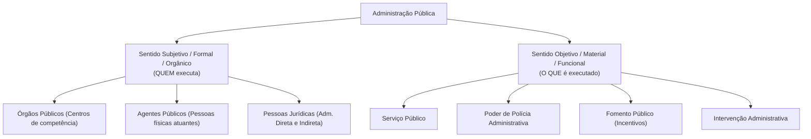
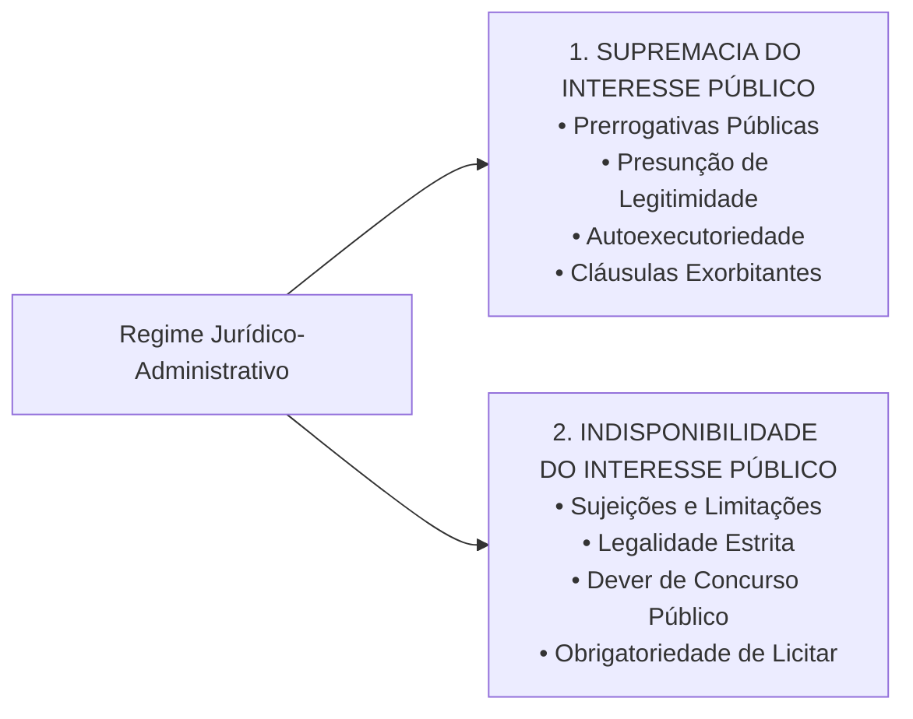
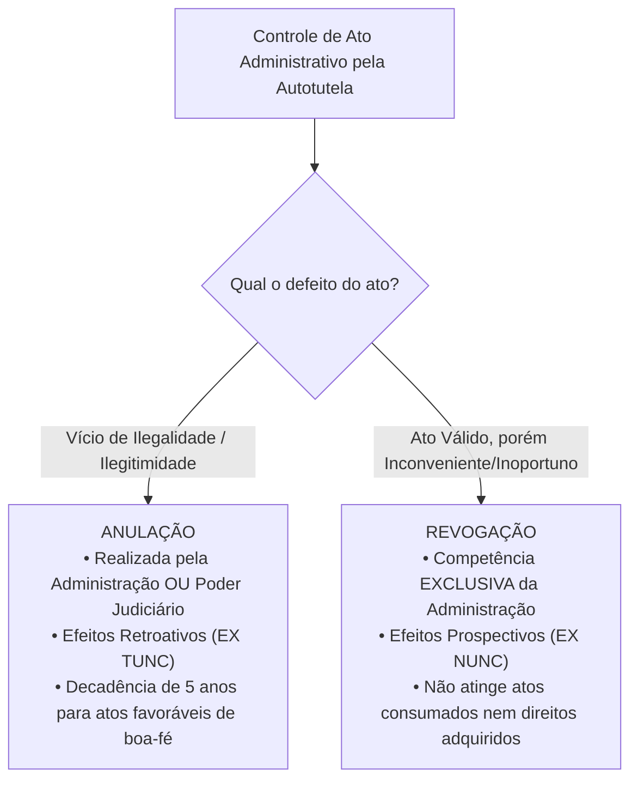

# 01 - Regime Jurídico Administrativo, Princípios e LINDB

> **Matéria:** Noções de Direito Administrativo  
> **Cargo:** A01 – Técnico de Controle Externo – Especialidade: Técnico Administrativo  
> **Arquivo:** `01_regime_juridico_principios_e_lindb.md`  

---

## 📌 Ementa / Itens do Edital
- Administração Pública: conceito, sentidos subjetivo/orgânico e objetivo/material
- Regime jurídico-administrativo: supremacia e indisponibilidade do interesse público
- Princípios constitucionais expressos: Legalidade, Impessoalidade, Moralidade, Publicidade e Eficiência (LIMPE - CF/88, art. 37, *caput*)
- Princípios administrativos implícitos/reconhecidos: Razoabilidade, Proporcionalidade, Segurança Jurídica, Continuidade dos Serviços Públicos, Autotutela (Súmulas 346 e 473 do STF) e Motivação
- Lei de Introdução às normas do Direito Brasileiro (LINDB - Decreto-Lei nº 4.657/1942 com redação dada pela Lei nº 12.376/2010 e alterações da Lei nº 13.655/2018, artigos 20 a 30) e sua aplicação na Administração Pública
- Responsabilização do agente público segundo o Decreto Federal nº 9.830/2019 e a LINDB (erro grosseiro e dolo)

---

---

## 🧭 Sumário

1. [Conceito e Sentidos de Administração Pública](#1-conceito-e-sentidos-de-administracao-publica)
    1. [Sentido Subjetivo, Formal ou Orgânico](#11-sentido-subjetivo-formal-ou-organico)
    2. [Sentido Objetivo, Material ou Funcional](#12-sentido-objetivo-material-ou-funcional)
    3. [Critérios Distintivos Adotados pela FCC](#13-criterios-distintivos-adotados-pela-fcc)
    4. [Teste 001](#Teste-001)
2. [O Regime Jurídico-Administrativo e sua Bipolaridade Fundamental](#2-o-regime-juridico-administrativo-e-sua-bipolaridade-fundamental)
    1. [Princípio da Supremacia do Interesse Público sobre o Privado](#21-principio-da-supremacia-do-interesse-publico-sobre-o-privado)
    2. [Princípio da Indisponibilidade do Interesse Público](#22-principio-da-indisponibilidade-do-interesse-publico)
    3. [Interesse Público Primário vs. Secundário](#23-interesse-publico-primario-vs-secundario)
    4. [Teste 002](#Teste-002)
3. [Princípios Constitucionais Expressos (Art. 37, caput, CF/88 - LIMPE)](#3-principios-constitucionais-expressos-art-37-caput-cf88-limpe)
    1. [Princípio da Legalidade Estrita](#31-principio-da-legalidade-estrita)
    2. [Princípio da Impessoalidade e a Vedação à Promoção Pessoal](#32-principio-da-impessoalidade-e-a-vedacao-a-promocao-pessoal)
    3. [Princípio da Moralidade e a Súmula Vinculante nº 13 (Antinepotismo)](#33-principio-da-moralidade-e-a-sumula-vinculante-no-13-antinepotismo)
    4. [Princípio da Publicidade e suas Exceções Constitucionais](#34-principio-da-publicidade-e-suas-excecoes-constitucionais)
    5. [Princípio da Eficiência (Emenda Constitucional nº 19/1998)](#35-principio-da-eficiencia-emenda-constitucional-no-191998)
    6. [Teste 003](#Teste-003)
    7. [Teste 004](#Teste-004)
    8. [Teste 005](#Teste-005)
    9. [Teste 006](#Teste-006)
4. [Princípios Administrativos Implícitos e Regime Sumular](#4-principios-administrativos-implicitos-e-regime-sumular)
    1. [Razoabilidade e Proporcionalidade](#41-razoabilidade-e-proporcionalidade)
    2. [Segurança Jurídica e Proteção à Confiança Legítima](#42-seguranca-juridica-e-protecao-a-confianca-legitima)
    3. [Princípio da Autotutela (Súmulas 346 e 473 do STF): Anulação vs. Revogação](#43-principio-da-autotutela-sumulas-346-e-473-do-stf-anulacao-vs-revogacao)
    4. [Princípio da Motivação e a Teoria dos Motivos Determinantes](#44-principio-da-motivacao-e-a-teoria-dos-motivos-determinantes)
    5. [Princípio da Continuidade dos Serviços Públicos](#45-principio-da-continuidade-dos-servicos-publicos)
    6. [Teste 007](#Teste-007)
    7. [Teste 008](#Teste-008)
    8. [Teste 009](#Teste-009)
5. [O Direito Público Positivo da LINDB (Arts. 20 a 30) e o Controle Externo](#5-o-direito-publico-positivo-da-lindb-arts-20-a-30-e-o-controle-externo)
    1. [Consequencialismo Jurídico e Vedação de Valores Abstratos (Art. 20)](#51-consequencialismo-juridico-e-vedacao-de-valores-abstratos-art-20)
    2. [Obstáculos Reais e Circunstâncias Práticas do Gestor (Art. 22)](#52-obstaculos-reais-e-circunstancias-praticas-do-gestor-art-22)
    3. [Responsabilização por Dolo ou Erro Grosseiro (Art. 28 da LINDB c/c Dec. 9.830/2019)](#53-responsabilizacao-por-dolo-ou-erro-grosseiro-art-28-da-lindb-cc-dec-98302019)
    4. [Segurança Jurídica, Transição e Vedação à Retroatividade (Arts. 23 e 24)](#54-seguranca-juridica-transicao-e-vedacao-a-retroatividade-arts-23-e-24)
    5. [Teste 010](#Teste-010)
    6. [Teste 011](#Teste-011)
6. [Fontes Recomendadas na Internet](#6-fontes-recomendadas-na-internet)

---

## 1. Conceito e Sentidos de Administração Pública

O Direito Administrativo brasileiro não se encontra codificado em um único diploma legal, fundando-se na Constituição da República de 1988, em leis esparsas e em construções doutrinárias e pretorianas consolidadas. O conceito de **Administração Pública** desdobra-se em dois sentidos complementares de fundamental relevância para as provas da Fundação Carlos Chagas (FCC):

### 1.1 Sentido Subjetivo, Formal ou Orgânico

Sob o enfoque **subjetivo, formal ou orgânico**, a Administração Pública define o complexo estrutural de **sujeitos de direito, órgãos e agentes** encarregados pelo ordenamento de exercer a função administrativa. 

- Responde à indagação: **"QUEM exerce a função administrativa?"**
- No ordenamento brasileiro, adota-se o critério estritamente formal: integram a Administração Pública em sentido subjetivo **exclusivamente os órgãos e entidades aos quais a lei confere tal condição** (União, Estados, DF, Municípios, suas autarquias, fundações públicas, empresas públicas e sociedades de economia mista). Particulares em colaboração com o poder público (concessionárias, permissionárias e organizações sociais) exercem atividade administrativa, mas **não integram a Administração Pública em sentido formal**.

### 1.2 Sentido Objetivo, Material ou Funcional

Sob o prisma **objetivo, material ou funcional**, a Administração Pública corresponde ao conjunto das **atividades e funções substantivas** tipicamente administrativas executadas pelo Estado.

- Responde à indagação: **"O QUE é executado pela máquina pública?"**
- Abrange classicamente quatro atividades administrativas basilares:
    1. **Serviço Público:** Prestação direta ou indireta de utilidades e comodidades materiais fruíveis individualmente pelos cidadãos (ex.: transporte coletivo, fornecimento de energia, saúde, saneamento básico).
    2. **Polícia Administrativa:** Restrições e condicionamentos impostos a direitos e liberdades individuais e ao uso da propriedade privada em prol do bem-estar coletivo (ex.: fiscalização sanitária, ambiental, trânsito e posturas urbanas).
    3. **Fomento Público:** Estímulo estatal protetivo à iniciativa privada de interesse social sem assunção direta da atividade (concessão de incentivos fiscais, subvenções econômicas e convênios com o terceiro setor).
    4. **Intervenção:** Atuação regulatória no domínio econômico ou sobre a propriedade privada (desapropriações, tombamentos, servidões administrativas).

### 1.3 Critérios Distintivos Adotados pela FCC

| Critério Distintivo | Sentido Subjetivo / Orgânico / Formal | Sentido Objetivo / Material / Funcional |
| :--- | :--- | :--- |
| **Pergunta-Guia** | *Quem realiza a atividade?* | *Qual atividade é realizada?* |
| **Composição** | Pessoas jurídicas, órgãos e agentes públicos da Administração Direta e Indireta | Serviços públicos, polícia administrativa, fomento e intervenção |
| **Grafia Típica** | Grafado com iniciais maiúsculas (**A**dministração **P**ública) | Grafado frequentemente com iniciais minúsculas (**a**dministração pública) |
| **Delegação a Particulares** | Não se transfere a entes delegatários privados | É transferido a concessionários e permissionários |

---

## 2. O Regime Jurídico-Administrativo e sua Bipolaridade Fundamental

O **Regime Jurídico-Administrativo** é o conjunto harmônico de princípios e regras de Direito Público que colocam a Administração Pública em posição especial perante os administrados, conferindo-lhe prerrogativas extraordinárias, ao mesmo tempo em que lhe impõe severas restrições.

Conforme consagrado pela doutrina de Celso Antônio Bandeira de Mello, o regime administrativo estrutura-se sobre dois pilares axiológicos fundamentais (bipolaridade do direito administrativo):

### 2.1 Princípio da Supremacia do Interesse Público sobre o Privado

Fundamenta a concessão de **prerrogativas e privilégios estatais** (*poderes de império*). Em situações de conflito genuíno entre o interesse particular e o interesse coletivo, este último deve prevalecer:

- *Manifestações Práticas:* Presunção de legitimidade e veracidade dos atos administrativos; autoexecutoriedade das decisões do poder de polícia; cláusulas exorbitantes nos contratos administrativos (como rescisão unilateral e alteração unilateral do objeto); e intervenção do Estado na propriedade particular mediante desapropriação e requisição administrativa.

### 2.2 Princípio da Indisponibilidade do Interesse Público

Representa o contrapeso democrático às prerrogativas estatais, corporificando as **sujeições e limitações administrativas**. O administrador público não é o proprietário dos bens e interesses que gere; atua como mero curador e gestor fiduciário do patrimônio do povo.

- *Manifestações Práticas:* Submissão inafastável ao princípio da legalidade estrita; obrigatoriedade de realização de concurso público para provimento de cargos efetivos (art. 37, II, CF); dever inegociável de licitar para obras, compras e serviços (art. 37, XXI, CF); dever de prestar contas aos Tribunais de Contas; e impossibilidade de renúncia graciosa a receitas tributárias ou concessão arbitrária de privilégios a particulares.

### 2.3 Interesse Público Primário vs. Secundário

A jurisprudência do STF e do STJ acolhe expressamente a distinção doutrinária entre:

- **Interesse Público Primário:** É o interesse real da coletividade como um todo (justiça social, saúde pública, educação, segurança). É o único verdadeiramente supremo e indisponível.
- **Interesse Público Secundário:** É o interesse patrimonial e fazendário do próprio aparelho estatal como pessoa jurídica (arrecadar mais tributos, evitar condenações judiciais pecuniárias, economizar recursos a qualquer custo). 
> ⚠️ **Alerta FCC:** O interesse público secundário só é legítimo quando coincide plenamente com o interesse primário da sociedade. Caso o Estado viole direitos fundamentais de cidadãos apenas para auferir vantagem financeira aos cofres públicos, tal ato configura ilicitude e desvio de finalidade.

---

## 3. Princípios Constitucionais Expressos (Art. 37, caput, CF/88 - LIMPE)

O art. 37, *caput*, da Constituição Federal estabelece os cinco princípios expressos de observância obrigatória pela Administração Pública direta e indireta de qualquer dos Poderes da União, dos Estados, do Distrito Federal e dos Municípios:

### 3.1 Princípio da Legalidade Estrita

Enquanto o particular goza da **autonomia da vontade** e da legalidade ampla, podendo fazer tudo o que a lei não proíba (art. 5º, II, CF/88), o administrador público rege-se pela **legalidade estrita**: só pode agir e praticar atos quando houver prévia e expressa autorização ou determinação em lei (*subordinação estrita à lei*). O ato administrativo sem amparo legal é nulo de pleno direito.

### 3.2 Princípio da Impessoalidade e a Vedação à Promoção Pessoal

O princípio da impessoalidade possui triplo desdobramento no âmbito dos concursos:

1. **Finalidade Pública:** Todo ato administrativo deve visar ao atendimento do interesse público genérico e à finalidade específica prevista na lei para a respectiva competência. A busca de vingança pessoal ou favorecimento a correligionários gera nulidade por *desvio de finalidade* (ou desvio de poder).
2. **Isonomia e Tratamento Neutro:** Proibição de concessão de privilégios ou perseguições arbitrárias. É a base axiológica do concurso público e da licitação.
3. **Vedação à Promoção Pessoal (Art. 37, § 1º, CF/88):** A publicidade dos atos, programas, obras, serviços e campanhas dos órgãos públicos deve possuir caráter estritamente educativo, informativo ou de orientação social, **dela não podendo constar nomes, símbolos, slogans ou imagens que caracterizem promoção pessoal de autoridades ou servidores públicos**.
    - *Teoria do Órgão (Imputação Volitiva):* Os atos praticados pelos agentes públicos são juridicamente imputados ao órgão ou pessoa jurídica estatal a que pertencem, e não à pessoa física do agente. Logo, quem realiza a obra é a "Secretaria de Saúde do Estado de Goiás", e não o "Secretário Fulano".

### 3.3 Princípio da Moralidade e a Súmula Vinculante nº 13 (Antinepotismo)

Exige conduta pautada pela boa-fé objetiva, honestidade, lealdade, decência e probidade. O ato administrativo pode atender rigorosamente à literalidade da lei, mas ser manifestamente nulo se contaminado por torpeza, favorecimento antiético ou imoralidade administrativa.

#### A Súmula Vinculante nº 13 do Supremo Tribunal Federal:
A moralidade e a impessoalidade fundamentam o teor da **Súmula Vinculante nº 13**, que proíbe o nepotismo no serviço público brasileiro:
> *"A nomeação de cônjuge, companheiro ou parente em linha reta, colateral ou por afinidade, até o terceiro grau, inclusive, da autoridade nomeante ou de servidor da mesma pessoa jurídica investido em cargo de direção, chefia ou assessoramento, para o exercício de cargo em comissão ou de confiança ou, ainda, de função gratificada na administração pública direta e indireta em qualquer dos poderes da União, dos Estados, do Distrito Federal e dos Municípios, compreendido o ajuste mediante designações recíprocas (nepotismo cruzado), viola a Constituição Federal."*

- **Graus de Parentesco Atingidos:**
    - *1º Grau:* Pais, mães, filhos, filhas (consanguíneos); sogro, sogra, genro, nora (afins).
    - *2º Grau:* Avós, netos, **irmãos** (consanguíneos); cunhados (afins).
    - *3º Grau:* Tios, sobrinhos (consanguíneos).
- **Ressalva Jurisprudencial Consolidada (Cargos Políticos):** O STF firmou tese de que a SV nº 13 **não incide de forma automática e absoluta sobre cargos de natureza política** (ex.: Ministros de Estado, Secretários Estaduais e Secretários Municipais). Contudo, a nomeação de parente para cargo político será considerada inválida pelo Judiciário/Tribunal de Contas se comprovada a manifesta ausência de qualificação técnica para a função ou caracterizado patente desvio de finalidade (fraude à lei).

### 3.4 Princípio da Publicidade e suas Exceções Constitucionais

A publicidade exige que a atuação estatal seja transparente, acessível e cognoscível aos cidadãos e órgãos de controle externo. 

- A publicação oficial é **requisito de eficácia** (aptidão para produzir efeitos jurídicos) e de **exigibilidade** dos atos administrativos que criam obrigações para terceiros ou geram despesas públicas; não é requisito de validade intrínseca do ato.
- **Exceções Constitucionais Estritas:** A própria CF/88 ressalva o sigilo apenas nas hipóteses de **segurança do Estado e da sociedade** e de proteção inafastável à **intimidade, honra e vida privada** das pessoas (art. 5º, incisos X, XXXIII e LX).

### 3.5 Princípio da Eficiência (Emenda Constitucional nº 19/1998)

Inserido formalmente no rol do art. 37 pela Reforma Administrativa (EC nº 19/1998), impõe à Administração o dever de obter o melhor rendimento funcional, presteza, perfeição técnica, celeridade na tramitação e economicidade, maximizando os resultados com o menor dispêndio possível de recursos públicos.

- *Desdobramentos Constitucionais Práticos:* Avaliação especial de desempenho para aquisição da estabilidade do servidor (art. 41, § 4º, CF); perda do cargo público por avaliação periódica de desempenho (art. 41, § 1º, III, CF); e fixação de metas de desempenho institucional mediante contratos de gestão (art. 37, § 8º, CF).

---

### Teste 001
**(FGV – TCE/GO – 2024 – Analista de Controle Externo - Jurídica)**
Rosangela é servidora pública do Estado de Goiás, ocupando cargo efetivo, e atua em Jataí/GO. Em seu contracheque constam diversas parcelas e Rosangela está em dúvida sobre a forma de cálculo da contribuição previdenciária. Das parcelas abaixo, retiradas do contracheque de Rosangela, marque aquela sobre a qual haverá recolhimento de contribuição previdenciária da servidora em comento.

* **A)** Diárias para viagens.
* **B)** Gratificação natalina.
* **C)** Ajuda de custo.
* **D)** Auxílio-alimentação.
* **E)** Abono de permanência.

---

> **Comentário Detalhado:**
>
> - **A)** **Incorreta.** A opção apresenta proposição em desacordo com os fundamentos teóricos e técnicos do tópico ao afirmar que "Diárias para viagens". De acordo com a teoria estudada em *A Súmula Vinculante nº 13 do Supremo Tribunal Federal:*, ressalva Jurisprudencial Consolidada (Cargos Políticos): O STF firmou tese de que a SV nº 13 não incide de forma automática e absoluta sobre cargos de natureza política (ex.: Ministros de Estado, Secretários Estaduais e Secretários Municipais). Contudo, a nomeação de parente para cargo político será considerada inválida pelo Judiciário/Tribunal de Contas se comprovada a manifesta ausência de qualificação técnica para a função ou caracterizado patente desvio de finalidade (fraude à lei).
> - **B)** **Correta.** Conforme fundamentado na seção *2.2 Princípio da Indisponibilidade do Interesse Público* deste guia, representa o contrapeso democrático às prerrogativas estatais, corporificando as sujeições e limitações administrativas. O administrador público não é o proprietário dos bens e interesses que gere; atua como mero curador e gestor fiduciário do patrimônio do povo. Dessa forma, está plenamente correta a assertiva da banca (FGV – TCE/GO/2024) ao estabelecer que "Gratificação natalina".
> - **C)** **Incorreta.** A opção apresenta proposição em desacordo com os fundamentos teóricos e técnicos do tópico ao afirmar que "Ajuda de custo". De acordo com a teoria estudada em *2.3 Interesse Público Primário vs. Secundário*, interesse Público Secundário: É o interesse patrimonial e fazendário do próprio aparelho estatal como pessoa jurídica (arrecadar mais tributos, evitar condenações judiciais pecuniárias, economizar recursos a qualquer custo).
> - **D)** **Incorreta.** A opção apresenta proposição em desacordo com os fundamentos teóricos e técnicos do tópico ao afirmar que "Auxílio alimentação". De acordo com a teoria estudada em *3.2 Princípio da Impessoalidade e a Vedação à Promoção Pessoal*, teoria do Órgão (Imputação Volitiva): Os atos praticados pelos agentes públicos são juridicamente imputados ao órgão ou pessoa jurídica estatal a que pertencem, e não à pessoa física do agente. Logo, quem realiza a obra é a "Secretaria de Saúde do Estado de Goiás", e não o "Secretário Fulano".
> - **E)** **Incorreta.** A opção apresenta proposição em desacordo com os fundamentos teóricos e técnicos do tópico ao afirmar que "Abono de permanência". De acordo com a teoria estudada em *4. Princípios Administrativos Implícitos e Regime Sumular*, além dos cinco princípios expressos no art. 37 da CF, o ordenamento constitucional e a legislação infraconstitucional (como a Lei do Processo Administrativo Federal nº 9.784/1999 e a Lei Estadual de Goiás nº 13.800/2001) consagram princípios implícitos de aplicação cogente.
>
> **Gabarito: B**

---

### Teste 002
**(FGV – TCE/GO – 2024 – Analista de Controle Externo - Tecnologia da Informação)**
Durante a execução de um contrato de prestação de serviços de TI, celebrado por uma autarquia federal, observou-se que o fornecedor não está cumprindo com os níveis estabelecidos nas Cláusulas de Nível de Serviço (SLA). Para resolver o problema, a administração deve

* **A)** emitir notificação formal ao fornecedor para que seja realizada uma auditoria técnica imediata e ajustes necessários.
* **B)** cancelar imediatamente o contrato, sem aviso formal, com aplicação de penalidades, visto que o serviço não atende às expectativas.
* **C)** cancelar o contrato com o fornecedor para evitar mais consequências, uma vez que as métricas de SLA são apenas diretrizes, não obrigatórias.
* **D)** reportar e aguardar que as falhas, para maior eficácia e esperar que sejam ajustadas no próximo ciclo de renovação contratual automática.
* **E)** reduzir o pagamento proporcionalmente ao período não conforme, independente do contrato, com comunicação formal ao fornecedor.

---

> **Comentário Detalhado:**
>
> - **A)** **Correta.** Conforme fundamentado na seção *4.5 Princípio da Continuidade dos Serviços Públicos* deste guia, limites Legítimos de Suspensão (Lei nº 8.987/1995, art. 6º, § 3º): O serviço pode ser suspenso após aviso prévio formal ao usuário por. Dessa forma, está plenamente correta a assertiva da banca (FGV – TCE/GO/2024) ao estabelecer que "emitir notificação formal ao fornecedor para que seja realizada uma auditoria técnica imediata e ajustes...".
> - **B)** **Incorreta.** A opção apresenta proposição em desacordo com os fundamentos teóricos e técnicos do tópico ao afirmar que "cancelar imediatamente o contrato, sem aviso formal, com aplicação de penalidades, visto que o serviço não atende...". De acordo com a teoria estudada em *1.2 Sentido Objetivo, Material ou Funcional*, serviço Público: Prestação direta ou indireta de utilidades e comodidades materiais fruíveis individualmente pelos cidadãos (ex.: transporte coletivo, fornecimento de energia, saúde, saneamento básico).
> - **C)** **Incorreta.** A opção incorre em restrição indevida ao limitar o escopo conceitual ao afirmar que "cancelar o contrato com o fornecedor para evitar mais consequências, uma vez que as métricas de SLA são apenas...". De acordo com a teoria estudada em *2.3 Interesse Público Primário vs. Secundário*, interesse Público Secundário: É o interesse patrimonial e fazendário do próprio aparelho estatal como pessoa jurídica (arrecadar mais tributos, evitar condenações judiciais pecuniárias, economizar recursos a qualquer custo).
> - **D)** **Incorreta.** A opção apresenta proposição em desacordo com os fundamentos teóricos e técnicos do tópico ao afirmar que "reportar e aguardar que as falhas, para maior eficácia e esperar que sejam ajustadas no próximo ciclo de renovação...". De acordo com a teoria estudada em *A Súmula Vinculante nº 13 do Supremo Tribunal Federal:*, ressalva Jurisprudencial Consolidada (Cargos Políticos): O STF firmou tese de que a SV nº 13 não incide de forma automática e absoluta sobre cargos de natureza política (ex.: Ministros de Estado, Secretários Estaduais e Secretários Municipais). Contudo, a nomeação de parente para cargo político será considerada inválida pelo Judiciário/Tribunal de Contas se comprovada a manifesta ausência de qualificação técnica para a função ou caracterizado patente desvio de finalidade (fraude à lei).
> - **E)** **Incorreta.** A opção apresenta proposição em desacordo com os fundamentos teóricos e técnicos do tópico ao afirmar que "reduzir o pagamento proporcionalmente ao período não conforme, independente do contrato, com comunicação formal ao...". De acordo com a teoria estudada em *5.1 Consequencialismo Jurídico e Vedação de Valores Abstratos (Art. 20)*, é vedado ao auditor ou julgador do Tribunal de Contas anular um contrato ou paralisar uma obra pública invocando fórmulas genéricas como "ofensa ao interesse público" ou "afronta à moralidade" sem motivar analiticamente os impactos socioeconômicos, os prejuízos à população e a viabilidade de alternativas de regularização.
>
> **Gabarito: A**

---

### Teste 003
**(FGV – TCE/GO – 2024 – Analista de Controle Externo - Tecnologia da Informação)**
Uma empresa pública contratou serviços de desenvolvimento de software, estabelecendo no contrato cláusulas de nível de serviço (SLA) com penalidade e especificações claras sobre o produto final, assim como condições para o seu aceite. Ao final do prazo, a empresa percebeu que o produto final não atendia integralmente às especificações técnicas acordadas. Visando proteger os interesses da empresa e o funcionamento do software, indique a medida correta que protege os interesses da empresa e o funcionamento do software.

* **A)** Dispensar o pagamento de penalidades, considerando que houve bastante trabalho feito pela contratada, e esperar uma nova versão.
* **B)** Exigir a revisão do produto sem custos adicionais, baseando-se nas cláusulas de nível de serviço estipuladas.
* **C)** Celebrar novos termos aditivos para nova versão do software, independente do aceite da contratada, para estender o prazo, visto que houve esforço por parte da contratada.
* **D)** Aceitar o produto como está, evitando conflitos judiciais e futuras complicações administrativas.
* **E)** Rescindir o contrato imediatamente, aplicando as máximas penalidades possíveis devido ao não cumprimento das especificações.

---

> **Comentário Detalhado:**
>
> - **A)** **Incorreta.** A opção apresenta proposição em desacordo com os fundamentos teóricos e técnicos do tópico ao afirmar que "Dispensar o pagamento de penalidades, considerando que houve bastante trabalho feito pela contratada, e esperar...". De acordo com a teoria estudada em *5.4 Segurança Jurídica, Transição e Vedação à Retroatividade (Arts. 23 e 24)*, vedação à Retroatividade de Nova Orientação Geral (Art. 24): A revisão judicial, administrativa ou controladora sobre a validade de atos, contratos ou processos já consumados levará em conta as orientações gerais vigentes à época. É expressamente proibido declarar inválidas situações consolidadas com amparo na orientação pretérita com base em mudança jurisprudencial posterior.
> - **B)** **Correta.** Conforme fundamentado na seção *4.5 Princípio da Continuidade dos Serviços Públicos* deste guia, limites Legítimos de Suspensão (Lei nº 8.987/1995, art. 6º, § 3º): O serviço pode ser suspenso após aviso prévio formal ao usuário por. Dessa forma, está plenamente correta a assertiva da banca (FGV – TCE/GO/2024) ao estabelecer que "Exigir a revisão do produto sem custos adicionais, baseando se nas cláusulas de nível de serviço estipuladas".
> - **C)** **Incorreta.** A opção apresenta proposição em desacordo com os fundamentos teóricos e técnicos do tópico ao afirmar que "Celebrar novos termos aditivos para nova versão do software, independente do aceite da contratada, para estender o...". De acordo com a teoria estudada em *2. O Regime Jurídico-Administrativo e sua Bipolaridade Fundamental*, rJA Sup["1. SUPREMACIA DO INTERESSE PÚBLICO<br/ • Prerrogativas Públicas<br/ • Presunção de Legitimidade<br/ • Autoexecutoriedade<br/ • Cláusulas Exorbitantes"].
> - **D)** **Incorreta.** A opção apresenta proposição em desacordo com os fundamentos teóricos e técnicos do tópico ao afirmar que "Aceitar o produto como está, evitando conflitos judiciais e futuras complicações administrativas". De acordo com a teoria estudada em *2.1 Princípio da Supremacia do Interesse Público sobre o Privado*, manifestações Práticas: Presunção de legitimidade e veracidade dos atos administrativos; autoexecutoriedade das decisões do poder de polícia; cláusulas exorbitantes nos contratos administrativos (como rescisão unilateral e alteração unilateral do objeto); e intervenção do Estado na propriedade particular mediante desapropriação e requisição administrativa.
> - **E)** **Incorreta.** A opção apresenta proposição em desacordo com os fundamentos teóricos e técnicos do tópico ao afirmar que "Rescindir o contrato imediatamente, aplicando as máximas penalidades possíveis devido ao não cumprimento das...". De acordo com a teoria estudada em *5.1 Consequencialismo Jurídico e Vedação de Valores Abstratos (Art. 20)*, é vedado ao auditor ou julgador do Tribunal de Contas anular um contrato ou paralisar uma obra pública invocando fórmulas genéricas como "ofensa ao interesse público" ou "afronta à moralidade" sem motivar analiticamente os impactos socioeconômicos, os prejuízos à população e a viabilidade de alternativas de regularização.
>
> **Gabarito: B**

---

### Teste 004
**(FGV – TRT 1ª – 2024 – Analista Judiciário - Área Administrativa)**
Um ordenador de despesa antecipou o pagamento de diárias para um grupo de servidores de um Tribunal Regional Federal participar de atividades de treinamento a serem realizadas em outro estado na semana seguinte. No momento da liberação dos recursos, há o cumprimento do(s) seguinte(s) estágio(s) da despesa pública:

* **A)** pagamento;
* **B)** empenho e liquidação;
* **C)** empenho e pagamento;
* **D)** liquidação e pagamento;
* **E)** empenho, liquidação e pagamento.

---

> **Comentário Detalhado:**
>
> - **A)** **Incorreta.** A opção apresenta proposição em desacordo com os fundamentos teóricos e técnicos do tópico ao afirmar que "pagamento". De acordo com a teoria estudada em *5.2 Obstáculos Reais e Circunstâncias Práticas do Gestor (Art. 22)*, na fiscalização de conformidade, os órgãos de controle externo devem contextualizar a conjuntura histórica e fática da tomada de decisão. Devem sopesar a escassez de recursos orçamentários, as falhas de infraestrutura, a urgência imposta por calamidades e o quadro pessoal deficiente do órgão no momento da prática do ato.
> - **B)** **Incorreta.** A opção apresenta proposição em desacordo com os fundamentos teóricos e técnicos do tópico ao afirmar que "empenho e liquidação". De acordo com a teoria estudada em *3.2 Princípio da Impessoalidade e a Vedação à Promoção Pessoal*, vedação à Promoção Pessoal (Art. 37, § 1º, CF/88): A publicidade dos atos, programas, obras, serviços e campanhas dos órgãos públicos deve possuir caráter estritamente educativo, informativo ou de orientação social, dela não podendo constar nomes, símbolos, slogans ou imagens que caracterizem promoção pessoal de autoridades ou servidores públicos.
> - **C)** **Correta.** Conforme fundamentado na seção *4.5 Princípio da Continuidade dos Serviços Públicos* deste guia, inadimplemento contratual do usuário, ressalvadas unidades públicas essenciais (hospitais e postos de saúde não podem ter o fornecimento de energia desligado por falta de pagamento). Dessa forma, está plenamente correta a assertiva da banca (FGV – TRT 1ª/2024) ao estabelecer que "empenho e pagamento".
> - **D)** **Incorreta.** A opção apresenta proposição em desacordo com os fundamentos teóricos e técnicos do tópico ao afirmar que "liquidação e pagamento". De acordo com a teoria estudada em *1.2 Sentido Objetivo, Material ou Funcional*, sob o prisma objetivo, material ou funcional, a Administração Pública corresponde ao conjunto das atividades e funções substantivas tipicamente administrativas executadas pelo Estado.
> - **E)** **Incorreta.** A opção apresenta proposição em desacordo com os fundamentos teóricos e técnicos do tópico ao afirmar que "empenho, liquidação e pagamento". De acordo com a teoria estudada em *1.2 Sentido Objetivo, Material ou Funcional*, abrange classicamente quatro atividades administrativas basilares.
>
> **Gabarito: C**

---

### Teste 005
**(FGV – TRF/1 – 2024 – Analista Judiciario Area Apoio Especializado Especialidade Suporte Em Tecnologia Da Informacao)**
João tem um emprego público na área administrativa da sociedade de economia mista federal Alfa, que explora atividade econômica em sentido estrito. Acresça-se que Alfa não recebe recursos públicos para o pagamento de suas despesas de custeio. Ao analisar se, à luz da Constituição da República, poderia vir a ter, de modo simultâneo, outro emprego público em sociedade de economia mista, João concluiu corretamente que é:

* **A)** vedada a acumulação pretendida;
* **B)** permitida a acumulação, independentemente de qualquer condicionante;
* **C)** vedada a acumulação, salvo se houver compatibilidade de horários na jornada de trabalho dos dois empregos;
* **D)** permitida a acumulação, desde que a soma de ambas as remunerações não ultrapasse o teto constitucional;
* **E)** permitida a acumulação, desde que as sociedades de economia mista estejam vinculadas a entes diversos.

---

> **Comentário Detalhado:**
>
> - **A)** **Correta.** Conforme fundamentado na seção *1.1 Sentido Subjetivo, Formal ou Orgânico* deste guia, no ordenamento brasileiro, adota se o critério estritamente formal: integram a Administração Pública em sentido subjetivo exclusivamente os órgãos e entidades aos quais a lei confere tal condição (União, Estados, DF, Municípios, suas autarquias, fundações públicas, empresas públicas e sociedades de economia mista). Particulares em colaboração com o poder público (concessionárias, permissionárias e organizações sociais) exercem atividade administrativa, mas não integram a Administração Pública em sentido formal. Dessa forma, está plenamente correta a assertiva da banca (FGV – TRF/1/2024) ao estabelecer que "vedada a acumulação pretendida".
> - **B)** **Incorreta.** A opção promove generalização excessiva que desconsidera as condições técnicas e normativas ao afirmar que "permitida a acumulação, independentemente de qualquer condicionante". De acordo com a teoria estudada em *2.3 Interesse Público Primário vs. Secundário*, interesse Público Secundário: É o interesse patrimonial e fazendário do próprio aparelho estatal como pessoa jurídica (arrecadar mais tributos, evitar condenações judiciais pecuniárias, economizar recursos a qualquer custo).
> - **C)** **Incorreta.** A opção apresenta proposição em desacordo com os fundamentos teóricos e técnicos do tópico ao afirmar que "vedada a acumulação, salvo se houver compatibilidade de horários na jornada de trabalho dos dois empregos". De acordo com a teoria estudada em *1. Conceito e Sentidos de Administração Pública*, o Direito Administrativo brasileiro não se encontra codificado em um único diploma legal, fundando se na Constituição da República de 1988, em leis esparsas e em construções doutrinárias e pretorianas consolidadas. O conceito de Administração Pública desdobra se em dois sentidos complementares de fundamental relevância para as provas da Fundação Carlos Chagas (FCC).
> - **D)** **Incorreta.** A opção apresenta proposição em desacordo com os fundamentos teóricos e técnicos do tópico ao afirmar que "permitida a acumulação, desde que a soma de ambas as remunerações não ultrapasse o teto constitucional". De acordo com a teoria estudada em *6. Fontes Recomendadas na Internet*, texto constitucional oficial com as regras basilares da Administração Pública (LIMPE), concurso público, publicidade institucional e teto remuneratório.
> - **E)** **Incorreta.** A opção apresenta proposição em desacordo com os fundamentos teóricos e técnicos do tópico ao afirmar que "permitida a acumulação, desde que as sociedades de economia mista estejam vinculadas a entes diversos". De acordo com a teoria estudada em *1.3 Critérios Distintivos Adotados pela FCC*, delegação a Particulares: Não se transfere a entes delegatários privados — É transferido a concessionários e permissionários.
>
> **Gabarito: A**

---

### Teste 006
**(FGV – TCE/PA – 2024 – Auditor de Controle Externo - Administrativa - Engenharia Telecomunicação)**
Na execução de um processo licitatório, o valor global de um serviço de engenharia a ser contratado por uma empresa pública foi de R$ 500.000,00 (quinhentos mil reais). As propostas apresentadas na licitação, em milhares de reais, são mostradas na tabela abaixo: Licitante Valor Global I 240,00 II 420,00 III 480,00 IV 450,00 V 270,00 De acordo com a Lei nº 13.303, de 2016, é correto afirmar que a vencedora do certame foi a empresa

* **A)** I.
* **B)** II.
* **C)** III.
* **D)** IV.
* **E)** V.

---

> **Comentário Detalhado:**
>
> - **A)** **Incorreta.** A opção apresenta proposição em desacordo com os fundamentos teóricos e técnicos do tópico ao afirmar que "I". De acordo com a teoria estudada em *4. Princípios Administrativos Implícitos e Regime Sumular*, além dos cinco princípios expressos no art. 37 da CF, o ordenamento constitucional e a legislação infraconstitucional (como a Lei do Processo Administrativo Federal nº 9.784/1999 e a Lei Estadual de Goiás nº 13.800/2001) consagram princípios implícitos de aplicação cogente.
> - **B)** **Correta.** Conforme fundamentado na seção *4.5 Princípio da Continuidade dos Serviços Públicos* deste guia, limites Legítimos de Suspensão (Lei nº 8.987/1995, art. 6º, § 3º): O serviço pode ser suspenso após aviso prévio formal ao usuário por. Dessa forma, está plenamente correta a assertiva da banca (FGV – TCE/PA/2024) ao estabelecer que "II".
> - **C)** **Incorreta.** A opção apresenta proposição em desacordo com os fundamentos teóricos e técnicos do tópico ao afirmar que "III". De acordo com a teoria estudada em *3.5 Princípio da Eficiência (Emenda Constitucional nº 19/1998)*, desdobramentos Constitucionais Práticos: Avaliação especial de desempenho para aquisição da estabilidade do servidor (art. 41, § 4º, CF); perda do cargo público por avaliação periódica de desempenho (art. 41, § 1º, III, CF); e fixação de metas de desempenho institucional mediante contratos de gestão (art. 37, § 8º, CF).
> - **D)** **Incorreta.** A opção apresenta proposição em desacordo com os fundamentos teóricos e técnicos do tópico ao afirmar que "IV". De acordo com a teoria estudada em *3.3 Princípio da Moralidade e a Súmula Vinculante nº 13 (Antinepotismo)*, exige conduta pautada pela boa fé objetiva, honestidade, lealdade, decência e probidade. O ato administrativo pode atender rigorosamente à literalidade da lei, mas ser manifestamente nulo se contaminado por torpeza, favorecimento antiético ou imoralidade administrativa.
> - **E)** **Incorreta.** A opção apresenta proposição em desacordo com os fundamentos teóricos e técnicos do tópico ao afirmar que "V". De acordo com a teoria estudada em *5.3 Responsabilização por Dolo ou Erro Grosseiro (Art. 28 da LINDB c/c Dec. 9.830/2019)*, responsabilidade Subjetiva: O servidor público ou parecerista técnico somente pode ser punido pessoalmente (com multas, sanções funcionais ou obrigação de ressarcir o erário) caso tenha atuado com dolo (intenção deliberada de descumprir a lei ou lesar o patrimônio) ou erro grosseiro (culpa grave inescusável).
>
> **Gabarito: B**

---

### Teste 007
**(FGV – TCE/PA – 2024 – Auditor de Controle Externo - Administrativa - Gestão Governamental)**
Observe o trecho descritivo abaixo, que tem por objeto um personagem de uma cidade interiorana: ’Seu Paulo’ era um mineiro já de alguma idade, que já havia trabalhado em São Paulo como motorista, mas agora era um faz- tudo em Lavras. Tinha bom humor, gostava muito de conversar e, na minha pequena propriedade, fazia as pequenas tarefas agrícolas diárias, como limpar o terreno, botar água nas plantas e tirar pragas que surgissem na grama. Essa pequena descrição

* **A)** procura identificar o personagem por meio de seus traços físicos.
* **B)** destaca sobretudo os traços psíquicos do personagem.
* **C)** mostra traços físicos e psíquicos do personagem.
* **D)** descreve o personagem em diversas épocas, procurando valorizá-lo.
* **E)** indica somente características sociais do personagem descrito, mostrando-o como símbolo do interiorano.

---

> **Comentário Detalhado:**
>
> - **A)** **Incorreta.** A opção apresenta proposição em desacordo com os fundamentos teóricos e técnicos do tópico ao afirmar que "procura identificar o personagem por meio de seus traços físicos". De acordo com a teoria estudada em *4.1 Razoabilidade e Proporcionalidade*, adequação: O meio escolhido deve ser apto a alcançar o objetivo público.
> - **B)** **Correta.** Conforme fundamentado na seção *2.1 Princípio da Supremacia do Interesse Público sobre o Privado* deste guia, manifestações Práticas: Presunção de legitimidade e veracidade dos atos administrativos; autoexecutoriedade das decisões do poder de polícia; cláusulas exorbitantes nos contratos administrativos (como rescisão unilateral e alteração unilateral do objeto); e intervenção do Estado na propriedade particular mediante desapropriação e requisição administrativa. Dessa forma, está plenamente correta a assertiva da banca (FGV – TCE/PA/2024) ao estabelecer que "destaca sobretudo os traços psíquicos do personagem".
> - **C)** **Incorreta.** A opção apresenta proposição em desacordo com os fundamentos teóricos e técnicos do tópico ao afirmar que "mostra traços físicos e psíquicos do personagem". De acordo com a teoria estudada em *4.1 Razoabilidade e Proporcionalidade*, exigem equilíbrio, bom senso, coerência e adequação entre os meios empregados pelo Estado e os fins pretendidos pela lei, vedando restrições desmedidas ou sacrifícios inúteis impostos aos administrados.
> - **D)** **Incorreta.** A opção apresenta proposição em desacordo com os fundamentos teóricos e técnicos do tópico ao afirmar que "descreve o personagem em diversas épocas, procurando valorizá lo". De acordo com a teoria estudada em *4.4 Princípio da Motivação e a Teoria dos Motivos Determinantes*, teoria dos Motivos Determinantes: A validade do ato administrativo fica estritamente vinculada à veracidade e pertinência dos motivos fáticos declarados pela autoridade competente. Se a Administração fundamentar a exoneração de um servidor comissionado aduzindo escassez orçamentária, e restar documentalmente comprovado que havia saldo orçamentário excedente, o ato de desligamento será declarado nulo por falsidade do motivo, mesmo que a lei não exigisse motivação obrigatória para a referida exoneração.
> - **E)** **Incorreta.** A opção incorre em restrição indevida ao limitar o escopo conceitual ao afirmar que "indica somente características sociais do personagem descrito, mostrando o como símbolo do interiorano". De acordo com a teoria estudada em *1.1 Sentido Subjetivo, Formal ou Orgânico*, no ordenamento brasileiro, adota se o critério estritamente formal: integram a Administração Pública em sentido subjetivo exclusivamente os órgãos e entidades aos quais a lei confere tal condição (União, Estados, DF, Municípios, suas autarquias, fundações públicas, empresas públicas e sociedades de economia mista). Particulares em colaboração com o poder público (concessionárias, permissionárias e organizações sociais) exercem atividade administrativa, mas não integram a Administração Pública em sentido formal.
>
> **Gabarito: B**

---

### Teste 008
**(FGV – TCE/PI – 2025 – Auditor de Controle Externo - Controle Externo - Específica de Área Comum)**
Em razão da prática de ato danoso ao erário, o TCE-PI aplicou multa e imputou débito a João, gestor de uma autarquia de município jurisdicionado àquela Corte de Contas. A decisão do TCE-PI que resultou na imputação de débito a João tem natureza de

* **A)** dívida ativa.
* **B)** dívida tributária.
* **C)** decisão jurisdicional.
* **D)** título de crédito judicial.
* **E)** título executivo extrajudicial.

---

> **Comentário Detalhado:**
>
> - **A)** **Incorreta.** A opção apresenta proposição em desacordo com os fundamentos teóricos e técnicos do tópico ao afirmar que "dívida ativa". De acordo com a teoria estudada em *5.2 Obstáculos Reais e Circunstâncias Práticas do Gestor (Art. 22)*, na fiscalização de conformidade, os órgãos de controle externo devem contextualizar a conjuntura histórica e fática da tomada de decisão. Devem sopesar a escassez de recursos orçamentários, as falhas de infraestrutura, a urgência imposta por calamidades e o quadro pessoal deficiente do órgão no momento da prática do ato.
> - **B)** **Incorreta.** A opção apresenta proposição em desacordo com os fundamentos teóricos e técnicos do tópico ao afirmar que "dívida tributária". De acordo com a teoria estudada em *A Súmula Vinculante nº 13 do Supremo Tribunal Federal:*, ressalva Jurisprudencial Consolidada (Cargos Políticos): O STF firmou tese de que a SV nº 13 não incide de forma automática e absoluta sobre cargos de natureza política (ex.: Ministros de Estado, Secretários Estaduais e Secretários Municipais). Contudo, a nomeação de parente para cargo político será considerada inválida pelo Judiciário/Tribunal de Contas se comprovada a manifesta ausência de qualificação técnica para a função ou caracterizado patente desvio de finalidade (fraude à lei).
> - **C)** **Incorreta.** A opção apresenta proposição em desacordo com os fundamentos teóricos e técnicos do tópico ao afirmar que "decisão jurisdicional". De acordo com a teoria estudada em *Enunciado da Súmula 473 do STF:*, ato["Controle de Ato Administrativo pela Autotutela"] Decisao{"Qual o defeito do ato?"}.
> - **D)** **Incorreta.** A opção apresenta proposição em desacordo com os fundamentos teóricos e técnicos do tópico ao afirmar que "título de crédito judicial". De acordo com a teoria estudada em *5.1 Consequencialismo Jurídico e Vedação de Valores Abstratos (Art. 20)*, "Art. 20. Nas esferas administrativa, controladora e judicial, não se decidirá com base em valores jurídicos abstratos sem que sejam consideradas as consequências práticas da decisão.".
> - **E)** **Correta.** Conforme fundamentado na seção *Enunciado da Súmula 473 do STF:* deste guia, autoridade Competente: Administração Pública (autotutela) ou Poder Judiciário — Exclusiva da própria Administração (Judiciário não revoga ato do Executivo). Dessa forma, está plenamente correta a assertiva da banca (FGV – TCE/PI/2025) ao estabelecer que "título executivo extrajudicial".
>
> **Gabarito: E**

---

### Teste 009
**(FGV – TCE/PI – 2025 – Auditor de Controle Externo - Controle Externo - Específica de Área Comum)**
Pedro é empregado em uma sociedade empresária localizada em Teresina/PI desde 2021. No contracheque de Pedro há diversas parcelas especificando o que ele recebe. De acordo com a norma de regência, assinale a opção que contempla dois direitos recebidos por Pedro sobre os quais não haverá incidência de contribuição previdenciária.

* **A)** Diárias para viagem e 13º salário.
* **B)** Cessão de direitos autorais e vale-cultura.
* **C)** Férias indenizadas e remuneração auferida.
* **D)** Gorjetas e vale-transporte, na forma da legislação.
* **E)** Participação nos lucros da empresa e adiantamento decorrentes de reajuste salarial.

---

> **Comentário Detalhado:**
>
> - **A)** **Incorreta.** A opção apresenta proposição em desacordo com os fundamentos teóricos e técnicos do tópico ao afirmar que "Diárias para viagem e 13º salário". De acordo com a teoria estudada em *1.2 Sentido Objetivo, Material ou Funcional*, polícia Administrativa: Restrições e condicionamentos impostos a direitos e liberdades individuais e ao uso da propriedade privada em prol do bem estar coletivo (ex.: fiscalização sanitária, ambiental, trânsito e posturas urbanas).
> - **B)** **Correta.** Conforme fundamentado na seção *2.3 Interesse Público Primário vs. Secundário* deste guia, ⚠️ Alerta FCC: O interesse público secundário só é legítimo quando coincide plenamente com o interesse primário da sociedade. Caso o Estado viole direitos fundamentais de cidadãos apenas para auferir vantagem financeira aos cofres públicos, tal ato configura ilicitude e desvio de finalidade. Dessa forma, está plenamente correta a assertiva da banca (FGV – TCE/PI/2025) ao estabelecer que "Cessão de direitos autorais e vale cultura".
> - **C)** **Incorreta.** A opção apresenta proposição em desacordo com os fundamentos teóricos e técnicos do tópico ao afirmar que "Férias indenizadas e remuneração auferida". De acordo com a teoria estudada em *Enunciado da Súmula 473 do STF:*, "A administração pode anular seus próprios atos, quando eivados de vícios que os tornam ilegais, porque deles não se originam direitos; ou revogá los, por motivo de conveniência ou oportunidade, respeitados os direitos adquiridos, e ressalvada, em todos os casos, a apreciação judicial.".
> - **D)** **Incorreta.** A opção apresenta proposição em desacordo com os fundamentos teóricos e técnicos do tópico ao afirmar que "Gorjetas e vale transporte, na forma da legislação". De acordo com a teoria estudada em *1.2 Sentido Objetivo, Material ou Funcional*, serviço Público: Prestação direta ou indireta de utilidades e comodidades materiais fruíveis individualmente pelos cidadãos (ex.: transporte coletivo, fornecimento de energia, saúde, saneamento básico).
> - **E)** **Incorreta.** A opção apresenta proposição em desacordo com os fundamentos teóricos e técnicos do tópico ao afirmar que "Participação nos lucros da empresa e adiantamento decorrentes de reajuste salarial". De acordo com a teoria estudada em *4.1 Razoabilidade e Proporcionalidade*, proporcionalidade em Sentido Estrito: Os benefícios auferidos pela medida devem superar os ônus decorrentes da intervenção estatal.
>
> **Gabarito: B**

---

### Teste 010
**(FGV – TCE/SC – 2026 – Auditor Fiscal de Controle Externo - Administração)**
A Lei de Acesso à Informação (LAI – Lei nº 12.527/2011) estabelece os procedimentos a serem observados pelos órgãos e entidades públicas, com a finalidade de garantir o acesso dos cidadãos às informações produzidas ou custodiadas pelo Estado. Um cidadão formulou pedido de acesso a documentos relacionados a contrato firmado por autarquia federal, sem apresentar qualquer justificativa para a solicitação. O órgão, por sua vez, indeferiu o pedido sob o argumento de que a ausência de motivação pelo requerente impediria a análise da pertinência do acesso. Com base na LAI, assinale a afirmativa correta.

* **A)** O indeferimento foi correto, pois a LAI exige que o requerente indique as razões do pedido de acesso à informação, permitindo ao órgão avaliar a pertinência e a finalidade da solicitação antes de conceder o acesso.
* **B)** O indeferimento foi correto apenas em relação a contratos que envolvam informações de caráter pessoal de terceiros, hipótese em que a LAI exige motivação expressa do requerente para fins de ponderação entre o direito de acesso e a proteção de dados.
* **C)** O indeferimento foi incorreto, pois a LAI veda expressamente a exigência de motivação como condição para o pedido de acesso à informação, sendo suficiente a identificação do requerente, e as informações contratuais de entidades públicas enquadram-se como informações de transparência ativa obrigatória.
* **D)** O indeferimento foi incorreto quanto à ausência de motivação, mas seria válido caso o contrato envolvesse valores acima do limite legal, hipótese em que a LAI autoriza a classificação das informações contratuais como sigilosas.
* **E)** O indeferimento foi incorreto, pois a LAI dispensa até mesmo a identificação do requerente para fins de pedido de acesso à informação, bastando a formalização da solicitação pelo canal oficial do órgão.

---

> **Comentário Detalhado:**
>
> - **A)** **Incorreta.** A opção apresenta proposição em desacordo com os fundamentos teóricos e técnicos do tópico ao afirmar que "O indeferimento foi correto, pois a LAI exige que o requerente indique as razões do pedido de acesso à informação...". De acordo com a teoria estudada em *4.4 Princípio da Motivação e a Teoria dos Motivos Determinantes*, teoria dos Motivos Determinantes: A validade do ato administrativo fica estritamente vinculada à veracidade e pertinência dos motivos fáticos declarados pela autoridade competente. Se a Administração fundamentar a exoneração de um servidor comissionado aduzindo escassez orçamentária, e restar documentalmente comprovado que havia saldo orçamentário excedente, o ato de desligamento será declarado nulo por falsidade do motivo, mesmo que a lei não exigisse motivação obrigatória para a referida exoneração.
> - **B)** **Incorreta.** A opção incorre em restrição indevida ao limitar o escopo conceitual ao afirmar que "O indeferimento foi correto apenas em relação a contratos que envolvam informações de caráter pessoal de...". De acordo com a teoria estudada em *4.2 Segurança Jurídica e Proteção à Confiança Legítima*, vedação à Aplicação Retroativa: O art. 2º, parágrafo único, inciso XIII, da Lei nº 9.784/1999 veda peremptoriamente a aplicação retroativa de nova interpretação jurídica para alcançar atos pretéritos já consolidados sob a orientação anterior.
> - **C)** **Correta.** Conforme fundamentado na seção *1.1 Sentido Subjetivo, Formal ou Orgânico* deste guia, no ordenamento brasileiro, adota se o critério estritamente formal: integram a Administração Pública em sentido subjetivo exclusivamente os órgãos e entidades aos quais a lei confere tal condição (União, Estados, DF, Municípios, suas autarquias, fundações públicas, empresas públicas e sociedades de economia mista). Particulares em colaboração com o poder público (concessionárias, permissionárias e organizações sociais) exercem atividade administrativa, mas não integram a Administração Pública em sentido formal. Dessa forma, está plenamente correta a assertiva da banca (FGV – TCE/SC/2026) ao estabelecer que "O indeferimento foi incorreto, pois a LAI veda expressamente a exigência de motivação como condição para o pedido...".
> - **D)** **Incorreta.** A opção apresenta proposição em desacordo com os fundamentos teóricos e técnicos do tópico ao afirmar que "O indeferimento foi incorreto quanto à ausência de motivação, mas seria válido caso o contrato envolvesse valores...". De acordo com a teoria estudada em *5.1 Consequencialismo Jurídico e Vedação de Valores Abstratos (Art. 20)*, é vedado ao auditor ou julgador do Tribunal de Contas anular um contrato ou paralisar uma obra pública invocando fórmulas genéricas como "ofensa ao interesse público" ou "afronta à moralidade" sem motivar analiticamente os impactos socioeconômicos, os prejuízos à população e a viabilidade de alternativas de regularização.
> - **E)** **Incorreta.** A opção afasta requisito ou relação estrutural exigida pela matéria ao afirmar que "O indeferimento foi incorreto, pois a LAI dispensa até mesmo a identificação do requerente para fins de pedido de...". De acordo com a teoria estudada em *3.4 Princípio da Publicidade e suas Exceções Constitucionais*, a publicação oficial é requisito de eficácia (aptidão para produzir efeitos jurídicos) e de exigibilidade dos atos administrativos que criam obrigações para terceiros ou geram despesas públicas; não é requisito de validade intrínseca do ato.
>
> **Gabarito: C**

---

## 4. Princípios Administrativos Implícitos e Regime Sumular

Além dos cinco princípios expressos no art. 37 da CF, o ordenamento constitucional e a legislação infraconstitucional (como a Lei do Processo Administrativo Federal nº 9.784/1999 e a Lei Estadual de Goiás nº 13.800/2001) consagram princípios implícitos de aplicação cogente:

### 4.1 Razoabilidade e Proporcionalidade

Exigem equilíbrio, bom senso, coerência e adequação entre os meios empregados pelo Estado e os fins pretendidos pela lei, vedando restrições desmedidas ou sacrifícios inúteis impostos aos administrados.

- **Tripé da Proporcionalidade:**
    1. *Adequação:* O meio escolhido deve ser apto a alcançar o objetivo público.
    2. *Necessidade (Exigibilidade):* Entre os meios aptos, deve-se eleger o que cause menor gravame ao cidadão (*vedação de excesso*).
    3. *Proporcionalidade em Sentido Estrito:* Os benefícios auferidos pela medida devem superar os ônus decorrentes da intervenção estatal.

### 4.2 Segurança Jurídica e Proteção à Confiança Legítima

Visa garantir a estabilidade das relações jurídicas constituídas e proteger a confiança dos administrados perante as condutas e orientações da Administração.

- *Vedação à Aplicação Retroativa:* O art. 2º, parágrafo único, inciso XIII, da Lei nº 9.784/1999 veda peremptoriamente a aplicação retroativa de nova interpretação jurídica para alcançar atos pretéritos já consolidados sob a orientação anterior.
- *Prazo Decadencial da Autotutela:* Fixação do prazo decadencial de **5 anos** para que a Administração anule atos administrativos favoráveis aos administrados praticados de boa-fé (art. 54 da Lei 9.784/99 e art. 54 da Lei Estadual/GO 13.800/2001).

### 4.3 Princípio da Autotutela (Súmulas 346 e 473 do STF): Anulação vs. Revogação

O princípio da autotutela assegura à Administração Pública o poder-dever de controlar diretamente seus próprios atos, revendo-os quanto à legalidade ou ao mérito, sem necessidade de autorização judicial prévia.

#### Enunciado da Súmula 473 do STF:
> *"A administração pode anular seus próprios atos, quando eivados de vícios que os tornam ilegais, porque deles não se originam direitos; ou revogá-los, por motivo de conveniência ou oportunidade, respeitados os direitos adquiridos, e ressalvada, em todos os casos, a apreciação judicial."*

| Dimensão | Anulação de Ato Administrativo | Revogação de Ato Administrativo |
| :--- | :--- | :--- |
| **Fundamento Central** | **Ilegalidade / Ilegitimidade** (vício formal ou material de validade) | **Inconveniência ou Inoportunidade** (razões de mérito) |
| **Autoridade Competente** | **Administração Pública** (autotutela) ou **Poder Judiciário** | **Exclusiva da própria Administração** (Judiciário não revoga ato do Executivo) |
| **Efeitos no Tempo** | **Retroativos (*ex tunc*)**, apagando os efeitos desde a origem | **Prospectivos (*ex nunc*)**, preservando os efeitos já produzidos |
| **Limites Temporais** | Prazo decadencial de **5 anos** para atos benéficos ao cidadão de boa-fé | Não há prazo pré-fixado, respeitados atos consumados e direito adquirido |
| **Garantia Processual** | Exige contraditório e ampla defesa prévios se atingir direito de terceiros | Exige contraditório e ampla defesa se atingir direito constituído |

### 4.4 Princípio da Motivação e a Teoria dos Motivos Determinantes

A motivação consiste na exposição explícita, por escrito, das razões de fato e dos fundamentos de direito que justificam a prática do ato administrativo.

- **Teoria dos Motivos Determinantes:** A validade do ato administrativo fica estritamente vinculada à veracidade e pertinência dos motivos fáticos declarados pela autoridade competente. Se a Administração fundamentar a exoneração de um servidor comissionado aduzindo escassez orçamentária, e restar documentalmente comprovado que havia saldo orçamentário excedente, o ato de desligamento será declarado nulo por falsidade do motivo, mesmo que a lei não exigisse motivação obrigatória para a referida exoneração.

### 4.5 Princípio da Continuidade dos Serviços Públicos

Os serviços públicos representam a prestação material de necessidades indeclináveis da sociedade, não podendo sofrer interrupções imotivadas ou abruptas.

- *Limites Legítimos de Suspensão (Lei nº 8.987/1995, art. 6º, § 3º):* O serviço pode ser suspenso após aviso prévio formal ao usuário por:
    1. Razões de ordem técnica ou de segurança das instalações;
    2. Inadimplemento contratual do usuário, ressalvadas unidades públicas essenciais (hospitais e postos de saúde não podem ter o fornecimento de energia desligado por falta de pagamento).

---

## 5. O Direito Público Positivo da LINDB (Arts. 20 a 30) e o Controle Externo

A Lei de Introdução às Normas do Direito Brasileiro (LINDB - Decreto-Lei nº 4.657/1942), com as alterações introduzidas pela Lei nº 13.655/2018 e regulamentadas pelo Decreto Federal nº 9.830/2019, inaugurou uma nova fase de pragmatismo, segurança jurídica e racionalidade no Direito Administrativo sancionador e nas decisões dos Tribunais de Contas.

### 5.1 Consequencialismo Jurídico e Vedação de Valores Abstratos (Art. 20)

> *"Art. 20. Nas esferas administrativa, controladora e judicial, não se decidirá com base em valores jurídicos abstratos sem que sejam consideradas as consequências práticas da decisão."*

- É vedado ao auditor ou julgador do Tribunal de Contas anular um contrato ou paralisar uma obra pública invocando fórmulas genéricas como "ofensa ao interesse público" ou "afronta à moralidade" sem motivar analiticamente os impactos socioeconômicos, os prejuízos à população e a viabilidade de alternativas de regularização.

### 5.2 Obstáculos Reais e Circunstâncias Práticas do Gestor (Art. 22)

> *"Art. 22. Na interpretação de normas sobre gestão pública, serão considerados os obstáculos e as dificuldades reais do gestor e as exigências das políticas públicas a seu cargo, sem prejuízo dos direitos dos administrados."*

- Na fiscalização de conformidade, os órgãos de controle externo devem contextualizar a conjuntura histórica e fática da tomada de decisão. Devem sopesar a escassez de recursos orçamentários, as falhas de infraestrutura, a urgência imposta por calamidades e o quadro pessoal deficiente do órgão no momento da prática do ato.

### 5.3 Responsabilização por Dolo ou Erro Grosseiro (Art. 28 da LINDB c/c Dec. 9.830/2019)

> *"Art. 28. O agente público responderá pessoalmente por suas decisões ou opiniões técnicas em caso de dolo ou erro grosseiro."*

- **Responsabilidade Subjetiva:** O servidor público ou parecerista técnico somente pode ser punido pessoalmente (com multas, sanções funcionais ou obrigação de ressarcir o erário) caso tenha atuado com **dolo** (intenção deliberada de descumprir a lei ou lesar o patrimônio) ou **erro grosseiro** (culpa grave inescusável).
- **Conceito de Erro Grosseiro (Decreto nº 9.830/2019, art. 12):** Considera-se erro grosseiro aquele manifesto, evidente e inescusável praticado com culpa grave, caracterizado por ação ou omissão com elevado grau de negligência, imprudência ou imperícia, demonstrando desprezo ostensivo às regras elementares de cautela que um profissional com diligência média adotaria nas mesmas circunstâncias fáticas.

> 🚨 **ALERTA CRÍTICO DE PROVA FCC:**  
> A divergência interpretativa razoável de lei, jurisprudência ou norma técnica entre o corpo técnico do Tribunal de Contas e o gestor **JAMAIS configura erro grosseiro**. Para impor sanção ao administrador, é indispensável que a acusação comprove desídia grave, negligência crassa ou dolo!

### 5.4 Segurança Jurídica, Transição e Vedação à Retroatividade (Arts. 23 e 24)

- **Regime de Transição (Art. 23):** Decisão que estabelece nova interpretação ou novo dever deve prever período de transição quando indispensável para que o novo dever seja cumprido de modo proporcional e sem caos operacional.
- **Vedação à Retroatividade de Nova Orientação Geral (Art. 24):** A revisão judicial, administrativa ou controladora sobre a validade de atos, contratos ou processos já consumados levará em conta as **orientações gerais vigentes à época**. É expressamente proibido declarar inválidas situações consolidadas com amparo na orientação pretérita com base em mudança jurisprudencial posterior.

---

## 6. Fontes Recomendadas na Internet

- [Constituição Federal de 1988 - Art. 37 (Princípios Constitucionais da Administração Pública)](https://www.planalto.gov.br/ccivil_03/constituicao/constituicao.htm#art37)  
  Texto constitucional oficial com as regras basilares da Administração Pública (LIMPE), concurso público, publicidade institucional e teto remuneratório.
- [Lei de Introdução às Normas do Direito Brasileiro (LINDB Compilada - Arts. 20 a 30)](https://www.planalto.gov.br/ccivil_03/decreto-lei/del4657compilado.htm)  
  Dispositivos introduzidos pela Lei nº 13.655/2018 disciplinando o consequencialismo jurídico, a segurança jurídica e a responsabilização por dolo ou erro grosseiro.
- [Lei Federal nº 13.655/2018 (Segurança Jurídica e Eficiência na Aplicação do Direito Público)](https://www.planalto.gov.br/ccivil_03/_ato2015-2018/2018/lei/l13655.htm)  
  Diploma legal que inseriu os artigos 20 a 30 na LINDB para balizar a atuação das esferas administrativa, controladora e judicial.
- [Decreto Federal nº 9.830/2019 (Regulamento dos Arts. 20 a 30 da LINDB)](https://www.planalto.gov.br/ccivil_03/_ato2019-2022/2019/decreto/d9830.htm)  
  Regulamentação que conceitua formalmente erro grosseiro, dolo, compromisso processual, motivação consequencialista e regime de transição.
- [Súmula Vinculante nº 13 do STF (Vedação ao Nepotismo)](https://portal.stf.jus.br/jurisprudencia/sumarios/sumulavinculante.asp?seq=13)  
  Precedentes e teor oficial da vedação ao nepotismo direto e cruzado na administração direta e indireta de todos os Poderes.
- [Súmula 473 do STF (Princípio da Autotutela Administrativa)](https://portal.stf.jus.br/jurisprudencia/sumarios/sumula.asp?seq=473)  
  Enunciado consolidado sobre o poder-dever de anulação de atos ilegais e a revogação de atos válidos por conveniência e oportunidade.
* DI PIETRO, Maria Sylvia Zanella. **Direito Administrativo**. 37. ed. Rio de Janeiro: Forense, 2024. (Cap. 3 - Regime Jurídico Administrativo e Princípios da Administração Pública).
* CARVALHO FILHO, José dos Santos. **Manual de Direito Administrativo**. 38. ed. Barueri: Atlas, 2024. (Cap. 1 - Introdução ao Direito Administrativo e Princípios Administrativos).
* MELLO, Celso Antônio Bandeira de. **Curso de Direito Administrativo**. 37. ed. Belo Horizonte: Fórum, 2024. (Cap. 2 - O Regime Jurídico-Administrativo: Supremacia e Indisponibilidade do Interesse Público).
