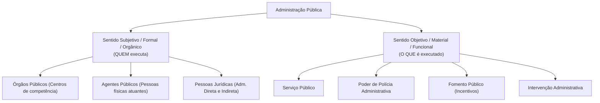
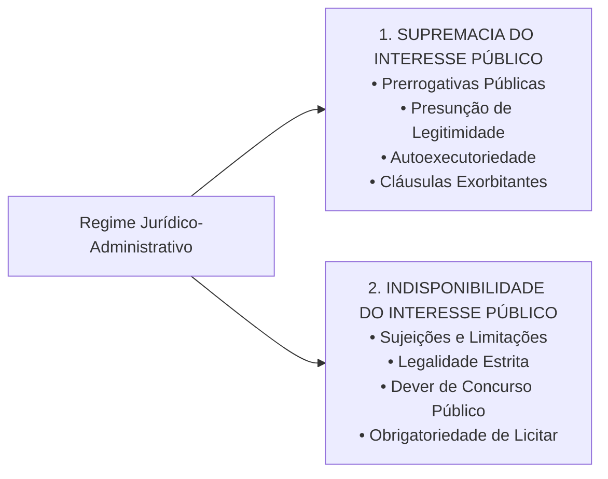
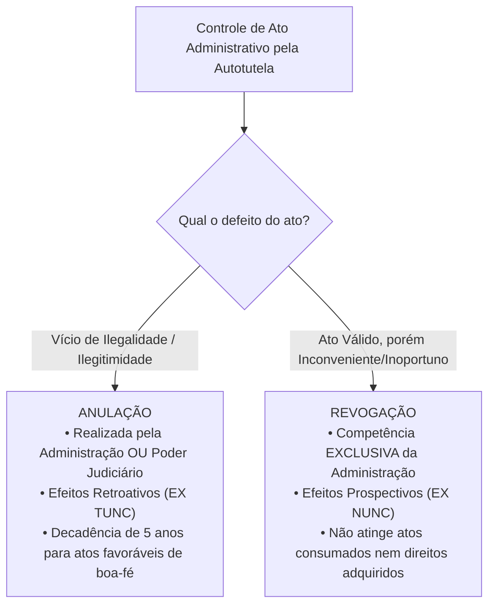

# 01 - Regime Jurídico Administrativo, Princípios e LINDB

> **Matéria:** Noções de Direito Administrativo  
> **Cargo:** A01 – Técnico de Controle Externo – Especialidade: Técnico Administrativo  
> **Arquivo:** `01_regime_juridico_principios_e_lindb.md`  

---

## 📌 Ementa / Itens do Edital
- Administração Pública: conceito, sentidos subjetivo/orgânico e objetivo/material
- Regime jurídico-administrativo: supremacia e indisponibilidade do interesse público
- Princípios constitucionais expressos: Legalidade, Impessoalidade, Moralidade, Publicidade e Eficiência (LIMPE - CF/88, art. 37, *caput*)
- Princípios administrativos implícitos/reconhecidos: Razoabilidade, Proporcionalidade, Segurança Jurídica, Continuidade dos Serviços Públicos, Autotutela (Súmulas 346 e 473 do STF) e Motivação
- Lei de Introdução às normas do Direito Brasileiro (LINDB - Decreto-Lei nº 4.657/1942 com redação dada pela Lei nº 12.376/2010 e alterações da Lei nº 13.655/2018, artigos 20 a 30) e sua aplicação na Administração Pública
- Responsabilização do agente público segundo o Decreto Federal nº 9.830/2019 e a LINDB (erro grosseiro e dolo)

---

---

## 🧭 Sumário

1. [Conceito e Sentidos de Administração Pública](#1-conceito-e-sentidos-de-administracao-publica)
    1. [Sentido Subjetivo, Formal ou Orgânico](#11-sentido-subjetivo-formal-ou-organico)
    2. [Sentido Objetivo, Material ou Funcional](#12-sentido-objetivo-material-ou-funcional)
    3. [Critérios Distintivos Adotados pela FCC](#13-criterios-distintivos-adotados-pela-fcc)
    4. [Teste 001](#Teste-001)
2. [O Regime Jurídico-Administrativo e sua Bipolaridade Fundamental](#2-o-regime-juridico-administrativo-e-sua-bipolaridade-fundamental)
    1. [Princípio da Supremacia do Interesse Público sobre o Privado](#21-principio-da-supremacia-do-interesse-publico-sobre-o-privado)
    2. [Princípio da Indisponibilidade do Interesse Público](#22-principio-da-indisponibilidade-do-interesse-publico)
    3. [Interesse Público Primário vs. Secundário](#23-interesse-publico-primario-vs-secundario)
    4. [Teste 002](#Teste-002)
3. [Princípios Constitucionais Expressos (Art. 37, caput, CF/88 - LIMPE)](#3-principios-constitucionais-expressos-art-37-caput-cf88-limpe)
    1. [Princípio da Legalidade Estrita](#31-principio-da-legalidade-estrita)
    2. [Princípio da Impessoalidade e a Vedação à Promoção Pessoal](#32-principio-da-impessoalidade-e-a-vedacao-a-promocao-pessoal)
    3. [Princípio da Moralidade e a Súmula Vinculante nº 13 (Antinepotismo)](#33-principio-da-moralidade-e-a-sumula-vinculante-no-13-antinepotismo)
    4. [Princípio da Publicidade e suas Exceções Constitucionais](#34-principio-da-publicidade-e-suas-excecoes-constitucionais)
    5. [Princípio da Eficiência (Emenda Constitucional nº 19/1998)](#35-principio-da-eficiencia-emenda-constitucional-no-191998)
    6. [Teste 003](#Teste-003)
    7. [Teste 004](#Teste-004)
    8. [Teste 005](#Teste-005)
    9. [Teste 006](#Teste-006)
4. [Princípios Administrativos Implícitos e Regime Sumular](#4-principios-administrativos-implicitos-e-regime-sumular)
    1. [Razoabilidade e Proporcionalidade](#41-razoabilidade-e-proporcionalidade)
    2. [Segurança Jurídica e Proteção à Confiança Legítima](#42-seguranca-juridica-e-protecao-a-confianca-legitima)
    3. [Princípio da Autotutela (Súmulas 346 e 473 do STF): Anulação vs. Revogação](#43-principio-da-autotutela-sumulas-346-e-473-do-stf-anulacao-vs-revogacao)
    4. [Princípio da Motivação e a Teoria dos Motivos Determinantes](#44-principio-da-motivacao-e-a-teoria-dos-motivos-determinantes)
    5. [Princípio da Continuidade dos Serviços Públicos](#45-principio-da-continuidade-dos-servicos-publicos)
    6. [Teste 007](#Teste-007)
    7. [Teste 008](#Teste-008)
    8. [Teste 009](#Teste-009)
5. [O Direito Público Positivo da LINDB (Arts. 20 a 30) e o Controle Externo](#5-o-direito-publico-positivo-da-lindb-arts-20-a-30-e-o-controle-externo)
    1. [Consequencialismo Jurídico e Vedação de Valores Abstratos (Art. 20)](#51-consequencialismo-juridico-e-vedacao-de-valores-abstratos-art-20)
    2. [Obstáculos Reais e Circunstâncias Práticas do Gestor (Art. 22)](#52-obstaculos-reais-e-circunstancias-praticas-do-gestor-art-22)
    3. [Responsabilização por Dolo ou Erro Grosseiro (Art. 28 da LINDB c/c Dec. 9.830/2019)](#53-responsabilizacao-por-dolo-ou-erro-grosseiro-art-28-da-lindb-cc-dec-98302019)
    4. [Segurança Jurídica, Transição e Vedação à Retroatividade (Arts. 23 e 24)](#54-seguranca-juridica-transicao-e-vedacao-a-retroatividade-arts-23-e-24)
    5. [Teste 010](#Teste-010)
    6. [Teste 011](#Teste-011)
6. [Fontes Recomendadas na Internet](#6-fontes-recomendadas-na-internet)

---

## 1. Conceito e Sentidos de Administração Pública

O Direito Administrativo brasileiro não se encontra codificado em um único diploma legal, fundando-se na Constituição da República de 1988, em leis esparsas e em construções doutrinárias e pretorianas consolidadas. O conceito de **Administração Pública** desdobra-se em dois sentidos complementares de fundamental relevância para as provas da Fundação Carlos Chagas (FCC):

### 1.1 Sentido Subjetivo, Formal ou Orgânico

Sob o enfoque **subjetivo, formal ou orgânico**, a Administração Pública define o complexo estrutural de **sujeitos de direito, órgãos e agentes** encarregados pelo ordenamento de exercer a função administrativa. 

- Responde à indagação: **"QUEM exerce a função administrativa?"**
- No ordenamento brasileiro, adota-se o critério estritamente formal: integram a Administração Pública em sentido subjetivo **exclusivamente os órgãos e entidades aos quais a lei confere tal condição** (União, Estados, DF, Municípios, suas autarquias, fundações públicas, empresas públicas e sociedades de economia mista). Particulares em colaboração com o poder público (concessionárias, permissionárias e organizações sociais) exercem atividade administrativa, mas **não integram a Administração Pública em sentido formal**.

### 1.2 Sentido Objetivo, Material ou Funcional

Sob o prisma **objetivo, material ou funcional**, a Administração Pública corresponde ao conjunto das **atividades e funções substantivas** tipicamente administrativas executadas pelo Estado.

- Responde à indagação: **"O QUE é executado pela máquina pública?"**
- Abrange classicamente quatro atividades administrativas basilares:
    1. **Serviço Público:** Prestação direta ou indireta de utilidades e comodidades materiais fruíveis individualmente pelos cidadãos (ex.: transporte coletivo, fornecimento de energia, saúde, saneamento básico).
    2. **Polícia Administrativa:** Restrições e condicionamentos impostos a direitos e liberdades individuais e ao uso da propriedade privada em prol do bem-estar coletivo (ex.: fiscalização sanitária, ambiental, trânsito e posturas urbanas).
    3. **Fomento Público:** Estímulo estatal protetivo à iniciativa privada de interesse social sem assunção direta da atividade (concessão de incentivos fiscais, subvenções econômicas e convênios com o terceiro setor).
    4. **Intervenção:** Atuação regulatória no domínio econômico ou sobre a propriedade privada (desapropriações, tombamentos, servidões administrativas).

### 1.3 Critérios Distintivos Adotados pela FCC

| Critério Distintivo | Sentido Subjetivo / Orgânico / Formal | Sentido Objetivo / Material / Funcional |
| :--- | :--- | :--- |
| **Pergunta-Guia** | *Quem realiza a atividade?* | *Qual atividade é realizada?* |
| **Composição** | Pessoas jurídicas, órgãos e agentes públicos da Administração Direta e Indireta | Serviços públicos, polícia administrativa, fomento e intervenção |
| **Grafia Típica** | Grafado com iniciais maiúsculas (**A**dministração **P**ública) | Grafado frequentemente com iniciais minúsculas (**a**dministração pública) |
| **Delegação a Particulares** | Não se transfere a entes delegatários privados | É transferido a concessionários e permissionários |

---

### Teste 001
**(FGV – TJ/SC – 2026 – Analista Administrativo)**
Maria ocupa cargo de primeiro escalão em determinado ente federativo, na condição de Secretária de Estado. As normas afetas à prevenção e ao tratamento do conflito de interesses nesse ente seguem os balizamentos oferecidos pela Lei nº 12.813/2013. Maria pretende exercer determinada atividade privada de cunho econômico. Embora o exercício dessa atividade não seja vedado pelas referidas normas, Maria tem dúvida em relação à sua licitude, pois implicaria na prestação de serviços a pessoas jurídicas que têm interesse em decisões de colegiado administrativo do qual ela participa. Ao analisar a sistemática legal, Maria concluiu corretamente que

* **A)** a ausência de vedação legal ao exercício da atividade afasta a possibilidade de ser configurado o conflito de interesses.
* **B)** o interesse das pessoas jurídicas nas decisões do colegiado de que Maria participe não configura conflito de interesses.
* **C)** o conflito de interesses na situação descrita é afastado, caso Maria esteja em gozo de licença ou em período de afastamento.
* **D)** a situação descrita configura conflito de interesses, devendo ser fiscalizada por Comissão de Ética Pública instituída no âmbito do Poder Executivo do ente federativo ao qual Maria está vinculada.
* **E)** o conflito de interesses somente estará configurado se Maria divulgar ou fizer uso de informações privilegiadas obtidas no exercício funcional, para viabilizar a prestação do serviço para o qual seja contratada. Noções de Informática e Proteção de Dados

---

> **Comentário Detalhado:**
>
> - **A)** **Incorreta.** A opção apresenta proposição em desacordo com os fundamentos teóricos e técnicos do tópico ao afirmar que "a ausência de vedação legal ao exercício da atividade afasta a possibilidade de ser configurado o conflito de...". De acordo com a teoria estudada em *A Súmula Vinculante nº 13 do Supremo Tribunal Federal:*, *"A nomeação de cônjuge, companheiro ou parente em linha reta, colateral ou por afinidade, até o terceiro grau, inclusive, da autoridade nomeante ou de servidor da mesma pessoa jurídica investido em cargo de direção, chefia ou assessoramento, para o exercício de cargo em comissão ou de confiança ou, ainda, de função gratificada na administração pública direta e indireta em qualquer dos poderes da União, dos Estados, do Distrito Federal e dos Municípios, compreendido o ajuste mediante designações recíprocas (nepotismo cruzado), viola a Constituição Federal."*.
> - **B)** **Incorreta.** A opção apresenta proposição em desacordo com os fundamentos teóricos e técnicos do tópico ao afirmar que "o interesse das pessoas jurídicas nas decisões do colegiado de que Maria participe não configura conflito de...". De acordo com a teoria estudada em *1.3 Critérios Distintivos Adotados pela FCC*, composição: Pessoas jurídicas, órgãos e agentes públicos da Administração Direta e Indireta — Serviços públicos, polícia administrativa, fomento e intervenção.
> - **C)** **Incorreta.** A opção apresenta proposição em desacordo com os fundamentos teóricos e técnicos do tópico ao afirmar que "o conflito de interesses na situação descrita é afastado, caso Maria esteja em gozo de licença ou em período de...". De acordo com a teoria estudada em *2.3 Interesse Público Primário vs. Secundário*, caso o Estado viole direitos fundamentais de cidadãos apenas para auferir vantagem financeira aos cofres públicos, tal ato configura ilicitude e desvio de finalidade.
> - **D)** **Correta.** Conforme fundamentado na seção *Enunciado da Súmula 473 do STF:* deste guia, autoridade Competente: Administração Pública (autotutela) ou Poder Judiciário — Exclusiva da própria Administração (Judiciário não revoga ato do Executivo). Dessa forma, está plenamente correta a assertiva da banca (FGV – TJ/SC/2026) ao estabelecer que "a situação descrita configura conflito de interesses, devendo ser fiscalizada por Comissão de Ética Pública...".
> - **E)** **Incorreta.** A opção incorre em restrição indevida ao limitar o escopo conceitual ao afirmar que "o conflito de interesses somente estará configurado se Maria divulgar ou fizer uso de informações privilegiadas...". De acordo com a teoria estudada em *1.2 Sentido Objetivo, Material ou Funcional*, serviço Público: Prestação direta ou indireta de utilidades e comodidades materiais fruíveis individualmente pelos cidadãos (ex.: transporte coletivo, fornecimento de energia, saúde, saneamento básico).
>
> **Gabarito: D**

---

## 2. O Regime Jurídico-Administrativo e sua Bipolaridade Fundamental

O **Regime Jurídico-Administrativo** é o conjunto harmônico de princípios e regras de Direito Público que colocam a Administração Pública em posição especial perante os administrados, conferindo-lhe prerrogativas extraordinárias, ao mesmo tempo em que lhe impõe severas restrições.

Conforme consagrado pela doutrina de Celso Antônio Bandeira de Mello, o regime administrativo estrutura-se sobre dois pilares axiológicos fundamentais (bipolaridade do direito administrativo):

### 2.1 Princípio da Supremacia do Interesse Público sobre o Privado

Fundamenta a concessão de **prerrogativas e privilégios estatais** (*poderes de império*). Em situações de conflito genuíno entre o interesse particular e o interesse coletivo, este último deve prevalecer:

- *Manifestações Práticas:* Presunção de legitimidade e veracidade dos atos administrativos; autoexecutoriedade das decisões do poder de polícia; cláusulas exorbitantes nos contratos administrativos (como rescisão unilateral e alteração unilateral do objeto); e intervenção do Estado na propriedade particular mediante desapropriação e requisição administrativa.

### 2.2 Princípio da Indisponibilidade do Interesse Público

Representa o contrapeso democrático às prerrogativas estatais, corporificando as **sujeições e limitações administrativas**. O administrador público não é o proprietário dos bens e interesses que gere; atua como mero curador e gestor fiduciário do patrimônio do povo.

- *Manifestações Práticas:* Submissão inafastável ao princípio da legalidade estrita; obrigatoriedade de realização de concurso público para provimento de cargos efetivos (art. 37, II, CF); dever inegociável de licitar para obras, compras e serviços (art. 37, XXI, CF); dever de prestar contas aos Tribunais de Contas; e impossibilidade de renúncia graciosa a receitas tributárias ou concessão arbitrária de privilégios a particulares.

### 2.3 Interesse Público Primário vs. Secundário

A jurisprudência do STF e do STJ acolhe expressamente a distinção doutrinária entre:

- **Interesse Público Primário:** É o interesse real da coletividade como um todo (justiça social, saúde pública, educação, segurança). É o único verdadeiramente supremo e indisponível.
- **Interesse Público Secundário:** É o interesse patrimonial e fazendário do próprio aparelho estatal como pessoa jurídica (arrecadar mais tributos, evitar condenações judiciais pecuniárias, economizar recursos a qualquer custo). 
> ⚠️ **Alerta FCC:** O interesse público secundário só é legítimo quando coincide plenamente com o interesse primário da sociedade. Caso o Estado viole direitos fundamentais de cidadãos apenas para auferir vantagem financeira aos cofres públicos, tal ato configura ilicitude e desvio de finalidade.

---

### Teste 002
**(FGV – TCE/PA – 2024 – Auditor de Controle Externo - Administrativa - Gestão Governamental)**
Monique Gume, servidora pública efetiva lotada na Secretaria de Educação do Estado do Pará, procura uma conceituada advogada paraense e relata que tomou posse no cargo, após o devido concurso, na vigência da Lei Complementar nº XYZ, de 2002. Ocorre que, em 2023, a citada norma jurídica foi extinta pela promulgação da Lei Complementar nº ABC, que extinguiu uma gratificação de cinquenta por cento sobre o vencimento a que ela tinha direito. Destaque-se que o artigo nono da Lei Complementar de 2023 prevê a revogação por inteiro da Lei Complementar de 2002. Monique explica, ainda, que só realizou o concurso devido à gratificação, pois do contrário o cargo não possuiria atrativo suficiente. Com base na situação hipotética, assinale a afirmativa correta.

* **A)** A jurisprudência brasileira consagra a existência de direito adquirido a regime jurídico.
* **B)** Salvo disposição em contrário, a lei revogada se restaura por ter a lei revogadora perdido a vigência.
* **C)** Na situação hipotética, com a promulgação da Lei Complementar nº ABC de 2023, a Lei Complementar nº XYZ de 2002 foi ab-rogada expressamente.
* **D)** O princípio da supremacia do interesse público permite a violação do direito adquirido pela promulgação de uma lei ordinária.
* **E)** A lei nova que estabeleça disposições gerais ou especiais a par das já existentes revoga a lei anterior.

---

> **Comentário Detalhado:**
>
> - **A)** **Incorreta.** A opção apresenta proposição em desacordo com os fundamentos teóricos e técnicos do tópico ao afirmar que "A jurisprudência brasileira consagra a existência de direito adquirido a regime jurídico". De acordo com a teoria estudada em *2. O Regime Jurídico-Administrativo e sua Bipolaridade Fundamental*, o Regime Jurídico-Administrativo é o conjunto harmônico de princípios e regras de Direito Público que colocam a Administração Pública em posição especial perante os administrados, conferindo-lhe prerrogativas extraordinárias, ao mesmo tempo em que lhe impõe severas restrições.
> - **B)** **Incorreta.** A opção apresenta proposição em desacordo com os fundamentos teóricos e técnicos do tópico ao afirmar que "Salvo disposição em contrário, a lei revogada se restaura por ter a lei revogadora perdido a vigência". De acordo com a teoria estudada em *2.3 Interesse Público Primário vs. Secundário*, a jurisprudência do STF e do STJ acolhe expressamente a distinção doutrinária entre.
> - **C)** **Correta.** Conforme fundamentado na seção *5.4 Segurança Jurídica, Transição e Vedação à Retroatividade (Arts. 23 e 24)* deste guia, é expressamente proibido declarar inválidas situações consolidadas com amparo na orientação pretérita com base em mudança jurisprudencial posterior. Dessa forma, está plenamente correta a assertiva da banca (FGV – TCE/PA/2024) ao estabelecer que "Na situação hipotética, com a promulgação da Lei Complementar nº ABC de 2023, a Lei Complementar nº XYZ de 2002...".
> - **D)** **Incorreta.** A opção apresenta proposição em desacordo com os fundamentos teóricos e técnicos do tópico ao afirmar que "O princípio da supremacia do interesse público permite a violação do direito adquirido pela promulgação de uma lei...". De acordo com a teoria estudada em *2.1 Princípio da Supremacia do Interesse Público sobre o Privado*, fundamenta a concessão de prerrogativas e privilégios estatais (*poderes de império*). Em situações de conflito genuíno entre o interesse particular e o interesse coletivo, este último deve prevalecer.
> - **E)** **Incorreta.** A opção apresenta proposição em desacordo com os fundamentos teóricos e técnicos do tópico ao afirmar que "A lei nova que estabeleça disposições gerais ou especiais a par das já existentes revoga a lei anterior". De acordo com a teoria estudada em *4.2 Segurança Jurídica e Proteção à Confiança Legítima*, *Vedação à Aplicação Retroativa:* O art. 2º, parágrafo único, inciso XIII, da Lei nº 9.784/1999 veda peremptoriamente a aplicação retroativa de nova interpretação jurídica para alcançar atos pretéritos já consolidados sob a orientação anterior.
>
> **Gabarito: C**

---

## 3. Princípios Constitucionais Expressos (Art. 37, caput, CF/88 - LIMPE)

O art. 37, *caput*, da Constituição Federal estabelece os cinco princípios expressos de observância obrigatória pela Administração Pública direta e indireta de qualquer dos Poderes da União, dos Estados, do Distrito Federal e dos Municípios:

### 3.1 Princípio da Legalidade Estrita

Enquanto o particular goza da **autonomia da vontade** e da legalidade ampla, podendo fazer tudo o que a lei não proíba (art. 5º, II, CF/88), o administrador público rege-se pela **legalidade estrita**: só pode agir e praticar atos quando houver prévia e expressa autorização ou determinação em lei (*subordinação estrita à lei*). O ato administrativo sem amparo legal é nulo de pleno direito.

### 3.2 Princípio da Impessoalidade e a Vedação à Promoção Pessoal

O princípio da impessoalidade possui triplo desdobramento no âmbito dos concursos:

1. **Finalidade Pública:** Todo ato administrativo deve visar ao atendimento do interesse público genérico e à finalidade específica prevista na lei para a respectiva competência. A busca de vingança pessoal ou favorecimento a correligionários gera nulidade por *desvio de finalidade* (ou desvio de poder).
2. **Isonomia e Tratamento Neutro:** Proibição de concessão de privilégios ou perseguições arbitrárias. É a base axiológica do concurso público e da licitação.
3. **Vedação à Promoção Pessoal (Art. 37, § 1º, CF/88):** A publicidade dos atos, programas, obras, serviços e campanhas dos órgãos públicos deve possuir caráter estritamente educativo, informativo ou de orientação social, **dela não podendo constar nomes, símbolos, slogans ou imagens que caracterizem promoção pessoal de autoridades ou servidores públicos**.
    - *Teoria do Órgão (Imputação Volitiva):* Os atos praticados pelos agentes públicos são juridicamente imputados ao órgão ou pessoa jurídica estatal a que pertencem, e não à pessoa física do agente. Logo, quem realiza a obra é a "Secretaria de Saúde do Estado de Goiás", e não o "Secretário Fulano".

### 3.3 Princípio da Moralidade e a Súmula Vinculante nº 13 (Antinepotismo)

Exige conduta pautada pela boa-fé objetiva, honestidade, lealdade, decência e probidade. O ato administrativo pode atender rigorosamente à literalidade da lei, mas ser manifestamente nulo se contaminado por torpeza, favorecimento antiético ou imoralidade administrativa.

#### A Súmula Vinculante nº 13 do Supremo Tribunal Federal:
A moralidade e a impessoalidade fundamentam o teor da **Súmula Vinculante nº 13**, que proíbe o nepotismo no serviço público brasileiro:
> *"A nomeação de cônjuge, companheiro ou parente em linha reta, colateral ou por afinidade, até o terceiro grau, inclusive, da autoridade nomeante ou de servidor da mesma pessoa jurídica investido em cargo de direção, chefia ou assessoramento, para o exercício de cargo em comissão ou de confiança ou, ainda, de função gratificada na administração pública direta e indireta em qualquer dos poderes da União, dos Estados, do Distrito Federal e dos Municípios, compreendido o ajuste mediante designações recíprocas (nepotismo cruzado), viola a Constituição Federal."*

- **Graus de Parentesco Atingidos:**
    - *1º Grau:* Pais, mães, filhos, filhas (consanguíneos); sogro, sogra, genro, nora (afins).
    - *2º Grau:* Avós, netos, **irmãos** (consanguíneos); cunhados (afins).
    - *3º Grau:* Tios, sobrinhos (consanguíneos).
- **Ressalva Jurisprudencial Consolidada (Cargos Políticos):** O STF firmou tese de que a SV nº 13 **não incide de forma automática e absoluta sobre cargos de natureza política** (ex.: Ministros de Estado, Secretários Estaduais e Secretários Municipais). Contudo, a nomeação de parente para cargo político será considerada inválida pelo Judiciário/Tribunal de Contas se comprovada a manifesta ausência de qualificação técnica para a função ou caracterizado patente desvio de finalidade (fraude à lei).

### 3.4 Princípio da Publicidade e suas Exceções Constitucionais

A publicidade exige que a atuação estatal seja transparente, acessível e cognoscível aos cidadãos e órgãos de controle externo. 

- A publicação oficial é **requisito de eficácia** (aptidão para produzir efeitos jurídicos) e de **exigibilidade** dos atos administrativos que criam obrigações para terceiros ou geram despesas públicas; não é requisito de validade intrínseca do ato.
- **Exceções Constitucionais Estritas:** A própria CF/88 ressalva o sigilo apenas nas hipóteses de **segurança do Estado e da sociedade** e de proteção inafastável à **intimidade, honra e vida privada** das pessoas (art. 5º, incisos X, XXXIII e LX).

### 3.5 Princípio da Eficiência (Emenda Constitucional nº 19/1998)

Inserido formalmente no rol do art. 37 pela Reforma Administrativa (EC nº 19/1998), impõe à Administração o dever de obter o melhor rendimento funcional, presteza, perfeição técnica, celeridade na tramitação e economicidade, maximizando os resultados com o menor dispêndio possível de recursos públicos.

- *Desdobramentos Constitucionais Práticos:* Avaliação especial de desempenho para aquisição da estabilidade do servidor (art. 41, § 4º, CF); perda do cargo público por avaliação periódica de desempenho (art. 41, § 1º, III, CF); e fixação de metas de desempenho institucional mediante contratos de gestão (art. 37, § 8º, CF).

---

### Teste 003
**(FGV – TCE/PA – 2024 – Auditor de Controle Externo - Fiscalização - Ciências Atuariais)**
Anaclésio é servidor público estável, ocupante de cargo considerado técnico, integrante de carreira na Administração Direta no Estado do Pará, sendo certo que ele está analisando a viabilidade de acumular aquele que ocupa e exerce com outro cargo, emprego ou função no âmbito da Administração Pública Diante dessa situação hipotética, considerando as disposições constitucionais acerca do tema, é correto afirmar que Anaclésio

* **A)** apenas poderia acumular cargos públicos se fosse profissional da área de saúde.
* **B)** poderia acumular o cargo em questão com qualquer outro emprego no âmbito da Administração Indireta.
* **C)** poderia acumular o cargo técnico em questão com outro cargo efetivo de professor.
* **D)** somente poderia acumular tal cargo com outra função pública, que não se enquadre como cargo ou emprego público.
* **E)** poderia acumular o cargo que ocupa com qualquer outro cargo, emprego ou função de natureza burocrática.

---

> **Comentário Detalhado:**
>
> - **A)** **Incorreta.** A opção incorre em restrição indevida ao limitar o escopo conceitual ao afirmar que "apenas poderia acumular cargos públicos se fosse profissional da área de saúde". De acordo com a teoria estudada em *4.5 Princípio da Continuidade dos Serviços Públicos*, inadimplemento contratual do usuário, ressalvadas unidades públicas essenciais (hospitais e postos de saúde não podem ter o fornecimento de energia desligado por falta de pagamento).
> - **B)** **Incorreta.** A opção promove generalização excessiva que desconsidera as condições técnicas e normativas ao afirmar que "poderia acumular o cargo em questão com qualquer outro emprego no âmbito da Administração Indireta". De acordo com a teoria estudada em *3. Princípios Constitucionais Expressos (Art. 37, caput, CF/88 - LIMPE)*, o art. 37, *caput*, da Constituição Federal estabelece os cinco princípios expressos de observância obrigatória pela Administração Pública direta e indireta de qualquer dos Poderes da União, dos Estados, do Distrito Federal e dos Municípios.
> - **C)** **Correta.** Conforme fundamentado na seção *A Súmula Vinculante nº 13 do Supremo Tribunal Federal:* deste guia, *"A nomeação de cônjuge, companheiro ou parente em linha reta, colateral ou por afinidade, até o terceiro grau, inclusive, da autoridade nomeante ou de servidor da mesma pessoa jurídica investido em cargo de direção, chefia ou assessoramento, para o exercício de cargo em comissão ou de confiança ou, ainda, de função gratificada na administração pública direta e indireta em qualquer dos poderes da União, dos Estados, do Distrito Federal e dos Municípios, compreendido o ajuste mediante designações recíprocas (nepotismo cruzado), viola a Constituição Federal."*. Dessa forma, está plenamente correta a assertiva da banca (FGV – TCE/PA/2024) ao estabelecer que "poderia acumular o cargo técnico em questão com outro cargo efetivo de professor".
> - **D)** **Incorreta.** A opção incorre em restrição indevida ao limitar o escopo conceitual ao afirmar que "somente poderia acumular tal cargo com outra função pública, que não se enquadre como cargo ou emprego público". De acordo com a teoria estudada em *1.1 Sentido Subjetivo, Formal ou Orgânico*, responde à indagação: "QUEM exerce a função administrativa?".
> - **E)** **Incorreta.** A opção promove generalização excessiva que desconsidera as condições técnicas e normativas ao afirmar que "poderia acumular o cargo que ocupa com qualquer outro cargo, emprego ou função de natureza burocrática". De acordo com a teoria estudada em *A Súmula Vinculante nº 13 do Supremo Tribunal Federal:*, ressalva Jurisprudencial Consolidada (Cargos Políticos): O STF firmou tese de que a SV nº 13 não incide de forma automática e absoluta sobre cargos de natureza política (ex.: Ministros de Estado, Secretários Estaduais e Secretários Municipais).
>
> **Gabarito: C**

---

### Teste 004
**(FCC – TRT 9ª – 2015 – Analista Judiciário - Apoio Especializado - Tecnologia da Informação)**
No que se refere às regras constitucionais aplicáveis à Administração pública, é VEDADO

* **A)** direta, não estando sujeita aos mesmos princípios a Administração pública indireta e o Poder Judiciário, em razão do princípio da separação dos poderes.
* **B)** pública direta e indireta, não abarcando o Poder Judiciário e Legislativo, mesmo no exercício atípico da função admi- nistrativa, em razão do princípio da estrita legalidade.
* **C)** pública direta e indireta de qualquer dos Poderes da União, dos Estados, do Distrito Federal e dos Municípios.
* **D)** pública direta e indireta dos Poderes Executivo e Judiciário, excluído o Poder Legislativo, em razão da submissão ao Tribunal de Contas.
* **E)** pública direta de qualquer dos Poderes da União, dos Estados, do Distrito Federal e dos Municípios, excluindo a administração pública indireta, por estar sujeita a regime de direito privado.

---

> **Comentário Detalhado:**
>
> - **A)** **Incorreta.** A opção apresenta proposição em desacordo com os fundamentos teóricos e técnicos do tópico ao afirmar que "direta, não estando sujeita aos mesmos princípios a Administração pública indireta e o Poder Judiciário, em razão...". De acordo com a teoria estudada em *A Súmula Vinculante nº 13 do Supremo Tribunal Federal:*, *"A nomeação de cônjuge, companheiro ou parente em linha reta, colateral ou por afinidade, até o terceiro grau, inclusive, da autoridade nomeante ou de servidor da mesma pessoa jurídica investido em cargo de direção, chefia ou assessoramento, para o exercício de cargo em comissão ou de confiança ou, ainda, de função gratificada na administração pública direta e indireta em qualquer dos poderes da União, dos Estados, do Distrito Federal e dos Municípios, compreendido o ajuste mediante designações recíprocas (nepotismo cruzado), viola a Constituição Federal."*.
> - **B)** **Incorreta.** A opção apresenta proposição em desacordo com os fundamentos teóricos e técnicos do tópico ao afirmar que "pública direta e indireta, não abarcando o Poder Judiciário e Legislativo, mesmo no exercício atípico da função...". De acordo com a teoria estudada em *1.1 Sentido Subjetivo, Formal ou Orgânico*, no ordenamento brasileiro, adota-se o critério estritamente formal: integram a Administração Pública em sentido subjetivo exclusivamente os órgãos e entidades aos quais a lei confere tal condição (União, Estados, DF, Municípios, suas autarquias, fundações públicas, empresas públicas e sociedades de economia mista).
> - **C)** **Incorreta.** A opção promove generalização excessiva que desconsidera as condições técnicas e normativas ao afirmar que "pública direta e indireta de qualquer dos Poderes da União, dos Estados, do Distrito Federal e dos Municípios". De acordo com a teoria estudada em *2. O Regime Jurídico-Administrativo e sua Bipolaridade Fundamental*, o Regime Jurídico-Administrativo é o conjunto harmônico de princípios e regras de Direito Público que colocam a Administração Pública em posição especial perante os administrados, conferindo-lhe prerrogativas extraordinárias, ao mesmo tempo em que lhe impõe severas restrições.
> - **D)** **Incorreta.** A opção apresenta proposição em desacordo com os fundamentos teóricos e técnicos do tópico ao afirmar que "pública direta e indireta dos Poderes Executivo e Judiciário, excluído o Poder Legislativo, em razão da submissão...". De acordo com a teoria estudada em *Enunciado da Súmula 473 do STF:*, autoridade Competente: Administração Pública (autotutela) ou Poder Judiciário — Exclusiva da própria Administração (Judiciário não revoga ato do Executivo).
> - **E)** **Correta.** Conforme fundamentado na seção *3. Princípios Constitucionais Expressos (Art. 37, caput, CF/88 - LIMPE)* deste guia, o art. 37, *caput*, da Constituição Federal estabelece os cinco princípios expressos de observância obrigatória pela Administração Pública direta e indireta de qualquer dos Poderes da União, dos Estados, do Distrito Federal e dos Municípios. Dessa forma, está plenamente correta a assertiva da banca (FCC – TRT 9ª/2015) ao estabelecer que "pública direta de qualquer dos Poderes da União, dos Estados, do Distrito Federal e dos Municípios, excluindo a...".
>
> **Gabarito: E**

---

### Teste 005
**(FGV – TRT da 24º Região – 2025 – Analista Judiciário - Área Administrativa - Contabilidade)**
De acordo com a Lei de Improbidade Administrativa (Lei nº 8.429/1992), relacione os atos de improbidade administrativa listados a seguir ao seu respectivo exemplo. 1. Atos de Improbidade Administrativa que importam enriquecimento ilícito. 2. Atos de Improbidade Administrativa que causam prejuízo ao erário. 3. Atos de Improbidade Administrativa que atentam contra os princípios da Administração Pública. ( ) conceder benefício administrativo ou fiscal sem a observância das formalidades legais ou regulamentares aplicáveis à espécie. ( ) deixar de prestar contas quando esteja obrigado a fazê-lo, desde que disponha das condições para isso, com vistas a ocultar irregularidades. ( ) perceber vantagem econômica, direta ou indireta, para facilitar a alienação, permuta ou locação de bem público ou o fornecimento de serviço por ente estatal por preço inferior ao valor de mercado. Assinale a alternativa que mostra a relação correta, segundo a ordem apresentada.

* **A)** 1 – 2 – 3.
* **B)** 1 – 3 – 2.
* **C)** 2 – 1 – 3.
* **D)** 2 – 3 – 1.
* **E)** 3 – 2 – 1.

---

> **Comentário Detalhado:**
>
> - **A)** **Incorreta.** A opção apresenta proposição em desacordo com os fundamentos teóricos e técnicos do tópico ao afirmar que "1 – 2 – 3". De acordo com a teoria estudada em *1.2 Sentido Objetivo, Material ou Funcional*, serviço Público: Prestação direta ou indireta de utilidades e comodidades materiais fruíveis individualmente pelos cidadãos (ex.: transporte coletivo, fornecimento de energia, saúde, saneamento básico).
> - **B)** **Incorreta.** A opção apresenta proposição em desacordo com os fundamentos teóricos e técnicos do tópico ao afirmar que "1 – 3 – 2". De acordo com a teoria estudada em *1.3 Critérios Distintivos Adotados pela FCC*, composição: Pessoas jurídicas, órgãos e agentes públicos da Administração Direta e Indireta — Serviços públicos, polícia administrativa, fomento e intervenção.
> - **C)** **Incorreta.** A opção apresenta proposição em desacordo com os fundamentos teóricos e técnicos do tópico ao afirmar que "2 – 1 – 3". De acordo com a teoria estudada em *A Súmula Vinculante nº 13 do Supremo Tribunal Federal:*, *"A nomeação de cônjuge, companheiro ou parente em linha reta, colateral ou por afinidade, até o terceiro grau, inclusive, da autoridade nomeante ou de servidor da mesma pessoa jurídica investido em cargo de direção, chefia ou assessoramento, para o exercício de cargo em comissão ou de confiança ou, ainda, de função gratificada na administração pública direta e indireta em qualquer dos poderes da União, dos Estados, do Distrito Federal e dos Municípios, compreendido o ajuste mediante designações recíprocas (nepotismo cruzado), viola a Constituição Federal."*.
> - **D)** **Correta.** Conforme fundamentado na seção *3. Princípios Constitucionais Expressos (Art. 37, caput, CF/88 - LIMPE)* deste guia, o art. 37, *caput*, da Constituição Federal estabelece os cinco princípios expressos de observância obrigatória pela Administração Pública direta e indireta de qualquer dos Poderes da União, dos Estados, do Distrito Federal e dos Municípios. Dessa forma, está plenamente correta a assertiva da banca (FGV – TRT da 24º Região/2025) ao estabelecer que "2 – 3 – 1".
> - **E)** **Incorreta.** A opção apresenta proposição em desacordo com os fundamentos teóricos e técnicos do tópico ao afirmar que "3 – 2 – 1". De acordo com a teoria estudada em *3.3 Princípio da Moralidade e a Súmula Vinculante nº 13 (Antinepotismo)*, o ato administrativo pode atender rigorosamente à literalidade da lei, mas ser manifestamente nulo se contaminado por torpeza, favorecimento antiético ou imoralidade administrativa.
>
> **Gabarito: D**

---

### Teste 006
**(FGV – TCE/PA – 2024 – Auditor de Controle Externo - Administrativa - Administração)**
A Constituição Federal de 1988, nos artigos 37 ao 41, estabelece os princípios e diretrizes para a administração pública, abrangendo as esferas federal, estadual e municipal. Esses artigos também tratam dos direitos e deveres dos servidores públicos, garantindo a transparência, eficiência e legalidade na gestão pública. Com relação aos direitos e deveres dos servidores públicos, avalie as afirmativas a seguir. I. É permitida a incorporação de vantagens de caráter temporário ou vinculadas ao exercício de função de confiança ou de cargo em comissão à remuneração do cargo efetivo. II. É garantido ao servidor público civil o direito à livre associação sindical. III. O direito de greve será exercido nos termos e nos limites definidos em lei específica. Está correto o que se afirma em

* **A)** I, apenas.
* **B)** I e II, apenas.
* **C)** I e III, apenas.
* **D)** II e III, apenas.
* **E)** I, II e III.

---

> **Comentário Detalhado:**
>
> - **A)** **Incorreta.** A opção incorre em restrição indevida ao limitar o escopo conceitual ao afirmar que "I, apenas". De acordo com a teoria estudada em *A Súmula Vinculante nº 13 do Supremo Tribunal Federal:*, *"A nomeação de cônjuge, companheiro ou parente em linha reta, colateral ou por afinidade, até o terceiro grau, inclusive, da autoridade nomeante ou de servidor da mesma pessoa jurídica investido em cargo de direção, chefia ou assessoramento, para o exercício de cargo em comissão ou de confiança ou, ainda, de função gratificada na administração pública direta e indireta em qualquer dos poderes da União, dos Estados, do Distrito Federal e dos Municípios, compreendido o ajuste mediante designações recíprocas (nepotismo cruzado), viola a Constituição Federal."*.
> - **B)** **Incorreta.** A opção incorre em restrição indevida ao limitar o escopo conceitual ao afirmar que "I e II, apenas". De acordo com a teoria estudada em *3. Princípios Constitucionais Expressos (Art. 37, caput, CF/88 - LIMPE)*, o art. 37, *caput*, da Constituição Federal estabelece os cinco princípios expressos de observância obrigatória pela Administração Pública direta e indireta de qualquer dos Poderes da União, dos Estados, do Distrito Federal e dos Municípios.
> - **C)** **Incorreta.** A opção incorre em restrição indevida ao limitar o escopo conceitual ao afirmar que "I e III, apenas". De acordo com a teoria estudada em *3.2 Princípio da Impessoalidade e a Vedação à Promoção Pessoal*, vedação à Promoção Pessoal (Art. 37, § 1º, CF/88): A publicidade dos atos, programas, obras, serviços e campanhas dos órgãos públicos deve possuir caráter estritamente educativo, informativo ou de orientação social, dela não podendo constar nomes, símbolos, slogans ou imagens que caracterizem promoção pessoal de autoridades ou servidores públicos.
> - **D)** **Correta.** Conforme fundamentado na seção *3.5 Princípio da Eficiência (Emenda Constitucional nº 19/1998)* deste guia, *Desdobramentos Constitucionais Práticos:* Avaliação especial de desempenho para aquisição da estabilidade do servidor (art. 41, § 4º, CF); perda do cargo público por avaliação periódica de desempenho (art. 41, § 1º, III, CF); e fixação de metas de desempenho institucional mediante contratos de gestão (art. 37, § 8º, CF). Dessa forma, está plenamente correta a assertiva da banca (FGV – TCE/PA/2024) ao estabelecer que "II e III, apenas".
> - **E)** **Incorreta.** A opção apresenta proposição em desacordo com os fundamentos teóricos e técnicos do tópico ao afirmar que "I, II e III". De acordo com a teoria estudada em *1. Conceito e Sentidos de Administração Pública*, o Direito Administrativo brasileiro não se encontra codificado em um único diploma legal, fundando-se na Constituição da República de 1988, em leis esparsas e em construções doutrinárias e pretorianas consolidadas.
>
> **Gabarito: D**

---

## 4. Princípios Administrativos Implícitos e Regime Sumular

Além dos cinco princípios expressos no art. 37 da CF, o ordenamento constitucional e a legislação infraconstitucional (como a Lei do Processo Administrativo Federal nº 9.784/1999 e a Lei Estadual de Goiás nº 13.800/2001) consagram princípios implícitos de aplicação cogente:

### 4.1 Razoabilidade e Proporcionalidade

Exigem equilíbrio, bom senso, coerência e adequação entre os meios empregados pelo Estado e os fins pretendidos pela lei, vedando restrições desmedidas ou sacrifícios inúteis impostos aos administrados.

- **Tripé da Proporcionalidade:**
    1. *Adequação:* O meio escolhido deve ser apto a alcançar o objetivo público.
    2. *Necessidade (Exigibilidade):* Entre os meios aptos, deve-se eleger o que cause menor gravame ao cidadão (*vedação de excesso*).
    3. *Proporcionalidade em Sentido Estrito:* Os benefícios auferidos pela medida devem superar os ônus decorrentes da intervenção estatal.

### 4.2 Segurança Jurídica e Proteção à Confiança Legítima

Visa garantir a estabilidade das relações jurídicas constituídas e proteger a confiança dos administrados perante as condutas e orientações da Administração.

- *Vedação à Aplicação Retroativa:* O art. 2º, parágrafo único, inciso XIII, da Lei nº 9.784/1999 veda peremptoriamente a aplicação retroativa de nova interpretação jurídica para alcançar atos pretéritos já consolidados sob a orientação anterior.
- *Prazo Decadencial da Autotutela:* Fixação do prazo decadencial de **5 anos** para que a Administração anule atos administrativos favoráveis aos administrados praticados de boa-fé (art. 54 da Lei 9.784/99 e art. 54 da Lei Estadual/GO 13.800/2001).

### 4.3 Princípio da Autotutela (Súmulas 346 e 473 do STF): Anulação vs. Revogação

O princípio da autotutela assegura à Administração Pública o poder-dever de controlar diretamente seus próprios atos, revendo-os quanto à legalidade ou ao mérito, sem necessidade de autorização judicial prévia.

#### Enunciado da Súmula 473 do STF:
> *"A administração pode anular seus próprios atos, quando eivados de vícios que os tornam ilegais, porque deles não se originam direitos; ou revogá-los, por motivo de conveniência ou oportunidade, respeitados os direitos adquiridos, e ressalvada, em todos os casos, a apreciação judicial."*

| Dimensão | Anulação de Ato Administrativo | Revogação de Ato Administrativo |
| :--- | :--- | :--- |
| **Fundamento Central** | **Ilegalidade / Ilegitimidade** (vício formal ou material de validade) | **Inconveniência ou Inoportunidade** (razões de mérito) |
| **Autoridade Competente** | **Administração Pública** (autotutela) ou **Poder Judiciário** | **Exclusiva da própria Administração** (Judiciário não revoga ato do Executivo) |
| **Efeitos no Tempo** | **Retroativos (*ex tunc*)**, apagando os efeitos desde a origem | **Prospectivos (*ex nunc*)**, preservando os efeitos já produzidos |
| **Limites Temporais** | Prazo decadencial de **5 anos** para atos benéficos ao cidadão de boa-fé | Não há prazo pré-fixado, respeitados atos consumados e direito adquirido |
| **Garantia Processual** | Exige contraditório e ampla defesa prévios se atingir direito de terceiros | Exige contraditório e ampla defesa se atingir direito constituído |

### 4.4 Princípio da Motivação e a Teoria dos Motivos Determinantes

A motivação consiste na exposição explícita, por escrito, das razões de fato e dos fundamentos de direito que justificam a prática do ato administrativo.

- **Teoria dos Motivos Determinantes:** A validade do ato administrativo fica estritamente vinculada à veracidade e pertinência dos motivos fáticos declarados pela autoridade competente. Se a Administração fundamentar a exoneração de um servidor comissionado aduzindo escassez orçamentária, e restar documentalmente comprovado que havia saldo orçamentário excedente, o ato de desligamento será declarado nulo por falsidade do motivo, mesmo que a lei não exigisse motivação obrigatória para a referida exoneração.

### 4.5 Princípio da Continuidade dos Serviços Públicos

Os serviços públicos representam a prestação material de necessidades indeclináveis da sociedade, não podendo sofrer interrupções imotivadas ou abruptas.

- *Limites Legítimos de Suspensão (Lei nº 8.987/1995, art. 6º, § 3º):* O serviço pode ser suspenso após aviso prévio formal ao usuário por:
    1. Razões de ordem técnica ou de segurança das instalações;
    2. Inadimplemento contratual do usuário, ressalvadas unidades públicas essenciais (hospitais e postos de saúde não podem ter o fornecimento de energia desligado por falta de pagamento).

---

### Teste 007
**(FGV – TCE/SC – 2026 – Auditor Fiscal de Controle Externo - Administração)**
Os atos de improbidade administrativa são ações ou omissões dolosas que violam os deveres de honestidade, probidade e boa- fé. Considerando as disposições da Lei nº 8.429/1992, com a redação dada pela Lei nº 14.230/2021, a respeito dos referidos atos, é correto afirmar que

* **A)** constitui ato de improbidade administrativa que causa prejuízo ao erário deixar a Assembleia Legislativa de apreciar o parecer prévio de Contas do Governador emitido pelo Tribunal de Contas Estadual, no prazo de 60 dias a contar do seu recebimento.
* **B)** constitui ato de improbidade administrativa que causa prejuízo ao erário deixar a Câmara Municipal de apreciar o parecer prévio de Contas do Prefeito Municipal emitido pelo Tribunal de Contas do Município, no prazo de 30 dias a contar do seu recebimento.
* **C)** constitui ato de improbidade administrativa que atenta contra os princípios da administração pública deixar de prestar contas quando esteja obrigado a fazê-lo, desde que disponha das condições para isso, com vistas a ocultar irregularidades
* **D)** constitui ato de improbidade administrativa que importa enriquecimento ilícito deixar o Tribunal de Contas de proferir provimento final em tomada de contas especial no prazo de 5 anos a contar do fato gerador, desde que o valor não supere o limite de alçada.
* **E)** constitui ato de improbidade administrativa que causa prejuízo ao erário deixar de prestar contas quando esteja obrigado a fazê-lo, desde que disponha das condições para isso, com vistas a ocultar irregularidades ou permitir a mudança em situação de fato ou de direito.

---

> **Comentário Detalhado:**
>
> - **A)** **Incorreta.** A opção apresenta proposição em desacordo com os fundamentos teóricos e técnicos do tópico ao afirmar que "constitui ato de improbidade administrativa que causa prejuízo ao erário deixar a Assembleia Legislativa de...". De acordo com a teoria estudada em *4.2 Segurança Jurídica e Proteção à Confiança Legítima*, *Prazo Decadencial da Autotutela:* Fixação do prazo decadencial de 5 anos para que a Administração anule atos administrativos favoráveis aos administrados praticados de boa-fé (art. 54 da Lei 9.784/99 e art. 54 da Lei Estadual/GO 13.800/2001).
> - **B)** **Incorreta.** A opção apresenta proposição em desacordo com os fundamentos teóricos e técnicos do tópico ao afirmar que "constitui ato de improbidade administrativa que causa prejuízo ao erário deixar a Câmara Municipal de apreciar o...". De acordo com a teoria estudada em *Enunciado da Súmula 473 do STF:*, limites Temporais: Prazo decadencial de 5 anos para atos benéficos ao cidadão de boa-fé — Não há prazo pré-fixado, respeitados atos consumados e direito adquirido.
> - **C)** **Correta.** Conforme fundamentado na seção *2.2 Princípio da Indisponibilidade do Interesse Público* deste guia, *Manifestações Práticas:* Submissão inafastável ao princípio da legalidade estrita; obrigatoriedade de realização de concurso público para provimento de cargos efetivos (art. 37, II, CF); dever inegociável de licitar para obras, compras e serviços (art. 37, XXI, CF); dever de prestar contas aos Tribunais de Contas; e impossibilidade de renúncia graciosa a receitas tributárias ou concessão arbitrária de privilégios a particulares. Dessa forma, está plenamente correta a assertiva da banca (FGV – TCE/SC/2026) ao estabelecer que "constitui ato de improbidade administrativa que atenta contra os princípios da administração pública deixar de...".
> - **D)** **Incorreta.** A opção apresenta proposição em desacordo com os fundamentos teóricos e técnicos do tópico ao afirmar que "constitui ato de improbidade administrativa que importa enriquecimento ilícito deixar o Tribunal de Contas de...". De acordo com a teoria estudada em *2. O Regime Jurídico-Administrativo e sua Bipolaridade Fundamental*, o Regime Jurídico-Administrativo é o conjunto harmônico de princípios e regras de Direito Público que colocam a Administração Pública em posição especial perante os administrados, conferindo-lhe prerrogativas extraordinárias, ao mesmo tempo em que lhe impõe severas restrições.
> - **E)** **Incorreta.** A opção apresenta proposição em desacordo com os fundamentos teóricos e técnicos do tópico ao afirmar que "constitui ato de improbidade administrativa que causa prejuízo ao erário deixar de prestar contas quando esteja...". De acordo com a teoria estudada em *4.4 Princípio da Motivação e a Teoria dos Motivos Determinantes*, a motivação consiste na exposição explícita, por escrito, das razões de fato e dos fundamentos de direito que justificam a prática do ato administrativo.
>
> **Gabarito: C**

---

### Teste 008
**(FGV – TRT/13 – 2022 – Analista Judiciario Tecnologia Da Informacao)**
Maria forneceu os seus dados pessoais para usufruir determinado benefício assistencial ofertado pelo Estado Alfa. Considerando que Maria figurava como parte interessada em um processo administrativo no qual certo órgão da Administração Pública lhe aplicara a sanção de multa, um servidor constatou que as referidas informações poderiam ser utilizadas, neste último processo, para demonstrar que Maria não tinha razão em suas alegações. À luz da sistemática estabelecida pela Lei Geral de Proteção de Dados (LGPD), é correto afirmar que

* **A)** é vedado que órgão da Administração Pública, enquanto controlador dos dados pessoais, os utilize para qualquer outro fim que não aquele indicado pelo titular.
* **B)** o princípio da universalidade das provas, contemplado na LGPD, autoriza a utilização dos dados pessoais de Maria para os fins pretendidos pelo servidor.
* **C)** como os dados pessoais foram apresentados por Maria, para o exercício regular de um direito, não poderiam ser utilizados em seu prejuízo.
* **D)** a Administração Pública, sempre que figure como operadora dos dados pessoais, pode utilizá-los da forma que melhor lhe aprouver.
* **E)** a LGPD autoriza a utilização dos dados fornecidos por Maria caso o bem jurídico a ser tutelado seja de interesse público.

---

> **Comentário Detalhado:**
>
> - **A)** **Incorreta.** A opção promove generalização excessiva que desconsidera as condições técnicas e normativas ao afirmar que "é vedado que órgão da Administração Pública, enquanto controlador dos dados pessoais, os utilize para qualquer...". De acordo com a teoria estudada em *A Súmula Vinculante nº 13 do Supremo Tribunal Federal:*, *"A nomeação de cônjuge, companheiro ou parente em linha reta, colateral ou por afinidade, até o terceiro grau, inclusive, da autoridade nomeante ou de servidor da mesma pessoa jurídica investido em cargo de direção, chefia ou assessoramento, para o exercício de cargo em comissão ou de confiança ou, ainda, de função gratificada na administração pública direta e indireta em qualquer dos poderes da União, dos Estados, do Distrito Federal e dos Municípios, compreendido o ajuste mediante designações recíprocas (nepotismo cruzado), viola a Constituição Federal."*.
> - **B)** **Incorreta.** A opção apresenta proposição em desacordo com os fundamentos teóricos e técnicos do tópico ao afirmar que "o princípio da universalidade das provas, contemplado na LGPD, autoriza a utilização dos dados pessoais de Maria...". De acordo com a teoria estudada em *4.1 Razoabilidade e Proporcionalidade*, exigem equilíbrio, bom senso, coerência e adequação entre os meios empregados pelo Estado e os fins pretendidos pela lei, vedando restrições desmedidas ou sacrifícios inúteis impostos aos administrados.
> - **C)** **Correta.** Conforme fundamentado na seção *5.3 Responsabilização por Dolo ou Erro Grosseiro (Art. 28 da LINDB c/c Dec. 9.830/2019)* deste guia, responsabilidade Subjetiva: O servidor público ou parecerista técnico somente pode ser punido pessoalmente (com multas, sanções funcionais ou obrigação de ressarcir o erário) caso tenha atuado com dolo (intenção deliberada de descumprir a lei ou lesar o patrimônio) ou erro grosseiro (culpa grave inescusável). Dessa forma, está plenamente correta a assertiva da banca (FGV – TRT/13/2022) ao estabelecer que "como os dados pessoais foram apresentados por Maria, para o exercício regular de um direito, não poderiam ser...".
> - **D)** **Incorreta.** A opção promove generalização excessiva que desconsidera as condições técnicas e normativas ao afirmar que "a Administração Pública, sempre que figure como operadora dos dados pessoais, pode utilizá-los da forma que melhor...". De acordo com a teoria estudada em *Enunciado da Súmula 473 do STF:*, *"A administração pode anular seus próprios atos, quando eivados de vícios que os tornam ilegais, porque deles não se originam direitos; ou revogá-los, por motivo de conveniência ou oportunidade, respeitados os direitos adquiridos, e ressalvada, em todos os casos, a apreciação judicial."*.
> - **E)** **Incorreta.** A opção apresenta proposição em desacordo com os fundamentos teóricos e técnicos do tópico ao afirmar que "a LGPD autoriza a utilização dos dados fornecidos por Maria caso o bem jurídico a ser tutelado seja de interesse...". De acordo com a teoria estudada em *2. O Regime Jurídico-Administrativo e sua Bipolaridade Fundamental*, o Regime Jurídico-Administrativo é o conjunto harmônico de princípios e regras de Direito Público que colocam a Administração Pública em posição especial perante os administrados, conferindo-lhe prerrogativas extraordinárias, ao mesmo tempo em que lhe impõe severas restrições.
>
> **Gabarito: C**

---

### Teste 009
**(FCC – TRT 9ª – 2015 – Analista Judiciário - Apoio Especializado - Tecnologia da Informação)**
No âmbito federal sobreveio a Lei no 9.784/1999, que foi muito bem recebida, porquanto tem por objetivo a proteção dos direitos dos administrados e o melhor cumprimento dos fins da administração. Para o alcance de referidos objetivos, o diploma legal elenca diversos princípios informadores da atuação da Administração, dentre eles o princípio da

* **A)** legalidade estrita, que significa a vinculação do agir administrativo à lei formal, que se sobrepõe, em razão do princípio da supremacia do interesse público ao privado, aos princípios gerais do direito e aos informadores do próprio direito administrativo.
* **B)** publicidade, que, no entanto, é menos amplo que o que informa o processo judicial, em razão de a Administração estar autorizada, pela lei, a sacrificar direitos na busca do interesse público.
* **C)** oficialidade, que garante ao administrado, com exclusividade, o direito de instaurar o processo administrativo e, sob outro enforque, à Administração de impulsioná-lo de ofício.
* **D)** razoabilidade e proporcionalidade, que impõe à Administração um dever de adequação entre meios e fins, vedando a imposição de obrigações, restrições e sanções em medida superior à estritamente necessária à cura do interesse público.
* **E)** eficiência, que em casos específicos autoriza a Administração a agir de forma contrária ao princípio da legalidade, se,

---

> **Comentário Detalhado:**
>
> - **A)** **Incorreta.** A opção apresenta proposição em desacordo com os fundamentos teóricos e técnicos do tópico ao afirmar que "legalidade estrita, que significa a vinculação do agir administrativo à lei formal, que se sobrepõe, em razão do...". De acordo com a teoria estudada em *2. O Regime Jurídico-Administrativo e sua Bipolaridade Fundamental*, o Regime Jurídico-Administrativo é o conjunto harmônico de princípios e regras de Direito Público que colocam a Administração Pública em posição especial perante os administrados, conferindo-lhe prerrogativas extraordinárias, ao mesmo tempo em que lhe impõe severas restrições.
> - **B)** **Incorreta.** A opção apresenta proposição em desacordo com os fundamentos teóricos e técnicos do tópico ao afirmar que "publicidade, que, no entanto, é menos amplo que o que informa o processo judicial, em razão de a Administração...". De acordo com a teoria estudada em *1.2 Sentido Objetivo, Material ou Funcional*, polícia Administrativa: Restrições e condicionamentos impostos a direitos e liberdades individuais e ao uso da propriedade privada em prol do bem-estar coletivo (ex.: fiscalização sanitária, ambiental, trânsito e posturas urbanas).
> - **C)** **Incorreta.** A opção apresenta proposição em desacordo com os fundamentos teóricos e técnicos do tópico ao afirmar que "oficialidade, que garante ao administrado, com exclusividade, o direito de instaurar o processo administrativo e...". De acordo com a teoria estudada em *4.1 Razoabilidade e Proporcionalidade*, *Adequação:* O meio escolhido deve ser apto a alcançar o objetivo público.
> - **D)** **Correta.** Conforme fundamentado na seção *4.1 Razoabilidade e Proporcionalidade* deste guia, exigem equilíbrio, bom senso, coerência e adequação entre os meios empregados pelo Estado e os fins pretendidos pela lei, vedando restrições desmedidas ou sacrifícios inúteis impostos aos administrados. Dessa forma, está plenamente correta a assertiva da banca (FCC – TRT 9ª/2015) ao estabelecer que "razoabilidade e proporcionalidade, que impõe à Administração um dever de adequação entre meios e fins, vedando a...".
> - **E)** **Incorreta.** A opção apresenta proposição em desacordo com os fundamentos teóricos e técnicos do tópico ao afirmar que "eficiência, que em casos específicos autoriza a Administração a agir de forma contrária ao princípio da...". De acordo com a teoria estudada em *3.5 Princípio da Eficiência (Emenda Constitucional nº 19/1998)*, inserido formalmente no rol do art. 37 pela Reforma Administrativa (EC nº 19/1998), impõe à Administração o dever de obter o melhor rendimento funcional, presteza, perfeição técnica, celeridade na tramitação e economicidade, maximizando os resultados com o menor dispêndio possível de recursos públicos.
>
> **Gabarito: D**

---

## 5. O Direito Público Positivo da LINDB (Arts. 20 a 30) e o Controle Externo

A Lei de Introdução às Normas do Direito Brasileiro (LINDB - Decreto-Lei nº 4.657/1942), com as alterações introduzidas pela Lei nº 13.655/2018 e regulamentadas pelo Decreto Federal nº 9.830/2019, inaugurou uma nova fase de pragmatismo, segurança jurídica e racionalidade no Direito Administrativo sancionador e nas decisões dos Tribunais de Contas.

### 5.1 Consequencialismo Jurídico e Vedação de Valores Abstratos (Art. 20)

> *"Art. 20. Nas esferas administrativa, controladora e judicial, não se decidirá com base em valores jurídicos abstratos sem que sejam consideradas as consequências práticas da decisão."*

- É vedado ao auditor ou julgador do Tribunal de Contas anular um contrato ou paralisar uma obra pública invocando fórmulas genéricas como "ofensa ao interesse público" ou "afronta à moralidade" sem motivar analiticamente os impactos socioeconômicos, os prejuízos à população e a viabilidade de alternativas de regularização.

### 5.2 Obstáculos Reais e Circunstâncias Práticas do Gestor (Art. 22)

> *"Art. 22. Na interpretação de normas sobre gestão pública, serão considerados os obstáculos e as dificuldades reais do gestor e as exigências das políticas públicas a seu cargo, sem prejuízo dos direitos dos administrados."*

- Na fiscalização de conformidade, os órgãos de controle externo devem contextualizar a conjuntura histórica e fática da tomada de decisão. Devem sopesar a escassez de recursos orçamentários, as falhas de infraestrutura, a urgência imposta por calamidades e o quadro pessoal deficiente do órgão no momento da prática do ato.

### 5.3 Responsabilização por Dolo ou Erro Grosseiro (Art. 28 da LINDB c/c Dec. 9.830/2019)

> *"Art. 28. O agente público responderá pessoalmente por suas decisões ou opiniões técnicas em caso de dolo ou erro grosseiro."*

- **Responsabilidade Subjetiva:** O servidor público ou parecerista técnico somente pode ser punido pessoalmente (com multas, sanções funcionais ou obrigação de ressarcir o erário) caso tenha atuado com **dolo** (intenção deliberada de descumprir a lei ou lesar o patrimônio) ou **erro grosseiro** (culpa grave inescusável).
- **Conceito de Erro Grosseiro (Decreto nº 9.830/2019, art. 12):** Considera-se erro grosseiro aquele manifesto, evidente e inescusável praticado com culpa grave, caracterizado por ação ou omissão com elevado grau de negligência, imprudência ou imperícia, demonstrando desprezo ostensivo às regras elementares de cautela que um profissional com diligência média adotaria nas mesmas circunstâncias fáticas.

> 🚨 **ALERTA CRÍTICO DE PROVA FCC:**  
> A divergência interpretativa razoável de lei, jurisprudência ou norma técnica entre o corpo técnico do Tribunal de Contas e o gestor **JAMAIS configura erro grosseiro**. Para impor sanção ao administrador, é indispensável que a acusação comprove desídia grave, negligência crassa ou dolo!

### 5.4 Segurança Jurídica, Transição e Vedação à Retroatividade (Arts. 23 e 24)

- **Regime de Transição (Art. 23):** Decisão que estabelece nova interpretação ou novo dever deve prever período de transição quando indispensável para que o novo dever seja cumprido de modo proporcional e sem caos operacional.
- **Vedação à Retroatividade de Nova Orientação Geral (Art. 24):** A revisão judicial, administrativa ou controladora sobre a validade de atos, contratos ou processos já consumados levará em conta as **orientações gerais vigentes à época**. É expressamente proibido declarar inválidas situações consolidadas com amparo na orientação pretérita com base em mudança jurisprudencial posterior.

---

### Teste 010
**(FGV – TCE/PI – 2025 – Auditor de Controle Externo - Controle Externo - Específica de Área Comum)**
Os Tribunais de Contas são órgãos independentes, de envergadura constitucional, responsáveis pelo controle externo da Administração Pública, ostentando competências próprias e privativas. As decisões proferidas pelas Cortes de Contas têm capacidade de impactar diretamente a esfera jurídica dos órgãos jurisdicionados, definindo deveres e responsabilidades. Nesse contexto, considerando as disposições da Lei de Introdução às Normas do Direito Brasileiro - LINDB, no âmbito de sua atuação, o Tribunal de Contas do Estado do Piauí

* **A)** ao decidir, poderá se basear em valores jurídicos abstratos, mesmo sem considerar as consequências práticas da decisão, desde que o faça de forma motivada.
* **B)** ao motivar seus atos, demonstrará a necessidade e a adequação da medida imposta ou da invalidação de ato, contrato, ajuste, processo ou norma administrativa, inclusive em face das possíveis alternativas.
* **C)** ao interpretar normas sobre gestão pública, deverá considerar os obstáculos, as dificuldades reais do gestor e as exigências das políticas públicas a seu cargo, mesmo que com eventual prejuízo dos direitos dos administrados.
* **D)** ao decretar a invalidação de ato, contrato, ajuste, processo ou norma administrativa, deverá indicar de modo expresso suas consequências administrativas, mas não as jurídicas, em razão do princípio da inafastabilidade do controle jurisdicional.
* **E)** ao estabelecer interpretação ou orientação nova sobre norma de conteúdo indeterminado, impondo novo dever ou novo condicionamento de direito, dará a ela aplicabilidade imediata, se abstendo, em qualquer caso, de estabelecer regime de transição, aplicável apenas à esfera judicial. Noções de Direito Constitucional

---

> **Comentário Detalhado:**
>
> - **A)** **Incorreta.** A opção apresenta proposição em desacordo com os fundamentos teóricos e técnicos do tópico ao afirmar que "ao decidir, poderá se basear em valores jurídicos abstratos, mesmo sem considerar as consequências práticas da...". De acordo com a teoria estudada em *5.1 Consequencialismo Jurídico e Vedação de Valores Abstratos (Art. 20)*, *"Art. 20. Nas esferas administrativa, controladora e judicial, não se decidirá com base em valores jurídicos abstratos sem que sejam consideradas as consequências práticas da decisão."*.
> - **B)** **Correta.** Conforme fundamentado na seção *5.1 Consequencialismo Jurídico e Vedação de Valores Abstratos (Art. 20)* deste guia, é vedado ao auditor ou julgador do Tribunal de Contas anular um contrato ou paralisar uma obra pública invocando fórmulas genéricas como "ofensa ao interesse público" ou "afronta à moralidade" sem motivar analiticamente os impactos socioeconômicos, os prejuízos à população e a viabilidade de alternativas de regularização. Dessa forma, está plenamente correta a assertiva da banca (FGV – TCE/PI/2025) ao estabelecer que "ao motivar seus atos, demonstrará a necessidade e a adequação da medida imposta ou da invalidação de ato...".
> - **C)** **Incorreta.** A opção apresenta proposição em desacordo com os fundamentos teóricos e técnicos do tópico ao afirmar que "ao interpretar normas sobre gestão pública, deverá considerar os obstáculos, as dificuldades reais do gestor e as...". De acordo com a teoria estudada em *5.2 Obstáculos Reais e Circunstâncias Práticas do Gestor (Art. 22)*, *"Art. 22. Na interpretação de normas sobre gestão pública, serão considerados os obstáculos e as dificuldades reais do gestor e as exigências das políticas públicas a seu cargo, sem prejuízo dos direitos dos administrados."*.
> - **D)** **Incorreta.** A opção apresenta proposição em desacordo com os fundamentos teóricos e técnicos do tópico ao afirmar que "ao decretar a invalidação de ato, contrato, ajuste, processo ou norma administrativa, deverá indicar de modo...". De acordo com a teoria estudada em *5. O Direito Público Positivo da LINDB (Arts. 20 a 30) e o Controle Externo*, a Lei de Introdução às Normas do Direito Brasileiro (LINDB - Decreto-Lei nº 4.657/1942), com as alterações introduzidas pela Lei nº 13.655/2018 e regulamentadas pelo Decreto Federal nº 9.830/2019, inaugurou uma nova fase de pragmatismo, segurança jurídica e racionalidade no Direito Administrativo sancionador e nas decisões dos Tribunais de Contas.
> - **E)** **Incorreta.** A opção incorre em restrição indevida ao limitar o escopo conceitual ao afirmar que "ao estabelecer interpretação ou orientação nova sobre norma de conteúdo indeterminado, impondo novo dever ou novo...". De acordo com a teoria estudada em *5.4 Segurança Jurídica, Transição e Vedação à Retroatividade (Arts. 23 e 24)*, regime de Transição (Art. 23): Decisão que estabelece nova interpretação ou novo dever deve prever período de transição quando indispensável para que o novo dever seja cumprido de modo proporcional e sem caos operacional.
>
> **Gabarito: B**

---

### Teste 011
**(FGV – TJ/MT – 2024 – Analista Judiciario Tecnologia Da Informacao)**
Caio, após tomar posse no cargo de analista no Tribunal de Justiça do Estado Alfa, constatou a importância prática da Lei de Introdução às Normas do Direito Brasileiro, em razão de uma atuação legislativa pujante, dando azo à criação de um número elevado de novas leis todos os anos. Nesse cenário, considerando as disposições da Lei de Introdução às Normas do Direito Brasileiro, as seguintes afirmativas estão corretas, à exceção de uma. Assinale-a.

* **A)** Lei nova que estabeleça disposições gerais ou especiais a par das já existentes, não revoga nem modifica a lei anterior.
* **B)** Salvo disposição contrária, a lei começa a vigorar em todo o país quarenta e cinco dias depois de oficialmente publicada.
* **C)** A lei revogada se restaura quando a lei revogadora perder a vigência, salvo disposição em sentido contrário.
* **D)** Não se destinando à vigência temporária, a lei terá vigor até que outra a modifique ou revogue.
* **E)** As correções a texto de lei já em vigor consideram-se lei nova.

---

> **Comentário Detalhado:**
>
> - **A)** **Incorreta.** A opção apresenta proposição em desacordo com os fundamentos teóricos e técnicos do tópico ao afirmar que "Lei nova que estabeleça disposições gerais ou especiais a par das já existentes, não revoga nem modifica a lei...". De acordo com a teoria estudada em *4.2 Segurança Jurídica e Proteção à Confiança Legítima*, *Vedação à Aplicação Retroativa:* O art. 2º, parágrafo único, inciso XIII, da Lei nº 9.784/1999 veda peremptoriamente a aplicação retroativa de nova interpretação jurídica para alcançar atos pretéritos já consolidados sob a orientação anterior.
> - **B)** **Incorreta.** A opção apresenta proposição em desacordo com os fundamentos teóricos e técnicos do tópico ao afirmar que "Salvo disposição contrária, a lei começa a vigorar em todo o país quarenta e cinco dias depois de oficialmente...". De acordo com a teoria estudada em *4. Princípios Administrativos Implícitos e Regime Sumular*, além dos cinco princípios expressos no art. 37 da CF, o ordenamento constitucional e a legislação infraconstitucional (como a Lei do Processo Administrativo Federal nº 9.784/1999 e a Lei Estadual de Goiás nº 13.800/2001) consagram princípios implícitos de aplicação cogente.
> - **C)** **Correta.** Conforme fundamentado na seção *5. O Direito Público Positivo da LINDB (Arts. 20 a 30) e o Controle Externo* deste guia, a Lei de Introdução às Normas do Direito Brasileiro (LINDB - Decreto-Lei nº 4.657/1942), com as alterações introduzidas pela Lei nº 13.655/2018 e regulamentadas pelo Decreto Federal nº 9.830/2019, inaugurou uma nova fase de pragmatismo, segurança jurídica e racionalidade no Direito Administrativo sancionador e nas decisões dos Tribunais de Contas. Dessa forma, está plenamente correta a assertiva da banca (FGV – TJ/MT/2024) ao estabelecer que "A lei revogada se restaura quando a lei revogadora perder a vigência, salvo disposição em sentido contrário".
> - **D)** **Incorreta.** A opção apresenta proposição em desacordo com os fundamentos teóricos e técnicos do tópico ao afirmar que "Não se destinando à vigência temporária, a lei terá vigor até que outra a modifique ou revogue". De acordo com a teoria estudada em *1.1 Sentido Subjetivo, Formal ou Orgânico*, no ordenamento brasileiro, adota-se o critério estritamente formal: integram a Administração Pública em sentido subjetivo exclusivamente os órgãos e entidades aos quais a lei confere tal condição (União, Estados, DF, Municípios, suas autarquias, fundações públicas, empresas públicas e sociedades de economia mista).
> - **E)** **Incorreta.** A opção apresenta proposição em desacordo com os fundamentos teóricos e técnicos do tópico ao afirmar que "As correções a texto de lei já em vigor consideram-se lei nova". De acordo com a teoria estudada em *4.5 Princípio da Continuidade dos Serviços Públicos*, *Limites Legítimos de Suspensão (Lei nº 8.987/1995, art. 6º, § 3º):* O serviço pode ser suspenso após aviso prévio formal ao usuário por.
>
> **Gabarito: C**

---

## 6. Fontes Recomendadas na Internet

- [Constituição Federal de 1988 - Art. 37 (Princípios Constitucionais da Administração Pública)](https://www.planalto.gov.br/ccivil_03/constituicao/constituicao.htm#art37)  
  Texto constitucional oficial com as regras basilares da Administração Pública (LIMPE), concurso público, publicidade institucional e teto remuneratório.
- [Lei de Introdução às Normas do Direito Brasileiro (LINDB Compilada - Arts. 20 a 30)](https://www.planalto.gov.br/ccivil_03/decreto-lei/del4657compilado.htm)  
  Dispositivos introduzidos pela Lei nº 13.655/2018 disciplinando o consequencialismo jurídico, a segurança jurídica e a responsabilização por dolo ou erro grosseiro.
- [Lei Federal nº 13.655/2018 (Segurança Jurídica e Eficiência na Aplicação do Direito Público)](https://www.planalto.gov.br/ccivil_03/_ato2015-2018/2018/lei/l13655.htm)  
  Diploma legal que inseriu os artigos 20 a 30 na LINDB para balizar a atuação das esferas administrativa, controladora e judicial.
- [Decreto Federal nº 9.830/2019 (Regulamento dos Arts. 20 a 30 da LINDB)](https://www.planalto.gov.br/ccivil_03/_ato2019-2022/2019/decreto/d9830.htm)  
  Regulamentação que conceitua formalmente erro grosseiro, dolo, compromisso processual, motivação consequencialista e regime de transição.
- [Súmula Vinculante nº 13 do STF (Vedação ao Nepotismo)](https://portal.stf.jus.br/jurisprudencia/sumarios/sumulavinculante.asp?seq=13)  
  Precedentes e teor oficial da vedação ao nepotismo direto e cruzado na administração direta e indireta de todos os Poderes.
- [Súmula 473 do STF (Princípio da Autotutela Administrativa)](https://portal.stf.jus.br/jurisprudencia/sumarios/sumula.asp?seq=473)  
  Enunciado consolidado sobre o poder-dever de anulação de atos ilegais e a revogação de atos válidos por conveniência e oportunidade.
* DI PIETRO, Maria Sylvia Zanella. **Direito Administrativo**. 37. ed. Rio de Janeiro: Forense, 2024. (Cap. 3 - Regime Jurídico Administrativo e Princípios da Administração Pública).
* CARVALHO FILHO, José dos Santos. **Manual de Direito Administrativo**. 38. ed. Barueri: Atlas, 2024. (Cap. 1 - Introdução ao Direito Administrativo e Princípios Administrativos).
* MELLO, Celso Antônio Bandeira de. **Curso de Direito Administrativo**. 37. ed. Belo Horizonte: Fórum, 2024. (Cap. 2 - O Regime Jurídico-Administrativo: Supremacia e Indisponibilidade do Interesse Público).
