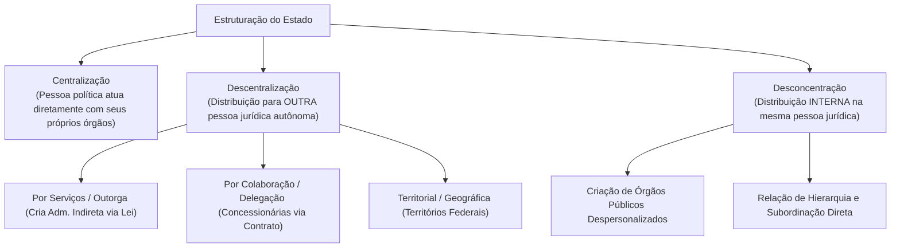
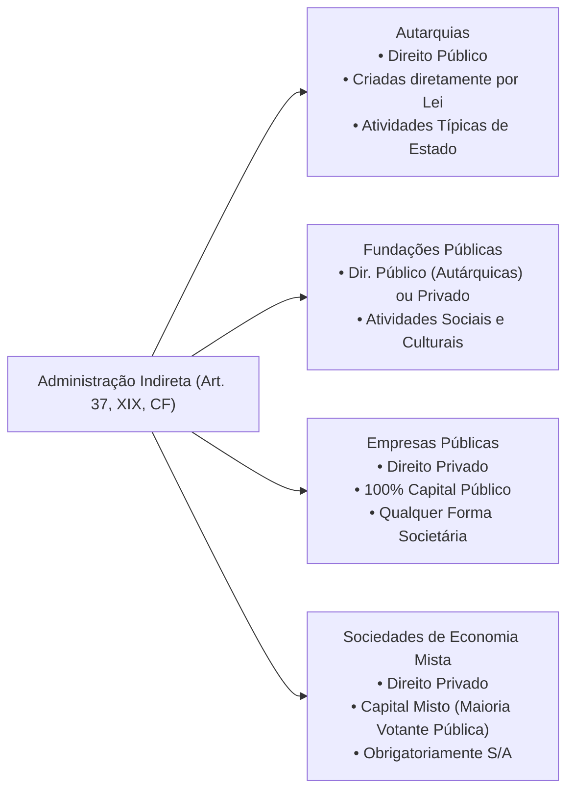
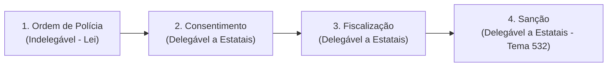
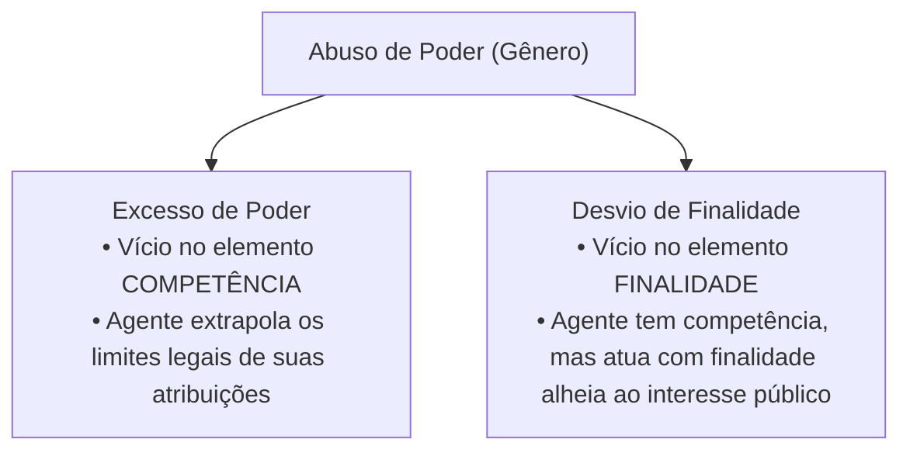

# 02 - Organização Administrativa, Poderes e Abuso de Autoridade

> **Matéria:** Noções de Direito Administrativo  
> **Cargo:** A01 – Técnico de Controle Externo – Especialidade: Técnico Administrativo  
> **Arquivo:** `02_organizacao_administrativa_e_poderes.md`  

---

## 📌 Ementa / Itens do Edital
- Organização administrativa brasileira: Administração Direta e Indireta
- Descentralização vs. Desconcentração: conceitos, distinções e repercussões jurídicas
- Entidades da Administração Indireta: Autarquias, Fundações Públicas, Empresas Públicas e Sociedades de Economia Mista
- Regime jurídico das Estatais (Lei nº 13.303/2016)
- Terceiro Setor e entidades paraestatais: Serviços Sociais Autônomos (Sistema S), Organizações Sociais (OS) e OSCIPs
- Poderes da Administração Pública: Poder Vinculado, Discricionário, Hierárquico, Disciplinar, Regulamentar e Poder de Polícia
- Poder de Polícia: conceito (CTN, art. 78), atributos, limites e fases do ciclo de polícia
- Uso e abuso do poder: excesso de poder e desvio de finalidade
- Lei de Abuso de Autoridade (Lei nº 13.869/2019 e alterações): sujeitos ativos, elemento subjetivo especial e crimes funcionais

---

## 🧭 Sumário

1. [Organização Administrativa: Técnicas de Estruturação Estatal](#1-organizacao-administrativa-tecnicas-de-estruturacao-estatal)
    1. [Centralização e Descentralização](#11-centralizacao-e-descentralizacao)
    2. [Desconcentração e a Criação de Órgãos Públicos](#12-desconcentracao-e-a-criacao-de-orgaos-publicos)
    3. [Quadro Distintivo: Descentralização vs. Desconcentração](#13-quadro-distintivo-descentralizacao-vs-desconcentracao)
    4. [Teste 012](#Teste-012)
2. [Entidades da Administração Indireta](#2-entidades-da-administracao-indireta)
    1. [Autarquias e Autarquias de Regime Especial](#21-autarquias-e-autarquias-de-regime-especial)
    2. [Fundações Públicas (Direito Público vs. Direito Privado)](#22-fundacoes-publicas-direito-publico-vs-direito-privado)
    3. [Empresas Públicas e Sociedades de Economia Mista](#23-empresas-publicas-e-sociedades-de-economia-mista)
    4. [O Estatuto Jurídico das Estatais (Lei nº 13.303/2016)](#24-o-estatuto-juridico-das-estatais-lei-no-133032016)
    5. [Controle Finalístico, Tutela e Supervisão Ministerial](#25-controle-finalistico-tutela-e-supervisao-ministerial)
    6. [Teste 013](#Teste-013)
    7. [Teste 014](#Teste-014)
    8. [Teste 015](#Teste-015)
    9. [Teste 016](#Teste-016)
3. [O Terceiro Setor e Entidades Paraestatais](#3-o-terceiro-setor-e-entidades-paraestatais)
    1. [Serviços Sociais Autônomos (Sistema S)](#31-servicos-sociais-autonomos-sistema-s)
    2. [Organizações Sociais (OS) e Contratos de Gestão](#32-organizacoes-sociais-os-e-contratos-de-gestao)
    3. [OSCIPs e Termos de Parceria](#33-oscips-e-termos-de-parceria)
    4. [Teste 017](#Teste-017)
4. [Poderes Administrativos e Prerrogativas Públicas](#4-poderes-administrativos-e-prerrogativas-publicas)
    1. [Poder Vinculado vs. Poder Discricionário e o Mérito Administrativo](#41-poder-vinculado-vs-poder-discricionario-e-o-merito-administrativo)
    2. [Poder Hierárquico: Delegação, Avocação e a Regra do CENORA](#42-poder-hierarquico-delegacao-avocacao-e-a-regra-do-cenora)
    3. [Poder Disciplinar e Sanções Funcionais](#43-poder-disciplinar-e-sancoes-funcionais)
    4. [Poder Regulamentar / Normativo e os Decretos Autônomos](#44-poder-regulamentar-normativo-e-os-decretos-autonomos)
    5. [Poder de Polícia, Ciclo de Polícia e Delegação (Tema 532/STF)](#45-poder-de-policia-ciclo-de-policia-e-delegacao-tema-532stf)
    6. [Teste 018](#Teste-018)
    7. [Teste 019](#Teste-019)
    8. [Teste 020](#Teste-020)
    9. [Teste 021](#Teste-021)
5. [Uso e Abuso de Poder e a Lei nº 13.869/2019](#5-uso-e-abuso-de-poder-e-a-lei-no-138692019)
    1. [Excesso de Poder vs. Desvio de Finalidade](#51-excesso-de-poder-vs-desvio-de-finalidade)
    2. [Elemento Subjetivo Especial e Proibição do Crime de Hermenêutica](#52-elemento-subjetivo-especial-e-proibicao-do-crime-de-hermeneutica)
    3. [Sujeitos Ativos no Âmbito dos Tribunais de Contas](#53-sujeitos-ativos-no-ambito-dos-tribunais-de-contas)
    4. [Teste 022](#Teste-022)
6. [Fontes Recomendadas na Internet](#6-fontes-recomendadas-na-internet)

---

## 1. Organização Administrativa: Técnicas de Estruturação Estatal

A organização administrativa é o conjunto de mecanismos normativos e estruturais mediante os quais o Estado distribui suas competências e funções entre pessoas jurídicas, órgãos e agentes públicos.

### 1.1 Centralização e Descentralização

- **Centralização:** Ocorre quando o Estado executa suas tarefas administrativas **diretamente**, por meio dos órgãos e agentes integrantes da própria pessoa jurídica política matriz (União, Estados, DF e Municípios — Administração Direta).
- **Descentralização:** Ocorre quando o Estado transfere a execução ou a titularidade e execução de determinada atividade administrativa para **outra pessoa jurídica distinta**, dotada de personalidade própria.
    - **Descentralização por Serviços, Outorga ou Funcional:** O poder público transfere a **titularidade e a execução** do serviço mediante **lei formal** para entidades da Administração Pública Indireta (Autarquias, Fundações Públicas, Empresas Públicas e Sociedades de Economia Mista). Possui caráter de estabilidade institucional duradoura.
    - **Descentralização por Colaboração ou Delegação:** O poder público transfere apenas a **execução material** do serviço para particulares (concessionárias e permissionárias de serviços públicos) mediante **contrato administrativo de concessão** ou **ato unilateral de permissão**. A titularidade permanece nas mãos do poder concedente.
    - **Descentralização Territorial ou Geográfica:** Ocorre na criação de Territórios Federais (entidades autárquicas geográficas com capacidade genérica de gestão local).

### 1.2 Desconcentração e a Criação de Órgãos Públicos

A **desconcentração** é uma técnica puramente interna de divisão e distribuição de competências que ocorre **dentro de uma mesma pessoa jurídica**. 

- Não gera uma nova entidade dotada de personalidade jurídica; dá origem a **órgãos públicos despersonalizados** (Ministérios, Secretarias de Estado, Diretorias, Departamentos).
- Caracteriza-se por uma **relação estrita de hierarquia, subordinação e controle disciplinar** entre a chefia superior e as unidades subordinadas.
- *Teoria do Órgão (Imputação Volitiva):* Os órgãos não possuem vontade própria autônoma nem patrimônio segregado; as manifestações volitivas de seus agentes são juridicamente imputadas à pessoa jurídica à qual o órgão se vincula.

### 1.3 Quadro Distintivo: Descentralização vs. Desconcentração

| Critério de Comparação | Descentralização Administrativa | Desconcentração Administrativa |
| :--- | :--- | :--- |
| **Pessoas Jurídicas Envolvidas** | Envolve **duas ou mais pessoas jurídicas distintas** | Ocorre **dentro de uma única pessoa jurídica** |
| **Criação Resultante** | Cria **novas entidades** autônomas da Administração Indireta | Cria **órgãos públicos** despersonalizados |
| **Vínculo Jurídico** | **Não há hierarquia nem subordinação** (há apenas vinculação / tutela finalística) | **Há relação estrita de hierarquia e subordinação** |
| **Mnemônico Visual FCC** | Descentrali**Z**ação $\rightarrow$ Gera **E**ntidades externas | Desconcen**T**ração $\rightarrow$ Gera **Ó**rgãos internos |

---

### Teste 012
**(FGV – TJ/DFT – 2022 – Analista Judiciario Suporte Em Tecnologia Da Informacao)**
O prefeito do Município Alfa decidiu promover uma ampla reestruturação da Administração pública indireta. Para tanto, decidiu que fosse elaborado um estudo preliminar, de modo a delinear os contornos gerais de: (1) duas entidades com personalidade jurídica própria, para a execução dos serviços públicos de limpeza urbana e de administração de cemitérios públicos; e (2) de órgãos específicos, a serem criados no âmbito da Secretaria de Saúde e da Secretaria de Ordem Pública, de modo a aumentar a especialização e, consequentemente, o nível de eficiência estatal. É correto afirmar que:

* **A)** em (1) são mencionados exemplos de descentralização administrativa por especificação e em (2) de descentralização administrativa por serviços;
* **B)** em (1) são mencionados exemplos de desconcentração administrativa por especificação e em (2) de desconcentração administrativa por serviços;
* **C)** em (1) são mencionados exemplos de descentralização administrativa por serviços e em (2) de desconcentração administrativa;
* **D)** em (1) são mencionados exemplos de desestatização por serviços e em (2) de descentralização administrativa por eficiência;
* **E)** em (1) são mencionados exemplos de desestatização por serviços e em (2) de estatização por padrão de eficiência.

---

> **Comentário Detalhado:**
>
> - **A)** **Incorreta.** A opção apresenta proposição em desacordo com os fundamentos teóricos e técnicos do tópico ao afirmar que "em (1) são mencionados exemplos de descentralização administrativa por especificação e em (2) de descentralização...". De acordo com a teoria estudada em *1.1 Centralização e Descentralização*, descentralização: Ocorre quando o Estado transfere a execução ou a titularidade e execução de determinada atividade administrativa para outra pessoa jurídica distinta, dotada de personalidade própria.
> - **B)** **Incorreta.** A opção apresenta proposição em desacordo com os fundamentos teóricos e técnicos do tópico ao afirmar que "em (1) são mencionados exemplos de desconcentração administrativa por especificação e em (2) de desconcentração...". De acordo com a teoria estudada em *1.3 Quadro Distintivo: Descentralização vs. Desconcentração*, criação Resultante: Cria novas entidades autônomas da Administração Indireta — Cria órgãos públicos despersonalizados.
> - **C)** **Correta.** Conforme fundamentado na seção *1.1 Centralização e Descentralização* deste guia, descentralização por Serviços, Outorga ou Funcional: O poder público transfere a titularidade e a execução do serviço mediante lei formal para entidades da Administração Pública Indireta (Autarquias, Fundações Públicas, Empresas Públicas e Sociedades de Economia Mista). Dessa forma, está plenamente correta a assertiva da banca (FGV – TJ/DFT/2022) ao estabelecer que "em (1) são mencionados exemplos de descentralização administrativa por serviços e em (2) de desconcentração...".
> - **D)** **Incorreta.** A opção apresenta proposição em desacordo com os fundamentos teóricos e técnicos do tópico ao afirmar que "em (1) são mencionados exemplos de desestatização por serviços e em (2) de descentralização administrativa por...". De acordo com a teoria estudada em *1.1 Centralização e Descentralização*, descentralização por Colaboração ou Delegação: O poder público transfere apenas a execução material do serviço para particulares (concessionárias e permissionárias de serviços públicos) mediante contrato administrativo de concessão ou ato unilateral de permissão.
> - **E)** **Incorreta.** A opção apresenta proposição em desacordo com os fundamentos teóricos e técnicos do tópico ao afirmar que "em (1) são mencionados exemplos de desestatização por serviços e em (2) de estatização por padrão de eficiência". De acordo com a teoria estudada em *1.3 Quadro Distintivo: Descentralização vs. Desconcentração*, pessoas Jurídicas Envolvidas: Envolve duas ou mais pessoas jurídicas distintas — Ocorre dentro de uma única pessoa jurídica.
>
> **Gabarito: C**

---

## 2. Entidades da Administração Indireta

A Administração Indireta é o conjunto de entes descentralizados aos quais a lei confere personalidade jurídica própria para desempenhar atividades especializadas de interesse coletivo. Rege-se pelo art. 37, XIX, da CF/88.

### 2.1 Autarquias e Autarquias de Regime Especial

- **Conceito:** Pessoa jurídica de **direito público**, instituída diretamente por **lei específica**, para desempenhar atividades típicas e exclusivas de Estado que requeiram gestão administrativa e financeira descentralizada.
- **Regime Jurídico:** Totalmente público. Seus bens são públicos (impenhoráveis, inalienáveis e imprescritíveis); gozam de **imunidade tributária recíproca** (CF, art. 150, § 2º) sobre patrimônio, renda e serviços vinculados a suas finalidades; seus servidores submetem-se ao regime estatutário do respectivo ente; e suas dívidas judiciais são quitadas mediante precatórios.
- **Autarquias em Regime Especial (Agências Reguladoras):** Autarquias dotadas de maior autonomia institucional, financeira e decisória. Caracterizam-se por: dirigentes investidos com mandato fixo após sabatina legislativa (estabilidade no mandato, perda do cargo apenas nas hipóteses legais); poder normativo técnico regulatório; e inexistência de recurso hierárquico impróprio para os Ministérios/Secretarias sobre decisões técnicas de mérito.

### 2.2 Fundações Públicas (Direito Público vs. Direito Privado)

Entidades com patrimônio personalizado voltadas a finalidades sociais, de saúde, educação, cultura ou pesquisa (sem fins lucrativos):

- **Fundação Pública de Direito Público (Fundação Autárquica / Autarquia Fundacional):** Criada diretamente por lei específica. Equipara-se material e formalmente a uma autarquia em direitos, deveres, prerrogativas e imunidades.
- **Fundação Pública de Direito Privado:** Tem sua criação **autorizada por lei específica**, nascendo juridicamente com a inscrição de seus atos constitutivos no Cartório de Registro Civil das Pessoas Jurídicas. O art. 37, XIX, da CF exige a edição de **lei complementar para definir as áreas de sua atuação**.

### 2.3 Empresas Públicas e Sociedades de Economia Mista

São as empresas estatais, pessoas jurídicas de direito privado instituídas para exploração de atividade econômica de produção ou comercialização de bens/serviços ou para prestação de serviços públicos:

| Critério Distintivo | Empresa Pública (EP) | Sociedade de Economia Mista (SEM) |
| :--- | :--- | :--- |
| **Composição Societária do Capital** | **100% Capital Público** (admitida a copropriedade entre entes estatais diversos) | **Capital Misto** (Público + Privado; o Estado detém a maioria das ações com direito a voto) |
| **Forma Societária Admitida** | **Qualquer modalidade societária** (Ltda., S.A., etc.) | **Obrigatoriamente Sociedade Anônima (S/A)** |
| **Foro Competente na Justiça (União)** | **Justiça Federal** (CF, art. 109, I) | **Justiça Estadual** (STF, Súmula 556) |
| **Foro Competente (Estados/Municípios)** | **Justiça Estadual** comum | **Justiça Estadual** comum |
| **Modo de Criação** | **Autorizada por lei específica** + Registro na Junta/Cartório | **Autorizada por lei específica** + Registro na Junta/Cartório |
| **Exemplos Nacionais** | Caixa Econômica Federal (CEF), Correios (ECT), BNDES | Banco do Brasil (BB), Petrobras, Sabesp |

### 2.4 O Estatuto Jurídico das Estatais (Lei nº 13.303/2016)

A Lei Federal nº 13.303/2016 instituiu o estatuto jurídico unificado de governança e contratações para todas as empresas públicas e sociedades de economia mista da União, Estados, DF e Municípios:

- **Governança Corporativa e Conformidade:** Exigência de comitês estatutários de auditoria e risco, regras de integridade e requisitos rigorosos de idoneidade técnica e experiência profissional para a indicação de membros do Conselho de Administração e Diretorias Executivas (vedação a ocupantes de cargos políticos e sindicais partidários).
- **Regime Próprio de Licitações das Estatais:** As estatais possuem regime licitatório próprio disciplinado pelos arts. 28 a 84 da Lei 13.303/2016, com modalidades licitatórias simplificadas e procedimentos de negociação direta, não se sujeitando como regra geral à Lei nº 14.133/2021.

### 2.5 Controle Finalístico, Tutela e Supervisão Ministerial

Entre a Administração Direta e as entidades da Administração Indireta **NÃO existe subordinação hierárquica**. O controle exercido pelo ente instituidor denomina-se **controle finalístico, supervisão ministerial ou tutela administrativa**:

- É um controle de conformidade com os fins para os quais a entidade foi criada (*princípio da especialidade*).
- Não autoriza intervenções abusivas no mérito ou na gestão interna autônoma, limitando-se aos atos expressamente autorizados em lei.

---

### Teste 013
**(FGV – TCE/SC – 2026 – Auditor Fiscal de Controle Externo - Administração)**
A Constituição Federal de 1988 estabelece a distinção entre Administração Pública direta e indireta. Com base no Art. 37, caput, da Constituição Federal (CF) e nos princípios que regem a Administração Pública, assinale a afirmativa correta.

* **A)** As autarquias integram a Administração Pública direta e, por isso, não possuem personalidade jurídica própria, subordinando-se hierarquicamente ao ente federativo que as criou.
* **B)** A Administração Pública indireta é composta por autarquias, fundações públicas, empresas públicas e sociedades de economia mista, todas sujeitas ao controle finalístico do ente instituidor.
* **C)** As empresas públicas e as sociedades de economia mista, por integrarem a Administração Pública indireta, devem obrigatoriamente adotar o regime jurídico estatutário para seus empregados, tais como os órgãos da Administração direta.
* **D)** O princípio da eficiência, inserido no Art. 37, caput, da CF/88 pela Emenda Constitucional nº 19/1998, aplica-se exclusivamente à Administração Pública federal, não alcançando os Estados e os Municípios.
* **E)** A criação de autarquias dispensa lei específica, podendo ser efetivada por decreto do Poder Executivo, desde que o Legislativo autorize previamente por resolução.

---

> **Comentário Detalhado:**
>
> - **A)** **Incorreta.** A opção apresenta proposição em desacordo com os fundamentos teóricos e técnicos do tópico ao afirmar que "As autarquias integram a Administração Pública direta e, por isso, não possuem personalidade jurídica própria...". De acordo com a teoria estudada em *2.5 Controle Finalístico, Tutela e Supervisão Ministerial*, entre a Administração Direta e as entidades da Administração Indireta NÃO existe subordinação hierárquica. O controle exercido pelo ente instituidor denomina-se controle finalístico, supervisão ministerial ou tutela administrativa.
> - **B)** **Correta.** Conforme fundamentado na seção *1.1 Centralização e Descentralização* deste guia, descentralização por Serviços, Outorga ou Funcional: O poder público transfere a titularidade e a execução do serviço mediante lei formal para entidades da Administração Pública Indireta (Autarquias, Fundações Públicas, Empresas Públicas e Sociedades de Economia Mista). Dessa forma, está plenamente correta a assertiva da banca (FGV – TCE/SC/2026) ao estabelecer que "A Administração Pública indireta é composta por autarquias, fundações públicas, empresas públicas e sociedades de...".
> - **C)** **Incorreta.** A opção apresenta proposição em desacordo com os fundamentos teóricos e técnicos do tópico ao afirmar que "As empresas públicas e as sociedades de economia mista, por integrarem a Administração Pública indireta, devem...". De acordo com a teoria estudada em *2.4 O Estatuto Jurídico das Estatais (Lei nº 13.303/2016)*, a Lei Federal nº 13.303/2016 instituiu o estatuto jurídico unificado de governança e contratações para todas as empresas públicas e sociedades de economia mista da União, Estados, DF e Municípios.
> - **D)** **Incorreta.** A opção incorre em restrição indevida ao limitar o escopo conceitual ao afirmar que "O princípio da eficiência, inserido no Art. 37, caput, da CF/88 pela Emenda Constitucional nº 19/1998, aplica-se...". De acordo com a teoria estudada em *2.3 Empresas Públicas e Sociedades de Economia Mista*, foro Competente (Estados/Municípios): Justiça Estadual comum — Justiça Estadual comum.
> - **E)** **Incorreta.** A opção afasta requisito ou relação estrutural exigida pela matéria ao afirmar que "A criação de autarquias dispensa lei específica, podendo ser efetivada por decreto do Poder Executivo, desde que o...". De acordo com a teoria estudada em *2.3 Empresas Públicas e Sociedades de Economia Mista*, modo de Criação: Autorizada por lei específica + Registro na Junta/Cartório — Autorizada por lei específica + Registro na Junta/Cartório.
>
> **Gabarito: B**

---

### Teste 014
**(FGV – TCE/PA – 2024 – Auditor de Controle Externo - Fiscalização - Ciências Atuariais)**
Considerando os contornos da Administração Pública na Constituição de 1988, é correto afirmar que são entidades administrativas, integrantes da Administração Indireta, que são criadas por lei, diante de sua personalidade jurídica de direito público

* **A)** as entidades autárquicas.
* **B)** as sociedades de economia mista.
* **C)** as empresas públicas.
* **D)** os serviços sociais autônomos.
* **E)** as organizações da sociedade civil de interesse público.

---

> **Comentário Detalhado:**
>
> - **A)** **Correta.** Conforme fundamentado na seção *2. Entidades da Administração Indireta* deste guia, a Administração Indireta é o conjunto de entes descentralizados aos quais a lei confere personalidade jurídica própria para desempenhar atividades especializadas de interesse coletivo. Rege-se pelo art. 37, XIX, da CF/88. Dessa forma, está plenamente correta a assertiva da banca (FGV – TCE/PA/2024) ao estabelecer que "as entidades autárquicas".
> - **B)** **Incorreta.** A opção apresenta proposição em desacordo com os fundamentos teóricos e técnicos do tópico ao afirmar que "as sociedades de economia mista". De acordo com a teoria estudada em *1.1 Centralização e Descentralização*, descentralização por Serviços, Outorga ou Funcional: O poder público transfere a titularidade e a execução do serviço mediante lei formal para entidades da Administração Pública Indireta (Autarquias, Fundações Públicas, Empresas Públicas e Sociedades de Economia Mista).
> - **C)** **Incorreta.** A opção apresenta proposição em desacordo com os fundamentos teóricos e técnicos do tópico ao afirmar que "as empresas públicas". De acordo com a teoria estudada em *1.1 Centralização e Descentralização*, descentralização Territorial ou Geográfica: Ocorre na criação de Territórios Federais (entidades autárquicas geográficas com capacidade genérica de gestão local).
> - **D)** **Incorreta.** A opção apresenta proposição em desacordo com os fundamentos teóricos e técnicos do tópico ao afirmar que "os serviços sociais autônomos". De acordo com a teoria estudada em *3.1 Serviços Sociais Autônomos (Sistema S)*, pessoas jurídicas de direito privado criadas por autorização legislativa para prestar serviços de interesse social e capacitação profissional a categorias de empregados (SESI, SENAI, SESC, SENAC, SEST, SENAT, SEBRAE).
> - **E)** **Incorreta.** A opção apresenta proposição em desacordo com os fundamentos teóricos e técnicos do tópico ao afirmar que "as organizações da sociedade civil de interesse público". De acordo com a teoria estudada em *3.3 OSCIPs e Termos de Parceria*, organizações da Sociedade Civil de Interesse Público regidas pela Lei nº 9.790/1999.
>
> **Gabarito: A**

---

### Teste 015
**(FGV – TCE/GO – 2024 – Analista de Controle Externo - Ciências Contábeis)**
Marcela e Maíra estavam debatendo sobre o regime jurídico dos bens das autarquias e das sociedades de economia mista que atuam em regime de concorrência, distribuem lucro entre seus acionistas e não realizam serviços públicos, situação em que concluíram corretamente que

* **A)** os bens das autarquias podem ser usucapidos.
* **B)** os bens de ambas as mencionadas entidades administrativas são inalienáveis.
* **C)** os bens das referidas sociedades de economia mista são imprescritíveis.
* **D)** os bens dominicais das autarquias são passíveis de alienação, observadas as exigências legais.
* **E)** os bens das aludidas sociedades de economia mista são impenhoráveis.

---

> **Comentário Detalhado:**
>
> - **A)** **Incorreta.** A opção apresenta proposição em desacordo com os fundamentos teóricos e técnicos do tópico ao afirmar que "os bens das autarquias podem ser usucapidos". De acordo com a teoria estudada em *3.2 Organizações Sociais (OS) e Contratos de Gestão*, atuam na área de saúde, educação, cultura e pesquisa mediante a celebração de Contrato de Gestão. Podem receber fomento financeiro direto, dotações orçamentárias e cessão especial de servidores e bens públicos.
> - **B)** **Incorreta.** A opção apresenta proposição em desacordo com os fundamentos teóricos e técnicos do tópico ao afirmar que "os bens de ambas as mencionadas entidades administrativas são inalienáveis". De acordo com a teoria estudada em *1.1 Centralização e Descentralização*, descentralização por Serviços, Outorga ou Funcional: O poder público transfere a titularidade e a execução do serviço mediante lei formal para entidades da Administração Pública Indireta (Autarquias, Fundações Públicas, Empresas Públicas e Sociedades de Economia Mista).
> - **C)** **Incorreta.** A opção apresenta proposição em desacordo com os fundamentos teóricos e técnicos do tópico ao afirmar que "os bens das referidas sociedades de economia mista são imprescritíveis". De acordo com a teoria estudada em *2.3 Empresas Públicas e Sociedades de Economia Mista*, são as empresas estatais, pessoas jurídicas de direito privado instituídas para exploração de atividade econômica de produção ou comercialização de bens/serviços ou para prestação de serviços públicos.
> - **D)** **Correta.** Conforme fundamentado na seção *2.1 Autarquias e Autarquias de Regime Especial* deste guia, seus bens são públicos (impenhoráveis, inalienáveis e imprescritíveis); gozam de imunidade tributária recíproca (CF, art. 150, § 2º) sobre patrimônio, renda e serviços vinculados a suas finalidades; seus servidores submetem-se ao regime estatutário do respectivo ente; e suas dívidas judiciais são quitadas mediante precatórios. Dessa forma, está plenamente correta a assertiva da banca (FGV – TCE/GO/2024) ao estabelecer que "os bens dominicais das autarquias são passíveis de alienação, observadas as exigências legais".
> - **E)** **Incorreta.** A opção apresenta proposição em desacordo com os fundamentos teóricos e técnicos do tópico ao afirmar que "os bens das aludidas sociedades de economia mista são impenhoráveis". De acordo com a teoria estudada em *2.4 O Estatuto Jurídico das Estatais (Lei nº 13.303/2016)*, a Lei Federal nº 13.303/2016 instituiu o estatuto jurídico unificado de governança e contratações para todas as empresas públicas e sociedades de economia mista da União, Estados, DF e Municípios.
>
> **Gabarito: D**

---

### Teste 016
**(FGV – TCE/PA – 2024 – Auditor de Controle Externo - Administrativa - Direito)**
A Constituição Federal de 1988 dispõe sobre os requisitos para a concessão de vantagem ou aumento de remuneração, a criação de cargos, empregos e funções, pelos órgãos e entidades da administração pública. Entre os órgãos e entidades da administração pública que não se submetem à exigência de autorização específica na lei de diretrizes orçamentárias estão

* **A)** as fundações instituídas e mantidas pelo poder público.
* **B)** as autarquias.
* **C)** as empresas públicas.
* **D)** a Poder Judiciário.
* **E)** os Tribunais de Conta.

---

> **Comentário Detalhado:**
>
> - **A)** **Incorreta.** A opção apresenta proposição em desacordo com os fundamentos teóricos e técnicos do tópico ao afirmar que "as fundações instituídas e mantidas pelo poder público". De acordo com a teoria estudada em *1.1 Centralização e Descentralização*, descentralização por Serviços, Outorga ou Funcional: O poder público transfere a titularidade e a execução do serviço mediante lei formal para entidades da Administração Pública Indireta (Autarquias, Fundações Públicas, Empresas Públicas e Sociedades de Economia Mista).
> - **B)** **Incorreta.** A opção apresenta proposição em desacordo com os fundamentos teóricos e técnicos do tópico ao afirmar que "as autarquias". De acordo com a teoria estudada em *2.4 O Estatuto Jurídico das Estatais (Lei nº 13.303/2016)*, governança Corporativa e Conformidade: Exigência de comitês estatutários de auditoria e risco, regras de integridade e requisitos rigorosos de idoneidade técnica e experiência profissional para a indicação de membros do Conselho de Administração e Diretorias Executivas (vedação a ocupantes de cargos políticos e sindicais partidários).
> - **C)** **Correta.** Conforme fundamentado na seção *2.3 Empresas Públicas e Sociedades de Economia Mista* deste guia, modo de Criação: Autorizada por lei específica + Registro na Junta/Cartório — Autorizada por lei específica + Registro na Junta/Cartório. Dessa forma, está plenamente correta a assertiva da banca (FGV – TCE/PA/2024) ao estabelecer que "as empresas públicas".
> - **D)** **Incorreta.** A opção apresenta proposição em desacordo com os fundamentos teóricos e técnicos do tópico ao afirmar que "a Poder Judiciário". De acordo com a teoria estudada em *2.4 O Estatuto Jurídico das Estatais (Lei nº 13.303/2016)*, a Lei Federal nº 13.303/2016 instituiu o estatuto jurídico unificado de governança e contratações para todas as empresas públicas e sociedades de economia mista da União, Estados, DF e Municípios.
> - **E)** **Incorreta.** A opção apresenta proposição em desacordo com os fundamentos teóricos e técnicos do tópico ao afirmar que "os Tribunais de Conta". De acordo com a teoria estudada em *5.3 Sujeitos Ativos no Âmbito dos Tribunais de Contas*, exigem declaração motivada na sentença e estão condicionados à reincidência específica em crime de abuso de autoridade.
>
> **Gabarito: C**

---

## 3. O Terceiro Setor e Entidades Paraestatais

O Terceiro Setor compreende entidades privadas sem fins lucrativos que colaboram voluntariamente com o Estado na consecução de finalidades públicas e sociais, sem integrar a estrutura formal da Administração Pública.

### 3.1 Serviços Sociais Autônomos (Sistema S)

- Pessoas jurídicas de direito privado criadas por autorização legislativa para prestar serviços de interesse social e capacitação profissional a categorias de empregados (SESI, SENAI, SESC, SENAC, SEST, SENAT, SEBRAE).
- Não integram a Administração Pública; financiam-se mediante contribuições parafiscais arrecadadas compulsoriamente pelo Estado. Submetem-se ao controle externo exercido pelo Tribunal de Contas quanto aos recursos parafiscais, mas possuem regulamentos próprios de licitação e processo seletivo simplificado para pessoal.

### 3.2 Organizações Sociais (OS) e Contratos de Gestão

- Pessoas jurídicas de direito privado sem fins lucrativos que recebem a qualificação jurídica de OS pelo Poder Executivo (Lei nº 9.637/1998 e legislações estaduais congêneres).
- Atuam na área de saúde, educação, cultura e pesquisa mediante a celebração de **Contrato de Gestão**. Podem receber fomento financeiro direto, dotações orçamentárias e cessão especial de servidores e bens públicos.

### 3.3 OSCIPs e Termos de Parceria

- Organizações da Sociedade Civil de Interesse Público regidas pela Lei nº 9.790/1999.
- O vínculo de cooperação instrumentaliza-se formalmente por meio de **Termo de Parceria**.

---

### Teste 017
**(FGV – TCE/SC – 2026 – Auditor Fiscal de Controle Externo - Administração)**
Durante a execução de um convênio firmado entre a União e uma organização da sociedade civil para a execução de programa de assistência social, a Controladoria-Geral da União identificou irregularidades na aplicação dos recursos transferidos. Em paralelo, um grupo de cidadãos organizados encaminhou denúncia ao Tribunal de Contas da União relatando possível desvio de verbas. Diante desse cenário, que envolve simultaneamente mecanismos de controle interno, externo e social, e com base na Constituição Federal de 1988, assinale a afirmativa correta.

* **A)** O controle exercido pela Controladoria-Geral da União sobre a aplicação dos recursos do convênio caracteriza controle externo, pois a CGU é órgão independente do Poder Executivo e atua de forma autônoma em relação aos demais órgãos federais.
* **B)** O Tribunal de Contas da União não tem competência para fiscalizar entidades privadas que recebam recursos públicos federais, pois sua jurisdição se restringe aos órgãos e agentes da Administração Pública direta e indireta.
* **C)** A denúncia encaminhada pelos cidadãos ao TCU configura exercício de controle social, modalidade reconhecida pela Constituição Federal de 1988, que atribui a qualquer cidadão legitimidade para denunciar irregularidades perante o Tribunal de Contas.
* **D)** O controle interno exercido pela CGU e o controle externo exercido pelo TCU são excludentes entre si, de modo que, instaurado o processo de controle externo pelo TCU, a CGU perde automaticamente a competência para apurar as mesmas irregularidades.
* **E)** As decisões do Tribunal de Contas da União que imputam débito ou aplicam multa têm eficácia de título executivo, mas sua execução judicial depende de provocação do Ministério Público Federal, não podendo ser promovida diretamente pela União.

---

> **Comentário Detalhado:**
>
> - **A)** **Incorreta.** A opção apresenta proposição em desacordo com os fundamentos teóricos e técnicos do tópico ao afirmar que "O controle exercido pela Controladoria-Geral da União sobre a aplicação dos recursos do convênio caracteriza...". De acordo com a teoria estudada em *4.2 Poder Hierárquico: Delegação, Avocação e a Regra do CENORA*, a decisão de recursos administrativos é terminantemente indelegável! Se o titular de uma pasta delegar a um subordinado o julgamento de um recurso contra sanção proferida pelo órgão, a delegação é nula de pleno direito, pois violaria o duplo grau de julgamento administrativo.
> - **B)** **Incorreta.** A opção apresenta proposição em desacordo com os fundamentos teóricos e técnicos do tópico ao afirmar que "O Tribunal de Contas da União não tem competência para fiscalizar entidades privadas que recebam recursos públicos...". De acordo com a teoria estudada em *5.3 Sujeitos Ativos no Âmbito dos Tribunais de Contas*, o art. 2º da Lei nº 13.869/2019 estabelece que é sujeito ativo de crime de abuso de autoridade qualquer agente público, servidor ou não, da administração direta e indireta de todos os Poderes, incluindo expressamente os membros e servidores dos Tribunais e Conselhos de Contas.
> - **C)** **Correta.** Conforme fundamentado na seção *2.3 Empresas Públicas e Sociedades de Economia Mista* deste guia, forma Societária Admitida: Qualquer modalidade societária (Ltda., S.A., etc.) — Obrigatoriamente Sociedade Anônima (S/A). Dessa forma, está plenamente correta a assertiva da banca (FGV – TCE/SC/2026) ao estabelecer que "A denúncia encaminhada pelos cidadãos ao TCU configura exercício de controle social, modalidade reconhecida pela...".
> - **D)** **Incorreta.** A opção apresenta proposição em desacordo com os fundamentos teóricos e técnicos do tópico ao afirmar que "O controle interno exercido pela CGU e o controle externo exercido pelo TCU são excludentes entre si, de modo que...". De acordo com a teoria estudada em *3.1 Serviços Sociais Autônomos (Sistema S)*, submetem-se ao controle externo exercido pelo Tribunal de Contas quanto aos recursos parafiscais, mas possuem regulamentos próprios de licitação e processo seletivo simplificado para pessoal.
> - **E)** **Incorreta.** A opção apresenta proposição em desacordo com os fundamentos teóricos e técnicos do tópico ao afirmar que "As decisões do Tribunal de Contas da União que imputam débito ou aplicam multa têm eficácia de título executivo...". De acordo com a teoria estudada em *4.1 Poder Vinculado vs. Poder Discricionário e o Mérito Administrativo*, *Limites do Controle Judicial:* O Poder Judiciário e o Tribunal de Contas não podem invadir o mérito administrativo puro (não podem substituir a escolha legítima e discricionária do gestor); todavia, exercem pleno controle de legalidade, proporcionalidade, razoabilidade e moralidade sobre o ato.
>
> **Gabarito: C**

---

## 4. Poderes Administrativos e Prerrogativas Públicas

Os poderes administrativos são prerrogativas instrumentais outorgadas aos agentes do Estado com a finalidade de viabilizar a satisfação do interesse público. Não constituem privilégios pessoais, mas verdadeiros **poderes-deveres** (o dever de agir é indeclinável).

### 4.1 Poder Vinculado vs. Poder Discricionário e o Mérito Administrativo

- **Poder Vinculado:** A lei estabelece com precisão exaustiva todos os requisitos e a única conduta obrigatória a ser adotada pelo agente, inexistindo qualquer margem de liberdade ou juízo de conveniência (ex.: concessão de aposentadoria ao servidor que cumpriu todos os requisitos legais).
- **Poder Discricionário:** A lei confere expressamente ao administrador uma margem controlada de livre apreciação para eleger a decisão mais adequada perante o caso concreto, com base na **conveniência e oportunidade** (**Mérito Administrativo**).
    - *Limites do Controle Judicial:* O Poder Judiciário e o Tribunal de Contas **não podem invadir o mérito administrativo puro** (não podem substituir a escolha legítima e discricionária do gestor); todavia, exercem pleno controle de legalidade, proporcionalidade, razoabilidade e moralidade sobre o ato.

### 4.2 Poder Hierárquico: Delegação, Avocação e a Regra do CENORA

O poder hierárquico distribui e escalona funções entre órgãos e agentes subordinados, conferindo poderes de dar ordens, fiscalizar, revisar atos, delegar e avocar competências:

- **Delegação:** Transferência temporária do exercício de certas competências para órgãos ou agentes subordinados ou de mesmo nível hierárquico.
- **Vedações Absolutas à Delegação (Mnemônico CENORA - Lei 9.784/99, art. 13):**
    - **CE:** Competência **Exclusiva** conferida por lei a determinado órgão ou autoridade.
    - **NO:** Edição de atos de caráter **Normativo**.
    - **RA:** Decisão de **Recursos Administrativos**.

> 🚨 **ALERTA CRÍTICO DE PROVA FCC:**  
> A decisão de recursos administrativos é **terminantemente indelegável**! Se o titular de uma pasta delegar a um subordinado o julgamento de um recurso contra sanção proferida pelo órgão, a delegação é nula de pleno direito, pois violaria o duplo grau de julgamento administrativo.

### 4.3 Poder Disciplinar e Sanções Funcionais

É a prerrogativa interna da Administração de apurar infrações e aplicar penalidades funcionais a agentes públicos submetidos à hierarquia estatal ou a **particulares com vínculo jurídico especial com o Estado** (ex.: empresas contratadas que cometem faltas em licitações e contratos).

- Não se confunde com o poder de polícia (que pune particulares em geral, desprovidos de vínculo jurídico especial prévio).

### 4.4 Poder Regulamentar / Normativo e os Decretos Autônomos

Prerrogativa outorgada aos Chefes do Poder Executivo para expedir atos gerais e abstratos:

- **Decretos de Execução / Regulamentares (CF, art. 84, IV):** Editados para a fiel execução de leis já existentes. Não podem inovar originariamente na ordem jurídica nem criar direitos ou obrigações primárias não contempladas na lei.
- **Decretos Autônomos (CF, art. 84, VI):** Espécie normativa primária excepcional, autorizada diretamente pelo texto constitucional apenas em duas hipóteses taxativas:
    - *Alínea "a":* **Organização e funcionamento da administração pública**, desde que **não implique aumento de despesa** nem **criação ou extinção de órgãos públicos**;
    - *Alínea "b":* **Extinção de funções ou cargos públicos, quando vagos**.

> 💡 **Pegadinha Clássica FCC:**  
> Decreto autônomo **NUNCA pode criar ou extinguir órgãos públicos**, e **NUNCA pode extinguir cargos públicos se estiverem ocupados**! A criação e extinção de órgãos públicos exige expressamente **lei formal em sentido estrito** (CF, art. 48, XI e art. 61, § 1º, II, "e").

### 4.5 Poder de Polícia, Ciclo de Polícia e Delegação (Tema 532/STF)

O art. 78 do Código Tributário Nacional (CTN) conceitua o **poder de polícia** como a atividade da administração pública que, regulando a prática de ato ou a abstenção de fato em razão de interesse público, limita ou disciplina direito, interesse ou liberdade individual.

- **Atributos do Poder de Polícia:** Discricionariedade, Autoexecutoriedade e Coercibilidade.
- **O Ciclo de Polícia (Quatro Fases):**
    1. *Ordem de Polícia:* A norma jurídica legal que institui a restrição ou comando abstrato.
    2. *Consentimento de Polícia:* Ato pelo qual o Estado autoriza ou licencia o exercício da atividade privada condicionada (alvarás, licenças).
    3. *Fiscalização de Polícia:* Vistorias, inspeções, autuações e blitz.
    4. *Sanção de Polícia:* Aplicação punitiva da penalidade administrativa (multa, apreensão de mercadoria, interdição de estabelecimento).

#### O Marco Histórico do Tema 532 da Repercussão Geral do STF:
Superando divergências anteriores, o STF pacificou a tese com eficácia vinculante:
> *"É constitucional a delegação do poder de polícia, por meio de lei, a pessoas jurídicas de direito privado integrantes da Administração Pública indireta de capital social majoritariamente público que prestem exclusivamente serviço público de atuação própria do Estado e em regime não concorrencial."*

- É constitucional delegar a estatais as fases de **consentimento, fiscalização e sanção**. Apenas a primeira fase (**legislar / ordem de polícia**) permanece indelegável, privativa do Estado.

---

### Teste 018
**(FCC – TRT 2ª – 2014 – Analista Judiciário - Tecnologia da Informação)**
Órgão integrante do Poder Legislativo federal, no desempenho da função administrativa, solucionou controvérsia proferindo ato administrativo restritivo de direito sem, no entanto, observar a Lei no 9.784/1999. Considerando o âmbito de aplicação da referida lei, é correto afirmar que o administrador atuou

* **A)** conforme a lei, porque o referido ato normativo aplica-se, exclusivamente, ao Poder Executivo federal, abrangendo a Administração pública direta e indireta.
* **B)** conforme a lei, porque o referido ato normativo aplica-se ao Poder Executivo federal, abrangendo a Administração pública direta e indireta e ao Poder Judiciário federal, não se aplicando ao Poder Legislativo federal, estadual ou local.
* **C)** em desconformidade com a lei, porque os preceitos da supracitada norma também se aplicam aos órgãos dos Poderes Legislativo e Judiciário da União, quando no desempenho de função administrativa.
* **D)** em desconformidade com a lei, porque os preceitos da norma também se aplicam aos órgãos dos Poderes Legislativo e Judiciário da União, respectivamente, quando no desempenho de função legislativa e judicial.
* **E)** conforme a lei, porque o ato normativo aplica-se tão somente às unidades de atuação integrantes da estrutura da

---

> **Comentário Detalhado:**
>
> - **A)** **Incorreta.** A opção incorre em restrição indevida ao limitar o escopo conceitual ao afirmar que "conforme a lei, porque o referido ato normativo aplica-se, exclusivamente, ao Poder Executivo federal, abrangendo...". De acordo com a teoria estudada em *5.3 Sujeitos Ativos no Âmbito dos Tribunais de Contas*, o art. 2º da Lei nº 13.869/2019 estabelece que é sujeito ativo de crime de abuso de autoridade qualquer agente público, servidor ou não, da administração direta e indireta de todos os Poderes, incluindo expressamente os membros e servidores dos Tribunais e Conselhos de Contas.
> - **B)** **Incorreta.** A opção apresenta proposição em desacordo com os fundamentos teóricos e técnicos do tópico ao afirmar que "conforme a lei, porque o referido ato normativo aplica-se ao Poder Executivo federal, abrangendo a Administração...". De acordo com a teoria estudada em *2.5 Controle Finalístico, Tutela e Supervisão Ministerial*, entre a Administração Direta e as entidades da Administração Indireta NÃO existe subordinação hierárquica. O controle exercido pelo ente instituidor denomina-se controle finalístico, supervisão ministerial ou tutela administrativa.
> - **C)** **Correta.** Conforme fundamentado na seção *5.3 Sujeitos Ativos no Âmbito dos Tribunais de Contas* deste guia, efeitos da Condenação (Art. 4º): A perda do cargo, mandato ou função pública e a inabilitação para o exercício de cargo público por período de 1 a 5 anos NÃO são efeitos automáticos da condenação penal. Dessa forma, está plenamente correta a assertiva da banca (FCC – TRT 2ª/2014) ao estabelecer que "em desconformidade com a lei, porque os preceitos da supracitada norma também se aplicam aos órgãos dos Poderes...".
> - **D)** **Incorreta.** A opção apresenta proposição em desacordo com os fundamentos teóricos e técnicos do tópico ao afirmar que "em desconformidade com a lei, porque os preceitos da norma também se aplicam aos órgãos dos Poderes Legislativo e...". De acordo com a teoria estudada em *4.1 Poder Vinculado vs. Poder Discricionário e o Mérito Administrativo*, *Limites do Controle Judicial:* O Poder Judiciário e o Tribunal de Contas não podem invadir o mérito administrativo puro (não podem substituir a escolha legítima e discricionária do gestor); todavia, exercem pleno controle de legalidade, proporcionalidade, razoabilidade e moralidade sobre o ato.
> - **E)** **Incorreta.** A opção incorre em restrição indevida ao limitar o escopo conceitual ao afirmar que "conforme a lei, porque o ato normativo aplica-se tão somente às unidades de atuação integrantes da estrutura da". De acordo com a teoria estudada em *O Marco Histórico do Tema 532 da Repercussão Geral do STF:*, *"É constitucional a delegação do poder de polícia, por meio de lei, a pessoas jurídicas de direito privado integrantes da Administração Pública indireta de capital social majoritariamente público que prestem exclusivamente serviço público de atuação própria do Estado e em regime não concorrencial."*.
>
> **Gabarito: C**

---

### Teste 019
**(FGV – TCE/PA – 2024 – Auditor de Controle Externo - Administrativa - Administração)**
O Poder Executivo do Estado do Pará realizou estudos com o objetivo de promover a descentralização da prestação de determinado serviço público de competência estadual. Nesses estudos, foi debatida a possibilidade de que a referida descentralização fosse direcionada a uma entidade paraestatal. Ao final, concluiu-se corretamente, à luz da Constituição do Estado do Pará, que

* **A)** a outorga do serviço público deve ser necessariamente antecedida de licitação, o que impede o direcionamento almejado.
* **B)** como o ente paraestatal integra a Administração Pública indireta, cabe apenas ao Poder Executivo avaliar a conveniência, ou não, do direcionamento almejado.
* **C)** a outorga apenas se dará mediante lei autorizadora, devendo ser demonstrada, na perspectiva técnica ou econômica, a impossibilidade ou inconveniência da centralização.
* **D)** o direcionamento é ato privativo do Poder Executivo, mas pressupõe a demonstração de suas vantagens, na perspectiva da economicidade e da eficiência, em relação à licitação.
* **E)** a forma de outorga do serviço, se mediante contratação direta ou mediante licitação, com entes da Administração Pública indireta ou entes privados, deve ser definida pela Assembleia Legislativa. História, Geografia e Conhecimentos do Estado do Pará

---

> **Comentário Detalhado:**
>
> - **A)** **Incorreta.** A opção apresenta proposição em desacordo com os fundamentos teóricos e técnicos do tópico ao afirmar que "a outorga do serviço público deve ser necessariamente antecedida de licitação, o que impede o direcionamento...". De acordo com a teoria estudada em *1.1 Centralização e Descentralização*, descentralização por Colaboração ou Delegação: O poder público transfere apenas a execução material do serviço para particulares (concessionárias e permissionárias de serviços públicos) mediante contrato administrativo de concessão ou ato unilateral de permissão.
> - **B)** **Incorreta.** A opção incorre em restrição indevida ao limitar o escopo conceitual ao afirmar que "como o ente paraestatal integra a Administração Pública indireta, cabe apenas ao Poder Executivo avaliar a...". De acordo com a teoria estudada em *4.1 Poder Vinculado vs. Poder Discricionário e o Mérito Administrativo*, poder Vinculado: A lei estabelece com precisão exaustiva todos os requisitos e a única conduta obrigatória a ser adotada pelo agente, inexistindo qualquer margem de liberdade ou juízo de conveniência (ex.: concessão de aposentadoria ao servidor que cumpriu todos os requisitos legais).
> - **C)** **Correta.** Conforme fundamentado na seção *1.1 Centralização e Descentralização* deste guia, descentralização por Serviços, Outorga ou Funcional: O poder público transfere a titularidade e a execução do serviço mediante lei formal para entidades da Administração Pública Indireta (Autarquias, Fundações Públicas, Empresas Públicas e Sociedades de Economia Mista). Dessa forma, está plenamente correta a assertiva da banca (FGV – TCE/PA/2024) ao estabelecer que "a outorga apenas se dará mediante lei autorizadora, devendo ser demonstrada, na perspectiva técnica ou econômica...".
> - **D)** **Incorreta.** A opção apresenta proposição em desacordo com os fundamentos teóricos e técnicos do tópico ao afirmar que "o direcionamento é ato privativo do Poder Executivo, mas pressupõe a demonstração de suas vantagens, na...". De acordo com a teoria estudada em *3.2 Organizações Sociais (OS) e Contratos de Gestão*, pessoas jurídicas de direito privado sem fins lucrativos que recebem a qualificação jurídica de OS pelo Poder Executivo (Lei nº 9.637/1998 e legislações estaduais congêneres).
> - **E)** **Incorreta.** A opção apresenta proposição em desacordo com os fundamentos teóricos e técnicos do tópico ao afirmar que "a forma de outorga do serviço, se mediante contratação direta ou mediante licitação, com entes da Administração...". De acordo com a teoria estudada em *O Marco Histórico do Tema 532 da Repercussão Geral do STF:*, *"É constitucional a delegação do poder de polícia, por meio de lei, a pessoas jurídicas de direito privado integrantes da Administração Pública indireta de capital social majoritariamente público que prestem exclusivamente serviço público de atuação própria do Estado e em regime não concorrencial."*.
>
> **Gabarito: C**

---

### Teste 020
**(FGV – TRT 1ª – 2024 – Analista Judiciário - Área Administrativa)**
O presidente da República ajuizou ação direta de inconstitucionalidade, junto ao Supremo Tribunal Federal (STF), impugnando uma lei que dispunha sobre a cobrança de taxas em concurso público na Administração Pública federal direta e indireta. Pelo diploma legislativo, a inscrição para concurso público destinado ao provimento de cargos em órgão da Administração Pública federal direta e indireta não terá custo superior a 20% do salário mínimo e será gratuita para quem estiver desempregado ou não possuir renda familiar superior a dois salários mínimos. À luz da Agenda 2030 da Organização das Nações Unidas (ONU) e do pensamento do STF, é correto afirmar que:

* **A)** a referida lei é exemplo do objetivo de garantir a igualdade de oportunidades e reduzir as desigualdades de resultados, por meio da promoção de legislação, políticas e ações adequadas a esse respeito;
* **B)** o objetivo de reduzir a desigualdade dentro dos países e entre eles não compõe a agenda 2030 da ONU, já que, com o tempo, a organização adotou uma postura cada vez mais liberal;
* **C)** o objetivo de desenvolvimento sustentável concernente a instituições eficazes leva à inconstitucionalidade da medida, ante a desqualificação de pessoal, consequência da limitação ou isenção da taxa de inscrição;
* **D)** a isenção não pode ser concedida por ser o tema do enunciado, matéria que repercute na relação entre a Administração Pública e os seus agentes, independentemente de eventual busca contra a desigualdade;
* **E)** a utilização do salário mínimo como critério de aferição do nível de pobreza atenta contra a Constituição de 1988, não podendo este ser empregado como referência paradigmática para limitar ou isentar taxa de inscrição em concurso.

---

> **Comentário Detalhado:**
>
> - **A)** **Correta.** Conforme fundamentado na seção *O Marco Histórico do Tema 532 da Repercussão Geral do STF:* deste guia, *"É constitucional a delegação do poder de polícia, por meio de lei, a pessoas jurídicas de direito privado integrantes da Administração Pública indireta de capital social majoritariamente público que prestem exclusivamente serviço público de atuação própria do Estado e em regime não concorrencial."*. Dessa forma, está plenamente correta a assertiva da banca (FGV – TRT 1ª/2024) ao estabelecer que "a referida lei é exemplo do objetivo de garantir a igualdade de oportunidades e reduzir as desigualdades de...".
> - **B)** **Incorreta.** A opção apresenta proposição em desacordo com os fundamentos teóricos e técnicos do tópico ao afirmar que "o objetivo de reduzir a desigualdade dentro dos países e entre eles não compõe a agenda 2030 da ONU, já que, com o...". De acordo com a teoria estudada em *1.3 Quadro Distintivo: Descentralização vs. Desconcentração*, pessoas Jurídicas Envolvidas: Envolve duas ou mais pessoas jurídicas distintas — Ocorre dentro de uma única pessoa jurídica.
> - **C)** **Incorreta.** A opção apresenta proposição em desacordo com os fundamentos teóricos e técnicos do tópico ao afirmar que "o objetivo de desenvolvimento sustentável concernente a instituições eficazes leva à inconstitucionalidade da...". De acordo com a teoria estudada em *2.2 Fundações Públicas (Direito Público vs. Direito Privado)*, fundação Pública de Direito Privado: Tem sua criação autorizada por lei específica, nascendo juridicamente com a inscrição de seus atos constitutivos no Cartório de Registro Civil das Pessoas Jurídicas.
> - **D)** **Incorreta.** A opção apresenta proposição em desacordo com os fundamentos teóricos e técnicos do tópico ao afirmar que "a isenção não pode ser concedida por ser o tema do enunciado, matéria que repercute na relação entre a...". De acordo com a teoria estudada em *1.1 Centralização e Descentralização*, centralização: Ocorre quando o Estado executa suas tarefas administrativas diretamente, por meio dos órgãos e agentes integrantes da própria pessoa jurídica política matriz (União, Estados, DF e Municípios — Administração Direta).
> - **E)** **Incorreta.** A opção apresenta proposição em desacordo com os fundamentos teóricos e técnicos do tópico ao afirmar que "a utilização do salário mínimo como critério de aferição do nível de pobreza atenta contra a Constituição de 1988...". De acordo com a teoria estudada em *4.1 Poder Vinculado vs. Poder Discricionário e o Mérito Administrativo*, poder Vinculado: A lei estabelece com precisão exaustiva todos os requisitos e a única conduta obrigatória a ser adotada pelo agente, inexistindo qualquer margem de liberdade ou juízo de conveniência (ex.: concessão de aposentadoria ao servidor que cumpriu todos os requisitos legais).
>
> **Gabarito: A**

---

### Teste 021
**(FGV – TCE/PA – 2024 – Auditor de Controle Externo - Administrativa - Direito)**
Após perquirir a distinção entre Administração Direta e Indireta e os respectivos órgãos e entidades administrativas, além das questões atinentes à personalidade jurídica em cada caso, Felisbela concluiu corretamente que

* **A)** os Tribunais de Contas são órgãos integrantes da Administração Direta, que não são dotados de personalidade jurídica.
* **B)** as autarquias são órgãos integrantes da Administração Direta, que tem personalidade jurídica de direito público.
* **C)** as empresas públicas são entidades integrantes da Administração Indireta dotadas de personalidade jurídica de direito públicos.
* **D)** os Tribunais de Justiça são entidades integrantes da Administração Indireta dotadas de personalidade jurídica de direito público.
* **E)** as fundações públicas são órgãos integrantes da Administração Indireta, que não são dotados de personalidade jurídica.

---

> **Comentário Detalhado:**
>
> - **A)** **Correta.** Conforme fundamentado na seção *1.1 Centralização e Descentralização* deste guia, centralização: Ocorre quando o Estado executa suas tarefas administrativas diretamente, por meio dos órgãos e agentes integrantes da própria pessoa jurídica política matriz (União, Estados, DF e Municípios — Administração Direta). Dessa forma, está plenamente correta a assertiva da banca (FGV – TCE/PA/2024) ao estabelecer que "os Tribunais de Contas são órgãos integrantes da Administração Direta, que não são dotados de personalidade...".
> - **B)** **Incorreta.** A opção apresenta proposição em desacordo com os fundamentos teóricos e técnicos do tópico ao afirmar que "as autarquias são órgãos integrantes da Administração Direta, que tem personalidade jurídica de direito público". De acordo com a teoria estudada em *5.3 Sujeitos Ativos no Âmbito dos Tribunais de Contas*, o art. 2º da Lei nº 13.869/2019 estabelece que é sujeito ativo de crime de abuso de autoridade qualquer agente público, servidor ou não, da administração direta e indireta de todos os Poderes, incluindo expressamente os membros e servidores dos Tribunais e Conselhos de Contas.
> - **C)** **Incorreta.** A opção apresenta proposição em desacordo com os fundamentos teóricos e técnicos do tópico ao afirmar que "as empresas públicas são entidades integrantes da Administração Indireta dotadas de personalidade jurídica de...". De acordo com a teoria estudada em *2. Entidades da Administração Indireta*, a Administração Indireta é o conjunto de entes descentralizados aos quais a lei confere personalidade jurídica própria para desempenhar atividades especializadas de interesse coletivo. Rege-se pelo art. 37, XIX, da CF/88.
> - **D)** **Incorreta.** A opção apresenta proposição em desacordo com os fundamentos teóricos e técnicos do tópico ao afirmar que "os Tribunais de Justiça são entidades integrantes da Administração Indireta dotadas de personalidade jurídica de...". De acordo com a teoria estudada em *2.5 Controle Finalístico, Tutela e Supervisão Ministerial*, entre a Administração Direta e as entidades da Administração Indireta NÃO existe subordinação hierárquica. O controle exercido pelo ente instituidor denomina-se controle finalístico, supervisão ministerial ou tutela administrativa.
> - **E)** **Incorreta.** A opção apresenta proposição em desacordo com os fundamentos teóricos e técnicos do tópico ao afirmar que "as fundações públicas são órgãos integrantes da Administração Indireta, que não são dotados de personalidade...". De acordo com a teoria estudada em *1.1 Centralização e Descentralização*, descentralização por Serviços, Outorga ou Funcional: O poder público transfere a titularidade e a execução do serviço mediante lei formal para entidades da Administração Pública Indireta (Autarquias, Fundações Públicas, Empresas Públicas e Sociedades de Economia Mista).
>
> **Gabarito: A**

---

## 5. Uso e Abuso de Poder e a Lei nº 13.869/2019

### 5.1 Excesso de Poder vs. Desvio de Finalidade

O **abuso de poder** é gênero que se desdobra em duas espécies nucleares:

1. **Excesso de Poder (Vício de Competência):** Ocorre quando a autoridade atua além dos limites legais de suas atribuições funcionais. O agente é incompetente para praticar aquele ato específico, exorbitando do mandato legal.
2. **Desvio de Finalidade / Desvio de Poder (Vício de Finalidade):** Ocorre quando o agente público atua dentro de sua competência legal formal, mas pratica o ato com o propósito de atingir fim diverso daquele fixado pela lei ou com intenção privada espúria (perseguição política, favorecimento ilícito ou vingança pessoal). É vício de nulidade insanável.

### 5.2 Elemento Subjetivo Especial e Proibição do Crime de Hermenêutica

A **Lei nº 13.869/2019** (Lei de Abuso de Autoridade) disciplina os crimes cometidos por agentes públicos no exercício de suas funções:

- **Dolo Específico Obrigatório (Art. 1º, § 1º):** As condutas descritas na lei constituem crime exclusivamente quando praticadas pelo agente público com a finalidade específica de:
    1. Prejudicar outrem;
    2. Beneficiar a si mesmo ou a terceiro; ou
    3. Por mero capricho ou satisfação pessoal.

    - *Não se admite modalidade culposa!*
- **Proibição do Crime de Hermenêutica (Art. 1º, § 2º):** A divergência na interpretação de lei ou na avaliação de fatos e provas **NÃO configura abuso de autoridade**. O magistrado, membro do Ministério Público ou auditor do Tribunal de Contas não comete crime simplesmente por aplicar uma tese jurídica contrária à pretensão do réu.

### 5.3 Sujeitos Ativos no Âmbito dos Tribunais de Contas

O art. 2º da Lei nº 13.869/2019 estabelece que é sujeito ativo de crime de abuso de autoridade qualquer agente público, servidor ou não, da administração direta e indireta de todos os Poderes, incluindo expressamente os **membros e servidores dos Tribunais e Conselhos de Contas**.

- **Efeitos da Condenação (Art. 4º):** A perda do cargo, mandato ou função pública e a inabilitação para o exercício de cargo público por período de 1 a 5 anos **NÃO são efeitos automáticos** da condenação penal. Exigem declaração motivada na sentença e estão condicionados à **reincidência específica** em crime de abuso de autoridade.

---

### Teste 022
**(FCC – TRT 24ª – 2017 – Analista Judiciário - Tecnologia da Informação)**
Em determinada licitação, na modalidade tomada de preços, ultrapassada a fase de habilitação, pretende um dos licitantes desistir da sua proposta. Nos termos da Lei no 8.666/1993, a desistência da proposta, na fase pretendida,

* **A)** só será admitida se os demais licitantes concordarem com a desistência, sendo necessário que a empresa fundamente seu pedido.
* **B)** só será admitida se houver motivo justo, decorrente ou não de fato superveniente, e desde que aceito pela autoridade máxima do órgão licitante.
* **C)** não é admitida, em qualquer hipótese.
* **D)** é admitida apenas se houver motivo justo, decorrente de fato superveniente e aceito pela Comissão.
* **E)** é sempre admitida, bastando que a empresa fundamente seu pedido.

---

> **Comentário Detalhado:**
>
> - **A)** **Correta.** Conforme fundamentado na seção *2.3 Empresas Públicas e Sociedades de Economia Mista* deste guia, forma Societária Admitida: Qualquer modalidade societária (Ltda., S.A., etc.) — Obrigatoriamente Sociedade Anônima (S/A). Dessa forma, está plenamente correta a assertiva da banca (FCC – TRT 24ª/2017) ao estabelecer que "só será admitida se os demais licitantes concordarem com a desistência, sendo necessário que a empresa fundamente...".
> - **B)** **Incorreta.** A opção apresenta proposição em desacordo com os fundamentos teóricos e técnicos do tópico ao afirmar que "só será admitida se houver motivo justo, decorrente ou não de fato superveniente, e desde que aceito pela...". De acordo com a teoria estudada em *4.2 Poder Hierárquico: Delegação, Avocação e a Regra do CENORA*, cE: Competência Exclusiva conferida por lei a determinado órgão ou autoridade.
> - **C)** **Incorreta.** A opção promove generalização excessiva que desconsidera as condições técnicas e normativas ao afirmar que "não é admitida, em qualquer hipótese". De acordo com a teoria estudada em *5.3 Sujeitos Ativos no Âmbito dos Tribunais de Contas*, o art. 2º da Lei nº 13.869/2019 estabelece que é sujeito ativo de crime de abuso de autoridade qualquer agente público, servidor ou não, da administração direta e indireta de todos os Poderes, incluindo expressamente os membros e servidores dos Tribunais e Conselhos de Contas.
> - **D)** **Incorreta.** A opção incorre em restrição indevida ao limitar o escopo conceitual ao afirmar que "é admitida apenas se houver motivo justo, decorrente de fato superveniente e aceito pela Comissão". De acordo com a teoria estudada em *4.5 Poder de Polícia, Ciclo de Polícia e Delegação (Tema 532/STF)*, o art. 78 do Código Tributário Nacional (CTN) conceitua o poder de polícia como a atividade da administração pública que, regulando a prática de ato ou a abstenção de fato em razão de interesse público, limita ou disciplina direito, interesse ou liberdade individual.
> - **E)** **Incorreta.** A opção promove generalização excessiva que desconsidera as condições técnicas e normativas ao afirmar que "é sempre admitida, bastando que a empresa fundamente seu pedido". De acordo com a teoria estudada em *2.3 Empresas Públicas e Sociedades de Economia Mista*, composição Societária do Capital: 100% Capital Público (admitida a copropriedade entre entes estatais diversos) — Capital Misto (Público + Privado; o Estado detém a maioria das ações com direito a voto).
>
> **Gabarito: A**

---

## 6. Fontes Recomendadas na Internet

- [Constituição Federal de 1988 - Art. 37, XIX e Art. 84, VI](https://www.planalto.gov.br/ccivil_03/constituicao/constituicao.htm#art37)  
  Dispositivos constitucionais reguladores da criação de entidades da Administração Indireta, decretos autônomos e foros judiciais.
- [Decreto-Lei nº 200/1967 (Organização da Administração Federal)](https://www.planalto.gov.br/ccivil_03/decreto-lei/del0200.htm)  
  Diploma histórico que estruturou os conceitos de Administração Direta e Indireta, descentralização e supervisão ministerial.
- [Lei Federal nº 13.303/2016 (Estatuto Jurídico das Empresas Estatais)](https://www.planalto.gov.br/ccivil_03/_ato2015-2018/2016/lei/l13303.htm)  
  Regulamento de governança corporativa, conselhos de administração e contratações para empresas públicas e sociedades de economia mista.
- [Lei Federal nº 13.869/2019 (Lei de Abuso de Autoridade)](https://www.planalto.gov.br/ccivil_03/_ato2019-2022/2019/lei/l13869.htm)  
  Tipificação dos crimes de abuso de autoridade, exigência do dolo específico e vedação ao crime de hermenêutica.
- [STF - Tema 532 de Repercussão Geral (Delegação do Poder de Polícia Administrativa)](https://portal.stf.jus.br/jurisprudencia/repercussaoGeral/tema.asp?num=532)  
  Precedente vinculante fixado no RE 633.782 admitindo delegação das fases de consentimento, fiscalização e sanção a estatais prestadoras de serviço público.
- [Lei Federal nº 9.784/1999 - Art. 13 (Limites da Delegação de Competência)](https://www.planalto.gov.br/ccivil_03/leis/l9784.htm#art13)  
  Regulamentação das vedações absolutas de delegação de atos normativos, decisão de recursos administrativos e competências exclusivas.
* DI PIETRO, Maria Sylvia Zanella. **Direito Administrativo**. 37. ed. Rio de Janeiro: Forense, 2024. (Cap. 4 e Cap. 10 - Poderes da Administração e Organização Administrativa).
* CARVALHO FILHO, José dos Santos. **Manual de Direito Administrativo**. 38. ed. Barueri: Atlas, 2024. (Cap. 2 e Cap. 9 - Poderes Administrativos, Administração Indireta e Entidades Paraestatais).
* OLIVEIRA, Rafael Carvalho Rezende. **Curso de Direito Administrativo**. 12. ed. Rio de Janeiro: Método, 2024. (Cap. 4 e Cap. 11 - Organização Administrativa, Terceiro Setor e Poder de Polícia).
