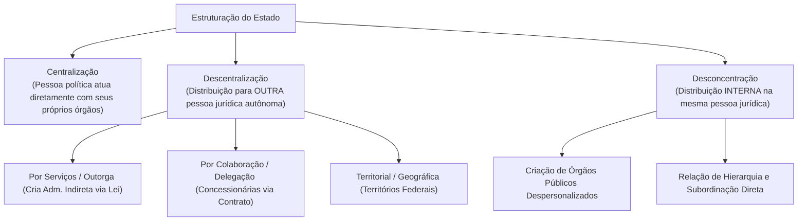
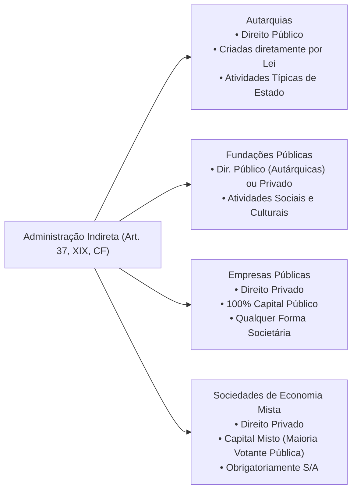
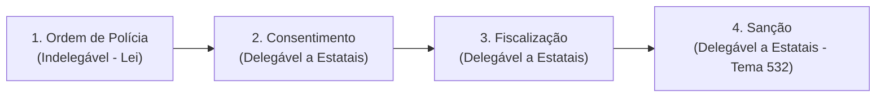
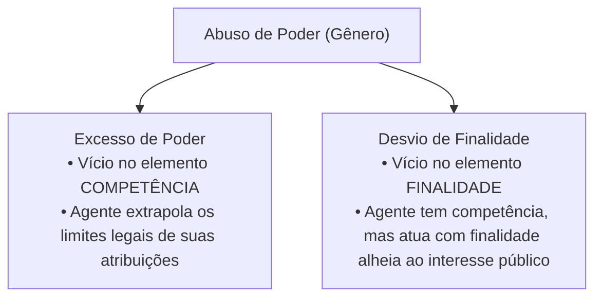

# 02 - Organização Administrativa, Poderes e Abuso de Autoridade

> **Matéria:** Noções de Direito Administrativo  
> **Cargo:** A01 – Técnico de Controle Externo – Especialidade: Técnico Administrativo  
> **Arquivo:** `02_organizacao_administrativa_e_poderes.md`  

---

## 📌 Ementa / Itens do Edital
- Organização administrativa brasileira: Administração Direta e Indireta
- Descentralização vs. Desconcentração: conceitos, distinções e repercussões jurídicas
- Entidades da Administração Indireta: Autarquias, Fundações Públicas, Empresas Públicas e Sociedades de Economia Mista
- Regime jurídico das Estatais (Lei nº 13.303/2016)
- Terceiro Setor e entidades paraestatais: Serviços Sociais Autônomos (Sistema S), Organizações Sociais (OS) e OSCIPs
- Poderes da Administração Pública: Poder Vinculado, Discricionário, Hierárquico, Disciplinar, Regulamentar e Poder de Polícia
- Poder de Polícia: conceito (CTN, art. 78), atributos, limites e fases do ciclo de polícia
- Uso e abuso do poder: excesso de poder e desvio de finalidade
- Lei de Abuso de Autoridade (Lei nº 13.869/2019 e alterações): sujeitos ativos, elemento subjetivo especial e crimes funcionais

---

## 🧭 Sumário

1. [Organização Administrativa: Técnicas de Estruturação Estatal](#1-organizacao-administrativa-tecnicas-de-estruturacao-estatal)
    1. [Centralização e Descentralização](#11-centralizacao-e-descentralizacao)
    2. [Desconcentração e a Criação de Órgãos Públicos](#12-desconcentracao-e-a-criacao-de-orgaos-publicos)
    3. [Quadro Distintivo: Descentralização vs. Desconcentração](#13-quadro-distintivo-descentralizacao-vs-desconcentracao)
    4. [Teste 012](#Teste-012)
2. [Entidades da Administração Indireta](#2-entidades-da-administracao-indireta)
    1. [Autarquias e Autarquias de Regime Especial](#21-autarquias-e-autarquias-de-regime-especial)
    2. [Fundações Públicas (Direito Público vs. Direito Privado)](#22-fundacoes-publicas-direito-publico-vs-direito-privado)
    3. [Empresas Públicas e Sociedades de Economia Mista](#23-empresas-publicas-e-sociedades-de-economia-mista)
    4. [O Estatuto Jurídico das Estatais (Lei nº 13.303/2016)](#24-o-estatuto-juridico-das-estatais-lei-no-133032016)
    5. [Controle Finalístico, Tutela e Supervisão Ministerial](#25-controle-finalistico-tutela-e-supervisao-ministerial)
    6. [Teste 013](#Teste-013)
    7. [Teste 014](#Teste-014)
    8. [Teste 015](#Teste-015)
    9. [Teste 016](#Teste-016)
3. [O Terceiro Setor e Entidades Paraestatais](#3-o-terceiro-setor-e-entidades-paraestatais)
    1. [Serviços Sociais Autônomos (Sistema S)](#31-servicos-sociais-autonomos-sistema-s)
    2. [Organizações Sociais (OS) e Contratos de Gestão](#32-organizacoes-sociais-os-e-contratos-de-gestao)
    3. [OSCIPs e Termos de Parceria](#33-oscips-e-termos-de-parceria)
    4. [Teste 017](#Teste-017)
4. [Poderes Administrativos e Prerrogativas Públicas](#4-poderes-administrativos-e-prerrogativas-publicas)
    1. [Poder Vinculado vs. Poder Discricionário e o Mérito Administrativo](#41-poder-vinculado-vs-poder-discricionario-e-o-merito-administrativo)
    2. [Poder Hierárquico: Delegação, Avocação e a Regra do CENORA](#42-poder-hierarquico-delegacao-avocacao-e-a-regra-do-cenora)
    3. [Poder Disciplinar e Sanções Funcionais](#43-poder-disciplinar-e-sancoes-funcionais)
    4. [Poder Regulamentar / Normativo e os Decretos Autônomos](#44-poder-regulamentar-normativo-e-os-decretos-autonomos)
    5. [Poder de Polícia, Ciclo de Polícia e Delegação (Tema 532/STF)](#45-poder-de-policia-ciclo-de-policia-e-delegacao-tema-532stf)
    6. [Teste 018](#Teste-018)
    7. [Teste 019](#Teste-019)
    8. [Teste 020](#Teste-020)
    9. [Teste 021](#Teste-021)
5. [Uso e Abuso de Poder e a Lei nº 13.869/2019](#5-uso-e-abuso-de-poder-e-a-lei-no-138692019)
    1. [Excesso de Poder vs. Desvio de Finalidade](#51-excesso-de-poder-vs-desvio-de-finalidade)
    2. [Elemento Subjetivo Especial e Proibição do Crime de Hermenêutica](#52-elemento-subjetivo-especial-e-proibicao-do-crime-de-hermeneutica)
    3. [Sujeitos Ativos no Âmbito dos Tribunais de Contas](#53-sujeitos-ativos-no-ambito-dos-tribunais-de-contas)
    4. [Teste 022](#Teste-022)
6. [Fontes Recomendadas na Internet](#6-fontes-recomendadas-na-internet)

---

## 1. Organização Administrativa: Técnicas de Estruturação Estatal

A organização administrativa é o conjunto de mecanismos normativos e estruturais mediante os quais o Estado distribui suas competências e funções entre pessoas jurídicas, órgãos e agentes públicos.

### 1.1 Centralização e Descentralização

- **Centralização:** Ocorre quando o Estado executa suas tarefas administrativas **diretamente**, por meio dos órgãos e agentes integrantes da própria pessoa jurídica política matriz (União, Estados, DF e Municípios — Administração Direta).
- **Descentralização:** Ocorre quando o Estado transfere a execução ou a titularidade e execução de determinada atividade administrativa para **outra pessoa jurídica distinta**, dotada de personalidade própria.
    - **Descentralização por Serviços, Outorga ou Funcional:** O poder público transfere a **titularidade e a execução** do serviço mediante **lei formal** para entidades da Administração Pública Indireta (Autarquias, Fundações Públicas, Empresas Públicas e Sociedades de Economia Mista). Possui caráter de estabilidade institucional duradoura.
    - **Descentralização por Colaboração ou Delegação:** O poder público transfere apenas a **execução material** do serviço para particulares (concessionárias e permissionárias de serviços públicos) mediante **contrato administrativo de concessão** ou **ato unilateral de permissão**. A titularidade permanece nas mãos do poder concedente.
    - **Descentralização Territorial ou Geográfica:** Ocorre na criação de Territórios Federais (entidades autárquicas geográficas com capacidade genérica de gestão local).

### 1.2 Desconcentração e a Criação de Órgãos Públicos

A **desconcentração** é uma técnica puramente interna de divisão e distribuição de competências que ocorre **dentro de uma mesma pessoa jurídica**. 

- Não gera uma nova entidade dotada de personalidade jurídica; dá origem a **órgãos públicos despersonalizados** (Ministérios, Secretarias de Estado, Diretorias, Departamentos).
- Caracteriza-se por uma **relação estrita de hierarquia, subordinação e controle disciplinar** entre a chefia superior e as unidades subordinadas.
- *Teoria do Órgão (Imputação Volitiva):* Os órgãos não possuem vontade própria autônoma nem patrimônio segregado; as manifestações volitivas de seus agentes são juridicamente imputadas à pessoa jurídica à qual o órgão se vincula.

### 1.3 Quadro Distintivo: Descentralização vs. Desconcentração

| Critério de Comparação | Descentralização Administrativa | Desconcentração Administrativa |
| :--- | :--- | :--- |
| **Pessoas Jurídicas Envolvidas** | Envolve **duas ou mais pessoas jurídicas distintas** | Ocorre **dentro de uma única pessoa jurídica** |
| **Criação Resultante** | Cria **novas entidades** autônomas da Administração Indireta | Cria **órgãos públicos** despersonalizados |
| **Vínculo Jurídico** | **Não há hierarquia nem subordinação** (há apenas vinculação / tutela finalística) | **Há relação estrita de hierarquia e subordinação** |
| **Mnemônico Visual FCC** | Descentrali**Z**ação $\rightarrow$ Gera **E**ntidades externas | Desconcen**T**ração $\rightarrow$ Gera **Ó**rgãos internos |

---

### Teste 012
**(FGV – TRT – Analista Judiciário - Suporte e Infraestrutura de TI – 2022)**  
O Prefeito do Município Alfa decidiu promover uma ampla reestruturação da estrutura administrativa municipal. Para tanto, adotou duas medidas:  
(1) encaminhou à Câmara Municipal projeto de lei para a criação de uma autarquia municipal de trânsito e de uma empresa pública de informática;  
(2) editou decreto extinguindo secretarias adjuntas e redistribuindo internamente suas competências regimentais entre diretorias de uma mesma Secretaria de Governo.

Em relação a essas medidas, é correto afirmar que:

* **A)** em (1) ocorre descentralização administrativa por serviços; e em (2), desconcentração administrativa.
* **B)** em (1) e em (2) ocorrem hipóteses típicas de desconcentração administrativa territorial e funcional.
* **C)** em (1) ocorre descentralização política originária; e em (2), delegação negocial de competências estatais.
* **D)** em (1) ocorre desconcentração funcional; e em (2), descentralização administrativa por colaboração.
* **E)** em (1) e em (2) ocorrem hipóteses de desestatização mediante transferência definitiva de titularidade.

---

> **Comentário Detalhado:**
>
> - **A)** **Correto**. Na medida (1), há descentralização administrativa por serviços, funcional ou outorga, pois o Município cria novas pessoas jurídicas integrantes da Administração Indireta (autarquia e empresa pública) e a elas transfere atribuições. Na medida (2), há mera desconcentração administrativa, pois ocorre distribuição interna de competências no âmbito da própria pessoa jurídica municipal (órgãos de uma mesma secretaria), mantendo-se o vínculo hierárquico.
> - **B)** **Incorreto**. A criação de novas pessoas jurídicas consubstancia descentralização, não desconcentração.
> - **C)** **Incorreto**. A descentralização políticadecorre diretamente da Constituição Federal aos entes federados; o Município não realiza descentralização política ao criar estatais.
> - **D)** **Incorreto**. Houve inversão terminológica completa entre os institutos da descentralização e desconcentração.
> - **E)** **Incorreto**. Desestatização envolve alienação de ativos ou privatização, hipótese inexistente nas medidas estatais internas.
>
> **Gabarito: A**
## 2. Entidades da Administração Indireta

A Administração Indireta é o conjunto de entes descentralizados aos quais a lei confere personalidade jurídica própria para desempenhar atividades especializadas de interesse coletivo. Rege-se pelo art. 37, XIX, da CF/88.

### 2.1 Autarquias e Autarquias de Regime Especial

- **Conceito:** Pessoa jurídica de **direito público**, instituída diretamente por **lei específica**, para desempenhar atividades típicas e exclusivas de Estado que requeiram gestão administrativa e financeira descentralizada.
- **Regime Jurídico:** Totalmente público. Seus bens são públicos (impenhoráveis, inalienáveis e imprescritíveis); gozam de **imunidade tributária recíproca** (CF, art. 150, § 2º) sobre patrimônio, renda e serviços vinculados a suas finalidades; seus servidores submetem-se ao regime estatutário do respectivo ente; e suas dívidas judiciais são quitadas mediante precatórios.
- **Autarquias em Regime Especial (Agências Reguladoras):** Autarquias dotadas de maior autonomia institucional, financeira e decisória. Caracterizam-se por: dirigentes investidos com mandato fixo após sabatina legislativa (estabilidade no mandato, perda do cargo apenas nas hipóteses legais); poder normativo técnico regulatório; e inexistência de recurso hierárquico impróprio para os Ministérios/Secretarias sobre decisões técnicas de mérito.

### 2.2 Fundações Públicas (Direito Público vs. Direito Privado)

Entidades com patrimônio personalizado voltadas a finalidades sociais, de saúde, educação, cultura ou pesquisa (sem fins lucrativos):

- **Fundação Pública de Direito Público (Fundação Autárquica / Autarquia Fundacional):** Criada diretamente por lei específica. Equipara-se material e formalmente a uma autarquia em direitos, deveres, prerrogativas e imunidades.
- **Fundação Pública de Direito Privado:** Tem sua criação **autorizada por lei específica**, nascendo juridicamente com a inscrição de seus atos constitutivos no Cartório de Registro Civil das Pessoas Jurídicas. O art. 37, XIX, da CF exige a edição de **lei complementar para definir as áreas de sua atuação**.

### 2.3 Empresas Públicas e Sociedades de Economia Mista

São as empresas estatais, pessoas jurídicas de direito privado instituídas para exploração de atividade econômica de produção ou comercialização de bens/serviços ou para prestação de serviços públicos:

| Critério Distintivo | Empresa Pública (EP) | Sociedade de Economia Mista (SEM) |
| :--- | :--- | :--- |
| **Composição Societária do Capital** | **100% Capital Público** (admitida a copropriedade entre entes estatais diversos) | **Capital Misto** (Público + Privado; o Estado detém a maioria das ações com direito a voto) |
| **Forma Societária Admitida** | **Qualquer modalidade societária** (Ltda., S.A., etc.) | **Obrigatoriamente Sociedade Anônima (S/A)** |
| **Foro Competente na Justiça (União)** | **Justiça Federal** (CF, art. 109, I) | **Justiça Estadual** (STF, Súmula 556) |
| **Foro Competente (Estados/Municípios)** | **Justiça Estadual** comum | **Justiça Estadual** comum |
| **Modo de Criação** | **Autorizada por lei específica** + Registro na Junta/Cartório | **Autorizada por lei específica** + Registro na Junta/Cartório |
| **Exemplos Nacionais** | Caixa Econômica Federal (CEF), Correios (ECT), BNDES | Banco do Brasil (BB), Petrobras, Sabesp |

### 2.4 O Estatuto Jurídico das Estatais (Lei nº 13.303/2016)

A Lei Federal nº 13.303/2016 instituiu o estatuto jurídico unificado de governança e contratações para todas as empresas públicas e sociedades de economia mista da União, Estados, DF e Municípios:

- **Governança Corporativa e Conformidade:** Exigência de comitês estatutários de auditoria e risco, regras de integridade e requisitos rigorosos de idoneidade técnica e experiência profissional para a indicação de membros do Conselho de Administração e Diretorias Executivas (vedação a ocupantes de cargos políticos e sindicais partidários).
- **Regime Próprio de Licitações das Estatais:** As estatais possuem regime licitatório próprio disciplinado pelos arts. 28 a 84 da Lei 13.303/2016, com modalidades licitatórias simplificadas e procedimentos de negociação direta, não se sujeitando como regra geral à Lei nº 14.133/2021.

### 2.5 Controle Finalístico, Tutela e Supervisão Ministerial

Entre a Administração Direta e as entidades da Administração Indireta **NÃO existe subordinação hierárquica**. O controle exercido pelo ente instituidor denomina-se **controle finalístico, supervisão ministerial ou tutela administrativa**:

- É um controle de conformidade com os fins para os quais a entidade foi criada (*princípio da especialidade*).
- Não autoriza intervenções abusivas no mérito ou na gestão interna autônoma, limitando-se aos atos expressamente autorizados em lei.

---

### Teste 013
**(IBFC – TJ-MG – Analista Judiciario Classe C Analista de Tecnologia da Informacao – 2022)**
Segundo a Lei Geral de Proteção de Dados (LGPD), o tratamento de dados pessoais pelas pessoas jurídicas de direito público (União, Estados, Distrito Federal e Municípios, os órgãos públicos integrantes da administração direta dos Poderes Executivo, Legislativo, incluindo as Cortes de Contas, e Judiciário e do Ministério Público, as autarquias, as fundações públicas, as empresas públicas, as sociedades de economia mista e demais entidades controladas direta ou indiretamente pela União, Estados, Distrito Federal e Municípios) deverá ser realizado para o atendimento de sua finalidade pública, na persecução do interesse público, com o objetivo de executar as competências legais ou cumprir as atribuições legais do serviço público. Na conformidade com essa diretriz, assinale a alternativa correta.

* **A)** A autoridade nacional não poderá dispor sobre as formas de publicidade das operações de tratamento
* **B)** Os serviços notariais e de registro exercidos em caráter privado, por delegação do Poder Público, não terão o mesmo tratamento dispensado às pessoas jurídicas referidas no enunciado desta questão, nos termos da LGPD
* **C)** Os órgãos notariais e de registro devem fornecer acesso aos dados por meio eletrônico para a administração pública, tendo em vista o atendimento de sua finalidade pública, na persecução do interesse público, com o objetivo de executar as competências legais ou cumprir as atribuições legais do serviço público
* **D)** É vedado ao Poder Público, em qualquer caso, transferir a entidades privadas dados pessoais constantes de bases de dados a que tenha acesso
* **E)** A autoridade nacional não poderá estabelecer normas complementares para as atividades de comunicação e de uso compartilhado de dados pessoais

---

> **Comentário Detalhado:**
>
> - **A)** **Incorreta.** A opção apresenta proposição em desacordo com os fundamentos teóricos e técnicos do tópico ao afirmar que "A autoridade nacional não poderá dispor sobre as formas de publicidade das operações de tratamento". De acordo com a teoria estudada em *5.1 Excesso de Poder vs. Desvio de Finalidade*, excesso de Poder (Vício de Competência): Ocorre quando a autoridade atua além dos limites legais de suas atribuições funcionais. O agente é incompetente para praticar aquele ato específico, exorbitando do mandato legal.
> - **B)** **Incorreta.** A opção apresenta proposição em desacordo com os fundamentos teóricos e técnicos do tópico ao afirmar que "Os serviços notariais e de registro exercidos em caráter privado, por delegação do Poder Público, não terão o...". De acordo com a teoria estudada em *2.3 Empresas Públicas e Sociedades de Economia Mista*, são as empresas estatais, pessoas jurídicas de direito privado instituídas para exploração de atividade econômica de produção ou comercialização de bens/serviços ou para prestação de serviços públicos.
> - **C)** **Correta.** Conforme fundamentado na seção *O Marco Histórico do Tema 532 da Repercussão Geral do STF:* deste guia, *"É constitucional a delegação do poder de polícia, por meio de lei, a pessoas jurídicas de direito privado integrantes da Administração Pública indireta de capital social majoritariamente público que prestem exclusivamente serviço público de atuação própria do Estado e em regime não concorrencial."*. Dessa forma, está plenamente correta a assertiva da banca (IBFC – TJ-MG/2022) ao estabelecer que "Os órgãos notariais e de registro devem fornecer acesso aos dados por meio eletrônico para a administração...".
> - **D)** **Incorreta.** A opção promove generalização excessiva que desconsidera as condições técnicas e normativas ao afirmar que "É vedado ao Poder Público, em qualquer caso, transferir a entidades privadas dados pessoais constantes de bases de...". De acordo com a teoria estudada em *1.1 Centralização e Descentralização*, descentralização por Serviços, Outorga ou Funcional: O poder público transfere a titularidade e a execução do serviço mediante lei formal para entidades da Administração Pública Indireta (Autarquias, Fundações Públicas, Empresas Públicas e Sociedades de Economia Mista).
> - **E)** **Incorreta.** A opção apresenta proposição em desacordo com os fundamentos teóricos e técnicos do tópico ao afirmar que "A autoridade nacional não poderá estabelecer normas complementares para as atividades de comunicação e de uso...". De acordo com a teoria estudada em *4. Poderes Administrativos e Prerrogativas Públicas*, os poderes administrativos são prerrogativas instrumentais outorgadas aos agentes do Estado com a finalidade de viabilizar a satisfação do interesse público. Não constituem privilégios pessoais, mas verdadeiros poderes-deveres (o dever de agir é indeclinável).
>
> **Gabarito: C**

---

### Teste 014
**(FCC – TRT-24 – Analista Judiciario Tecnologia da Informacao – 2017)**
Com relação à Administração indireta, no que concerne às características das autarquias, considere: I. As autarquias só por lei podem ser criadas. II. Apenas no caso de exaustão dos recursos da autarquia é que incidirá a responsabilidade do Estado, que é subsidiária. III. As autarquias não são subordinadas a órgão algum do Estado, mas apenas controladas. IV. Os bens e rendas das autarquias, não apenas quando vinculados a suas finalidades essenciais, mas em toda e qualquer circunstância, possuem imunidade tributária. Está correto o que se afirma APENAS em

* **A)** I, II e III.
* **B)** I e III.
* **C)** I, II e IV.
* **D)** III.
* **E)** II e IV.

---

> **Comentário Detalhado:**
>
> - **A)** **Incorreta.** A opção apresenta proposição em desacordo com os fundamentos teóricos e técnicos do tópico ao afirmar que "I, II e III". De acordo com a teoria estudada em *4.1 Poder Vinculado vs. Poder Discricionário e o Mérito Administrativo*, poder Vinculado: A lei estabelece com precisão exaustiva todos os requisitos e a única conduta obrigatória a ser adotada pelo agente, inexistindo qualquer margem de liberdade ou juízo de conveniência (ex.: concessão de aposentadoria ao servidor que cumpriu todos os requisitos legais).
> - **B)** **Correta.** Conforme fundamentado na seção *2.1 Autarquias e Autarquias de Regime Especial* deste guia, seus bens são públicos (impenhoráveis, inalienáveis e imprescritíveis); gozam de imunidade tributária recíproca (CF, art. 150, § 2º) sobre patrimônio, renda e serviços vinculados a suas finalidades; seus servidores submetem-se ao regime estatutário do respectivo ente; e suas dívidas judiciais são quitadas mediante precatórios. Dessa forma, está plenamente correta a assertiva da banca (FCC – TRT-24/2017) ao estabelecer que "I e III".
> - **C)** **Incorreta.** A opção apresenta proposição em desacordo com os fundamentos teóricos e técnicos do tópico ao afirmar que "I, II e IV". De acordo com a teoria estudada em *5.3 Sujeitos Ativos no Âmbito dos Tribunais de Contas*, o art. 2º da Lei nº 13.869/2019 estabelece que é sujeito ativo de crime de abuso de autoridade qualquer agente público, servidor ou não, da administração direta e indireta de todos os Poderes, incluindo expressamente os membros e servidores dos Tribunais e Conselhos de Contas.
> - **D)** **Incorreta.** A opção apresenta proposição em desacordo com os fundamentos teóricos e técnicos do tópico ao afirmar que "III". De acordo com a teoria estudada em *1.1 Centralização e Descentralização*, descentralização por Serviços, Outorga ou Funcional: O poder público transfere a titularidade e a execução do serviço mediante lei formal para entidades da Administração Pública Indireta (Autarquias, Fundações Públicas, Empresas Públicas e Sociedades de Economia Mista).
> - **E)** **Incorreta.** A opção apresenta proposição em desacordo com os fundamentos teóricos e técnicos do tópico ao afirmar que "II e IV". De acordo com a teoria estudada em *1.2 Desconcentração e a Criação de Órgãos Públicos*, caracteriza-se por uma relação estrita de hierarquia, subordinação e controle disciplinar entre a chefia superior e as unidades subordinadas.
>
> **Gabarito: B**

---

### Teste 015
**(FGV – TRT-24 – Analista Judiciario Area Administrativa Sem Especialidade – 2025)**
A Administração Pública estrutura-se por meio de organizações formais que definem a distribuição de funções, competências e níveis de autoridade, assegurando a gestão organizacional do poder público de forma racional e eficiente. Assinale a opção que apresenta corretamente a pessoa jurídica de direito privado que, embora controlada pelo Estado, não atende a todos os requisitos legais para ser considerada empresa pública ou sociedade de economia mista, atuando em regra na prestação de serviços públicos de natureza comercial ou industrial.

* **A)** Autarquia especial.
* **B)** Fundação pública de direito público.
* **C)** Empresa sob controle acionário do Estado.
* **D)** Sociedade de economia mista.
* **E)** Empresa pública.

---

> **Comentário Detalhado:**
>
> - **A)** **Incorreta.** A opção apresenta proposição em desacordo com os fundamentos teóricos e técnicos do tópico ao afirmar que "Autarquia especial". De acordo com a teoria estudada em *2.3 Empresas Públicas e Sociedades de Economia Mista*, são as empresas estatais, pessoas jurídicas de direito privado instituídas para exploração de atividade econômica de produção ou comercialização de bens/serviços ou para prestação de serviços públicos.
> - **B)** **Incorreta.** A opção apresenta proposição em desacordo com os fundamentos teóricos e técnicos do tópico ao afirmar que "Fundação pública de direito público". De acordo com a teoria estudada em *2.3 Empresas Públicas e Sociedades de Economia Mista*, composição Societária do Capital: 100% Capital Público (admitida a copropriedade entre entes estatais diversos) — Capital Misto (Público + Privado; o Estado detém a maioria das ações com direito a voto).
> - **C)** **Incorreta.** A opção apresenta proposição em desacordo com os fundamentos teóricos e técnicos do tópico ao afirmar que "Empresa sob controle acionário do Estado". De acordo com a teoria estudada em *1.1 Centralização e Descentralização*, descentralização por Serviços, Outorga ou Funcional: O poder público transfere a titularidade e a execução do serviço mediante lei formal para entidades da Administração Pública Indireta (Autarquias, Fundações Públicas, Empresas Públicas e Sociedades de Economia Mista).
> - **D)** **Correta.** Conforme fundamentado na seção *2.3 Empresas Públicas e Sociedades de Economia Mista* deste guia, forma Societária Admitida: Qualquer modalidade societária (Ltda., S.A., etc.) — Obrigatoriamente Sociedade Anônima (S/A). Dessa forma, está plenamente correta a assertiva da banca (FGV – TRT-24/2025) ao estabelecer que "Sociedade de economia mista".
> - **E)** **Incorreta.** A opção apresenta proposição em desacordo com os fundamentos teóricos e técnicos do tópico ao afirmar que "Empresa pública". De acordo com a teoria estudada em *2.3 Empresas Públicas e Sociedades de Economia Mista*, foro Competente na Justiça (União): Justiça Federal (CF, art. 109, I) — Justiça Estadual (STF, Súmula 556).
>
> **Gabarito: D**

---

### Teste 016
**(FGV – TCE-PA – Auditor de Controle Externo Administrativa Direito – 2024)**
A Constituição Federal de 1988 dispõe sobre os requisitos para a concessão de vantagem ou aumento de remuneração, a criação de cargos, empregos e funções, pelos órgãos e entidades da administração pública. Entre os órgãos e entidades da administração pública que não se submetem à exigência de autorização específica na lei de diretrizes orçamentárias estão

* **A)** as fundações instituídas e mantidas pelo poder público.
* **B)** as autarquias.
* **C)** as empresas públicas.
* **D)** a Poder Judiciário.
* **E)** os Tribunais de Conta.

---

> **Comentário Detalhado:**
>
> - **A)** **Incorreta.** A opção apresenta proposição em desacordo com os fundamentos teóricos e técnicos do tópico ao afirmar que "as fundações instituídas e mantidas pelo poder público". De acordo com a teoria estudada em *1.1 Centralização e Descentralização*, descentralização por Serviços, Outorga ou Funcional: O poder público transfere a titularidade e a execução do serviço mediante lei formal para entidades da Administração Pública Indireta (Autarquias, Fundações Públicas, Empresas Públicas e Sociedades de Economia Mista).
> - **B)** **Incorreta.** A opção apresenta proposição em desacordo com os fundamentos teóricos e técnicos do tópico ao afirmar que "as autarquias". De acordo com a teoria estudada em *2.4 O Estatuto Jurídico das Estatais (Lei nº 13.303/2016)*, governança Corporativa e Conformidade: Exigência de comitês estatutários de auditoria e risco, regras de integridade e requisitos rigorosos de idoneidade técnica e experiência profissional para a indicação de membros do Conselho de Administração e Diretorias Executivas (vedação a ocupantes de cargos políticos e sindicais partidários).
> - **C)** **Incorreta.** A opção apresenta proposição em desacordo com os fundamentos teóricos e técnicos do tópico ao afirmar que "as empresas públicas". De acordo com a teoria estudada em *2.3 Empresas Públicas e Sociedades de Economia Mista*, modo de Criação: Autorizada por lei específica + Registro na Junta/Cartório — Autorizada por lei específica + Registro na Junta/Cartório.
> - **D)** **Incorreta.** A opção apresenta proposição em desacordo com os fundamentos teóricos e técnicos do tópico ao afirmar que "a Poder Judiciário". De acordo com a teoria estudada em *4.4 Poder Regulamentar / Normativo e os Decretos Autônomos*, *Alínea "a":* Organização e funcionamento da administração pública, desde que não implique aumento de despesa nem criação ou extinção de órgãos públicos.
> - **E)** **Correta.** Conforme fundamentado na seção *5.3 Sujeitos Ativos no Âmbito dos Tribunais de Contas* deste guia, exigem declaração motivada na sentença e estão condicionados à reincidência específica em crime de abuso de autoridade. Dessa forma, está plenamente correta a assertiva da banca (FGV – TCE-PA/2024) ao estabelecer que "os Tribunais de Conta".
>
> **Gabarito: E**

---

## 3. O Terceiro Setor e Entidades Paraestatais

O Terceiro Setor compreende entidades privadas sem fins lucrativos que colaboram voluntariamente com o Estado na consecução de finalidades públicas e sociais, sem integrar a estrutura formal da Administração Pública.

### 3.1 Serviços Sociais Autônomos (Sistema S)

- Pessoas jurídicas de direito privado criadas por autorização legislativa para prestar serviços de interesse social e capacitação profissional a categorias de empregados (SESI, SENAI, SESC, SENAC, SEST, SENAT, SEBRAE).
- Não integram a Administração Pública; financiam-se mediante contribuições parafiscais arrecadadas compulsoriamente pelo Estado. Submetem-se ao controle externo exercido pelo Tribunal de Contas quanto aos recursos parafiscais, mas possuem regulamentos próprios de licitação e processo seletivo simplificado para pessoal.

### 3.2 Organizações Sociais (OS) e Contratos de Gestão

- Pessoas jurídicas de direito privado sem fins lucrativos que recebem a qualificação jurídica de OS pelo Poder Executivo (Lei nº 9.637/1998 e legislações estaduais congêneres).
- Atuam na área de saúde, educação, cultura e pesquisa mediante a celebração de **Contrato de Gestão**. Podem receber fomento financeiro direto, dotações orçamentárias e cessão especial de servidores e bens públicos.

### 3.3 OSCIPs e Termos de Parceria

- Organizações da Sociedade Civil de Interesse Público regidas pela Lei nº 9.790/1999.
- O vínculo de cooperação instrumentaliza-se formalmente por meio de **Termo de Parceria**.

---

### Teste 017
**(FGV – TCE-PA – Auditor de Controle Externo Administrativa Administracao – 2024)**
Os teóricos da denominada Reforma do Estado incluíram as organizações sociais no que denominam terceiro setor, aquele que é composto por entidades da sociedade civil que exercem atividades de interesse público e não lucrativas. O terceiro setor coexiste com o primeiro setor, que é o Estado, e o segundo, que é o mercado. Na realidade ele caracteriza-se por prestar atividade de interesse público, por iniciativa privada, sem fins lucrativos; precisamente pelo interesse público da atividade, o Estado tem interesse em fazer parceria com as mesmas, dentro da atividade de fomento; para essa parceria, as entidades têm que atender a determinados requisitos impostos por lei e que variam de um caso para outro; uma vez preenchidos os requisitos, a entidade recebe um título, como o de utilidade pública ou o certificado de fins filantrópicos (hoje denominado de certificado da entidade beneficente de assistência social). As entidades do terceiro setor sempre existiram e tradicionalmente formalizavam a parceria com o poder público por meio de convênio; com as Leis números 9.637, de 15-5-1998 (sobre organizações sociais), e 9.790, de 23- 9-1999 (sobre Oscips), os instrumentos de parceria idealizados foram respectivamente, o contrato de gestão e o termo de parceria, que se somaram ao tradicional convênio. (DI PIETRO, 2022, pág. 334. Adaptado.) Em relação às Organizações Sociais e às Organizações da Sociedade Civil de Interesse Público assinale a afirmativa incorreta.

* **A)** A celebração do contrato de gestão deve ser conduzida de forma pública, objetiva e impessoal, com observância dos princípios do caput do Art. 37 da Constituição Federal de 1988.
* **B)** A execução do objeto do Termo de Parceria firmado com OSCIP será acompanhada e fiscalizada por órgão do Poder Público da área de atuação correspondente à atividade fomentada, e pelos Conselhos de Políticas Públicas das áreas correspondentes de atuação existentes, em cada nível de governo.
* **C)** Os resultados atingidos com a execução do Termo de Parceria devem ser analisados por comissão de avaliação, composta de comum acordo entre o órgão parceiro e a Organização da Sociedade Civil de Interesse Público.
* **D)** Os responsáveis pela fiscalização da execução do contrato de gestão, ao tomarem conhecimento de qualquer irregularidade ou ilegalidade na utilização de recursos ou bens de origem pública por organização social, dela darão ciência ao respectivo Tribunal de Contas, sob pena de responsabilidade subsidiária.
* **E)** Havendo indícios fundados de malversação de bens ou recursos de origem pública por Organização Social, os responsáveis pela fiscalização representarão ao Ministério Público ou à Procuradoria da entidade para que requeira ao juízo competente a decretação da indisponibilidade dos bens da entidade e o sequestro dos bens dos seus dirigentes.

---

> **Comentário Detalhado:**
>
> - **A)** **Incorreta.** A opção apresenta proposição em desacordo com os fundamentos teóricos e técnicos do tópico ao afirmar que "A celebração do contrato de gestão deve ser conduzida de forma pública, objetiva e impessoal, com observância dos...". De acordo com a teoria estudada em *3.2 Organizações Sociais (OS) e Contratos de Gestão*, pessoas jurídicas de direito privado sem fins lucrativos que recebem a qualificação jurídica de OS pelo Poder Executivo (Lei nº 9.637/1998 e legislações estaduais congêneres).
> - **B)** **Incorreta.** A opção apresenta proposição em desacordo com os fundamentos teóricos e técnicos do tópico ao afirmar que "A execução do objeto do Termo de Parceria firmado com OSCIP será acompanhada e fiscalizada por órgão do Poder...". De acordo com a teoria estudada em *3.3 OSCIPs e Termos de Parceria*, organizações da Sociedade Civil de Interesse Público regidas pela Lei nº 9.790/1999.
> - **C)** **Incorreta.** A opção apresenta proposição em desacordo com os fundamentos teóricos e técnicos do tópico ao afirmar que "Os resultados atingidos com a execução do Termo de Parceria devem ser analisados por comissão de avaliação...". De acordo com a teoria estudada em *3.3 OSCIPs e Termos de Parceria*, o vínculo de cooperação instrumentaliza-se formalmente por meio de Termo de Parceria.
> - **D)** **Correta.** Conforme fundamentado na seção *3.2 Organizações Sociais (OS) e Contratos de Gestão* deste guia, atuam na área de saúde, educação, cultura e pesquisa mediante a celebração de Contrato de Gestão. Podem receber fomento financeiro direto, dotações orçamentárias e cessão especial de servidores e bens públicos. Dessa forma, está plenamente correta a assertiva da banca (FGV – TCE-PA/2024) ao estabelecer que "Os responsáveis pela fiscalização da execução do contrato de gestão, ao tomarem conhecimento de qualquer...".
> - **E)** **Incorreta.** A opção apresenta proposição em desacordo com os fundamentos teóricos e técnicos do tópico ao afirmar que "Havendo indícios fundados de malversação de bens ou recursos de origem pública por Organização Social, os...". De acordo com a teoria estudada em *4.1 Poder Vinculado vs. Poder Discricionário e o Mérito Administrativo*, poder Vinculado: A lei estabelece com precisão exaustiva todos os requisitos e a única conduta obrigatória a ser adotada pelo agente, inexistindo qualquer margem de liberdade ou juízo de conveniência (ex.: concessão de aposentadoria ao servidor que cumpriu todos os requisitos legais).
>
> **Gabarito: D**

---

## 4. Poderes Administrativos e Prerrogativas Públicas

Os poderes administrativos são prerrogativas instrumentais outorgadas aos agentes do Estado com a finalidade de viabilizar a satisfação do interesse público. Não constituem privilégios pessoais, mas verdadeiros **poderes-deveres** (o dever de agir é indeclinável).

### 4.1 Poder Vinculado vs. Poder Discricionário e o Mérito Administrativo

- **Poder Vinculado:** A lei estabelece com precisão exaustiva todos os requisitos e a única conduta obrigatória a ser adotada pelo agente, inexistindo qualquer margem de liberdade ou juízo de conveniência (ex.: concessão de aposentadoria ao servidor que cumpriu todos os requisitos legais).
- **Poder Discricionário:** A lei confere expressamente ao administrador uma margem controlada de livre apreciação para eleger a decisão mais adequada perante o caso concreto, com base na **conveniência e oportunidade** (**Mérito Administrativo**).
    - *Limites do Controle Judicial:* O Poder Judiciário e o Tribunal de Contas **não podem invadir o mérito administrativo puro** (não podem substituir a escolha legítima e discricionária do gestor); todavia, exercem pleno controle de legalidade, proporcionalidade, razoabilidade e moralidade sobre o ato.

### 4.2 Poder Hierárquico: Delegação, Avocação e a Regra do CENORA

O poder hierárquico distribui e escalona funções entre órgãos e agentes subordinados, conferindo poderes de dar ordens, fiscalizar, revisar atos, delegar e avocar competências:

- **Delegação:** Transferência temporária do exercício de certas competências para órgãos ou agentes subordinados ou de mesmo nível hierárquico.
- **Vedações Absolutas à Delegação (Mnemônico CENORA - Lei 9.784/99, art. 13):**
    - **CE:** Competência **Exclusiva** conferida por lei a determinado órgão ou autoridade.
    - **NO:** Edição de atos de caráter **Normativo**.
    - **RA:** Decisão de **Recursos Administrativos**.

> 🚨 **ALERTA CRÍTICO DE PROVA FCC:**  
> A decisão de recursos administrativos é **terminantemente indelegável**! Se o titular de uma pasta delegar a um subordinado o julgamento de um recurso contra sanção proferida pelo órgão, a delegação é nula de pleno direito, pois violaria o duplo grau de julgamento administrativo.

### 4.3 Poder Disciplinar e Sanções Funcionais

É a prerrogativa interna da Administração de apurar infrações e aplicar penalidades funcionais a agentes públicos submetidos à hierarquia estatal ou a **particulares com vínculo jurídico especial com o Estado** (ex.: empresas contratadas que cometem faltas em licitações e contratos).

- Não se confunde com o poder de polícia (que pune particulares em geral, desprovidos de vínculo jurídico especial prévio).

### 4.4 Poder Regulamentar / Normativo e os Decretos Autônomos

Prerrogativa outorgada aos Chefes do Poder Executivo para expedir atos gerais e abstratos:

- **Decretos de Execução / Regulamentares (CF, art. 84, IV):** Editados para a fiel execução de leis já existentes. Não podem inovar originariamente na ordem jurídica nem criar direitos ou obrigações primárias não contempladas na lei.
- **Decretos Autônomos (CF, art. 84, VI):** Espécie normativa primária excepcional, autorizada diretamente pelo texto constitucional apenas em duas hipóteses taxativas:
    - *Alínea "a":* **Organização e funcionamento da administração pública**, desde que **não implique aumento de despesa** nem **criação ou extinção de órgãos públicos**;
    - *Alínea "b":* **Extinção de funções ou cargos públicos, quando vagos**.

> 💡 **Pegadinha Clássica FCC:**  
> Decreto autônomo **NUNCA pode criar ou extinguir órgãos públicos**, e **NUNCA pode extinguir cargos públicos se estiverem ocupados**! A criação e extinção de órgãos públicos exige expressamente **lei formal em sentido estrito** (CF, art. 48, XI e art. 61, § 1º, II, "e").

### 4.5 Poder de Polícia, Ciclo de Polícia e Delegação (Tema 532/STF)

O art. 78 do Código Tributário Nacional (CTN) conceitua o **poder de polícia** como a atividade da administração pública que, regulando a prática de ato ou a abstenção de fato em razão de interesse público, limita ou disciplina direito, interesse ou liberdade individual.

- **Atributos do Poder de Polícia:** Discricionariedade, Autoexecutoriedade e Coercibilidade.
- **O Ciclo de Polícia (Quatro Fases):**
    1. *Ordem de Polícia:* A norma jurídica legal que institui a restrição ou comando abstrato.
    2. *Consentimento de Polícia:* Ato pelo qual o Estado autoriza ou licencia o exercício da atividade privada condicionada (alvarás, licenças).
    3. *Fiscalização de Polícia:* Vistorias, inspeções, autuações e blitz.
    4. *Sanção de Polícia:* Aplicação punitiva da penalidade administrativa (multa, apreensão de mercadoria, interdição de estabelecimento).

#### O Marco Histórico do Tema 532 da Repercussão Geral do STF:
Superando divergências anteriores, o STF pacificou a tese com eficácia vinculante:
> *"É constitucional a delegação do poder de polícia, por meio de lei, a pessoas jurídicas de direito privado integrantes da Administração Pública indireta de capital social majoritariamente público que prestem exclusivamente serviço público de atuação própria do Estado e em regime não concorrencial."*

- É constitucional delegar a estatais as fases de **consentimento, fiscalização e sanção**. Apenas a primeira fase (**legislar / ordem de polícia**) permanece indelegável, privativa do Estado.

---

### Teste 018
**(FGV – TJ-SC – Analista Administrativo – 2026)**
Na Administração Pública federal direta, autárquica e fundacional, a terceirização é disciplinada pelo Decreto nº 9.507/2018, que enumera, em seu art. 3º, hipóteses em que se veda a execução indireta de serviços, em razão da natureza nuclear ou indelegável das atividades envolvidas. Dentre as hipóteses em que o Decreto nº 9.507/2018 veda a execução indireta de serviços na Administração Pública federal direta, autárquica e fundacional, encontra-se a contratação de serviços de

* **A)** conservação, limpeza e copeiragem.
* **B)** recepção e telecomunicações.
* **C)** manutenção predial e de equipamentos.
* **D)** regulação e outorga de serviços públicos.
* **E)** transporte de cargas e de passageiros.

---

> **Comentário Detalhado:**
>
> - **A)** **Incorreta.** A opção apresenta proposição em desacordo com os fundamentos teóricos e técnicos do tópico ao afirmar que "conservação, limpeza e copeiragem". De acordo com a teoria estudada em *2. Entidades da Administração Indireta*, a Administração Indireta é o conjunto de entes descentralizados aos quais a lei confere personalidade jurídica própria para desempenhar atividades especializadas de interesse coletivo. Rege-se pelo art. 37, XIX, da CF/88.
> - **B)** **Correta.** Conforme fundamentado na seção *1.1 Centralização e Descentralização* deste guia, descentralização por Serviços, Outorga ou Funcional: O poder público transfere a titularidade e a execução do serviço mediante lei formal para entidades da Administração Pública Indireta (Autarquias, Fundações Públicas, Empresas Públicas e Sociedades de Economia Mista). Dessa forma, está plenamente correta a assertiva da banca (FGV – TJ-SC/2026) ao estabelecer que "recepção e telecomunicações".
> - **C)** **Incorreta.** A opção apresenta proposição em desacordo com os fundamentos teóricos e técnicos do tópico ao afirmar que "manutenção predial e de equipamentos". De acordo com a teoria estudada em *4.5 Poder de Polícia, Ciclo de Polícia e Delegação (Tema 532/STF)*, o art. 78 do Código Tributário Nacional (CTN) conceitua o poder de polícia como a atividade da administração pública que, regulando a prática de ato ou a abstenção de fato em razão de interesse público, limita ou disciplina direito, interesse ou liberdade individual.
> - **D)** **Incorreta.** A opção apresenta proposição em desacordo com os fundamentos teóricos e técnicos do tópico ao afirmar que "regulação e outorga de serviços públicos". De acordo com a teoria estudada em *1.1 Centralização e Descentralização*, descentralização por Colaboração ou Delegação: O poder público transfere apenas a execução material do serviço para particulares (concessionárias e permissionárias de serviços públicos) mediante contrato administrativo de concessão ou ato unilateral de permissão.
> - **E)** **Incorreta.** A opção apresenta proposição em desacordo com os fundamentos teóricos e técnicos do tópico ao afirmar que "transporte de cargas e de passageiros". De acordo com a teoria estudada em *5.3 Sujeitos Ativos no Âmbito dos Tribunais de Contas*, o art. 2º da Lei nº 13.869/2019 estabelece que é sujeito ativo de crime de abuso de autoridade qualquer agente público, servidor ou não, da administração direta e indireta de todos os Poderes, incluindo expressamente os membros e servidores dos Tribunais e Conselhos de Contas.
>
> **Gabarito: B**

---

### Teste 019
**(FGV – TCE-SC – Auditor Fiscal de Controle Externo Ciencias Contabeis – 2026)**
De acordo com a Lei nº 9.637/1998, o Poder Executivo poderá qualificar como organizações sociais, pessoas jurídicas de direito privado, sem fins lucrativos, cujas atividades sejam dirigidas ao ensino, à pesquisa científica, ao desenvolvimento tecnológico, à proteção e preservação do meio ambiente, à cultura e à saúde. Entre os requisitos específicos para que as entidades privadas habilitem-se à qualificação como organização social está a comprovação do registro de seu ato constitutivo, dispondo sobre finalidade não lucrativa. Isso significa que

* **A)** o total das receitas deve ser igual ao total das despesas.
* **B)** os excedentes financeiros devem ser destinados a atividades sociais.
* **C)** a soma dos custos e das despesas deve ser maior ou igual à soma das receitas.
* **D)** os excedentes financeiros devem ser investidos no desenvolvimento das próprias atividades.
* **E)** os serviços oferecidos devem ter preços menores do que os do mercado, sejam eles subsidiados ou não.

---

> **Comentário Detalhado:**
>
> - **A)** **Correta.** Conforme fundamentado na seção *3.2 Organizações Sociais (OS) e Contratos de Gestão* deste guia, pessoas jurídicas de direito privado sem fins lucrativos que recebem a qualificação jurídica de OS pelo Poder Executivo (Lei nº 9.637/1998 e legislações estaduais congêneres). Dessa forma, está plenamente correta a assertiva da banca (FGV – TCE-SC/2026) ao estabelecer que "o total das receitas deve ser igual ao total das despesas".
> - **B)** **Incorreta.** A opção apresenta proposição em desacordo com os fundamentos teóricos e técnicos do tópico ao afirmar que "os excedentes financeiros devem ser destinados a atividades sociais". De acordo com a teoria estudada em *2.2 Fundações Públicas (Direito Público vs. Direito Privado)*, entidades com patrimônio personalizado voltadas a finalidades sociais, de saúde, educação, cultura ou pesquisa (sem fins lucrativos).
> - **C)** **Incorreta.** A opção apresenta proposição em desacordo com os fundamentos teóricos e técnicos do tópico ao afirmar que "a soma dos custos e das despesas deve ser maior ou igual à soma das receitas". De acordo com a teoria estudada em *O Marco Histórico do Tema 532 da Repercussão Geral do STF:*, *"É constitucional a delegação do poder de polícia, por meio de lei, a pessoas jurídicas de direito privado integrantes da Administração Pública indireta de capital social majoritariamente público que prestem exclusivamente serviço público de atuação própria do Estado e em regime não concorrencial."*.
> - **D)** **Incorreta.** A opção apresenta proposição em desacordo com os fundamentos teóricos e técnicos do tópico ao afirmar que "os excedentes financeiros devem ser investidos no desenvolvimento das próprias atividades". De acordo com a teoria estudada em *4.1 Poder Vinculado vs. Poder Discricionário e o Mérito Administrativo*, poder Vinculado: A lei estabelece com precisão exaustiva todos os requisitos e a única conduta obrigatória a ser adotada pelo agente, inexistindo qualquer margem de liberdade ou juízo de conveniência (ex.: concessão de aposentadoria ao servidor que cumpriu todos os requisitos legais).
> - **E)** **Incorreta.** A opção apresenta proposição em desacordo com os fundamentos teóricos e técnicos do tópico ao afirmar que "os serviços oferecidos devem ter preços menores do que os do mercado, sejam eles subsidiados ou não". De acordo com a teoria estudada em *3.1 Serviços Sociais Autônomos (Sistema S)*, pessoas jurídicas de direito privado criadas por autorização legislativa para prestar serviços de interesse social e capacitação profissional a categorias de empregados (SESI, SENAI, SESC, SENAC, SEST, SENAT, SEBRAE).
>
> **Gabarito: A**

---

### Teste 020
**(FGV – TCE-SC – Auditor Fiscal de Controle Externo Administracao – 2026)**
A Constituição Federal de 1988 estabelece a distinção entre Administração Pública direta e indireta. Com base no Art. 37, caput, da Constituição Federal (CF) e nos princípios que regem a Administração Pública, assinale a afirmativa correta.

* **A)** As autarquias integram a Administração Pública direta e, por isso, não possuem personalidade jurídica própria, subordinando-se hierarquicamente ao ente federativo que as criou.
* **B)** A Administração Pública indireta é composta por autarquias, fundações públicas, empresas públicas e sociedades de economia mista, todas sujeitas ao controle finalístico do ente instituidor.
* **C)** As empresas públicas e as sociedades de economia mista, por integrarem a Administração Pública indireta, devem obrigatoriamente adotar o regime jurídico estatutário para seus empregados, tais como os órgãos da Administração direta.
* **D)** O princípio da eficiência, inserido no Art. 37, caput, da CF/88 pela Emenda Constitucional nº 19/1998, aplica-se exclusivamente à Administração Pública federal, não alcançando os Estados e os Municípios.
* **E)** A criação de autarquias dispensa lei específica, podendo ser efetivada por decreto do Poder Executivo, desde que o Legislativo autorize previamente por resolução.

---

> **Comentário Detalhado:**
>
> - **A)** **Incorreta.** A opção apresenta proposição em desacordo com os fundamentos teóricos e técnicos do tópico ao afirmar que "As autarquias integram a Administração Pública direta e, por isso, não possuem personalidade jurídica própria...". De acordo com a teoria estudada em *1.1 Centralização e Descentralização*, centralização: Ocorre quando o Estado executa suas tarefas administrativas diretamente, por meio dos órgãos e agentes integrantes da própria pessoa jurídica política matriz (União, Estados, DF e Municípios — Administração Direta).
> - **B)** **Incorreta.** A opção apresenta proposição em desacordo com os fundamentos teóricos e técnicos do tópico ao afirmar que "A Administração Pública indireta é composta por autarquias, fundações públicas, empresas públicas e sociedades de...". De acordo com a teoria estudada em *1.1 Centralização e Descentralização*, descentralização por Serviços, Outorga ou Funcional: O poder público transfere a titularidade e a execução do serviço mediante lei formal para entidades da Administração Pública Indireta (Autarquias, Fundações Públicas, Empresas Públicas e Sociedades de Economia Mista).
> - **C)** **Incorreta.** A opção apresenta proposição em desacordo com os fundamentos teóricos e técnicos do tópico ao afirmar que "As empresas públicas e as sociedades de economia mista, por integrarem a Administração Pública indireta, devem...". De acordo com a teoria estudada em *2.4 O Estatuto Jurídico das Estatais (Lei nº 13.303/2016)*, a Lei Federal nº 13.303/2016 instituiu o estatuto jurídico unificado de governança e contratações para todas as empresas públicas e sociedades de economia mista da União, Estados, DF e Municípios.
> - **D)** **Correta.** Conforme fundamentado na seção *O Marco Histórico do Tema 532 da Repercussão Geral do STF:* deste guia, *"É constitucional a delegação do poder de polícia, por meio de lei, a pessoas jurídicas de direito privado integrantes da Administração Pública indireta de capital social majoritariamente público que prestem exclusivamente serviço público de atuação própria do Estado e em regime não concorrencial."*. Dessa forma, está plenamente correta a assertiva da banca (FGV – TCE-SC/2026) ao estabelecer que "O princípio da eficiência, inserido no Art. 37, caput, da CF/88 pela Emenda Constitucional nº 19/1998, aplica-se...".
> - **E)** **Incorreta.** A opção afasta requisito ou relação estrutural exigida pela matéria ao afirmar que "A criação de autarquias dispensa lei específica, podendo ser efetivada por decreto do Poder Executivo, desde que o...". De acordo com a teoria estudada em *4.4 Poder Regulamentar / Normativo e os Decretos Autônomos*, decreto autônomo NUNCA pode criar ou extinguir órgãos públicos, e NUNCA pode extinguir cargos públicos se estiverem ocupados! A criação e extinção de órgãos públicos exige expressamente lei formal em sentido estrito (CF, art. 48, XI e art. 61, § 1º, II, "e").
>
> **Gabarito: D**

---

### Teste 021
**(FGV – TCE-PA – Auditor de Controle Externo Administrativa Direito – 2024)**
Após perquirir a distinção entre Administração Direta e Indireta e os respectivos órgãos e entidades administrativas, além das questões atinentes à personalidade jurídica em cada caso, Felisbela concluiu corretamente que

* **A)** os Tribunais de Contas são órgãos integrantes da Administração Direta, que não são dotados de personalidade jurídica.
* **B)** as autarquias são órgãos integrantes da Administração Direta, que tem personalidade jurídica de direito público.
* **C)** as empresas públicas são entidades integrantes da Administração Indireta dotadas de personalidade jurídica de direito públicos.
* **D)** os Tribunais de Justiça são entidades integrantes da Administração Indireta dotadas de personalidade jurídica de direito público.
* **E)** as fundações públicas são órgãos integrantes da Administração Indireta, que não são dotados de personalidade jurídica.

---

> **Comentário Detalhado:**
>
> - **A)** **Incorreta.** A opção apresenta proposição em desacordo com os fundamentos teóricos e técnicos do tópico ao afirmar que "os Tribunais de Contas são órgãos integrantes da Administração Direta, que não são dotados de personalidade...". De acordo com a teoria estudada em *5.3 Sujeitos Ativos no Âmbito dos Tribunais de Contas*, o art. 2º da Lei nº 13.869/2019 estabelece que é sujeito ativo de crime de abuso de autoridade qualquer agente público, servidor ou não, da administração direta e indireta de todos os Poderes, incluindo expressamente os membros e servidores dos Tribunais e Conselhos de Contas.
> - **B)** **Incorreta.** A opção apresenta proposição em desacordo com os fundamentos teóricos e técnicos do tópico ao afirmar que "as autarquias são órgãos integrantes da Administração Direta, que tem personalidade jurídica de direito público". De acordo com a teoria estudada em *1.1 Centralização e Descentralização*, descentralização por Serviços, Outorga ou Funcional: O poder público transfere a titularidade e a execução do serviço mediante lei formal para entidades da Administração Pública Indireta (Autarquias, Fundações Públicas, Empresas Públicas e Sociedades de Economia Mista).
> - **C)** **Incorreta.** A opção apresenta proposição em desacordo com os fundamentos teóricos e técnicos do tópico ao afirmar que "as empresas públicas são entidades integrantes da Administração Indireta dotadas de personalidade jurídica de...". De acordo com a teoria estudada em *2. Entidades da Administração Indireta*, a Administração Indireta é o conjunto de entes descentralizados aos quais a lei confere personalidade jurídica própria para desempenhar atividades especializadas de interesse coletivo. Rege-se pelo art. 37, XIX, da CF/88.
> - **D)** **Incorreta.** A opção apresenta proposição em desacordo com os fundamentos teóricos e técnicos do tópico ao afirmar que "os Tribunais de Justiça são entidades integrantes da Administração Indireta dotadas de personalidade jurídica de...". De acordo com a teoria estudada em *O Marco Histórico do Tema 532 da Repercussão Geral do STF:*, *"É constitucional a delegação do poder de polícia, por meio de lei, a pessoas jurídicas de direito privado integrantes da Administração Pública indireta de capital social majoritariamente público que prestem exclusivamente serviço público de atuação própria do Estado e em regime não concorrencial."*.
> - **E)** **Correta.** Conforme fundamentado na seção *1.1 Centralização e Descentralização* deste guia, centralização: Ocorre quando o Estado executa suas tarefas administrativas diretamente, por meio dos órgãos e agentes integrantes da própria pessoa jurídica política matriz (União, Estados, DF e Municípios — Administração Direta). Dessa forma, está plenamente correta a assertiva da banca (FGV – TCE-PA/2024) ao estabelecer que "as fundações públicas são órgãos integrantes da Administração Indireta, que não são dotados de personalidade...".
>
> **Gabarito: E**

---

## 5. Uso e Abuso de Poder e a Lei nº 13.869/2019

### 5.1 Excesso de Poder vs. Desvio de Finalidade

O **abuso de poder** é gênero que se desdobra em duas espécies nucleares:

1. **Excesso de Poder (Vício de Competência):** Ocorre quando a autoridade atua além dos limites legais de suas atribuições funcionais. O agente é incompetente para praticar aquele ato específico, exorbitando do mandato legal.
2. **Desvio de Finalidade / Desvio de Poder (Vício de Finalidade):** Ocorre quando o agente público atua dentro de sua competência legal formal, mas pratica o ato com o propósito de atingir fim diverso daquele fixado pela lei ou com intenção privada espúria (perseguição política, favorecimento ilícito ou vingança pessoal). É vício de nulidade insanável.

### 5.2 Elemento Subjetivo Especial e Proibição do Crime de Hermenêutica

A **Lei nº 13.869/2019** (Lei de Abuso de Autoridade) disciplina os crimes cometidos por agentes públicos no exercício de suas funções:

- **Dolo Específico Obrigatório (Art. 1º, § 1º):** As condutas descritas na lei constituem crime exclusivamente quando praticadas pelo agente público com a finalidade específica de:
    1. Prejudicar outrem;
    2. Beneficiar a si mesmo ou a terceiro; ou
    3. Por mero capricho ou satisfação pessoal.

    - *Não se admite modalidade culposa!*
- **Proibição do Crime de Hermenêutica (Art. 1º, § 2º):** A divergência na interpretação de lei ou na avaliação de fatos e provas **NÃO configura abuso de autoridade**. O magistrado, membro do Ministério Público ou auditor do Tribunal de Contas não comete crime simplesmente por aplicar uma tese jurídica contrária à pretensão do réu.

### 5.3 Sujeitos Ativos no Âmbito dos Tribunais de Contas

O art. 2º da Lei nº 13.869/2019 estabelece que é sujeito ativo de crime de abuso de autoridade qualquer agente público, servidor ou não, da administração direta e indireta de todos os Poderes, incluindo expressamente os **membros e servidores dos Tribunais e Conselhos de Contas**.

- **Efeitos da Condenação (Art. 4º):** A perda do cargo, mandato ou função pública e a inabilitação para o exercício de cargo público por período de 1 a 5 anos **NÃO são efeitos automáticos** da condenação penal. Exigem declaração motivada na sentença e estão condicionados à **reincidência específica** em crime de abuso de autoridade.

---

### Teste 022
**(FGV – TRF-1 – Analista Judiciário - Tecnologia da Informação – 2024)**  
Fernando, técnico judiciário do Tribunal Regional Federal da 1ª Região, estava conversando com seu colega de trabalho a respeito das distinções conceituais e operacionais entre o poder de polícia administrativa e o poder de polícia judiciária no ordenamento jurídico brasileiro. 

Ao debaterem sobre a natureza e as características dessas duas formas de atuação estatal, é correto afirmar que:

* **A)** as autoridades que exercem a atividade de polícia administrativa pertencem exclusivamente ao Poder Judiciário.
* **B)** a polícia judiciária tem caráter puramente preventivo, ao passo que a polícia administrativa opera apenas de forma repressiva.
* **C)** ambas operam de forma preventiva e repressiva, incidindo a administrativa preponderantemente sobre bens, direitos e atividades.
* **D)** apenas a polícia judiciária pode incidir sobre bens particulares, na medida em que a administrativa recai restritamente sobre pessoas.
* **E)** a polícia federal detém atribuições exclusivas de polícia administrativa, carecendo de competência de polícia judiciária.

---

> **Comentário Detalhado:**
>
> - **A)** **Incorreto**. A polícia administrativa é exercida precipuamente por órgãos e agentes do Poder Executivo e seus órgãos fiscalizadores.
> - **B)** **Incorreto**. Ambas podem atuar de forma preventiva e repressiva (ex.: concessão de licença e aplicação de multa pela polícia administrativa; patrulhamento e prisão em flagrante pela judiciária).
> - **C)** **Correto**. A distinção clássica ensinada pela doutrina (Hely Lopes Meirelles e Di Pietro) aponta que a polícia administrativa incide predominantemente sobre bens, direitos e atividades (condicionando e restringindo seu exercício em prol do bem-estar coletivo), enquanto a polícia judiciária incide prioritariamente sobre pessoas (autores de ilícitos penais). Ademais, ambas as espécies admitem atuação tanto preventiva quanto repressiva.
> - **D)** **Incorreto**. A polícia administrativa incide justamente sobre bens e atividades particulares (imóveis, comércios, veículos).
> - **E)** **Incorreto**. A Polícia Federal exerce funções de polícia judiciária da União de forma precípua (art. 144, § 1º, IV da CF/88).
>
> **Gabarito: C**
## 6. Fontes Recomendadas na Internet

- [Constituição Federal de 1988 - Art. 37, XIX e Art. 84, VI](https://www.planalto.gov.br/ccivil_03/constituicao/constituicao.htm#art37)  
  Dispositivos constitucionais reguladores da criação de entidades da Administração Indireta, decretos autônomos e foros judiciais.
- [Decreto-Lei nº 200/1967 (Organização da Administração Federal)](https://www.planalto.gov.br/ccivil_03/decreto-lei/del0200.htm)  
  Diploma histórico que estruturou os conceitos de Administração Direta e Indireta, descentralização e supervisão ministerial.
- [Lei Federal nº 13.303/2016 (Estatuto Jurídico das Empresas Estatais)](https://www.planalto.gov.br/ccivil_03/_ato2015-2018/2016/lei/l13303.htm)  
  Regulamento de governança corporativa, conselhos de administração e contratações para empresas públicas e sociedades de economia mista.
- [Lei Federal nº 13.869/2019 (Lei de Abuso de Autoridade)](https://www.planalto.gov.br/ccivil_03/_ato2019-2022/2019/lei/l13869.htm)  
  Tipificação dos crimes de abuso de autoridade, exigência do dolo específico e vedação ao crime de hermenêutica.
- [STF - Tema 532 de Repercussão Geral (Delegação do Poder de Polícia Administrativa)](https://portal.stf.jus.br/jurisprudencia/repercussaoGeral/tema.asp?num=532)  
  Precedente vinculante fixado no RE 633.782 admitindo delegação das fases de consentimento, fiscalização e sanção a estatais prestadoras de serviço público.
- [Lei Federal nº 9.784/1999 - Art. 13 (Limites da Delegação de Competência)](https://www.planalto.gov.br/ccivil_03/leis/l9784.htm#art13)  
  Regulamentação das vedações absolutas de delegação de atos normativos, decisão de recursos administrativos e competências exclusivas.
* DI PIETRO, Maria Sylvia Zanella. **Direito Administrativo**. 37. ed. Rio de Janeiro: Forense, 2024. (Cap. 4 e Cap. 10 - Poderes da Administração e Organização Administrativa).
* CARVALHO FILHO, José dos Santos. **Manual de Direito Administrativo**. 38. ed. Barueri: Atlas, 2024. (Cap. 2 e Cap. 9 - Poderes Administrativos, Administração Indireta e Entidades Paraestatais).
* OLIVEIRA, Rafael Carvalho Rezende. **Curso de Direito Administrativo**. 12. ed. Rio de Janeiro: Método, 2024. (Cap. 4 e Cap. 11 - Organização Administrativa, Terceiro Setor e Poder de Polícia).
