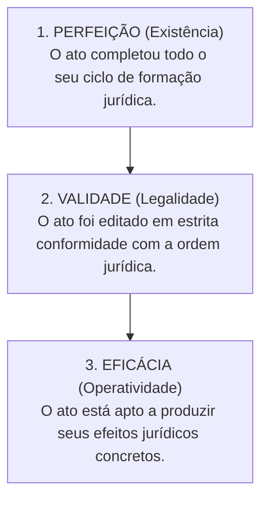
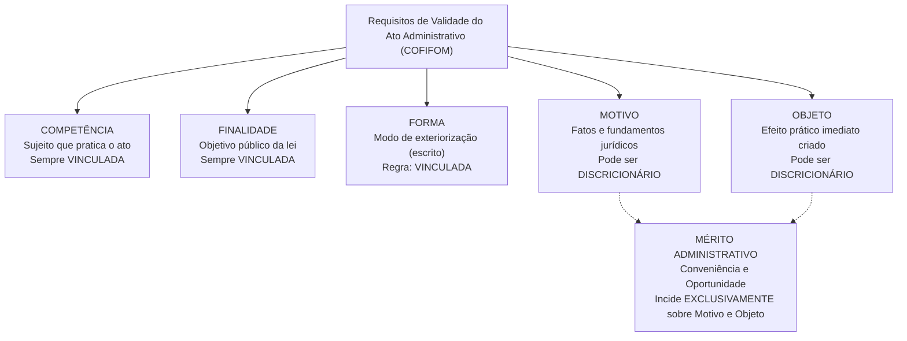
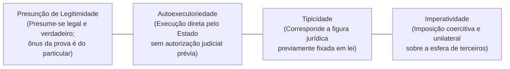
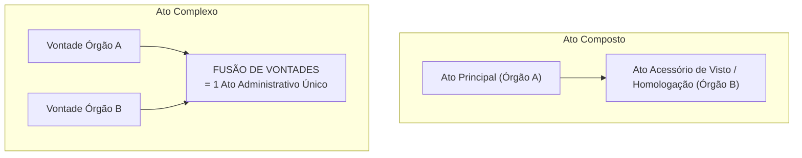

# 03 - Atos Administrativos e Processo Administrativo Estadual (Lei 13.800/2001)

> **Matéria:** Noções de Direito Administrativo  
> **Cargo:** A01 – Técnico de Controle Externo – Especialidade: Técnico Administrativo  
> **Arquivo:** `03_atos_administrativos_e_processo_estadual.md`  

---

## 📌 Ementa / Itens do Edital
- Ato administrativo: conceito, características e distinções
- Elementos e requisitos de validade (Competência, Finalidade, Forma, Motivo e Objeto - COFIFOM)
- Atributos do ato administrativo: Presunção de Legitimidade, Autoexecutoriedade, Tipicidade e Imperatividade (PATI)
- Classificação dos atos administrativos: vinculados e discricionários; simples, complexos e compostos
- Formação, efeitos, perfeição, validade e eficácia
- Extinção dos atos: anulação, revogação, cassação, caducidade e contraposição
- Convalidação (sanamento de vícios de competência e forma)
- Processo Administrativo no Estado de Goiás: Lei Estadual nº 13.800/2001 e alterações

---

## 🧭 Sumário

1. [Teoria Geral do Ato Administrativo e Distinções Conceituais](#1-teoria-geral-do-ato-administrativo-e-distincoes-conceituais)
    1. [Fato da Administração vs. Fato Administrativo vs. Ato Administrativo](#11-fato-da-administracao-vs-fato-administrativo-vs-ato-administrativo)
    2. [Perfeição, Validade e Eficácia do Ato](#12-perfeicao-validade-e-eficacia-do-ato)
    3. [Teste 023](#Teste-023)
2. [Elementos e Requisitos de Validade do Ato (Mnemônico COFIFOM)](#2-elementos-e-requisitos-de-validade-do-ato-mnemonico-cofifom)
    1. [Competência (Sujeito Competente)](#21-competencia-sujeito-competente)
    2. [Finalidade e o Desvio de Poder](#22-finalidade-e-o-desvio-de-poder)
    3. [Forma e Princípio da Solenidade](#23-forma-e-principio-da-solenidade)
    4. [Motivo e a Teoria dos Motivos Determinantes](#24-motivo-e-a-teoria-dos-motivos-determinantes)
    5. [Objeto (Conteúdo) e a Delimitação do Mérito Administrativo](#25-objeto-conteudo-e-a-delimitacao-do-merito-administrativo)
    6. [Teste 024](#Teste-024)
    7. [Teste 025](#Teste-025)
    8. [Teste 026](#Teste-026)
3. [Atributos do Ato Administrativo (Mnemônico PATI)](#3-atributos-do-ato-administrativo-mnemonico-pati)
    1. [Presunção de Legitimidade e Veracidade](#31-presuncao-de-legitimidade-e-veracidade)
    2. [Autoexecutoriedade e seus Limites](#32-autoexecutoriedade-e-seus-limites)
    3. [Tipicidade Administrativa](#33-tipicidade-administrativa)
    4. [Imperatividade e Poder Extroverso](#34-imperatividade-e-poder-extroverso)
    5. [Teste 027](#Teste-027)
4. [Classificações Relevantes para a FCC: Atos Simples, Complexos e Compostos](#4-classificacoes-relevantes-para-a-fcc-atos-simples-complexos-e-compostos)
    1. [Atos Simples, Complexos e Compostos](#41-atos-simples-complexos-e-compostos)
    2. [O Registro de Aposentadoria no Tribunal de Contas (Tema 445 / STF)](#42-o-registro-de-aposentadoria-no-tribunal-de-contas-tema-445-stf)
    3. [Teste 028](#Teste-028)
    4. [Teste 029](#Teste-029)
5. [Extinção e Convalidação dos Atos Administrativos](#5-extincao-e-convalidacao-dos-atos-administrativos)
    1. [Modos de Extinção: Anulação, Revogação, Cassação, Caducidade e Contraposição](#51-modos-de-extincao-anulacao-revogacao-cassacao-caducidade-e-contraposicao)
    2. [Convalidação: Requisitos, Limites e Efeitos Temporais](#52-convalidacao-requisitos-limites-e-efeitos-temporais)
    3. [Teste 030](#Teste-030)
    4. [Teste 031](#Teste-031)
6. [Processo Administrativo no Estado de Goiás (Lei Estadual nº 13.800/2001)](#6-processo-administrativo-no-estado-de-goias-lei-estadual-no-138002001)
    1. [Princípios Norteadores e Direitos dos Administrados](#61-principios-norteadores-e-direitos-dos-administrados)
    2. [Vedações Absolutas à Delegação (Regra do CENORA - Art. 13)](#62-vedacoes-absolutas-a-delegacao-regra-do-cenora-art-13)
    3. [Impedimentos e Suspeição de Agentes e Julgadores](#63-impedimentos-e-suspeicao-de-agentes-e-julgadores)
    4. [Motivação das Decisões e Regime Recursal](#64-motivacao-das-decisoes-e-regime-recursal)
    5. [Teste 032](#Teste-032)
    6. [Teste 033](#Teste-033)
7. [Fontes Recomendadas na Internet](#7-fontes-recomendadas-na-internet)

---

## 1. Teoria Geral do Ato Administrativo e Distinções Conceituais

O ato administrativo é a manifestação unilateral de vontade da Administração Pública ou de quem lhe faça as vezes, que, agindo sob o império do Direito Público, tem por fim imediato adquirir, resguardar, transferir, modificar, extinguir ou declarar direitos, ou impor obrigações aos administrados ou a si própria.

### 1.1 Fato da Administração vs. Fato Administrativo vs. Ato Administrativo

A doutrina administrativista clássica (seguida com rigor pela banca FCC) diferencia os eventos jurídicos da administração pública em três categorias:

- **Fato da Administração:** Evento puramente material ou natural ocorrido no seio da Administração, mas desprovido de repercussão ou consequência jurídica direta para o Direito Administrativo (ex.: o funcionário que limpa o chão de uma repartição; a pintura ordinária de uma parede).
- **Fato Administrativo:** Acontecimento fático que produz efeitos jurídicos relevantes no âmbito do Direito Administrativo. Pode decorrer de um ato voluntário (ex.: a apreensão material de mercadorias pirateadas) ou de um evento da natureza (ex.: a queda de uma árvore sobre veículo particular gerando responsabilidade civil; o decurso do tempo acarretando prescrição).
- **Ato Administrativo:** Declaração jurídica formal e intencional emitida pelo Estado com a finalidade de produzir efeitos jurídicos no mundo do direito (ex.: a expedição de uma licença de obras, a demissão de um servidor público estável, a aplicação de uma penalidade em licitação).

### 1.2 Perfeição, Validade e Eficácia do Ato

A teoria tridimensional do ato administrativo estabelece três planos de análise que não se confundem:

- **Ato Perfeito:** Aquele que completou todas as fases de seu ciclo de formação interna, estando concluído. Pode ser válido ou inválido.
- **Ato Válido:** Aquele que, além de perfeito, atende a todos os requisitos e pressupostos estabelecidos em lei (sem vícios de legalidade).
- **Ato Eficaz:** Aquele que está pronto para deflagrar seus efeitos jurídicos práticos, não dependendo de condição suspensiva, termo inicial ou publicação oficial.
    - *Exemplo Prático FCC:* Um ato de demissão assinado pelo Governador é **perfeito e válido**, mas só se torna **eficaz** a partir de sua publicação no Diário Oficial do Estado.

---

### Teste 023
**(FCC – TRT 11ª – 2017 – Analista Judiciário - Tecnologia da Informação)**
A Lei no 11.126/2005 dispõe sobre o direito do portador de deficiência visual de ingressar e permanecer em ambientes de uso coletivo acompanhado de cão-guia. Qualquer tentativa voltada a impedir ou dificultar o gozo desse direito constitui ato de dis- criminação a ser apenado com multa e

* **A)** prisão preventiva.
* **B)** interdição.
* **C)** detenção.
* **D)** reclusão.
* **E)** trabalhos comunitários.

---

> **Comentário Detalhado:**
>
> - **A)** **Incorreta.** A opção apresenta proposição em desacordo com os fundamentos teóricos e técnicos do tópico ao afirmar que "prisão preventiva". De acordo com a teoria estudada em *2.4 Motivo e a Teoria dos Motivos Determinantes*, o motivo constitui a situação de fato (o evento do mundo real) e a situação de direito (o enquadramento na norma legal) que autorizam ou determinam a prática do ato administrativo.
> - **B)** **Correta.** Conforme fundamentado na seção *3.2 Autoexecutoriedade e seus Limites* deste guia, é a prerrogativa conferida à Administração Pública de compelir materialmente o administrado a cumprir o ato ou executar diretamente a providência administrativa, inclusive com uso moderado da força física policial, sem necessidade de intervenção ou autorização prévia do Poder Judiciário (ex.: guincho de carro estacionado em local proibido; interdição e lacração de restaurante com alimentos deteriorados; apreensão de drogas). Dessa forma, está plenamente correta a assertiva da banca (FCC – TRT 11ª/2017) ao estabelecer que "interdição".
> - **C)** **Incorreta.** A opção apresenta proposição em desacordo com os fundamentos teóricos e técnicos do tópico ao afirmar que "detenção". De acordo com a teoria estudada em *A Teoria dos Motivos Determinantes:*, se for judicialmente ou administrativamente comprovado que o motivo é falso (o órgão tinha recursos abundantes) ou juridicamente inexistente, o ato de exoneração é nulo de pleno direito, devendo ser extirpado da ordem jurídica.
> - **D)** **Incorreta.** A opção apresenta proposição em desacordo com os fundamentos teóricos e técnicos do tópico ao afirmar que "reclusão". De acordo com a teoria estudada em *1.2 Perfeição, Validade e Eficácia do Ato*, ato Perfeito: Aquele que completou todas as fases de seu ciclo de formação interna, estando concluído. Pode ser válido ou inválido.
> - **E)** **Incorreta.** A opção apresenta proposição em desacordo com os fundamentos teóricos e técnicos do tópico ao afirmar que "trabalhos comunitários". De acordo com a teoria estudada em *1. Teoria Geral do Ato Administrativo e Distinções Conceituais*, o ato administrativo é a manifestação unilateral de vontade da Administração Pública ou de quem lhe faça as vezes, que, agindo sob o império do Direito Público, tem por fim imediato adquirir, resguardar, transferir, modificar, extinguir ou declarar direitos, ou impor obrigações aos administrados ou a si própria.
>
> **Gabarito: B**

---

## 2. Elementos e Requisitos de Validade do Ato (Mnemônico COFIFOM)

A Lei de Ação Popular (Lei Federal nº 4.717/1965, art. 2º) positivou a doutrina dos cinco elementos constitutivos indispensáveis para a validade do ato administrativo: **Competência, Finalidade, Forma, Motivo e Objeto** (**COFIFOM**).

### 2.1 Competência (Sujeito Competente)

É o círculo de atribuições conferido pelo ordenamento jurídico ao agente ou órgão público para a prática do ato.

- **Características:** É irrenunciável, intransferível por acordo entre as partes, inderrogável, imprescritível e imodificável pela vontade do titular.
- **Espécies de Vício de Competência:**
    - *Usurpação de Função:* Crime praticado por particular que se faz passar por funcionário público (ato inexistente).
    - *Excesso de Poder:* O agente público ultrapassa os limites legais de suas atribuições funcionais (ato nulo insanável).
    - *Incompetência Relativa:* O ato é praticado por agente de mesmo órgão ou hierarquia que não detinha a atribuição específica, sem que a competência fosse atribuída com exclusividade pela lei. Admite **convalidação** por ratificação da autoridade competente.

### 2.2 Finalidade e o Desvio de Poder

A finalidade representa o objetivo mediato de interesse público que o ato deve alcançar. É elemento **invariavelmente vinculado**; o administrador jamais detém discricionariedade para escolher a finalidade pública a ser perseguida.

- **Desvio de Finalidade (Desvio de Poder):** Ocorre quando a autoridade competente utiliza poderes legítimos para atingir fins alheios ao interesse público ou fim diverso daquele categorizado pela lei para aquela competência (ex.: remoção compulsória de servidor com o propósito punitivo disfarçado de perseguição pessoal). É vício que acarreta a **nulidade absoluta e insanável** do ato administrativo.

### 2.3 Forma e Princípio da Solenidade

A forma é o modo pelo qual a vontade da Administração se exterioriza e ganha publicidade no mundo jurídico.

- No Direito Administrativo vige o princípio do formalismo moderado, mas como regra geral os atos são solenes e devem ser expedidos por **escrito**, contendo data, identificação do cargo e assinatura.
- *Defeitos de Forma:* A omissão de formalidades não essenciais que não prejudiquem o direito de defesa dos administrados configura vício sanável, passível de **convalidação**.

### 2.4 Motivo e a Teoria dos Motivos Determinantes

O motivo constitui a situação de fato (o evento do mundo real) e a situação de direito (o enquadramento na norma legal) que autorizam ou determinam a prática do ato administrativo.

- Não se confunde com a **motivação** (a motivação é a declaração escrita dos motivos; o motivo é o próprio fato em si).

#### A Teoria dos Motivos Determinantes:
Consagrada pela jurisprudência pacífica do STF e do STJ, preceitua que a validade do ato administrativo fica indissoluvelmente vinculada à veracidade, exatidão e subsistência dos motivos alegados pela autoridade:

- Mesmo que o ato seja discricionário e prescindisse originalmente de motivação obrigatória (como a exoneração *ad nutum* de um assessor comissionado), se a autoridade decidir enunciar publicamente um motivo (ex.: afirmar no decreto que exonerou o servidor em razão do corte orçamentário do setor), **o ato ficará vinculado a essa justificativa**.
- Se for judicialmente ou administrativamente comprovado que o motivo é falso (o órgão tinha recursos abundantes) ou juridicamente inexistente, **o ato de exoneração é nulo de pleno direito**, devendo ser extirpado da ordem jurídica.

### 2.5 Objeto (Conteúdo) e a Delimitação do Mérito Administrativo

O objeto é o efeito jurídico imediato e substantivo que o ato produz no mundo real (é o "o que" o ato decide, cria, extingue ou altera). Deve ser lícito, possível, determinado ou determinável.

- **O Mérito Administrativo:** Nos atos discricionários, o mérito administrativo — consubstanciado no juízo de **conveniência e oportunidade** privativo da autoridade pública — incide **estrita e unicamente sobre o Motivo e o Objeto**. Os elementos Competência, Finalidade e Forma são sempre vinculados.

---

### Teste 024
**(FGV – TJ/MT – 2024 – Analista Judiciario Tecnologia Da Informacao)**
Vanessa pretende ingressar na esfera cível com uma ação fundada em direito pessoal em detrimento de Petrônio. Com esse intuito, Vanessa procurou o auxílio de um advogado, o qual lhe orientou sobre diversas temáticas jurídicas, inclusive no que se refere à competência para o processo e julgamento da ação que será proposta. De acordo com a narrativa e considerando as disposições do Código de Processo Civil, analise as afirmativas a seguir: I. A ação fundada em direito pessoal será proposta, em regra, no foro de domicílio do réu. II. Sendo incerto ou desconhecido o domicílio do réu, ele poderá ser demandado onde for encontrado ou no foro de domicílio do autor. III. Quando o réu não tiver domicílio ou residência no Brasil, a ação será proposta no foro de domicílio do autor, e, se este também residir fora do Brasil, a ação deverá ser proposta no Distrito Federal. Nesse cenário, considerando as disposições do Código de Processo Civil, está correto o que se afirma em

* **A)** I, apenas.
* **B)** II, apenas.
* **C)** III, apenas.
* **D)** I e II, apenas.
* **E)** I, II e III.

---

> **Comentário Detalhado:**
>
> - **A)** **Incorreta.** A opção incorre em restrição indevida ao limitar o escopo conceitual ao afirmar que "I, apenas". De acordo com a teoria estudada em *2.2 Finalidade e o Desvio de Poder*, desvio de Finalidade (Desvio de Poder): Ocorre quando a autoridade competente utiliza poderes legítimos para atingir fins alheios ao interesse público ou fim diverso daquele categorizado pela lei para aquela competência (ex.: remoção compulsória de servidor com o propósito punitivo disfarçado de perseguição pessoal).
> - **B)** **Incorreta.** A opção incorre em restrição indevida ao limitar o escopo conceitual ao afirmar que "II, apenas". De acordo com a teoria estudada em *2. Elementos e Requisitos de Validade do Ato (Mnemônico COFIFOM)*, a Lei de Ação Popular (Lei Federal nº 4.717/1965, art. 2º) positivou a doutrina dos cinco elementos constitutivos indispensáveis para a validade do ato administrativo: Competência, Finalidade, Forma, Motivo e Objeto (COFIFOM).
> - **C)** **Incorreta.** A opção incorre em restrição indevida ao limitar o escopo conceitual ao afirmar que "III, apenas". De acordo com a teoria estudada em *4.2 O Registro de Aposentadoria no Tribunal de Contas (Tema 445 / STF)*, *"Em atenção aos princípios da segurança jurídica e da confiança legítima, os Tribunais de Contas estão sujeitos ao prazo de 5 anos para o julgamento da legalidade do ato de concessão inicial de aposentadoria, reforma ou pensão, a contar da chegada do processo à respectiva Corte de Contas, após o qual, se não houver decisão, o ato considerar-se-á definitivamente registrado."*.
> - **D)** **Correta.** Conforme fundamentado na seção *2.3 Forma e Princípio da Solenidade* deste guia, no Direito Administrativo vige o princípio do formalismo moderado, mas como regra geral os atos são solenes e devem ser expedidos por escrito, contendo data, identificação do cargo e assinatura. Dessa forma, está plenamente correta a assertiva da banca (FGV – TJ/MT/2024) ao estabelecer que "I e II, apenas".
> - **E)** **Incorreta.** A opção apresenta proposição em desacordo com os fundamentos teóricos e técnicos do tópico ao afirmar que "I, II e III". De acordo com a teoria estudada em *6.4 Motivação das Decisões e Regime Recursal*, a autoridade julgadora pode confirmar, modificar, anular ou revogar, total ou parcialmente, a decisão recorrida; se da revisão puder decorrer gravame à situação do recorrente (*reformatio in pejus*), este deverá ser cientificado previamente para formular suas alegações no prazo de 10 dias.
>
> **Gabarito: D**

---

### Teste 025
**(FGV – TRT da 24º Região – 2025 – Analista Judiciário - Área Administrativa - Contabilidade)**
A informação de que Pedro, servidor público federal de escalão hierárquico superior, teria praticado uma infração disciplinar, chegou ao conhecimento da autoridade competente. Além de ser informado por seus assessores imediatos sobre a necessidade de instaurar o respectivo processo administrativo disciplinar, também lhe foi sugerida a possibilidade de afastamento preventivo, em razão do risco de que ele influísse na apuração do ilícito administrativo. Em relação ao sugerido afastamento de Pedro, considerando os balizamentos estabelecidos pela Lei nº 8.112/1990, assinale a afirmativa correta.

* **A)** É vedado, considerando a presunção de inocência.
* **B)** Pode se estender pelo prazo máximo de cento e oitenta dias.
* **C)** Caso seja decretado, acarretará a suspensão da remuneração durante a sua vigência.
* **D)** Somente é possível em se tratando de infração disciplinar que possa acarretar a sanção de demissão.
* **E)** Deve cessar, uma vez ultrapassado o limite temporal fixado em lei, ainda que não concluído o processo disciplinar.

---

> **Comentário Detalhado:**
>
> - **A)** **Incorreta.** A opção apresenta proposição em desacordo com os fundamentos teóricos e técnicos do tópico ao afirmar que "É vedado, considerando a presunção de inocência". De acordo com a teoria estudada em *3.1 Presunção de Legitimidade e Veracidade*, presume-se que o ato administrativo foi expedido em estrita consonância com a lei (legitimidade) e que os fatos relatados pelos agentes públicos são verdadeiros (veracidade).
> - **B)** **Incorreta.** A opção apresenta proposição em desacordo com os fundamentos teóricos e técnicos do tópico ao afirmar que "Pode se estender pelo prazo máximo de cento e oitenta dias". De acordo com a teoria estudada em *4.2 O Registro de Aposentadoria no Tribunal de Contas (Tema 445 / STF)*, *"Em atenção aos princípios da segurança jurídica e da confiança legítima, os Tribunais de Contas estão sujeitos ao prazo de 5 anos para o julgamento da legalidade do ato de concessão inicial de aposentadoria, reforma ou pensão, a contar da chegada do processo à respectiva Corte de Contas, após o qual, se não houver decisão, o ato considerar-se-á definitivamente registrado."*.
> - **C)** **Incorreta.** A opção apresenta proposição em desacordo com os fundamentos teóricos e técnicos do tópico ao afirmar que "Caso seja decretado, acarretará a suspensão da remuneração durante a sua vigência". De acordo com a teoria estudada em *6.3 Impedimentos e Suspeição de Agentes e Julgadores*, impedimento (Vício Objetivo - Art. 18): O servidor ou autoridade é legalmente impedido de atuar em processo no qual.
> - **D)** **Incorreta.** A opção incorre em restrição indevida ao limitar o escopo conceitual ao afirmar que "Somente é possível em se tratando de infração disciplinar que possa acarretar a sanção de demissão". De acordo com a teoria estudada em *2.5 Objeto (Conteúdo) e a Delimitação do Mérito Administrativo*, o objeto é o efeito jurídico imediato e substantivo que o ato produz no mundo real (é o "o que" o ato decide, cria, extingue ou altera). Deve ser lícito, possível, determinado ou determinável.
> - **E)** **Correta.** Conforme fundamentado na seção *6. Processo Administrativo no Estado de Goiás (Lei Estadual nº 13.800/2001)* deste guia, a Lei Estadual nº 13.800/2001 disciplina o processo administrativo no âmbito da Administração Pública direta e indireta do Estado de Goiás. Dessa forma, está plenamente correta a assertiva da banca (FGV – TRT da 24º Região/2025) ao estabelecer que "Deve cessar, uma vez ultrapassado o limite temporal fixado em lei, ainda que não concluído o processo disciplinar".
>
> **Gabarito: E**

---

### Teste 026
**(FGV – TRF/1 – 2024 – Analista Judiciario Area Apoio Especializado Especialidade Suporte Em Tecnologia Da Informacao)**
Ao estudar as hipóteses de extinção do ato administrativo, Júlia verificou que há uma modalidade em que isso ocorre em razão da incompatibilidade do ato administrativo com outro posterior, tal como ocorre com a nomeação do servidor, que é extinta com a sua exoneração. Tal modalidade de extinção corresponde a:

* **A)** recusa;
* **B)** renúncia;
* **C)** anulação;
* **D)** revogação;
* **E)** contraposição.

---

> **Comentário Detalhado:**
>
> - **A)** **Incorreta.** A opção apresenta proposição em desacordo com os fundamentos teóricos e técnicos do tópico ao afirmar que "recusa". De acordo com a teoria estudada em *5.1 Modos de Extinção: Anulação, Revogação, Cassação, Caducidade e Contraposição*, modalidade de Extinção: Causa Primária — Efeitos no Tempo — Competência — Distinção Prática FCC.
> - **B)** **Incorreta.** A opção apresenta proposição em desacordo com os fundamentos teóricos e técnicos do tópico ao afirmar que "renúncia". De acordo com a teoria estudada em *5.1 Modos de Extinção: Anulação, Revogação, Cassação, Caducidade e Contraposição*, renúncia: Desistência expressa voluntária manifestada pelo beneficiário — *Ex nunc* — Manifestação do particular — O titular abre mão do benefício conferido pelo ato.
> - **C)** **Incorreta.** A opção apresenta proposição em desacordo com os fundamentos teóricos e técnicos do tópico ao afirmar que "anulação". De acordo com a teoria estudada em *5.1 Modos de Extinção: Anulação, Revogação, Cassação, Caducidade e Contraposição*, anulação: Ilegalidade originária do ato (vício de legalidade insanável) — Retroativo (*ex tunc*) — Administração Pública ou Poder Judiciário — Desfaz o ato desde o nascimento, pois dele não se originam direitos.
> - **D)** **Incorreta.** A opção apresenta proposição em desacordo com os fundamentos teóricos e técnicos do tópico ao afirmar que "revogação". De acordo com a teoria estudada em *5.1 Modos de Extinção: Anulação, Revogação, Cassação, Caducidade e Contraposição*, caducidade: Superveniência de lei nova que torna a atividade ilegal — *Ex nunc* — Administração Pública — O ato era legal, mas nova legislação proibiu a atividade (ex.: lei que veda pedágio na área).
> - **E)** **Correta.** Conforme fundamentado na seção *5.1 Modos de Extinção: Anulação, Revogação, Cassação, Caducidade e Contraposição* deste guia, contraposição / Derrubada: Emissão de novo ato com efeitos antagônicos e incompatíveis — *Ex nunc* — Administração Pública — O novo ato extingue o anterior (ex.: ato de exoneração contrapõe-se ao de nomeação). Dessa forma, está plenamente correta a assertiva da banca (FGV – TRF/1/2024) ao estabelecer que "contraposição".
>
> **Gabarito: E**

---

## 3. Atributos do Ato Administrativo (Mnemônico PATI)

Os atributos do ato administrativo consagram prerrogativas que decorrem diretamente do princípio da supremacia do interesse público:

### 3.1 Presunção de Legitimidade e Veracidade

Presume-se que o ato administrativo foi expedido em estrita consonância com a lei (legitimidade) e que os fatos relatados pelos agentes públicos são verdadeiros (veracidade).

- É presunção relativa (*juris tantum*), que admite prova em contrário.
- Gera a **inversão do ônus da prova**: incumbe ao particular demonstrar e comprovar a ilegalidade ou falsidade do ato impugnado perante o Judiciário ou a Administração.

### 3.2 Autoexecutoriedade e seus Limites

É a prerrogativa conferida à Administração Pública de compelir materialmente o administrado a cumprir o ato ou executar diretamente a providência administrativa, inclusive com uso moderado da força física policial, **sem necessidade de intervenção ou autorização prévia do Poder Judiciário** (ex.: guincho de carro estacionado em local proibido; interdição e lacração de restaurante com alimentos deteriorados; apreensão de drogas).

- **Limites Críticos da Autoexecutoriedade:** A autoexecutoriedade depende de expressa previsão legal ou de situação fática emergencial/urgente.  
> 🚨 **ALERTA CLÁSSICO FCC:**  
> A cobrança de **multas pecuniárias administrativas NÃO é autoexecutória**! Se o particular se recusar a pagar a multa, a Administração não pode tomar o dinheiro de sua conta bancária diretamente; deve inscrever o débito em Dívida Ativa e ajuizar Ação de Execução Fiscal perante o Poder Judiciário.

### 3.3 Tipicidade Administrativa

Formulada por Maria Sylvia Zanella Di Pietro, preceitua que cada ato administrativo deve corresponder rigorosamente a figuras e modelos abstratos previamente tipificados na legislação. Impede que o Estado crie atos unilaterais inominados ou arbitrários sem desenho legal prévio.

### 3.4 Imperatividade e Poder Extroverso

Consiste na faculdade de impor obrigações coercitivas e restrições unilaterais a terceiros, independentemente de sua concordância prévia.

- Não está presente em atos negociais (licenças, autorizações) e atos meramente enunciativos (pareceres, certidões, atestados).

---

### Teste 027
**(FGV – TRT 1ª – 2024 – Analista Judiciário - Área Administrativa)**
No exercício de suas atribuições como analista do Tribunal Regional da 1ª Região, Clarice foi consultada acerca das hipóteses em que o ato administrativo é passível de revogação. Ela respondeu que são passíveis de revogação:

* **A)** os atos administrativos com prazos expirados;
* **B)** os atos administrativos preclusos no processo administrativo;
* **C)** os atos administrativos discricionários;
* **D)** os atos que geram direitos adquiridos;
* **E)** os chamados meros atos administrativos, tais como os atestados.

---

> **Comentário Detalhado:**
>
> - **A)** **Incorreta.** A opção apresenta proposição em desacordo com os fundamentos teóricos e técnicos do tópico ao afirmar que "os atos administrativos com prazos expirados". De acordo com a teoria estudada em *2.5 Objeto (Conteúdo) e a Delimitação do Mérito Administrativo*, o Mérito Administrativo: Nos atos discricionários, o mérito administrativo — consubstanciado no juízo de conveniência e oportunidade privativo da autoridade pública — incide estrita e unicamente sobre o Motivo e o Objeto.
> - **B)** **Incorreta.** A opção apresenta proposição em desacordo com os fundamentos teóricos e técnicos do tópico ao afirmar que "os atos administrativos preclusos no processo administrativo". De acordo com a teoria estudada em *6. Processo Administrativo no Estado de Goiás (Lei Estadual nº 13.800/2001)*, a Lei Estadual nº 13.800/2001 disciplina o processo administrativo no âmbito da Administração Pública direta e indireta do Estado de Goiás.
> - **C)** **Correta.** Conforme fundamentado na seção *5.1 Modos de Extinção: Anulação, Revogação, Cassação, Caducidade e Contraposição* deste guia, o Poder Judiciário JAMAIS pode revogar atos administrativos do Poder Executivo. Dessa forma, está plenamente correta a assertiva da banca (FGV – TRT 1ª/2024) ao estabelecer que "os atos administrativos discricionários".
> - **D)** **Incorreta.** A opção apresenta proposição em desacordo com os fundamentos teóricos e técnicos do tópico ao afirmar que "os atos que geram direitos adquiridos". De acordo com a teoria estudada em *5.1 Modos de Extinção: Anulação, Revogação, Cassação, Caducidade e Contraposição*, revogação: Inconveniência ou inoportunidade superveniente (mérito) — Prospectivo (*ex nunc*) — Exclusiva da própria Administração — Recai sobre atos válidos; respeita direitos adquiridos e atos consumados.
> - **E)** **Incorreta.** A opção apresenta proposição em desacordo com os fundamentos teóricos e técnicos do tópico ao afirmar que "os chamados meros atos administrativos, tais como os atestados". De acordo com a teoria estudada em *3.4 Imperatividade e Poder Extroverso*, não está presente em atos negociais (licenças, autorizações) e atos meramente enunciativos (pareceres, certidões, atestados).
>
> **Gabarito: C**

---

## 4. Classificações Relevantes para a FCC: Atos Simples, Complexos e Compostos

### 4.1 Atos Simples, Complexos e Compostos

- **Ato Simples:** Resulta da manifestação de vontade de um **único órgão** administrativo (seja ele singular, como o ato de um Secretário de Estado, ou colegiado, como a decisão plenária de um Tribunal de Contas).
- **Ato Composto:** Resulta da manifestação de vontade de um único órgão que emite um **ato principal**, cuja eficácia depende de um **ato instrumental acessório** emanado de outro órgão (ex.: aprovação, homologação, visto, chancela). Há um ato principal e um ato acessório.
- **Ato Complexo:** Resulta da **fusão e integração convergente de vontades de dois ou mais órgãos autônomos e independentes**, que se conjugam para formar um **único ato administrativo final**.

### 4.2 O Registro de Aposentadoria no Tribunal de Contas (Tema 445 / STF)

O julgamento da legalidade e a concessão de registro de aposentadoria, pensão ou reforma pelas Cortes de Contas é um dos temas prediletos da FCC:

1. **Natureza Jurídica:** Trata-se categoricamente de um **ato administrativo complexo** (Súmula Vinculante nº 3 e pacífica jurisprudência do STF). O ato inicial expedido pelo órgão de origem é meramente precário e provisório; somente ganha definitividade e perfeição com o julgamento e registro pelo Tribunal de Contas.
2. **Dispensa de Contraditório Prévio (SV nº 3):** Na apreciação da legalidade do ato de concessão inicial de aposentadoria, é dispensado o contraditório e a ampla defesa no Tribunal de Contas, salvo se transcorrer prazo desarrazoado.
3. **O Prazo Decadencial de 5 Anos (Tema 445 do STF):** O STF fixou a seguinte tese vinculante:
   > *"Em atenção aos princípios da segurança jurídica e da confiança legítima, os Tribunais de Contas estão sujeitos ao prazo de 5 anos para o julgamento da legalidade do ato de concessão inicial de aposentadoria, reforma ou pensão, **a contar da chegada do processo à respectiva Corte de Contas**, após o qual, se não houver decisão, o ato considerar-se-á definitivamente registrado."*
4. **Impossibilidade de Revogação por Conveniência:** Por se tratar de ato vinculado, a autoridade de origem não pode revogar a aposentadoria com base em razões de conveniência ou oportunidade (mérito).

---

### Teste 028
**(FGV – TCE/PA – 2024 – Auditor de Controle Externo - Administrativa - Administração)**
Ao estudar a classificação dos atos administrativos, à luz da orientação do Supremo Tribunal Federal, Josiane verificou que é correto indicar como um ato administrativo complexo

* **A)** a decisão plenária de certo Tribunal de Contas.
* **B)** a determinação de ressarcimento ao erário pelo Tribunal de Contas, após o devido processo administrativo.
* **C)** o registro de aposentadoria de servidores públicos ocupantes de cargo efetivo junto ao respectivo Tribunal de Conta.
* **D)** a desconsideração da personalidade jurídica em sede administrativa, realizada pelo Tribunal de Contas em determinado processo administrativo.
* **E)** o reconhecimento de ilegalidade de determinada verba remuneratória paga a servidor público, por decisão do Tribunal de Contas.

---

> **Comentário Detalhado:**
>
> - **A)** **Incorreta.** A opção apresenta proposição em desacordo com os fundamentos teóricos e técnicos do tópico ao afirmar que "a decisão plenária de certo Tribunal de Contas". De acordo com a teoria estudada em *4.1 Atos Simples, Complexos e Compostos*, ato Simples: Resulta da manifestação de vontade de um único órgão administrativo (seja ele singular, como o ato de um Secretário de Estado, ou colegiado, como a decisão plenária de um Tribunal de Contas).
> - **B)** **Incorreta.** A opção apresenta proposição em desacordo com os fundamentos teóricos e técnicos do tópico ao afirmar que "a determinação de ressarcimento ao erário pelo Tribunal de Contas, após o devido processo administrativo". De acordo com a teoria estudada em *4.2 O Registro de Aposentadoria no Tribunal de Contas (Tema 445 / STF)*, *"Em atenção aos princípios da segurança jurídica e da confiança legítima, os Tribunais de Contas estão sujeitos ao prazo de 5 anos para o julgamento da legalidade do ato de concessão inicial de aposentadoria, reforma ou pensão, a contar da chegada do processo à respectiva Corte de Contas, após o qual, se não houver decisão, o ato considerar-se-á definitivamente registrado."*.
> - **C)** **Correta.** Conforme fundamentado na seção *4.2 O Registro de Aposentadoria no Tribunal de Contas (Tema 445 / STF)* deste guia, natureza Jurídica: Trata-se categoricamente de um ato administrativo complexo (Súmula Vinculante nº 3 e pacífica jurisprudência do STF). Dessa forma, está plenamente correta a assertiva da banca (FGV – TCE/PA/2024) ao estabelecer que "o registro de aposentadoria de servidores públicos ocupantes de cargo efetivo junto ao respectivo Tribunal de Conta".
> - **D)** **Incorreta.** A opção apresenta proposição em desacordo com os fundamentos teóricos e técnicos do tópico ao afirmar que "a desconsideração da personalidade jurídica em sede administrativa, realizada pelo Tribunal de Contas em...". De acordo com a teoria estudada em *4.2 O Registro de Aposentadoria no Tribunal de Contas (Tema 445 / STF)*, o ato inicial expedido pelo órgão de origem é meramente precário e provisório; somente ganha definitividade e perfeição com o julgamento e registro pelo Tribunal de Contas.
> - **E)** **Incorreta.** A opção apresenta proposição em desacordo com os fundamentos teóricos e técnicos do tópico ao afirmar que "o reconhecimento de ilegalidade de determinada verba remuneratória paga a servidor público, por decisão do...". De acordo com a teoria estudada em *4.2 O Registro de Aposentadoria no Tribunal de Contas (Tema 445 / STF)*, dispensa de Contraditório Prévio (SV nº 3): Na apreciação da legalidade do ato de concessão inicial de aposentadoria, é dispensado o contraditório e a ampla defesa no Tribunal de Contas, salvo se transcorrer prazo desarrazoado.
>
> **Gabarito: C**

---

### Teste 029
**(FCC – TRT 11ª – 2017 – Analista Judiciário - Tecnologia da Informação)**
Palavras utilizadas no texto motivaram as frases que seguem, que, entretanto, devem ser analisadas independentemente dele. A que se apresenta em conformidade com as normas de concordância é:

* **A)** Grupos indígenas, principalmente inserido no contexto do rio Amazonas, vem chamando a atenção de pesquisadores de distintas áreas do saber, estudiosos que os julgam detentores de muitos segredos.
* **B)** Adepto ou não desse entendimento sobre a formação de um estrato neo-indígena, especialistas em etnografia muito se dedicam a interpretar os dados apresentados na pesquisa recém-publicada.
* **C)** Certamente podem ter havido entre os leitores-pesquisadores muitas dúvidas sobre a magnitude do citado desapare- cimento de nações indígenas que viviam ao longo do rio Amazonas.
* **D)** Fenômenos demográficos e culturais, em qualquer época da história da humanidade, sempre pôde produzir efeitos insus- peitados, e muitas vezes o fez.
* **E)** O capítulo evidencia que vários aspectos da história indígena amazonense devem merecer ainda cuidadosa reflexão, porque, apesar da curiosidade que suscita, muito dela ainda permanece obscuro. Atenção: Considere o texto abaixo para responder às questões de números 6 a 12. 1 Três em cada quatro brasileiros se consideram católicos. Pelas contas do Censo 2000, para uma população total em torno de 170 milhões de habitantes, o Brasil entra no século XXI aproximadamente com 125 milhões de católicos decla- rados, praticamente três quartos da população residente total. Quer dizer que no início do terceiro milênio ainda é possível a esse país, o maior e mais populoso da “América cató- 5 lica”, continuar ostentando com fundamento em dados estatísticos cientificamente controlados e religiosamente isentos sua histórica posição de nação com hegemonia católica, que um dia lhe valeu o desgastado título que o aclama como “o maior país católico do mundo”. Tradicionalmente autoaplicado por seus habitantes em conotações que, a bem da verdade, sofrem polarizações e inflexões de toda espécie e grau, que vão do contentamento envaidecido sem ressalvas ao lamento aborrecido sem reservas, a plausibilidade desse superlativo identitário pode estar com os dias contados. 10 Não obstante a permanência ininterrupta da enorme desigualdade em tamanho e estatura das religiões no Brasil, não é mais possível, nos dias que correm, desconhecer que a sociedade brasileira está passando por um processo de transição religiosa que é notório. Visível a olho nu. Mas não só, uma vez que se trata de um processo que tem sido há décadas acompanhado atentamente, e comprovado a frio reiteradamente, pelas estatísticas censitárias. Esse lento vir a ser, ao mesmo tempo matemático e falastrão, vai pouco a pouco desfigurando nosso velho semblante cultural com a introdução 15 gradual, mas nem por isso menos corrosiva, de estranhamentos e distâncias, descontinuidades e respiros no batido ramerrão do imaginário religioso nacional. Com efeito, hoje se assiste em nosso país a um vigoroso movimento de transição demográfico-religiosa que já assumiu a forma de progressiva migração de contingentes católicos para outras religiões. Ou mesmo para nenhuma. (Adaptado de: PIERUCCI, Antonio Flávio. Religiões no Brasil. In: BOTELHO, André e SCHWARCZ, Lilia Moritz (orgs.). Agenda Brasileira: temas de uma sociedade em mudança. Companhia das Letras, 2011, p. 472-473)

---

> **Comentário Detalhado:**
>
> - **A)** **Incorreta.** A opção apresenta proposição em desacordo com os fundamentos teóricos e técnicos do tópico ao afirmar que "Grupos indígenas, principalmente inserido no contexto do rio Amazonas, vem chamando a atenção de pesquisadores de...". De acordo com a teoria estudada em *6.3 Impedimentos e Suspeição de Agentes e Julgadores*, suspeição (Vício Subjetivo - Art. 20): Pode ser arguida a suspeição de autoridade ou servidor que tenha amizade íntima ou inimizade notória com algum dos interessados ou com os respectivos cônjuges, companheiros, parentes e afins até o terceiro grau.
> - **B)** **Incorreta.** A opção apresenta proposição em desacordo com os fundamentos teóricos e técnicos do tópico ao afirmar que "Adepto ou não desse entendimento sobre a formação de um estrato neo-indígena, especialistas em etnografia muito se...". De acordo com a teoria estudada em *2.3 Forma e Princípio da Solenidade*, no Direito Administrativo vige o princípio do formalismo moderado, mas como regra geral os atos são solenes e devem ser expedidos por escrito, contendo data, identificação do cargo e assinatura.
> - **C)** **Incorreta.** A opção apresenta proposição em desacordo com os fundamentos teóricos e técnicos do tópico ao afirmar que "Certamente podem ter havido entre os leitores-pesquisadores muitas dúvidas sobre a magnitude do citado desapare-...". De acordo com a teoria estudada em *4.2 O Registro de Aposentadoria no Tribunal de Contas (Tema 445 / STF)*, *"Em atenção aos princípios da segurança jurídica e da confiança legítima, os Tribunais de Contas estão sujeitos ao prazo de 5 anos para o julgamento da legalidade do ato de concessão inicial de aposentadoria, reforma ou pensão, a contar da chegada do processo à respectiva Corte de Contas, após o qual, se não houver decisão, o ato considerar-se-á definitivamente registrado."*.
> - **D)** **Incorreta.** A opção promove generalização excessiva que desconsidera as condições técnicas e normativas ao afirmar que "Fenômenos demográficos e culturais, em qualquer época da história da humanidade, sempre pôde produzir efeitos...". De acordo com a teoria estudada em *6.4 Motivação das Decisões e Regime Recursal*, a autoridade julgadora pode confirmar, modificar, anular ou revogar, total ou parcialmente, a decisão recorrida; se da revisão puder decorrer gravame à situação do recorrente (*reformatio in pejus*), este deverá ser cientificado previamente para formular suas alegações no prazo de 10 dias.
> - **E)** **Correta.** Conforme fundamentado na seção *2.5 Objeto (Conteúdo) e a Delimitação do Mérito Administrativo* deste guia, o objeto é o efeito jurídico imediato e substantivo que o ato produz no mundo real (é o "o que" o ato decide, cria, extingue ou altera). Deve ser lícito, possível, determinado ou determinável. Dessa forma, está plenamente correta a assertiva da banca (FCC – TRT 11ª/2017) ao estabelecer que "O capítulo evidencia que vários aspectos da história indígena amazonense devem merecer ainda cuidadosa reflexão...".
>
> **Gabarito: E**

---

## 5. Extinção e Convalidação dos Atos Administrativos

### 5.1 Modos de Extinção: Anulação, Revogação, Cassação, Caducidade e Contraposição

| Modalidade de Extinção | Causa Primária | Efeitos no Tempo | Competência | Distinção Prática FCC |
| :--- | :--- | :---: | :--- | :--- |
| **Anulação** | **Ilegalidade originária** do ato (vício de legalidade insanável) | **Retroativo (*ex tunc*)** | Administração Pública ou Poder Judiciário | Desfaz o ato desde o nascimento, pois dele não se originam direitos. |
| **Revogação** | **Inconveniência ou inoportunidade superveniente** (mérito) | **Prospectivo (*ex nunc*)** | **Exclusiva da própria Administração** | Recai sobre atos válidos; respeita direitos adquiridos e atos consumados. |
| **Cassação** | **Descumprimento de condições legais** pelo particular beneficiário | *Ex nunc* | Administração Pública | Sanção contra o administrado faltoso (ex.: cassar alvará sanitário por comida estragada). |
| **Caducidade** | **Superveniência de lei nova** que torna a atividade ilegal | *Ex nunc* | Administração Pública | O ato era legal, mas nova legislação proibiu a atividade (ex.: lei que veda pedágio na área). |
| **Contraposição / Derrubada** | Emissão de **novo ato com efeitos antagônicos** e incompatíveis | *Ex nunc* | Administração Pública | O novo ato extingue o anterior (ex.: ato de exoneração contrapõe-se ao de nomeação). |
| **Renúncia** | Desistência expressa voluntária manifestada pelo beneficiário | *Ex nunc* | Manifestação do particular | O titular abre mão do benefício conferido pelo ato. |

> ⚠️ **Atenção Máxima FCC:**  
> O Poder Judiciário **JAMAIS pode revogar atos administrativos do Poder Executivo**. O Judiciário pode anular atos ilegais, mas se pronunciar sobre a conveniência e oportunidade de atos do Executivo configuraria intolerável violação à separação dos Poderes (art. 2º da CF).

### 5.2 Convalidação: Requisitos, Limites e Efeitos Temporais

A convalidação (ou sanatória) é o ato administrativo pelo qual a Administração corrige e supre um vício existente em ato ilegal anterior com efeitos retroativos (**ex tunc**).

- **Dispositivo Normativo:** Art. 55 da Lei Federal nº 9.784/1999 e art. 54 da Lei Estadual/GO nº 13.800/2001.
- **Requisitos Cumulativos Obrigatórios:**
    1. O ato **não pode acarretar lesão ao interesse público**;
    2. O ato **não pode causar prejuízos a terceiros de boa-fé**;
    3. O vício deve ser **sanável**.

- **Defeitos Sanáveis que Comportam Convalidação:**
    - **Competência quanto à Pessoa:** Admite convalidação (ratificação pela autoridade competente), desde que a lei **NÃO tenha atribuído competência exclusiva** à autoridade que praticou o ato originário.
    - **Forma:** Admite convalidação se a forma desrespeitada não foi expressamente exigida por lei como requisito essencial de validade do ato.
- **Defeitos Insanáveis (NULIDADE ABSOLUTA - Vedada Convalidação):**
    - Vício de **Finalidade** (desvio de poder);
    - Vício de **Motivo** (motivo falso ou inexistente);
    - Vício de **Objeto** (objeto ilícito ou impossível);
    - Vício de competência privativa/exclusiva ou forma essencial.

---

### Teste 030
**(FGV – TJ/AP – 2023 – Analista Judiciario Apoio Especializado Tecnologia Da Informacao Banco De Dados)**
A autoridade competente no âmbito da atividade de controle sugeriu a revogação de todos os atos administrativos que não mais atendam ao interesse público, mas foi indagada acerca da existência de atos que não seriam passíveis de tal modalidade de extinção. Diante dessa situação hipotética, é correto afirmar que:

* **A)** todos os atos administrativos são passíveis de revogação;
* **B)** apenas os atos vinculados são passíveis de revogação;
* **C)** nenhum ato administrativo é passível de revogação;
* **D)** somente os atos discricionários são passíveis de revogação;
* **E)** apenas os atos administrativos que já exauriram os seus efeitos não podem ser revogados. Conhecimentos Específicos Quando referenciadas, considere as tabelas relacionais Competidor e Disputa, cujas estruturas e instâncias são descritas abaixo. Todas as colunas são definidas como strings. A tabela Disputa contém as disputas realizadas entre competidores que aparecem na tabela Competidor. Em cada disputa há dois competidores, um com camisa azul e outro com camisa verde. Competidor Disputa Nome Azul Verde A A B B C A C B A D C E E F A F F D

---

> **Comentário Detalhado:**
>
> - **A)** **Incorreta.** A opção apresenta proposição em desacordo com os fundamentos teóricos e técnicos do tópico ao afirmar que "todos os atos administrativos são passíveis de revogação". De acordo com a teoria estudada em *2.5 Objeto (Conteúdo) e a Delimitação do Mérito Administrativo*, o Mérito Administrativo: Nos atos discricionários, o mérito administrativo — consubstanciado no juízo de conveniência e oportunidade privativo da autoridade pública — incide estrita e unicamente sobre o Motivo e o Objeto.
> - **B)** **Incorreta.** A opção incorre em restrição indevida ao limitar o escopo conceitual ao afirmar que "apenas os atos vinculados são passíveis de revogação". De acordo com a teoria estudada em *5.1 Modos de Extinção: Anulação, Revogação, Cassação, Caducidade e Contraposição*, revogação: Inconveniência ou inoportunidade superveniente (mérito) — Prospectivo (*ex nunc*) — Exclusiva da própria Administração — Recai sobre atos válidos; respeita direitos adquiridos e atos consumados.
> - **C)** **Incorreta.** A opção apresenta proposição em desacordo com os fundamentos teóricos e técnicos do tópico ao afirmar que "nenhum ato administrativo é passível de revogação". De acordo com a teoria estudada em *5.1 Modos de Extinção: Anulação, Revogação, Cassação, Caducidade e Contraposição*, o Judiciário pode anular atos ilegais, mas se pronunciar sobre a conveniência e oportunidade de atos do Executivo configuraria intolerável violação à separação dos Poderes (art. 2º da CF).
> - **D)** **Correta.** Conforme fundamentado na seção *5.1 Modos de Extinção: Anulação, Revogação, Cassação, Caducidade e Contraposição* deste guia, o Poder Judiciário JAMAIS pode revogar atos administrativos do Poder Executivo. Dessa forma, está plenamente correta a assertiva da banca (FGV – TJ/AP/2023) ao estabelecer que "somente os atos discricionários são passíveis de revogação".
> - **E)** **Incorreta.** A opção incorre em restrição indevida ao limitar o escopo conceitual ao afirmar que "apenas os atos administrativos que já exauriram os seus efeitos não podem ser revogados. Conhecimentos Específicos...". De acordo com a teoria estudada em *4.1 Atos Simples, Complexos e Compostos*, ato Complexo: Resulta da fusão e integração convergente de vontades de dois ou mais órgãos autônomos e independentes, que se conjugam para formar um único ato administrativo final.
>
> **Gabarito: D**

---

### Teste 031
**(FGV – TCE/PA – 2024 – Auditor de Controle Externo - Administrativa - Gestão Governamental)**
No âmbito da autotutela, existem diferentes modalidades de extinção do ato por manifestação de vontade da Administração, entre as quais encontram-se as seguintes situações: I. Extinção do ato administrativo discricionário, apenas pelo fato de que a situação nele contemplada não é mais admitida pela legislação. II. Extinção do ato administrativo em razão de ilegalidade superveniente atribuída ao respectivo beneficiário. III. Extinção do ato administrativo em decorrência do reconhecimento de um vício grave e insanável. As situações I, II e III referem-se, respectivamente, a extinções por

* **A)** caducidade, cassação e anulação.
* **B)** revogação, anulação e caducidade.
* **C)** anulação, cassação e revogação.
* **D)** revogação, cassação e anulação.
* **E)** caducidade, revogação e cassação.

---

> **Comentário Detalhado:**
>
> - **A)** **Correta.** Conforme fundamentado na seção *5.1 Modos de Extinção: Anulação, Revogação, Cassação, Caducidade e Contraposição* deste guia, anulação: Ilegalidade originária do ato (vício de legalidade insanável) — Retroativo (*ex tunc*) — Administração Pública ou Poder Judiciário — Desfaz o ato desde o nascimento, pois dele não se originam direitos. Dessa forma, está plenamente correta a assertiva da banca (FGV – TCE/PA/2024) ao estabelecer que "caducidade, cassação e anulação".
> - **B)** **Incorreta.** A opção apresenta proposição em desacordo com os fundamentos teóricos e técnicos do tópico ao afirmar que "revogação, anulação e caducidade". De acordo com a teoria estudada em *5.1 Modos de Extinção: Anulação, Revogação, Cassação, Caducidade e Contraposição*, renúncia: Desistência expressa voluntária manifestada pelo beneficiário — *Ex nunc* — Manifestação do particular — O titular abre mão do benefício conferido pelo ato.
> - **C)** **Incorreta.** A opção apresenta proposição em desacordo com os fundamentos teóricos e técnicos do tópico ao afirmar que "anulação, cassação e revogação". De acordo com a teoria estudada em *5.1 Modos de Extinção: Anulação, Revogação, Cassação, Caducidade e Contraposição*, caducidade: Superveniência de lei nova que torna a atividade ilegal — *Ex nunc* — Administração Pública — O ato era legal, mas nova legislação proibiu a atividade (ex.: lei que veda pedágio na área).
> - **D)** **Incorreta.** A opção apresenta proposição em desacordo com os fundamentos teóricos e técnicos do tópico ao afirmar que "revogação, cassação e anulação". De acordo com a teoria estudada em *5.1 Modos de Extinção: Anulação, Revogação, Cassação, Caducidade e Contraposição*, revogação: Inconveniência ou inoportunidade superveniente (mérito) — Prospectivo (*ex nunc*) — Exclusiva da própria Administração — Recai sobre atos válidos; respeita direitos adquiridos e atos consumados.
> - **E)** **Incorreta.** A opção apresenta proposição em desacordo com os fundamentos teóricos e técnicos do tópico ao afirmar que "caducidade, revogação e cassação". De acordo com a teoria estudada em *5.1 Modos de Extinção: Anulação, Revogação, Cassação, Caducidade e Contraposição*, cassação: Descumprimento de condições legais pelo particular beneficiário — *Ex nunc* — Administração Pública — Sanção contra o administrado faltoso (ex.: cassar alvará sanitário por comida estragada).
>
> **Gabarito: A**

---

## 6. Processo Administrativo no Estado de Goiás (Lei Estadual nº 13.800/2001)

A **Lei Estadual nº 13.800/2001** disciplina o processo administrativo no âmbito da Administração Pública direta e indireta do Estado de Goiás:

### 6.1 Princípios Norteadores e Direitos dos Administrados

- Subordina-se aos princípios da legalidade, finalidade, motivação, razoabilidade, proporcionalidade, moralidade, ampla defesa, contraditório, segurança jurídica, interesse público e eficiência (art. 2º).
- Reconhece o direito do cidadão de ser tratado com respeito, ter ciência da tramitação dos processos em que tenha a condição de interessado, ter vista dos autos, obter certidões e formular alegações e apresentar documentos antes da tomada da decisão.

### 6.2 Vedações Absolutas à Delegação (Regra do CENORA - Art. 13)

Reproduzindo a regra geral do direito público brasileiro, o art. 13 da Lei Goiana nº 13.800/2001 veda taxativamente a delegação de três matérias específicas:

1. **Competência Exclusiva** atribuída por lei a determinado órgão ou autoridade;
2. Edição de atos de caráter **Normativo**;
3. Decisão de **Recursos Administrativos**.

### 6.3 Impedimentos e Suspeição de Agentes e Julgadores

Para assegurar a imparcialidade nas decisões administrativas, a lei estadual estabelece distinção crucial entre:

- **Impedimento (Vício Objetivo - Art. 18):** O servidor ou autoridade é legalmente impedido de atuar em processo no qual:
    - Tenha interesse direto ou indireto na matéria;
    - Tenha participado ou venha a participar como perito, testemunha ou representante, ou se tais situações ocorrerem quanto ao cônjuge, companheiro ou parentes até o terceiro grau;
    - Esteja litigando judicial ou administrativamente com o interessado ou respectivo cônjuge/companheiro.
    - *Omissão do Impedimento:* Constitui falta disciplinar grave.
- **Suspeição (Vício Subjetivo - Art. 20):** Pode ser arguida a suspeição de autoridade ou servidor que tenha amizade íntima ou inimizade notória com algum dos interessados ou com os respectivos cônjuges, companheiros, parentes e afins até o terceiro grau.

### 6.4 Motivação das Decisões e Regime Recursal

- **Dever de Motivação (Art. 50):** As decisões que neguem, limitem ou afetem direitos ou interesses, imponham sanções, decidam recursos, dispensem licitações ou anulem/revoguem atos anteriores devem ser expressamente motivadas, com indicação dos fatos e fundamentos jurídicos.
- **Prazos Recursais (Art. 59):** Salvo disposição legal específica em contrário, o prazo para interposição de recurso administrativo na administração goiana é de **10 (dez) dias**, contados da ciência ou divulgação oficial da decisão.
- **Efeitos do Recurso e Reformatio in Pejus (Arts. 61 e 64):** O recurso tem como regra geral efeito estritamente devolutivo (efeito suspensivo é excepcional). A autoridade julgadora pode confirmar, modificar, anular ou revogar, total ou parcialmente, a decisão recorrida; se da revisão puder decorrer gravame à situação do recorrente (*reformatio in pejus*), este deverá ser cientificado previamente para formular suas alegações no prazo de 10 dias.

---

### Teste 032
**(FGV – TRF/1 – 2024 – Analista Judiciario Area Apoio Especializado Especialidade Suporte Em Tecnologia Da Informacao)**
Para além dos princípios previstos expressamente no Art. 37, caput, da CRFB/1988, as normas que versam sobre direito administrativo costumam elencar outros princípios relacionados às respectivas matérias (setoriais), tal como se observa no Art. 2º da Lei nº 9.784/1999, que trata do processo administrativo, e no Art. 5º da Lei nº 14.133/2021, que trata de licitações e contratos. Nesse contexto, os princípios que NÃO estão no aludido dispositivo constitucional, mas que constam textualmente das referidas normas, são, respectivamente:

* **A)** impessoalidade e vinculação ao edital;
* **B)** segregação de funções e moralidade;
* **C)** motivação e publicidade;
* **D)** proporcionalidade e planejamento;
* **E)** probidade administrativa e eficiência. Noções de Direito Constitucional

---

> **Comentário Detalhado:**
>
> - **A)** **Incorreta.** A opção apresenta proposição em desacordo com os fundamentos teóricos e técnicos do tópico ao afirmar que "impessoalidade e vinculação ao edital". De acordo com a teoria estudada em *5.2 Convalidação: Requisitos, Limites e Efeitos Temporais*, dispositivo Normativo: Art. 55 da Lei Federal nº 9.784/1999 e art. 54 da Lei Estadual/GO nº 13.800/2001.
> - **B)** **Incorreta.** A opção apresenta proposição em desacordo com os fundamentos teóricos e técnicos do tópico ao afirmar que "segregação de funções e moralidade". De acordo com a teoria estudada em *6.2 Vedações Absolutas à Delegação (Regra do CENORA - Art. 13)*, reproduzindo a regra geral do direito público brasileiro, o art. 13 da Lei Goiana nº 13.800/2001 veda taxativamente a delegação de três matérias específicas.
> - **C)** **Incorreta.** A opção apresenta proposição em desacordo com os fundamentos teóricos e técnicos do tópico ao afirmar que "motivação e publicidade". De acordo com a teoria estudada em *6.4 Motivação das Decisões e Regime Recursal*, dever de Motivação (Art. 50): As decisões que neguem, limitem ou afetem direitos ou interesses, imponham sanções, decidam recursos, dispensem licitações ou anulem/revoguem atos anteriores devem ser expressamente motivadas, com indicação dos fatos e fundamentos jurídicos.
> - **D)** **Correta.** Conforme fundamentado na seção *6.1 Princípios Norteadores e Direitos dos Administrados* deste guia, subordina-se aos princípios da legalidade, finalidade, motivação, razoabilidade, proporcionalidade, moralidade, ampla defesa, contraditório, segurança jurídica, interesse público e eficiência (art. 2º). Dessa forma, está plenamente correta a assertiva da banca (FGV – TRF/1/2024) ao estabelecer que "proporcionalidade e planejamento".
> - **E)** **Incorreta.** A opção apresenta proposição em desacordo com os fundamentos teóricos e técnicos do tópico ao afirmar que "probidade administrativa e eficiência. Noções de Direito Constitucional". De acordo com a teoria estudada em *6.1 Princípios Norteadores e Direitos dos Administrados*, reconhece o direito do cidadão de ser tratado com respeito, ter ciência da tramitação dos processos em que tenha a condição de interessado, ter vista dos autos, obter certidões e formular alegações e apresentar documentos antes da tomada da decisão.
>
> **Gabarito: D**

---

### Teste 033
**(FGV – TRT 16ª – 2022 – Analista Judiciário (Área Administrativa - Tecnologia da Informação))**
O Presidente da autarquia federal XX delegou a órgão hierarquicamente inferior, por tempo indeterminado, a competência para praticar certos atos administrativos de natureza não normativa. Apesar da plena vigência da delegação, esse agente desejava praticar, ele próprio, certo ato administrativo. À luz da sistemática estabelecida pela Lei nº 9.784/1999, é correto afirmar que o Presidente da autarquia federal XX

* **A)** pode exercer, no momento em que melhor lhe aprouver, independente de qualquer motivação, a competência que fora delegada, desde que comunique ao órgão delegado.
* **B)** está impedido de exercer a competência que fora delegada, sem exceções, enquanto perdurar a delegação, pois se trata de uma nova regra de competência, de natureza derivada.
* **C)** somente pode exercer a competência que fora delegada após o decurso de trinta dias, contados da notificação administrativa do órgão hierarquicamente inferior.
* **D)** pode avocar temporariamente a competência que fora delegada, o que se dará em caráter excepcional e por motivos relevantes devidamente justificados.
* **E)** possui competência concorrente com o órgão hierarquicamente inferior para o exercício da competência

---

> **Comentário Detalhado:**
>
> - **A)** **Incorreta.** A opção promove generalização excessiva que desconsidera as condições técnicas e normativas ao afirmar que "pode exercer, no momento em que melhor lhe aprouver, independente de qualquer motivação, a competência que fora...". De acordo com a teoria estudada em *2.1 Competência (Sujeito Competente)*, *Incompetência Relativa:* O ato é praticado por agente de mesmo órgão ou hierarquia que não detinha a atribuição específica, sem que a competência fosse atribuída com exclusividade pela lei. Admite convalidação por ratificação da autoridade competente.
> - **B)** **Incorreta.** A opção apresenta proposição em desacordo com os fundamentos teóricos e técnicos do tópico ao afirmar que "está impedido de exercer a competência que fora delegada, sem exceções, enquanto perdurar a delegação, pois se...". De acordo com a teoria estudada em *4.2 O Registro de Aposentadoria no Tribunal de Contas (Tema 445 / STF)*, natureza Jurídica: Trata-se categoricamente de um ato administrativo complexo (Súmula Vinculante nº 3 e pacífica jurisprudência do STF).
> - **C)** **Incorreta.** A opção incorre em restrição indevida ao limitar o escopo conceitual ao afirmar que "somente pode exercer a competência que fora delegada após o decurso de trinta dias, contados da notificação...". De acordo com a teoria estudada em *1.1 Fato da Administração vs. Fato Administrativo vs. Ato Administrativo*, pode decorrer de um ato voluntário (ex.: a apreensão material de mercadorias pirateadas) ou de um evento da natureza (ex.: a queda de uma árvore sobre veículo particular gerando responsabilidade civil; o decurso do tempo acarretando prescrição).
> - **D)** **Correta.** Conforme fundamentado na seção *6.2 Vedações Absolutas à Delegação (Regra do CENORA - Art. 13)* deste guia, competência Exclusiva atribuída por lei a determinado órgão ou autoridade. Dessa forma, está plenamente correta a assertiva da banca (FGV – TRT 16ª/2022) ao estabelecer que "pode avocar temporariamente a competência que fora delegada, o que se dará em caráter excepcional e por motivos...".
> - **E)** **Incorreta.** A opção apresenta proposição em desacordo com os fundamentos teóricos e técnicos do tópico ao afirmar que "possui competência concorrente com o órgão hierarquicamente inferior para o exercício da competência". De acordo com a teoria estudada em *2.1 Competência (Sujeito Competente)*, é o círculo de atribuições conferido pelo ordenamento jurídico ao agente ou órgão público para a prática do ato.
>
> **Gabarito: D**

---

## 7. Fontes Recomendadas na Internet

- [Lei Estadual de Goiás nº 13.800/2001 (Processo Administrativo Estadual de Goiás)](https://legisla.casacivil.go.gov.br/pesquisa_legislacao/81441/lei-13800)  
  Texto legal consolidado que disciplina o processo administrativo, impedimentos, suspeição, convalidação e prazos recursais no Estado de Goiás.
- [Lei Federal nº 4.717/1965 (Lei da Ação Popular - Art. 2º)](https://www.planalto.gov.br/ccivil_03/leis/l4717.htm#art2)  
  Dispositivo normativo de referência que define os elementos e vícios de competência, finalidade, forma, motivo e objeto do ato administrativo.
- [Súmula Vinculante nº 3 do STF (Contraditório e Registro de Aposentadorias nos Tribunais de Contas)](https://portal.stf.jus.br/jurisprudencia/sumarios/sumulavinculante.asp?seq=3)  
  Enunciado vinculante que consagra a natureza complexa e a exceção de contraditório no ato inicial de concessão de aposentadoria, reforma e pensão.
- [STF - Tema 445 de Repercussão Geral (Prazo Decadencial de 5 Anos para Registro no TC)](https://portal.stf.jus.br/jurisprudencia/repercussaoGeral/tema.asp?num=445)  
  Tese de repercussão geral fixando o prazo de 5 anos para julgamento da legalidade do ato concessório a contar da chegada dos autos ao Tribunal de Contas.
- [Lei Federal nº 9.784/1999 (Processo Administrativo Federal)](https://www.planalto.gov.br/ccivil_03/leis/l9784.htm)  
  Normas gerais sobre motivação, convalidação (art. 55), anulação decadencial quinquenal (art. 54) e vedações à delegação (art. 13).
* DI PIETRO, Maria Sylvia Zanella. **Direito Administrativo**. 37. ed. Rio de Janeiro: Forense, 2024. (Cap. 7 e Cap. 16 - Atos Administrativos e Processo Administrativo).
* CARVALHO FILHO, José dos Santos. **Manual de Direito Administrativo**. 38. ed. Barueri: Atlas, 2024. (Cap. 3 e Cap. 21 - Atos Administrativos: Elementos, Atributos, Extinção e Processo Administrativo).
* MELLO, Celso Antônio Bandeira de. **Curso de Direito Administrativo**. 37. ed. Belo Horizonte: Fórum, 2024. (Cap. 7 - Teoria dos Atos Administrativos, Perfeição, Validade, Eficácia e Convalidação).
