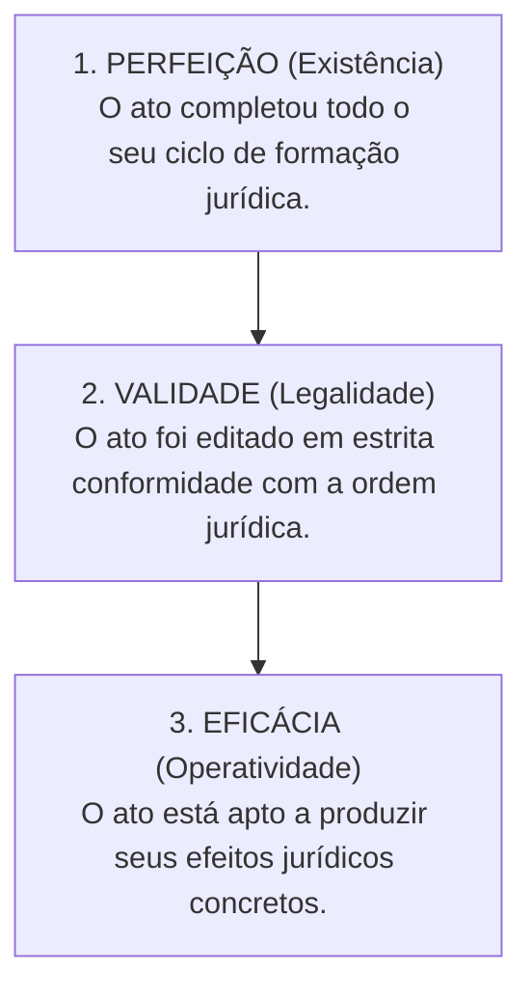
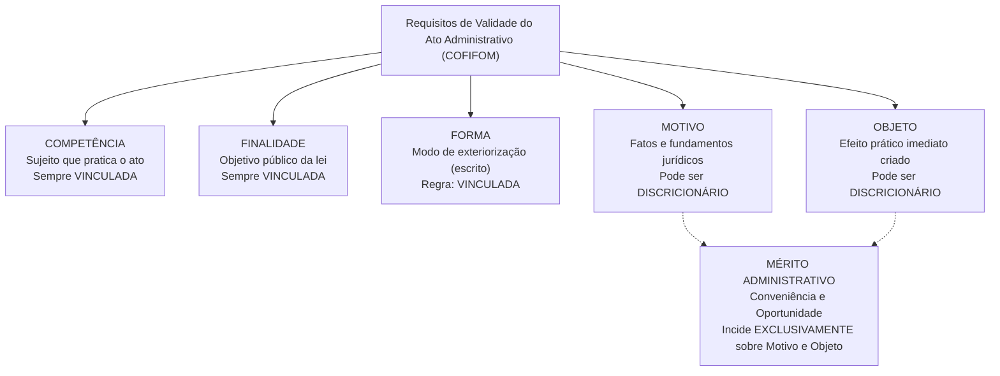
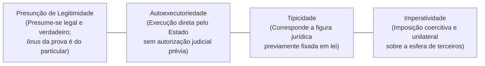
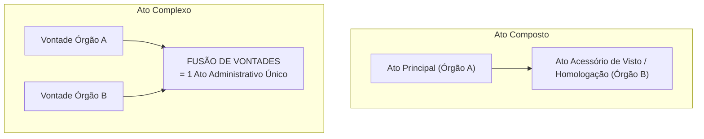

# 03 - Atos Administrativos e Processo Administrativo Estadual (Lei 13.800/2001)

> **Matéria:** Noções de Direito Administrativo  
> **Cargo:** A01 – Técnico de Controle Externo – Especialidade: Técnico Administrativo  
> **Arquivo:** `03_atos_administrativos_e_processo_estadual.md`  

---

## 📌 Ementa / Itens do Edital
- Ato administrativo: conceito, características e distinções
- Elementos e requisitos de validade (Competência, Finalidade, Forma, Motivo e Objeto - COFIFOM)
- Atributos do ato administrativo: Presunção de Legitimidade, Autoexecutoriedade, Tipicidade e Imperatividade (PATI)
- Classificação dos atos administrativos: vinculados e discricionários; simples, complexos e compostos
- Formação, efeitos, perfeição, validade e eficácia
- Extinção dos atos: anulação, revogação, cassação, caducidade e contraposição
- Convalidação (sanamento de vícios de competência e forma)
- Processo Administrativo no Estado de Goiás: Lei Estadual nº 13.800/2001 e alterações

---

## 🧭 Sumário

1. [Teoria Geral do Ato Administrativo e Distinções Conceituais](#1-teoria-geral-do-ato-administrativo-e-distincoes-conceituais)
    1. [Fato da Administração vs. Fato Administrativo vs. Ato Administrativo](#11-fato-da-administracao-vs-fato-administrativo-vs-ato-administrativo)
    2. [Perfeição, Validade e Eficácia do Ato](#12-perfeicao-validade-e-eficacia-do-ato)
    3. [Teste 023](#Teste-023)
2. [Elementos e Requisitos de Validade do Ato (Mnemônico COFIFOM)](#2-elementos-e-requisitos-de-validade-do-ato-mnemonico-cofifom)
    1. [Competência (Sujeito Competente)](#21-competencia-sujeito-competente)
    2. [Finalidade e o Desvio de Poder](#22-finalidade-e-o-desvio-de-poder)
    3. [Forma e Princípio da Solenidade](#23-forma-e-principio-da-solenidade)
    4. [Motivo e a Teoria dos Motivos Determinantes](#24-motivo-e-a-teoria-dos-motivos-determinantes)
    5. [Objeto (Conteúdo) e a Delimitação do Mérito Administrativo](#25-objeto-conteudo-e-a-delimitacao-do-merito-administrativo)
    6. [Teste 024](#Teste-024)
    7. [Teste 025](#Teste-025)
    8. [Teste 026](#Teste-026)
3. [Atributos do Ato Administrativo (Mnemônico PATI)](#3-atributos-do-ato-administrativo-mnemonico-pati)
    1. [Presunção de Legitimidade e Veracidade](#31-presuncao-de-legitimidade-e-veracidade)
    2. [Autoexecutoriedade e seus Limites](#32-autoexecutoriedade-e-seus-limites)
    3. [Tipicidade Administrativa](#33-tipicidade-administrativa)
    4. [Imperatividade e Poder Extroverso](#34-imperatividade-e-poder-extroverso)
    5. [Teste 027](#Teste-027)
4. [Classificações Relevantes para a FCC: Atos Simples, Complexos e Compostos](#4-classificacoes-relevantes-para-a-fcc-atos-simples-complexos-e-compostos)
    1. [Atos Simples, Complexos e Compostos](#41-atos-simples-complexos-e-compostos)
    2. [O Registro de Aposentadoria no Tribunal de Contas (Tema 445 / STF)](#42-o-registro-de-aposentadoria-no-tribunal-de-contas-tema-445-stf)
    3. [Teste 028](#Teste-028)
    4. [Teste 029](#Teste-029)
5. [Extinção e Convalidação dos Atos Administrativos](#5-extincao-e-convalidacao-dos-atos-administrativos)
    1. [Modos de Extinção: Anulação, Revogação, Cassação, Caducidade e Contraposição](#51-modos-de-extincao-anulacao-revogacao-cassacao-caducidade-e-contraposicao)
    2. [Convalidação: Requisitos, Limites e Efeitos Temporais](#52-convalidacao-requisitos-limites-e-efeitos-temporais)
    3. [Teste 030](#Teste-030)
    4. [Teste 031](#Teste-031)
6. [Processo Administrativo no Estado de Goiás (Lei Estadual nº 13.800/2001)](#6-processo-administrativo-no-estado-de-goias-lei-estadual-no-138002001)
    1. [Princípios Norteadores e Direitos dos Administrados](#61-principios-norteadores-e-direitos-dos-administrados)
    2. [Vedações Absolutas à Delegação (Regra do CENORA - Art. 13)](#62-vedacoes-absolutas-a-delegacao-regra-do-cenora-art-13)
    3. [Impedimentos e Suspeição de Agentes e Julgadores](#63-impedimentos-e-suspeicao-de-agentes-e-julgadores)
    4. [Motivação das Decisões e Regime Recursal](#64-motivacao-das-decisoes-e-regime-recursal)
    5. [Teste 032](#Teste-032)
    6. [Teste 033](#Teste-033)
7. [Fontes Recomendadas na Internet](#7-fontes-recomendadas-na-internet)

---

## 1. Teoria Geral do Ato Administrativo e Distinções Conceituais

O ato administrativo é a manifestação unilateral de vontade da Administração Pública ou de quem lhe faça as vezes, que, agindo sob o império do Direito Público, tem por fim imediato adquirir, resguardar, transferir, modificar, extinguir ou declarar direitos, ou impor obrigações aos administrados ou a si própria.

### 1.1 Fato da Administração vs. Fato Administrativo vs. Ato Administrativo

A doutrina administrativista clássica (seguida com rigor pela banca FCC) diferencia os eventos jurídicos da administração pública em três categorias:

- **Fato da Administração:** Evento puramente material ou natural ocorrido no seio da Administração, mas desprovido de repercussão ou consequência jurídica direta para o Direito Administrativo (ex.: o funcionário que limpa o chão de uma repartição; a pintura ordinária de uma parede).
- **Fato Administrativo:** Acontecimento fático que produz efeitos jurídicos relevantes no âmbito do Direito Administrativo. Pode decorrer de um ato voluntário (ex.: a apreensão material de mercadorias pirateadas) ou de um evento da natureza (ex.: a queda de uma árvore sobre veículo particular gerando responsabilidade civil; o decurso do tempo acarretando prescrição).
- **Ato Administrativo:** Declaração jurídica formal e intencional emitida pelo Estado com a finalidade de produzir efeitos jurídicos no mundo do direito (ex.: a expedição de uma licença de obras, a demissão de um servidor público estável, a aplicação de uma penalidade em licitação).

### 1.2 Perfeição, Validade e Eficácia do Ato

A teoria tridimensional do ato administrativo estabelece três planos de análise que não se confundem:

- **Ato Perfeito:** Aquele que completou todas as fases de seu ciclo de formação interna, estando concluído. Pode ser válido ou inválido.
- **Ato Válido:** Aquele que, além de perfeito, atende a todos os requisitos e pressupostos estabelecidos em lei (sem vícios de legalidade).
- **Ato Eficaz:** Aquele que está pronto para deflagrar seus efeitos jurídicos práticos, não dependendo de condição suspensiva, termo inicial ou publicação oficial.
    - *Exemplo Prático FCC:* Um ato de demissão assinado pelo Governador é **perfeito e válido**, mas só se torna **eficaz** a partir de sua publicação no Diário Oficial do Estado.

---

### Teste 023
**(FCC – TRT-4 – Analista Judiciario Tecnologia da Informacao – 2015)**
Sobre o processo administrativo no âmbito da Administração Pública Federal, regulado pela Lei no 9.784/99, é correto afirmar que

* **A)** órgão é a unidade de atuação dotada de personalidade jurídica.
* **B)** todos os atos administrativos devem sempre ser objeto de divulgação oficial.
* **C)** o processo pode ser iniciado tanto de ofício como a pedido do interessado.
* **D)** o requerimento inicial do interessado deve ser feito sempre na forma escrita.
* **E)** a competência exercida pelos órgãos administrativos é irrenunciável, cabendo delegação no caso da edição de atos de caráter normativo.

---

> **Comentário Detalhado:**
>
> - **A)** **Incorreta.** A opção apresenta proposição em desacordo com os fundamentos teóricos e técnicos do tópico ao afirmar que "órgão é a unidade de atuação dotada de personalidade jurídica". De acordo com a teoria estudada em *A Teoria dos Motivos Determinantes:*, se for judicialmente ou administrativamente comprovado que o motivo é falso (o órgão tinha recursos abundantes) ou juridicamente inexistente, o ato de exoneração é nulo de pleno direito, devendo ser extirpado da ordem jurídica.
> - **B)** **Incorreta.** A opção promove generalização excessiva que desconsidera as condições técnicas e normativas ao afirmar que "todos os atos administrativos devem sempre ser objeto de divulgação oficial". De acordo com a teoria estudada em *7. Fontes Recomendadas na Internet*, dI PIETRO, Maria Sylvia Zanella. Direito Administrativo. 37. ed. Rio de Janeiro: Forense, 2024. (Cap. 7 e Cap. 16 - Atos Administrativos e Processo Administrativo).
> - **C)** **Correta.** Conforme fundamentado na seção *6. Processo Administrativo no Estado de Goiás (Lei Estadual nº 13.800/2001)* deste guia, a Lei Estadual nº 13.800/2001 disciplina o processo administrativo no âmbito da Administração Pública direta e indireta do Estado de Goiás. Dessa forma, está plenamente correta a assertiva da banca (FCC – TRT-4/2015) ao estabelecer que "o processo pode ser iniciado tanto de ofício como a pedido do interessado".
> - **D)** **Incorreta.** A opção promove generalização excessiva que desconsidera as condições técnicas e normativas ao afirmar que "o requerimento inicial do interessado deve ser feito sempre na forma escrita". De acordo com a teoria estudada em *2.5 Objeto (Conteúdo) e a Delimitação do Mérito Administrativo*, os elementos Competência, Finalidade e Forma são sempre vinculados.
> - **E)** **Incorreta.** A opção apresenta proposição em desacordo com os fundamentos teóricos e técnicos do tópico ao afirmar que "a competência exercida pelos órgãos administrativos é irrenunciável, cabendo delegação no caso da edição de atos...". De acordo com a teoria estudada em *7. Fontes Recomendadas na Internet*, cARVALHO FILHO, José dos Santos. Manual de Direito Administrativo. 38. ed. Barueri: Atlas, 2024. (Cap. 3 e Cap. 21 - Atos Administrativos: Elementos, Atributos, Extinção e Processo Administrativo).
>
> **Gabarito: C**

---

## 2. Elementos e Requisitos de Validade do Ato (Mnemônico COFIFOM)

A Lei de Ação Popular (Lei Federal nº 4.717/1965, art. 2º) positivou a doutrina dos cinco elementos constitutivos indispensáveis para a validade do ato administrativo: **Competência, Finalidade, Forma, Motivo e Objeto** (**COFIFOM**).

### 2.1 Competência (Sujeito Competente)

É o círculo de atribuições conferido pelo ordenamento jurídico ao agente ou órgão público para a prática do ato.

- **Características:** É irrenunciável, intransferível por acordo entre as partes, inderrogável, imprescritível e imodificável pela vontade do titular.
- **Espécies de Vício de Competência:**
    - *Usurpação de Função:* Crime praticado por particular que se faz passar por funcionário público (ato inexistente).
    - *Excesso de Poder:* O agente público ultrapassa os limites legais de suas atribuições funcionais (ato nulo insanável).
    - *Incompetência Relativa:* O ato é praticado por agente de mesmo órgão ou hierarquia que não detinha a atribuição específica, sem que a competência fosse atribuída com exclusividade pela lei. Admite **convalidação** por ratificação da autoridade competente.

### 2.2 Finalidade e o Desvio de Poder

A finalidade representa o objetivo mediato de interesse público que o ato deve alcançar. É elemento **invariavelmente vinculado**; o administrador jamais detém discricionariedade para escolher a finalidade pública a ser perseguida.

- **Desvio de Finalidade (Desvio de Poder):** Ocorre quando a autoridade competente utiliza poderes legítimos para atingir fins alheios ao interesse público ou fim diverso daquele categorizado pela lei para aquela competência (ex.: remoção compulsória de servidor com o propósito punitivo disfarçado de perseguição pessoal). É vício que acarreta a **nulidade absoluta e insanável** do ato administrativo.

### 2.3 Forma e Princípio da Solenidade

A forma é o modo pelo qual a vontade da Administração se exterioriza e ganha publicidade no mundo jurídico.

- No Direito Administrativo vige o princípio do formalismo moderado, mas como regra geral os atos são solenes e devem ser expedidos por **escrito**, contendo data, identificação do cargo e assinatura.
- *Defeitos de Forma:* A omissão de formalidades não essenciais que não prejudiquem o direito de defesa dos administrados configura vício sanável, passível de **convalidação**.

### 2.4 Motivo e a Teoria dos Motivos Determinantes

O motivo constitui a situação de fato (o evento do mundo real) e a situação de direito (o enquadramento na norma legal) que autorizam ou determinam a prática do ato administrativo.

- Não se confunde com a **motivação** (a motivação é a declaração escrita dos motivos; o motivo é o próprio fato em si).

#### A Teoria dos Motivos Determinantes:
Consagrada pela jurisprudência pacífica do STF e do STJ, preceitua que a validade do ato administrativo fica indissoluvelmente vinculada à veracidade, exatidão e subsistência dos motivos alegados pela autoridade:

- Mesmo que o ato seja discricionário e prescindisse originalmente de motivação obrigatória (como a exoneração *ad nutum* de um assessor comissionado), se a autoridade decidir enunciar publicamente um motivo (ex.: afirmar no decreto que exonerou o servidor em razão do corte orçamentário do setor), **o ato ficará vinculado a essa justificativa**.
- Se for judicialmente ou administrativamente comprovado que o motivo é falso (o órgão tinha recursos abundantes) ou juridicamente inexistente, **o ato de exoneração é nulo de pleno direito**, devendo ser extirpado da ordem jurídica.

### 2.5 Objeto (Conteúdo) e a Delimitação do Mérito Administrativo

O objeto é o efeito jurídico imediato e substantivo que o ato produz no mundo real (é o "o que" o ato decide, cria, extingue ou altera). Deve ser lícito, possível, determinado ou determinável.

- **O Mérito Administrativo:** Nos atos discricionários, o mérito administrativo — consubstanciado no juízo de **conveniência e oportunidade** privativo da autoridade pública — incide **estrita e unicamente sobre o Motivo e o Objeto**. Os elementos Competência, Finalidade e Forma são sempre vinculados.

---

### Teste 024
**(FGV – TRF-1 – Analista Judiciario Area Apoio Especializado Especialidade Suporte Em Tecnologia da Informacao – 2024)**
Ao estudar as hipóteses de extinção do ato administrativo, Júlia verificou que há uma modalidade em que isso ocorre em razão da incompatibilidade do ato administrativo com outro posterior, tal como ocorre com a nomeação do servidor, que é extinta com a sua exoneração. Tal modalidade de extinção corresponde a:

* **A)** recusa;
* **B)** renúncia;
* **C)** anulação;
* **D)** revogação;
* **E)** contraposição.

---

> **Comentário Detalhado:**
>
> - **A)** **Incorreta.** A opção apresenta proposição em desacordo com os fundamentos teóricos e técnicos do tópico ao afirmar que "recusa". De acordo com a teoria estudada em *5.1 Modos de Extinção: Anulação, Revogação, Cassação, Caducidade e Contraposição*, modalidade de Extinção: Causa Primária — Efeitos no Tempo — Competência — Distinção Prática FCC.
> - **B)** **Incorreta.** A opção apresenta proposição em desacordo com os fundamentos teóricos e técnicos do tópico ao afirmar que "renúncia". De acordo com a teoria estudada em *5.1 Modos de Extinção: Anulação, Revogação, Cassação, Caducidade e Contraposição*, renúncia: Desistência expressa voluntária manifestada pelo beneficiário — *Ex nunc* — Manifestação do particular — O titular abre mão do benefício conferido pelo ato.
> - **C)** **Incorreta.** A opção apresenta proposição em desacordo com os fundamentos teóricos e técnicos do tópico ao afirmar que "anulação". De acordo com a teoria estudada em *5.1 Modos de Extinção: Anulação, Revogação, Cassação, Caducidade e Contraposição*, anulação: Ilegalidade originária do ato (vício de legalidade insanável) — Retroativo (*ex tunc*) — Administração Pública ou Poder Judiciário — Desfaz o ato desde o nascimento, pois dele não se originam direitos.
> - **D)** **Incorreta.** A opção apresenta proposição em desacordo com os fundamentos teóricos e técnicos do tópico ao afirmar que "revogação". De acordo com a teoria estudada em *5.1 Modos de Extinção: Anulação, Revogação, Cassação, Caducidade e Contraposição*, caducidade: Superveniência de lei nova que torna a atividade ilegal — *Ex nunc* — Administração Pública — O ato era legal, mas nova legislação proibiu a atividade (ex.: lei que veda pedágio na área).
> - **E)** **Correta.** Conforme fundamentado na seção *5.1 Modos de Extinção: Anulação, Revogação, Cassação, Caducidade e Contraposição* deste guia, contraposição / Derrubada: Emissão de novo ato com efeitos antagônicos e incompatíveis — *Ex nunc* — Administração Pública — O novo ato extingue o anterior (ex.: ato de exoneração contrapõe-se ao de nomeação). Dessa forma, está plenamente correta a assertiva da banca (FGV – TRF-1/2024) ao estabelecer que "contraposição".
>
> **Gabarito: E**

---

### Teste 025
**(FGV – TCE-GO – Analista de Controle Externo Controle Externo – 2024)**
Sérgio, no exercício de suas atribuições como Analista do Tribunal de Contas do Estado de Goiás, deparou-se com um procedimento administrativo envolvendo o controle externo de legalidade sobre determinado ato discricionário do Poder Executivo. Acerca da aludida temática, é correto afirmar que

* **A)** é possível a revogação do ato administrativo pela Corte de Contas.
* **B)** não é possível o controle externo de ato discricionário pela Corte de Contas.
* **C)** é possível sindicar o mérito administrativo no exercício do controle externo pela Corte de Contas.
* **D)** não é possível que a Corte de Contas substitua o Poder Executivo no exercício da discricionariedade.
* **E)** é possível anular o ato discricionário em questão por razões de conveniência e oportunidade da Corte de Contas. Administração Financeira e Orçamentária

---

> **Comentário Detalhado:**
>
> - **A)** **Incorreta.** A opção apresenta proposição em desacordo com os fundamentos teóricos e técnicos do tópico ao afirmar que "é possível a revogação do ato administrativo pela Corte de Contas". De acordo com a teoria estudada em *4.2 O Registro de Aposentadoria no Tribunal de Contas (Tema 445 / STF)*, impossibilidade de Revogação por Conveniência: Por se tratar de ato vinculado, a autoridade de origem não pode revogar a aposentadoria com base em razões de conveniência ou oportunidade (mérito).
> - **B)** **Incorreta.** A opção apresenta proposição em desacordo com os fundamentos teóricos e técnicos do tópico ao afirmar que "não é possível o controle externo de ato discricionário pela Corte de Contas". De acordo com a teoria estudada em *A Teoria dos Motivos Determinantes:*, mesmo que o ato seja discricionário e prescindisse originalmente de motivação obrigatória (como a exoneração *ad nutum* de um assessor comissionado), se a autoridade decidir enunciar publicamente um motivo (ex.: afirmar no decreto que exonerou o servidor em razão do corte orçamentário do setor), o ato ficará vinculado a essa justificativa.
> - **C)** **Correta.** Conforme fundamentado na seção *2.5 Objeto (Conteúdo) e a Delimitação do Mérito Administrativo* deste guia, o objeto é o efeito jurídico imediato e substantivo que o ato produz no mundo real (é o "o que" o ato decide, cria, extingue ou altera). Deve ser lícito, possível, determinado ou determinável. Dessa forma, está plenamente correta a assertiva da banca (FGV – TCE-GO/2024) ao estabelecer que "é possível sindicar o mérito administrativo no exercício do controle externo pela Corte de Contas".
> - **D)** **Incorreta.** A opção apresenta proposição em desacordo com os fundamentos teóricos e técnicos do tópico ao afirmar que "não é possível que a Corte de Contas substitua o Poder Executivo no exercício da discricionariedade". De acordo com a teoria estudada em *2.2 Finalidade e o Desvio de Poder*, a finalidade representa o objetivo mediato de interesse público que o ato deve alcançar. É elemento invariavelmente vinculado; o administrador jamais detém discricionariedade para escolher a finalidade pública a ser perseguida.
> - **E)** **Incorreta.** A opção apresenta proposição em desacordo com os fundamentos teóricos e técnicos do tópico ao afirmar que "é possível anular o ato discricionário em questão por razões de conveniência e oportunidade da Corte de Contas...". De acordo com a teoria estudada em *2.5 Objeto (Conteúdo) e a Delimitação do Mérito Administrativo*, o Mérito Administrativo: Nos atos discricionários, o mérito administrativo — consubstanciado no juízo de conveniência e oportunidade privativo da autoridade pública — incide estrita e unicamente sobre o Motivo e o Objeto.
>
> **Gabarito: C**

---

### Teste 026
**(FCC – TRT-24 – Analista Judiciario Tecnologia da Informacao – 2017)**
O ato administrativo discricionário

* **A)** não comporta anulação.
* **B)** é passível de revogação.
* **C)** não está sujeito a controle judicial.
* **D)** apresenta discricionariedade em todos os seus requisitos, exceto quanto à competência para a prática do ato.
* **E)** apresenta discricionariedade em um de seus requisitos, qual seja, a finalidade.

---

> **Comentário Detalhado:**
>
> - **A)** **Incorreta.** A opção apresenta proposição em desacordo com os fundamentos teóricos e técnicos do tópico ao afirmar que "não comporta anulação". De acordo com a teoria estudada em *5.1 Modos de Extinção: Anulação, Revogação, Cassação, Caducidade e Contraposição*, modalidade de Extinção: Causa Primária — Efeitos no Tempo — Competência — Distinção Prática FCC.
> - **B)** **Incorreta.** A opção apresenta proposição em desacordo com os fundamentos teóricos e técnicos do tópico ao afirmar que "é passível de revogação". De acordo com a teoria estudada em *2.1 Competência (Sujeito Competente)*, é o círculo de atribuições conferido pelo ordenamento jurídico ao agente ou órgão público para a prática do ato.
> - **C)** **Incorreta.** A opção apresenta proposição em desacordo com os fundamentos teóricos e técnicos do tópico ao afirmar que "não está sujeito a controle judicial". De acordo com a teoria estudada em *2.1 Competência (Sujeito Competente)*, *Usurpação de Função:* Crime praticado por particular que se faz passar por funcionário público (ato inexistente).
> - **D)** **Correta.** Conforme fundamentado na seção *5.2 Convalidação: Requisitos, Limites e Efeitos Temporais* deste guia, competência quanto à Pessoa: Admite convalidação (ratificação pela autoridade competente), desde que a lei NÃO tenha atribuído competência exclusiva à autoridade que praticou o ato originário. Dessa forma, está plenamente correta a assertiva da banca (FCC – TRT-24/2017) ao estabelecer que "apresenta discricionariedade em todos os seus requisitos, exceto quanto à competência para a prática do ato".
> - **E)** **Incorreta.** A opção apresenta proposição em desacordo com os fundamentos teóricos e técnicos do tópico ao afirmar que "apresenta discricionariedade em um de seus requisitos, qual seja, a finalidade". De acordo com a teoria estudada em *2. Elementos e Requisitos de Validade do Ato (Mnemônico COFIFOM)*, a Lei de Ação Popular (Lei Federal nº 4.717/1965, art. 2º) positivou a doutrina dos cinco elementos constitutivos indispensáveis para a validade do ato administrativo: Competência, Finalidade, Forma, Motivo e Objeto (COFIFOM).
>
> **Gabarito: D**

---

## 3. Atributos do Ato Administrativo (Mnemônico PATI)

Os atributos do ato administrativo consagram prerrogativas que decorrem diretamente do princípio da supremacia do interesse público:

### 3.1 Presunção de Legitimidade e Veracidade

Presume-se que o ato administrativo foi expedido em estrita consonância com a lei (legitimidade) e que os fatos relatados pelos agentes públicos são verdadeiros (veracidade).

- É presunção relativa (*juris tantum*), que admite prova em contrário.
- Gera a **inversão do ônus da prova**: incumbe ao particular demonstrar e comprovar a ilegalidade ou falsidade do ato impugnado perante o Judiciário ou a Administração.

### 3.2 Autoexecutoriedade e seus Limites

É a prerrogativa conferida à Administração Pública de compelir materialmente o administrado a cumprir o ato ou executar diretamente a providência administrativa, inclusive com uso moderado da força física policial, **sem necessidade de intervenção ou autorização prévia do Poder Judiciário** (ex.: guincho de carro estacionado em local proibido; interdição e lacração de restaurante com alimentos deteriorados; apreensão de drogas).

- **Limites Críticos da Autoexecutoriedade:** A autoexecutoriedade depende de expressa previsão legal ou de situação fática emergencial/urgente.  
> 🚨 **ALERTA CLÁSSICO FCC:**  
> A cobrança de **multas pecuniárias administrativas NÃO é autoexecutória**! Se o particular se recusar a pagar a multa, a Administração não pode tomar o dinheiro de sua conta bancária diretamente; deve inscrever o débito em Dívida Ativa e ajuizar Ação de Execução Fiscal perante o Poder Judiciário.

### 3.3 Tipicidade Administrativa

Formulada por Maria Sylvia Zanella Di Pietro, preceitua que cada ato administrativo deve corresponder rigorosamente a figuras e modelos abstratos previamente tipificados na legislação. Impede que o Estado crie atos unilaterais inominados ou arbitrários sem desenho legal prévio.

### 3.4 Imperatividade e Poder Extroverso

Consiste na faculdade de impor obrigações coercitivas e restrições unilaterais a terceiros, independentemente de sua concordância prévia.

- Não está presente em atos negociais (licenças, autorizações) e atos meramente enunciativos (pareceres, certidões, atestados).

---

### Teste 027
**(CEBRASPE – TJ-RJ – Analista Judiciario Grupo Tecnologia da Informacao Analista de Gestao de Tic – 2021)**
O entendimento de que o ato administrativo é considerado válido até que se prove em contrário corresponde ao atributo da

* **A)** tipicidade.
* **B)** exigibilidade.
* **C)** imperatividade.
* **D)** presunção de legitimidade.
* **E)** autoexecutoriedade.

---

> **Comentário Detalhado:**
>
> - **A)** **Incorreta.** A opção apresenta proposição em desacordo com os fundamentos teóricos e técnicos do tópico ao afirmar que "tipicidade". De acordo com a teoria estudada em *3.1 Presunção de Legitimidade e Veracidade*, presume-se que o ato administrativo foi expedido em estrita consonância com a lei (legitimidade) e que os fatos relatados pelos agentes públicos são verdadeiros (veracidade).
> - **B)** **Incorreta.** A opção apresenta proposição em desacordo com os fundamentos teóricos e técnicos do tópico ao afirmar que "exigibilidade". De acordo com a teoria estudada em *3.1 Presunção de Legitimidade e Veracidade*, gera a inversão do ônus da prova: incumbe ao particular demonstrar e comprovar a ilegalidade ou falsidade do ato impugnado perante o Judiciário ou a Administração.
> - **C)** **Incorreta.** A opção apresenta proposição em desacordo com os fundamentos teóricos e técnicos do tópico ao afirmar que "imperatividade". De acordo com a teoria estudada em *3.4 Imperatividade e Poder Extroverso*, consiste na faculdade de impor obrigações coercitivas e restrições unilaterais a terceiros, independentemente de sua concordância prévia.
> - **D)** **Correta.** Conforme fundamentado na seção *3.1 Presunção de Legitimidade e Veracidade* deste guia, é presunção relativa (*juris tantum*), que admite prova em contrário. Dessa forma, está plenamente correta a assertiva da banca (CEBRASPE – TJ-RJ/2021) ao estabelecer que "presunção de legitimidade".
> - **E)** **Incorreta.** A opção apresenta proposição em desacordo com os fundamentos teóricos e técnicos do tópico ao afirmar que "autoexecutoriedade". De acordo com a teoria estudada em *3.2 Autoexecutoriedade e seus Limites*, é a prerrogativa conferida à Administração Pública de compelir materialmente o administrado a cumprir o ato ou executar diretamente a providência administrativa, inclusive com uso moderado da força física policial, sem necessidade de intervenção ou autorização prévia do Poder Judiciário (ex.: guincho de carro estacionado em local proibido; interdição e lacração de restaurante com alimentos deteriorados; apreensão de drogas).
>
> **Gabarito: D**

---

## 4. Classificações Relevantes para a FCC: Atos Simples, Complexos e Compostos

### 4.1 Atos Simples, Complexos e Compostos

- **Ato Simples:** Resulta da manifestação de vontade de um **único órgão** administrativo (seja ele singular, como o ato de um Secretário de Estado, ou colegiado, como a decisão plenária de um Tribunal de Contas).
- **Ato Composto:** Resulta da manifestação de vontade de um único órgão que emite um **ato principal**, cuja eficácia depende de um **ato instrumental acessório** emanado de outro órgão (ex.: aprovação, homologação, visto, chancela). Há um ato principal e um ato acessório.
- **Ato Complexo:** Resulta da **fusão e integração convergente de vontades de dois ou mais órgãos autônomos e independentes**, que se conjugam para formar um **único ato administrativo final**.

### 4.2 O Registro de Aposentadoria no Tribunal de Contas (Tema 445 / STF)

O julgamento da legalidade e a concessão de registro de aposentadoria, pensão ou reforma pelas Cortes de Contas é um dos temas prediletos da FCC:

1. **Natureza Jurídica:** Trata-se categoricamente de um **ato administrativo complexo** (Súmula Vinculante nº 3 e pacífica jurisprudência do STF). O ato inicial expedido pelo órgão de origem é meramente precário e provisório; somente ganha definitividade e perfeição com o julgamento e registro pelo Tribunal de Contas.
2. **Dispensa de Contraditório Prévio (SV nº 3):** Na apreciação da legalidade do ato de concessão inicial de aposentadoria, é dispensado o contraditório e a ampla defesa no Tribunal de Contas, salvo se transcorrer prazo desarrazoado.
3. **O Prazo Decadencial de 5 Anos (Tema 445 do STF):** O STF fixou a seguinte tese vinculante:
   > *"Em atenção aos princípios da segurança jurídica e da confiança legítima, os Tribunais de Contas estão sujeitos ao prazo de 5 anos para o julgamento da legalidade do ato de concessão inicial de aposentadoria, reforma ou pensão, **a contar da chegada do processo à respectiva Corte de Contas**, após o qual, se não houver decisão, o ato considerar-se-á definitivamente registrado."*
4. **Impossibilidade de Revogação por Conveniência:** Por se tratar de ato vinculado, a autoridade de origem não pode revogar a aposentadoria com base em razões de conveniência ou oportunidade (mérito).

---

### Teste 028
**(FCC – TCE-GO – Analista de Controle Externo Gestao de Conhecimento – 2009)**
O princípio da presunção de legalidade dos atos administrativos

* **A)** impede sua apreciação pelo Poder Judiciário.
* **B)** permite que a sua legalidade seja questionada, embora o ato seja considerado válido até decisão em contrário.
* **C)** torna verdadeiros, em caráter absoluto, os fatos alegados pela Administração como motivos para edição do ato.
* **D)** permite ao Poder Judiciário analisar apenas seus aspectos de constitucionalidade, não de legalidade.
* **E)** é incompatível com os demais princípios administrativos e constitui exceção ao regime jurídico de direito público.

---

> **Comentário Detalhado:**
>
> - **A)** **Incorreta.** A opção apresenta proposição em desacordo com os fundamentos teóricos e técnicos do tópico ao afirmar que "impede sua apreciação pelo Poder Judiciário". De acordo com a teoria estudada em *4.2 O Registro de Aposentadoria no Tribunal de Contas (Tema 445 / STF)*, dispensa de Contraditório Prévio (SV nº 3): Na apreciação da legalidade do ato de concessão inicial de aposentadoria, é dispensado o contraditório e a ampla defesa no Tribunal de Contas, salvo se transcorrer prazo desarrazoado.
> - **B)** **Correta.** Conforme fundamentado na seção *4.2 O Registro de Aposentadoria no Tribunal de Contas (Tema 445 / STF)* deste guia, *"Em atenção aos princípios da segurança jurídica e da confiança legítima, os Tribunais de Contas estão sujeitos ao prazo de 5 anos para o julgamento da legalidade do ato de concessão inicial de aposentadoria, reforma ou pensão, a contar da chegada do processo à respectiva Corte de Contas, após o qual, se não houver decisão, o ato considerar-se-á definitivamente registrado."*. Dessa forma, está plenamente correta a assertiva da banca (FCC – TCE-GO/2009) ao estabelecer que "permite que a sua legalidade seja questionada, embora o ato seja considerado válido até decisão em contrário".
> - **C)** **Incorreta.** A opção promove generalização excessiva que desconsidera as condições técnicas e normativas ao afirmar que "torna verdadeiros, em caráter absoluto, os fatos alegados pela Administração como motivos para edição do ato". De acordo com a teoria estudada em *3.1 Presunção de Legitimidade e Veracidade*, presume-se que o ato administrativo foi expedido em estrita consonância com a lei (legitimidade) e que os fatos relatados pelos agentes públicos são verdadeiros (veracidade).
> - **D)** **Incorreta.** A opção incorre em restrição indevida ao limitar o escopo conceitual ao afirmar que "permite ao Poder Judiciário analisar apenas seus aspectos de constitucionalidade, não de legalidade". De acordo com a teoria estudada em *1.2 Perfeição, Validade e Eficácia do Ato*, ato Válido: Aquele que, além de perfeito, atende a todos os requisitos e pressupostos estabelecidos em lei (sem vícios de legalidade).
> - **E)** **Incorreta.** A opção apresenta proposição em desacordo com os fundamentos teóricos e técnicos do tópico ao afirmar que "é incompatível com os demais princípios administrativos e constitui exceção ao regime jurídico de direito público". De acordo com a teoria estudada em *6.4 Motivação das Decisões e Regime Recursal*, prazos Recursais (Art. 59): Salvo disposição legal específica em contrário, o prazo para interposição de recurso administrativo na administração goiana é de 10 (dez) dias, contados da ciência ou divulgação oficial da decisão.
>
> **Gabarito: B**

---

### Teste 029
**(FGV – TJ-AP – Analista Judiciario Apoio Especializado Tecnologia da Informacao Banco de Dados – 2023)**
A autoridade competente no âmbito da atividade de controle sugeriu a revogação de todos os atos administrativos que não mais atendam ao interesse público, mas foi indagada acerca da existência de atos que não seriam passíveis de tal modalidade de extinção. Diante dessa situação hipotética, é correto afirmar que:

* **A)** todos os atos administrativos são passíveis de revogação;
* **B)** apenas os atos vinculados são passíveis de revogação;
* **C)** nenhum ato administrativo é passível de revogação;
* **D)** somente os atos discricionários são passíveis de revogação;
* **E)** apenas os atos administrativos que já exauriram os seus efeitos não podem ser revogados.

---

> **Comentário Detalhado:**
>
> - **A)** **Incorreta.** A opção apresenta proposição em desacordo com os fundamentos teóricos e técnicos do tópico ao afirmar que "todos os atos administrativos são passíveis de revogação". De acordo com a teoria estudada em *5.1 Modos de Extinção: Anulação, Revogação, Cassação, Caducidade e Contraposição*, o Poder Judiciário JAMAIS pode revogar atos administrativos do Poder Executivo.
> - **B)** **Incorreta.** A opção incorre em restrição indevida ao limitar o escopo conceitual ao afirmar que "apenas os atos vinculados são passíveis de revogação". De acordo com a teoria estudada em *5.1 Modos de Extinção: Anulação, Revogação, Cassação, Caducidade e Contraposição*, revogação: Inconveniência ou inoportunidade superveniente (mérito) — Prospectivo (*ex nunc*) — Exclusiva da própria Administração — Recai sobre atos válidos; respeita direitos adquiridos e atos consumados.
> - **C)** **Incorreta.** A opção apresenta proposição em desacordo com os fundamentos teóricos e técnicos do tópico ao afirmar que "nenhum ato administrativo é passível de revogação". De acordo com a teoria estudada em *4.1 Atos Simples, Complexos e Compostos*, ato Complexo: Resulta da fusão e integração convergente de vontades de dois ou mais órgãos autônomos e independentes, que se conjugam para formar um único ato administrativo final.
> - **D)** **Correta.** Conforme fundamentado na seção *2.5 Objeto (Conteúdo) e a Delimitação do Mérito Administrativo* deste guia, o Mérito Administrativo: Nos atos discricionários, o mérito administrativo — consubstanciado no juízo de conveniência e oportunidade privativo da autoridade pública — incide estrita e unicamente sobre o Motivo e o Objeto. Dessa forma, está plenamente correta a assertiva da banca (FGV – TJ-AP/2023) ao estabelecer que "somente os atos discricionários são passíveis de revogação".
> - **E)** **Incorreta.** A opção incorre em restrição indevida ao limitar o escopo conceitual ao afirmar que "apenas os atos administrativos que já exauriram os seus efeitos não podem ser revogados". De acordo com a teoria estudada em *7. Fontes Recomendadas na Internet*, cARVALHO FILHO, José dos Santos. Manual de Direito Administrativo. 38. ed. Barueri: Atlas, 2024. (Cap. 3 e Cap. 21 - Atos Administrativos: Elementos, Atributos, Extinção e Processo Administrativo).
>
> **Gabarito: D**

---

## 5. Extinção e Convalidação dos Atos Administrativos

### 5.1 Modos de Extinção: Anulação, Revogação, Cassação, Caducidade e Contraposição

| Modalidade de Extinção | Causa Primária | Efeitos no Tempo | Competência | Distinção Prática FCC |
| :--- | :--- | :---: | :--- | :--- |
| **Anulação** | **Ilegalidade originária** do ato (vício de legalidade insanável) | **Retroativo (*ex tunc*)** | Administração Pública ou Poder Judiciário | Desfaz o ato desde o nascimento, pois dele não se originam direitos. |
| **Revogação** | **Inconveniência ou inoportunidade superveniente** (mérito) | **Prospectivo (*ex nunc*)** | **Exclusiva da própria Administração** | Recai sobre atos válidos; respeita direitos adquiridos e atos consumados. |
| **Cassação** | **Descumprimento de condições legais** pelo particular beneficiário | *Ex nunc* | Administração Pública | Sanção contra o administrado faltoso (ex.: cassar alvará sanitário por comida estragada). |
| **Caducidade** | **Superveniência de lei nova** que torna a atividade ilegal | *Ex nunc* | Administração Pública | O ato era legal, mas nova legislação proibiu a atividade (ex.: lei que veda pedágio na área). |
| **Contraposição / Derrubada** | Emissão de **novo ato com efeitos antagônicos** e incompatíveis | *Ex nunc* | Administração Pública | O novo ato extingue o anterior (ex.: ato de exoneração contrapõe-se ao de nomeação). |
| **Renúncia** | Desistência expressa voluntária manifestada pelo beneficiário | *Ex nunc* | Manifestação do particular | O titular abre mão do benefício conferido pelo ato. |

> ⚠️ **Atenção Máxima FCC:**  
> O Poder Judiciário **JAMAIS pode revogar atos administrativos do Poder Executivo**. O Judiciário pode anular atos ilegais, mas se pronunciar sobre a conveniência e oportunidade de atos do Executivo configuraria intolerável violação à separação dos Poderes (art. 2º da CF).

### 5.2 Convalidação: Requisitos, Limites e Efeitos Temporais

A convalidação (ou sanatória) é o ato administrativo pelo qual a Administração corrige e supre um vício existente em ato ilegal anterior com efeitos retroativos (**ex tunc**).

- **Dispositivo Normativo:** Art. 55 da Lei Federal nº 9.784/1999 e art. 54 da Lei Estadual/GO nº 13.800/2001.
- **Requisitos Cumulativos Obrigatórios:**
    1. O ato **não pode acarretar lesão ao interesse público**;
    2. O ato **não pode causar prejuízos a terceiros de boa-fé**;
    3. O vício deve ser **sanável**.

- **Defeitos Sanáveis que Comportam Convalidação:**
    - **Competência quanto à Pessoa:** Admite convalidação (ratificação pela autoridade competente), desde que a lei **NÃO tenha atribuído competência exclusiva** à autoridade que praticou o ato originário.
    - **Forma:** Admite convalidação se a forma desrespeitada não foi expressamente exigida por lei como requisito essencial de validade do ato.
- **Defeitos Insanáveis (NULIDADE ABSOLUTA - Vedada Convalidação):**
    - Vício de **Finalidade** (desvio de poder);
    - Vício de **Motivo** (motivo falso ou inexistente);
    - Vício de **Objeto** (objeto ilícito ou impossível);
    - Vício de competência privativa/exclusiva ou forma essencial.

---

### Teste 030
**(FGV – TCE-PA – Auditor de Controle Externo Administrativa Gestao Governamental – 2024)**
No âmbito da autotutela, existem diferentes modalidades de extinção do ato por manifestação de vontade da Administração, entre as quais encontram-se as seguintes situações: I. Extinção do ato administrativo discricionário, apenas pelo fato de que a situação nele contemplada não é mais admitida pela legislação. II. Extinção do ato administrativo em razão de ilegalidade superveniente atribuída ao respectivo beneficiário. III. Extinção do ato administrativo em decorrência do reconhecimento de um vício grave e insanável. As situações I, II e III referem-se, respectivamente, a extinções por

* **A)** caducidade, cassação e anulação.
* **B)** revogação, anulação e caducidade.
* **C)** anulação, cassação e revogação.
* **D)** revogação, cassação e anulação.
* **E)** caducidade, revogação e cassação.

---

> **Comentário Detalhado:**
>
> - **A)** **Correta.** Conforme fundamentado na seção *5.1 Modos de Extinção: Anulação, Revogação, Cassação, Caducidade e Contraposição* deste guia, anulação: Ilegalidade originária do ato (vício de legalidade insanável) — Retroativo (*ex tunc*) — Administração Pública ou Poder Judiciário — Desfaz o ato desde o nascimento, pois dele não se originam direitos. Dessa forma, está plenamente correta a assertiva da banca (FGV – TCE-PA/2024) ao estabelecer que "caducidade, cassação e anulação".
> - **B)** **Incorreta.** A opção apresenta proposição em desacordo com os fundamentos teóricos e técnicos do tópico ao afirmar que "revogação, anulação e caducidade". De acordo com a teoria estudada em *5.1 Modos de Extinção: Anulação, Revogação, Cassação, Caducidade e Contraposição*, renúncia: Desistência expressa voluntária manifestada pelo beneficiário — *Ex nunc* — Manifestação do particular — O titular abre mão do benefício conferido pelo ato.
> - **C)** **Incorreta.** A opção apresenta proposição em desacordo com os fundamentos teóricos e técnicos do tópico ao afirmar que "anulação, cassação e revogação". De acordo com a teoria estudada em *5.1 Modos de Extinção: Anulação, Revogação, Cassação, Caducidade e Contraposição*, caducidade: Superveniência de lei nova que torna a atividade ilegal — *Ex nunc* — Administração Pública — O ato era legal, mas nova legislação proibiu a atividade (ex.: lei que veda pedágio na área).
> - **D)** **Incorreta.** A opção apresenta proposição em desacordo com os fundamentos teóricos e técnicos do tópico ao afirmar que "revogação, cassação e anulação". De acordo com a teoria estudada em *5.1 Modos de Extinção: Anulação, Revogação, Cassação, Caducidade e Contraposição*, revogação: Inconveniência ou inoportunidade superveniente (mérito) — Prospectivo (*ex nunc*) — Exclusiva da própria Administração — Recai sobre atos válidos; respeita direitos adquiridos e atos consumados.
> - **E)** **Incorreta.** A opção apresenta proposição em desacordo com os fundamentos teóricos e técnicos do tópico ao afirmar que "caducidade, revogação e cassação". De acordo com a teoria estudada em *5.1 Modos de Extinção: Anulação, Revogação, Cassação, Caducidade e Contraposição*, cassação: Descumprimento de condições legais pelo particular beneficiário — *Ex nunc* — Administração Pública — Sanção contra o administrado faltoso (ex.: cassar alvará sanitário por comida estragada).
>
> **Gabarito: A**

---

### Teste 031
**(FCC – TRT-13 – Analista Judiciario Tecnologia da Informacao – 2014)**
A respeito dos atos administrativos, considere: I. Apenas os atos discricionários são passíveis de revogação, mantidos os efeitos anteriormente produzidos. II. Os atos vinculados, quando eivados de vício de competência são passíveis de convalidação, salvo em matérias de competência exclusiva. III. Os atos vinculados podem ser anulados, retroagindo a anulação à data da edição do ato, ou revogados, com efeitos a partir da revogação. Está correto o que consta APENAS em

* **A)** I e III.
* **B)** I e II.
* **C)** II e III.
* **D)** I.
* **E)** II.

---

> **Comentário Detalhado:**
>
> - **A)** **Incorreta.** A opção apresenta proposição em desacordo com os fundamentos teóricos e técnicos do tópico ao afirmar que "I e III". De acordo com a teoria estudada em *5.1 Modos de Extinção: Anulação, Revogação, Cassação, Caducidade e Contraposição*, revogação: Inconveniência ou inoportunidade superveniente (mérito) — Prospectivo (*ex nunc*) — Exclusiva da própria Administração — Recai sobre atos válidos; respeita direitos adquiridos e atos consumados.
> - **B)** **Correta.** Conforme fundamentado na seção *5.2 Convalidação: Requisitos, Limites e Efeitos Temporais* deste guia, vício de competência privativa/exclusiva ou forma essencial. Dessa forma, está plenamente correta a assertiva da banca (FCC – TRT-13/2014) ao estabelecer que "I e II".
> - **C)** **Incorreta.** A opção apresenta proposição em desacordo com os fundamentos teóricos e técnicos do tópico ao afirmar que "II e III". De acordo com a teoria estudada em *5.1 Modos de Extinção: Anulação, Revogação, Cassação, Caducidade e Contraposição*, o Poder Judiciário JAMAIS pode revogar atos administrativos do Poder Executivo.
> - **D)** **Incorreta.** A opção apresenta proposição em desacordo com os fundamentos teóricos e técnicos do tópico ao afirmar que "I". De acordo com a teoria estudada em *5.2 Convalidação: Requisitos, Limites e Efeitos Temporais*, competência quanto à Pessoa: Admite convalidação (ratificação pela autoridade competente), desde que a lei NÃO tenha atribuído competência exclusiva à autoridade que praticou o ato originário.
> - **E)** **Incorreta.** A opção apresenta proposição em desacordo com os fundamentos teóricos e técnicos do tópico ao afirmar que "II". De acordo com a teoria estudada em *5.1 Modos de Extinção: Anulação, Revogação, Cassação, Caducidade e Contraposição*, modalidade de Extinção: Causa Primária — Efeitos no Tempo — Competência — Distinção Prática FCC.
>
> **Gabarito: B**

---

## 6. Processo Administrativo no Estado de Goiás (Lei Estadual nº 13.800/2001)

A **Lei Estadual nº 13.800/2001** disciplina o processo administrativo no âmbito da Administração Pública direta e indireta do Estado de Goiás:

### 6.1 Princípios Norteadores e Direitos dos Administrados

- Subordina-se aos princípios da legalidade, finalidade, motivação, razoabilidade, proporcionalidade, moralidade, ampla defesa, contraditório, segurança jurídica, interesse público e eficiência (art. 2º).
- Reconhece o direito do cidadão de ser tratado com respeito, ter ciência da tramitação dos processos em que tenha a condição de interessado, ter vista dos autos, obter certidões e formular alegações e apresentar documentos antes da tomada da decisão.

### 6.2 Vedações Absolutas à Delegação (Regra do CENORA - Art. 13)

Reproduzindo a regra geral do direito público brasileiro, o art. 13 da Lei Goiana nº 13.800/2001 veda taxativamente a delegação de três matérias específicas:

1. **Competência Exclusiva** atribuída por lei a determinado órgão ou autoridade;
2. Edição de atos de caráter **Normativo**;
3. Decisão de **Recursos Administrativos**.

### 6.3 Impedimentos e Suspeição de Agentes e Julgadores

Para assegurar a imparcialidade nas decisões administrativas, a lei estadual estabelece distinção crucial entre:

- **Impedimento (Vício Objetivo - Art. 18):** O servidor ou autoridade é legalmente impedido de atuar em processo no qual:
    - Tenha interesse direto ou indireto na matéria;
    - Tenha participado ou venha a participar como perito, testemunha ou representante, ou se tais situações ocorrerem quanto ao cônjuge, companheiro ou parentes até o terceiro grau;
    - Esteja litigando judicial ou administrativamente com o interessado ou respectivo cônjuge/companheiro.
    - *Omissão do Impedimento:* Constitui falta disciplinar grave.
- **Suspeição (Vício Subjetivo - Art. 20):** Pode ser arguida a suspeição de autoridade ou servidor que tenha amizade íntima ou inimizade notória com algum dos interessados ou com os respectivos cônjuges, companheiros, parentes e afins até o terceiro grau.

### 6.4 Motivação das Decisões e Regime Recursal

- **Dever de Motivação (Art. 50):** As decisões que neguem, limitem ou afetem direitos ou interesses, imponham sanções, decidam recursos, dispensem licitações ou anulem/revoguem atos anteriores devem ser expressamente motivadas, com indicação dos fatos e fundamentos jurídicos.
- **Prazos Recursais (Art. 59):** Salvo disposição legal específica em contrário, o prazo para interposição de recurso administrativo na administração goiana é de **10 (dez) dias**, contados da ciência ou divulgação oficial da decisão.
- **Efeitos do Recurso e Reformatio in Pejus (Arts. 61 e 64):** O recurso tem como regra geral efeito estritamente devolutivo (efeito suspensivo é excepcional). A autoridade julgadora pode confirmar, modificar, anular ou revogar, total ou parcialmente, a decisão recorrida; se da revisão puder decorrer gravame à situação do recorrente (*reformatio in pejus*), este deverá ser cientificado previamente para formular suas alegações no prazo de 10 dias.

---

### Teste 032
**(FGV – TCE-GO – Analista de Controle Externo Juridica – 2024)**
Jansen, servidor público estável do Estado de Goiás, exerce a atribuição de analisar processos administrativos sobre determinada matéria, sendo certo que um dos feitos submetidos à sua apreciação envolve o interesse de Carlos, que é casado com Angélica, contra quem o mencionado agente público está litigando judicialmente. Considerando as causas de impedimento e suspeição constantes da Lei Estadual nº 13.800/2001, é correto afirmar que a situação descrita

* **A)** não apresenta qualquer razão para o reconhecimento do impedimento ou suspeição de Jansen.
* **B)** caracteriza hipótese de suspeição, de modo que Jansen deve comunicá-la a autoridade competente, abstendo-se de atuar no referido processo.
* **C)** apenas poderia delimitar o impedimento de Jansen se ele estivesse litigando contra Carlos, o que não pode ser estendido para a sua esposa.
* **D)** configura causa de impedimento, de modo que a omissão de Jansen no dever de comunicar tal fato, constitui falta grave para efeitos disciplinares.
* **E)** conforma a suspeição de Jansen, que pode ser arguida por Carlos, hipótese em que o eventual indeferimento da alegação é passível de recurso sem efeito suspensivo.

---

> **Comentário Detalhado:**
>
> - **A)** **Incorreta.** A opção promove generalização excessiva que desconsidera as condições técnicas e normativas ao afirmar que "não apresenta qualquer razão para o reconhecimento do impedimento ou suspeição de Jansen". De acordo com a teoria estudada em *6.3 Impedimentos e Suspeição de Agentes e Julgadores*, impedimento (Vício Objetivo - Art. 18): O servidor ou autoridade é legalmente impedido de atuar em processo no qual.
> - **B)** **Incorreta.** A opção apresenta proposição em desacordo com os fundamentos teóricos e técnicos do tópico ao afirmar que "caracteriza hipótese de suspeição, de modo que Jansen deve comunicá-la a autoridade competente, abstendo-se de...". De acordo com a teoria estudada em *6. Processo Administrativo no Estado de Goiás (Lei Estadual nº 13.800/2001)*, a Lei Estadual nº 13.800/2001 disciplina o processo administrativo no âmbito da Administração Pública direta e indireta do Estado de Goiás.
> - **C)** **Incorreta.** A opção incorre em restrição indevida ao limitar o escopo conceitual ao afirmar que "apenas poderia delimitar o impedimento de Jansen se ele estivesse litigando contra Carlos, o que não pode ser...". De acordo com a teoria estudada em *2.3 Forma e Princípio da Solenidade*, *Defeitos de Forma:* A omissão de formalidades não essenciais que não prejudiquem o direito de defesa dos administrados configura vício sanável, passível de convalidação.
> - **D)** **Correta.** Conforme fundamentado na seção *6.3 Impedimentos e Suspeição de Agentes e Julgadores* deste guia, *Omissão do Impedimento:* Constitui falta disciplinar grave. Dessa forma, está plenamente correta a assertiva da banca (FGV – TCE-GO/2024) ao estabelecer que "configura causa de impedimento, de modo que a omissão de Jansen no dever de comunicar tal fato, constitui falta...".
> - **E)** **Incorreta.** A opção apresenta proposição em desacordo com os fundamentos teóricos e técnicos do tópico ao afirmar que "conforma a suspeição de Jansen, que pode ser arguida por Carlos, hipótese em que o eventual indeferimento da...". De acordo com a teoria estudada em *6.4 Motivação das Decisões e Regime Recursal*, efeitos do Recurso e Reformatio in Pejus (Arts. 61 e 64): O recurso tem como regra geral efeito estritamente devolutivo (efeito suspensivo é excepcional).
>
> **Gabarito: D**

---

### Teste 033
**(FCC – TCE-GO – Analista de Controle Externo Gestao de Conhecimento – 2009)**
Considere: I. O processo administrativo somente poderá ter início mediante pedido do interessado. II. Não pode ser objeto de delegação a decisão de recursos administrativos. III. Inexistindo competência legal específica, o processo administrativo poderá ser iniciado perante a autoridade de qualquer grau hierárquico para decidir: Considerando a regulamentação do processo administrativo no âmbito da Administração Pública do Estado de Goiás, está correto o que se afirma APENAS em

* **A)** I.
* **B)** I e II.
* **C)** II.
* **D)** II e III.
* **E)** III.

---

> **Comentário Detalhado:**
>
> - **A)** **Incorreta.** A opção apresenta proposição em desacordo com os fundamentos teóricos e técnicos do tópico ao afirmar que "I". De acordo com a teoria estudada em *6.4 Motivação das Decisões e Regime Recursal*, prazos Recursais (Art. 59): Salvo disposição legal específica em contrário, o prazo para interposição de recurso administrativo na administração goiana é de 10 (dez) dias, contados da ciência ou divulgação oficial da decisão.
> - **B)** **Incorreta.** A opção apresenta proposição em desacordo com os fundamentos teóricos e técnicos do tópico ao afirmar que "I e II". De acordo com a teoria estudada em *6.3 Impedimentos e Suspeição de Agentes e Julgadores*, suspeição (Vício Subjetivo - Art. 20): Pode ser arguida a suspeição de autoridade ou servidor que tenha amizade íntima ou inimizade notória com algum dos interessados ou com os respectivos cônjuges, companheiros, parentes e afins até o terceiro grau.
> - **C)** **Correta.** Conforme fundamentado na seção *6. Processo Administrativo no Estado de Goiás (Lei Estadual nº 13.800/2001)* deste guia, a Lei Estadual nº 13.800/2001 disciplina o processo administrativo no âmbito da Administração Pública direta e indireta do Estado de Goiás. Dessa forma, está plenamente correta a assertiva da banca (FCC – TCE-GO/2009) ao estabelecer que "II".
> - **D)** **Incorreta.** A opção apresenta proposição em desacordo com os fundamentos teóricos e técnicos do tópico ao afirmar que "II e III". De acordo com a teoria estudada em *6.4 Motivação das Decisões e Regime Recursal*, a autoridade julgadora pode confirmar, modificar, anular ou revogar, total ou parcialmente, a decisão recorrida; se da revisão puder decorrer gravame à situação do recorrente (*reformatio in pejus*), este deverá ser cientificado previamente para formular suas alegações no prazo de 10 dias.
> - **E)** **Incorreta.** A opção apresenta proposição em desacordo com os fundamentos teóricos e técnicos do tópico ao afirmar que "III". De acordo com a teoria estudada em *6.1 Princípios Norteadores e Direitos dos Administrados*, reconhece o direito do cidadão de ser tratado com respeito, ter ciência da tramitação dos processos em que tenha a condição de interessado, ter vista dos autos, obter certidões e formular alegações e apresentar documentos antes da tomada da decisão.
>
> **Gabarito: C**

---

## 7. Fontes Recomendadas na Internet

- [Lei Estadual de Goiás nº 13.800/2001 (Processo Administrativo Estadual de Goiás)](https://legisla.casacivil.go.gov.br/pesquisa_legislacao/81441/lei-13800)  
  Texto legal consolidado que disciplina o processo administrativo, impedimentos, suspeição, convalidação e prazos recursais no Estado de Goiás.
- [Lei Federal nº 4.717/1965 (Lei da Ação Popular - Art. 2º)](https://www.planalto.gov.br/ccivil_03/leis/l4717.htm#art2)  
  Dispositivo normativo de referência que define os elementos e vícios de competência, finalidade, forma, motivo e objeto do ato administrativo.
- [Súmula Vinculante nº 3 do STF (Contraditório e Registro de Aposentadorias nos Tribunais de Contas)](https://portal.stf.jus.br/jurisprudencia/sumarios/sumulavinculante.asp?seq=3)  
  Enunciado vinculante que consagra a natureza complexa e a exceção de contraditório no ato inicial de concessão de aposentadoria, reforma e pensão.
- [STF - Tema 445 de Repercussão Geral (Prazo Decadencial de 5 Anos para Registro no TC)](https://portal.stf.jus.br/jurisprudencia/repercussaoGeral/tema.asp?num=445)  
  Tese de repercussão geral fixando o prazo de 5 anos para julgamento da legalidade do ato concessório a contar da chegada dos autos ao Tribunal de Contas.
- [Lei Federal nº 9.784/1999 (Processo Administrativo Federal)](https://www.planalto.gov.br/ccivil_03/leis/l9784.htm)  
  Normas gerais sobre motivação, convalidação (art. 55), anulação decadencial quinquenal (art. 54) e vedações à delegação (art. 13).
* DI PIETRO, Maria Sylvia Zanella. **Direito Administrativo**. 37. ed. Rio de Janeiro: Forense, 2024. (Cap. 7 e Cap. 16 - Atos Administrativos e Processo Administrativo).
* CARVALHO FILHO, José dos Santos. **Manual de Direito Administrativo**. 38. ed. Barueri: Atlas, 2024. (Cap. 3 e Cap. 21 - Atos Administrativos: Elementos, Atributos, Extinção e Processo Administrativo).
* MELLO, Celso Antônio Bandeira de. **Curso de Direito Administrativo**. 37. ed. Belo Horizonte: Fórum, 2024. (Cap. 7 - Teoria dos Atos Administrativos, Perfeição, Validade, Eficácia e Convalidação).
