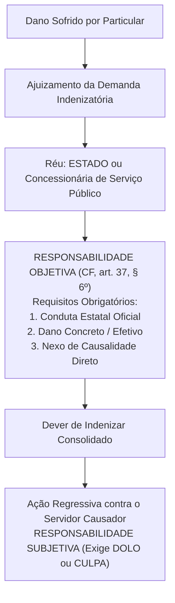
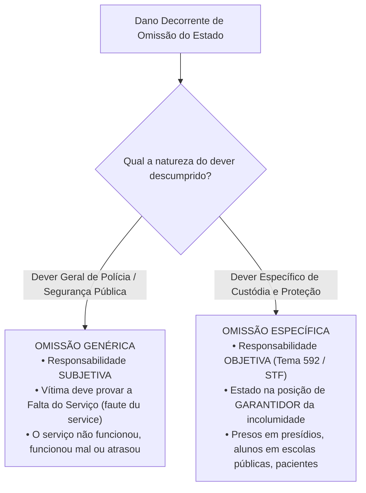
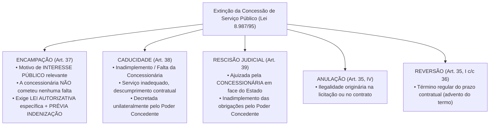

# 04 - Serviços Públicos, Bens Públicos e Responsabilidade Civil do Estado

> **Matéria:** Noções de Direito Administrativo  
> **Cargo:** A01 – Técnico de Controle Externo – Especialidade: Técnico Administrativo  
> **Arquivo:** `04_servicos_publicos_bens_e_responsabilidade_civil.md`  

---

## 📌 Ementa / Itens do Edital
- Responsabilidade civil do Estado: evolução histórica, fundamentos e modalidades
- Artigo 37, § 6º da Constituição Federal de 1988: responsabilidade objetiva das pessoas jurídicas de direito público e das de direito privado prestadoras de serviços públicos
- Teoria do Risco Administrativo vs. Teoria do Risco Integral
- Responsabilidade por ação vs. responsabilidade por omissão estatal (*faute du service* e dever específico de custódia)
- Causas excludentes e atenuantes do nexo de causalidade
- Ação regressiva contra o agente público e Tema 940 do STF (Teoria da Dupla Garantia)
- Serviços públicos: conceito, princípios, delegação a particulares (Lei nº 8.987/1995 e Lei nº 11.079/2004)
- Bens públicos: conceito, classificação (Código Civil, art. 99), afetação/desafetação e regime jurídico

---

## 🧭 Sumário

1. [Responsabilidade Civil Extracontratual do Estado](#1-responsabilidade-civil-extracontratual-do-estado)
    1. [Evolução Histórica da Responsabilidade Estatal](#11-evolucao-historica-da-responsabilidade-estatal)
    2. [O Art. 37, § 6º da CF/88 e os Elementos da Responsabilidade Objetiva](#12-o-art-37-6o-da-cf88-e-os-elementos-da-responsabilidade-objetiva)
    3. [Teoria do Risco Administrativo: Excludentes e Atenuantes](#13-teoria-do-risco-administrativo-excludentes-e-atenuantes)
    4. [Teoria do Risco Integral e suas Hipóteses Excepcionais](#14-teoria-do-risco-integral-e-suas-hipoteses-excepcionais)
    5. [Responsabilidade por Omissão Estatal: Genérica vs. Específica](#15-responsabilidade-por-omissao-estatal-generica-vs-especifica)
    6. [Ação Regressiva e a Teoria da Dupla Garantia (Tema 940 / STF)](#16-acao-regressiva-e-a-teoria-da-dupla-garantia-tema-940-stf)
    7. [Teste 034](#Teste-034)
    8. [Teste 035](#Teste-035)
    9. [Teste 036](#Teste-036)
    10. [Teste 037](#Teste-037)
2. [Regime Jurídico dos Serviços Públicos e sua Delegação](#2-regime-juridico-dos-servicos-publicos-e-sua-delegacao)
    1. [Princípios do Serviço Público Adequado](#21-principios-do-servico-publico-adequado)
    2. [Concessão Comum e Permissão de Serviço Público (Lei nº 8.987/1995)](#22-concessao-comum-e-permissao-de-servico-publico-lei-no-89871995)
    3. [Formas de Extinção das Concessões: Encampação vs. Caducidade](#23-formas-de-extincao-das-concessoes-encampacao-vs-caducidade)
    4. [Parcerias Público-Privadas - PPPs (Lei nº 11.079/2004)](#24-parcerias-publico-privadas-ppps-lei-no-110792004)
    5. [Teste 038](#Teste-038)
    6. [Teste 039](#Teste-039)
    7. [Teste 040](#Teste-040)
    8. [Teste 041](#Teste-041)
3. [Bens Públicos: Classificação, Afetação e Prerrogativas](#3-bens-publicos-classificacao-afetacao-e-prerrogativas)
    1. [Classificação Quanto à Destinação (Código Civil, art. 99)](#31-classificacao-quanto-a-destinacao-codigo-civil-art-99)
    2. [Fenômeno da Afetação e Desafetação](#32-fenomeno-da-afetacao-e-desafetacao)
    3. [Prerrogativas do Regime Jurídico e a Imprescritibilidade Absoluta](#33-prerrogativas-do-regime-juridico-e-a-imprescritibilidade-absoluta)
    4. [Teste 042](#Teste-042)
    5. [Teste 043](#Teste-043)
    6. [Teste 044](#Teste-044)
4. [Fontes Recomendadas na Internet](#4-fontes-recomendadas-na-internet)

---

## 1. Responsabilidade Civil Extracontratual do Estado

A responsabilidade civil extracontratual da Administração Pública consiste na obrigação jurídica que recai sobre o Estado de reparar os danos materiais, morais e estéticos causados a particulares por condutas comissivas ou omissivas de seus agentes públicos no exercício de suas atribuições ou a pretexto de exercê-las.

### 1.1 Evolução Histórica da Responsabilidade Estatal

- **Teoria da Irresponsabilidade Estatal (*The King can do no wrong*):** Predominou nos Estados Absolutistas. O monarca e o Estado não respondiam por quaisquer danos causados aos súditos.
- **Teorias Civilistas / Subjetivas (Culpa Comum):** Surgiram com o advento do Estado Liberal de Direito. Exigiam que a vítima comprovasse a culpa individualizada do agente público (*culpa in eligendo* ou *culpa in vigilando*), operando em extrema desvantagem processual para o particular.
- **Teoria da Culpa Administrativa / Culpa do Serviço (*Faute du Service*):** Desvinculou a culpa da pessoa física do servidor. A responsabilidade continuava sendo subjetiva, mas bastava à vítima comprovar a falta do serviço estatal: o serviço não funcionou, funcionou mal ou funcionou com atraso intolerável.
- **Teoria Objetiva do Risco Administrativo:** Consagrada pelo Direito Constitucional contemporâneo, dispensa integralmente a comprovação de dolo ou culpa estatal, fundando-se na causalidade material e na solidariedade social perante os riscos criados pela atividade administrativa.

### 1.2 O Art. 37, § 6º da CF/88 e os Elementos da Responsabilidade Objetiva

> *"Art. 37, § 6º. As pessoas jurídicas de direito público e as de direito privado prestadoras de serviços públicos responderão pelos danos que seus agentes, nessa qualidade, causarem a terceiros, assegurado o direito de regresso contra o responsável nos casos de dolo ou culpa."*

#### Elementos Indispensáveis para a Responsabilização Objetiva:
1. **Conduta Estatal:** Ação ou comportamento imputável a um agente público (efetivo, comissionado, temporário ou terceiro delegatário) agindo nessa qualidade.
2. **Dano Efetivo:** Prejuízo certo, juridicamente tutelado, de natureza patrimonial, moral ou estética.
3. **Nexo de Causalidade:** Relação direta de causa e efeito entre a conduta oficial e o dano experimentado pela vítima (Teoria do Dano Direto e Imediato).

> ⭐ **IMPORTANTE / REPERCUSSÃO GERAL STF:**  
> A responsabilidade objetiva do art. 37, § 6º, aplica-se às **empresas prestadoras de serviços públicos** (concessionárias e permissionárias) tanto em relação aos **usuários do serviço** quanto em relação a **terceiros não usuários** (vítimas de acidentes causados pelo serviço público - RE 591.874/STF).

### 1.3 Teoria do Risco Administrativo: Excludentes e Atenuantes

O ordenamento jurídico brasileiro adota como **regra geral a Teoria do Risco Administrativo**. Essa teoria baseia-se na ideia de que a atividade estatal gera riscos inerentes para a coletividade, devendo o poder público arcar com os prejuízos decorrentes. Todavia, **NÃO se trata de responsabilidade absoluta**, admitindo-se a ruptura ou atenuação do nexo causal nas seguintes hipóteses:

- **Causas Excludentes do Nexo de Causalidade (Afastam 100% da Indenização):**
    1. *Culpa Exclusiva da Vítima:* O evento decorreu inteiramente do comportamento negligente, imprudente ou voluntário do próprio lesado (ex.: pedestre que se atira intencionalmente sob as rodas de um ônibus público em alta velocidade).
    2. *Caso Fortuito ou Força Maior Absoluta:* Eventos imprevisíveis da natureza com violência desmedida (raios imprevisíveis, terremotos, trombas d'água fora de qualquer série histórica), desde que o Estado não tenha sido omisso em adotar medidas preventivas exigíveis.
    3. *Fato Exclusivo de Terceiro:* Dano provocado exclusivamente por ação autônoma e imprevisível de outrem sem qualquer concurso da conduta estatal (ex.: assalto à mão armada ocorrido dentro de um ônibus coletivo com disparo de arma de fogo deflagrado pelo criminoso).

- **Causas Atenuantes do Nexo de Causalidade:**
    - *Culpa Concorrente da Vítima:* A vítima e o agente público concorreram simultaneamente para a eclosão do evento danoso. O Estado continua obrigado a indenizar, mas o montante indenizatório é **reduzido proporcionalmente** ao grau de culpa da vítima.

### 1.4 Teoria do Risco Integral e suas Hipóteses Excepcionais

Na **Teoria do Risco Integral**, a obrigação estatal de indenizar é cega e absoluta. O Estado atua como garantidor universal de riscos, **sendo vedada a invocação de qualquer causa excludente** (o poder público é condenado mesmo diante de caso fortuito, força maior ou culpa exclusiva da vítima).

O ordenamento constitucional e legal brasileiro reconhece a incidência do risco integral em apenas **três hipóteses taxativas**:

1. **Dano Nuclear:** Responsabilidade civil por acidentes radiológicos ou nucleares (CF/88, art. 21, XXIII, "d");
2. **Atos de Guerra e Terrorismo Aéreo:** Danos a terceiros decorrentes de atentados terroristas contra aeronaves comerciais de matrícula brasileira (Lei Federal nº 10.744/2003);
3. **Dano Ambiental:** Jurisprudência vinculante consolidada do Superior Tribunal de Justiça (Tema Repetitivo 707/STJ) para degradações ecológicas graves.

### 1.5 Responsabilidade por Omissão Estatal: Genérica vs. Específica

Quando o dano decorre de um não-fazer da Administração Pública, a jurisprudência estabelece rígida bifurcação metodológica:

- **Omissão Genérica (Responsabilidade Subjetiva):** O Estado descumpre seu dever genérico de proteção da ordem social (ex.: furto de veículo particular estacionado em via pública comum; alagamento pontual em chuva sazonal). A vítima deve provar a ocorrência de culpa anônima do serviço (*faute du service*), demonstrando que o poder público foi negligente diante de um dever exigível.
- **Omissão Específica (Responsabilidade Objetiva - Tema 592/STF):** Ocorre quando o Estado atua na **posição de garante**, detendo a pessoa ou a coisa sob sua imediata custódia física institucional (ex.: morte ou lesão corporal de detento em estabelecimento penitenciário; acidente com criança no interior de escola pública municipal; suicídio de paciente internado em hospital psiquiátrico público). A responsabilidade é **OBJETIVA**; o Estado só se exonera se comprovar que a morte ou o dano decorreu de causa natural ou que o evento era faticamente inevitável mesmo com o cumprimento de todos os protocolos regulares de vigilância.

### 1.6 Ação Regressiva e a Teoria da Dupla Garantia (Tema 940 / STF)

O Supremo Tribunal Federal, ao julgar o RE 1.027.633 sob a sistemática da repercussão geral (**Tema 940**), pacificou a controvérsia sobre a legitimidade passiva nas ações indenizatórias fundamentadas no art. 37, § 6º, da CF/88:

> *"A teor do art. 37, § 6º, da Constituição Federal, a ação por danos causados por agente público deve ser ajuizada contra o Estado ou a pessoa jurídica de direito privado prestadora de serviço público, **sendo parte ilegítima para figurar no polo passivo o autor do ato**, assegurado o direito de regresso contra o responsável nos casos de dolo ou culpa."*

#### A Teoria da Dupla Garantia:
1. **Primeira Garantia (Ao Cidadão Vítima):** Assegura que o particular lesionado demandará contra o Estado ou concessionária sob regime de responsabilidade objetiva (sem ter que provar a culpa do servidor) e com a certeza de solvência financeira pública.
2. **Segunda Garantia (Ao Agente Público):** Protege o servidor contra ações temerárias de administrados inconformados, assegurando-lhe que **jamais poderá ser réu direto** na ação proposta pela vítima, nem compor litisconsórcio passivo originário com o Estado.

- **Regime da Ação Regressiva:** O Estado, após ser definitivamente condenado e efetuar o pagamento da indenização à vítima, tem o **dever de ajuizar ação regressiva** contra o servidor causador do dano. No âmbito da ação de regresso, a responsabilidade do servidor é **SUBJETIVA**, dependendo da comprovação cabal de que ele agiu com **dolo ou culpa** (negligência, imprudência ou imperícia).

---

### Teste 001
**(FGV – TJ/AP – 2023 – Analista Judiciario Apoio Especializado Tecnologia Da Informacao Banco De Dados)**
Na qualidade de servidora pública ocupante do cargo de analista do Tribunal de Justiça do Estado do Amapá, Marieva foi questionada acerca de qual teoria foi adotada para responsabilidade civil do Estado pela conduta dos respectivos agentes públicos, à luz do disposto no Art. 37, §6º, da Constituição da República de 1988 e as peculiaridades decorrentes de tal orientação. Nesse contexto, considerando o entendimento do Supremo Tribunal Federal acerca da matéria, Marieva respondeu, corretamente, que se tratava da:

* **A)** teoria do risco administrativo, que consagra a responsabilidade subjetiva do Estado e não admite excludentes do nexo de causalidade;
* **B)** teoria do risco integral, que consagra a responsabilidade objetiva do Estado e não admite excludentes do nexo de causalidade;
* **C)** teoria da culpa administrativa, que consagra a responsabilidade subjetiva do Estado e não admite excludentes do nexo de causalidade;
* **D)** teoria do risco administrativo, que consagra a responsabilidade objetiva do Estado e admite excludentes do nexo de causalidade;
* **E)** teoria do risco integral, que consagra a responsabilidade subjetiva do Estado e admite excludentes do nexo de causalidade.

---

> **Comentário Detalhado:**
>
> - **A)** **Incorreta.** A opção apresenta proposição em desacordo com os fundamentos teóricos e técnicos do tópico ao afirmar que "teoria do risco administrativo, que consagra a responsabilidade subjetiva do Estado e não admite excludentes do...". De acordo com a teoria estudada em *1.3 Teoria do Risco Administrativo: Excludentes e Atenuantes*, causas Excludentes do Nexo de Causalidade (Afastam 100% da Indenização).
> - **B)** **Incorreta.** A opção apresenta proposição em desacordo com os fundamentos teóricos e técnicos do tópico ao afirmar que "teoria do risco integral, que consagra a responsabilidade objetiva do Estado e não admite excludentes do nexo de...". De acordo com a teoria estudada em *1.3 Teoria do Risco Administrativo: Excludentes e Atenuantes*, causas Atenuantes do Nexo de Causalidade.
> - **C)** **Incorreta.** A opção apresenta proposição em desacordo com os fundamentos teóricos e técnicos do tópico ao afirmar que "teoria da culpa administrativa, que consagra a responsabilidade subjetiva do Estado e não admite excludentes do...". De acordo com a teoria estudada em *1.1 Evolução Histórica da Responsabilidade Estatal*, teoria Objetiva do Risco Administrativo: Consagrada pelo Direito Constitucional contemporâneo, dispensa integralmente a comprovação de dolo ou culpa estatal, fundando se na causalidade material e na solidariedade social perante os riscos criados pela atividade administrativa.
> - **D)** **Correta.** Conforme fundamentado na seção *1.3 Teoria do Risco Administrativo: Excludentes e Atenuantes* deste guia, o ordenamento jurídico brasileiro adota como regra geral a Teoria do Risco Administrativo. Essa teoria baseia se na ideia de que a atividade estatal gera riscos inerentes para a coletividade, devendo o poder público arcar com os prejuízos decorrentes. Todavia, NÃO se trata de responsabilidade absoluta, admitindo se a ruptura ou atenuação do nexo causal nas seguintes hipóteses. Dessa forma, está plenamente correta a assertiva da banca (FGV – TJ/AP/2023) ao estabelecer que "teoria do risco administrativo, que consagra a responsabilidade objetiva do Estado e admite excludentes do nexo de...".
> - **E)** **Incorreta.** A opção apresenta proposição em desacordo com os fundamentos teóricos e técnicos do tópico ao afirmar que "teoria do risco integral, que consagra a responsabilidade subjetiva do Estado e admite excludentes do nexo de...". De acordo com a teoria estudada em *1.2 O Art. 37, § 6º da CF/88 e os Elementos da Responsabilidade Objetiva*, dEF REQ["RESPONSABILIDADE OBJETIVA (CF, art. 37, § 6º)<br/ Requisitos Obrigatórios:<br/ 1. Conduta Estatal Oficial<br/ 2. Dano Concreto / Efetivo<br/ 3. Nexo de Causalidade Direto"].
>
> **Gabarito: D**

---

### Teste 002
**(FGV – TRT 1ª – 2024 – Analista Judiciário - Área Administrativa)**
Josélia decidiu aprofundar os seus conhecimentos com relação à orientação do Supremo Tribunal Federal acerca da responsabilidade civil do Estado, à luz do disposto no Art. 37, §6º, da CRFB/1988, vindo a concluir corretamente que:

* **A)** no caso atinente a morte por disparo de arma de fogo em decorrência de operação policial, a responsabilidade civil do Estado é fundada na teoria do risco integral;
* **B)** o direito de regresso em relação ao agente público causador do dano em sede de responsabilidade civil é imprescritível, por se tratar de ressarcimento ao erário;
* **C)** não é cabível o reconhecimento de causas excludentes da responsabilidade civil, diante da previsão constitucional;
* **D)** o agente causador do dano não tem legitimidade para constar do polo passivo da ação judicial que visa à responsabilização civil do Estado;
* **E)** tanto o Estado quanto o agente causador do dano respondem objetivamente pelos danos por este causados no exercício de suas atribuições.

---

> **Comentário Detalhado:**
>
> - **A)** **Incorreta.** A opção apresenta proposição em desacordo com os fundamentos teóricos e técnicos do tópico ao afirmar que "no caso atinente a morte por disparo de arma de fogo em decorrência de operação policial, a responsabilidade civil...". De acordo com a teoria estudada em *1.3 Teoria do Risco Administrativo: Excludentes e Atenuantes*, fato Exclusivo de Terceiro: Dano provocado exclusivamente por ação autônoma e imprevisível de outrem sem qualquer concurso da conduta estatal (ex.: assalto à mão armada ocorrido dentro de um ônibus coletivo com disparo de arma de fogo deflagrado pelo criminoso).
> - **B)** **Incorreta.** A opção apresenta proposição em desacordo com os fundamentos teóricos e técnicos do tópico ao afirmar que "o direito de regresso em relação ao agente público causador do dano em sede de responsabilidade civil é...". De acordo com a teoria estudada em *A Teoria da Dupla Garantia:*, regime da Ação Regressiva: O Estado, após ser definitivamente condenado e efetuar o pagamento da indenização à vítima, tem o dever de ajuizar ação regressiva contra o servidor causador do dano. No âmbito da ação de regresso, a responsabilidade do servidor é SUBJETIVA, dependendo da comprovação cabal de que ele agiu com dolo ou culpa (negligência, imprudência ou imperícia).
> - **C)** **Incorreta.** A opção apresenta proposição em desacordo com os fundamentos teóricos e técnicos do tópico ao afirmar que "não é cabível o reconhecimento de causas excludentes da responsabilidade civil, diante da previsão constitucional". De acordo com a teoria estudada em *A Teoria da Dupla Garantia:*, segunda Garantia (Ao Agente Público): Protege o servidor contra ações temerárias de administrados inconformados, assegurando lhe que jamais poderá ser réu direto na ação proposta pela vítima, nem compor litisconsórcio passivo originário com o Estado.
> - **D)** **Correta.** Conforme fundamentado na seção *1.6 Ação Regressiva e a Teoria da Dupla Garantia (Tema 940 / STF)* deste guia, "A teor do art. 37, § 6º, da Constituição Federal, a ação por danos causados por agente público deve ser ajuizada contra o Estado ou a pessoa jurídica de direito privado prestadora de serviço público, sendo parte ilegítima para figurar no polo passivo o autor do ato, assegurado o direito de regresso contra o responsável nos casos de dolo ou culpa.". Dessa forma, está plenamente correta a assertiva da banca (FGV – TRT 1ª/2024) ao estabelecer que "o agente causador do dano não tem legitimidade para constar do polo passivo da ação judicial que visa à...".
> - **E)** **Incorreta.** A opção apresenta proposição em desacordo com os fundamentos teóricos e técnicos do tópico ao afirmar que "tanto o Estado quanto o agente causador do dano respondem objetivamente pelos danos por este causados no exercício...". De acordo com a teoria estudada em *1. Responsabilidade Civil Extracontratual do Estado*, a responsabilidade civil extracontratual da Administração Pública consiste na obrigação jurídica que recai sobre o Estado de reparar os danos materiais, morais e estéticos causados a particulares por condutas comissivas ou omissivas de seus agentes públicos no exercício de suas atribuições ou a pretexto de exercê las.
>
> **Gabarito: D**

---

## 2. Regime Jurídico dos Serviços Públicos e sua Delegação

### 2.1 Princípios do Serviço Público Adequado

A Lei Federal nº 8.987/1995 (art. 6º) prescreve que toda concessão ou permissão pressupõe a prestação de **serviço adequado**, assim entendido o que satisfaz as condições de:

- **Regularidade:** Prestação sem oscilações arbitrárias de qualidade.
- **Continuidade:** Não interrupção da atividade, admitida a suspensão motivada em hipóteses estritas de segurança técnica ou inadimplemento do usuário após aviso prévio formal.
- **Eficiência:** Máxima produtividade e excelência técnica.
- **Segurança:** Minimização de riscos aos usuários e ao meio ambiente.
- **Atualidade:** Incorporação contínua de métodos modernos, equipamentos tecnológicos de ponta e expansão da rede.
- **Generalidade:** Acesso universal e não discriminatório a todos os cidadãos.
- **Cortesia:** Urbanidade no trato com os usuários.
- **Modicidade das Tarifas:** Fixação de preços públicos acessíveis à população em equilíbrio econômico-financeiro.

### 2.2 Concessão Comum e Permissão de Serviço Público (Lei nº 8.987/1995)

- **Concessão Comum de Serviço Público:** Delegação contratual bilateral formalizada com pessoa jurídica ou consórcio de empresas, mediante prévia licitação obrigatória, para exploração do serviço por prazo determinado, a expensas e risco da concessionária, remunerada unicamente pelas tarifas cobradas dos usuários.
- **Permissão de Serviço Público:** Delegação formalizada mediante **contrato de adesão**, a título precário, após prévia licitação, admitindo como permitente pessoa física ou jurídica.

### 2.3 Formas de Extinção das Concessões: Encampação vs. Caducidade

A diferenciação entre as modalidades de extinção contratual na Lei nº 8.987/1995 é intensamente cobrada pela FCC:

| Critério de Comparação | Encampação (Resgate) | Caducidade |
| :--- | :--- | :--- |
| **Causa Primária** | **Interesse público superveniente** (conveniência administrativa) | **Inadimplemento contratual culposo** da concessionária |
| **Culpa da Concessionária?** | **NÃO** (a empresa cumpria rigorosamente o contrato) | **SIM** (prestação defeituosa, paralisações, descumprimento de prazos) |
| **Exigência de Lei?** | **SIM**, exige **lei autorizativa específica** do ente concedente | **NÃO**, declarada por **decreto** do Chefe do Executivo |
| **Indenização Prévia?** | **SIM**, o pagamento de indenização deve ser **prévio** à retomada | **NÃO**, indenização é apurada a posteriori descontadas multas contratuais |

### 2.4 Parcerias Público-Privadas - PPPs (Lei nº 11.079/2004)

As Parcerias Público-Privadas constituem concessões especiais destinadas a viabilizar investimentos vultosos de infraestrutura em colaboração com o capital privado:

1. **Concessão Patrocinada (Art. 2º, § 1º):** É a concessão de serviços públicos ou obras públicas em que a remuneração da concessionária envolve a combinação de **tarifa paga pelos usuários** mais uma **contraprestação pecuniária complementar paga pelo parceiro público**.
2. **Concessão Administrativa (Art. 2º, § 2º):** É o contrato de prestação de serviços de que a **Administração Pública seja a usuária direta ou indireta**, ainda que envolva a execução de obra ou fornecimento e instalação de bens. A remuneração é **100% custeada pelo erário**, inexistindo cobrança de tarifas dos cidadãos (ex.: construção e operação de hospitais públicos do SUS, presídios, iluminação pública).
3. **Vedações Legais Obrigatórias à Celebração de PPPs (Art. 2º, § 4º):**
    - Contratos cujo valor total seja **inferior a R$ 10.000.000,00 (dez milhões de reais)**;
    - Período de prestação de serviços **inferior a 5 (cinco) anos** ou superior a 35 (trinta e cinco) anos;
    - Contratos que tenham por objeto único o fornecimento de mão de obra, a mera locação de equipamentos ou a execução isolada de obra pública sem prestação continuada de serviços.

---

### Teste 003
**(FGV – TJ/SC – 2026 – Analista Administrativo)**
As parcerias público-privadas (PPPs) constituem estratégia governamental destinada a viabilizar empreendimentos e serviços públicos por meio da articulação entre a Administração Pública e o setor privado, apresentando potencial para superar limitações estruturais do setor estatal. A respeito das vantagens das PPPs para a Administração Pública, analise as afirmativas a seguir. I. Viabilizam empreendimentos que, sob a ótica estritamente financeira, não seriam sustentáveis apenas com a cobrança de tarifa dos usuários, ao admitir contraprestação do parceiro público ao parceiro privado. II. Geram complementaridade às capacidades e aos recursos do governo, mediante a aprendizagem de novas habilidades, o acesso a ferramentas de gestão da informação e o desenvolvimento de capacidade gerencial. III. Devem ser concebidas pelos gestores como mecanismo de viabilização de aportes financeiros privados, dispensando a busca de eficiência no uso de recursos públicos. Está correto o que se afirma em

* **A)** I, II e III.
* **B)** I e II, apenas.
* **C)** I e III, apenas.
* **D)** II e III, apenas.
* **E)** I, apenas.

---

> **Comentário Detalhado:**
>
> - **A)** **Incorreta.** A opção apresenta proposição em desacordo com os fundamentos teóricos e técnicos do tópico ao afirmar que "I, II e III". De acordo com a teoria estudada em *3.1 Classificação Quanto à Destinação (Código Civil, art. 99)*, bens Dominicais ou Dominicais (Art. 99, III): Bens que constituem o patrimônio disponível do Estado sem destinação pública específica ou aplicação administrativa direta (terras devolutas, prédios públicos desativados, títulos da dívida pública, bens desapropriados e não afetados).
> - **B)** **Correta.** Conforme fundamentado na seção *2.4 Parcerias Público-Privadas - PPPs (Lei nº 11.079/2004)* deste guia, concessão Patrocinada (Art. 2º, § 1º): É a concessão de serviços públicos ou obras públicas em que a remuneração da concessionária envolve a combinação de tarifa paga pelos usuários mais uma contraprestação pecuniária complementar paga pelo parceiro público. Dessa forma, está plenamente correta a assertiva da banca (FGV – TJ/SC/2026) ao estabelecer que "I e II, apenas".
> - **C)** **Incorreta.** A opção incorre em restrição indevida ao limitar o escopo conceitual ao afirmar que "I e III, apenas". De acordo com a teoria estudada em *2.4 Parcerias Público-Privadas - PPPs (Lei nº 11.079/2004)*, as Parcerias Público Privadas constituem concessões especiais destinadas a viabilizar investimentos vultosos de infraestrutura em colaboração com o capital privado.
> - **D)** **Incorreta.** A opção incorre em restrição indevida ao limitar o escopo conceitual ao afirmar que "II e III, apenas". De acordo com a teoria estudada em *2.4 Parcerias Público-Privadas - PPPs (Lei nº 11.079/2004)*, concessão Administrativa (Art. 2º, § 2º): É o contrato de prestação de serviços de que a Administração Pública seja a usuária direta ou indireta, ainda que envolva a execução de obra ou fornecimento e instalação de bens. A remuneração é 100% custeada pelo erário, inexistindo cobrança de tarifas dos cidadãos (ex.: construção e operação de hospitais públicos do SUS, presídios, iluminação pública).
> - **E)** **Incorreta.** A opção incorre em restrição indevida ao limitar o escopo conceitual ao afirmar que "I, apenas". De acordo com a teoria estudada em *3.1 Classificação Quanto à Destinação (Código Civil, art. 99)*, bens de Uso Comum do Povo (Art. 99, I): Destinados ao uso franqueado e indistinto de toda a coletividade (mares, rios, estradas, ruas, praças, praias). Podem ser utilizados gratuitamente ou mediante cobrança de tarifa/pedágio autorizada por lei.
>
> **Gabarito: B**

---

### Teste 004
**(FGV – TJ/SC – 2026 – Analista Administrativo)**
Na Administração Pública federal direta, autárquica e fundacional, a terceirização é disciplinada pelo Decreto nº 9.507/2018, que enumera, em seu art. 3º, hipóteses em que se veda a execução indireta de serviços, em razão da natureza nuclear ou indelegável das atividades envolvidas. Dentre as hipóteses em que o Decreto nº 9.507/2018 veda a execução indireta de serviços na Administração Pública federal direta, autárquica e fundacional, encontra-se a contratação de serviços de

* **A)** conservação, limpeza e copeiragem.
* **B)** recepção e telecomunicações.
* **C)** manutenção predial e de equipamentos.
* **D)** regulação e outorga de serviços públicos.
* **E)** transporte de cargas e de passageiros.

---

> **Comentário Detalhado:**
>
> - **A)** **Incorreta.** A opção apresenta proposição em desacordo com os fundamentos teóricos e técnicos do tópico ao afirmar que "conservação, limpeza e copeiragem". De acordo com a teoria estudada em *4. Fontes Recomendadas na Internet*, normas gerais sobre participação, proteção e defesa dos direitos do usuário dos serviços públicos da administração direta e indireta.
> - **B)** **Incorreta.** A opção apresenta proposição em desacordo com os fundamentos teóricos e técnicos do tópico ao afirmar que "recepção e telecomunicações". De acordo com a teoria estudada em *3.1 Classificação Quanto à Destinação (Código Civil, art. 99)*, bens de Uso Especial (Art. 99, II): Destinados à execução direta dos serviços públicos e ao funcionamento da máquina administrativa (edifícios de fóruns e tribunais, escolas públicas, hospitais estatais, viaturas policiais, quartéis).
> - **C)** **Incorreta.** A opção apresenta proposição em desacordo com os fundamentos teóricos e técnicos do tópico ao afirmar que "manutenção predial e de equipamentos". De acordo com a teoria estudada em *2.4 Parcerias Público-Privadas - PPPs (Lei nº 11.079/2004)*, contratos que tenham por objeto único o fornecimento de mão de obra, a mera locação de equipamentos ou a execução isolada de obra pública sem prestação continuada de serviços.
> - **D)** **Correta.** Conforme fundamentado na seção *2.4 Parcerias Público-Privadas - PPPs (Lei nº 11.079/2004)* deste guia, concessão Administrativa (Art. 2º, § 2º): É o contrato de prestação de serviços de que a Administração Pública seja a usuária direta ou indireta, ainda que envolva a execução de obra ou fornecimento e instalação de bens. A remuneração é 100% custeada pelo erário, inexistindo cobrança de tarifas dos cidadãos (ex.: construção e operação de hospitais públicos do SUS, presídios, iluminação pública). Dessa forma, está plenamente correta a assertiva da banca (FGV – TJ/SC/2026) ao estabelecer que "regulação e outorga de serviços públicos".
> - **E)** **Incorreta.** A opção apresenta proposição em desacordo com os fundamentos teóricos e técnicos do tópico ao afirmar que "transporte de cargas e de passageiros". De acordo com a teoria estudada em *1.2 O Art. 37, § 6º da CF/88 e os Elementos da Responsabilidade Objetiva*, "Art. 37, § 6º. As pessoas jurídicas de direito público e as de direito privado prestadoras de serviços públicos responderão pelos danos que seus agentes, nessa qualidade, causarem a terceiros, assegurado o direito de regresso contra o responsável nos casos de dolo ou culpa.".
>
> **Gabarito: D**

---

### Teste 005
**(FCC – TCE/GO – 2009 – Analista de Controle Externo - Gestão de Conhecimento)**
Considere as situações abaixo descritas, relativamente a juízo da responsabilização disciplinar daqueles que atividades desempenhadas por servidores públicos do tenham com ele concorrido. Estado de Goiás, no exercício de suas funções: _________________________________________________________ 46. No exercício de seu poder regulamentar, o Chefe do Po- I. deixar, injustificadamente, de arrecadar tributos a der Executivo pode expedir, relativamente a todas as seu cargo. matérias de sua competência, regulamentos II. empregar meio vexatório na cobrança de tributo ou

* **A)** I, apenas. decretos por ele expedidos.
* **B)** II, apenas. ção de serviços públicos. _________________________________________________________
* **C)** III, apenas.
* **D)** de execução, destinados a dar fiel cumprimento aos
* **E)** independentes, destinados a regulamentar a presta-

---

> **Comentário Detalhado:**
>
> - **A)** **Incorreta.** A opção incorre em restrição indevida ao limitar o escopo conceitual ao afirmar que "I, apenas. decretos por ele expedidos". De acordo com a teoria estudada em *3.1 Classificação Quanto à Destinação (Código Civil, art. 99)*, bens de Uso Especial (Art. 99, II): Destinados à execução direta dos serviços públicos e ao funcionamento da máquina administrativa (edifícios de fóruns e tribunais, escolas públicas, hospitais estatais, viaturas policiais, quartéis).
> - **B)** **Incorreta.** A opção incorre em restrição indevida ao limitar o escopo conceitual ao afirmar que "II, apenas. ção de serviços públicos". De acordo com a teoria estudada em *2.4 Parcerias Público-Privadas - PPPs (Lei nº 11.079/2004)*, concessão Administrativa (Art. 2º, § 2º): É o contrato de prestação de serviços de que a Administração Pública seja a usuária direta ou indireta, ainda que envolva a execução de obra ou fornecimento e instalação de bens. A remuneração é 100% custeada pelo erário, inexistindo cobrança de tarifas dos cidadãos (ex.: construção e operação de hospitais públicos do SUS, presídios, iluminação pública).
> - **C)** **Incorreta.** A opção incorre em restrição indevida ao limitar o escopo conceitual ao afirmar que "III, apenas". De acordo com a teoria estudada em *3.1 Classificação Quanto à Destinação (Código Civil, art. 99)*, bens Dominicais ou Dominicais (Art. 99, III): Bens que constituem o patrimônio disponível do Estado sem destinação pública específica ou aplicação administrativa direta (terras devolutas, prédios públicos desativados, títulos da dívida pública, bens desapropriados e não afetados).
> - **D)** **Incorreta.** A opção apresenta proposição em desacordo com os fundamentos teóricos e técnicos do tópico ao afirmar que "de execução, destinados a dar fiel cumprimento aos". De acordo com a teoria estudada em *2.4 Parcerias Público-Privadas - PPPs (Lei nº 11.079/2004)*, contratos que tenham por objeto único o fornecimento de mão de obra, a mera locação de equipamentos ou a execução isolada de obra pública sem prestação continuada de serviços.
> - **E)** **Correta.** Conforme fundamentado na seção *3.1 Classificação Quanto à Destinação (Código Civil, art. 99)* deste guia, bens de Uso Comum do Povo (Art. 99, I): Destinados ao uso franqueado e indistinto de toda a coletividade (mares, rios, estradas, ruas, praças, praias). Podem ser utilizados gratuitamente ou mediante cobrança de tarifa/pedágio autorizada por lei. Dessa forma, está plenamente correta a assertiva da banca (FCC – TCE/GO/2009) ao estabelecer que "independentes, destinados a regulamentar a presta".
>
> **Gabarito: E**

---

### Teste 006
**(FGV – TCE/GO – 2024 – Analista de Controle Externo - Jurídica)**
Em julgamento ocorrido no final do ano de 2022, em sede de controle concentrado de constitucionalidade, o STF analisou o denominado “orçamento secreto”. Com relação ao tema e considerando o julgamento do STF, assinale a afirmativa correta.

* **A)** O orçamento secreto observa os postulados da publicidade e transparência através da disponibilização nos sites oficiais do Governo Federal das informações sobre a execução orçamentaria das emendas do relator.
* **B)** Trata-se de um regime em que vincula o autor da emenda ao beneficiário da despesa, tornando verificáveis a origem e destinação do dinheiro gasto por meio do cruzamento das informações publicadas, sendo, portanto, constitucional.
* **C)** O orçamento secreto oculta os efetivos requerentes da despesa, por meio da utilização de rubrica orçamentária única, na qual todas as despesas previstas são atribuídas à pessoa do relator-geral do orçamento.
* **D)** O orçamento secreto deve destinar obrigatoriamente as despesas para ações e serviços públicos de saúde e de assistência social, e oculta os valores individualizados das emendas do relator.
* **E)** As emendas parlamentares ao orçamento secreto possuem autorização constitucional e objetivam viabilizar a participação ativa dos Deputados Federais e Senadores na elaboração da peça orçamentária.

---

> **Comentário Detalhado:**
>
> - **A)** **Incorreta.** A opção apresenta proposição em desacordo com os fundamentos teóricos e técnicos do tópico ao afirmar que "O orçamento secreto observa os postulados da publicidade e transparência através da disponibilização nos sites...". De acordo com a teoria estudada em *1.6 Ação Regressiva e a Teoria da Dupla Garantia (Tema 940 / STF)*, o Supremo Tribunal Federal, ao julgar o RE 1.027.633 sob a sistemática da repercussão geral (Tema 940), pacificou a controvérsia sobre a legitimidade passiva nas ações indenizatórias fundamentadas no art. 37, § 6º, da CF/88.
> - **B)** **Incorreta.** A opção apresenta proposição em desacordo com os fundamentos teóricos e técnicos do tópico ao afirmar que "Trata se de um regime em que vincula o autor da emenda ao beneficiário da despesa, tornando verificáveis a origem...". De acordo com a teoria estudada em *1.6 Ação Regressiva e a Teoria da Dupla Garantia (Tema 940 / STF)*, "A teor do art. 37, § 6º, da Constituição Federal, a ação por danos causados por agente público deve ser ajuizada contra o Estado ou a pessoa jurídica de direito privado prestadora de serviço público, sendo parte ilegítima para figurar no polo passivo o autor do ato, assegurado o direito de regresso contra o responsável nos casos de dolo ou culpa.".
> - **C)** **Correta.** Conforme fundamentado na seção *1.5 Responsabilidade por Omissão Estatal: Genérica vs. Específica* deste guia, omissão Específica (Responsabilidade Objetiva Tema 592/STF): Ocorre quando o Estado atua na posição de garante, detendo a pessoa ou a coisa sob sua imediata custódia física institucional (ex.: morte ou lesão corporal de detento em estabelecimento penitenciário; acidente com criança no interior de escola pública municipal; suicídio de paciente internado em hospital psiquiátrico público). A responsabilidade é OBJETIVA; o Estado só se exonera se comprovar que a morte ou o dano decorreu de causa natural ou que o evento era faticamente inevitável mesmo com o cumprimento de todos os protocolos regulares de vigilância. Dessa forma, está plenamente correta a assertiva da banca (FGV – TCE/GO/2024) ao estabelecer que "O orçamento secreto oculta os efetivos requerentes da despesa, por meio da utilização de rubrica orçamentária...".
> - **D)** **Incorreta.** A opção apresenta proposição em desacordo com os fundamentos teóricos e técnicos do tópico ao afirmar que "O orçamento secreto deve destinar obrigatoriamente as despesas para ações e serviços públicos de saúde e de...". De acordo com a teoria estudada em *1.5 Responsabilidade por Omissão Estatal: Genérica vs. Específica*, omissão Genérica (Responsabilidade Subjetiva): O Estado descumpre seu dever genérico de proteção da ordem social (ex.: furto de veículo particular estacionado em via pública comum; alagamento pontual em chuva sazonal). A vítima deve provar a ocorrência de culpa anônima do serviço ( faute du service ), demonstrando que o poder público foi negligente diante de um dever exigível.
> - **E)** **Incorreta.** A opção apresenta proposição em desacordo com os fundamentos teóricos e técnicos do tópico ao afirmar que "As emendas parlamentares ao orçamento secreto possuem autorização constitucional e objetivam viabilizar a...". De acordo com a teoria estudada em *4. Fontes Recomendadas na Internet*, sTF Tema 940 de Repercussão Geral (Teoria da Dupla Garantia na Responsabilidade Civil).
>
> **Gabarito: C**

---

### Teste 007
**(CEBRASPE – TRF/6 – 2025 – Analista Judiciario Apoio Especializado Tecnologia Da Informacao)**
Em decorrência da recente experiência do Estado na prestação de serviços públicos digitais, associada tanto a características do setor público quanto a entraves legislativos, a administração pública substituiu a lógica de prestação de serviços digitais centrada no usuário, consagrada no setor privado, pela lógica burocrática do serviço público voltada essencialmente à efetividade junto aos cidadãos. De acordo com o CIS Controls, julgue os próximos itens.

* **C)** Certo
* **E)** Errado

---

> **Comentário Detalhado:**
>
> - **C)** **Incorreta.** A proposição apresenta proposição em desacordo com os fundamentos teóricos e técnicos do tópico ao afirmar que "Em decorrência da recente experiência do Estado na prestação de serviços públicos digitais, associada tanto a...". De acordo com a teoria em *2.4 Parcerias Público-Privadas - PPPs (Lei nº 11.079/2004)*, concessão Administrativa (Art. 2º, § 2º): É o contrato de prestação de serviços de que a Administração Pública seja a usuária direta ou indireta, ainda que envolva a execução de obra ou fornecimento e instalação de bens. A remuneração é 100% custeada pelo erário, inexistindo cobrança de tarifas dos cidadãos (ex.: construção e operação de hospitais públicos do SUS, presídios, iluminação pública).
> - **E)** **Correta.** O item está **Errado** (gabarito oficial: **E**), pois contraria a disciplina teórica aplicável.
>
> **Gabarito: E**

---

### Teste 008
**(FGV – TRT da 24º Região – 2025 – Analista Judiciário - Área Administrativa - Contabilidade)**
A Administração Pública, como organização formal moderna, apresenta características básicas como divisão do trabalho, hierarquia funcional, formalização de regras, impessoalidade e busca pela eficiência na prestação dos serviços públicos. Assinale a opção que apresenta, corretamente, uma característica das organizações formais modernas no âmbito da Administração Pública.

* **A)** Os clientes internos não influenciam os processos organizacionais, pois seu papel está restrito ao consumo dos produtos finais da organização.
* **B)** Departamentos, divisões e seções não são considerados unidades organizacionais por não estarem diretamente ligados à alta gestão.
* **C)** A departamentalização por cliente é característica das estruturas informais e não se aplica à Administração Pública.
* **D)** Unidades organizacionais, como grupos de trabalho e seções, podem funcionar tanto como fornecedores quanto como clientes internos, conforme o fluxo de processos internos.
* **E)** A estrutura organizacional da Administração Pública não permite a existência de fornecedores internos, pois todos os insumos provêm do setor privado.

---

> **Comentário Detalhado:**
>
> - **A)** **Incorreta.** A opção apresenta proposição em desacordo com os fundamentos teóricos e técnicos do tópico ao afirmar que "Os clientes internos não influenciam os processos organizacionais, pois seu papel está restrito ao consumo dos...". De acordo com a teoria estudada em *3.1 Classificação Quanto à Destinação (Código Civil, art. 99)*, bens de Uso Comum do Povo (Art. 99, I): Destinados ao uso franqueado e indistinto de toda a coletividade (mares, rios, estradas, ruas, praças, praias). Podem ser utilizados gratuitamente ou mediante cobrança de tarifa/pedágio autorizada por lei.
> - **B)** **Incorreta.** A opção apresenta proposição em desacordo com os fundamentos teóricos e técnicos do tópico ao afirmar que "Departamentos, divisões e seções não são considerados unidades organizacionais por não estarem diretamente ligados...". De acordo com a teoria estudada em *3.1 Classificação Quanto à Destinação (Código Civil, art. 99)*, bens de Uso Especial (Art. 99, II): Destinados à execução direta dos serviços públicos e ao funcionamento da máquina administrativa (edifícios de fóruns e tribunais, escolas públicas, hospitais estatais, viaturas policiais, quartéis).
> - **C)** **Incorreta.** A opção apresenta proposição em desacordo com os fundamentos teóricos e técnicos do tópico ao afirmar que "A departamentalização por cliente é característica das estruturas informais e não se aplica à Administração Pública". De acordo com a teoria estudada em *2.4 Parcerias Público-Privadas - PPPs (Lei nº 11.079/2004)*, concessão Administrativa (Art. 2º, § 2º): É o contrato de prestação de serviços de que a Administração Pública seja a usuária direta ou indireta, ainda que envolva a execução de obra ou fornecimento e instalação de bens. A remuneração é 100% custeada pelo erário, inexistindo cobrança de tarifas dos cidadãos (ex.: construção e operação de hospitais públicos do SUS, presídios, iluminação pública).
> - **D)** **Correta.** Conforme fundamentado na seção *Elementos Indispensáveis para a Responsabilização Objetiva:* deste guia, a responsabilidade objetiva do art. 37, § 6º, aplica se às empresas prestadoras de serviços públicos (concessionárias e permissionárias) tanto em relação aos usuários do serviço quanto em relação a terceiros não usuários (vítimas de acidentes causados pelo serviço público RE 591.874/STF). Dessa forma, está plenamente correta a assertiva da banca (FGV – TRT da 24º Região/2025) ao estabelecer que "Unidades organizacionais, como grupos de trabalho e seções, podem funcionar tanto como fornecedores quanto como...".
> - **E)** **Incorreta.** A opção apresenta proposição em desacordo com os fundamentos teóricos e técnicos do tópico ao afirmar que "A estrutura organizacional da Administração Pública não permite a existência de fornecedores internos, pois todos...". De acordo com a teoria estudada em *4. Fontes Recomendadas na Internet*, normas gerais sobre participação, proteção e defesa dos direitos do usuário dos serviços públicos da administração direta e indireta.
>
> **Gabarito: D**

---

### Teste 009
**(FGV – TRT da 24º Região – 2025 – Analista Judiciário - Área Administrativa - Sem Especialidade)**
A Administração Pública estrutura-se por meio de organizações formais que definem a distribuição de funções, competências e níveis de autoridade, assegurando a gestão organizacional do poder público de forma racional e eficiente. Assinale a opção que apresenta corretamente a pessoa jurídica de direito privado que, embora controlada pelo Estado, não atende a todos os requisitos legais para ser considerada empresa pública ou sociedade de economia mista, atuando em regra na prestação de serviços públicos de natureza comercial ou industrial.

* **A)** Autarquia especial.
* **B)** Fundação pública de direito público.
* **C)** Empresa sob controle acionário do Estado.
* **D)** Sociedade de economia mista.
* **E)** Empresa pública.

---

> **Comentário Detalhado:**
>
> - **A)** **Incorreta.** A opção apresenta proposição em desacordo com os fundamentos teóricos e técnicos do tópico ao afirmar que "Autarquia especial". De acordo com a teoria estudada em *3.3 Prerrogativas do Regime Jurídico e a Imprescritibilidade Absoluta*, inalienabilidade Relativa: Os bens de uso comum e de uso especial são inalienáveis enquanto conservarem sua qualificação pública. Os bens dominicais podem ser alienados, desde que cumpridos os requisitos da lei de licitações.
> - **B)** **Incorreta.** A opção apresenta proposição em desacordo com os fundamentos teóricos e técnicos do tópico ao afirmar que "Fundação pública de direito público". De acordo com a teoria estudada em *1.6 Ação Regressiva e a Teoria da Dupla Garantia (Tema 940 / STF)*, "A teor do art. 37, § 6º, da Constituição Federal, a ação por danos causados por agente público deve ser ajuizada contra o Estado ou a pessoa jurídica de direito privado prestadora de serviço público, sendo parte ilegítima para figurar no polo passivo o autor do ato, assegurado o direito de regresso contra o responsável nos casos de dolo ou culpa.".
> - **C)** **Correta.** Conforme fundamentado na seção *2.3 Formas de Extinção das Concessões: Encampação vs. Caducidade* deste guia, culpa da Concessionária?: NÃO (a empresa cumpria rigorosamente o contrato) — SIM (prestação defeituosa, paralisações, descumprimento de prazos). Dessa forma, está plenamente correta a assertiva da banca (FGV – TRT da 24º Região/2025) ao estabelecer que "Empresa sob controle acionário do Estado".
> - **D)** **Incorreta.** A opção apresenta proposição em desacordo com os fundamentos teóricos e técnicos do tópico ao afirmar que "Sociedade de economia mista". De acordo com a teoria estudada em *3.3 Prerrogativas do Regime Jurídico e a Imprescritibilidade Absoluta*, impenhorabilidade: Os bens públicos não podem ser objeto de penhora ou constrição judicial para garantia de dívidas. A execução contra a Fazenda Pública opera se exclusivamente sob o regime constitucional de precatórios judiciais ou requisições de pequeno valor RPV (CF, art. 100).
> - **E)** **Incorreta.** A opção apresenta proposição em desacordo com os fundamentos teóricos e técnicos do tópico ao afirmar que "Empresa pública". De acordo com a teoria estudada em *1.5 Responsabilidade por Omissão Estatal: Genérica vs. Específica*, omissão Específica (Responsabilidade Objetiva Tema 592/STF): Ocorre quando o Estado atua na posição de garante, detendo a pessoa ou a coisa sob sua imediata custódia física institucional (ex.: morte ou lesão corporal de detento em estabelecimento penitenciário; acidente com criança no interior de escola pública municipal; suicídio de paciente internado em hospital psiquiátrico público). A responsabilidade é OBJETIVA; o Estado só se exonera se comprovar que a morte ou o dano decorreu de causa natural ou que o evento era faticamente inevitável mesmo com o cumprimento de todos os protocolos regulares de vigilância.
>
> **Gabarito: C**

---

### Teste 010
**(FGV – TRT 1ª – 2024 – Analista Judiciário - Área Administrativa)**
A gestão adequada dos resíduos sólidos é um desafio cada vez mais urgente e essencial para a preservação do meio ambiente e a sustentabilidade do planeta. A inadequada gestão de resíduos compromete não apenas o meio ambiente, mas a qualidade de vida da população e o desenvolvimento sustentável. Nesse contexto, a implementação de Planos Municipais de Gestão Integrada de Resíduos Sólidos é imprescindível para a adequada gestão dos resíduos. Sobre esses planos, é correto afirmar que:

* **A)** devem prever expressamente a periodicidade de sua revisão, observado o período máximo de 30 anos;
* **B)** é facultada a previsão de sistema de cálculo dos custos da prestação dos serviços públicos de limpeza urbana e de manejo de resíduos sólidos, bem como a forma de cobrança desses serviços;
* **C)** devem contemplar ações específicas a serem desenvolvidas no âmbito dos órgãos da Administração Pública, com vistas à utilização racional dos recursos ambientais, ao combate a todas as formas de desperdício e à minimização da geração de resíduos;
* **D)** não é obrigatória sua elaboração para que os municípios tenham acesso a recursos financeiros e incentivos governamentais relacionados à limpeza urbana e ao manejo de resíduos sólidos, embora seja recomendada;
* **E)** devem prever as zonas favoráveis e desfavoráveis para a localização de unidades de tratamento de resíduos sólidos ou de disposição final de rejeitos.

---

> **Comentário Detalhado:**
>
> - **A)** **Incorreta.** A opção apresenta proposição em desacordo com os fundamentos teóricos e técnicos do tópico ao afirmar que "devem prever expressamente a periodicidade de sua revisão, observado o período máximo de 30 anos". De acordo com a teoria estudada em *A Teoria da Dupla Garantia:*, regime da Ação Regressiva: O Estado, após ser definitivamente condenado e efetuar o pagamento da indenização à vítima, tem o dever de ajuizar ação regressiva contra o servidor causador do dano. No âmbito da ação de regresso, a responsabilidade do servidor é SUBJETIVA, dependendo da comprovação cabal de que ele agiu com dolo ou culpa (negligência, imprudência ou imperícia).
> - **B)** **Incorreta.** A opção apresenta proposição em desacordo com os fundamentos teóricos e técnicos do tópico ao afirmar que "é facultada a previsão de sistema de cálculo dos custos da prestação dos serviços públicos de limpeza urbana e de...". De acordo com a teoria estudada em *2.4 Parcerias Público-Privadas - PPPs (Lei nº 11.079/2004)*, concessão Administrativa (Art. 2º, § 2º): É o contrato de prestação de serviços de que a Administração Pública seja a usuária direta ou indireta, ainda que envolva a execução de obra ou fornecimento e instalação de bens. A remuneração é 100% custeada pelo erário, inexistindo cobrança de tarifas dos cidadãos (ex.: construção e operação de hospitais públicos do SUS, presídios, iluminação pública).
> - **C)** **Correta.** Conforme fundamentado na seção *2.1 Princípios do Serviço Público Adequado* deste guia, segurança: Minimização de riscos aos usuários e ao meio ambiente. Dessa forma, está plenamente correta a assertiva da banca (FGV – TRT 1ª/2024) ao estabelecer que "devem contemplar ações específicas a serem desenvolvidas no âmbito dos órgãos da Administração Pública, com vistas...".
> - **D)** **Incorreta.** A opção apresenta proposição em desacordo com os fundamentos teóricos e técnicos do tópico ao afirmar que "não é obrigatória sua elaboração para que os municípios tenham acesso a recursos financeiros e incentivos...". De acordo com a teoria estudada em *2.1 Princípios do Serviço Público Adequado*, generalidade: Acesso universal e não discriminatório a todos os cidadãos.
> - **E)** **Incorreta.** A opção apresenta proposição em desacordo com os fundamentos teóricos e técnicos do tópico ao afirmar que "devem prever as zonas favoráveis e desfavoráveis para a localização de unidades de tratamento de resíduos sólidos...". De acordo com a teoria estudada em *1.6 Ação Regressiva e a Teoria da Dupla Garantia (Tema 940 / STF)*, o Supremo Tribunal Federal, ao julgar o RE 1.027.633 sob a sistemática da repercussão geral (Tema 940), pacificou a controvérsia sobre a legitimidade passiva nas ações indenizatórias fundamentadas no art. 37, § 6º, da CF/88.
>
> **Gabarito: C**

---

### Teste 011
**(FGV – TCE/PA – 2024 – Auditor de Controle Externo - Administrativa - Contabilidade)**
Em uma entidade do setor público, os Balanços Orçamentários não consolidados poderão apresentar desequilíbrio e déficit orçamentário, pois muitos deles não são agentes arrecadadores e executam despesas orçamentárias para prestação de serviços públicos e realização de investimentos. Esse fato não representa irregularidade e deve ser

* **A)** reforçado pela administração em relatório especial específico, que não representa demonstração contábil.
* **B)** contabilizado, de modo complementar, através do Balanço Financeiro, que mostra a variação financeira entre eles.
* **C)** apresentado, de modo complementar, em balanço orçamentário adicional, elaborado para ressaltar esse aspecto.
* **D)** evidenciado, de modo complementar, por nota explicativa que demonstre o montante da movimentação financeira relacionado à execução do orçamento do exercício.
* **E)** contabilizado, de modo complementar, através da Demonstração das Mutações do Patrimônio Líquido, que inclui as variações entre as contas que compõe este elemento.

---

> **Comentário Detalhado:**
>
> - **A)** **Incorreta.** A opção apresenta proposição em desacordo com os fundamentos teóricos e técnicos do tópico ao afirmar que "reforçado pela administração em relatório especial específico, que não representa demonstração contábil". De acordo com a teoria estudada em *2.4 Parcerias Público-Privadas - PPPs (Lei nº 11.079/2004)*, concessão Administrativa (Art. 2º, § 2º): É o contrato de prestação de serviços de que a Administração Pública seja a usuária direta ou indireta, ainda que envolva a execução de obra ou fornecimento e instalação de bens. A remuneração é 100% custeada pelo erário, inexistindo cobrança de tarifas dos cidadãos (ex.: construção e operação de hospitais públicos do SUS, presídios, iluminação pública).
> - **B)** **Incorreta.** A opção apresenta proposição em desacordo com os fundamentos teóricos e técnicos do tópico ao afirmar que "contabilizado, de modo complementar, através do Balanço Financeiro, que mostra a variação financeira entre eles". De acordo com a teoria estudada em *2.4 Parcerias Público-Privadas - PPPs (Lei nº 11.079/2004)*, concessão Patrocinada (Art. 2º, § 1º): É a concessão de serviços públicos ou obras públicas em que a remuneração da concessionária envolve a combinação de tarifa paga pelos usuários mais uma contraprestação pecuniária complementar paga pelo parceiro público.
> - **C)** **Incorreta.** A opção apresenta proposição em desacordo com os fundamentos teóricos e técnicos do tópico ao afirmar que "apresentado, de modo complementar, em balanço orçamentário adicional, elaborado para ressaltar esse aspecto". De acordo com a teoria estudada em *2.4 Parcerias Público-Privadas - PPPs (Lei nº 11.079/2004)*, contratos que tenham por objeto único o fornecimento de mão de obra, a mera locação de equipamentos ou a execução isolada de obra pública sem prestação continuada de serviços.
> - **D)** **Correta.** Conforme fundamentado na seção *1. Responsabilidade Civil Extracontratual do Estado* deste guia, a responsabilidade civil extracontratual da Administração Pública consiste na obrigação jurídica que recai sobre o Estado de reparar os danos materiais, morais e estéticos causados a particulares por condutas comissivas ou omissivas de seus agentes públicos no exercício de suas atribuições ou a pretexto de exercê las. Dessa forma, está plenamente correta a assertiva da banca (FGV – TCE/PA/2024) ao estabelecer que "evidenciado, de modo complementar, por nota explicativa que demonstre o montante da movimentação financeira...".
> - **E)** **Incorreta.** A opção apresenta proposição em desacordo com os fundamentos teóricos e técnicos do tópico ao afirmar que "contabilizado, de modo complementar, através da Demonstração das Mutações do Patrimônio Líquido, que inclui as...". De acordo com a teoria estudada em *3.1 Classificação Quanto à Destinação (Código Civil, art. 99)*, bens Dominicais ou Dominicais (Art. 99, III): Bens que constituem o patrimônio disponível do Estado sem destinação pública específica ou aplicação administrativa direta (terras devolutas, prédios públicos desativados, títulos da dívida pública, bens desapropriados e não afetados).
>
> **Gabarito: D**

---

### Teste 012
**(FGV – TCE/PA – 2024 – Auditor de Controle Externo - Fiscalização - Contabilidade)**
Os custos dos empréstimos são os juros e outros custos em que a entidade incorre relacionados com o empréstimo de recursos. Esses custos podem incluir o que se afirma a seguir, exceto

* **A)** a amortização de descontos ou prêmios relacionados com empréstimos obtidos.
* **B)** os juros de empréstimos obtidos em curto e longo prazos e de saldo bancário a descoberto.
* **C)** os encargos financeiros relativos a arrendamentos mercantis financeiros e contratos de concessão de serviços públicos.
* **D)** os gastos com a equipe da administração financeira e com a empresa que atua diretamente na captação de novos empréstimos e financiamentos.
* **E)** as variações cambiais decorrentes de empréstimos em moeda estrangeira, na extensão em que elas sejam consideradas como ajuste do custo dos juros.

---

> **Comentário Detalhado:**
>
> - **A)** **Incorreta.** A opção apresenta proposição em desacordo com os fundamentos teóricos e técnicos do tópico ao afirmar que "a amortização de descontos ou prêmios relacionados com empréstimos obtidos". De acordo com a teoria estudada em *2.3 Formas de Extinção das Concessões: Encampação vs. Caducidade*, culpa da Concessionária?: NÃO (a empresa cumpria rigorosamente o contrato) — SIM (prestação defeituosa, paralisações, descumprimento de prazos).
> - **B)** **Incorreta.** A opção apresenta proposição em desacordo com os fundamentos teóricos e técnicos do tópico ao afirmar que "os juros de empréstimos obtidos em curto e longo prazos e de saldo bancário a descoberto". De acordo com a teoria estudada em *1.4 Teoria do Risco Integral e suas Hipóteses Excepcionais*, na Teoria do Risco Integral, a obrigação estatal de indenizar é cega e absoluta. O Estado atua como garantidor universal de riscos, sendo vedada a invocação de qualquer causa excludente (o poder público é condenado mesmo diante de caso fortuito, força maior ou culpa exclusiva da vítima).
> - **C)** **Incorreta.** A opção apresenta proposição em desacordo com os fundamentos teóricos e técnicos do tópico ao afirmar que "os encargos financeiros relativos a arrendamentos mercantis financeiros e contratos de concessão de serviços...". De acordo com a teoria estudada em *2.4 Parcerias Público-Privadas - PPPs (Lei nº 11.079/2004)*, concessão Administrativa (Art. 2º, § 2º): É o contrato de prestação de serviços de que a Administração Pública seja a usuária direta ou indireta, ainda que envolva a execução de obra ou fornecimento e instalação de bens. A remuneração é 100% custeada pelo erário, inexistindo cobrança de tarifas dos cidadãos (ex.: construção e operação de hospitais públicos do SUS, presídios, iluminação pública).
> - **D)** **Correta.** Conforme fundamentado na seção *A Teoria da Dupla Garantia:* deste guia, primeira Garantia (Ao Cidadão Vítima): Assegura que o particular lesionado demandará contra o Estado ou concessionária sob regime de responsabilidade objetiva (sem ter que provar a culpa do servidor) e com a certeza de solvência financeira pública. Dessa forma, está plenamente correta a assertiva da banca (FGV – TCE/PA/2024) ao estabelecer que "os gastos com a equipe da administração financeira e com a empresa que atua diretamente na captação de novos...".
> - **E)** **Incorreta.** A opção apresenta proposição em desacordo com os fundamentos teóricos e técnicos do tópico ao afirmar que "as variações cambiais decorrentes de empréstimos em moeda estrangeira, na extensão em que elas sejam consideradas...". De acordo com a teoria estudada em *1.3 Teoria do Risco Administrativo: Excludentes e Atenuantes*, o ordenamento jurídico brasileiro adota como regra geral a Teoria do Risco Administrativo. Essa teoria baseia se na ideia de que a atividade estatal gera riscos inerentes para a coletividade, devendo o poder público arcar com os prejuízos decorrentes. Todavia, NÃO se trata de responsabilidade absoluta, admitindo se a ruptura ou atenuação do nexo causal nas seguintes hipóteses.
>
> **Gabarito: D**

---

### Teste 013
**(FGV – TCE/SC – 2026 – Auditor Fiscal de Controle Externo - Ciências Contábeis)**
Em janeiro de 2026, uma empresa assinou um novo contrato de concessão de serviços públicos. Nessa data, a entidade concedente deseja determinar a mensuração inicial dos ativos da concessão, que são segmentados em: I. ativos que já existiam e que tiveram aumento no potencial de serviços; e II. ativos que foram construídos em função do contrato de concessão. As mensurações iniciais de I e de II devem ser, respectivamente, a

* **A)** valor justo e valor justo.
* **B)** custo histórico e valor justo.
* **C)** valor justo e custo histórico.
* **D)** custo histórico e custo histórico.
* **E)** custo histórico e custo corrente de reposição.

---

> **Comentário Detalhado:**
>
> - **A)** **Correta.** Conforme fundamentado na seção *3.3 Prerrogativas do Regime Jurídico e a Imprescritibilidade Absoluta* deste guia, impenhorabilidade: Os bens públicos não podem ser objeto de penhora ou constrição judicial para garantia de dívidas. A execução contra a Fazenda Pública opera se exclusivamente sob o regime constitucional de precatórios judiciais ou requisições de pequeno valor RPV (CF, art. 100). Dessa forma, está plenamente correta a assertiva da banca (FGV – TCE/SC/2026) ao estabelecer que "valor justo e valor justo".
> - **B)** **Incorreta.** A opção apresenta proposição em desacordo com os fundamentos teóricos e técnicos do tópico ao afirmar que "custo histórico e valor justo". De acordo com a teoria estudada em *2.4 Parcerias Público-Privadas - PPPs (Lei nº 11.079/2004)*, contratos cujo valor total seja inferior a R$ 10.000.000,00 (dez milhões de reais).
> - **C)** **Incorreta.** A opção apresenta proposição em desacordo com os fundamentos teóricos e técnicos do tópico ao afirmar que "valor justo e custo histórico". De acordo com a teoria estudada em *2.4 Parcerias Público-Privadas - PPPs (Lei nº 11.079/2004)*, concessão Administrativa (Art. 2º, § 2º): É o contrato de prestação de serviços de que a Administração Pública seja a usuária direta ou indireta, ainda que envolva a execução de obra ou fornecimento e instalação de bens. A remuneração é 100% custeada pelo erário, inexistindo cobrança de tarifas dos cidadãos (ex.: construção e operação de hospitais públicos do SUS, presídios, iluminação pública).
> - **D)** **Incorreta.** A opção apresenta proposição em desacordo com os fundamentos teóricos e técnicos do tópico ao afirmar que "custo histórico e custo histórico". De acordo com a teoria estudada em *2.3 Formas de Extinção das Concessões: Encampação vs. Caducidade*, culpa da Concessionária?: NÃO (a empresa cumpria rigorosamente o contrato) — SIM (prestação defeituosa, paralisações, descumprimento de prazos).
> - **E)** **Incorreta.** A opção apresenta proposição em desacordo com os fundamentos teóricos e técnicos do tópico ao afirmar que "custo histórico e custo corrente de reposição". De acordo com a teoria estudada em *1.2 O Art. 37, § 6º da CF/88 e os Elementos da Responsabilidade Objetiva*, "Art. 37, § 6º. As pessoas jurídicas de direito público e as de direito privado prestadoras de serviços públicos responderão pelos danos que seus agentes, nessa qualidade, causarem a terceiros, assegurado o direito de regresso contra o responsável nos casos de dolo ou culpa.".
>
> **Gabarito: A**

---

### Teste 014
**(FGV – TCE/SC – 2026 – Auditor Fiscal de Controle Externo - Direito)**
Em decorrência de ampla mobilização popular, foi aprovada no último ano, a partir de iniciativa da maioria absoluta dos Deputados Estaduais, a Emenda Constitucional nº X (ECX) à Constituição do Estado Alfa, que vinculou 18% (dezoito por cento) dos recursos orçamentários anuais ao sistema estadual de saúde. Apesar do acolhimento popular, um legitimado submeteu a ECX ao controle concentrado de constitucionalidade. O órgão jurisdicional competente decidiu corretamente que a ECX é

* **A)** constitucional, pois mantém uma relação de simetria com previsão expressa da Constituição da República.
* **B)** inconstitucional, tendo incursionado em temática própria da lei e caminhado em norte contrário à necessidade de reavaliação dos índices a cada quinquênio.
* **C)** constitucional, considerando que a vedação de vinculação da receita pública a fundo não é aplicável, em se tratando de recursos destinados a ações e serviços públicos de saúde.
* **D)** constitucional, pois a sistemática estabelecida na Constituição da República assegura o nível mínimo de proteção do direito à saúde, que pode ser ampliado a nível estadual.
* **E)** inconstitucional, considerando que os percentuais mínimos de vinculação de receitas orçamentárias, a ações e serviços de saúde, estão definidos na Constituição da República em patamares distintos dos estabelecidos em ECX.

---

> **Comentário Detalhado:**
>
> - **A)** **Incorreta.** A opção apresenta proposição em desacordo com os fundamentos teóricos e técnicos do tópico ao afirmar que "constitucional, pois mantém uma relação de simetria com previsão expressa da Constituição da República". De acordo com a teoria estudada em *3.3 Prerrogativas do Regime Jurídico e a Imprescritibilidade Absoluta*, impenhorabilidade: Os bens públicos não podem ser objeto de penhora ou constrição judicial para garantia de dívidas. A execução contra a Fazenda Pública opera se exclusivamente sob o regime constitucional de precatórios judiciais ou requisições de pequeno valor RPV (CF, art. 100).
> - **B)** **Correta.** Conforme fundamentado na seção *3.3 Prerrogativas do Regime Jurídico e a Imprescritibilidade Absoluta* deste guia, inalienabilidade Relativa: Os bens de uso comum e de uso especial são inalienáveis enquanto conservarem sua qualificação pública. Os bens dominicais podem ser alienados, desde que cumpridos os requisitos da lei de licitações. Dessa forma, está plenamente correta a assertiva da banca (FGV – TCE/SC/2026) ao estabelecer que "inconstitucional, tendo incursionado em temática própria da lei e caminhado em norte contrário à necessidade de...".
> - **C)** **Incorreta.** A opção apresenta proposição em desacordo com os fundamentos teóricos e técnicos do tópico ao afirmar que "constitucional, considerando que a vedação de vinculação da receita pública a fundo não é aplicável, em se...". De acordo com a teoria estudada em *3.1 Classificação Quanto à Destinação (Código Civil, art. 99)*, bens de Uso Especial (Art. 99, II): Destinados à execução direta dos serviços públicos e ao funcionamento da máquina administrativa (edifícios de fóruns e tribunais, escolas públicas, hospitais estatais, viaturas policiais, quartéis).
> - **D)** **Incorreta.** A opção apresenta proposição em desacordo com os fundamentos teóricos e técnicos do tópico ao afirmar que "constitucional, pois a sistemática estabelecida na Constituição da República assegura o nível mínimo de proteção...". De acordo com a teoria estudada em *3.3 Prerrogativas do Regime Jurídico e a Imprescritibilidade Absoluta*, o art. 183, § 3º e o art. 191, parágrafo único, da Constituição Federal, corroborados pela Súmula 340 do STF, preceituam que nenhum bem público, qualquer que seja sua classificação (inclusive os bens dominicais), pode ser adquirido por usucapião.
> - **E)** **Incorreta.** A opção apresenta proposição em desacordo com os fundamentos teóricos e técnicos do tópico ao afirmar que "inconstitucional, considerando que os percentuais mínimos de vinculação de receitas orçamentárias, a ações e...". De acordo com a teoria estudada em *1.6 Ação Regressiva e a Teoria da Dupla Garantia (Tema 940 / STF)*, "A teor do art. 37, § 6º, da Constituição Federal, a ação por danos causados por agente público deve ser ajuizada contra o Estado ou a pessoa jurídica de direito privado prestadora de serviço público, sendo parte ilegítima para figurar no polo passivo o autor do ato, assegurado o direito de regresso contra o responsável nos casos de dolo ou culpa.".
>
> **Gabarito: B**

---

### Teste 015
**(FGV – TCE/SC – 2026 – Auditor Fiscal de Controle Externo - Direito)**
João da Silva ajuizou ação em face do Instituto Nacional do Seguro Social (INSS), autarquia federal vinculada à União, postulando a concessão de benefício de aposentadoria por incapacidade permanente, com pagamento das prestações em atraso desde a data do requerimento administrativo indeferido. A sentença julgou o pedido procedente, fixando como termo inicial o mês do requerimento administrativo, estabelecendo a renda mensal inicial do benefício com base no salário de benefício já apurado pelo INSS e determinando a incidência de correção monetária e juros de mora conforme os índices legalmente previstos. A condenação em parcelas atrasadas, apurável mediante simples cálculos aritméticos com base nos parâmetros da sentença, estimava-se em aproximadamente 380 salários-mínimos, não havendo necessidade de liquidação autônoma ou atividade cognitiva complementar para sua quantificação. O INSS, em sede de impugnação ao cumprimento de sentença promovido por João da Silva, sustentou que a sentença deveria ter sido submetida ao duplo grau obrigatório de jurisdição por força da remessa necessária. Considerando o disposto na legislação processual civil e o entendimento fixado pelo Superior Tribunal de Justiça sob o regime dos recursos repetitivos, é correto afirmar que a sentença em referência

* **A)** não está sujeita à remessa necessária, pois a condenação imposta ao INSS não ultrapassa 500 salários-mínimos, limite a partir do qual a remessa necessária é exigível nas demandas que envolvam autarquias federais, nos termos do art. 496, § 3º, I, do CPC/2015.
* **B)** está sujeita à remessa necessária, uma vez que o valor da condenação supera 100 salários-mínimos, limite a partir do qual a remessa necessária é exigível nas demandas que envolvam autarquias federais, nos termos do art. 496, § 3º, I, do CPC/2015.
* **C)** está sujeita à remessa necessária, pois as condenações impostas ao INSS em demandas previdenciárias são, por sua própria natureza, materialmente ilíquidas, pois dependem da aferição de competências, salários de contribuição e índices de atualização variáveis, razão pela qual se submetem invariavelmente à remessa necessária.
* **D)** não está sujeita à remessa necessária, pois, havendo parâmetros suficientes fixados no decisum que permitam a apuração imediata da condenação por simples cálculos aritméticos, e sendo possível estimar que o valor não excederá o limite de 1.000 salários-mínimos previsto no art. 496, § 3º, I, do CPC/2015, resta afastado o duplo grau obrigatório de jurisdição.
* **E)** não está sujeita à remessa necessária, pelo fato de o valor da condenação ser inferior ao limite estabelecido no art. 496, § 3º, I, do CPC/2015, sendo irrelevante, para esse fim, a análise da complexidade exigida na fase de liquidação ou a existência de parâmetros suficientes na sentença para a apuração do quantum debeatur.

---

> **Comentário Detalhado:**
>
> - **A)** **Incorreta.** A opção apresenta proposição em desacordo com os fundamentos teóricos e técnicos do tópico ao afirmar que "não está sujeita à remessa necessária, pois a condenação imposta ao INSS não ultrapassa 500 salários mínimos...". De acordo com a teoria estudada em *3. Bens Públicos: Classificação, Afetação e Prerrogativas*, conforme o art. 98 do Código Civil, são bens públicos todos aqueles pertencentes às pessoas jurídicas de direito público interno (União, Estados, DF, Municípios e suas autarquias e fundações públicas de direito público). Todos os demais são bens privados.
> - **B)** **Incorreta.** A opção apresenta proposição em desacordo com os fundamentos teóricos e técnicos do tópico ao afirmar que "está sujeita à remessa necessária, uma vez que o valor da condenação supera 100 salários mínimos, limite a partir...". De acordo com a teoria estudada em *3.3 Prerrogativas do Regime Jurídico e a Imprescritibilidade Absoluta*, impenhorabilidade: Os bens públicos não podem ser objeto de penhora ou constrição judicial para garantia de dívidas. A execução contra a Fazenda Pública opera se exclusivamente sob o regime constitucional de precatórios judiciais ou requisições de pequeno valor RPV (CF, art. 100).
> - **C)** **Incorreta.** A opção apresenta proposição em desacordo com os fundamentos teóricos e técnicos do tópico ao afirmar que "está sujeita à remessa necessária, pois as condenações impostas ao INSS em demandas previdenciárias são, por sua...". De acordo com a teoria estudada em *1.3 Teoria do Risco Administrativo: Excludentes e Atenuantes*, caso Fortuito ou Força Maior Absoluta: Eventos imprevisíveis da natureza com violência desmedida (raios imprevisíveis, terremotos, trombas d'água fora de qualquer série histórica), desde que o Estado não tenha sido omisso em adotar medidas preventivas exigíveis.
> - **D)** **Correta.** Conforme fundamentado na seção *2.4 Parcerias Público-Privadas - PPPs (Lei nº 11.079/2004)* deste guia, contratos cujo valor total seja inferior a R$ 10.000.000,00 (dez milhões de reais). Dessa forma, está plenamente correta a assertiva da banca (FGV – TCE/SC/2026) ao estabelecer que "não está sujeita à remessa necessária, pois, havendo parâmetros suficientes fixados no decisum que permitam a...".
> - **E)** **Incorreta.** A opção apresenta proposição em desacordo com os fundamentos teóricos e técnicos do tópico ao afirmar que "não está sujeita à remessa necessária, pelo fato de o valor da condenação ser inferior ao limite estabelecido no...". De acordo com a teoria estudada em *1.6 Ação Regressiva e a Teoria da Dupla Garantia (Tema 940 / STF)*, "A teor do art. 37, § 6º, da Constituição Federal, a ação por danos causados por agente público deve ser ajuizada contra o Estado ou a pessoa jurídica de direito privado prestadora de serviço público, sendo parte ilegítima para figurar no polo passivo o autor do ato, assegurado o direito de regresso contra o responsável nos casos de dolo ou culpa.".
>
> **Gabarito: D**

---

### Teste 016
**(FGV – TCE/SC – 2026 – Auditor Fiscal de Controle Externo - Engenharia Elétrica)**
No contexto das políticas públicas e regulamentações para a redução do desperdício de energia elétrica no Brasil, avalie as afirmativas a seguir. I. O Selo Procel de Economia de Energia é uma ferramenta de adesão voluntária que permite ao consumidor identificar, no ponto de venda, os equipamentos e eletrodomésticos que apresentam os melhores índices de eficiência energética dentro de sua categoria. II. O Programa de Eficiência Energética (PEE), regulado pela ANEEL, obriga as concessionárias e permissionárias de serviços públicos de distribuição de energia elétrica a investir em projetos que busquem o uso eficiente da energia elétrica, tanto no lado da oferta quanto no lado do consumo. III. O Selo Procel e o Programa de Eficiência Energética da ANEEL possuem a mesma natureza jurídica e operacional, sendo ambos financiados diretamente pelo Tesouro Nacional e geridos exclusivamente pela Eletrobras. Está correto o que se afirma em

* **A)** I, apenas.
* **B)** II, apenas.
* **C)** III, apenas.
* **D)** I e II, apenas.
* **E)** II e III, apenas.

---

> **Comentário Detalhado:**
>
> - **A)** **Incorreta.** A opção incorre em restrição indevida ao limitar o escopo conceitual ao afirmar que "I, apenas". De acordo com a teoria estudada em *3.1 Classificação Quanto à Destinação (Código Civil, art. 99)*, bens de Uso Especial (Art. 99, II): Destinados à execução direta dos serviços públicos e ao funcionamento da máquina administrativa (edifícios de fóruns e tribunais, escolas públicas, hospitais estatais, viaturas policiais, quartéis).
> - **B)** **Incorreta.** A opção incorre em restrição indevida ao limitar o escopo conceitual ao afirmar que "II, apenas". De acordo com a teoria estudada em *3.1 Classificação Quanto à Destinação (Código Civil, art. 99)*, bens Dominicais ou Dominicais (Art. 99, III): Bens que constituem o patrimônio disponível do Estado sem destinação pública específica ou aplicação administrativa direta (terras devolutas, prédios públicos desativados, títulos da dívida pública, bens desapropriados e não afetados).
> - **C)** **Incorreta.** A opção incorre em restrição indevida ao limitar o escopo conceitual ao afirmar que "III, apenas". De acordo com a teoria estudada em *1.3 Teoria do Risco Administrativo: Excludentes e Atenuantes*, fato Exclusivo de Terceiro: Dano provocado exclusivamente por ação autônoma e imprevisível de outrem sem qualquer concurso da conduta estatal (ex.: assalto à mão armada ocorrido dentro de um ônibus coletivo com disparo de arma de fogo deflagrado pelo criminoso).
> - **D)** **Correta.** Conforme fundamentado na seção *Elementos Indispensáveis para a Responsabilização Objetiva:* deste guia, a responsabilidade objetiva do art. 37, § 6º, aplica se às empresas prestadoras de serviços públicos (concessionárias e permissionárias) tanto em relação aos usuários do serviço quanto em relação a terceiros não usuários (vítimas de acidentes causados pelo serviço público RE 591.874/STF). Dessa forma, está plenamente correta a assertiva da banca (FGV – TCE/SC/2026) ao estabelecer que "I e II, apenas".
> - **E)** **Incorreta.** A opção incorre em restrição indevida ao limitar o escopo conceitual ao afirmar que "II e III, apenas". De acordo com a teoria estudada em *2.2 Concessão Comum e Permissão de Serviço Público (Lei nº 8.987/1995)*, permissão de Serviço Público: Delegação formalizada mediante contrato de adesão, a título precário, após prévia licitação, admitindo como permitente pessoa física ou jurídica.
>
> **Gabarito: D**

---

### Teste 017
**(FGV – TCE/SC – 2026 – Auditor Fiscal De Controle Externo Engenharia Sanitaria)**
Durante o processo de estruturação da atividade regulatória de um sistema regionalizado de saneamento básico, discutiu-se quais objetivos devem orientar a atuação da entidade reguladora diante de conflitos entre a expansão da cobertura, a sustentabilidade econômico-financeira e a proteção dos usuários. Nesse contexto, a atuação regulatória estará mais alinhada aos objetivos da regulação dos serviços públicos de saneamento quando

* **A)** concentrar a atividade regulatória na preservação do equilíbrio contratual originalmente pactuado, independentemente da evolução das condições sociais e operacionais da prestação.
* **B)** adotar mecanismos regulatórios voltados à compatibilização entre sustentabilidade da prestação, expansão do acesso e padrões adequados de qualidade e eficiência dos serviços.
* **C)** priorizar a estabilidade econômico-financeira do prestador, ainda que isso implique postergação contínua de metas de universalização contratualmente previstas.
* **D)** imitar a intervenção regulatória à fiscalização contábil e tarifária, evitando interferência em metas operacionais e indicadores de desempenho.
* **E)** estabelecer padrões uniformes de prestação sem considerar diferenças técnicas, econômicas ou regionais entre os sistemas regulados.

---

> **Comentário Detalhado:**
>
> - **A)** **Incorreta.** A opção apresenta proposição em desacordo com os fundamentos teóricos e técnicos do tópico ao afirmar que "concentrar a atividade regulatória na preservação do equilíbrio contratual originalmente pactuado...". De acordo com a teoria estudada em *1.1 Evolução Histórica da Responsabilidade Estatal*, teoria Objetiva do Risco Administrativo: Consagrada pelo Direito Constitucional contemporâneo, dispensa integralmente a comprovação de dolo ou culpa estatal, fundando se na causalidade material e na solidariedade social perante os riscos criados pela atividade administrativa.
> - **B)** **Correta.** Conforme fundamentado na seção *1.2 O Art. 37, § 6º da CF/88 e os Elementos da Responsabilidade Objetiva* deste guia, "Art. 37, § 6º. As pessoas jurídicas de direito público e as de direito privado prestadoras de serviços públicos responderão pelos danos que seus agentes, nessa qualidade, causarem a terceiros, assegurado o direito de regresso contra o responsável nos casos de dolo ou culpa.". Dessa forma, está plenamente correta a assertiva da banca (FGV – TCE/SC/2026) ao estabelecer que "adotar mecanismos regulatórios voltados à compatibilização entre sustentabilidade da prestação, expansão do acesso...".
> - **C)** **Incorreta.** A opção apresenta proposição em desacordo com os fundamentos teóricos e técnicos do tópico ao afirmar que "priorizar a estabilidade econômico financeira do prestador, ainda que isso implique postergação contínua de metas...". De acordo com a teoria estudada em *2.4 Parcerias Público-Privadas - PPPs (Lei nº 11.079/2004)*, concessão Administrativa (Art. 2º, § 2º): É o contrato de prestação de serviços de que a Administração Pública seja a usuária direta ou indireta, ainda que envolva a execução de obra ou fornecimento e instalação de bens. A remuneração é 100% custeada pelo erário, inexistindo cobrança de tarifas dos cidadãos (ex.: construção e operação de hospitais públicos do SUS, presídios, iluminação pública).
> - **D)** **Incorreta.** A opção apresenta proposição em desacordo com os fundamentos teóricos e técnicos do tópico ao afirmar que "imitar a intervenção regulatória à fiscalização contábil e tarifária, evitando interferência em metas operacionais...". De acordo com a teoria estudada em *2.1 Princípios do Serviço Público Adequado*, regularidade: Prestação sem oscilações arbitrárias de qualidade.
> - **E)** **Incorreta.** A opção apresenta proposição em desacordo com os fundamentos teóricos e técnicos do tópico ao afirmar que "estabelecer padrões uniformes de prestação sem considerar diferenças técnicas, econômicas ou regionais entre os...". De acordo com a teoria estudada em *2.1 Princípios do Serviço Público Adequado*, atualidade: Incorporação contínua de métodos modernos, equipamentos tecnológicos de ponta e expansão da rede.
>
> **Gabarito: B**

---

### Teste 018
**(FGV – TCE/SC – 2026 – Auditor Fiscal De Controle Externo Engenharia Sanitaria)**
Um conflito surgiu entre uma entidade reguladora infranacional e uma concessionária de serviços de abastecimento de água, acerca da interpretação de uma norma de referência da Agência Nacional de Águas e Saneamento Básico. Enquanto a concessionária defendia determinado critério tarifário, a entidade reguladora sustentava interpretação diversa da norma aplicável. Com o objetivo de evitar a judicialização do conflito, as partes avaliaram a possibilidade de instauração do procedimento de mediação regulatória previsto na Resolução ANA nº 209, de 9 de setembro de 2024. Considerando o exposto nessa resolução, avalie as afirmativas a seguir. I. O procedimento de mediação regulatória pode ser requerido unilateralmente, mas sua instauração depende da manifestação de vontade dos demais interessados. II. A existência de processo judicial ou arbitral sobre a mesma matéria impede a instauração da mediação regulatória perante a ANA. III. A mediação regulatória conduzida pela ANA possui caráter compulsório para os prestadores de serviços públicos de saneamento básico. Está correto apenas o que se afirma em

* **A)** I.
* **B)** II.
* **C)** I e II.
* **D)** I e III.
* **E)** II e III.

---

> **Comentário Detalhado:**
>
> - **A)** **Correta.** Conforme fundamentado na seção *3.2 Fenômeno da Afetação e Desafetação* deste guia, afetação: É a atribuição formal ou fática de uma destinação pública a determinado bem (o bem passa a ser de uso comum ou de uso especial). Enquanto afetado, o bem é inalienável. Dessa forma, está plenamente correta a assertiva da banca (FGV – TCE/SC/2026) ao estabelecer que "I".
> - **B)** **Incorreta.** A opção apresenta proposição em desacordo com os fundamentos teóricos e técnicos do tópico ao afirmar que "II". De acordo com a teoria estudada em *3.3 Prerrogativas do Regime Jurídico e a Imprescritibilidade Absoluta*, impenhorabilidade: Os bens públicos não podem ser objeto de penhora ou constrição judicial para garantia de dívidas. A execução contra a Fazenda Pública opera se exclusivamente sob o regime constitucional de precatórios judiciais ou requisições de pequeno valor RPV (CF, art. 100).
> - **C)** **Incorreta.** A opção apresenta proposição em desacordo com os fundamentos teóricos e técnicos do tópico ao afirmar que "I e II". De acordo com a teoria estudada em *1.2 O Art. 37, § 6º da CF/88 e os Elementos da Responsabilidade Objetiva*, "Art. 37, § 6º. As pessoas jurídicas de direito público e as de direito privado prestadoras de serviços públicos responderão pelos danos que seus agentes, nessa qualidade, causarem a terceiros, assegurado o direito de regresso contra o responsável nos casos de dolo ou culpa.".
> - **D)** **Incorreta.** A opção apresenta proposição em desacordo com os fundamentos teóricos e técnicos do tópico ao afirmar que "I e III". De acordo com a teoria estudada em *3.1 Classificação Quanto à Destinação (Código Civil, art. 99)*, bens Dominicais ou Dominicais (Art. 99, III): Bens que constituem o patrimônio disponível do Estado sem destinação pública específica ou aplicação administrativa direta (terras devolutas, prédios públicos desativados, títulos da dívida pública, bens desapropriados e não afetados).
> - **E)** **Incorreta.** A opção apresenta proposição em desacordo com os fundamentos teóricos e técnicos do tópico ao afirmar que "II e III". De acordo com a teoria estudada em *4. Fontes Recomendadas na Internet*, dI PIETRO, Maria Sylvia Zanella. Direito Administrativo. 37. ed. Rio de Janeiro: Forense, 2024. (Cap. 5, Cap. 15 e Cap. 17 Serviços Públicos, Responsabilidade Extracontratual do Estado e Bens Públicos).
>
> **Gabarito: A**

---

### Teste 019
**(FGV – TCE/SC – 2026 – Auditor Fiscal De Controle Externo Engenharia Sanitaria)**
Ao término de um contrato de concessão dos serviços públicos de abastecimento de água e esgotamento sanitário, a entidade reguladora iniciou o processo de avaliação dos bens reversíveis ainda não amortizados pela concessionária, com o objetivo de definir eventual indenização devida pela continuidade da prestação dos serviços. Durante a discussão técnica, foram apresentadas diferentes metodologias de cálculo para definição do valor indenizável dos ativos vinculados à concessão, nos termos da NR nº 3/2023 da Agência Nacional de Águas e Saneamento Básico. Sobre as metodologias de indenização previstas na norma, avalie as afirmativas a seguir. I. A metodologia baseada no valor justo procura estimar o valor pelo qual um ativo poderia ser negociado entre partes independentes e conhecedoras do mercado, considerando as condições econômicas e operacionais aplicáveis ao bem avaliado. II. A metodologia do valor novo de reposição busca estimar o custo necessário para substituição do ativo por outro equivalente, observadas as condições técnicas e operacionais pertinentes. III. A metodologia baseada no valor histórico corrigido desconsidera integralmente a depreciação e o estado de conservação dos ativos vinculados à prestação do serviço. Está correto o que se afirma em

* **A)** I, apenas.
* **B)** II, apenas.
* **C)** I e II, apenas.
* **D)** II e III, apenas.
* **E)** I, II e III.

---

> **Comentário Detalhado:**
>
> - **A)** **Incorreta.** A opção incorre em restrição indevida ao limitar o escopo conceitual ao afirmar que "I, apenas". De acordo com a teoria estudada em *3.2 Fenômeno da Afetação e Desafetação*, desafetação: É a retirada da destinação pública do bem, convertendo o em bem dominical. Somente após a regular desafetação o bem público torna se passível de alienação, observadas as exigências de autorização legislativa, interesse público justificado, avaliação prévia e procedimento licitatório.
> - **B)** **Incorreta.** A opção incorre em restrição indevida ao limitar o escopo conceitual ao afirmar que "II, apenas". De acordo com a teoria estudada em *2.1 Princípios do Serviço Público Adequado*, a Lei Federal nº 8.987/1995 (art. 6º) prescreve que toda concessão ou permissão pressupõe a prestação de serviço adequado, assim entendido o que satisfaz as condições de.
> - **C)** **Correta.** Conforme fundamentado na seção *2.4 Parcerias Público-Privadas - PPPs (Lei nº 11.079/2004)* deste guia, concessão Administrativa (Art. 2º, § 2º): É o contrato de prestação de serviços de que a Administração Pública seja a usuária direta ou indireta, ainda que envolva a execução de obra ou fornecimento e instalação de bens. A remuneração é 100% custeada pelo erário, inexistindo cobrança de tarifas dos cidadãos (ex.: construção e operação de hospitais públicos do SUS, presídios, iluminação pública). Dessa forma, está plenamente correta a assertiva da banca (FGV – TCE/SC/2026) ao estabelecer que "I e II, apenas".
> - **D)** **Incorreta.** A opção incorre em restrição indevida ao limitar o escopo conceitual ao afirmar que "II e III, apenas". De acordo com a teoria estudada em *3.1 Classificação Quanto à Destinação (Código Civil, art. 99)*, bens Dominicais ou Dominicais (Art. 99, III): Bens que constituem o patrimônio disponível do Estado sem destinação pública específica ou aplicação administrativa direta (terras devolutas, prédios públicos desativados, títulos da dívida pública, bens desapropriados e não afetados).
> - **E)** **Incorreta.** A opção apresenta proposição em desacordo com os fundamentos teóricos e técnicos do tópico ao afirmar que "I, II e III". De acordo com a teoria estudada em *2.1 Princípios do Serviço Público Adequado*, continuidade: Não interrupção da atividade, admitida a suspensão motivada em hipóteses estritas de segurança técnica ou inadimplemento do usuário após aviso prévio formal.
>
> **Gabarito: C**

---

### Teste 020
**(FGV – TCE/SC – 2026 – Auditor Fiscal De Controle Externo Engenharia Sanitaria)**
Uma agência reguladora local, ao aplicar as diretrizes da NR nº 10/2024 da Agência Nacional de Águas e Saneamento Básico para o reajuste tarifário dos serviços públicos de abastecimento de água e de esgotamento sanitário, sujeitos ao modelo de regulação discricionária, avaliou os custos operacionais de uma concessionária ao longo de 12 meses. Verificou-se que a tarifa média vigente era de R$ 4,00 por m³. No período analisado, o índice de reajuste tarifário foi fixado em 12%, enquanto o fator de eficiência regulatória (produtividade), determinado pela agência, foi de 3%. Considerando as condições propostas, a nova tarifa média a ser aplicada será, aproximadamente, de

* **A)** R$ 4,18 por m³.
* **B)** R$ 4,36 por m³.
* **C)** R$ 4,48 por m³.
* **D)** R$ 4,60 por m³.
* **E)** R$ 4,72 por m³.

---

> **Comentário Detalhado:**
>
> - **A)** **Incorreta.** A opção apresenta proposição em desacordo com os fundamentos teóricos e técnicos do tópico ao afirmar que "R$ 4,18 por m³". De acordo com a teoria estudada em *2.4 Parcerias Público-Privadas - PPPs (Lei nº 11.079/2004)*, concessão Patrocinada (Art. 2º, § 1º): É a concessão de serviços públicos ou obras públicas em que a remuneração da concessionária envolve a combinação de tarifa paga pelos usuários mais uma contraprestação pecuniária complementar paga pelo parceiro público.
> - **B)** **Correta.** Conforme fundamentado na seção *3.2 Fenômeno da Afetação e Desafetação* deste guia, afetação: É a atribuição formal ou fática de uma destinação pública a determinado bem (o bem passa a ser de uso comum ou de uso especial). Enquanto afetado, o bem é inalienável. Dessa forma, está plenamente correta a assertiva da banca (FGV – TCE/SC/2026) ao estabelecer que "R$ 4,36 por m³".
> - **C)** **Incorreta.** A opção apresenta proposição em desacordo com os fundamentos teóricos e técnicos do tópico ao afirmar que "R$ 4,48 por m³". De acordo com a teoria estudada em *2.1 Princípios do Serviço Público Adequado*, eficiência: Máxima produtividade e excelência técnica.
> - **D)** **Incorreta.** A opção apresenta proposição em desacordo com os fundamentos teóricos e técnicos do tópico ao afirmar que "R$ 4,60 por m³". De acordo com a teoria estudada em *4. Fontes Recomendadas na Internet*, dI PIETRO, Maria Sylvia Zanella. Direito Administrativo. 37. ed. Rio de Janeiro: Forense, 2024. (Cap. 5, Cap. 15 e Cap. 17 Serviços Públicos, Responsabilidade Extracontratual do Estado e Bens Públicos).
> - **E)** **Incorreta.** A opção apresenta proposição em desacordo com os fundamentos teóricos e técnicos do tópico ao afirmar que "R$ 4,72 por m³". De acordo com a teoria estudada em *4. Fontes Recomendadas na Internet*, cARVALHO FILHO, José dos Santos. Manual de Direito Administrativo. 38. ed. Barueri: Atlas, 2024. (Cap. 6, Cap. 11 e Cap. 18 Serviços Públicos, Concessões, Responsabilidade Civil do Estado e Bens Públicos).
>
> **Gabarito: B**

---

### Teste 021
**(FGV – TCE/SC – 2026 – Auditor Fiscal De Controle Externo Engenharia Sanitaria)**
Um Município pretende adequar sua política tarifária às diretrizes da Agência Nacional de Águas e Saneamento Básico estabelecidas na NR nº 13/2025, aprovada pela Resolução ANA nº 271/2025, para os serviços públicos de abastecimento de água e de esgotamento sanitário. Durante os estudos, verificou-se que determinada família inscrita no Cadastro Único possui renda per capita compatível com os critérios da tarifa social e consumo médio mensal de 8 m³ de água. A concessionária local propôs aplicar desconto apenas sobre o valor excedente a 5 m³ consumidos, mantendo a tarifa integral para a parcela inicial do consumo. Além disso, sugeriu impedir o acesso ao benefício às famílias com débitos anteriores em aberto. Considerando os princípios gerais da NR nº 13/2025 relacionados à modicidade tarifária, universalização do acesso e proteção de usuários vulneráveis, a medida mais compatível com a norma é

* **A)** vedar a concessão de tarifa social a usuários inadimplentes, pois a existência de débitos elimina automaticamente o caráter essencial do serviço público.
* **B)** substituir integralmente a estrutura tarifária progressiva por tarifa única fixa para todos os usuários residenciais, a fim de simplificar a cobrança dos serviços.
* **C)** aplicar a tarifa social exclusivamente aos serviços de abastecimento de água, excluindo os serviços de esgotamento sanitário por possuírem natureza distinta.
* **D)** permitir a aplicação da tarifa social apenas sobre o consumo excedente ao volume mínimo operacional definido pela concessionária, independentemente da condição socioeconômica do usuário.
* **E)** assegurar mecanismo tarifário diferenciado voltado às famílias vulneráveis, observando critérios objetivos e transparência regulatória, sem criar barreiras desproporcionais ao acesso ao benefício.

---

> **Comentário Detalhado:**
>
> - **A)** **Incorreta.** A opção apresenta proposição em desacordo com os fundamentos teóricos e técnicos do tópico ao afirmar que "vedar a concessão de tarifa social a usuários inadimplentes, pois a existência de débitos elimina automaticamente...". De acordo com a teoria estudada em *2.4 Parcerias Público-Privadas - PPPs (Lei nº 11.079/2004)*, concessão Patrocinada (Art. 2º, § 1º): É a concessão de serviços públicos ou obras públicas em que a remuneração da concessionária envolve a combinação de tarifa paga pelos usuários mais uma contraprestação pecuniária complementar paga pelo parceiro público.
> - **B)** **Incorreta.** A opção apresenta proposição em desacordo com os fundamentos teóricos e técnicos do tópico ao afirmar que "substituir integralmente a estrutura tarifária progressiva por tarifa única fixa para todos os usuários...". De acordo com a teoria estudada em *3.1 Classificação Quanto à Destinação (Código Civil, art. 99)*, bens de Uso Comum do Povo (Art. 99, I): Destinados ao uso franqueado e indistinto de toda a coletividade (mares, rios, estradas, ruas, praças, praias). Podem ser utilizados gratuitamente ou mediante cobrança de tarifa/pedágio autorizada por lei.
> - **C)** **Incorreta.** A opção incorre em restrição indevida ao limitar o escopo conceitual ao afirmar que "aplicar a tarifa social exclusivamente aos serviços de abastecimento de água, excluindo os serviços de esgotamento...". De acordo com a teoria estudada em *1.3 Teoria do Risco Administrativo: Excludentes e Atenuantes*, caso Fortuito ou Força Maior Absoluta: Eventos imprevisíveis da natureza com violência desmedida (raios imprevisíveis, terremotos, trombas d'água fora de qualquer série histórica), desde que o Estado não tenha sido omisso em adotar medidas preventivas exigíveis.
> - **D)** **Incorreta.** A opção incorre em restrição indevida ao limitar o escopo conceitual ao afirmar que "permitir a aplicação da tarifa social apenas sobre o consumo excedente ao volume mínimo operacional definido pela...". De acordo com a teoria estudada em *4. Fontes Recomendadas na Internet*, normas gerais sobre participação, proteção e defesa dos direitos do usuário dos serviços públicos da administração direta e indireta.
> - **E)** **Correta.** Conforme fundamentado na seção *2.1 Princípios do Serviço Público Adequado* deste guia, generalidade: Acesso universal e não discriminatório a todos os cidadãos. Dessa forma, está plenamente correta a assertiva da banca (FGV – TCE/SC/2026) ao estabelecer que "assegurar mecanismo tarifário diferenciado voltado às famílias vulneráveis, observando critérios objetivos e...".
>
> **Gabarito: E**

---

### Teste 022
**(FGV – TCE/SC – 2026 – Auditor Fiscal De Controle Externo Engenharia Sanitaria)**
Em relação à regulação dos serviços públicos de saneamento básico, avalie as afirmativas a seguir e assinale (V) para a verdadeira e (F) para a falsa. ( ) A receita requerida deve ressarcir o prestador de serviços das despesas administrativas e custos eficientes de operação (OPEX), ficando os custos de investimento (CAPEX) a cargo do prestador do serviço. ( ) O modo de prestação regionalizada ocorre quando há prestação de um ou mais componentes dos serviços públicos em determinada região cujo território abrange mais de um Município. ( ) Se houver risco à sustentabilidade econômico-financeira do prestador de serviço, pode-se solicitar uma revisão extraordinária da tarifa, caso o prestador seja uma empresa privada. As afirmativas são, respectivamente,

* **A)** F – F – V.
* **B)** F – V – V.
* **C)** V – F – V.
* **D)** V – F – F.
* **E)** F – V – F.

---

> **Comentário Detalhado:**
>
> - **A)** **Incorreta.** A opção apresenta proposição em desacordo com os fundamentos teóricos e técnicos do tópico ao afirmar que "F – F – V". De acordo com a teoria estudada em *2.4 Parcerias Público-Privadas - PPPs (Lei nº 11.079/2004)*, concessão Administrativa (Art. 2º, § 2º): É o contrato de prestação de serviços de que a Administração Pública seja a usuária direta ou indireta, ainda que envolva a execução de obra ou fornecimento e instalação de bens. A remuneração é 100% custeada pelo erário, inexistindo cobrança de tarifas dos cidadãos (ex.: construção e operação de hospitais públicos do SUS, presídios, iluminação pública).
> - **B)** **Incorreta.** A opção apresenta proposição em desacordo com os fundamentos teóricos e técnicos do tópico ao afirmar que "F – V – V". De acordo com a teoria estudada em *Elementos Indispensáveis para a Responsabilização Objetiva:*, a responsabilidade objetiva do art. 37, § 6º, aplica se às empresas prestadoras de serviços públicos (concessionárias e permissionárias) tanto em relação aos usuários do serviço quanto em relação a terceiros não usuários (vítimas de acidentes causados pelo serviço público RE 591.874/STF).
> - **C)** **Incorreta.** A opção apresenta proposição em desacordo com os fundamentos teóricos e técnicos do tópico ao afirmar que "V – F – V". De acordo com a teoria estudada em *2.1 Princípios do Serviço Público Adequado*, modicidade das Tarifas: Fixação de preços públicos acessíveis à população em equilíbrio econômico financeiro.
> - **D)** **Incorreta.** A opção apresenta proposição em desacordo com os fundamentos teóricos e técnicos do tópico ao afirmar que "V – F – F". De acordo com a teoria estudada em *2.3 Formas de Extinção das Concessões: Encampação vs. Caducidade*, culpa da Concessionária?: NÃO (a empresa cumpria rigorosamente o contrato) — SIM (prestação defeituosa, paralisações, descumprimento de prazos).
> - **E)** **Correta.** Conforme fundamentado na seção *2.4 Parcerias Público-Privadas - PPPs (Lei nº 11.079/2004)* deste guia, concessão Patrocinada (Art. 2º, § 1º): É a concessão de serviços públicos ou obras públicas em que a remuneração da concessionária envolve a combinação de tarifa paga pelos usuários mais uma contraprestação pecuniária complementar paga pelo parceiro público. Dessa forma, está plenamente correta a assertiva da banca (FGV – TCE/SC/2026) ao estabelecer que "F – V – F".
>
> **Gabarito: E**

---

### Teste 023
**(FGV – TCE/SC – 2026 – Auditor Fiscal De Controle Externo Engenharia Sanitaria)**
Em relação ao Serviço Público de Manejo de Resíduos Sólidos Urbanos (SMRSU), avalie as afirmativas a seguir. I. O SMRSU compreende desde a coleta, transbordo e transporte dos resíduos sólidos urbanos, até sua triagem, tratamento e destinação final. II. Os serviços públicos de limpeza urbana também devem ser contemplados nas tarifas para esse tipo de serviço. III. O SMRSU é destinado especificamente aos geradores efetivos ou potenciais de resíduos sólidos urbanos que sejam de natureza jurídica. Está correto o que se afirma em

* **A)** I, apenas.
* **B)** II, apenas.
* **C)** I e II, apenas.
* **D)** I e III, apenas.
* **E)** II e III, apenas.

---

> **Comentário Detalhado:**
>
> - **A)** **Correta.** Conforme fundamentado na seção *Elementos Indispensáveis para a Responsabilização Objetiva:* deste guia, a responsabilidade objetiva do art. 37, § 6º, aplica se às empresas prestadoras de serviços públicos (concessionárias e permissionárias) tanto em relação aos usuários do serviço quanto em relação a terceiros não usuários (vítimas de acidentes causados pelo serviço público RE 591.874/STF). Dessa forma, está plenamente correta a assertiva da banca (FGV – TCE/SC/2026) ao estabelecer que "I, apenas".
> - **B)** **Incorreta.** A opção incorre em restrição indevida ao limitar o escopo conceitual ao afirmar que "II, apenas". De acordo com a teoria estudada em *3.1 Classificação Quanto à Destinação (Código Civil, art. 99)*, bens Dominicais ou Dominicais (Art. 99, III): Bens que constituem o patrimônio disponível do Estado sem destinação pública específica ou aplicação administrativa direta (terras devolutas, prédios públicos desativados, títulos da dívida pública, bens desapropriados e não afetados).
> - **C)** **Incorreta.** A opção incorre em restrição indevida ao limitar o escopo conceitual ao afirmar que "I e II, apenas". De acordo com a teoria estudada em *2.2 Concessão Comum e Permissão de Serviço Público (Lei nº 8.987/1995)*, concessão Comum de Serviço Público: Delegação contratual bilateral formalizada com pessoa jurídica ou consórcio de empresas, mediante prévia licitação obrigatória, para exploração do serviço por prazo determinado, a expensas e risco da concessionária, remunerada unicamente pelas tarifas cobradas dos usuários.
> - **D)** **Incorreta.** A opção incorre em restrição indevida ao limitar o escopo conceitual ao afirmar que "I e III, apenas". De acordo com a teoria estudada em *2.4 Parcerias Público-Privadas - PPPs (Lei nº 11.079/2004)*, concessão Administrativa (Art. 2º, § 2º): É o contrato de prestação de serviços de que a Administração Pública seja a usuária direta ou indireta, ainda que envolva a execução de obra ou fornecimento e instalação de bens. A remuneração é 100% custeada pelo erário, inexistindo cobrança de tarifas dos cidadãos (ex.: construção e operação de hospitais públicos do SUS, presídios, iluminação pública).
> - **E)** **Incorreta.** A opção incorre em restrição indevida ao limitar o escopo conceitual ao afirmar que "II e III, apenas". De acordo com a teoria estudada em *1.6 Ação Regressiva e a Teoria da Dupla Garantia (Tema 940 / STF)*, "A teor do art. 37, § 6º, da Constituição Federal, a ação por danos causados por agente público deve ser ajuizada contra o Estado ou a pessoa jurídica de direito privado prestadora de serviço público, sendo parte ilegítima para figurar no polo passivo o autor do ato, assegurado o direito de regresso contra o responsável nos casos de dolo ou culpa.".
>
> **Gabarito: A**

---

### Teste 024
**(FGV – TCE/SC – 2026 – Auditor Fiscal De Controle Externo Engenharia Sanitaria)**
Os indicadores operacionais da prestação dos serviços públicos de abastecimento de água e de esgotamento sanitário podem ser classificados como sendo de nível I ou II. Um exemplo de indicador do nível II é o índice de

* **A)** análises de coliformes totais da água no padrão estabelecido.
* **B)** duração média dos reparos de extravasamentos de esgoto.
* **C)** intermitência do serviço de abastecimento de água.
* **D)** perdas de água na distribuição por ligação.
* **E)** cobertura de esgotamento sanitário. Realização

---

> **Comentário Detalhado:**
>
> - **A)** **Incorreta.** A opção apresenta proposição em desacordo com os fundamentos teóricos e técnicos do tópico ao afirmar que "análises de coliformes totais da água no padrão estabelecido". De acordo com a teoria estudada em *1.3 Teoria do Risco Administrativo: Excludentes e Atenuantes*, caso Fortuito ou Força Maior Absoluta: Eventos imprevisíveis da natureza com violência desmedida (raios imprevisíveis, terremotos, trombas d'água fora de qualquer série histórica), desde que o Estado não tenha sido omisso em adotar medidas preventivas exigíveis.
> - **B)** **Correta.** Conforme fundamentado na seção *3.3 Prerrogativas do Regime Jurídico e a Imprescritibilidade Absoluta* deste guia, impenhorabilidade: Os bens públicos não podem ser objeto de penhora ou constrição judicial para garantia de dívidas. A execução contra a Fazenda Pública opera se exclusivamente sob o regime constitucional de precatórios judiciais ou requisições de pequeno valor RPV (CF, art. 100). Dessa forma, está plenamente correta a assertiva da banca (FGV – TCE/SC/2026) ao estabelecer que "duração média dos reparos de extravasamentos de esgoto".
> - **C)** **Incorreta.** A opção apresenta proposição em desacordo com os fundamentos teóricos e técnicos do tópico ao afirmar que "intermitência do serviço de abastecimento de água". De acordo com a teoria estudada em *1.6 Ação Regressiva e a Teoria da Dupla Garantia (Tema 940 / STF)*, "A teor do art. 37, § 6º, da Constituição Federal, a ação por danos causados por agente público deve ser ajuizada contra o Estado ou a pessoa jurídica de direito privado prestadora de serviço público, sendo parte ilegítima para figurar no polo passivo o autor do ato, assegurado o direito de regresso contra o responsável nos casos de dolo ou culpa.".
> - **D)** **Incorreta.** A opção apresenta proposição em desacordo com os fundamentos teóricos e técnicos do tópico ao afirmar que "perdas de água na distribuição por ligação". De acordo com a teoria estudada em *2.4 Parcerias Público-Privadas - PPPs (Lei nº 11.079/2004)*, concessão Administrativa (Art. 2º, § 2º): É o contrato de prestação de serviços de que a Administração Pública seja a usuária direta ou indireta, ainda que envolva a execução de obra ou fornecimento e instalação de bens. A remuneração é 100% custeada pelo erário, inexistindo cobrança de tarifas dos cidadãos (ex.: construção e operação de hospitais públicos do SUS, presídios, iluminação pública).
> - **E)** **Incorreta.** A opção apresenta proposição em desacordo com os fundamentos teóricos e técnicos do tópico ao afirmar que "cobertura de esgotamento sanitário. Realização". De acordo com a teoria estudada em *3.1 Classificação Quanto à Destinação (Código Civil, art. 99)*, bens de Uso Comum do Povo (Art. 99, I): Destinados ao uso franqueado e indistinto de toda a coletividade (mares, rios, estradas, ruas, praças, praias). Podem ser utilizados gratuitamente ou mediante cobrança de tarifa/pedágio autorizada por lei.
>
> **Gabarito: B**

---

### Teste 025
**(FGV – TRT/DA – 2025 – Tecnico Judiciario Area Administrativa Agente Da Policia Judicial)**
Assinale a opção que apresenta, corretamente, o conceito de segurança institucional.

* **A)** Está relacionada à proteção de pessoas que estejam sob ameaça advinda de sua função em uma dada instituição.
* **B)** Tem a finalidade de manter a ordem pública e da paz social por meio da proteção do Estado.
* **C)** Compreende a segurança privada dos serviços públicos oferecidos pelo Estado.
* **D)** Tem por princípio de que o Estado tem que manter a proteção de pessoas e patrimônio.
* **E)** Atua na segurança prisional e nos deslocamentos de detentos de alta periculosidade.

---

> **Comentário Detalhado:**
>
> - **A)** **Correta.** Conforme fundamentado na seção *1.5 Responsabilidade por Omissão Estatal: Genérica vs. Específica* deste guia, omissão Específica (Responsabilidade Objetiva Tema 592/STF): Ocorre quando o Estado atua na posição de garante, detendo a pessoa ou a coisa sob sua imediata custódia física institucional (ex.: morte ou lesão corporal de detento em estabelecimento penitenciário; acidente com criança no interior de escola pública municipal; suicídio de paciente internado em hospital psiquiátrico público). A responsabilidade é OBJETIVA; o Estado só se exonera se comprovar que a morte ou o dano decorreu de causa natural ou que o evento era faticamente inevitável mesmo com o cumprimento de todos os protocolos regulares de vigilância. Dessa forma, está plenamente correta a assertiva da banca (FGV – TRT/DA/2025) ao estabelecer que "Está relacionada à proteção de pessoas que estejam sob ameaça advinda de sua função em uma dada instituição".
> - **B)** **Incorreta.** A opção apresenta proposição em desacordo com os fundamentos teóricos e técnicos do tópico ao afirmar que "Tem a finalidade de manter a ordem pública e da paz social por meio da proteção do Estado". De acordo com a teoria estudada em *1.5 Responsabilidade por Omissão Estatal: Genérica vs. Específica*, omissão Genérica (Responsabilidade Subjetiva): O Estado descumpre seu dever genérico de proteção da ordem social (ex.: furto de veículo particular estacionado em via pública comum; alagamento pontual em chuva sazonal). A vítima deve provar a ocorrência de culpa anônima do serviço ( faute du service ), demonstrando que o poder público foi negligente diante de um dever exigível.
> - **C)** **Incorreta.** A opção apresenta proposição em desacordo com os fundamentos teóricos e técnicos do tópico ao afirmar que "Compreende a segurança privada dos serviços públicos oferecidos pelo Estado". De acordo com a teoria estudada em *1.2 O Art. 37, § 6º da CF/88 e os Elementos da Responsabilidade Objetiva*, "Art. 37, § 6º. As pessoas jurídicas de direito público e as de direito privado prestadoras de serviços públicos responderão pelos danos que seus agentes, nessa qualidade, causarem a terceiros, assegurado o direito de regresso contra o responsável nos casos de dolo ou culpa.".
> - **D)** **Incorreta.** A opção apresenta proposição em desacordo com os fundamentos teóricos e técnicos do tópico ao afirmar que "Tem por princípio de que o Estado tem que manter a proteção de pessoas e patrimônio". De acordo com a teoria estudada em *3.1 Classificação Quanto à Destinação (Código Civil, art. 99)*, bens Dominicais ou Dominicais (Art. 99, III): Bens que constituem o patrimônio disponível do Estado sem destinação pública específica ou aplicação administrativa direta (terras devolutas, prédios públicos desativados, títulos da dívida pública, bens desapropriados e não afetados).
> - **E)** **Incorreta.** A opção apresenta proposição em desacordo com os fundamentos teóricos e técnicos do tópico ao afirmar que "Atua na segurança prisional e nos deslocamentos de detentos de alta periculosidade". De acordo com a teoria estudada em *1.3 Teoria do Risco Administrativo: Excludentes e Atenuantes*, culpa Exclusiva da Vítima: O evento decorreu inteiramente do comportamento negligente, imprudente ou voluntário do próprio lesado (ex.: pedestre que se atira intencionalmente sob as rodas de um ônibus público em alta velocidade).
>
> **Gabarito: A**

---

### Teste 026
**(FGV – TRT/DA – 2025 – Tecnico Judiciario Area Administrativa Sem Especialidade)**
A gestão de resultados na produção de serviços públicos visa aumentar a eficiência, a eficácia e a qualidade das políticas e ações governamentais, garantindo que os recursos públicos sejam utilizados de forma estratégica para gerar impacto positivo e valor para a sociedade. Assinale a opção que apresenta, corretamente, o fluxo lógico de um modelo de gestão de resultados.

* **A)** O modelo inicia-se com o monitoramento do desempenho, seguido da definição dos objetivos estratégicos, indicadores de desempenho e metas, culminando com a formulação da missão da organização.
* **B)** O diagnóstico do ambiente ocorre antes da definição da missão, permitindo que os objetivos estratégicos sejam adaptados conforme o monitoramento de desempenho.
* **C)** A missão da organização é o ponto de partida do modelo, orientando o diagnóstico do ambiente, a definição de objetivos estratégicos, a criação de indicadores e metas, o monitoramento do desempenho e os planos de ação.
* **D)** Os planos de ação são definidos antes do diagnóstico do ambiente, sendo revisados posteriormente com base nos indicadores de desempenho e metas estabelecidos.
* **E)** O modelo segue uma lógica circular, sem início ou fim definidos, focando exclusivamente no monitoramento do desempenho como eixo central do processo.

---

> **Comentário Detalhado:**
>
> - **A)** **Incorreta.** A opção apresenta proposição em desacordo com os fundamentos teóricos e técnicos do tópico ao afirmar que "O modelo inicia se com o monitoramento do desempenho, seguido da definição dos objetivos estratégicos, indicadores...". De acordo com a teoria estudada em *Elementos Indispensáveis para a Responsabilização Objetiva:*, conduta Estatal: Ação ou comportamento imputável a um agente público (efetivo, comissionado, temporário ou terceiro delegatário) agindo nessa qualidade.
> - **B)** **Incorreta.** A opção apresenta proposição em desacordo com os fundamentos teóricos e técnicos do tópico ao afirmar que "O diagnóstico do ambiente ocorre antes da definição da missão, permitindo que os objetivos estratégicos sejam...". De acordo com a teoria estudada em *1.5 Responsabilidade por Omissão Estatal: Genérica vs. Específica*, omissão Específica (Responsabilidade Objetiva Tema 592/STF): Ocorre quando o Estado atua na posição de garante, detendo a pessoa ou a coisa sob sua imediata custódia física institucional (ex.: morte ou lesão corporal de detento em estabelecimento penitenciário; acidente com criança no interior de escola pública municipal; suicídio de paciente internado em hospital psiquiátrico público). A responsabilidade é OBJETIVA; o Estado só se exonera se comprovar que a morte ou o dano decorreu de causa natural ou que o evento era faticamente inevitável mesmo com o cumprimento de todos os protocolos regulares de vigilância.
> - **C)** **Correta.** Conforme fundamentado na seção *2.1 Princípios do Serviço Público Adequado* deste guia, segurança: Minimização de riscos aos usuários e ao meio ambiente. Dessa forma, está plenamente correta a assertiva da banca (FGV – TRT/DA/2025) ao estabelecer que "A missão da organização é o ponto de partida do modelo, orientando o diagnóstico do ambiente, a definição de...".
> - **D)** **Incorreta.** A opção apresenta proposição em desacordo com os fundamentos teóricos e técnicos do tópico ao afirmar que "Os planos de ação são definidos antes do diagnóstico do ambiente, sendo revisados posteriormente com base nos...". De acordo com a teoria estudada em *1.6 Ação Regressiva e a Teoria da Dupla Garantia (Tema 940 / STF)*, "A teor do art. 37, § 6º, da Constituição Federal, a ação por danos causados por agente público deve ser ajuizada contra o Estado ou a pessoa jurídica de direito privado prestadora de serviço público, sendo parte ilegítima para figurar no polo passivo o autor do ato, assegurado o direito de regresso contra o responsável nos casos de dolo ou culpa.".
> - **E)** **Incorreta.** A opção incorre em restrição indevida ao limitar o escopo conceitual ao afirmar que "O modelo segue uma lógica circular, sem início ou fim definidos, focando exclusivamente no monitoramento do...". De acordo com a teoria estudada em *1.3 Teoria do Risco Administrativo: Excludentes e Atenuantes*, fato Exclusivo de Terceiro: Dano provocado exclusivamente por ação autônoma e imprevisível de outrem sem qualquer concurso da conduta estatal (ex.: assalto à mão armada ocorrido dentro de um ônibus coletivo com disparo de arma de fogo deflagrado pelo criminoso).
>
> **Gabarito: C**

---

## 3. Bens Públicos: Classificação, Afetação e Prerrogativas

Conforme o art. 98 do Código Civil, são bens públicos todos aqueles pertencentes às pessoas jurídicas de direito público interno (União, Estados, DF, Municípios e suas autarquias e fundações públicas de direito público). Todos os demais são bens privados.

### 3.1 Classificação Quanto à Destinação (Código Civil, art. 99)

- **Bens de Uso Comum do Povo (Art. 99, I):** Destinados ao uso franqueado e indistinto de toda a coletividade (mares, rios, estradas, ruas, praças, praias). Podem ser utilizados gratuitamente ou mediante cobrança de tarifa/pedágio autorizada por lei.
- **Bens de Uso Especial (Art. 99, II):** Destinados à execução direta dos serviços públicos e ao funcionamento da máquina administrativa (edifícios de fóruns e tribunais, escolas públicas, hospitais estatais, viaturas policiais, quartéis).
- **Bens Dominicais ou Dominicais (Art. 99, III):** Bens que constituem o patrimônio disponível do Estado sem destinação pública específica ou aplicação administrativa direta (terras devolutas, prédios públicos desativados, títulos da dívida pública, bens desapropriados e não afetados).

### 3.2 Fenômeno da Afetação e Desafetação

- **Afetação:** É a atribuição formal ou fática de uma destinação pública a determinado bem (o bem passa a ser de uso comum ou de uso especial). Enquanto afetado, o bem é **inalienável**.
- **Desafetação:** É a retirada da destinação pública do bem, convertendo-o em bem dominical. Somente após a regular desafetação o bem público torna-se passível de alienação, observadas as exigências de autorização legislativa, interesse público justificado, avaliação prévia e procedimento licitatório.

### 3.3 Prerrogativas do Regime Jurídico e a Imprescritibilidade Absoluta

O regime jurídico dos bens públicos é informado por quatro prerrogativas estruturantes:

1. **Inalienabilidade Relativa:** Os bens de uso comum e de uso especial são inalienáveis enquanto conservarem sua qualificação pública. Os bens dominicais podem ser alienados, desde que cumpridos os requisitos da lei de licitações.
2. **Impenhorabilidade:** Os bens públicos não podem ser objeto de penhora ou constrição judicial para garantia de dívidas. A execução contra a Fazenda Pública opera-se exclusivamente sob o regime constitucional de **precatórios judiciais ou requisições de pequeno valor - RPV** (CF, art. 100).
3. **Imprescritibilidade Absoluta (Vedação de Usucapião):**  
   O art. 183, § 3º e o art. 191, parágrafo único, da Constituição Federal, corroborados pela **Súmula 340 do STF**, preceituam que **nenhum bem público, qualquer que seja sua classificação (inclusive os bens dominicais), pode ser adquirido por usucapião**.
    - *Natureza da Ocupação Irregular:* O particular que ocupa área pública sem título legítimo é considerado **mero detentor clandestino**. Não exerce posse jurídica tutelável, não tem direito a interditos possessórios contra o Estado e não faz jus a retenção ou indenização por benfeitorias realizadas.

4. **Não-Onerabilidade:** Impossibilidade de que bens públicos sejam gravados com direitos reais de garantia em favor de terceiros (hipoteca, penhor, anticrese).

---

### Teste 027
**(FCC – TCE/GO – 2009 – Analista de Controle Externo - Gestão de Conhecimento)**
NÃO contempla prerrogativa inerente ao regime jurídico de trabalho administrativo:

* **A)** impenhorabilidade dos bens públicos. desemprego involuntário.
* **B)** a garantia de irredutibilidade do salário.
* **C)** o décimo-terceiro salário com base na remuneração integral ou no valor da aposentadoria.
* **D)** o prazo prescricional para propositura de ação ju- dicial quanto aos créditos resultantes da relação de
* **E)** a redução dos riscos inerentes ao trabalho, por meio 42. Considere as afirmações abaixo, relativas ao conceito de de normas de saúde, higiene e segurança. serviço público: _________________________________________________________ I. O conceito de serviço público varia no tempo e no

---

> **Comentário Detalhado:**
>
> - **A)** **Incorreta.** A opção apresenta proposição em desacordo com os fundamentos teóricos e técnicos do tópico ao afirmar que "impenhorabilidade dos bens públicos. desemprego involuntário". De acordo com a teoria estudada em *3.3 Prerrogativas do Regime Jurídico e a Imprescritibilidade Absoluta*, impenhorabilidade: Os bens públicos não podem ser objeto de penhora ou constrição judicial para garantia de dívidas. A execução contra a Fazenda Pública opera se exclusivamente sob o regime constitucional de precatórios judiciais ou requisições de pequeno valor RPV (CF, art. 100).
> - **B)** **Incorreta.** A opção apresenta proposição em desacordo com os fundamentos teóricos e técnicos do tópico ao afirmar que "a garantia de irredutibilidade do salário". De acordo com a teoria estudada em *A Teoria da Dupla Garantia:*, regime da Ação Regressiva: O Estado, após ser definitivamente condenado e efetuar o pagamento da indenização à vítima, tem o dever de ajuizar ação regressiva contra o servidor causador do dano. No âmbito da ação de regresso, a responsabilidade do servidor é SUBJETIVA, dependendo da comprovação cabal de que ele agiu com dolo ou culpa (negligência, imprudência ou imperícia).
> - **C)** **Incorreta.** A opção apresenta proposição em desacordo com os fundamentos teóricos e técnicos do tópico ao afirmar que "o décimo terceiro salário com base na remuneração integral ou no valor da aposentadoria". De acordo com a teoria estudada em *1.3 Teoria do Risco Administrativo: Excludentes e Atenuantes*, fato Exclusivo de Terceiro: Dano provocado exclusivamente por ação autônoma e imprevisível de outrem sem qualquer concurso da conduta estatal (ex.: assalto à mão armada ocorrido dentro de um ônibus coletivo com disparo de arma de fogo deflagrado pelo criminoso).
> - **D)** **Correta.** Conforme fundamentado na seção *Elementos Indispensáveis para a Responsabilização Objetiva:* deste guia, a responsabilidade objetiva do art. 37, § 6º, aplica se às empresas prestadoras de serviços públicos (concessionárias e permissionárias) tanto em relação aos usuários do serviço quanto em relação a terceiros não usuários (vítimas de acidentes causados pelo serviço público RE 591.874/STF). Dessa forma, está plenamente correta a assertiva da banca (FCC – TCE/GO/2009) ao estabelecer que "o prazo prescricional para propositura de ação ju dicial quanto aos créditos resultantes da relação de".
> - **E)** **Incorreta.** A opção apresenta proposição em desacordo com os fundamentos teóricos e técnicos do tópico ao afirmar que "a redução dos riscos inerentes ao trabalho, por meio 42. Considere as afirmações abaixo, relativas ao conceito de...". De acordo com a teoria estudada em *2.1 Princípios do Serviço Público Adequado*, segurança: Minimização de riscos aos usuários e ao meio ambiente.
>
> **Gabarito: D**

---

### Teste 028
**(FGV – TCE/PA – 2024 – Auditor de Controle Externo - Administrativa - Direito)**
Ana, Prefeita do Município Alfa, contava com residência oficial, que se situava em localidade central, próxima à sede do Partido Político Beta, ao qual estava filiada. No ano de realização da eleição em que concorreria à reeleição, Ana realizou reuniões de campanha de modo recorrente, em caráter reservado, na residência oficial, o que foi objeto de críticas dos demais candidatos ao pleito. No caso em tela, é correto afirmar que a conduta de Ana é

* **A)** lícita, já que as reuniões não tiveram caráter de ato público.
* **B)** ilícita, pois é vedado o uso de bens públicos em benefício de candidato.
* **C)** Ilícita, salvo se Ana foi expressamente autorizada a realizar as reuniões pela Câmara Municipal de Alfa.
* **D)** lícita, desde que as reuniões tenham sido realizadas em momento anterior à convenção partidária.
* **E)** lícita, desde que as reuniões tenham sido realizadas em momento anterior ao registro de candidatura.

---

> **Comentário Detalhado:**
>
> - **A)** **Correta.** Conforme fundamentado na seção *1.6 Ação Regressiva e a Teoria da Dupla Garantia (Tema 940 / STF)* deste guia, "A teor do art. 37, § 6º, da Constituição Federal, a ação por danos causados por agente público deve ser ajuizada contra o Estado ou a pessoa jurídica de direito privado prestadora de serviço público, sendo parte ilegítima para figurar no polo passivo o autor do ato, assegurado o direito de regresso contra o responsável nos casos de dolo ou culpa.". Dessa forma, está plenamente correta a assertiva da banca (FGV – TCE/PA/2024) ao estabelecer que "lícita, já que as reuniões não tiveram caráter de ato público".
> - **B)** **Incorreta.** A opção apresenta proposição em desacordo com os fundamentos teóricos e técnicos do tópico ao afirmar que "ilícita, pois é vedado o uso de bens públicos em benefício de candidato". De acordo com a teoria estudada em *3.1 Classificação Quanto à Destinação (Código Civil, art. 99)*, bens de Uso Especial (Art. 99, II): Destinados à execução direta dos serviços públicos e ao funcionamento da máquina administrativa (edifícios de fóruns e tribunais, escolas públicas, hospitais estatais, viaturas policiais, quartéis).
> - **C)** **Incorreta.** A opção apresenta proposição em desacordo com os fundamentos teóricos e técnicos do tópico ao afirmar que "Ilícita, salvo se Ana foi expressamente autorizada a realizar as reuniões pela Câmara Municipal de Alfa". De acordo com a teoria estudada em *1.5 Responsabilidade por Omissão Estatal: Genérica vs. Específica*, omissão Específica (Responsabilidade Objetiva Tema 592/STF): Ocorre quando o Estado atua na posição de garante, detendo a pessoa ou a coisa sob sua imediata custódia física institucional (ex.: morte ou lesão corporal de detento em estabelecimento penitenciário; acidente com criança no interior de escola pública municipal; suicídio de paciente internado em hospital psiquiátrico público). A responsabilidade é OBJETIVA; o Estado só se exonera se comprovar que a morte ou o dano decorreu de causa natural ou que o evento era faticamente inevitável mesmo com o cumprimento de todos os protocolos regulares de vigilância.
> - **D)** **Incorreta.** A opção apresenta proposição em desacordo com os fundamentos teóricos e técnicos do tópico ao afirmar que "lícita, desde que as reuniões tenham sido realizadas em momento anterior à convenção partidária". De acordo com a teoria estudada em *1.3 Teoria do Risco Administrativo: Excludentes e Atenuantes*, caso Fortuito ou Força Maior Absoluta: Eventos imprevisíveis da natureza com violência desmedida (raios imprevisíveis, terremotos, trombas d'água fora de qualquer série histórica), desde que o Estado não tenha sido omisso em adotar medidas preventivas exigíveis.
> - **E)** **Incorreta.** A opção apresenta proposição em desacordo com os fundamentos teóricos e técnicos do tópico ao afirmar que "lícita, desde que as reuniões tenham sido realizadas em momento anterior ao registro de candidatura". De acordo com a teoria estudada em *2.4 Parcerias Público-Privadas - PPPs (Lei nº 11.079/2004)*, contratos que tenham por objeto único o fornecimento de mão de obra, a mera locação de equipamentos ou a execução isolada de obra pública sem prestação continuada de serviços.
>
> **Gabarito: A**

---

### Teste 029
**(FGV – TCE/SC – 2026 – Auditor Fiscal de Controle Externo - Economia)**
Em uma pequena cidade, a prefeitura estuda financiar a iluminação das ruas por meio de contribuições voluntárias dos moradores. Como é difícil excluir do uso do sistema aqueles que não pagam, cada morador tem incentivo a contribuir menos do que contribuiria se pudesse ser cobrado individualmente pelo benefício recebido. Do ponto de vista microeconômico, a principal razão para a tendência à provisão ineficiente desse serviço é

* **A)** o problema do carona, associado à não exclusão característica dos bens públicos.
* **B)** a rivalidade no consumo do bem, que exige alocação por preços.
* **C)** a existência de economias de escala, que transforma o serviço em monopólio natural.
* **D)** a presença de externalidade positiva, decorrente do problema de não rivalidade no consumo.
* **E)** o fato de o bem ser de clube, permitindo exclusão sem custo relevante.

---

> **Comentário Detalhado:**
>
> - **A)** **Incorreta.** A opção apresenta proposição em desacordo com os fundamentos teóricos e técnicos do tópico ao afirmar que "o problema do carona, associado à não exclusão característica dos bens públicos". De acordo com a teoria estudada em *3.3 Prerrogativas do Regime Jurídico e a Imprescritibilidade Absoluta*, o art. 183, § 3º e o art. 191, parágrafo único, da Constituição Federal, corroborados pela Súmula 340 do STF, preceituam que nenhum bem público, qualquer que seja sua classificação (inclusive os bens dominicais), pode ser adquirido por usucapião.
> - **B)** **Incorreta.** A opção apresenta proposição em desacordo com os fundamentos teóricos e técnicos do tópico ao afirmar que "a rivalidade no consumo do bem, que exige alocação por preços". De acordo com a teoria estudada em *2.3 Formas de Extinção das Concessões: Encampação vs. Caducidade*, eXT ENC["ENCAMPAÇÃO (Art. 37)<br/ • Motivo de INTERESSE PÚBLICO relevante<br/ • A concessionária NÃO cometeu nenhuma falta<br/ • Exige LEI AUTORIZATIVA específica + PRÉVIA INDENIZAÇÃO"].
> - **C)** **Incorreta.** A opção apresenta proposição em desacordo com os fundamentos teóricos e técnicos do tópico ao afirmar que "a existência de economias de escala, que transforma o serviço em monopólio natural". De acordo com a teoria estudada em *3.1 Classificação Quanto à Destinação (Código Civil, art. 99)*, bens de Uso Comum do Povo (Art. 99, I): Destinados ao uso franqueado e indistinto de toda a coletividade (mares, rios, estradas, ruas, praças, praias). Podem ser utilizados gratuitamente ou mediante cobrança de tarifa/pedágio autorizada por lei.
> - **D)** **Incorreta.** A opção apresenta proposição em desacordo com os fundamentos teóricos e técnicos do tópico ao afirmar que "a presença de externalidade positiva, decorrente do problema de não rivalidade no consumo". De acordo com a teoria estudada em *1.3 Teoria do Risco Administrativo: Excludentes e Atenuantes*, fato Exclusivo de Terceiro: Dano provocado exclusivamente por ação autônoma e imprevisível de outrem sem qualquer concurso da conduta estatal (ex.: assalto à mão armada ocorrido dentro de um ônibus coletivo com disparo de arma de fogo deflagrado pelo criminoso).
> - **E)** **Correta.** Conforme fundamentado na seção *3.2 Fenômeno da Afetação e Desafetação* deste guia, afetação: É a atribuição formal ou fática de uma destinação pública a determinado bem (o bem passa a ser de uso comum ou de uso especial). Enquanto afetado, o bem é inalienável. Dessa forma, está plenamente correta a assertiva da banca (FGV – TCE/SC/2026) ao estabelecer que "o fato de o bem ser de clube, permitindo exclusão sem custo relevante".
>
> **Gabarito: E**

---

## 4. Fontes Recomendadas na Internet

- [Constituição Federal de 1988 - Art. 37, § 6º, Art. 183, § 3º e Art. 191](https://www.planalto.gov.br/ccivil_03/constituicao/constituicao.htm#art37)  
  Bases normativas fundamentais da responsabilidade civil objetiva do Estado e vedação expressa à usucapião de bens públicos urbanos e rurais.
- [Lei Federal nº 8.987/1995 (Lei Geral de Concessões e Permissões de Serviços Públicos)](https://www.planalto.gov.br/ccivil_03/leis/l8987cons.htm)  
  Regulamento dos princípios do serviço público adequado, direitos dos usuários e hipóteses de extinção contratual (encampação e caducidade).
- [Lei Federal nº 11.079/2004 (Marco das Parcerias Público-Privadas - PPPs)](https://www.planalto.gov.br/ccivil_03/_ato2004-2006/2004/lei/l11079.htm)  
  Dispositivos sobre concessões patrocinadas, concessões administrativas, repartição de riscos e limites operacionais de contratação.
- [Lei Federal nº 13.460/2017 (Código de Defesa dos Usuários dos Serviços Públicos)](https://www.planalto.gov.br/ccivil_03/_ato2015-2018/2017/lei/l13460.htm)  
  Normas gerais sobre participação, proteção e defesa dos direitos do usuário dos serviços públicos da administração direta e indireta.
- [Código Civil Brasileiro - Arts. 98 a 103 (Regime Jurídico dos Bens Públicos)](https://www.planalto.gov.br/ccivil_03/leis/2002/l10406compilada.htm#art98)  
  Classificação legal dos bens públicos de uso comum do povo, de uso especial e dominicais, e regras de inalienabilidade.
- [STF - Tema 940 de Repercussão Geral (Teoria da Dupla Garantia na Responsabilidade Civil)](https://portal.stf.jus.br/jurisprudencia/repercussaoGeral/tema.asp?num=940)  
  Tese que consolidou a ilegitimidade passiva originária do agente público em ações indenizatórias propostas pela vítima em face do Estado.
* DI PIETRO, Maria Sylvia Zanella. **Direito Administrativo**. 37. ed. Rio de Janeiro: Forense, 2024. (Cap. 5, Cap. 15 e Cap. 17 - Serviços Públicos, Responsabilidade Extracontratual do Estado e Bens Públicos).
* CARVALHO FILHO, José dos Santos. **Manual de Direito Administrativo**. 38. ed. Barueri: Atlas, 2024. (Cap. 6, Cap. 11 e Cap. 18 - Serviços Públicos, Concessões, Responsabilidade Civil do Estado e Bens Públicos).
* OLIVEIRA, Rafael Carvalho Rezende. **Curso de Direito Administrativo**. 12. ed. Rio de Janeiro: Método, 2024. (Cap. 12, Cap. 20 e Cap. 23 - Serviços Públicos, Bens Públicos e Responsabilidade Civil Estatal).
