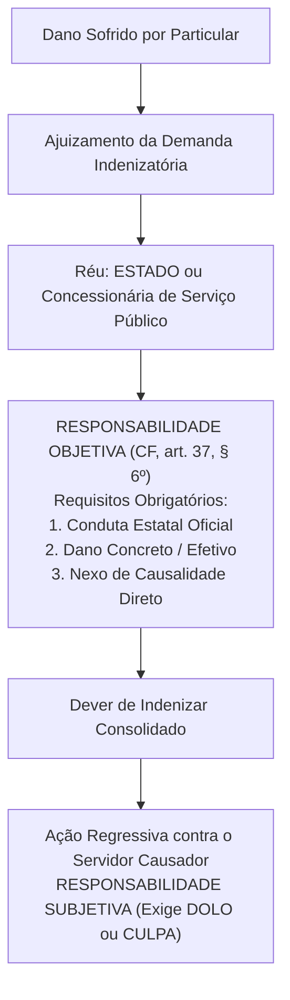
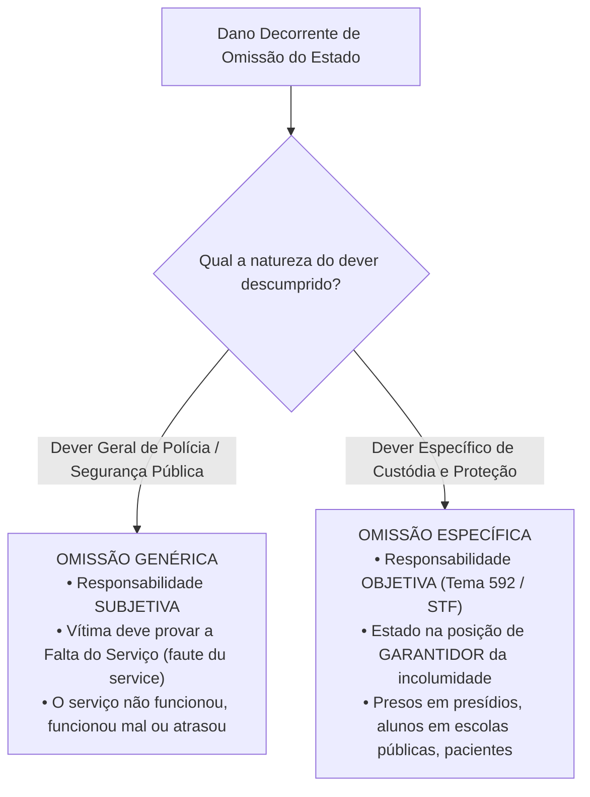
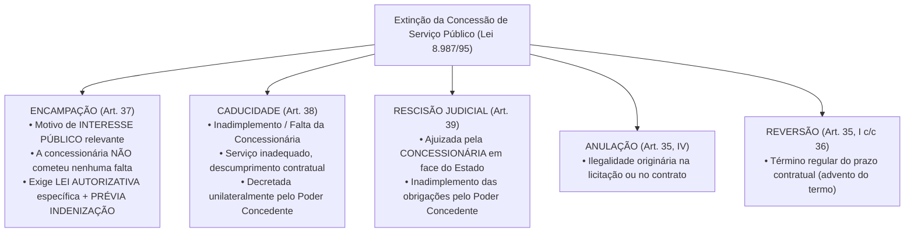

# 04 - Serviços Públicos, Bens Públicos e Responsabilidade Civil do Estado

> **Matéria:** Noções de Direito Administrativo  
> **Cargo:** A01 – Técnico de Controle Externo – Especialidade: Técnico Administrativo  
> **Arquivo:** `04_servicos_publicos_bens_e_responsabilidade_civil.md`  

---

## 📌 Ementa / Itens do Edital
- Responsabilidade civil do Estado: evolução histórica, fundamentos e modalidades
- Artigo 37, § 6º da Constituição Federal de 1988: responsabilidade objetiva das pessoas jurídicas de direito público e das de direito privado prestadoras de serviços públicos
- Teoria do Risco Administrativo vs. Teoria do Risco Integral
- Responsabilidade por ação vs. responsabilidade por omissão estatal (*faute du service* e dever específico de custódia)
- Causas excludentes e atenuantes do nexo de causalidade
- Ação regressiva contra o agente público e Tema 940 do STF (Teoria da Dupla Garantia)
- Serviços públicos: conceito, princípios, delegação a particulares (Lei nº 8.987/1995 e Lei nº 11.079/2004)
- Bens públicos: conceito, classificação (Código Civil, art. 99), afetação/desafetação e regime jurídico

---

## 🧭 Sumário

1. [Responsabilidade Civil Extracontratual do Estado](#1-responsabilidade-civil-extracontratual-do-estado)
    1. [Evolução Histórica da Responsabilidade Estatal](#11-evolucao-historica-da-responsabilidade-estatal)
    2. [O Art. 37, § 6º da CF/88 e os Elementos da Responsabilidade Objetiva](#12-o-art-37-6o-da-cf88-e-os-elementos-da-responsabilidade-objetiva)
    3. [Teoria do Risco Administrativo: Excludentes e Atenuantes](#13-teoria-do-risco-administrativo-excludentes-e-atenuantes)
    4. [Teoria do Risco Integral e suas Hipóteses Excepcionais](#14-teoria-do-risco-integral-e-suas-hipoteses-excepcionais)
    5. [Responsabilidade por Omissão Estatal: Genérica vs. Específica](#15-responsabilidade-por-omissao-estatal-generica-vs-especifica)
    6. [Ação Regressiva e a Teoria da Dupla Garantia (Tema 940 / STF)](#16-acao-regressiva-e-a-teoria-da-dupla-garantia-tema-940-stf)
    7. [Teste 034](#Teste-034)
    8. [Teste 035](#Teste-035)
    9. [Teste 036](#Teste-036)
    10. [Teste 037](#Teste-037)
2. [Regime Jurídico dos Serviços Públicos e sua Delegação](#2-regime-juridico-dos-servicos-publicos-e-sua-delegacao)
    1. [Princípios do Serviço Público Adequado](#21-principios-do-servico-publico-adequado)
    2. [Concessão Comum e Permissão de Serviço Público (Lei nº 8.987/1995)](#22-concessao-comum-e-permissao-de-servico-publico-lei-no-89871995)
    3. [Formas de Extinção das Concessões: Encampação vs. Caducidade](#23-formas-de-extincao-das-concessoes-encampacao-vs-caducidade)
    4. [Parcerias Público-Privadas - PPPs (Lei nº 11.079/2004)](#24-parcerias-publico-privadas-ppps-lei-no-110792004)
    5. [Teste 038](#Teste-038)
    6. [Teste 039](#Teste-039)
    7. [Teste 040](#Teste-040)
    8. [Teste 041](#Teste-041)
3. [Bens Públicos: Classificação, Afetação e Prerrogativas](#3-bens-publicos-classificacao-afetacao-e-prerrogativas)
    1. [Classificação Quanto à Destinação (Código Civil, art. 99)](#31-classificacao-quanto-a-destinacao-codigo-civil-art-99)
    2. [Fenômeno da Afetação e Desafetação](#32-fenomeno-da-afetacao-e-desafetacao)
    3. [Prerrogativas do Regime Jurídico e a Imprescritibilidade Absoluta](#33-prerrogativas-do-regime-juridico-e-a-imprescritibilidade-absoluta)
    4. [Teste 042](#Teste-042)
    5. [Teste 043](#Teste-043)
    6. [Teste 044](#Teste-044)
4. [Fontes Recomendadas na Internet](#4-fontes-recomendadas-na-internet)

---

## 1. Responsabilidade Civil Extracontratual do Estado

A responsabilidade civil extracontratual da Administração Pública consiste na obrigação jurídica que recai sobre o Estado de reparar os danos materiais, morais e estéticos causados a particulares por condutas comissivas ou omissivas de seus agentes públicos no exercício de suas atribuições ou a pretexto de exercê-las.

### 1.1 Evolução Histórica da Responsabilidade Estatal

- **Teoria da Irresponsabilidade Estatal (*The King can do no wrong*):** Predominou nos Estados Absolutistas. O monarca e o Estado não respondiam por quaisquer danos causados aos súditos.
- **Teorias Civilistas / Subjetivas (Culpa Comum):** Surgiram com o advento do Estado Liberal de Direito. Exigiam que a vítima comprovasse a culpa individualizada do agente público (*culpa in eligendo* ou *culpa in vigilando*), operando em extrema desvantagem processual para o particular.
- **Teoria da Culpa Administrativa / Culpa do Serviço (*Faute du Service*):** Desvinculou a culpa da pessoa física do servidor. A responsabilidade continuava sendo subjetiva, mas bastava à vítima comprovar a falta do serviço estatal: o serviço não funcionou, funcionou mal ou funcionou com atraso intolerável.
- **Teoria Objetiva do Risco Administrativo:** Consagrada pelo Direito Constitucional contemporâneo, dispensa integralmente a comprovação de dolo ou culpa estatal, fundando-se na causalidade material e na solidariedade social perante os riscos criados pela atividade administrativa.

### 1.2 O Art. 37, § 6º da CF/88 e os Elementos da Responsabilidade Objetiva

> *"Art. 37, § 6º. As pessoas jurídicas de direito público e as de direito privado prestadoras de serviços públicos responderão pelos danos que seus agentes, nessa qualidade, causarem a terceiros, assegurado o direito de regresso contra o responsável nos casos de dolo ou culpa."*

#### Elementos Indispensáveis para a Responsabilização Objetiva:
1. **Conduta Estatal:** Ação ou comportamento imputável a um agente público (efetivo, comissionado, temporário ou terceiro delegatário) agindo nessa qualidade.
2. **Dano Efetivo:** Prejuízo certo, juridicamente tutelado, de natureza patrimonial, moral ou estética.
3. **Nexo de Causalidade:** Relação direta de causa e efeito entre a conduta oficial e o dano experimentado pela vítima (Teoria do Dano Direto e Imediato).

> ⭐ **IMPORTANTE / REPERCUSSÃO GERAL STF:**  
> A responsabilidade objetiva do art. 37, § 6º, aplica-se às **empresas prestadoras de serviços públicos** (concessionárias e permissionárias) tanto em relação aos **usuários do serviço** quanto em relação a **terceiros não usuários** (vítimas de acidentes causados pelo serviço público - RE 591.874/STF).

### 1.3 Teoria do Risco Administrativo: Excludentes e Atenuantes

O ordenamento jurídico brasileiro adota como **regra geral a Teoria do Risco Administrativo**. Essa teoria baseia-se na ideia de que a atividade estatal gera riscos inerentes para a coletividade, devendo o poder público arcar com os prejuízos decorrentes. Todavia, **NÃO se trata de responsabilidade absoluta**, admitindo-se a ruptura ou atenuação do nexo causal nas seguintes hipóteses:

- **Causas Excludentes do Nexo de Causalidade (Afastam 100% da Indenização):**
    1. *Culpa Exclusiva da Vítima:* O evento decorreu inteiramente do comportamento negligente, imprudente ou voluntário do próprio lesado (ex.: pedestre que se atira intencionalmente sob as rodas de um ônibus público em alta velocidade).
    2. *Caso Fortuito ou Força Maior Absoluta:* Eventos imprevisíveis da natureza com violência desmedida (raios imprevisíveis, terremotos, trombas d'água fora de qualquer série histórica), desde que o Estado não tenha sido omisso em adotar medidas preventivas exigíveis.
    3. *Fato Exclusivo de Terceiro:* Dano provocado exclusivamente por ação autônoma e imprevisível de outrem sem qualquer concurso da conduta estatal (ex.: assalto à mão armada ocorrido dentro de um ônibus coletivo com disparo de arma de fogo deflagrado pelo criminoso).

- **Causas Atenuantes do Nexo de Causalidade:**
    - *Culpa Concorrente da Vítima:* A vítima e o agente público concorreram simultaneamente para a eclosão do evento danoso. O Estado continua obrigado a indenizar, mas o montante indenizatório é **reduzido proporcionalmente** ao grau de culpa da vítima.

### 1.4 Teoria do Risco Integral e suas Hipóteses Excepcionais

Na **Teoria do Risco Integral**, a obrigação estatal de indenizar é cega e absoluta. O Estado atua como garantidor universal de riscos, **sendo vedada a invocação de qualquer causa excludente** (o poder público é condenado mesmo diante de caso fortuito, força maior ou culpa exclusiva da vítima).

O ordenamento constitucional e legal brasileiro reconhece a incidência do risco integral em apenas **três hipóteses taxativas**:

1. **Dano Nuclear:** Responsabilidade civil por acidentes radiológicos ou nucleares (CF/88, art. 21, XXIII, "d");
2. **Atos de Guerra e Terrorismo Aéreo:** Danos a terceiros decorrentes de atentados terroristas contra aeronaves comerciais de matrícula brasileira (Lei Federal nº 10.744/2003);
3. **Dano Ambiental:** Jurisprudência vinculante consolidada do Superior Tribunal de Justiça (Tema Repetitivo 707/STJ) para degradações ecológicas graves.

### 1.5 Responsabilidade por Omissão Estatal: Genérica vs. Específica

Quando o dano decorre de um não-fazer da Administração Pública, a jurisprudência estabelece rígida bifurcação metodológica:

- **Omissão Genérica (Responsabilidade Subjetiva):** O Estado descumpre seu dever genérico de proteção da ordem social (ex.: furto de veículo particular estacionado em via pública comum; alagamento pontual em chuva sazonal). A vítima deve provar a ocorrência de culpa anônima do serviço (*faute du service*), demonstrando que o poder público foi negligente diante de um dever exigível.
- **Omissão Específica (Responsabilidade Objetiva - Tema 592/STF):** Ocorre quando o Estado atua na **posição de garante**, detendo a pessoa ou a coisa sob sua imediata custódia física institucional (ex.: morte ou lesão corporal de detento em estabelecimento penitenciário; acidente com criança no interior de escola pública municipal; suicídio de paciente internado em hospital psiquiátrico público). A responsabilidade é **OBJETIVA**; o Estado só se exonera se comprovar que a morte ou o dano decorreu de causa natural ou que o evento era faticamente inevitável mesmo com o cumprimento de todos os protocolos regulares de vigilância.

### 1.6 Ação Regressiva e a Teoria da Dupla Garantia (Tema 940 / STF)

O Supremo Tribunal Federal, ao julgar o RE 1.027.633 sob a sistemática da repercussão geral (**Tema 940**), pacificou a controvérsia sobre a legitimidade passiva nas ações indenizatórias fundamentadas no art. 37, § 6º, da CF/88:

> *"A teor do art. 37, § 6º, da Constituição Federal, a ação por danos causados por agente público deve ser ajuizada contra o Estado ou a pessoa jurídica de direito privado prestadora de serviço público, **sendo parte ilegítima para figurar no polo passivo o autor do ato**, assegurado o direito de regresso contra o responsável nos casos de dolo ou culpa."*

#### A Teoria da Dupla Garantia:
1. **Primeira Garantia (Ao Cidadão Vítima):** Assegura que o particular lesionado demandará contra o Estado ou concessionária sob regime de responsabilidade objetiva (sem ter que provar a culpa do servidor) e com a certeza de solvência financeira pública.
2. **Segunda Garantia (Ao Agente Público):** Protege o servidor contra ações temerárias de administrados inconformados, assegurando-lhe que **jamais poderá ser réu direto** na ação proposta pela vítima, nem compor litisconsórcio passivo originário com o Estado.

- **Regime da Ação Regressiva:** O Estado, após ser definitivamente condenado e efetuar o pagamento da indenização à vítima, tem o **dever de ajuizar ação regressiva** contra o servidor causador do dano. No âmbito da ação de regresso, a responsabilidade do servidor é **SUBJETIVA**, dependendo da comprovação cabal de que ele agiu com **dolo ou culpa** (negligência, imprudência ou imperícia).

---

### Teste 034
**(FGV – TCE-PA – Auditor de Controle Externo Fiscalizacao Contabilidade – 2024)**
Tereza, experiente negociadora de veículos usados, anuncia um veículo por preço bem abaixo do mercado, despertando o interesse de Cristina. Cristina então procurou Tereza a fim de adquirir o veículo. Curiosa para entender a razão pela qual Tereza estava vendendo o bem por um valor bem abaixo de mercado, interrogou Tereza, que então explicou que o veículo foi adquirido por herança de seu avô e que seus primos estariam reclamando judicialmente a propriedade do bem, informando, inclusive, o número do processo. Considerando o valor do bem, Cristina resolveu fechar o negócio, que foi firmado por escrito, contando cláusula específica de exclusão de responsabilidade de Tereza caso os primos lograssem êxito na referida ação judicial e carro fosse por eles retomado. Foi acertado ainda o pagamento à vista. Seis meses após a celebração da compra e venda, Cristina teve o carro apreendido por autoridade policial, que informou que o veículo era roubado e vinha sendo procurado há cerca de dois anos. Em seguida, Cristina procurou Tereza, requerendo a restituição dos valores pagos. Tereza, no entanto, se recusou, sob o argumento que o contrato celebrado entre as partes excluía integralmente a sua responsabilidade por eventual perda do bem. Diante da situação hipotética narrada e em conformidade com a legislação vigente, avalie as assertivas a seguir. I. Tereza poderá ser responsabilizada pela evicção, a qual abarca a restituição integral do preço pago por Cristina, bem como a indenização pelas despesas dos contratos e as custas judiciais e honorários advocatícios. II. Tereza está correta em sua argumentação, pois constou do contrato, cláusula específica de exclusão de responsabilidade pela eventual perda do bem, o que abarca a apreensão por autoridade judicial. III. Eventual responsabilidade de Tereza, dependerá de sentença transitada em julgado determinando a perda do bem, sendo insuficiente para tal, a apreensão por autoridade policial. IV. Tereza não poderá ser responsabilizada pela perda do bem, pois informou a Cristina que se tratava de coisa litigiosa e, para compensar o risco, o preço pactuado foi abaixo do valor de mercado. Está correto o que se afirma em

* **A)** I, apenas.
* **B)** II, apenas.
* **C)** I e III, apenas.
* **D)** II e IV, apenas.
* **E)** IV, apenas.

---

> **Comentário Detalhado:**
>
> - **A)** **Correta.** Conforme fundamentado na seção *1.4 Teoria do Risco Integral e suas Hipóteses Excepcionais* deste guia, o Estado atua como garantidor universal de riscos, sendo vedada a invocação de qualquer causa excludente (o poder público é condenado mesmo diante de caso fortuito, força maior ou culpa exclusiva da vítima). Dessa forma, está plenamente correta a assertiva da banca (FGV – TCE-PA/2024) ao estabelecer que "I, apenas".
> - **B)** **Incorreta.** A opção incorre em restrição indevida ao limitar o escopo conceitual ao afirmar que "II, apenas". De acordo com a teoria estudada em *A Teoria da Dupla Garantia:*, regime da Ação Regressiva: O Estado, após ser definitivamente condenado e efetuar o pagamento da indenização à vítima, tem o dever de ajuizar ação regressiva contra o servidor causador do dano.
> - **C)** **Incorreta.** A opção incorre em restrição indevida ao limitar o escopo conceitual ao afirmar que "I e III, apenas". De acordo com a teoria estudada em *3.1 Classificação Quanto à Destinação (Código Civil, art. 99)*, bens Dominicais ou Dominicais (Art. 99, III): Bens que constituem o patrimônio disponível do Estado sem destinação pública específica ou aplicação administrativa direta (terras devolutas, prédios públicos desativados, títulos da dívida pública, bens desapropriados e não afetados).
> - **D)** **Incorreta.** A opção incorre em restrição indevida ao limitar o escopo conceitual ao afirmar que "II e IV, apenas". De acordo com a teoria estudada em *3.3 Prerrogativas do Regime Jurídico e a Imprescritibilidade Absoluta*, o art. 183, § 3º e o art. 191, parágrafo único, da Constituição Federal, corroborados pela Súmula 340 do STF, preceituam que nenhum bem público, qualquer que seja sua classificação (inclusive os bens dominicais), pode ser adquirido por usucapião.
> - **E)** **Incorreta.** A opção incorre em restrição indevida ao limitar o escopo conceitual ao afirmar que "IV, apenas". De acordo com a teoria estudada em *1.5 Responsabilidade por Omissão Estatal: Genérica vs. Específica*, omissão Específica (Responsabilidade Objetiva - Tema 592/STF): Ocorre quando o Estado atua na posição de garante, detendo a pessoa ou a coisa sob sua imediata custódia física institucional (ex.: morte ou lesão corporal de detento em estabelecimento penitenciário; acidente com criança no interior de escola pública municipal; suicídio de paciente internado em hospital psiquiátrico público).
>
> **Gabarito: A**

---

### Teste 035
**(FGV – TCE-PA – Auditor de Controle Externo Administrativa Direito – 2024)**
A empresa Gama Ltda adquiriu um terreno para ali construir um posto de combustível. O imóvel, segundo estudos preliminares, está localizado em uma Área de Preservação Permanente (APP), próximo a uma nascente subterrânea que alimenta um dos rios que cortam o município. Mesmo com essa informação, o Instituto Ambiental Estadual, autarquia estadual, concedeu a licença para a construção do posto sob o argumento de que a nascente está canalizada e não haveria impacto significativo no meio ambiente. Além disso, alegou a autarquia estadual que antes da instalação do posto de gasolina, já havia sido concedida licença ambiental para um outro empreendimento que funcionou e causou dano ambiental no local. O Ministério Público não concordou e ingressou com ação civil pública contra a empresa, o instituto ambiental e os sócios da pessoa jurídica argumentando que a instalação do posto de combustível em uma APP contraria as leis ambientais e comprovou novo dano ambiental causado pela empresa Gama Ltda. No entanto, o juiz julgou os pedidos improcedentes sob o argumento de que não foram produzidas provas da ilegalidade de localização e instalação da empresa, diante do fato de que a licença foi concedida antes da instalação do empreendimento. Além disso, o magistrado alegou que, antes da instalação do posto de gasolina, já havia sido concedida licença ambiental para um outro empreendimento que funcionou no local. Assim, o juízo entendeu que não foi o posto de gasolina não deve ser condenado, porque a área já estava degradada. A sentença foi mantida pelo Tribunal de 2ª instância, pelos mesmos fundamentos. Ainda inconformado, o Ministério Público interpôs recurso especial. Com base na narrativa, assinale a afirmativa correta.

* **A)** Entendeu corretamente o tribunal de origem no sentido de que o posto de gasolina não tem responsabilidade civil, pois não teria provocado danos ambientais considerando que a área já estava degradada.
* **B)** Eventual aplicação de penalidades administrativas, em razão da responsabilidade administrativa ambiental do posto de gasolina, não obedeceria à sistemática da teoria da culpabilidade, sendo desnecessária a demonstração de seu elemento subjetivo e demonstração do nexo causal entre a conduta e o dano.
* **C)** Conquanto houvesse a instalação do empreendimento em área de preservação permanente, não foram produzidas provas da ilegalidade de localização e instalação da empresa, diante do fato de que a licença foi concedida antes da instalação do empreendimento.
* **D)** A consolidação da intervenção na área de preservação permanente não justifica que seja mantida a situação lesiva ao meio ambiente.
* **E)** A violação das regras protetivas do meio ambiente atrai a responsabilidade civil objetiva, informada pela teoria do risco integral, nos termos do Art. 14, § 1º, da Lei nº 6.938/81, contra a empresa e os sócios da pessoa jurídica, exceto para a autarquia estadual, com presunção do prejuízo causado ao meio ambiente (dano in re ipsa), ensejando o dever de indenizar.

---

> **Comentário Detalhado:**
>
> - **A)** **Incorreta.** A opção apresenta proposição em desacordo com os fundamentos teóricos e técnicos do tópico ao afirmar que "Entendeu corretamente o tribunal de origem no sentido de que o posto de gasolina não tem responsabilidade civil...". De acordo com a teoria estudada em *1.3 Teoria do Risco Administrativo: Excludentes e Atenuantes*, *Fato Exclusivo de Terceiro:* Dano provocado exclusivamente por ação autônoma e imprevisível de outrem sem qualquer concurso da conduta estatal (ex.: assalto à mão armada ocorrido dentro de um ônibus coletivo com disparo de arma de fogo deflagrado pelo criminoso).
> - **B)** **Correta.** Conforme fundamentado na seção *Elementos Indispensáveis para a Responsabilização Objetiva:* deste guia, nexo de Causalidade: Relação direta de causa e efeito entre a conduta oficial e o dano experimentado pela vítima (Teoria do Dano Direto e Imediato). Dessa forma, está plenamente correta a assertiva da banca (FGV – TCE-PA/2024) ao estabelecer que "Eventual aplicação de penalidades administrativas, em razão da responsabilidade administrativa ambiental do posto...".
> - **C)** **Incorreta.** A opção apresenta proposição em desacordo com os fundamentos teóricos e técnicos do tópico ao afirmar que "Conquanto houvesse a instalação do empreendimento em área de preservação permanente, não foram produzidas provas...". De acordo com a teoria estudada em *1.4 Teoria do Risco Integral e suas Hipóteses Excepcionais*, o Estado atua como garantidor universal de riscos, sendo vedada a invocação de qualquer causa excludente (o poder público é condenado mesmo diante de caso fortuito, força maior ou culpa exclusiva da vítima).
> - **D)** **Incorreta.** A opção apresenta proposição em desacordo com os fundamentos teóricos e técnicos do tópico ao afirmar que "A consolidação da intervenção na área de preservação permanente não justifica que seja mantida a situação lesiva...". De acordo com a teoria estudada em *2.1 Princípios do Serviço Público Adequado*, segurança: Minimização de riscos aos usuários e ao meio ambiente.
> - **E)** **Incorreta.** A opção apresenta proposição em desacordo com os fundamentos teóricos e técnicos do tópico ao afirmar que "A violação das regras protetivas do meio ambiente atrai a responsabilidade civil objetiva, informada pela teoria...". De acordo com a teoria estudada em *1.6 Ação Regressiva e a Teoria da Dupla Garantia (Tema 940 / STF)*, *"A teor do art. 37, § 6º, da Constituição Federal, a ação por danos causados por agente público deve ser ajuizada contra o Estado ou a pessoa jurídica de direito privado prestadora de serviço público, sendo parte ilegítima para figurar no polo passivo o autor do ato, assegurado o direito de regresso contra o responsável nos casos de dolo ou culpa."*.
>
> **Gabarito: B**

---

### Teste 036
**(FGV – TJ-AP – Analista Judiciario Apoio Especializado Tecnologia da Informacao Banco de Dados – 2023)**
Na qualidade de servidora pública ocupante do cargo de analista do Tribunal de Justiça do Estado do Amapá, Marieva foi questionada acerca de qual teoria foi adotada para responsabilidade civil do Estado pela conduta dos respectivos agentes públicos, à luz do disposto no Art. 37, §6º, da Constituição da República de 1988 e as peculiaridades decorrentes de tal orientação. Nesse contexto, considerando o entendimento do Supremo Tribunal Federal acerca da matéria, Marieva respondeu, corretamente, que se tratava da:

* **A)** teoria do risco administrativo, que consagra a responsabilidade subjetiva do Estado e não admite excludentes do nexo de causalidade;
* **B)** teoria do risco integral, que consagra a responsabilidade objetiva do Estado e não admite excludentes do nexo de causalidade;
* **C)** teoria da culpa administrativa, que consagra a responsabilidade subjetiva do Estado e não admite excludentes do nexo de causalidade;
* **D)** teoria do risco administrativo, que consagra a responsabilidade objetiva do Estado e admite excludentes do nexo de causalidade;
* **E)** teoria do risco integral, que consagra a responsabilidade subjetiva do Estado e admite excludentes do nexo de causalidade.

---

> **Comentário Detalhado:**
>
> - **A)** **Incorreta.** A opção apresenta proposição em desacordo com os fundamentos teóricos e técnicos do tópico ao afirmar que "teoria do risco administrativo, que consagra a responsabilidade subjetiva do Estado e não admite excludentes do...". De acordo com a teoria estudada em *1.3 Teoria do Risco Administrativo: Excludentes e Atenuantes*, causas Atenuantes do Nexo de Causalidade.
> - **B)** **Incorreta.** A opção apresenta proposição em desacordo com os fundamentos teóricos e técnicos do tópico ao afirmar que "teoria do risco integral, que consagra a responsabilidade objetiva do Estado e não admite excludentes do nexo de...". De acordo com a teoria estudada em *1.3 Teoria do Risco Administrativo: Excludentes e Atenuantes*, todavia, NÃO se trata de responsabilidade absoluta, admitindo-se a ruptura ou atenuação do nexo causal nas seguintes hipóteses.
> - **C)** **Incorreta.** A opção apresenta proposição em desacordo com os fundamentos teóricos e técnicos do tópico ao afirmar que "teoria da culpa administrativa, que consagra a responsabilidade subjetiva do Estado e não admite excludentes do...". De acordo com a teoria estudada em *1.1 Evolução Histórica da Responsabilidade Estatal*, teoria Objetiva do Risco Administrativo: Consagrada pelo Direito Constitucional contemporâneo, dispensa integralmente a comprovação de dolo ou culpa estatal, fundando-se na causalidade material e na solidariedade social perante os riscos criados pela atividade administrativa.
> - **D)** **Correta.** Conforme fundamentado na seção *1.3 Teoria do Risco Administrativo: Excludentes e Atenuantes* deste guia, causas Excludentes do Nexo de Causalidade (Afastam 100% da Indenização). Dessa forma, está plenamente correta a assertiva da banca (FGV – TJ-AP/2023) ao estabelecer que "teoria do risco administrativo, que consagra a responsabilidade objetiva do Estado e admite excludentes do nexo de...".
> - **E)** **Incorreta.** A opção apresenta proposição em desacordo com os fundamentos teóricos e técnicos do tópico ao afirmar que "teoria do risco integral, que consagra a responsabilidade subjetiva do Estado e admite excludentes do nexo de...". De acordo com a teoria estudada em *Elementos Indispensáveis para a Responsabilização Objetiva:*, nexo de Causalidade: Relação direta de causa e efeito entre a conduta oficial e o dano experimentado pela vítima (Teoria do Dano Direto e Imediato).
>
> **Gabarito: D**

---

### Teste 037
**(FGV – TRT-1 – Analista Judiciario Area Administrativa – 2024)**
Josélia decidiu aprofundar os seus conhecimentos com relação à orientação do Supremo Tribunal Federal acerca da responsabilidade civil do Estado, à luz do disposto no Art. 37, §6º, da CRFB/1988, vindo a concluir corretamente que:

* **A)** no caso atinente a morte por disparo de arma de fogo em decorrência de operação policial, a responsabilidade civil do Estado é fundada na teoria do risco integral;
* **B)** o direito de regresso em relação ao agente público causador do dano em sede de responsabilidade civil é imprescritível, por se tratar de ressarcimento ao erário;
* **C)** não é cabível o reconhecimento de causas excludentes da responsabilidade civil, diante da previsão constitucional;
* **D)** o agente causador do dano não tem legitimidade para constar do polo passivo da ação judicial que visa à responsabilização civil do Estado;
* **E)** tanto o Estado quanto o agente causador do dano respondem objetivamente pelos danos por este causados no exercício de suas atribuições.

---

> **Comentário Detalhado:**
>
> - **A)** **Correta.** Conforme fundamentado na seção *1.3 Teoria do Risco Administrativo: Excludentes e Atenuantes* deste guia, *Fato Exclusivo de Terceiro:* Dano provocado exclusivamente por ação autônoma e imprevisível de outrem sem qualquer concurso da conduta estatal (ex.: assalto à mão armada ocorrido dentro de um ônibus coletivo com disparo de arma de fogo deflagrado pelo criminoso). Dessa forma, está plenamente correta a assertiva da banca (FGV – TRT-1/2024) ao estabelecer que "no caso atinente a morte por disparo de arma de fogo em decorrência de operação policial, a responsabilidade civil...".
> - **B)** **Incorreta.** A opção apresenta proposição em desacordo com os fundamentos teóricos e técnicos do tópico ao afirmar que "o direito de regresso em relação ao agente público causador do dano em sede de responsabilidade civil é...". De acordo com a teoria estudada em *1.4 Teoria do Risco Integral e suas Hipóteses Excepcionais*, dano Nuclear: Responsabilidade civil por acidentes radiológicos ou nucleares (CF/88, art. 21, XXIII, "d").
> - **C)** **Incorreta.** A opção apresenta proposição em desacordo com os fundamentos teóricos e técnicos do tópico ao afirmar que "não é cabível o reconhecimento de causas excludentes da responsabilidade civil, diante da previsão constitucional". De acordo com a teoria estudada em *1.4 Teoria do Risco Integral e suas Hipóteses Excepcionais*, o Estado atua como garantidor universal de riscos, sendo vedada a invocação de qualquer causa excludente (o poder público é condenado mesmo diante de caso fortuito, força maior ou culpa exclusiva da vítima).
> - **D)** **Incorreta.** A opção apresenta proposição em desacordo com os fundamentos teóricos e técnicos do tópico ao afirmar que "o agente causador do dano não tem legitimidade para constar do polo passivo da ação judicial que visa à...". De acordo com a teoria estudada em *1.6 Ação Regressiva e a Teoria da Dupla Garantia (Tema 940 / STF)*, *"A teor do art. 37, § 6º, da Constituição Federal, a ação por danos causados por agente público deve ser ajuizada contra o Estado ou a pessoa jurídica de direito privado prestadora de serviço público, sendo parte ilegítima para figurar no polo passivo o autor do ato, assegurado o direito de regresso contra o responsável nos casos de dolo ou culpa."*.
> - **E)** **Incorreta.** A opção apresenta proposição em desacordo com os fundamentos teóricos e técnicos do tópico ao afirmar que "tanto o Estado quanto o agente causador do dano respondem objetivamente pelos danos por este causados no exercício...". De acordo com a teoria estudada em *1. Responsabilidade Civil Extracontratual do Estado*, a responsabilidade civil extracontratual da Administração Pública consiste na obrigação jurídica que recai sobre o Estado de reparar os danos materiais, morais e estéticos causados a particulares por condutas comissivas ou omissivas de seus agentes públicos no exercício de suas atribuições ou a pretexto de exercê-las.
>
> **Gabarito: A**

---

## 2. Regime Jurídico dos Serviços Públicos e sua Delegação

### 2.1 Princípios do Serviço Público Adequado

A Lei Federal nº 8.987/1995 (art. 6º) prescreve que toda concessão ou permissão pressupõe a prestação de **serviço adequado**, assim entendido o que satisfaz as condições de:

- **Regularidade:** Prestação sem oscilações arbitrárias de qualidade.
- **Continuidade:** Não interrupção da atividade, admitida a suspensão motivada em hipóteses estritas de segurança técnica ou inadimplemento do usuário após aviso prévio formal.
- **Eficiência:** Máxima produtividade e excelência técnica.
- **Segurança:** Minimização de riscos aos usuários e ao meio ambiente.
- **Atualidade:** Incorporação contínua de métodos modernos, equipamentos tecnológicos de ponta e expansão da rede.
- **Generalidade:** Acesso universal e não discriminatório a todos os cidadãos.
- **Cortesia:** Urbanidade no trato com os usuários.
- **Modicidade das Tarifas:** Fixação de preços públicos acessíveis à população em equilíbrio econômico-financeiro.

### 2.2 Concessão Comum e Permissão de Serviço Público (Lei nº 8.987/1995)

- **Concessão Comum de Serviço Público:** Delegação contratual bilateral formalizada com pessoa jurídica ou consórcio de empresas, mediante prévia licitação obrigatória, para exploração do serviço por prazo determinado, a expensas e risco da concessionária, remunerada unicamente pelas tarifas cobradas dos usuários.
- **Permissão de Serviço Público:** Delegação formalizada mediante **contrato de adesão**, a título precário, após prévia licitação, admitindo como permitente pessoa física ou jurídica.

### 2.3 Formas de Extinção das Concessões: Encampação vs. Caducidade

A diferenciação entre as modalidades de extinção contratual na Lei nº 8.987/1995 é intensamente cobrada pela FCC:

| Critério de Comparação | Encampação (Resgate) | Caducidade |
| :--- | :--- | :--- |
| **Causa Primária** | **Interesse público superveniente** (conveniência administrativa) | **Inadimplemento contratual culposo** da concessionária |
| **Culpa da Concessionária?** | **NÃO** (a empresa cumpria rigorosamente o contrato) | **SIM** (prestação defeituosa, paralisações, descumprimento de prazos) |
| **Exigência de Lei?** | **SIM**, exige **lei autorizativa específica** do ente concedente | **NÃO**, declarada por **decreto** do Chefe do Executivo |
| **Indenização Prévia?** | **SIM**, o pagamento de indenização deve ser **prévio** à retomada | **NÃO**, indenização é apurada a posteriori descontadas multas contratuais |

### 2.4 Parcerias Público-Privadas - PPPs (Lei nº 11.079/2004)

As Parcerias Público-Privadas constituem concessões especiais destinadas a viabilizar investimentos vultosos de infraestrutura em colaboração com o capital privado:

1. **Concessão Patrocinada (Art. 2º, § 1º):** É a concessão de serviços públicos ou obras públicas em que a remuneração da concessionária envolve a combinação de **tarifa paga pelos usuários** mais uma **contraprestação pecuniária complementar paga pelo parceiro público**.
2. **Concessão Administrativa (Art. 2º, § 2º):** É o contrato de prestação de serviços de que a **Administração Pública seja a usuária direta ou indireta**, ainda que envolva a execução de obra ou fornecimento e instalação de bens. A remuneração é **100% custeada pelo erário**, inexistindo cobrança de tarifas dos cidadãos (ex.: construção e operação de hospitais públicos do SUS, presídios, iluminação pública).
3. **Vedações Legais Obrigatórias à Celebração de PPPs (Art. 2º, § 4º):**
    - Contratos cujo valor total seja **inferior a R$ 10.000.000,00 (dez milhões de reais)**;
    - Período de prestação de serviços **inferior a 5 (cinco) anos** ou superior a 35 (trinta e cinco) anos;
    - Contratos que tenham por objeto único o fornecimento de mão de obra, a mera locação de equipamentos ou a execução isolada de obra pública sem prestação continuada de serviços.

---

### Teste 038
**(FGV – TCE-SC – Auditor Fiscal de Controle Externo Direito – 2026)**
Carlos, proprietário de uma fazenda produtora de café, viajou ao exterior por longo período sem deixar procurador ou qualquer instrução formal. Durante sua ausência, seu vizinho André percebeu que uma praga estava rapidamente se alastrando na plantação de Carlos, podendo comprometer toda a safra. Diante disso, mesmo sem autorização, André contratou empresa especializada para conter a praga, assumindo custos elevados. Contudo, aproveitou a ocasião para também realizar melhorias estruturais na propriedade, visando aumentar a produtividade futura. Durante a execução dos serviços, André delegou a um terceiro a supervisão da aplicação de defensivos agrícolas. Esse terceiro, por negligência, utilizou produto inadequado, causando danos parciais à lavoura. Ao retornar, Carlos reconheceu a necessidade do controle da praga, mas recusou-se a pagar pelas melhorias, além de ter desaprovado a delegação a terceiro e ter afirmado que não deveria arcar com prejuízos decorrentes da má execução. Diante dessa situação, à luz das regras da gestão de negócios, assinale a afirmativa correta.

* **A)** Carlos está obrigado a indenizar integralmente André por todas as despesas realizadas, inclusive as melhorias, bem como assumir os prejuízos decorrentes da atuação do terceiro.
* **B)** André responde pelos danos causados pelo terceiro, podendo Carlos recusar o pagamento das despesas úteis e exigir a recomposição integral do estado anterior.
* **C)** Carlos deve reembolsar as despesas necessárias para conter a praga, mas não é obrigado a custear melhorias e André responde pelos danos causados pelo terceiro, que atuou por sua determinação.
* **D)** André não responde pelos danos causados pelo terceiro, pois atuou em benefício de Carlos, que, por sua vez, deve indenizar todas as despesas, ainda que desnecessárias.
* **E)** Carlos é obrigado a indenizar todas as despesas, independentemente de sua utilidade ou necessidade, sob pena de configurar enriquecimento sem causa.

---

> **Comentário Detalhado:**
>
> - **A)** **Incorreta.** A opção apresenta proposição em desacordo com os fundamentos teóricos e técnicos do tópico ao afirmar que "Carlos está obrigado a indenizar integralmente André por todas as despesas realizadas, inclusive as melhorias, bem...". De acordo com a teoria estudada em *1.3 Teoria do Risco Administrativo: Excludentes e Atenuantes*, essa teoria baseia-se na ideia de que a atividade estatal gera riscos inerentes para a coletividade, devendo o poder público arcar com os prejuízos decorrentes.
> - **B)** **Incorreta.** A opção apresenta proposição em desacordo com os fundamentos teóricos e técnicos do tópico ao afirmar que "André responde pelos danos causados pelo terceiro, podendo Carlos recusar o pagamento das despesas úteis e exigir...". De acordo com a teoria estudada em *1.4 Teoria do Risco Integral e suas Hipóteses Excepcionais*, atos de Guerra e Terrorismo Aéreo: Danos a terceiros decorrentes de atentados terroristas contra aeronaves comerciais de matrícula brasileira (Lei Federal nº 10.744/2003).
> - **C)** **Incorreta.** A opção apresenta proposição em desacordo com os fundamentos teóricos e técnicos do tópico ao afirmar que "Carlos deve reembolsar as despesas necessárias para conter a praga, mas não é obrigado a custear melhorias e André...". De acordo com a teoria estudada em *1.3 Teoria do Risco Administrativo: Excludentes e Atenuantes*, *Culpa Concorrente da Vítima:* A vítima e o agente público concorreram simultaneamente para a eclosão do evento danoso. O Estado continua obrigado a indenizar, mas o montante indenizatório é reduzido proporcionalmente ao grau de culpa da vítima.
> - **D)** **Correta.** Conforme fundamentado na seção *1.6 Ação Regressiva e a Teoria da Dupla Garantia (Tema 940 / STF)* deste guia, *"A teor do art. 37, § 6º, da Constituição Federal, a ação por danos causados por agente público deve ser ajuizada contra o Estado ou a pessoa jurídica de direito privado prestadora de serviço público, sendo parte ilegítima para figurar no polo passivo o autor do ato, assegurado o direito de regresso contra o responsável nos casos de dolo ou culpa."*. Dessa forma, está plenamente correta a assertiva da banca (FGV – TCE-SC/2026) ao estabelecer que "André não responde pelos danos causados pelo terceiro, pois atuou em benefício de Carlos, que, por sua vez, deve...".
> - **E)** **Incorreta.** A opção apresenta proposição em desacordo com os fundamentos teóricos e técnicos do tópico ao afirmar que "Carlos é obrigado a indenizar todas as despesas, independentemente de sua utilidade ou necessidade, sob pena de...". De acordo com a teoria estudada em *1. Responsabilidade Civil Extracontratual do Estado*, a responsabilidade civil extracontratual da Administração Pública consiste na obrigação jurídica que recai sobre o Estado de reparar os danos materiais, morais e estéticos causados a particulares por condutas comissivas ou omissivas de seus agentes públicos no exercício de suas atribuições ou a pretexto de exercê-las.
>
> **Gabarito: D**

---

### Teste 039
**(FGV – TRT-16 – Analista Judiciario Area Administrativa Tecnologia da Informacao – 2022)**
Antônio, agente público, foi acusado, por seu superior hierárquico, de ter causado dano ao Erário, o que foi reduzido a termo em representação na qual lhe atribuiu ato de improbidade tipificado na Lei nº 8.429/1992. À luz da sistemática legal, é correto afirmar que a tipologia da Lei nº 8.429/1992, na qual pode ser enquadrada a mencionada conduta de Antônio, é

* **A)** taxativa, admitindo apenas o dolo.
* **B)** taxativa, admitindo o dolo e a culpa.
* **C)** exemplificativa, admitindo apenas o dolo.
* **D)** exemplificativa, admitindo o dolo e a culpa.
* **E)** exemplificativa, sendo estruturada com base na responsabilidade objetiva.

---

> **Comentário Detalhado:**
>
> - **A)** **Incorreta.** A opção incorre em restrição indevida ao limitar o escopo conceitual ao afirmar que "taxativa, admitindo apenas o dolo". De acordo com a teoria estudada em *2.2 Concessão Comum e Permissão de Serviço Público (Lei nº 8.987/1995)*, permissão de Serviço Público: Delegação formalizada mediante contrato de adesão, a título precário, após prévia licitação, admitindo como permitente pessoa física ou jurídica.
> - **B)** **Incorreta.** A opção apresenta proposição em desacordo com os fundamentos teóricos e técnicos do tópico ao afirmar que "taxativa, admitindo o dolo e a culpa". De acordo com a teoria estudada em *1.1 Evolução Histórica da Responsabilidade Estatal*, teoria Objetiva do Risco Administrativo: Consagrada pelo Direito Constitucional contemporâneo, dispensa integralmente a comprovação de dolo ou culpa estatal, fundando-se na causalidade material e na solidariedade social perante os riscos criados pela atividade administrativa.
> - **C)** **Correta.** Conforme fundamentado na seção *1.6 Ação Regressiva e a Teoria da Dupla Garantia (Tema 940 / STF)* deste guia, *"A teor do art. 37, § 6º, da Constituição Federal, a ação por danos causados por agente público deve ser ajuizada contra o Estado ou a pessoa jurídica de direito privado prestadora de serviço público, sendo parte ilegítima para figurar no polo passivo o autor do ato, assegurado o direito de regresso contra o responsável nos casos de dolo ou culpa."*. Dessa forma, está plenamente correta a assertiva da banca (FGV – TRT-16/2022) ao estabelecer que "exemplificativa, admitindo apenas o dolo".
> - **D)** **Incorreta.** A opção apresenta proposição em desacordo com os fundamentos teóricos e técnicos do tópico ao afirmar que "exemplificativa, admitindo o dolo e a culpa". De acordo com a teoria estudada em *1.2 O Art. 37, § 6º da CF/88 e os Elementos da Responsabilidade Objetiva*, as pessoas jurídicas de direito público e as de direito privado prestadoras de serviços públicos responderão pelos danos que seus agentes, nessa qualidade, causarem a terceiros, assegurado o direito de regresso contra o responsável nos casos de dolo ou culpa."*.
> - **E)** **Incorreta.** A opção apresenta proposição em desacordo com os fundamentos teóricos e técnicos do tópico ao afirmar que "exemplificativa, sendo estruturada com base na responsabilidade objetiva". De acordo com a teoria estudada em *1.3 Teoria do Risco Administrativo: Excludentes e Atenuantes*, todavia, NÃO se trata de responsabilidade absoluta, admitindo-se a ruptura ou atenuação do nexo causal nas seguintes hipóteses.
>
> **Gabarito: C**

---

### Teste 040
**(FGV – TCE-PA – Auditor de Controle Externo Administrativa Direito – 2024)**
Instado a se manifestar acerca de certa permissão de serviço público, na forma em que expressamente previsto na Lei nº 8.987/95, Adalberto indicou corretamente que

* **A)** a permissão de serviço público tem natureza de ato administrativo discricionário e precário.
* **B)** o prazo mínimo para formalização de uma permissão de serviço público é de 10 (dez) anos.
* **C)** é vedada a aplicação na permissão de serviço público dos ditames atinentes às concessões de serviços públicos.
* **D)** a norma prevê a precariedade e a revogabilidade no âmbito da permissão de serviço público.
* **E)** não é possível a realização de licitação na modalidade concorrência para a formalização de uma permissão de serviço público.

---

> **Comentário Detalhado:**
>
> - **A)** **Incorreta.** A opção apresenta proposição em desacordo com os fundamentos teóricos e técnicos do tópico ao afirmar que "a permissão de serviço público tem natureza de ato administrativo discricionário e precário". De acordo com a teoria estudada em *2.2 Concessão Comum e Permissão de Serviço Público (Lei nº 8.987/1995)*, permissão de Serviço Público: Delegação formalizada mediante contrato de adesão, a título precário, após prévia licitação, admitindo como permitente pessoa física ou jurídica.
> - **B)** **Correta.** Conforme fundamentado na seção *2.2 Concessão Comum e Permissão de Serviço Público (Lei nº 8.987/1995)* deste guia, concessão Comum de Serviço Público: Delegação contratual bilateral formalizada com pessoa jurídica ou consórcio de empresas, mediante prévia licitação obrigatória, para exploração do serviço por prazo determinado, a expensas e risco da concessionária, remunerada unicamente pelas tarifas cobradas dos usuários. Dessa forma, está plenamente correta a assertiva da banca (FGV – TCE-PA/2024) ao estabelecer que "o prazo mínimo para formalização de uma permissão de serviço público é de 10 (dez) anos".
> - **C)** **Incorreta.** A opção apresenta proposição em desacordo com os fundamentos teóricos e técnicos do tópico ao afirmar que "é vedada a aplicação na permissão de serviço público dos ditames atinentes às concessões de serviços públicos". De acordo com a teoria estudada em *2.1 Princípios do Serviço Público Adequado*, a Lei Federal nº 8.987/1995 (art. 6º) prescreve que toda concessão ou permissão pressupõe a prestação de serviço adequado, assim entendido o que satisfaz as condições de.
> - **D)** **Incorreta.** A opção apresenta proposição em desacordo com os fundamentos teóricos e técnicos do tópico ao afirmar que "a norma prevê a precariedade e a revogabilidade no âmbito da permissão de serviço público". De acordo com a teoria estudada em *2.4 Parcerias Público-Privadas - PPPs (Lei nº 11.079/2004)*, contratos cujo valor total seja inferior a R$ 10.000.000,00 (dez milhões de reais).
> - **E)** **Incorreta.** A opção apresenta proposição em desacordo com os fundamentos teóricos e técnicos do tópico ao afirmar que "não é possível a realização de licitação na modalidade concorrência para a formalização de uma permissão de...". De acordo com a teoria estudada em *2.1 Princípios do Serviço Público Adequado*, regularidade: Prestação sem oscilações arbitrárias de qualidade.
>
> **Gabarito: B**

---

### Teste 041
**(FGV – TCE-GO – Analista de Controle Externo Controle Externo – 2024)**
Considerando a natureza dos serviços públicos e as peculiaridades previstas no ordenamento pátrio, é correto afirmar que pode ser objeto de uma concessão patrocinada

* **A)** a delegação de atividade que tenha como objeto único a realização de uma obra pública.
* **B)** a delegação do exercício do poder de polícia, com relação a todas as fases que compõem o respectivo ciclo.
* **C)** a delegação do serviço de veículo leve sobre trilhos, com a previsão de instalação da respectiva infraestrutura e manutenção, mediante a cobrança de tarifa dos usuários.
* **D)** a delegação da construção de uma universidade pública e a prestação do respectivo serviço de educação no estabelecimento oficial, mediante a cobrança de mensalidades.
* **E)** a delegação do serviço de iluminação pública, mediante a realização de obras e manutenção da respectiva infraestrutura.

---

> **Comentário Detalhado:**
>
> - **A)** **Incorreta.** A opção apresenta proposição em desacordo com os fundamentos teóricos e técnicos do tópico ao afirmar que "a delegação de atividade que tenha como objeto único a realização de uma obra pública". De acordo com a teoria estudada em *2.4 Parcerias Público-Privadas - PPPs (Lei nº 11.079/2004)*, contratos que tenham por objeto único o fornecimento de mão de obra, a mera locação de equipamentos ou a execução isolada de obra pública sem prestação continuada de serviços.
> - **B)** **Incorreta.** A opção apresenta proposição em desacordo com os fundamentos teóricos e técnicos do tópico ao afirmar que "a delegação do exercício do poder de polícia, com relação a todas as fases que compõem o respectivo ciclo". De acordo com a teoria estudada em *2.2 Concessão Comum e Permissão de Serviço Público (Lei nº 8.987/1995)*, permissão de Serviço Público: Delegação formalizada mediante contrato de adesão, a título precário, após prévia licitação, admitindo como permitente pessoa física ou jurídica.
> - **C)** **Incorreta.** A opção apresenta proposição em desacordo com os fundamentos teóricos e técnicos do tópico ao afirmar que "a delegação do serviço de veículo leve sobre trilhos, com a previsão de instalação da respectiva infraestrutura e...". De acordo com a teoria estudada em *2.4 Parcerias Público-Privadas - PPPs (Lei nº 11.079/2004)*, concessão Patrocinada (Art. 2º, § 1º): É a concessão de serviços públicos ou obras públicas em que a remuneração da concessionária envolve a combinação de tarifa paga pelos usuários mais uma contraprestação pecuniária complementar paga pelo parceiro público.
> - **D)** **Incorreta.** A opção apresenta proposição em desacordo com os fundamentos teóricos e técnicos do tópico ao afirmar que "a delegação da construção de uma universidade pública e a prestação do respectivo serviço de educação no...". De acordo com a teoria estudada em *2.4 Parcerias Público-Privadas - PPPs (Lei nº 11.079/2004)*, a remuneração é 100% custeada pelo erário, inexistindo cobrança de tarifas dos cidadãos (ex.: construção e operação de hospitais públicos do SUS, presídios, iluminação pública).
> - **E)** **Correta.** Conforme fundamentado na seção *2.2 Concessão Comum e Permissão de Serviço Público (Lei nº 8.987/1995)* deste guia, concessão Comum de Serviço Público: Delegação contratual bilateral formalizada com pessoa jurídica ou consórcio de empresas, mediante prévia licitação obrigatória, para exploração do serviço por prazo determinado, a expensas e risco da concessionária, remunerada unicamente pelas tarifas cobradas dos usuários. Dessa forma, está plenamente correta a assertiva da banca (FGV – TCE-GO/2024) ao estabelecer que "a delegação do serviço de iluminação pública, mediante a realização de obras e manutenção da respectiva...".
>
> **Gabarito: E**

---

## 3. Bens Públicos: Classificação, Afetação e Prerrogativas

Conforme o art. 98 do Código Civil, são bens públicos todos aqueles pertencentes às pessoas jurídicas de direito público interno (União, Estados, DF, Municípios e suas autarquias e fundações públicas de direito público). Todos os demais são bens privados.

### 3.1 Classificação Quanto à Destinação (Código Civil, art. 99)

- **Bens de Uso Comum do Povo (Art. 99, I):** Destinados ao uso franqueado e indistinto de toda a coletividade (mares, rios, estradas, ruas, praças, praias). Podem ser utilizados gratuitamente ou mediante cobrança de tarifa/pedágio autorizada por lei.
- **Bens de Uso Especial (Art. 99, II):** Destinados à execução direta dos serviços públicos e ao funcionamento da máquina administrativa (edifícios de fóruns e tribunais, escolas públicas, hospitais estatais, viaturas policiais, quartéis).
- **Bens Dominicais ou Dominicais (Art. 99, III):** Bens que constituem o patrimônio disponível do Estado sem destinação pública específica ou aplicação administrativa direta (terras devolutas, prédios públicos desativados, títulos da dívida pública, bens desapropriados e não afetados).

### 3.2 Fenômeno da Afetação e Desafetação

- **Afetação:** É a atribuição formal ou fática de uma destinação pública a determinado bem (o bem passa a ser de uso comum ou de uso especial). Enquanto afetado, o bem é **inalienável**.
- **Desafetação:** É a retirada da destinação pública do bem, convertendo-o em bem dominical. Somente após a regular desafetação o bem público torna-se passível de alienação, observadas as exigências de autorização legislativa, interesse público justificado, avaliação prévia e procedimento licitatório.

### 3.3 Prerrogativas do Regime Jurídico e a Imprescritibilidade Absoluta

O regime jurídico dos bens públicos é informado por quatro prerrogativas estruturantes:

1. **Inalienabilidade Relativa:** Os bens de uso comum e de uso especial são inalienáveis enquanto conservarem sua qualificação pública. Os bens dominicais podem ser alienados, desde que cumpridos os requisitos da lei de licitações.
2. **Impenhorabilidade:** Os bens públicos não podem ser objeto de penhora ou constrição judicial para garantia de dívidas. A execução contra a Fazenda Pública opera-se exclusivamente sob o regime constitucional de **precatórios judiciais ou requisições de pequeno valor - RPV** (CF, art. 100).
3. **Imprescritibilidade Absoluta (Vedação de Usucapião):**  
   O art. 183, § 3º e o art. 191, parágrafo único, da Constituição Federal, corroborados pela **Súmula 340 do STF**, preceituam que **nenhum bem público, qualquer que seja sua classificação (inclusive os bens dominicais), pode ser adquirido por usucapião**.
    - *Natureza da Ocupação Irregular:* O particular que ocupa área pública sem título legítimo é considerado **mero detentor clandestino**. Não exerce posse jurídica tutelável, não tem direito a interditos possessórios contra o Estado e não faz jus a retenção ou indenização por benfeitorias realizadas.

4. **Não-Onerabilidade:** Impossibilidade de que bens públicos sejam gravados com direitos reais de garantia em favor de terceiros (hipoteca, penhor, anticrese).

---

### Teste 042
**(FGV – TCE-PI – Auditor de Controle Externo Controle Externo Especifica de Area Comum – 2025)**
João é contador de uma sociedade empresária que comercializa roupas masculinas em um shopping localizado no Município Beta, no Estado do Piauí. Em razão de um pequeno acidente, João precisou ser atendido na emergência de um Hospital da rede pública do Município Beta. No entanto, após aguardar por atendimento por mais de 3 horas, foi informado pela equipe do Hospital de que não havia médicos disponíveis para atendê-lo, pelo que deveria retornar na manhã do dia seguinte. Revoltado, João quebrou um aparelho de diagnóstico e os computadores do laboratório do hospital, causando um prejuízo de R$ 150 mil. Considerando os fatos narrados e a jurisdição e competências constitucionais e regimentais do Tribunal de Contas do Estado do Piauí, é correto afirmar que João

* **A)** não pode ser julgado pelo TCE-PI.
* **B)** fica sujeito apenas à aplicação de multa pelo TCE-PI.
* **C)** pode ser sujeito de tomada de contas especial, a ser submetida a julgamento do TCE-PI.
* **D)** fica sujeito à responsabilização administrativa, que somente poderá ser apurada pelo Poder Judiciário.
* **E)** não pode ser obrigado a ressarcir os prejuízos causados, tendo em vista que a falha na prestação dos serviços justifica sua conduta.

---

> **Comentário Detalhado:**
>
> - **A)** **Incorreta.** A opção apresenta proposição em desacordo com os fundamentos teóricos e técnicos do tópico ao afirmar que "não pode ser julgado pelo TCE-PI". De acordo com a teoria estudada em *3.2 Fenômeno da Afetação e Desafetação*, afetação: É a atribuição formal ou fática de uma destinação pública a determinado bem (o bem passa a ser de uso comum ou de uso especial). Enquanto afetado, o bem é inalienável.
> - **B)** **Incorreta.** A opção incorre em restrição indevida ao limitar o escopo conceitual ao afirmar que "fica sujeito apenas à aplicação de multa pelo TCE-PI". De acordo com a teoria estudada em *3.3 Prerrogativas do Regime Jurídico e a Imprescritibilidade Absoluta*, inalienabilidade Relativa: Os bens de uso comum e de uso especial são inalienáveis enquanto conservarem sua qualificação pública. Os bens dominicais podem ser alienados, desde que cumpridos os requisitos da lei de licitações.
> - **C)** **Correta.** Conforme fundamentado na seção *3.3 Prerrogativas do Regime Jurídico e a Imprescritibilidade Absoluta* deste guia, o art. 183, § 3º e o art. 191, parágrafo único, da Constituição Federal, corroborados pela Súmula 340 do STF, preceituam que nenhum bem público, qualquer que seja sua classificação (inclusive os bens dominicais), pode ser adquirido por usucapião. Dessa forma, está plenamente correta a assertiva da banca (FGV – TCE-PI/2025) ao estabelecer que "pode ser sujeito de tomada de contas especial, a ser submetida a julgamento do TCE-PI".
> - **D)** **Incorreta.** A opção incorre em restrição indevida ao limitar o escopo conceitual ao afirmar que "fica sujeito à responsabilização administrativa, que somente poderá ser apurada pelo Poder Judiciário". De acordo com a teoria estudada em *A Teoria da Dupla Garantia:*, segunda Garantia (Ao Agente Público): Protege o servidor contra ações temerárias de administrados inconformados, assegurando-lhe que jamais poderá ser réu direto na ação proposta pela vítima, nem compor litisconsórcio passivo originário com o Estado.
> - **E)** **Incorreta.** A opção apresenta proposição em desacordo com os fundamentos teóricos e técnicos do tópico ao afirmar que "não pode ser obrigado a ressarcir os prejuízos causados, tendo em vista que a falha na prestação dos serviços...". De acordo com a teoria estudada em *1.6 Ação Regressiva e a Teoria da Dupla Garantia (Tema 940 / STF)*, *"A teor do art. 37, § 6º, da Constituição Federal, a ação por danos causados por agente público deve ser ajuizada contra o Estado ou a pessoa jurídica de direito privado prestadora de serviço público, sendo parte ilegítima para figurar no polo passivo o autor do ato, assegurado o direito de regresso contra o responsável nos casos de dolo ou culpa."*.
>
> **Gabarito: C**

---

### Teste 043
**(FGV – TCE-PA – Auditor de Controle Externo Administrativa Gestao Governamental – 2024)**
Em 24/01/2012, em patrulhamento realizado em uma ocupação irregular no Bairro Alfa, em Belém (PA), a Polícia Militar Ambiental constatou que Adriana teria desmatado área de preservação permanente de restinga no bioma Amazônico e que estava construindo uma residência no local. Na ocasião, Adriana disse que adquiriu o imóvel um ano antes, já com área desmatada, e que, na ocasião, o vendedor informou que ela poderia construir normalmente. Diante da ausência de licença ambiental, a autoridade lavrou auto de infração e embargou a obra. Posteriormente, em nova fiscalização ocorrida em 18/02/2012, constatou-se que Adriana descumpriu o embargo e deu prosseguimento à edificação da residência. Foi, então, lavrado novo auto de infração. O Ministério Público foi informado e instaurou inquérito civil para apuração dos fatos. No curso desse inquérito civil, o Ministério Publico requisitou que o Município informasse as providências que foram ou seriam adotadas, no exercício do poder de polícia, para coibir a prática ilegal. Ainda durante o curso do inquérito civil, a Polícia Militar Ambiental fez nova fiscalização no local e constatou que a residência embargada de Adriana permanece erguida e que existe outro imóvel, de propriedade de Antônio, em idêntica situação no local. Em resposta, o Município informou teve ciência das construções, mas não houve concessão de licença ambiental para a construção; e que a área investigada integra ocupação irregular. A responsabilidade civil do Município por dano ambiental, em caso de omissão de cumprimento adequado do seu dever de fiscalizar, será

* **A)** solidária, se a omissão for determinante para concretização ou agravamento do dano, porém de execução subsidiária.
* **B)** solidária, independentemente de a omissão ser determinante para concretização ou agravamento do dano, pois a responsabilidade é subjetiva.
* **C)** subsidiária, se a omissão for determinante para concretização ou agravamento do dano, pois a responsabilidade é subjetiva.
* **D)** solidária, ainda que a omissão não seja determinante para concretização ou agravamento do dano.
* **E)** subsidiária, independentemente da omissão ser determinante para concretização ou agravamento do dano.

---

> **Comentário Detalhado:**
>
> - **A)** **Correta.** Conforme fundamentado na seção *1.5 Responsabilidade por Omissão Estatal: Genérica vs. Específica* deste guia, a responsabilidade é OBJETIVA; o Estado só se exonera se comprovar que a morte ou o dano decorreu de causa natural ou que o evento era faticamente inevitável mesmo com o cumprimento de todos os protocolos regulares de vigilância. Dessa forma, está plenamente correta a assertiva da banca (FGV – TCE-PA/2024) ao estabelecer que "solidária, se a omissão for determinante para concretização ou agravamento do dano, porém de execução subsidiária".
> - **B)** **Incorreta.** A opção apresenta proposição em desacordo com os fundamentos teóricos e técnicos do tópico ao afirmar que "solidária, independentemente de a omissão ser determinante para concretização ou agravamento do dano, pois a...". De acordo com a teoria estudada em *1.5 Responsabilidade por Omissão Estatal: Genérica vs. Específica*, omissão Genérica (Responsabilidade Subjetiva): O Estado descumpre seu dever genérico de proteção da ordem social (ex.: furto de veículo particular estacionado em via pública comum; alagamento pontual em chuva sazonal).
> - **C)** **Incorreta.** A opção apresenta proposição em desacordo com os fundamentos teóricos e técnicos do tópico ao afirmar que "subsidiária, se a omissão for determinante para concretização ou agravamento do dano, pois a responsabilidade é...". De acordo com a teoria estudada em *1.5 Responsabilidade por Omissão Estatal: Genérica vs. Específica*, a vítima deve provar a ocorrência de culpa anônima do serviço (*faute du service*), demonstrando que o poder público foi negligente diante de um dever exigível.
> - **D)** **Incorreta.** A opção apresenta proposição em desacordo com os fundamentos teóricos e técnicos do tópico ao afirmar que "solidária, ainda que a omissão não seja determinante para concretização ou agravamento do dano". De acordo com a teoria estudada em *2.4 Parcerias Público-Privadas - PPPs (Lei nº 11.079/2004)*, concessão Administrativa (Art. 2º, § 2º): É o contrato de prestação de serviços de que a Administração Pública seja a usuária direta ou indireta, ainda que envolva a execução de obra ou fornecimento e instalação de bens.
> - **E)** **Incorreta.** A opção apresenta proposição em desacordo com os fundamentos teóricos e técnicos do tópico ao afirmar que "subsidiária, independentemente da omissão ser determinante para concretização ou agravamento do dano". De acordo com a teoria estudada em *1.5 Responsabilidade por Omissão Estatal: Genérica vs. Específica*, quando o dano decorre de um não-fazer da Administração Pública, a jurisprudência estabelece rígida bifurcação metodológica.
>
> **Gabarito: A**

---

### Teste 044
**(FGV – TCE-PA – Auditor de Controle Externo Administrativa Direito – 2024)**
A Alfa Químicas do Pará é uma empresa que comercializa e distribui insumos industriais para diversos segmentos do mercado e se localiza na confluência do rio Beta com o manancial de captação de água do sistema de abastecimento público de 3 (três) cidades. Um dos produtos que a empresa comercializa é a substância tolueno, um líquido incolor, volátil, com odor característico, amplamente utilizado como solvente em indústrias que vão desde a produção de tintas e vernizes até a fabricação de produtos farmacêuticos e de borracha. No entanto, apesar de sua utilidade, o tolueno apresenta sérios riscos para a saúde humana e para o meio ambiente, alguns já conhecidos e outros ainda não comprovados por evidências científicas. Um dos funcionários da empresa Alfa Químicas do Pará, discordando da forma como estava sendo conduzido o processo de armazenamento do tolueno, denunciou-a à Secretaria de Meio Ambiente e Sustentabilidade do Pará, dando conta de que existiam tanques de armazenamento com má conservação e que estavam sendo feitas descargas industriais inadequadas. Após investigação, ficou constatada a presença de efluentes com a substância tolueno, sem qualquer tratamento, nas galerias de águas pluviais cujo curso, conforme planta industrial, desemboca no rio Beta. A empresa cessou as atividades alguns meses após o ajuizamento da ação civil pública pelo Ministério Público, que ocorreu 5 (cinco) anos após a ocorrência do fato constatado. Dessa forma, à luz dos Princípios do Direito Ambiental, da Política Nacional do Meio Ambiente – Lei nº 6938/81 e da jurisprudência dos Tribunais Superiores sobre a matéria, assinale a afirmativa correta.

* **A)** A situação narrada caracteriza infração ambiental, passível de aplicação de sanções como a multa administrativa. Todavia, a demanda de reparação civil daí decorrente exige não apenas a ocorrência de infração, mas também que seja demonstrado o dano efetivo, observado o prazo prescricional de 10 (dez) anos.
* **B)** Diante dos princípios da precaução e da prevenção e dado o alto grau de risco que a atividade de despejo de efluentes contaminados, sem qualquer tratamento, em rio com ponto de confluência com manancial de captação para abastecimento público representa para o meio ambiente e a saúde humana, a ausência de nova prova técnica pericial do dano na fase processual pela parte autora não inviabiliza o reconhecimento do dever de reparação ambiental.
* **C)** Eventual ausência de realização de perícia judicial, em razão do grande tempo transcorrido para ajuizamento da ação e do fato de a empresa já ter finalizado suas atividades inviabiliza o reconhecimento do dever de reparação ambiental. Ademais, houve perda do interesse de agir, diante do encerramento das atividades da empresa.
* **D)** A inversão do ônus da prova não se aplica à presente hipótese, tendo em vista que não há prova cabal da presença de tolueno ao longo do rio Beta. Assim, não é possível especificar minimamente qual marca deletéria o despejo do efluente contaminado por tolueno impactou no ambiente de entorno e à saúde humana.
* **E)** Com base no ordenamento jurídico brasileiro, a regra geral é a de que a pretensão de exigir a reparação dos danos seja submetida à prescrição. Portanto, a despeito de a Constituição e leis ordinárias não disporem acerca do prazo prescricional para a reparação de danos civis ambientais, os tribunais superiores entendem que vigora a regra da estipulação de prazo de 5 anos para pretensão em matéria ambiental.

---

> **Comentário Detalhado:**
>
> - **A)** **Incorreta.** A opção incorre em restrição indevida ao limitar o escopo conceitual ao afirmar que "A situação narrada caracteriza infração ambiental, passível de aplicação de sanções como a multa administrativa...". De acordo com a teoria estudada em *3.1 Classificação Quanto à Destinação (Código Civil, art. 99)*, bens de Uso Especial (Art. 99, II): Destinados à execução direta dos serviços públicos e ao funcionamento da máquina administrativa (edifícios de fóruns e tribunais, escolas públicas, hospitais estatais, viaturas policiais, quartéis).
> - **B)** **Incorreta.** A opção promove generalização excessiva que desconsidera as condições técnicas e normativas ao afirmar que "Diante dos princípios da precaução e da prevenção e dado o alto grau de risco que a atividade de despejo de...". De acordo com a teoria estudada em *2.1 Princípios do Serviço Público Adequado*, segurança: Minimização de riscos aos usuários e ao meio ambiente.
> - **C)** **Incorreta.** A opção apresenta proposição em desacordo com os fundamentos teóricos e técnicos do tópico ao afirmar que "Eventual ausência de realização de perícia judicial, em razão do grande tempo transcorrido para ajuizamento da...". De acordo com a teoria estudada em *1.6 Ação Regressiva e a Teoria da Dupla Garantia (Tema 940 / STF)*, *"A teor do art. 37, § 6º, da Constituição Federal, a ação por danos causados por agente público deve ser ajuizada contra o Estado ou a pessoa jurídica de direito privado prestadora de serviço público, sendo parte ilegítima para figurar no polo passivo o autor do ato, assegurado o direito de regresso contra o responsável nos casos de dolo ou culpa."*.
> - **D)** **Incorreta.** A opção apresenta proposição em desacordo com os fundamentos teóricos e técnicos do tópico ao afirmar que "A inversão do ônus da prova não se aplica à presente hipótese, tendo em vista que não há prova cabal da presença...". De acordo com a teoria estudada em *1.4 Teoria do Risco Integral e suas Hipóteses Excepcionais*, o ordenamento constitucional e legal brasileiro reconhece a incidência do risco integral em apenas três hipóteses taxativas.
> - **E)** **Correta.** Conforme fundamentado na seção *1.3 Teoria do Risco Administrativo: Excludentes e Atenuantes* deste guia, o ordenamento jurídico brasileiro adota como regra geral a Teoria do Risco Administrativo. Dessa forma, está plenamente correta a assertiva da banca (FGV – TCE-PA/2024) ao estabelecer que "Com base no ordenamento jurídico brasileiro, a regra geral é a de que a pretensão de exigir a reparação dos danos...".
>
> **Gabarito: E**

---

## 4. Fontes Recomendadas na Internet

- [Constituição Federal de 1988 - Art. 37, § 6º, Art. 183, § 3º e Art. 191](https://www.planalto.gov.br/ccivil_03/constituicao/constituicao.htm#art37)  
  Bases normativas fundamentais da responsabilidade civil objetiva do Estado e vedação expressa à usucapião de bens públicos urbanos e rurais.
- [Lei Federal nº 8.987/1995 (Lei Geral de Concessões e Permissões de Serviços Públicos)](https://www.planalto.gov.br/ccivil_03/leis/l8987cons.htm)  
  Regulamento dos princípios do serviço público adequado, direitos dos usuários e hipóteses de extinção contratual (encampação e caducidade).
- [Lei Federal nº 11.079/2004 (Marco das Parcerias Público-Privadas - PPPs)](https://www.planalto.gov.br/ccivil_03/_ato2004-2006/2004/lei/l11079.htm)  
  Dispositivos sobre concessões patrocinadas, concessões administrativas, repartição de riscos e limites operacionais de contratação.
- [Lei Federal nº 13.460/2017 (Código de Defesa dos Usuários dos Serviços Públicos)](https://www.planalto.gov.br/ccivil_03/_ato2015-2018/2017/lei/l13460.htm)  
  Normas gerais sobre participação, proteção e defesa dos direitos do usuário dos serviços públicos da administração direta e indireta.
- [Código Civil Brasileiro - Arts. 98 a 103 (Regime Jurídico dos Bens Públicos)](https://www.planalto.gov.br/ccivil_03/leis/2002/l10406compilada.htm#art98)  
  Classificação legal dos bens públicos de uso comum do povo, de uso especial e dominicais, e regras de inalienabilidade.
- [STF - Tema 940 de Repercussão Geral (Teoria da Dupla Garantia na Responsabilidade Civil)](https://portal.stf.jus.br/jurisprudencia/repercussaoGeral/tema.asp?num=940)  
  Tese que consolidou a ilegitimidade passiva originária do agente público em ações indenizatórias propostas pela vítima em face do Estado.
* DI PIETRO, Maria Sylvia Zanella. **Direito Administrativo**. 37. ed. Rio de Janeiro: Forense, 2024. (Cap. 5, Cap. 15 e Cap. 17 - Serviços Públicos, Responsabilidade Extracontratual do Estado e Bens Públicos).
* CARVALHO FILHO, José dos Santos. **Manual de Direito Administrativo**. 38. ed. Barueri: Atlas, 2024. (Cap. 6, Cap. 11 e Cap. 18 - Serviços Públicos, Concessões, Responsabilidade Civil do Estado e Bens Públicos).
* OLIVEIRA, Rafael Carvalho Rezende. **Curso de Direito Administrativo**. 12. ed. Rio de Janeiro: Método, 2024. (Cap. 12, Cap. 20 e Cap. 23 - Serviços Públicos, Bens Públicos e Responsabilidade Civil Estatal).
