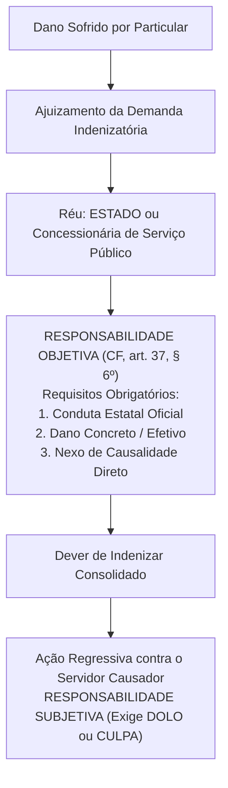
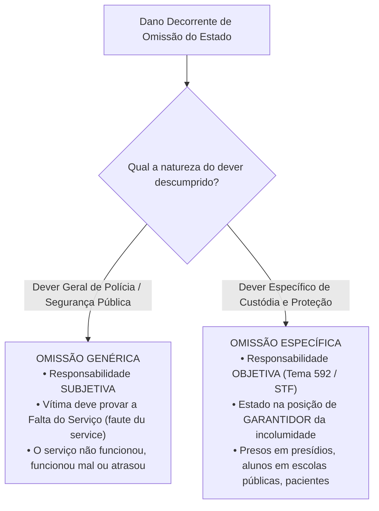
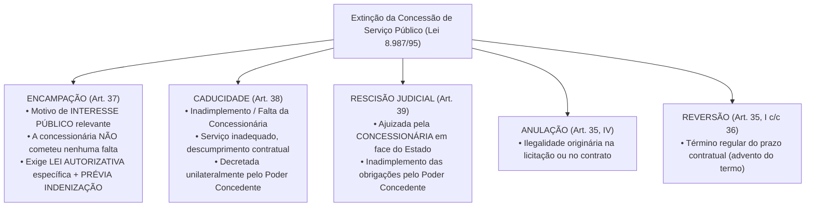

# 04 - Serviços Públicos, Bens Públicos e Responsabilidade Civil do Estado

> **Matéria:** Noções de Direito Administrativo  
> **Cargo:** A01 – Técnico de Controle Externo – Especialidade: Técnico Administrativo  
> **Arquivo:** `04_servicos_publicos_bens_e_responsabilidade_civil.md`  

---

## 📌 Ementa / Itens do Edital
- Responsabilidade civil do Estado: evolução histórica, fundamentos e modalidades
- Artigo 37, § 6º da Constituição Federal de 1988: responsabilidade objetiva das pessoas jurídicas de direito público e das de direito privado prestadoras de serviços públicos
- Teoria do Risco Administrativo vs. Teoria do Risco Integral
- Responsabilidade por ação vs. responsabilidade por omissão estatal (*faute du service* e dever específico de custódia)
- Causas excludentes e atenuantes do nexo de causalidade
- Ação regressiva contra o agente público e Tema 940 do STF (Teoria da Dupla Garantia)
- Serviços públicos: conceito, princípios, delegação a particulares (Lei nº 8.987/1995 e Lei nº 11.079/2004)
- Bens públicos: conceito, classificação (Código Civil, art. 99), afetação/desafetação e regime jurídico

---

## 🧭 Sumário

1. [Responsabilidade Civil Extracontratual do Estado](#1-responsabilidade-civil-extracontratual-do-estado)
    1. [Evolução Histórica da Responsabilidade Estatal](#11-evolucao-historica-da-responsabilidade-estatal)
    2. [O Art. 37, § 6º da CF/88 e os Elementos da Responsabilidade Objetiva](#12-o-art-37-6o-da-cf88-e-os-elementos-da-responsabilidade-objetiva)
    3. [Teoria do Risco Administrativo: Excludentes e Atenuantes](#13-teoria-do-risco-administrativo-excludentes-e-atenuantes)
    4. [Teoria do Risco Integral e suas Hipóteses Excepcionais](#14-teoria-do-risco-integral-e-suas-hipoteses-excepcionais)
    5. [Responsabilidade por Omissão Estatal: Genérica vs. Específica](#15-responsabilidade-por-omissao-estatal-generica-vs-especifica)
    6. [Ação Regressiva e a Teoria da Dupla Garantia (Tema 940 / STF)](#16-acao-regressiva-e-a-teoria-da-dupla-garantia-tema-940-stf)
    7. [Teste 034](#Teste-034)
    8. [Teste 035](#Teste-035)
    9. [Teste 036](#Teste-036)
    10. [Teste 037](#Teste-037)
2. [Regime Jurídico dos Serviços Públicos e sua Delegação](#2-regime-juridico-dos-servicos-publicos-e-sua-delegacao)
    1. [Princípios do Serviço Público Adequado](#21-principios-do-servico-publico-adequado)
    2. [Concessão Comum e Permissão de Serviço Público (Lei nº 8.987/1995)](#22-concessao-comum-e-permissao-de-servico-publico-lei-no-89871995)
    3. [Formas de Extinção das Concessões: Encampação vs. Caducidade](#23-formas-de-extincao-das-concessoes-encampacao-vs-caducidade)
    4. [Parcerias Público-Privadas - PPPs (Lei nº 11.079/2004)](#24-parcerias-publico-privadas-ppps-lei-no-110792004)
    5. [Teste 038](#Teste-038)
    6. [Teste 039](#Teste-039)
    7. [Teste 040](#Teste-040)
    8. [Teste 041](#Teste-041)
3. [Bens Públicos: Classificação, Afetação e Prerrogativas](#3-bens-publicos-classificacao-afetacao-e-prerrogativas)
    1. [Classificação Quanto à Destinação (Código Civil, art. 99)](#31-classificacao-quanto-a-destinacao-codigo-civil-art-99)
    2. [Fenômeno da Afetação e Desafetação](#32-fenomeno-da-afetacao-e-desafetacao)
    3. [Prerrogativas do Regime Jurídico e a Imprescritibilidade Absoluta](#33-prerrogativas-do-regime-juridico-e-a-imprescritibilidade-absoluta)
    4. [Teste 042](#Teste-042)
    5. [Teste 043](#Teste-043)
    6. [Teste 044](#Teste-044)
4. [Fontes Recomendadas na Internet](#4-fontes-recomendadas-na-internet)

---

## 1. Responsabilidade Civil Extracontratual do Estado

A responsabilidade civil extracontratual da Administração Pública consiste na obrigação jurídica que recai sobre o Estado de reparar os danos materiais, morais e estéticos causados a particulares por condutas comissivas ou omissivas de seus agentes públicos no exercício de suas atribuições ou a pretexto de exercê-las.

### 1.1 Evolução Histórica da Responsabilidade Estatal

- **Teoria da Irresponsabilidade Estatal (*The King can do no wrong*):** Predominou nos Estados Absolutistas. O monarca e o Estado não respondiam por quaisquer danos causados aos súditos.
- **Teorias Civilistas / Subjetivas (Culpa Comum):** Surgiram com o advento do Estado Liberal de Direito. Exigiam que a vítima comprovasse a culpa individualizada do agente público (*culpa in eligendo* ou *culpa in vigilando*), operando em extrema desvantagem processual para o particular.
- **Teoria da Culpa Administrativa / Culpa do Serviço (*Faute du Service*):** Desvinculou a culpa da pessoa física do servidor. A responsabilidade continuava sendo subjetiva, mas bastava à vítima comprovar a falta do serviço estatal: o serviço não funcionou, funcionou mal ou funcionou com atraso intolerável.
- **Teoria Objetiva do Risco Administrativo:** Consagrada pelo Direito Constitucional contemporâneo, dispensa integralmente a comprovação de dolo ou culpa estatal, fundando-se na causalidade material e na solidariedade social perante os riscos criados pela atividade administrativa.

### 1.2 O Art. 37, § 6º da CF/88 e os Elementos da Responsabilidade Objetiva

> *"Art. 37, § 6º. As pessoas jurídicas de direito público e as de direito privado prestadoras de serviços públicos responderão pelos danos que seus agentes, nessa qualidade, causarem a terceiros, assegurado o direito de regresso contra o responsável nos casos de dolo ou culpa."*

#### Elementos Indispensáveis para a Responsabilização Objetiva:
1. **Conduta Estatal:** Ação ou comportamento imputável a um agente público (efetivo, comissionado, temporário ou terceiro delegatário) agindo nessa qualidade.
2. **Dano Efetivo:** Prejuízo certo, juridicamente tutelado, de natureza patrimonial, moral ou estética.
3. **Nexo de Causalidade:** Relação direta de causa e efeito entre a conduta oficial e o dano experimentado pela vítima (Teoria do Dano Direto e Imediato).

> ⭐ **IMPORTANTE / REPERCUSSÃO GERAL STF:**  
> A responsabilidade objetiva do art. 37, § 6º, aplica-se às **empresas prestadoras de serviços públicos** (concessionárias e permissionárias) tanto em relação aos **usuários do serviço** quanto em relação a **terceiros não usuários** (vítimas de acidentes causados pelo serviço público - RE 591.874/STF).

### 1.3 Teoria do Risco Administrativo: Excludentes e Atenuantes

O ordenamento jurídico brasileiro adota como **regra geral a Teoria do Risco Administrativo**. Essa teoria baseia-se na ideia de que a atividade estatal gera riscos inerentes para a coletividade, devendo o poder público arcar com os prejuízos decorrentes. Todavia, **NÃO se trata de responsabilidade absoluta**, admitindo-se a ruptura ou atenuação do nexo causal nas seguintes hipóteses:

- **Causas Excludentes do Nexo de Causalidade (Afastam 100% da Indenização):**
    1. *Culpa Exclusiva da Vítima:* O evento decorreu inteiramente do comportamento negligente, imprudente ou voluntário do próprio lesado (ex.: pedestre que se atira intencionalmente sob as rodas de um ônibus público em alta velocidade).
    2. *Caso Fortuito ou Força Maior Absoluta:* Eventos imprevisíveis da natureza com violência desmedida (raios imprevisíveis, terremotos, trombas d'água fora de qualquer série histórica), desde que o Estado não tenha sido omisso em adotar medidas preventivas exigíveis.
    3. *Fato Exclusivo de Terceiro:* Dano provocado exclusivamente por ação autônoma e imprevisível de outrem sem qualquer concurso da conduta estatal (ex.: assalto à mão armada ocorrido dentro de um ônibus coletivo com disparo de arma de fogo deflagrado pelo criminoso).

- **Causas Atenuantes do Nexo de Causalidade:**
    - *Culpa Concorrente da Vítima:* A vítima e o agente público concorreram simultaneamente para a eclosão do evento danoso. O Estado continua obrigado a indenizar, mas o montante indenizatório é **reduzido proporcionalmente** ao grau de culpa da vítima.

### 1.4 Teoria do Risco Integral e suas Hipóteses Excepcionais

Na **Teoria do Risco Integral**, a obrigação estatal de indenizar é cega e absoluta. O Estado atua como garantidor universal de riscos, **sendo vedada a invocação de qualquer causa excludente** (o poder público é condenado mesmo diante de caso fortuito, força maior ou culpa exclusiva da vítima).

O ordenamento constitucional e legal brasileiro reconhece a incidência do risco integral em apenas **três hipóteses taxativas**:

1. **Dano Nuclear:** Responsabilidade civil por acidentes radiológicos ou nucleares (CF/88, art. 21, XXIII, "d");
2. **Atos de Guerra e Terrorismo Aéreo:** Danos a terceiros decorrentes de atentados terroristas contra aeronaves comerciais de matrícula brasileira (Lei Federal nº 10.744/2003);
3. **Dano Ambiental:** Jurisprudência vinculante consolidada do Superior Tribunal de Justiça (Tema Repetitivo 707/STJ) para degradações ecológicas graves.

### 1.5 Responsabilidade por Omissão Estatal: Genérica vs. Específica

Quando o dano decorre de um não-fazer da Administração Pública, a jurisprudência estabelece rígida bifurcação metodológica:

- **Omissão Genérica (Responsabilidade Subjetiva):** O Estado descumpre seu dever genérico de proteção da ordem social (ex.: furto de veículo particular estacionado em via pública comum; alagamento pontual em chuva sazonal). A vítima deve provar a ocorrência de culpa anônima do serviço (*faute du service*), demonstrando que o poder público foi negligente diante de um dever exigível.
- **Omissão Específica (Responsabilidade Objetiva - Tema 592/STF):** Ocorre quando o Estado atua na **posição de garante**, detendo a pessoa ou a coisa sob sua imediata custódia física institucional (ex.: morte ou lesão corporal de detento em estabelecimento penitenciário; acidente com criança no interior de escola pública municipal; suicídio de paciente internado em hospital psiquiátrico público). A responsabilidade é **OBJETIVA**; o Estado só se exonera se comprovar que a morte ou o dano decorreu de causa natural ou que o evento era faticamente inevitável mesmo com o cumprimento de todos os protocolos regulares de vigilância.

### 1.6 Ação Regressiva e a Teoria da Dupla Garantia (Tema 940 / STF)

O Supremo Tribunal Federal, ao julgar o RE 1.027.633 sob a sistemática da repercussão geral (**Tema 940**), pacificou a controvérsia sobre a legitimidade passiva nas ações indenizatórias fundamentadas no art. 37, § 6º, da CF/88:

> *"A teor do art. 37, § 6º, da Constituição Federal, a ação por danos causados por agente público deve ser ajuizada contra o Estado ou a pessoa jurídica de direito privado prestadora de serviço público, **sendo parte ilegítima para figurar no polo passivo o autor do ato**, assegurado o direito de regresso contra o responsável nos casos de dolo ou culpa."*

#### A Teoria da Dupla Garantia:
1. **Primeira Garantia (Ao Cidadão Vítima):** Assegura que o particular lesionado demandará contra o Estado ou concessionária sob regime de responsabilidade objetiva (sem ter que provar a culpa do servidor) e com a certeza de solvência financeira pública.
2. **Segunda Garantia (Ao Agente Público):** Protege o servidor contra ações temerárias de administrados inconformados, assegurando-lhe que **jamais poderá ser réu direto** na ação proposta pela vítima, nem compor litisconsórcio passivo originário com o Estado.

- **Regime da Ação Regressiva:** O Estado, após ser definitivamente condenado e efetuar o pagamento da indenização à vítima, tem o **dever de ajuizar ação regressiva** contra o servidor causador do dano. No âmbito da ação de regresso, a responsabilidade do servidor é **SUBJETIVA**, dependendo da comprovação cabal de que ele agiu com **dolo ou culpa** (negligência, imprudência ou imperícia).

---

### Teste 001
**(FGV – TJ/AP – 2023 – Analista Judiciario Apoio Especializado Tecnologia Da Informacao Banco De Dados)**
Na qualidade de servidora pública ocupante do cargo de analista do Tribunal de Justiça do Estado do Amapá, Marieva foi questionada acerca de qual teoria foi adotada para responsabilidade civil do Estado pela conduta dos respectivos agentes públicos, à luz do disposto no Art. 37, §6º, da Constituição da República de 1988 e as peculiaridades decorrentes de tal orientação. Nesse contexto, considerando o entendimento do Supremo Tribunal Federal acerca da matéria, Marieva respondeu, corretamente, que se tratava da:

* **A)** teoria do risco administrativo, que consagra a responsabilidade subjetiva do Estado e não admite excludentes do nexo de causalidade;
* **B)** teoria do risco integral, que consagra a responsabilidade objetiva do Estado e não admite excludentes do nexo de causalidade;
* **C)** teoria da culpa administrativa, que consagra a responsabilidade subjetiva do Estado e não admite excludentes do nexo de causalidade;
* **D)** teoria do risco administrativo, que consagra a responsabilidade objetiva do Estado e admite excludentes do nexo de causalidade;
* **E)** teoria do risco integral, que consagra a responsabilidade subjetiva do Estado e admite excludentes do nexo de causalidade.

---

> **Comentário Detalhado:**
>
> - **A)** **Incorreta.** A opção apresenta proposição em desacordo com os fundamentos teóricos e técnicos do tópico ao afirmar que "teoria do risco administrativo, que consagra a responsabilidade subjetiva do Estado e não admite excludentes do...". De acordo com a teoria estudada em *1.3 Teoria do Risco Administrativo: Excludentes e Atenuantes*, causas Excludentes do Nexo de Causalidade (Afastam 100% da Indenização).
> - **B)** **Incorreta.** A opção apresenta proposição em desacordo com os fundamentos teóricos e técnicos do tópico ao afirmar que "teoria do risco integral, que consagra a responsabilidade objetiva do Estado e não admite excludentes do nexo de...". De acordo com a teoria estudada em *1.3 Teoria do Risco Administrativo: Excludentes e Atenuantes*, causas Atenuantes do Nexo de Causalidade.
> - **C)** **Incorreta.** A opção apresenta proposição em desacordo com os fundamentos teóricos e técnicos do tópico ao afirmar que "teoria da culpa administrativa, que consagra a responsabilidade subjetiva do Estado e não admite excludentes do...". De acordo com a teoria estudada em *1.1 Evolução Histórica da Responsabilidade Estatal*, teoria Objetiva do Risco Administrativo: Consagrada pelo Direito Constitucional contemporâneo, dispensa integralmente a comprovação de dolo ou culpa estatal, fundando se na causalidade material e na solidariedade social perante os riscos criados pela atividade administrativa.
> - **D)** **Correta.** Conforme fundamentado na seção *1.3 Teoria do Risco Administrativo: Excludentes e Atenuantes* deste guia, o ordenamento jurídico brasileiro adota como regra geral a Teoria do Risco Administrativo. Essa teoria baseia se na ideia de que a atividade estatal gera riscos inerentes para a coletividade, devendo o poder público arcar com os prejuízos decorrentes. Todavia, NÃO se trata de responsabilidade absoluta, admitindo se a ruptura ou atenuação do nexo causal nas seguintes hipóteses. Dessa forma, está plenamente correta a assertiva da banca (FGV – TJ/AP/2023) ao estabelecer que "teoria do risco administrativo, que consagra a responsabilidade objetiva do Estado e admite excludentes do nexo de...".
> - **E)** **Incorreta.** A opção apresenta proposição em desacordo com os fundamentos teóricos e técnicos do tópico ao afirmar que "teoria do risco integral, que consagra a responsabilidade subjetiva do Estado e admite excludentes do nexo de...". De acordo com a teoria estudada em *1.2 O Art. 37, § 6º da CF/88 e os Elementos da Responsabilidade Objetiva*, dEF REQ["RESPONSABILIDADE OBJETIVA (CF, art. 37, § 6º)<br/ Requisitos Obrigatórios:<br/ 1. Conduta Estatal Oficial<br/ 2. Dano Concreto / Efetivo<br/ 3. Nexo de Causalidade Direto"].
>
> **Gabarito: D**

---

### Teste 002
**(FGV – TRT 1ª – 2024 – Analista Judiciário - Área Administrativa)**
Josélia decidiu aprofundar os seus conhecimentos com relação à orientação do Supremo Tribunal Federal acerca da responsabilidade civil do Estado, à luz do disposto no Art. 37, §6º, da CRFB/1988, vindo a concluir corretamente que:

* **A)** no caso atinente a morte por disparo de arma de fogo em decorrência de operação policial, a responsabilidade civil do Estado é fundada na teoria do risco integral;
* **B)** o direito de regresso em relação ao agente público causador do dano em sede de responsabilidade civil é imprescritível, por se tratar de ressarcimento ao erário;
* **C)** não é cabível o reconhecimento de causas excludentes da responsabilidade civil, diante da previsão constitucional;
* **D)** o agente causador do dano não tem legitimidade para constar do polo passivo da ação judicial que visa à responsabilização civil do Estado;
* **E)** tanto o Estado quanto o agente causador do dano respondem objetivamente pelos danos por este causados no exercício de suas atribuições.

---

> **Comentário Detalhado:**
>
> - **A)** **Incorreta.** A opção apresenta proposição em desacordo com os fundamentos teóricos e técnicos do tópico ao afirmar que "no caso atinente a morte por disparo de arma de fogo em decorrência de operação policial, a responsabilidade civil...". De acordo com a teoria estudada em *1.3 Teoria do Risco Administrativo: Excludentes e Atenuantes*, fato Exclusivo de Terceiro: Dano provocado exclusivamente por ação autônoma e imprevisível de outrem sem qualquer concurso da conduta estatal (ex.: assalto à mão armada ocorrido dentro de um ônibus coletivo com disparo de arma de fogo deflagrado pelo criminoso).
> - **B)** **Incorreta.** A opção apresenta proposição em desacordo com os fundamentos teóricos e técnicos do tópico ao afirmar que "o direito de regresso em relação ao agente público causador do dano em sede de responsabilidade civil é...". De acordo com a teoria estudada em *A Teoria da Dupla Garantia:*, regime da Ação Regressiva: O Estado, após ser definitivamente condenado e efetuar o pagamento da indenização à vítima, tem o dever de ajuizar ação regressiva contra o servidor causador do dano. No âmbito da ação de regresso, a responsabilidade do servidor é SUBJETIVA, dependendo da comprovação cabal de que ele agiu com dolo ou culpa (negligência, imprudência ou imperícia).
> - **C)** **Incorreta.** A opção apresenta proposição em desacordo com os fundamentos teóricos e técnicos do tópico ao afirmar que "não é cabível o reconhecimento de causas excludentes da responsabilidade civil, diante da previsão constitucional". De acordo com a teoria estudada em *A Teoria da Dupla Garantia:*, segunda Garantia (Ao Agente Público): Protege o servidor contra ações temerárias de administrados inconformados, assegurando lhe que jamais poderá ser réu direto na ação proposta pela vítima, nem compor litisconsórcio passivo originário com o Estado.
> - **D)** **Correta.** Conforme fundamentado na seção *1.6 Ação Regressiva e a Teoria da Dupla Garantia (Tema 940 / STF)* deste guia, "A teor do art. 37, § 6º, da Constituição Federal, a ação por danos causados por agente público deve ser ajuizada contra o Estado ou a pessoa jurídica de direito privado prestadora de serviço público, sendo parte ilegítima para figurar no polo passivo o autor do ato, assegurado o direito de regresso contra o responsável nos casos de dolo ou culpa.". Dessa forma, está plenamente correta a assertiva da banca (FGV – TRT 1ª/2024) ao estabelecer que "o agente causador do dano não tem legitimidade para constar do polo passivo da ação judicial que visa à...".
> - **E)** **Incorreta.** A opção apresenta proposição em desacordo com os fundamentos teóricos e técnicos do tópico ao afirmar que "tanto o Estado quanto o agente causador do dano respondem objetivamente pelos danos por este causados no exercício...". De acordo com a teoria estudada em *1. Responsabilidade Civil Extracontratual do Estado*, a responsabilidade civil extracontratual da Administração Pública consiste na obrigação jurídica que recai sobre o Estado de reparar os danos materiais, morais e estéticos causados a particulares por condutas comissivas ou omissivas de seus agentes públicos no exercício de suas atribuições ou a pretexto de exercê las.
>
> **Gabarito: D**

---

## 2. Regime Jurídico dos Serviços Públicos e sua Delegação

### 2.1 Princípios do Serviço Público Adequado

A Lei Federal nº 8.987/1995 (art. 6º) prescreve que toda concessão ou permissão pressupõe a prestação de **serviço adequado**, assim entendido o que satisfaz as condições de:

- **Regularidade:** Prestação sem oscilações arbitrárias de qualidade.
- **Continuidade:** Não interrupção da atividade, admitida a suspensão motivada em hipóteses estritas de segurança técnica ou inadimplemento do usuário após aviso prévio formal.
- **Eficiência:** Máxima produtividade e excelência técnica.
- **Segurança:** Minimização de riscos aos usuários e ao meio ambiente.
- **Atualidade:** Incorporação contínua de métodos modernos, equipamentos tecnológicos de ponta e expansão da rede.
- **Generalidade:** Acesso universal e não discriminatório a todos os cidadãos.
- **Cortesia:** Urbanidade no trato com os usuários.
- **Modicidade das Tarifas:** Fixação de preços públicos acessíveis à população em equilíbrio econômico-financeiro.

### 2.2 Concessão Comum e Permissão de Serviço Público (Lei nº 8.987/1995)

- **Concessão Comum de Serviço Público:** Delegação contratual bilateral formalizada com pessoa jurídica ou consórcio de empresas, mediante prévia licitação obrigatória, para exploração do serviço por prazo determinado, a expensas e risco da concessionária, remunerada unicamente pelas tarifas cobradas dos usuários.
- **Permissão de Serviço Público:** Delegação formalizada mediante **contrato de adesão**, a título precário, após prévia licitação, admitindo como permitente pessoa física ou jurídica.

### 2.3 Formas de Extinção das Concessões: Encampação vs. Caducidade

A diferenciação entre as modalidades de extinção contratual na Lei nº 8.987/1995 é intensamente cobrada pela FCC:

| Critério de Comparação | Encampação (Resgate) | Caducidade |
| :--- | :--- | :--- |
| **Causa Primária** | **Interesse público superveniente** (conveniência administrativa) | **Inadimplemento contratual culposo** da concessionária |
| **Culpa da Concessionária?** | **NÃO** (a empresa cumpria rigorosamente o contrato) | **SIM** (prestação defeituosa, paralisações, descumprimento de prazos) |
| **Exigência de Lei?** | **SIM**, exige **lei autorizativa específica** do ente concedente | **NÃO**, declarada por **decreto** do Chefe do Executivo |
| **Indenização Prévia?** | **SIM**, o pagamento de indenização deve ser **prévio** à retomada | **NÃO**, indenização é apurada a posteriori descontadas multas contratuais |

### 2.4 Parcerias Público-Privadas - PPPs (Lei nº 11.079/2004)

As Parcerias Público-Privadas constituem concessões especiais destinadas a viabilizar investimentos vultosos de infraestrutura em colaboração com o capital privado:

1. **Concessão Patrocinada (Art. 2º, § 1º):** É a concessão de serviços públicos ou obras públicas em que a remuneração da concessionária envolve a combinação de **tarifa paga pelos usuários** mais uma **contraprestação pecuniária complementar paga pelo parceiro público**.
2. **Concessão Administrativa (Art. 2º, § 2º):** É o contrato de prestação de serviços de que a **Administração Pública seja a usuária direta ou indireta**, ainda que envolva a execução de obra ou fornecimento e instalação de bens. A remuneração é **100% custeada pelo erário**, inexistindo cobrança de tarifas dos cidadãos (ex.: construção e operação de hospitais públicos do SUS, presídios, iluminação pública).
3. **Vedações Legais Obrigatórias à Celebração de PPPs (Art. 2º, § 4º):**
    - Contratos cujo valor total seja **inferior a R$ 10.000.000,00 (dez milhões de reais)**;
    - Período de prestação de serviços **inferior a 5 (cinco) anos** ou superior a 35 (trinta e cinco) anos;
    - Contratos que tenham por objeto único o fornecimento de mão de obra, a mera locação de equipamentos ou a execução isolada de obra pública sem prestação continuada de serviços.

---

### Teste 003
**(FGV – TJ/SC – 2026 – Analista Administrativo)**
Na Administração Pública federal direta, autárquica e fundacional, a terceirização é disciplinada pelo Decreto nº 9.507/2018, que enumera, em seu art. 3º, hipóteses em que se veda a execução indireta de serviços, em razão da natureza nuclear ou indelegável das atividades envolvidas. Dentre as hipóteses em que o Decreto nº 9.507/2018 veda a execução indireta de serviços na Administração Pública federal direta, autárquica e fundacional, encontra-se a contratação de serviços de

* **A)** conservação, limpeza e copeiragem.
* **B)** recepção e telecomunicações.
* **C)** manutenção predial e de equipamentos.
* **D)** regulação e outorga de serviços públicos.
* **E)** transporte de cargas e de passageiros.

---

> **Comentário Detalhado:**
>
> - **A)** **Incorreta.** A opção apresenta proposição em desacordo com os fundamentos teóricos e técnicos do tópico ao afirmar que "conservação, limpeza e copeiragem". De acordo com a teoria estudada em *4. Fontes Recomendadas na Internet*, normas gerais sobre participação, proteção e defesa dos direitos do usuário dos serviços públicos da administração direta e indireta.
> - **B)** **Incorreta.** A opção apresenta proposição em desacordo com os fundamentos teóricos e técnicos do tópico ao afirmar que "recepção e telecomunicações". De acordo com a teoria estudada em *3.1 Classificação Quanto à Destinação (Código Civil, art. 99)*, bens de Uso Especial (Art. 99, II): Destinados à execução direta dos serviços públicos e ao funcionamento da máquina administrativa (edifícios de fóruns e tribunais, escolas públicas, hospitais estatais, viaturas policiais, quartéis).
> - **C)** **Incorreta.** A opção apresenta proposição em desacordo com os fundamentos teóricos e técnicos do tópico ao afirmar que "manutenção predial e de equipamentos". De acordo com a teoria estudada em *2.4 Parcerias Público-Privadas - PPPs (Lei nº 11.079/2004)*, contratos que tenham por objeto único o fornecimento de mão de obra, a mera locação de equipamentos ou a execução isolada de obra pública sem prestação continuada de serviços.
> - **D)** **Correta.** Conforme fundamentado na seção *2.4 Parcerias Público-Privadas - PPPs (Lei nº 11.079/2004)* deste guia, concessão Administrativa (Art. 2º, § 2º): É o contrato de prestação de serviços de que a Administração Pública seja a usuária direta ou indireta, ainda que envolva a execução de obra ou fornecimento e instalação de bens. A remuneração é 100% custeada pelo erário, inexistindo cobrança de tarifas dos cidadãos (ex.: construção e operação de hospitais públicos do SUS, presídios, iluminação pública). Dessa forma, está plenamente correta a assertiva da banca (FGV – TJ/SC/2026) ao estabelecer que "regulação e outorga de serviços públicos".
> - **E)** **Incorreta.** A opção apresenta proposição em desacordo com os fundamentos teóricos e técnicos do tópico ao afirmar que "transporte de cargas e de passageiros". De acordo com a teoria estudada em *2.4 Parcerias Público-Privadas - PPPs (Lei nº 11.079/2004)*, concessão Patrocinada (Art. 2º, § 1º): É a concessão de serviços públicos ou obras públicas em que a remuneração da concessionária envolve a combinação de tarifa paga pelos usuários mais uma contraprestação pecuniária complementar paga pelo parceiro público.
>
> **Gabarito: D**

---

### Teste 004
**(FGV – TJ/DFT – 2022 – Analista Judiciario Suporte Em Tecnologia Da Informacao)**
O prefeito do Município Alfa decidiu promover uma ampla reestruturação da Administração pública indireta. Para tanto, decidiu que fosse elaborado um estudo preliminar, de modo a delinear os contornos gerais de: (1) duas entidades com personalidade jurídica própria, para a execução dos serviços públicos de limpeza urbana e de administração de cemitérios públicos; e (2) de órgãos específicos, a serem criados no âmbito da Secretaria de Saúde e da Secretaria de Ordem Pública, de modo a aumentar a especialização e, consequentemente, o nível de eficiência estatal. É correto afirmar que:

* **A)** em (1) são mencionados exemplos de descentralização administrativa por especificação e em (2) de descentralização administrativa por serviços;
* **B)** em (1) são mencionados exemplos de desconcentração administrativa por especificação e em (2) de desconcentração administrativa por serviços;
* **C)** em (1) são mencionados exemplos de descentralização administrativa por serviços e em (2) de desconcentração administrativa;
* **D)** em (1) são mencionados exemplos de desestatização por serviços e em (2) de descentralização administrativa por eficiência;
* **E)** em (1) são mencionados exemplos de desestatização por serviços e em (2) de estatização por padrão de eficiência.

---

> **Comentário Detalhado:**
>
> - **A)** **Incorreta.** A opção apresenta proposição em desacordo com os fundamentos teóricos e técnicos do tópico ao afirmar que "em (1) são mencionados exemplos de descentralização administrativa por especificação e em (2) de descentralização...". De acordo com a teoria estudada em *3.1 Classificação Quanto à Destinação (Código Civil, art. 99)*, bens de Uso Especial (Art. 99, II): Destinados à execução direta dos serviços públicos e ao funcionamento da máquina administrativa (edifícios de fóruns e tribunais, escolas públicas, hospitais estatais, viaturas policiais, quartéis).
> - **B)** **Incorreta.** A opção apresenta proposição em desacordo com os fundamentos teóricos e técnicos do tópico ao afirmar que "em (1) são mencionados exemplos de desconcentração administrativa por especificação e em (2) de desconcentração...". De acordo com a teoria estudada em *4. Fontes Recomendadas na Internet*, normas gerais sobre participação, proteção e defesa dos direitos do usuário dos serviços públicos da administração direta e indireta.
> - **C)** **Correta.** Conforme fundamentado na seção *2.4 Parcerias Público-Privadas - PPPs (Lei nº 11.079/2004)* deste guia, concessão Administrativa (Art. 2º, § 2º): É o contrato de prestação de serviços de que a Administração Pública seja a usuária direta ou indireta, ainda que envolva a execução de obra ou fornecimento e instalação de bens. A remuneração é 100% custeada pelo erário, inexistindo cobrança de tarifas dos cidadãos (ex.: construção e operação de hospitais públicos do SUS, presídios, iluminação pública). Dessa forma, está plenamente correta a assertiva da banca (FGV – TJ/DFT/2022) ao estabelecer que "em (1) são mencionados exemplos de descentralização administrativa por serviços e em (2) de desconcentração...".
> - **D)** **Incorreta.** A opção apresenta proposição em desacordo com os fundamentos teóricos e técnicos do tópico ao afirmar que "em (1) são mencionados exemplos de desestatização por serviços e em (2) de descentralização administrativa por...". De acordo com a teoria estudada em *2.1 Princípios do Serviço Público Adequado*, eficiência: Máxima produtividade e excelência técnica.
> - **E)** **Incorreta.** A opção apresenta proposição em desacordo com os fundamentos teóricos e técnicos do tópico ao afirmar que "em (1) são mencionados exemplos de desestatização por serviços e em (2) de estatização por padrão de eficiência". De acordo com a teoria estudada em *1.1 Evolução Histórica da Responsabilidade Estatal*, teoria Objetiva do Risco Administrativo: Consagrada pelo Direito Constitucional contemporâneo, dispensa integralmente a comprovação de dolo ou culpa estatal, fundando se na causalidade material e na solidariedade social perante os riscos criados pela atividade administrativa.
>
> **Gabarito: C**

---

### Teste 005
**(FGV – TCE/SC – 2026 – Auditor Fiscal de Controle Externo - Ciências Contábeis)**
Em janeiro de 2026, uma empresa assinou um novo contrato de concessão de serviços públicos. Nessa data, a entidade concedente deseja determinar a mensuração inicial dos ativos da concessão, que são segmentados em: I. ativos que já existiam e que tiveram aumento no potencial de serviços; e II. ativos que foram construídos em função do contrato de concessão. As mensurações iniciais de I e de II devem ser, respectivamente, a

* **A)** valor justo e valor justo.
* **B)** custo histórico e valor justo.
* **C)** valor justo e custo histórico.
* **D)** custo histórico e custo histórico.
* **E)** custo histórico e custo corrente de reposição.

---

> **Comentário Detalhado:**
>
> - **A)** **Correta.** Conforme fundamentado na seção *3.3 Prerrogativas do Regime Jurídico e a Imprescritibilidade Absoluta* deste guia, impenhorabilidade: Os bens públicos não podem ser objeto de penhora ou constrição judicial para garantia de dívidas. A execução contra a Fazenda Pública opera se exclusivamente sob o regime constitucional de precatórios judiciais ou requisições de pequeno valor RPV (CF, art. 100). Dessa forma, está plenamente correta a assertiva da banca (FGV – TCE/SC/2026) ao estabelecer que "valor justo e valor justo".
> - **B)** **Incorreta.** A opção apresenta proposição em desacordo com os fundamentos teóricos e técnicos do tópico ao afirmar que "custo histórico e valor justo". De acordo com a teoria estudada em *2.4 Parcerias Público-Privadas - PPPs (Lei nº 11.079/2004)*, contratos cujo valor total seja inferior a R$ 10.000.000,00 (dez milhões de reais).
> - **C)** **Incorreta.** A opção apresenta proposição em desacordo com os fundamentos teóricos e técnicos do tópico ao afirmar que "valor justo e custo histórico". De acordo com a teoria estudada em *2.4 Parcerias Público-Privadas - PPPs (Lei nº 11.079/2004)*, concessão Administrativa (Art. 2º, § 2º): É o contrato de prestação de serviços de que a Administração Pública seja a usuária direta ou indireta, ainda que envolva a execução de obra ou fornecimento e instalação de bens. A remuneração é 100% custeada pelo erário, inexistindo cobrança de tarifas dos cidadãos (ex.: construção e operação de hospitais públicos do SUS, presídios, iluminação pública).
> - **D)** **Incorreta.** A opção apresenta proposição em desacordo com os fundamentos teóricos e técnicos do tópico ao afirmar que "custo histórico e custo histórico". De acordo com a teoria estudada em *2.3 Formas de Extinção das Concessões: Encampação vs. Caducidade*, culpa da Concessionária?: NÃO (a empresa cumpria rigorosamente o contrato) — SIM (prestação defeituosa, paralisações, descumprimento de prazos).
> - **E)** **Incorreta.** A opção apresenta proposição em desacordo com os fundamentos teóricos e técnicos do tópico ao afirmar que "custo histórico e custo corrente de reposição". De acordo com a teoria estudada em *2.4 Parcerias Público-Privadas - PPPs (Lei nº 11.079/2004)*, concessão Patrocinada (Art. 2º, § 1º): É a concessão de serviços públicos ou obras públicas em que a remuneração da concessionária envolve a combinação de tarifa paga pelos usuários mais uma contraprestação pecuniária complementar paga pelo parceiro público.
>
> **Gabarito: A**

---

### Teste 006
**(FGV – TCE/SC – 2026 – Auditor Fiscal de Controle Externo - Engenharia Elétrica)**
No contexto das políticas públicas e regulamentações para a redução do desperdício de energia elétrica no Brasil, avalie as afirmativas a seguir. I. O Selo Procel de Economia de Energia é uma ferramenta de adesão voluntária que permite ao consumidor identificar, no ponto de venda, os equipamentos e eletrodomésticos que apresentam os melhores índices de eficiência energética dentro de sua categoria. II. O Programa de Eficiência Energética (PEE), regulado pela ANEEL, obriga as concessionárias e permissionárias de serviços públicos de distribuição de energia elétrica a investir em projetos que busquem o uso eficiente da energia elétrica, tanto no lado da oferta quanto no lado do consumo. III. O Selo Procel e o Programa de Eficiência Energética da ANEEL possuem a mesma natureza jurídica e operacional, sendo ambos financiados diretamente pelo Tesouro Nacional e geridos exclusivamente pela Eletrobras. Está correto o que se afirma em

* **A)** I, apenas.
* **B)** II, apenas.
* **C)** III, apenas.
* **D)** I e II, apenas.
* **E)** II e III, apenas.

---

> **Comentário Detalhado:**
>
> - **A)** **Incorreta.** A opção incorre em restrição indevida ao limitar o escopo conceitual ao afirmar que "I, apenas". De acordo com a teoria estudada em *3.1 Classificação Quanto à Destinação (Código Civil, art. 99)*, bens de Uso Especial (Art. 99, II): Destinados à execução direta dos serviços públicos e ao funcionamento da máquina administrativa (edifícios de fóruns e tribunais, escolas públicas, hospitais estatais, viaturas policiais, quartéis).
> - **B)** **Incorreta.** A opção incorre em restrição indevida ao limitar o escopo conceitual ao afirmar que "II, apenas". De acordo com a teoria estudada em *3.1 Classificação Quanto à Destinação (Código Civil, art. 99)*, bens Dominicais ou Dominicais (Art. 99, III): Bens que constituem o patrimônio disponível do Estado sem destinação pública específica ou aplicação administrativa direta (terras devolutas, prédios públicos desativados, títulos da dívida pública, bens desapropriados e não afetados).
> - **C)** **Incorreta.** A opção incorre em restrição indevida ao limitar o escopo conceitual ao afirmar que "III, apenas". De acordo com a teoria estudada em *2.2 Concessão Comum e Permissão de Serviço Público (Lei nº 8.987/1995)*, permissão de Serviço Público: Delegação formalizada mediante contrato de adesão, a título precário, após prévia licitação, admitindo como permitente pessoa física ou jurídica.
> - **D)** **Correta.** Conforme fundamentado na seção *Elementos Indispensáveis para a Responsabilização Objetiva:* deste guia, a responsabilidade objetiva do art. 37, § 6º, aplica se às empresas prestadoras de serviços públicos (concessionárias e permissionárias) tanto em relação aos usuários do serviço quanto em relação a terceiros não usuários (vítimas de acidentes causados pelo serviço público RE 591.874/STF). Dessa forma, está plenamente correta a assertiva da banca (FGV – TCE/SC/2026) ao estabelecer que "I e II, apenas".
> - **E)** **Incorreta.** A opção incorre em restrição indevida ao limitar o escopo conceitual ao afirmar que "II e III, apenas". De acordo com a teoria estudada em *2.4 Parcerias Público-Privadas - PPPs (Lei nº 11.079/2004)*, concessão Patrocinada (Art. 2º, § 1º): É a concessão de serviços públicos ou obras públicas em que a remuneração da concessionária envolve a combinação de tarifa paga pelos usuários mais uma contraprestação pecuniária complementar paga pelo parceiro público.
>
> **Gabarito: D**

---

### Teste 007
**(FGV – TCE/SC – 2026 – Auditor Fiscal De Controle Externo Engenharia Sanitaria)**
Uma agência reguladora local, ao aplicar as diretrizes da NR nº 10/2024 da Agência Nacional de Águas e Saneamento Básico para o reajuste tarifário dos serviços públicos de abastecimento de água e de esgotamento sanitário, sujeitos ao modelo de regulação discricionária, avaliou os custos operacionais de uma concessionária ao longo de 12 meses. Verificou-se que a tarifa média vigente era de R$ 4,00 por m³. No período analisado, o índice de reajuste tarifário foi fixado em 12%, enquanto o fator de eficiência regulatória (produtividade), determinado pela agência, foi de 3%. Considerando as condições propostas, a nova tarifa média a ser aplicada será, aproximadamente, de

* **A)** R$ 4,18 por m³.
* **B)** R$ 4,36 por m³.
* **C)** R$ 4,48 por m³.
* **D)** R$ 4,60 por m³.
* **E)** R$ 4,72 por m³.

---

> **Comentário Detalhado:**
>
> - **A)** **Incorreta.** A opção apresenta proposição em desacordo com os fundamentos teóricos e técnicos do tópico ao afirmar que "R$ 4,18 por m³". De acordo com a teoria estudada em *2.1 Princípios do Serviço Público Adequado*, eficiência: Máxima produtividade e excelência técnica.
> - **B)** **Correta.** Conforme fundamentado na seção *2.4 Parcerias Público-Privadas - PPPs (Lei nº 11.079/2004)* deste guia, concessão Patrocinada (Art. 2º, § 1º): É a concessão de serviços públicos ou obras públicas em que a remuneração da concessionária envolve a combinação de tarifa paga pelos usuários mais uma contraprestação pecuniária complementar paga pelo parceiro público. Dessa forma, está plenamente correta a assertiva da banca (FGV – TCE/SC/2026) ao estabelecer que "R$ 4,36 por m³".
> - **C)** **Incorreta.** A opção apresenta proposição em desacordo com os fundamentos teóricos e técnicos do tópico ao afirmar que "R$ 4,48 por m³". De acordo com a teoria estudada em *3.2 Fenômeno da Afetação e Desafetação*, afetação: É a atribuição formal ou fática de uma destinação pública a determinado bem (o bem passa a ser de uso comum ou de uso especial). Enquanto afetado, o bem é inalienável.
> - **D)** **Incorreta.** A opção apresenta proposição em desacordo com os fundamentos teóricos e técnicos do tópico ao afirmar que "R$ 4,60 por m³". De acordo com a teoria estudada em *2.4 Parcerias Público-Privadas - PPPs (Lei nº 11.079/2004)*, período de prestação de serviços inferior a 5 (cinco) anos ou superior a 35 (trinta e cinco) anos.
> - **E)** **Incorreta.** A opção apresenta proposição em desacordo com os fundamentos teóricos e técnicos do tópico ao afirmar que "R$ 4,72 por m³". De acordo com a teoria estudada em *2.2 Concessão Comum e Permissão de Serviço Público (Lei nº 8.987/1995)*, concessão Comum de Serviço Público: Delegação contratual bilateral formalizada com pessoa jurídica ou consórcio de empresas, mediante prévia licitação obrigatória, para exploração do serviço por prazo determinado, a expensas e risco da concessionária, remunerada unicamente pelas tarifas cobradas dos usuários.
>
> **Gabarito: B**

---

### Teste 008
**(FGV – TCE/SC – 2026 – Auditor Fiscal De Controle Externo Engenharia Sanitaria)**
Em relação ao Serviço Público de Manejo de Resíduos Sólidos Urbanos (SMRSU), avalie as afirmativas a seguir. I. O SMRSU compreende desde a coleta, transbordo e transporte dos resíduos sólidos urbanos, até sua triagem, tratamento e destinação final. II. Os serviços públicos de limpeza urbana também devem ser contemplados nas tarifas para esse tipo de serviço. III. O SMRSU é destinado especificamente aos geradores efetivos ou potenciais de resíduos sólidos urbanos que sejam de natureza jurídica. Está correto o que se afirma em

* **A)** I, apenas.
* **B)** II, apenas.
* **C)** I e II, apenas.
* **D)** I e III, apenas.
* **E)** II e III, apenas.

---

> **Comentário Detalhado:**
>
> - **A)** **Correta.** Conforme fundamentado na seção *2.2 Concessão Comum e Permissão de Serviço Público (Lei nº 8.987/1995)* deste guia, concessão Comum de Serviço Público: Delegação contratual bilateral formalizada com pessoa jurídica ou consórcio de empresas, mediante prévia licitação obrigatória, para exploração do serviço por prazo determinado, a expensas e risco da concessionária, remunerada unicamente pelas tarifas cobradas dos usuários. Dessa forma, está plenamente correta a assertiva da banca (FGV – TCE/SC/2026) ao estabelecer que "I, apenas".
> - **B)** **Incorreta.** A opção incorre em restrição indevida ao limitar o escopo conceitual ao afirmar que "II, apenas". De acordo com a teoria estudada em *Elementos Indispensáveis para a Responsabilização Objetiva:*, a responsabilidade objetiva do art. 37, § 6º, aplica se às empresas prestadoras de serviços públicos (concessionárias e permissionárias) tanto em relação aos usuários do serviço quanto em relação a terceiros não usuários (vítimas de acidentes causados pelo serviço público RE 591.874/STF).
> - **C)** **Incorreta.** A opção incorre em restrição indevida ao limitar o escopo conceitual ao afirmar que "I e II, apenas". De acordo com a teoria estudada em *3.1 Classificação Quanto à Destinação (Código Civil, art. 99)*, bens Dominicais ou Dominicais (Art. 99, III): Bens que constituem o patrimônio disponível do Estado sem destinação pública específica ou aplicação administrativa direta (terras devolutas, prédios públicos desativados, títulos da dívida pública, bens desapropriados e não afetados).
> - **D)** **Incorreta.** A opção incorre em restrição indevida ao limitar o escopo conceitual ao afirmar que "I e III, apenas". De acordo com a teoria estudada em *2.4 Parcerias Público-Privadas - PPPs (Lei nº 11.079/2004)*, concessão Administrativa (Art. 2º, § 2º): É o contrato de prestação de serviços de que a Administração Pública seja a usuária direta ou indireta, ainda que envolva a execução de obra ou fornecimento e instalação de bens. A remuneração é 100% custeada pelo erário, inexistindo cobrança de tarifas dos cidadãos (ex.: construção e operação de hospitais públicos do SUS, presídios, iluminação pública).
> - **E)** **Incorreta.** A opção incorre em restrição indevida ao limitar o escopo conceitual ao afirmar que "II e III, apenas". De acordo com a teoria estudada em *2.1 Princípios do Serviço Público Adequado*, modicidade das Tarifas: Fixação de preços públicos acessíveis à população em equilíbrio econômico financeiro.
>
> **Gabarito: A**

---

## 3. Bens Públicos: Classificação, Afetação e Prerrogativas

Conforme o art. 98 do Código Civil, são bens públicos todos aqueles pertencentes às pessoas jurídicas de direito público interno (União, Estados, DF, Municípios e suas autarquias e fundações públicas de direito público). Todos os demais são bens privados.

### 3.1 Classificação Quanto à Destinação (Código Civil, art. 99)

- **Bens de Uso Comum do Povo (Art. 99, I):** Destinados ao uso franqueado e indistinto de toda a coletividade (mares, rios, estradas, ruas, praças, praias). Podem ser utilizados gratuitamente ou mediante cobrança de tarifa/pedágio autorizada por lei.
- **Bens de Uso Especial (Art. 99, II):** Destinados à execução direta dos serviços públicos e ao funcionamento da máquina administrativa (edifícios de fóruns e tribunais, escolas públicas, hospitais estatais, viaturas policiais, quartéis).
- **Bens Dominicais ou Dominicais (Art. 99, III):** Bens que constituem o patrimônio disponível do Estado sem destinação pública específica ou aplicação administrativa direta (terras devolutas, prédios públicos desativados, títulos da dívida pública, bens desapropriados e não afetados).

### 3.2 Fenômeno da Afetação e Desafetação

- **Afetação:** É a atribuição formal ou fática de uma destinação pública a determinado bem (o bem passa a ser de uso comum ou de uso especial). Enquanto afetado, o bem é **inalienável**.
- **Desafetação:** É a retirada da destinação pública do bem, convertendo-o em bem dominical. Somente após a regular desafetação o bem público torna-se passível de alienação, observadas as exigências de autorização legislativa, interesse público justificado, avaliação prévia e procedimento licitatório.

### 3.3 Prerrogativas do Regime Jurídico e a Imprescritibilidade Absoluta

O regime jurídico dos bens públicos é informado por quatro prerrogativas estruturantes:

1. **Inalienabilidade Relativa:** Os bens de uso comum e de uso especial são inalienáveis enquanto conservarem sua qualificação pública. Os bens dominicais podem ser alienados, desde que cumpridos os requisitos da lei de licitações.
2. **Impenhorabilidade:** Os bens públicos não podem ser objeto de penhora ou constrição judicial para garantia de dívidas. A execução contra a Fazenda Pública opera-se exclusivamente sob o regime constitucional de **precatórios judiciais ou requisições de pequeno valor - RPV** (CF, art. 100).
3. **Imprescritibilidade Absoluta (Vedação de Usucapião):**  
   O art. 183, § 3º e o art. 191, parágrafo único, da Constituição Federal, corroborados pela **Súmula 340 do STF**, preceituam que **nenhum bem público, qualquer que seja sua classificação (inclusive os bens dominicais), pode ser adquirido por usucapião**.
    - *Natureza da Ocupação Irregular:* O particular que ocupa área pública sem título legítimo é considerado **mero detentor clandestino**. Não exerce posse jurídica tutelável, não tem direito a interditos possessórios contra o Estado e não faz jus a retenção ou indenização por benfeitorias realizadas.

4. **Não-Onerabilidade:** Impossibilidade de que bens públicos sejam gravados com direitos reais de garantia em favor de terceiros (hipoteca, penhor, anticrese).

---

## 4. Fontes Recomendadas na Internet

- [Constituição Federal de 1988 - Art. 37, § 6º, Art. 183, § 3º e Art. 191](https://www.planalto.gov.br/ccivil_03/constituicao/constituicao.htm#art37)  
  Bases normativas fundamentais da responsabilidade civil objetiva do Estado e vedação expressa à usucapião de bens públicos urbanos e rurais.
- [Lei Federal nº 8.987/1995 (Lei Geral de Concessões e Permissões de Serviços Públicos)](https://www.planalto.gov.br/ccivil_03/leis/l8987cons.htm)  
  Regulamento dos princípios do serviço público adequado, direitos dos usuários e hipóteses de extinção contratual (encampação e caducidade).
- [Lei Federal nº 11.079/2004 (Marco das Parcerias Público-Privadas - PPPs)](https://www.planalto.gov.br/ccivil_03/_ato2004-2006/2004/lei/l11079.htm)  
  Dispositivos sobre concessões patrocinadas, concessões administrativas, repartição de riscos e limites operacionais de contratação.
- [Lei Federal nº 13.460/2017 (Código de Defesa dos Usuários dos Serviços Públicos)](https://www.planalto.gov.br/ccivil_03/_ato2015-2018/2017/lei/l13460.htm)  
  Normas gerais sobre participação, proteção e defesa dos direitos do usuário dos serviços públicos da administração direta e indireta.
- [Código Civil Brasileiro - Arts. 98 a 103 (Regime Jurídico dos Bens Públicos)](https://www.planalto.gov.br/ccivil_03/leis/2002/l10406compilada.htm#art98)  
  Classificação legal dos bens públicos de uso comum do povo, de uso especial e dominicais, e regras de inalienabilidade.
- [STF - Tema 940 de Repercussão Geral (Teoria da Dupla Garantia na Responsabilidade Civil)](https://portal.stf.jus.br/jurisprudencia/repercussaoGeral/tema.asp?num=940)  
  Tese que consolidou a ilegitimidade passiva originária do agente público em ações indenizatórias propostas pela vítima em face do Estado.
* DI PIETRO, Maria Sylvia Zanella. **Direito Administrativo**. 37. ed. Rio de Janeiro: Forense, 2024. (Cap. 5, Cap. 15 e Cap. 17 - Serviços Públicos, Responsabilidade Extracontratual do Estado e Bens Públicos).
* CARVALHO FILHO, José dos Santos. **Manual de Direito Administrativo**. 38. ed. Barueri: Atlas, 2024. (Cap. 6, Cap. 11 e Cap. 18 - Serviços Públicos, Concessões, Responsabilidade Civil do Estado e Bens Públicos).
* OLIVEIRA, Rafael Carvalho Rezende. **Curso de Direito Administrativo**. 12. ed. Rio de Janeiro: Método, 2024. (Cap. 12, Cap. 20 e Cap. 23 - Serviços Públicos, Bens Públicos e Responsabilidade Civil Estatal).
