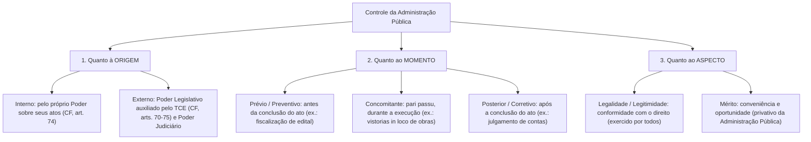
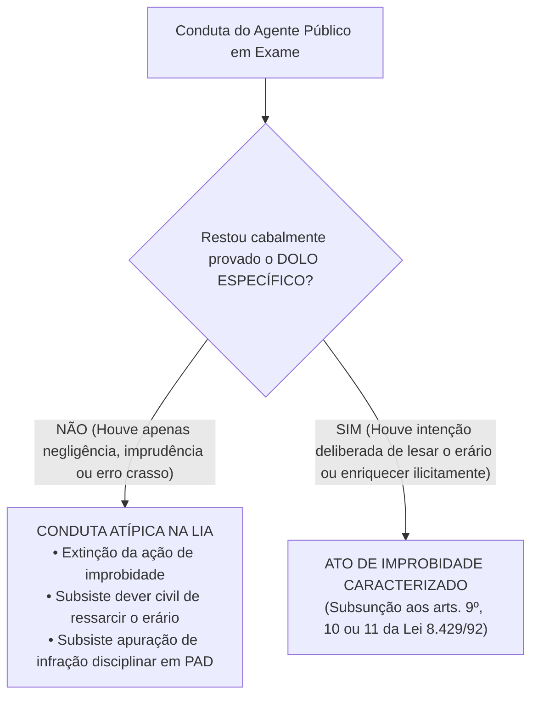
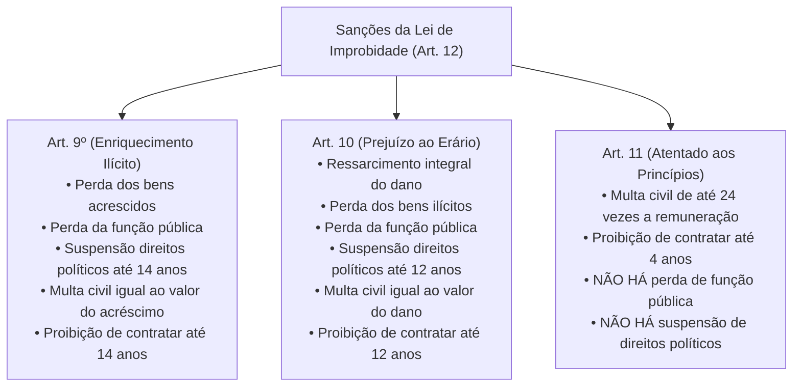

# 05 - Controle da Administração Pública e Improbidade Administrativa (Lei 8.429/1992 e Lei 14.230/2021)

> **Matéria:** Noções de Direito Administrativo  
> **Cargo:** A01 – Técnico de Controle Externo – Especialidade: Técnico Administrativo  
> **Arquivo:** `05_controle_da_administracao_e_improbidade_administrativa.md`  

---

## 📌 Ementa / Itens do Edital
- Controle da Administração Pública: conceito, fundamentos e classificações
- Classificação quanto à origem (Interno e Externo), momento (Prévio, Concomitante e Posterior) e aspecto (Legalidade e Mérito)
- Controle Legislativo e a atuação constitucional do Tribunal de Contas
- Controle Judicial: limites da atuação do Judiciário sobre o mérito administrativo e princípios da razoabilidade e proporcionalidade
- Instrumentos de controle judicial: Mandado de Segurança, Ação Popular e Ação Civil Pública
- Lei de Improbidade Administrativa (Lei Federal nº 8.429/1992 com redação dada pela Lei Federal nº 14.230/2021 e alterações)
- Sujeitos ativo e passivo dos atos de improbidade
- Elemento subjetivo: extinção da modalidade culposa e exigência de dolo específico (Tema 1.199 do STF)
- Tipologia dos atos de improbidade: Enriquecimento Ilícito (art. 9º), Prejuízo ao Erário (art. 10) e Atentado aos Princípios (art. 11)
- Sanções cominadas e regime prescricional unificado e intercorrente

---

## 🧭 Sumário

1. [Teoria Geral do Controle da Administração Pública](#1-teoria-geral-do-controle-da-administracao-publica)
    1. [Fundamento Republicano e Sistema de Freios e Contrapesos](#11-fundamento-republicano-e-sistema-de-freios-e-contrapesos)
    2. [Classificação Quanto à Origem: Controle Interno vs. Controle Externo](#12-classificacao-quanto-a-origem-controle-interno-vs-controle-externo)
    3. [Classificação Quanto ao Momento: Prévio, Concomitante e Posterior](#13-classificacao-quanto-ao-momento-previo-concomitante-e-posterior)
    4. [Classificação Quanto ao Aspecto: Controle de Legalidade vs. Mérito](#14-classificacao-quanto-ao-aspecto-controle-de-legalidade-vs-merito)
    5. [Teste 045](#Teste-045)
    6. [Teste 046](#Teste-046)
2. [O Controle Legislativo e a Atuação dos Tribunais de Contas](#2-o-controle-legislativo-e-a-atuacao-dos-tribunais-de-contas)
    1. [A Função Constitucional do Tribunal de Contas (CF/88, arts. 70 a 75)](#21-a-funcao-constitucional-do-tribunal-de-contas-cf88-arts-70-a-75)
    2. [Natureza das Decisões e Título Executivo Extrajudicial](#22-natureza-das-decisoes-e-titulo-executivo-extrajudicial)
    3. [Teste 047](#Teste-047)
    4. [Teste 048](#Teste-048)
3. [O Controle Judicial dos Atos Administrativos](#3-o-controle-judicial-dos-atos-administrativos)
    1. [Limites do Controle Judicial sobre o Mérito Administrativo](#31-limites-do-controle-judicial-sobre-o-merito-administrativo)
    2. [Anulação por Desvio de Finalidade e a Teoria dos Motivos Determinantes](#32-anulacao-por-desvio-de-finalidade-e-a-teoria-dos-motivos-determinantes)
    3. [Ações Constitucionais de Controle: Mandado de Segurança, Ação Popular e ACP](#33-acoes-constitucionais-de-controle-mandado-de-seguranca-acao-popular-e-acp)
    4. [Teste 049](#Teste-049)
    5. [Teste 050](#Teste-050)
4. [A Nova Lei de Improbidade Administrativa (Lei 8.429/1992 e Lei 14.230/2021)](#4-a-nova-lei-de-improbidade-administrativa-lei-84291992-e-lei-142302021)
    1. [Sujeitos Ativos e Passivos da Improbidade Administrativa](#41-sujeitos-ativos-e-passivos-da-improbidade-administrativa)
    2. [O Elemento Subjetivo e a Extinção da Culpa (Tema 1.199 / STF)](#42-o-elemento-subjetivo-e-a-extincao-da-culpa-tema-1199-stf)
    3. [Proibição do Crime de Hermenêutica no Âmbito da LIA](#43-proibicao-do-crime-de-hermeneutica-no-ambito-da-lia)
    4. [Teste 051](#Teste-051)
    5. [Teste 052](#Teste-052)
5. [Tipologia dos Atos de Improbidade e Quadro Sancionatório](#5-tipologia-dos-atos-de-improbidade-e-quadro-sancionatorio)
    1. [Enriquecimento Ilícito (Art. 9º da LIA)](#51-enriquecimento-ilicito-art-9o-da-lia)
    2. [Prejuízo ao Erário (Art. 10 da LIA)](#52-prejuizo-ao-erario-art-10-da-lia)
    3. [Atentado aos Princípios da Administração (Art. 11 da LIA - Rol Taxativo)](#53-atentado-aos-principios-da-administracao-art-11-da-lia-rol-taxativo)
    4. [Matriz Comparativa de Sanções do Artigo 12 da LIA](#54-matriz-comparativa-de-sancoes-do-artigo-12-da-lia)
    5. [Regime Prescricional Geral e Intercorrente (Art. 23 da LIA)](#55-regime-prescricional-geral-e-intercorrente-art-23-da-lia)
    6. [Teste 053](#Teste-053)
    7. [Teste 054](#Teste-054)
    8. [Teste 055](#Teste-055)
6. [Fontes Recomendadas na Internet](#6-fontes-recomendadas-na-internet)

---

## 1. Teoria Geral do Controle da Administração Pública

O controle da Administração Pública compreende o conjunto de mecanismos jurídicos e institucionais mediante os quais se fiscaliza, orienta, corrige e revisa a atuação dos órgãos, agentes e entidades do Estado, com vistas a assegurar a observância da legalidade, moralidade, economicidade e a consecução do interesse coletivo.

### 1.1 Fundamento Republicano e Sistema de Freios e Contrapesos

No Estado Democrático de Direito, nenhum poder estatal é absoluto ou imune a fiscalização. O controle administrativo fundamenta-se:

1. No **Princípio Republicano** (prestação de contas obrigatória de todo aquele que gere recursos públicos);
2. No **Princípio da Indisponibilidade do Interesse Público** (o administrador gere patrimônio alheio);
3. No **Sistema de Freios e Contrapesos (*Checks and Balances*)**, consagrado pelo art. 2º da CF/88, segundo o qual os Poderes Legislativo, Executivo e Judiciário são harmônicos e independentes, exercendo controles recíprocos uns sobre os outros.

### 1.2 Classificação Quanto à Origem: Controle Interno vs. Controle Externo

- **Controle Interno (CF/88, art. 74):** Exercido por cada um dos Poderes (Executivo, Legislativo e Judiciário) e pelo Ministério Público sobre sua própria estrutura administrativa e órgãos subordinados. Funda-se na hierarquia e na autotutela. Suas finalidades constitucionais compreendem: avaliar o cumprimento de metas do PPA, comprovar a legalidade da gestão orçamentária, exercer o controle de operações de crédito e apoiar o controle externo em sua missão institucional.
- **Controle Externo (CF/88, art. 70 a 75):** Exercido por um Poder sobre a atuação administrativa de outro Poder ou sobre terceiros gestores de recursos públicos. No plano federativo, é titularizado privativamente pelo **Poder Legislativo** (Assembleia Legislativa / Congresso Nacional), com o auxílio técnico, operacional e constitucional autônomo do **Tribunal de Contas**. Também abrange o controle jurisdicional repressivo exercido pelo Poder Judiciário.

### 1.3 Classificação Quanto ao Momento: Prévio, Concomitante e Posterior

- **Controle Prévio (Preventivo ou *a priori*):** Realizado antes da consumação ou produção de efeitos do ato administrativo, com o objetivo de prevenir irregularidades e evitar lesões ao erário (ex.: apreciação prévia de editais de concessão vultosos pelo TCE; aprovação legislativa de indicados a cargos de agências reguladoras).
- **Controle Concomitante (Simultâneo ou *pari passu*):** Realizado simultaneamente à execução material da atividade administrativa, em tempo real (ex.: auditorias de acompanhamento de execução orçamentária; fiscalizações e vistorias *in loco* em canteiros de obras rodoviárias estaduais).
- **Controle Posterior (Corretivo ou *a posteriori*):** Realizado após a consumação integral do ato administrativo ou do encerramento do exercício financeiro, visando sancionar faltas, anular ilegalidades ou certificar a higidez das contas (ex.: julgamento de tomadas de contas especiais; auditorias de conformidade posteriores; homologação ou rejeição das contas de gestores).

### 1.4 Classificação Quanto ao Aspecto: Controle de Legalidade vs. Mérito

- **Controle de Legalidade / Legitimidade:** Avalia a conformidade formal e material do ato administrativo com a Constituição, leis, decretos, súmulas vinculantes e princípios de direito público (razoabilidade, proporcionalidade e moralidade). Pode ser exercido pela própria Administração, pelo Tribunal de Contas e pelo Poder Judiciário.
- **Controle de Mérito:** Avalia a **conveniência e oportunidade** da decisão administrativa tomada dentro da margem de discricionariedade permitida pela lei. É atribuição **privativa e exclusiva da própria Administração Pública**, sendo vedado ao Judiciário ou ao Tribunal de Contas substituir o juízo de mérito do administrador.

---

### Teste 045
**(FGV – TCE/SC – 2026 – Auditor Fiscal de Controle Externo - Administração)**
Um Estado federado aprovou, por meio de lei específica, um programa de habitação social destinado a famílias de baixa renda, com dotação orçamentária prevista no PPA e na LOA vigentes. Dois anos após o início da execução, um relatório interno da Secretaria de Habitação apontou que apenas 18% das unidades habitacionais previstas haviam sido entregues, embora 74% dos recursos já tivessem sido empenhados. O Secretário de Habitação, ao ser questionado pela imprensa, afirmou que o Tribunal de Contas somente poderia atuar ao final do exercício financeiro e que, enquanto o programa estivesse em execução, a avaliação dos resultados era prerrogativa exclusiva do Poder Executivo, sendo vedada qualquer interferência externa no mérito das escolhas de gestão. Com base nas competências constitucionais dos órgãos de controle externo e no papel do Poder Legislativo, no ciclo de políticas públicas, a afirmação do Secretário é

* **A)** inconstitucional em ambos os aspectos: o Tribunal de Contas pode realizar auditorias operacionais durante a execução do programa e o Poder Legislativo tem competência para fiscalizar a eficácia, eficiência e economicidade das políticas públicas em curso, não se limitando ao exame da legalidade formal das despesas.
* **B)** parcialmente correta: embora o Tribunal de Contas possa atuar durante a execução, a avaliação do mérito das escolhas de gestão, como o ritmo de entrega das unidades habitacionais, é prerrogativa do Poder Executivo, insuscetível de controle externo enquanto não configurada ilegalidade formal na aplicação dos recursos.
* **C)** correta quanto ao Tribunal de Contas, pois sua atuação durante a execução restringe-se à fiscalização de contratos individualmente considerados, não abrangendo a avaliação de resultados e metas de programas governamentais em andamento.
* **D)** correta quanto ao Poder Legislativo, pois a Constituição Federal reserva ao Executivo a avaliação dos programas governamentais durante a implementação, cabendo ao Legislativo apenas apreciar as contas ao final do exercício e deliberar sobre créditos adicionais solicitados pelo Executivo.
* **E)** inconstitucional apenas quanto ao Tribunal de Contas, pois o Legislativo, de fato, não pode interferir no mérito das escolhas de gestão do Executivo durante a execução de programas aprovados em lei, sob pena de violação ao princípio da separação dos Poderes.

---

> **Comentário Detalhado:**
>
> - **A)** **Correta.** Conforme fundamentado na seção *1.4 Classificação Quanto ao Aspecto: Controle de Legalidade vs. Mérito* deste guia, pode ser exercido pela própria Administração, pelo Tribunal de Contas e pelo Poder Judiciário. Dessa forma, está plenamente correta a assertiva da banca (FGV – TCE/SC/2026) ao estabelecer que "inconstitucional em ambos os aspectos: o Tribunal de Contas pode realizar auditorias operacionais durante a...".
> - **B)** **Incorreta.** A opção apresenta proposição em desacordo com os fundamentos teóricos e técnicos do tópico ao afirmar que "parcialmente correta: embora o Tribunal de Contas possa atuar durante a execução, a avaliação do mérito das...". De acordo com a teoria estudada em *3.1 Limites do Controle Judicial sobre o Mérito Administrativo*, proibição de Revogação Judicial: O Poder Judiciário, no exercício de sua função jurisdicional, NUNCA revoga atos do Poder Executivo. O Judiciário apenas anula atos administrativos que padeçam de vícios de ilegalidade originária.
> - **C)** **Incorreta.** A opção apresenta proposição em desacordo com os fundamentos teóricos e técnicos do tópico ao afirmar que "correta quanto ao Tribunal de Contas, pois sua atuação durante a execução restringe-se à fiscalização de contratos...". De acordo com a teoria estudada em *1.2 Classificação Quanto à Origem: Controle Interno vs. Controle Externo*, suas finalidades constitucionais compreendem: avaliar o cumprimento de metas do PPA, comprovar a legalidade da gestão orçamentária, exercer o controle de operações de crédito e apoiar o controle externo em sua missão institucional.
> - **D)** **Incorreta.** A opção incorre em restrição indevida ao limitar o escopo conceitual ao afirmar que "correta quanto ao Poder Legislativo, pois a Constituição Federal reserva ao Executivo a avaliação dos programas...". De acordo com a teoria estudada em *1.3 Classificação Quanto ao Momento: Prévio, Concomitante e Posterior*, controle Posterior (Corretivo ou *a posteriori*): Realizado após a consumação integral do ato administrativo ou do encerramento do exercício financeiro, visando sancionar faltas, anular ilegalidades ou certificar a higidez das contas (ex.: julgamento de tomadas de contas especiais; auditorias de conformidade posteriores; homologação ou rejeição das contas de gestores).
> - **E)** **Incorreta.** A opção incorre em restrição indevida ao limitar o escopo conceitual ao afirmar que "inconstitucional apenas quanto ao Tribunal de Contas, pois o Legislativo, de fato, não pode interferir no mérito...". De acordo com a teoria estudada em *1.2 Classificação Quanto à Origem: Controle Interno vs. Controle Externo*, controle Interno (CF/88, art. 74): Exercido por cada um dos Poderes (Executivo, Legislativo e Judiciário) e pelo Ministério Público sobre sua própria estrutura administrativa e órgãos subordinados. Funda-se na hierarquia e na autotutela.
>
> **Gabarito: A**

---

### Teste 046
**(FGV – TRT/DA – 2025 – Tecnico Judiciario Area Administrativa Agente Da Policia Judicial)**
Pedro, servidor federal ocupante de cargo em comissão, lotado no órgão de controle interno de determinada estrutura de poder da União, recebeu expediente que tem por objeto a realização de uma análise relativa à execução orçamentária, considerando as metas previstas no plano plurianual. Ao consultar os balizamentos constitucionais da esfera de desenvolvimento do controle interno, Pedro concluiu corretamente que

* **A)** deve realizar apenas a análise alvitrada, caso haja delegação expressa do Tribunal de Contas da União.
* **B)** é da alçada privativa do Tribunal de Contas da União a análise a ser realizada, não do controle interno.
* **C)** deve, caso constate alguma irregularidade, dar ciência ao Tribunal de Contas da União, sob pena de ser solidariamente responsável.
* **D)** deve chancelar os distintos aspectos da execução orçamentária, principiando pela juridicidade e avançando até a conveniência e oportunidade dos atos praticados.
* **E)** somente deve verificar se há irregularidades nos atos praticados no âmbito interno, não avançar no plano da eficiência, delineada justamente pelas metas orçamentárias.

---

> **Comentário Detalhado:**
>
> - **A)** **Incorreta.** A opção incorre em restrição indevida ao limitar o escopo conceitual ao afirmar que "deve realizar apenas a análise alvitrada, caso haja delegação expressa do Tribunal de Contas da União". De acordo com a teoria estudada em *5.2 Prejuízo ao Erário (Art. 10 da LIA)*, exigência de Dano Efetivo e Real: A Lei nº 14.230/2021 proibiu o dano presumido (*in re ipsa*). Para que haja condenação pelo art. 10, a acusação deve comprovar documental e pericialmente o prejuízo financeiro concreto experimentado pelos cofres públicos.
> - **B)** **Incorreta.** A opção apresenta proposição em desacordo com os fundamentos teóricos e técnicos do tópico ao afirmar que "é da alçada privativa do Tribunal de Contas da União a análise a ser realizada, não do controle interno". De acordo com a teoria estudada em *1.2 Classificação Quanto à Origem: Controle Interno vs. Controle Externo*, no plano federativo, é titularizado privativamente pelo Poder Legislativo (Assembleia Legislativa / Congresso Nacional), com o auxílio técnico, operacional e constitucional autônomo do Tribunal de Contas.
> - **C)** **Correta.** Conforme fundamentado na seção *1.4 Classificação Quanto ao Aspecto: Controle de Legalidade vs. Mérito* deste guia, pode ser exercido pela própria Administração, pelo Tribunal de Contas e pelo Poder Judiciário. Dessa forma, está plenamente correta a assertiva da banca (FGV – TRT/DA/2025) ao estabelecer que "deve, caso constate alguma irregularidade, dar ciência ao Tribunal de Contas da União, sob pena de ser...".
> - **D)** **Incorreta.** A opção apresenta proposição em desacordo com os fundamentos teóricos e técnicos do tópico ao afirmar que "deve chancelar os distintos aspectos da execução orçamentária, principiando pela juridicidade e avançando até a...". De acordo com a teoria estudada em *1.3 Classificação Quanto ao Momento: Prévio, Concomitante e Posterior*, controle Concomitante (Simultâneo ou *pari passu*): Realizado simultaneamente à execução material da atividade administrativa, em tempo real (ex.: auditorias de acompanhamento de execução orçamentária; fiscalizações e vistorias *in loco* em canteiros de obras rodoviárias estaduais).
> - **E)** **Incorreta.** A opção incorre em restrição indevida ao limitar o escopo conceitual ao afirmar que "somente deve verificar se há irregularidades nos atos praticados no âmbito interno, não avançar no plano da...". De acordo com a teoria estudada em *1.2 Classificação Quanto à Origem: Controle Interno vs. Controle Externo*, suas finalidades constitucionais compreendem: avaliar o cumprimento de metas do PPA, comprovar a legalidade da gestão orçamentária, exercer o controle de operações de crédito e apoiar o controle externo em sua missão institucional.
>
> **Gabarito: C**

---

## 2. O Controle Legislativo e a Atuação dos Tribunais de Contas

### 2.1 A Função Constitucional do Tribunal de Contas (CF/88, arts. 70 a 75)

O controle externo a cargo do Poder Legislativo é exercido com o auxílio técnico do Tribunal de Contas do Estado (TCE-GO). As Cortes de Contas ostentam envergadura e autonomia constitucional direta, exercendo competências indelegáveis:

1. **Julgamento de Contas dos Administradores Públicos (Art. 71, II):** Julgar as contas de todos os ordenadores de despesa, dirigentes de estatais e gestores responsáveis por dinheiros, bens e valores públicos estaduais.
2. **Apreciação das Contas do Chefe do Executivo (Art. 71, I):** Emitir **parecer prévio** conclusivo sobre as contas anuais prestadas pelo Governador do Estado (o julgamento definitivo cabe à Assembleia Legislativa).
3. **Fiscalização Operacional e Financeira (Art. 71, IV):** Realizar inspeções e auditorias de natureza contábil, financeira, orçamentária, operacional e patrimonial.
4. **Fiscalização de Atos de Admissão e Aposentadoria (Art. 71, III):** Apreciar, para fins de registro, a legalidade dos atos de admissão de pessoal (salvo cargos comissionados) e de concessão inicial de aposentadorias, reformas e pensões.
5. **Aplicação de Sanções (Art. 71, VIII):** Aplicar aos responsáveis as sanções previstas em sua Lei Orgânica, incluindo multas pecuniárias, imputação de débito e inabilitação temporária para o exercício de cargo em comissão.

### 2.2 Natureza das Decisões e Título Executivo Extrajudicial

- **Eficácia de Título Executivo (CF/88, art. 71, § 3º):** As decisões do Tribunal de Contas de que resulte imputação de débito ou cominação de multa pecuniária possuem **eficácia de título executivo extrajudicial**.
- **Execução do Título:** A cobrança judicial não é executada pelo próprio Tribunal de Contas, mas sim pelo ente público lesado (a Procuradoria-Geral do Estado - PGE promove a competente Ação de Execução Fiscal perante a Vara da Fazenda Pública).

---

### Teste 047
**(FGV – TCE/PA – 2024 – Auditor de Controle Externo - Administrativa - Gestão Governamental)**
O Governador do Estado do Pará deve encaminhar ao Tribunal de Contas as contas correspondentes ao último exercício financeiro, para fins de emissão de parecer prévio. Ao consultar sua assessoria em relação ao alcance e ao procedimento afeto à análise dessa prestação de contas, foi corretamente esclarecido ao Chefe do Poder Executivo, à luz da sistemática estabelecida na Lei Complementar estadual nº 81/2012, que

* **A)** as contas compreendem as atividades dos Poderes Executivo, Legislativo e Judiciário, dos Tribunais de Contas do Estado, dos Ministérios Públicos e da Defensoria Pública.
* **B)** o parecer prévio se desenvolve em bases puramente inquisitoriais, devendo ser assegurados, no âmbito da Assembleia Legislativa, o contraditório e a ampla defesa.
* **C)** essa prestação consiste no Balanço Geral do Estado, no Relatório do Órgão Central do Sistema de Controle Interno do Poder Executivo e no Relatório de Auditoria Independente.
* **D)** o parecer prévio deve ser estruturado em capítulos, sendo cada qual direcionado a uma estrutura orgânica diretamente subordinada ao Poder Executivo, com a menção, ao final, da conclusão pela aprovação, ou não.
* **E)** o parecer prévio deve ser exarado no prazo de sessenta dias, prorrogáveis, a juízo da Assembleia Legislativa, por mais trinta dias, veiculando análise conclusiva sobre os aspectos contábil, financeiro, orçamentário, operacional e patrimonial. História, Geografia e Conhecimentos do Estado do Pará

---

> **Comentário Detalhado:**
>
> - **A)** **Correta.** Conforme fundamentado na seção *2.1 A Função Constitucional do Tribunal de Contas (CF/88, arts. 70 a 75)* deste guia, apreciação das Contas do Chefe do Executivo (Art. 71, I): Emitir parecer prévio conclusivo sobre as contas anuais prestadas pelo Governador do Estado (o julgamento definitivo cabe à Assembleia Legislativa). Dessa forma, está plenamente correta a assertiva da banca (FGV – TCE/PA/2024) ao estabelecer que "as contas compreendem as atividades dos Poderes Executivo, Legislativo e Judiciário, dos Tribunais de Contas do...".
> - **B)** **Incorreta.** A opção apresenta proposição em desacordo com os fundamentos teóricos e técnicos do tópico ao afirmar que "o parecer prévio se desenvolve em bases puramente inquisitoriais, devendo ser assegurados, no âmbito da Assembleia...". De acordo com a teoria estudada em *4.3 Proibição do Crime de Hermenêutica no Âmbito da LIA*, o art. 1º, § 8º, da LIA estabelece expressamente que não configura improbidade a ação ou omissão decorrente de divergência interpretativa da lei, baseada em jurisprudência, ainda que não pacificada, mesmo que não venha a ser posteriormente a prevalecente nos tribunais judiciais ou de contas.
> - **C)** **Incorreta.** A opção apresenta proposição em desacordo com os fundamentos teóricos e técnicos do tópico ao afirmar que "essa prestação consiste no Balanço Geral do Estado, no Relatório do Órgão Central do Sistema de Controle Interno...". De acordo com a teoria estudada em *1.1 Fundamento Republicano e Sistema de Freios e Contrapesos*, no Princípio Republicano (prestação de contas obrigatória de todo aquele que gere recursos públicos).
> - **D)** **Incorreta.** A opção apresenta proposição em desacordo com os fundamentos teóricos e técnicos do tópico ao afirmar que "o parecer prévio deve ser estruturado em capítulos, sendo cada qual direcionado a uma estrutura orgânica...". De acordo com a teoria estudada em *1.2 Classificação Quanto à Origem: Controle Interno vs. Controle Externo*, controle Interno (CF/88, art. 74): Exercido por cada um dos Poderes (Executivo, Legislativo e Judiciário) e pelo Ministério Público sobre sua própria estrutura administrativa e órgãos subordinados. Funda-se na hierarquia e na autotutela.
> - **E)** **Incorreta.** A opção apresenta proposição em desacordo com os fundamentos teóricos e técnicos do tópico ao afirmar que "o parecer prévio deve ser exarado no prazo de sessenta dias, prorrogáveis, a juízo da Assembleia Legislativa, por...". De acordo com a teoria estudada em *1.2 Classificação Quanto à Origem: Controle Interno vs. Controle Externo*, no plano federativo, é titularizado privativamente pelo Poder Legislativo (Assembleia Legislativa / Congresso Nacional), com o auxílio técnico, operacional e constitucional autônomo do Tribunal de Contas.
>
> **Gabarito: A**

---

### Teste 048
**(FGV – TCE/SC – 2026 – Auditor Fiscal de Controle Externo - Administração)**
No que se refere às competências próprias e privativas do Tribunal de Contas do Estado do Santa Catarina, delineadas na Constituição de respectivo Estado, é correto afirmar que cabe a esse órgão

* **A)** apreciar, em sede de parecer prévio, as contas dos administradores e demais responsáveis por dinheiros, bens e valores da administração direta e indireta, incluídas as sociedades instituídas e mantidas pelo Poder Público estadual, e as contas daqueles que derem causa a perda, extravio ou outra irregularidade de que resulte prejuízo ao erário.
* **B)** apreciar, para fins de registro, a legalidade dos atos de admissão de pessoal, a qualquer título, na administração direta e indireta, incluídas as fundações instituídas e mantidas pelo Poder Público, incluídas as nomeações para cargo de provimento em comissão, bem como a das concessões de aposentadorias, reformas e pensões, inclusive as melhorias posteriores que não alterem o fundamento legal do ato concessório.
* **C)** fiscalizar a aplicação de quaisquer recursos repassados pela União ao Estado, mediante convênio, acordo, ajuste ou qualquer outro instrumento congênere, e das subvenções a qualquer entidade de direito privado.
* **D)** aplicar aos responsáveis, em caso de ilegalidade de despesa ou irregularidade de contas, as sanções previstas em lei, que estabelecerá, entre outras cominações, a perda do cargo público, a perda dos direitos políticos e multa proporcional ao dano causado ao erário.
* **E)** apreciar as contas prestadas anualmente pelo Governador, as quais serão anexadas às dos Poderes Legislativo e Judiciário, do Ministério Público, da Defensoria Pública e do Tribunal de Contas, mediante parecer prévio que levará em consideração as contas dos três últimos exercícios financeiros e que deverá ser elaborado em sessenta dias a contar de seu recebimento.

---

> **Comentário Detalhado:**
>
> - **A)** **Incorreta.** A opção apresenta proposição em desacordo com os fundamentos teóricos e técnicos do tópico ao afirmar que "apreciar, em sede de parecer prévio, as contas dos administradores e demais responsáveis por dinheiros, bens e...". De acordo com a teoria estudada em *2.1 A Função Constitucional do Tribunal de Contas (CF/88, arts. 70 a 75)*, julgamento de Contas dos Administradores Públicos (Art. 71, II): Julgar as contas de todos os ordenadores de despesa, dirigentes de estatais e gestores responsáveis por dinheiros, bens e valores públicos estaduais.
> - **B)** **Incorreta.** A opção promove generalização excessiva que desconsidera as condições técnicas e normativas ao afirmar que "apreciar, para fins de registro, a legalidade dos atos de admissão de pessoal, a qualquer título, na administração...". De acordo com a teoria estudada em *2.1 A Função Constitucional do Tribunal de Contas (CF/88, arts. 70 a 75)*, fiscalização de Atos de Admissão e Aposentadoria (Art. 71, III): Apreciar, para fins de registro, a legalidade dos atos de admissão de pessoal (salvo cargos comissionados) e de concessão inicial de aposentadorias, reformas e pensões.
> - **C)** **Incorreta.** A opção promove generalização excessiva que desconsidera as condições técnicas e normativas ao afirmar que "fiscalizar a aplicação de quaisquer recursos repassados pela União ao Estado, mediante convênio, acordo, ajuste ou...". De acordo com a teoria estudada em *1.2 Classificação Quanto à Origem: Controle Interno vs. Controle Externo*, controle Interno (CF/88, art. 74): Exercido por cada um dos Poderes (Executivo, Legislativo e Judiciário) e pelo Ministério Público sobre sua própria estrutura administrativa e órgãos subordinados. Funda-se na hierarquia e na autotutela.
> - **D)** **Incorreta.** A opção apresenta proposição em desacordo com os fundamentos teóricos e técnicos do tópico ao afirmar que "aplicar aos responsáveis, em caso de ilegalidade de despesa ou irregularidade de contas, as sanções previstas em...". De acordo com a teoria estudada em *2.1 A Função Constitucional do Tribunal de Contas (CF/88, arts. 70 a 75)*, aplicação de Sanções (Art. 71, VIII): Aplicar aos responsáveis as sanções previstas em sua Lei Orgânica, incluindo multas pecuniárias, imputação de débito e inabilitação temporária para o exercício de cargo em comissão.
> - **E)** **Correta.** Conforme fundamentado na seção *2.1 A Função Constitucional do Tribunal de Contas (CF/88, arts. 70 a 75)* deste guia, apreciação das Contas do Chefe do Executivo (Art. 71, I): Emitir parecer prévio conclusivo sobre as contas anuais prestadas pelo Governador do Estado (o julgamento definitivo cabe à Assembleia Legislativa). Dessa forma, está plenamente correta a assertiva da banca (FGV – TCE/SC/2026) ao estabelecer que "apreciar as contas prestadas anualmente pelo Governador, as quais serão anexadas às dos Poderes Legislativo e...".
>
> **Gabarito: E**

---

## 3. O Controle Judicial dos Atos Administrativos

Em razão do princípio da inafastabilidade da tutela jurisdicional (CF/88, art. 5º, XXXV: *"a lei não excluirá da apreciação do Poder Judiciário lesão ou ameaça a direito"*), o Brasil adota o sistema de jurisdição una (sistema inglês), cabendo unicamente ao Poder Judiciário dizer o direito com força definitiva de coisa julgada material.

### 3.1 Limites do Controle Judicial sobre o Mérito Administrativo

- **Veto de Substituição de Mérito:** O juiz não pode substituir a valoração legítima de conveniência e oportunidade do administrador eleito ou concursado (ex.: escolher entre asfaltar a rua A ou reformar o posto de saúde B, quando ambas as opções são legais e orçamentariamente viáveis).
- **Proibição de Revogação Judicial:** O Poder Judiciário, no exercício de sua função jurisdicional, **NUNCA revoga atos do Poder Executivo**. O Judiciário apenas **anula** atos administrativos que padeçam de vícios de ilegalidade originária.

### 3.2 Anulação por Desvio de Finalidade e a Teoria dos Motivos Determinantes

O controle judicial sobre atos discricionários não se restringe à literalidade da lei, alcançando a legalidade ampla e os princípios constitucionais:

- **Desvio de Finalidade:** O Judiciário deve decretar a anulação do ato se restar demonstrado que a autoridade usou de sua competência legal para perseguir um desafeto pessoal, satisfazer capricho ou favorecer correligionários.
- **Teoria dos Motivos Determinantes:** Se a motivação alegada no ato for comprovadamente falsa, inexistente ou contraditória com os fatos da realidade, o ato é nulo por vício de motivo, devendo o Judiciário anulá-lo com efeitos retroativos (*ex tunc*).

### 3.3 Ações Constitucionais de Controle: Mandado de Segurança, Ação Popular e ACP

| Ação Constitucional | Base Normativa | Legitimidade Ativa | Objeto / Finalidade Principal | Particularidades Processuais |
| :--- | :--- | :--- | :--- | :--- |
| **Mandado de Segurança** | CF, art. 5º, LXIX; Lei 12.016/2009 | Pessoa física ou jurídica titular do direito | Proteger **direito líquido e certo**, não amparado por *habeas corpus* ou *habeas data*, contra ato ilegal ou abuso de poder | Exige **prova documental pré-constituída**; não admite dilação probatória; prazo decadencial de 120 dias. |
| **Ação Popular** | CF, art. 5º, LXXIII; Lei 4.717/1965 | **Qualquer cidadão brasileiro** no gozo de seus direitos políticos (título de eleitor) | Anular ato lesivo ao **patrimônio público**, à **moralidade administrativa**, ao **meio ambiente** e ao **patrimônio histórico e cultural** | Autor fica **isento de custas judiciais e sucumbência**, salvo comprovada má-fé. |
| **Ação Civil Pública** | CF, art. 129, III; Lei 7.347/1985 | Ministério Público, Defensoria Pública, Entes Federados, Autarquias e Associações constituídas há mais de 1 ano | Tutela de **direitos difusos, coletivos e individuais homogêneos** (meio ambiente, patrimônio público, consumidor) | Permite condenação em dinheiro (revertida a fundo público) e obrigação de fazer/não fazer. |

---

### Teste 049
**(FGV – TCE/SC – 2026 – Auditor Fiscal de Controle Externo - Administração)**
Após o devido processo, a sociedade Alfa foi responsabilizada em âmbito administrativo e judicial com base na Lei nº 12.846/2013, sendo aplicadas as penalidades proporcionais e adequadas, certo que na primeira esfera foi imposta a sanção de multa regularmente fixada e na segunda esfera as penas de perdimento dos bens e valores que representaram vantagem indevida e de proibição de receber incentivos, subsídios, subvenções, doações ou empréstimos de órgãos ou entidades públicas e de instituições financeiras públicas ou controladas pelo Poder Público, pelo prazo de 3 (três) anos, além da determinação de reparação integral do dano ocasionado. Considerando que a sociedade Alfa era controlada da sociedade Sigma ao tempo da infração, e que, após a mencionada penalização, foi incorporada pela sociedade Beta, bem como que é inequívoco que não houve simulação ou intuito de fraude nos aludidos arranjos societários, assinale a afirmativa correta à luz da Lei Anticorrupção (Lei nº 12.846/2013).

* **A)** A sociedade Sigma, na qualidade de controladora de Alfa, não pode responder por nenhuma das sanções a esta aplicadas em decorrência da prática de ato lesivo à Administração Pública, diante de expressa vedação legal.
* **B)** A responsabilidade de Beta, enquanto sucessora de Alfa, será restrita à obrigação de pagamento de multa e reparação integral do dano causado, até o limite do patrimônio transferido, não lhe sendo aplicáveis as demais sanções previstas na lei em comento.
* **C)** As sociedades controladoras, como é o caso de Sigma, respondem subsidiariamente pela prática de ato lesivo à Administração Pública praticado por sua controlada Alfa, restringindo-se tal responsabilidade à obrigação de pagamento de multa
* **D)** A subsistência da responsabilidade da sociedade Alfa restringe-se às hipóteses de alteração contratual, fusão ou cisão, não sendo aplicável aos casos de incorporação, razão pela qual a sociedade Beta, na qualidade de sucessora, não responde por qualquer das mencionadas sanções.
* **E)** Tanto a sociedade Sigma, controladora, quanto a sociedade Beta, que veio a incorporar a sociedade Alfa, respondem solidariamente pelas referidas sanções aplicadas pela prática de ato lesivo à Administração Pública, inexistindo restrição quanto à penalidades em que é passível a transferência de responsabilização. Direito (Administrativo, Constitucional e Financeiro)

---

> **Comentário Detalhado:**
>
> - **A)** **Incorreta.** A opção apresenta proposição em desacordo com os fundamentos teóricos e técnicos do tópico ao afirmar que "A sociedade Sigma, na qualidade de controladora de Alfa, não pode responder por nenhuma das sanções a esta...". De acordo com a teoria estudada em *Tese Vinculante do Tema 1.199 do STF (RE 1.205.746):*, o agente negligente pode responder disciplinarmente no estatuto funcional ou em ação regressiva civil comum de reparação ao erário, mas não sob a pecha desonrosa da improbidade.
> - **B)** **Correta.** Conforme fundamentado na seção *3.3 Ações Constitucionais de Controle: Mandado de Segurança, Ação Popular e ACP* deste guia, lei 7.347/1985 — Ministério Público, Defensoria Pública, Entes Federados, Autarquias e Associações constituídas há mais de 1 ano — Tutela de direitos difusos, coletivos e individuais homogêneos (meio ambiente, patrimônio público, consumidor) — Permite condenação em dinheiro (revertida a fundo público) e obrigação de fazer/não fazer. Dessa forma, está plenamente correta a assertiva da banca (FGV – TCE/SC/2026) ao estabelecer que "A responsabilidade de Beta, enquanto sucessora de Alfa, será restrita à obrigação de pagamento de multa e...".
> - **C)** **Incorreta.** A opção apresenta proposição em desacordo com os fundamentos teóricos e técnicos do tópico ao afirmar que "As sociedades controladoras, como é o caso de Sigma, respondem subsidiariamente pela prática de ato lesivo à...". De acordo com a teoria estudada em *3.3 Ações Constitucionais de Controle: Mandado de Segurança, Ação Popular e ACP*, lei 4.717/1965 — Qualquer cidadão brasileiro no gozo de seus direitos políticos (título de eleitor) — Anular ato lesivo ao patrimônio público, à moralidade administrativa, ao meio ambiente e ao patrimônio histórico e cultural — Autor fica isento de custas judiciais e sucumbência, salvo comprovada má-fé.
> - **D)** **Incorreta.** A opção promove generalização excessiva que desconsidera as condições técnicas e normativas ao afirmar que "A subsistência da responsabilidade da sociedade Alfa restringe-se às hipóteses de alteração contratual, fusão ou...". De acordo com a teoria estudada em *5.1 Enriquecimento Ilícito (Art. 9º da LIA)*, ocorre quando o agente aufere qualquer tipo de vantagem patrimonial indevida em razão do exercício de cargo, mandato, função ou emprego público.
> - **E)** **Incorreta.** A opção apresenta proposição em desacordo com os fundamentos teóricos e técnicos do tópico ao afirmar que "Tanto a sociedade Sigma, controladora, quanto a sociedade Beta, que veio a incorporar a sociedade Alfa, respondem...". De acordo com a teoria estudada em *1.3 Classificação Quanto ao Momento: Prévio, Concomitante e Posterior*, controle Posterior (Corretivo ou *a posteriori*): Realizado após a consumação integral do ato administrativo ou do encerramento do exercício financeiro, visando sancionar faltas, anular ilegalidades ou certificar a higidez das contas (ex.: julgamento de tomadas de contas especiais; auditorias de conformidade posteriores; homologação ou rejeição das contas de gestores).
>
> **Gabarito: B**

---

### Teste 050
**(FGV – TRT 1ª – 2024 – Analista Judiciário - Área Administrativa)**
Tramita em um órgão jurisdicional de primeira instância do Tribunal Regional Federal da 1ª Região um processo judicial que discute uma norma infralegal, que busca densificar uma lei. Por aquela norma, ficou estabelecida a vedação, com a utilização de carros de som ou assemelhados, da realização de qualquer manifestação pública, em locais abertos ao público pertencentes à União Federal. Os autos foram ao gabinete da magistrada, que, por sua vez, pediu uma pesquisa à sua equipe. Quanto ao tema do enunciado, com relação aos direitos fundamentais e à Declaração Universal dos Direitos Humanos de 1948, é correto afirmar que:

* **A)** as restrições a direitos fundamentais podem ser levadas a efeito, ainda que não se enxergue a tutela de bem jurídico específico, posto que um direito deve ser sempre concebido em si, independentemente de outros direitos, o que confere legitimidade à norma infralegal;
* **B)** a liberdade de reunião tem caráter instrumental, com duplo alcance, por assegurar a expressão de uma das mais importantes liberdades individuais e garantir a espontaneidade à atuação de distintos grupos sociais, o que deve ser incorporado na pesquisa;
* **C)** o caso abrange o direito fundamental de reunião, categorizado como clássico direito social, consagrado na Constituição Brasileira de 1988, mas sem previsão na Declaração Universal dos Direitos Humanos, o que diminui o raio de pesquisa da citada equipe;
* **D)** a liberdade de reunião, positivada no texto constitucional como direito fundamental, não encontra condicionamento para o seu exercício, de modo que o ato infralegal não a respeita, devendo essa consideração ser incluída na pesquisa solicitada pela magistrada;
* **E)** a vedação à utilização de carros de som ou assemelhados, quando da realização da citada manifestação pública, não deve ser encarada como restrição a direito fundamental, visto permanecer possível seu exercício sem o emprego da ampliação do som, sendo legítima a norma infralegal.

---

> **Comentário Detalhado:**
>
> - **A)** **Incorreta.** A opção promove generalização excessiva que desconsidera as condições técnicas e normativas ao afirmar que "as restrições a direitos fundamentais podem ser levadas a efeito, ainda que não se enxergue a tutela de bem...". De acordo com a teoria estudada em *3. O Controle Judicial dos Atos Administrativos*, em razão do princípio da inafastabilidade da tutela jurisdicional (CF/88, art. 5º, XXXV: *"a lei não excluirá da apreciação do Poder Judiciário lesão ou ameaça a direito"*), o Brasil adota o sistema de jurisdição una (sistema inglês), cabendo unicamente ao Poder Judiciário dizer o direito com força definitiva de coisa julgada material.
> - **B)** **Correta.** Conforme fundamentado na seção *3.3 Ações Constitucionais de Controle: Mandado de Segurança, Ação Popular e ACP* deste guia, lei 7.347/1985 — Ministério Público, Defensoria Pública, Entes Federados, Autarquias e Associações constituídas há mais de 1 ano — Tutela de direitos difusos, coletivos e individuais homogêneos (meio ambiente, patrimônio público, consumidor) — Permite condenação em dinheiro (revertida a fundo público) e obrigação de fazer/não fazer. Dessa forma, está plenamente correta a assertiva da banca (FGV – TRT 1ª/2024) ao estabelecer que "a liberdade de reunião tem caráter instrumental, com duplo alcance, por assegurar a expressão de uma das mais...".
> - **C)** **Incorreta.** A opção apresenta proposição em desacordo com os fundamentos teóricos e técnicos do tópico ao afirmar que "o caso abrange o direito fundamental de reunião, categorizado como clássico direito social, consagrado na...". De acordo com a teoria estudada em *1. Teoria Geral do Controle da Administração Pública*, o controle da Administração Pública compreende o conjunto de mecanismos jurídicos e institucionais mediante os quais se fiscaliza, orienta, corrige e revisa a atuação dos órgãos, agentes e entidades do Estado, com vistas a assegurar a observância da legalidade, moralidade, economicidade e a consecução do interesse coletivo.
> - **D)** **Incorreta.** A opção apresenta proposição em desacordo com os fundamentos teóricos e técnicos do tópico ao afirmar que "a liberdade de reunião, positivada no texto constitucional como direito fundamental, não encontra condicionamento...". De acordo com a teoria estudada em *3.2 Anulação por Desvio de Finalidade e a Teoria dos Motivos Determinantes*, teoria dos Motivos Determinantes: Se a motivação alegada no ato for comprovadamente falsa, inexistente ou contraditória com os fatos da realidade, o ato é nulo por vício de motivo, devendo o Judiciário anulá-lo com efeitos retroativos (*ex tunc*).
> - **E)** **Incorreta.** A opção apresenta proposição em desacordo com os fundamentos teóricos e técnicos do tópico ao afirmar que "a vedação à utilização de carros de som ou assemelhados, quando da realização da citada manifestação pública, não...". De acordo com a teoria estudada em *5.1 Enriquecimento Ilícito (Art. 9º da LIA)*, ocorre quando o agente aufere qualquer tipo de vantagem patrimonial indevida em razão do exercício de cargo, mandato, função ou emprego público.
>
> **Gabarito: B**

---

## 4. A Nova Lei de Improbidade Administrativa (Lei 8.429/1992 e Lei 14.230/2021)

A Lei Federal nº 14.230/2021 promoveu a mais profunda reforma na Lei de Improbidade Administrativa (LIA - Lei nº 8.429/1992), transformando o diploma em um estatuto de Direito Administrativo Sancionador rígido, com garantias processuais do direito punitivo.

### 4.1 Sujeitos Ativos e Passivos da Improbidade Administrativa

- **Sujeito Ativo (Art. 2º):** Considera-se agente público para os efeitos desta Lei o agente político, o servidor público e todo aquele que exerce, ainda que transitoriamente ou sem remuneração, por eleição, nomeação, designação, contratação ou qualquer outra forma de investidura ou vínculo, mandato, cargo, emprego ou função nas entidades públicas.
- **Particular em Concurso (Art. 3º):** As disposições da LIA aplicam-se àquele que, mesmo não sendo agente público, **induza ou concorra dolosamente** para a prática do ato de improbidade.  
  > ⚠️ **Regra Consolidada STJ/STF:** Não é cabível ação de improbidade exclusivamente em face de particular desacompanhado de agente público no polo passivo!

### 4.2 O Elemento Subjetivo e a Extinção da Culpa (Tema 1.199 / STF)

A alteração mais radical da Lei nº 14.230/2021 consistiu na **abolição total e expressa da modalidade culposa** para todos os atos de improbidade administrativa.

#### Tese Vinculante do Tema 1.199 do STF (RE 1.205.746):
1. **Exigência de Dolo Específico:** É necessária a comprovação de responsabilidade subjetiva com **dolo específico** para a tipificação de qualquer ato de improbidade administrativa (artigos 9º, 10 e 11). Não basta dolo genérico; exige-se a demonstração da vontade livre e consciente de alcançar o resultado ilícito, acompanhada do fim especial de agir.
2. **Extinção da Culpa (Inclusive Culpa Grave):** A negligência crassa, a imprudência, a imperícia ou o erro de gestão administrativa, ainda que inescusáveis, **NÃO configuram improbidade administrativa**. O agente negligente pode responder disciplinarmente no estatuto funcional ou em ação regressiva civil comum de reparação ao erário, mas não sob a pecha desonrosa da improbidade.
3. **Direito Intertemporal:**
    - *Processos com trânsito em julgado:* A nova lei **NÃO retroage** para desconstituir condenações culposas já consolidadas pela coisa julgada material.
    - *Processos em andamento:* A revogação da culpa **aplica-se imediatamente e de forma retroativa** a todas as ações de improbidade em curso em qualquer grau de jurisdição.

### 4.3 Proibição do Crime de Hermenêutica no Âmbito da LIA

O art. 1º, § 8º, da LIA estabelece expressamente que **não configura improbidade a ação ou omissão decorrente de divergência interpretativa da lei**, baseada em jurisprudência, ainda que não pacificada, mesmo que não venha a ser posteriormente a prevalecente nos tribunais judiciais ou de contas.

---

### Teste 051
**(FCC – TRT 16ª – 2014 – Analista Judiciário - Tecnologia da Informação)**
Suzana, servidora pública, permitiu a permuta de bem pú- ocasiões diferentes. Nos termos da Lei no 8.112/1990, a blico por preço superior ao de mercado, razão pela qual foi penalidade aplicada condenada por improbidade administrativa. Uma das san- ções aplicáveis ao agente ímprobo é a suspensão dos

* **A)** 5 a 8 anos.
* **B)** 8 a 10 anos. anos de efetivo exercício, se Vanessa não houver,
* **C)** terá seu registro cancelado após o decurso de dois anos de efetivo exercício, sendo irrelevante se
* **D)** 2 a 4 anos.
* **E)** 10 anos, obrigatoriamente. Vanessa praticar, nesse período, nova infração _________________________________________________________ disciplinar.

---

> **Comentário Detalhado:**
>
> - **A)** **Correta.** Conforme fundamentado na seção *4.1 Sujeitos Ativos e Passivos da Improbidade Administrativa* deste guia, sujeito Ativo (Art. 2º): Considera-se agente público para os efeitos desta Lei o agente político, o servidor público e todo aquele que exerce, ainda que transitoriamente ou sem remuneração, por eleição, nomeação, designação, contratação ou qualquer outra forma de investidura ou vínculo, mandato, cargo, emprego ou função nas entidades públicas. Dessa forma, está plenamente correta a assertiva da banca (FCC – TRT 16ª/2014) ao estabelecer que "5 a 8 anos".
> - **B)** **Incorreta.** A opção apresenta proposição em desacordo com os fundamentos teóricos e técnicos do tópico ao afirmar que "8 a 10 anos. anos de efetivo exercício, se Vanessa não houver,". De acordo com a teoria estudada em *5.1 Enriquecimento Ilícito (Art. 9º da LIA)*, ocorre quando o agente aufere qualquer tipo de vantagem patrimonial indevida em razão do exercício de cargo, mandato, função ou emprego público.
> - **C)** **Incorreta.** A opção apresenta proposição em desacordo com os fundamentos teóricos e técnicos do tópico ao afirmar que "terá seu registro cancelado após o decurso de dois anos de efetivo exercício, sendo irrelevante se". De acordo com a teoria estudada em *1.3 Classificação Quanto ao Momento: Prévio, Concomitante e Posterior*, controle Posterior (Corretivo ou *a posteriori*): Realizado após a consumação integral do ato administrativo ou do encerramento do exercício financeiro, visando sancionar faltas, anular ilegalidades ou certificar a higidez das contas (ex.: julgamento de tomadas de contas especiais; auditorias de conformidade posteriores; homologação ou rejeição das contas de gestores).
> - **D)** **Incorreta.** A opção apresenta proposição em desacordo com os fundamentos teóricos e técnicos do tópico ao afirmar que "2 a 4 anos". De acordo com a teoria estudada em *4.1 Sujeitos Ativos e Passivos da Improbidade Administrativa*, particular em Concurso (Art. 3º): As disposições da LIA aplicam-se àquele que, mesmo não sendo agente público, induza ou concorra dolosamente para a prática do ato de improbidade.
> - **E)** **Incorreta.** A opção apresenta proposição em desacordo com os fundamentos teóricos e técnicos do tópico ao afirmar que "10 anos, obrigatoriamente. Vanessa praticar, nesse período, nova infração...". De acordo com a teoria estudada em *4. A Nova Lei de Improbidade Administrativa (Lei 8.429/1992 e Lei 14.230/2021)*, a Lei Federal nº 14.230/2021 promoveu a mais profunda reforma na Lei de Improbidade Administrativa (LIA - Lei nº 8.429/1992), transformando o diploma em um estatuto de Direito Administrativo Sancionador rígido, com garantias processuais do direito punitivo.
>
> **Gabarito: A**

---

### Teste 052
**(FGV – TJ/SC – 2026 – Analista Administrativo)**
João, servidor público ocupante de cargo de provimento efetivo da Administração Pública indireta do Estado Delta, aceitou vantagem indevida dada pela sociedade empresária Sigma, para que fosse favorecida em determinada licitação. Para que seja atribuído ato ilícito a Sigma, na perspectiva da Lei nº 12.846/2013, é correto afirmar que

* **A)** deve ocorrer a prévia condenação de João pela prática de ato de improbidade administrativa.
* **B)** deve ser previamente demonstrada a responsabilidade individual de um dirigente a ela vinculado.
* **C)** pode ser perquirida a responsabilização de Sigma, independentemente da culpabilidade de um dos seus dirigentes.
* **D)** pode ser perquirida a responsabilidade administrativa de Sigma, independentemente do elemento subjetivo do agir, mas não a responsabilidade na instância civil.
* **E)** deve ser demonstrada a existência de cláusula de anuência à responsabilização, no edital da licitação, paralelamente à responsabilização com base na Lei nº 8.429/1992.

---

> **Comentário Detalhado:**
>
> - **A)** **Incorreta.** A opção apresenta proposição em desacordo com os fundamentos teóricos e técnicos do tópico ao afirmar que "deve ocorrer a prévia condenação de João pela prática de ato de improbidade administrativa". De acordo com a teoria estudada em *4.1 Sujeitos Ativos e Passivos da Improbidade Administrativa*, particular em Concurso (Art. 3º): As disposições da LIA aplicam-se àquele que, mesmo não sendo agente público, induza ou concorra dolosamente para a prática do ato de improbidade.
> - **B)** **Incorreta.** A opção apresenta proposição em desacordo com os fundamentos teóricos e técnicos do tópico ao afirmar que "deve ser previamente demonstrada a responsabilidade individual de um dirigente a ela vinculado". De acordo com a teoria estudada em *Tese Vinculante do Tema 1.199 do STF (RE 1.205.746):*, exigência de Dolo Específico: É necessária a comprovação de responsabilidade subjetiva com dolo específico para a tipificação de qualquer ato de improbidade administrativa (artigos 9º, 10 e 11).
> - **C)** **Correta.** Conforme fundamentado na seção *1.4 Classificação Quanto ao Aspecto: Controle de Legalidade vs. Mérito* deste guia, pode ser exercido pela própria Administração, pelo Tribunal de Contas e pelo Poder Judiciário. Dessa forma, está plenamente correta a assertiva da banca (FGV – TJ/SC/2026) ao estabelecer que "pode ser perquirida a responsabilização de Sigma, independentemente da culpabilidade de um dos seus dirigentes".
> - **D)** **Incorreta.** A opção apresenta proposição em desacordo com os fundamentos teóricos e técnicos do tópico ao afirmar que "pode ser perquirida a responsabilidade administrativa de Sigma, independentemente do elemento subjetivo do agir...". De acordo com a teoria estudada em *4.2 O Elemento Subjetivo e a Extinção da Culpa (Tema 1.199 / STF)*, a alteração mais radical da Lei nº 14.230/2021 consistiu na abolição total e expressa da modalidade culposa para todos os atos de improbidade administrativa.
> - **E)** **Incorreta.** A opção apresenta proposição em desacordo com os fundamentos teóricos e técnicos do tópico ao afirmar que "deve ser demonstrada a existência de cláusula de anuência à responsabilização, no edital da licitação...". De acordo com a teoria estudada em *4. A Nova Lei de Improbidade Administrativa (Lei 8.429/1992 e Lei 14.230/2021)*, a Lei Federal nº 14.230/2021 promoveu a mais profunda reforma na Lei de Improbidade Administrativa (LIA - Lei nº 8.429/1992), transformando o diploma em um estatuto de Direito Administrativo Sancionador rígido, com garantias processuais do direito punitivo.
>
> **Gabarito: C**

---

## 5. Tipologia dos Atos de Improbidade e Quadro Sancionatório

### 5.1 Enriquecimento Ilícito (Art. 9º da LIA)

Ocorre quando o agente aufere qualquer tipo de vantagem patrimonial indevida em razão do exercício de cargo, mandato, função ou emprego público.

- *Exemplos:* Receber propina, comissão ou presente oneroso; utilizar bens, veículos ou servidores públicos em obras ou serviços particulares; incorporar ao patrimônio pessoal bens públicos; evolução patrimonial desproporcional à renda declarada.
- **Natureza do Rol:** Rol **exemplificativo** (*numerus apertus*).

### 5.2 Prejuízo ao Erário (Art. 10 da LIA)

Consiste em qualquer ação ou omissão dolosa que enseje, efetiva e comprovadamente, perda patrimonial, desvio, apropriação, malbaratamento ou dilapidação dos bens ou haveres públicos.

- **Exigência de Dano Efetivo e Real:** A Lei nº 14.230/2021 **proibiu o dano presumido (*in re ipsa*)**. Para que haja condenação pelo art. 10, a acusação deve comprovar documental e pericialmente o prejuízo financeiro concreto experimentado pelos cofres públicos.
- **Natureza do Rol:** Rol considerado **taxativo** pela nova redação legal.

### 5.3 Atentado aos Princípios da Administração (Art. 11 da LIA - Rol Taxativo)

Trata de condutas dolosas que violam os deveres de honestidade, imparcialidade e legalidade expressamente descritos no texto da lei.

- **ROL ESTRITAMENTE TAXATIVO (*Numerus Clausus*):** O art. 11 passou a ter um rol fechado. Somente configuram improbidade por violação a princípios as condutas literalmente previstas em seus incisos:
    - *Inciso III:* Revelar fato ou circunstância de que tem ciência em razão das atribuições e que deva permanecer em segredo;
    - *Inciso IV:* Negar publicidade aos atos oficiais (salvo sigilo legal);
    - *Inciso V:* Frustrar a licitude de concurso público;
    - *Inciso VIII:* Recusar cumprimento a lei federal sem declaração de inconstitucionalidade;
    - *Inciso XI:* Praticar nepotismo (nomeação de cônjuge, companheiro ou parente até 3º grau).

### 5.4 Matriz Comparativa de Sanções do Artigo 12 da LIA

| Tipo de Improbidade | Natureza do Rol | Suspensão dos Direitos Políticos | Perda da Função Pública? | Multa Civil Máxima | Proibição de Contratar / Benefícios |
| :--- | :---: | :---: | :---: | :---: | :---: |
| **Art. 9º (Enriquecimento Ilícito)** | Exemplificativo | Até **14 anos** | **SIM** (atinge o cargo exercido à época) | Até o valor do **acréscimo patrimonial** | Até **14 anos** |
| **Art. 10 (Prejuízo ao Erário)** | Taxativo | Até **12 anos** | **SIM** | Até o valor do **dano efetivo** | Até **12 anos** |
| **Art. 11 (Atentado a Princípios)** | **Estritamente Taxativo** | **NÃO HÁ MAIS** | **NÃO HÁ MAIS** | Até **24 vezes a remuneração** do agente | Até **4 anos** |

> 🚨 **ALERTA CRÍTICO DE PROVA FCC:**  
> A eliminação das penas de perda da função pública e suspensão dos direitos políticos no **artigo 11** é uma das novidades mais exploradas pela FCC. O candidato desatualizado marca que houve perda de cargo por atentado a princípios, errando a questão. Para o art. 11 subsistem apenas a **multa civil de até 24 remunerações** e a **proibição de contratar por até 4 anos**!

### 5.5 Regime Prescricional Geral e Intercorrente (Art. 23 da LIA)

- **Prazo Prescricional Unificado:** A ação para a aplicação das sanções da LIA prescreve em **8 (oito) anos**, contados a partir da data da ocorrência do fato ou, no caso de infrações permanentes, do dia em que cessou a permanência.
- **Prescrição Intercorrente (Art. 23, § 4º a § 8º):** A instauração do inquérito civil ou da ação judicial interrompe a prescrição. Uma vez interrompida com o ajuizamento da ação, o prazo recomeça a correr pela metade: prescreve a pretensão se o processo judicial ficar paralisado por mais de **4 (quatro) anos** entre marcos interruptivos (como publicação de sentenças ou acórdãos condenatórios).

---

### Teste 053
**(FGV – TCE/SC – 2026 – Auditor Fiscal de Controle Externo - Ciências Contábeis)**
Após o devido processo, a sociedade Alfa foi responsabilizada em âmbito administrativo e judicial com base na Lei nº 12.846/2021, sendo aplicadas as penalidades proporcionais e adequadas, certo que na primeira esfera foi imposta a sanção de multa regularmente fixada e na segunda esfera as penas de perdimento dos bens e valores que representaram vantagem indevida e de proibição de receber incentivos, subsídios, subvenções, doações ou empréstimos de órgãos ou entidades públicas e de instituições financeiras públicas ou controladas pelo Poder Público, pelo prazo de 3 (três) anos, além da determinação de reparação integral do dano ocasionado. Considerando que a sociedade Alfa era controlada da sociedade Sigma ao tempo da infração, e que, após a mencionada penalização, foi incorporada pela sociedade Beta, bem como que é inequívoco que não houve simulação ou intuito de fraude nos aludidos arranjos societários, assinale a afirmativa correta à luz da Lei Anticorrupção (Lei nº 12.846/2021).

* **A)** A sociedade Sigma, na qualidade de controladora de Alfa, não pode responder por nenhuma das sanções a esta aplicadas em decorrência da prática de ato lesivo à Administração Pública, diante de expressa vedação legal.
* **B)** A responsabilidade de Beta, enquanto sucessora de Alfa, será restrita à obrigação de pagamento de multa e reparação integral do dano causado, até o limite do patrimônio transferido, não lhe sendo aplicáveis as demais sanções previstas na lei em comento.
* **C)** As sociedades controladoras, como é o caso de Sigma, respondem subsidiariamente pela prática de ato lesivo à Administração Pública praticado por sua controlada Alfa, restringindo-se tal responsabilidade à obrigação de pagamento de multa
* **D)** A subsistência da responsabilidade da sociedade Alfa restringe-se às hipóteses de alteração contratual, fusão ou cisão, não sendo aplicável aos casos de incorporação, razão pela qual a sociedade Beta, na qualidade de sucessora, não responde por qualquer das mencionadas sanções.
* **E)** Tanto a sociedade Sigma, controladora, quanto a sociedade Beta, que veio a incorporar a sociedade Alfa, respondem solidariamente pelas referidas sanções aplicadas pela prática de ato lesivo à Administração Pública, inexistindo restrição quanto à penalidades em que é passível a transferência de responsabilização. Direito (Administrativo, Constitucional e Financeiro)

---

> **Comentário Detalhado:**
>
> - **A)** **Incorreta.** A opção apresenta proposição em desacordo com os fundamentos teóricos e técnicos do tópico ao afirmar que "A sociedade Sigma, na qualidade de controladora de Alfa, não pode responder por nenhuma das sanções a esta...". De acordo com a teoria estudada em *Tese Vinculante do Tema 1.199 do STF (RE 1.205.746):*, o agente negligente pode responder disciplinarmente no estatuto funcional ou em ação regressiva civil comum de reparação ao erário, mas não sob a pecha desonrosa da improbidade.
> - **B)** **Correta.** Conforme fundamentado na seção *3.3 Ações Constitucionais de Controle: Mandado de Segurança, Ação Popular e ACP* deste guia, lei 7.347/1985 — Ministério Público, Defensoria Pública, Entes Federados, Autarquias e Associações constituídas há mais de 1 ano — Tutela de direitos difusos, coletivos e individuais homogêneos (meio ambiente, patrimônio público, consumidor) — Permite condenação em dinheiro (revertida a fundo público) e obrigação de fazer/não fazer. Dessa forma, está plenamente correta a assertiva da banca (FGV – TCE/SC/2026) ao estabelecer que "A responsabilidade de Beta, enquanto sucessora de Alfa, será restrita à obrigação de pagamento de multa e...".
> - **C)** **Incorreta.** A opção apresenta proposição em desacordo com os fundamentos teóricos e técnicos do tópico ao afirmar que "As sociedades controladoras, como é o caso de Sigma, respondem subsidiariamente pela prática de ato lesivo à...". De acordo com a teoria estudada em *3.3 Ações Constitucionais de Controle: Mandado de Segurança, Ação Popular e ACP*, lei 4.717/1965 — Qualquer cidadão brasileiro no gozo de seus direitos políticos (título de eleitor) — Anular ato lesivo ao patrimônio público, à moralidade administrativa, ao meio ambiente e ao patrimônio histórico e cultural — Autor fica isento de custas judiciais e sucumbência, salvo comprovada má-fé.
> - **D)** **Incorreta.** A opção promove generalização excessiva que desconsidera as condições técnicas e normativas ao afirmar que "A subsistência da responsabilidade da sociedade Alfa restringe-se às hipóteses de alteração contratual, fusão ou...". De acordo com a teoria estudada em *5.1 Enriquecimento Ilícito (Art. 9º da LIA)*, ocorre quando o agente aufere qualquer tipo de vantagem patrimonial indevida em razão do exercício de cargo, mandato, função ou emprego público.
> - **E)** **Incorreta.** A opção apresenta proposição em desacordo com os fundamentos teóricos e técnicos do tópico ao afirmar que "Tanto a sociedade Sigma, controladora, quanto a sociedade Beta, que veio a incorporar a sociedade Alfa, respondem...". De acordo com a teoria estudada em *1.3 Classificação Quanto ao Momento: Prévio, Concomitante e Posterior*, controle Posterior (Corretivo ou *a posteriori*): Realizado após a consumação integral do ato administrativo ou do encerramento do exercício financeiro, visando sancionar faltas, anular ilegalidades ou certificar a higidez das contas (ex.: julgamento de tomadas de contas especiais; auditorias de conformidade posteriores; homologação ou rejeição das contas de gestores).
>
> **Gabarito: B**

---

### Teste 054
**(FGV – TCE/GO – 2024 – Analista de Controle Externo - Jurídica)**
Diante das orientações consolidadas pelo Supremo Tribunal Federal acerca da temática da improbidade administrativa, notadamente após as alterações promovidas 14.230/2021 na Lei nº 8.429/92, é correto afirmar que

* **A)** o novo regime prevê a responsabilização objetiva pela prática de atos de improbidade administrativa.
* **B)** são prescritíveis as ações de ressarcimento ao erário decorrentes de atos de improbidade dolosos que ocasionam lesão aos cofres públicos.
* **C)** a revogação da modalidade culposa deve retroagir para beneficiar os agentes públicos condenados pela prática do ato de improbidade.
* **D)** o regime prescricional previsto no novel diploma é irretroativo, aplicando-se os novos marcos temporais a partir da publicação da lei.
* **E)** os entes federativos não têm legitimidade para ajuizar ação de improbidade administrativa nas situações em que sejam lesados, diante da exclusividade conferida ao Ministério Público para tanto.

---

> **Comentário Detalhado:**
>
> - **A)** **Incorreta.** A opção apresenta proposição em desacordo com os fundamentos teóricos e técnicos do tópico ao afirmar que "o novo regime prevê a responsabilização objetiva pela prática de atos de improbidade administrativa". De acordo com a teoria estudada em *4. A Nova Lei de Improbidade Administrativa (Lei 8.429/1992 e Lei 14.230/2021)*, a Lei Federal nº 14.230/2021 promoveu a mais profunda reforma na Lei de Improbidade Administrativa (LIA - Lei nº 8.429/1992), transformando o diploma em um estatuto de Direito Administrativo Sancionador rígido, com garantias processuais do direito punitivo.
> - **B)** **Incorreta.** A opção apresenta proposição em desacordo com os fundamentos teóricos e técnicos do tópico ao afirmar que "são prescritíveis as ações de ressarcimento ao erário decorrentes de atos de improbidade dolosos que ocasionam...". De acordo com a teoria estudada em *5.2 Prejuízo ao Erário (Art. 10 da LIA)*, exigência de Dano Efetivo e Real: A Lei nº 14.230/2021 proibiu o dano presumido (*in re ipsa*). Para que haja condenação pelo art. 10, a acusação deve comprovar documental e pericialmente o prejuízo financeiro concreto experimentado pelos cofres públicos.
> - **C)** **Incorreta.** A opção apresenta proposição em desacordo com os fundamentos teóricos e técnicos do tópico ao afirmar que "a revogação da modalidade culposa deve retroagir para beneficiar os agentes públicos condenados pela prática do...". De acordo com a teoria estudada em *4.2 O Elemento Subjetivo e a Extinção da Culpa (Tema 1.199 / STF)*, a alteração mais radical da Lei nº 14.230/2021 consistiu na abolição total e expressa da modalidade culposa para todos os atos de improbidade administrativa.
> - **D)** **Correta.** Conforme fundamentado na seção *5.5 Regime Prescricional Geral e Intercorrente (Art. 23 da LIA)* deste guia, uma vez interrompida com o ajuizamento da ação, o prazo recomeça a correr pela metade: prescreve a pretensão se o processo judicial ficar paralisado por mais de 4 (quatro) anos entre marcos interruptivos (como publicação de sentenças ou acórdãos condenatórios). Dessa forma, está plenamente correta a assertiva da banca (FGV – TCE/GO/2024) ao estabelecer que "o regime prescricional previsto no novel diploma é irretroativo, aplicando-se os novos marcos temporais a partir...".
> - **E)** **Incorreta.** A opção apresenta proposição em desacordo com os fundamentos teóricos e técnicos do tópico ao afirmar que "os entes federativos não têm legitimidade para ajuizar ação de improbidade administrativa nas situações em que...". De acordo com a teoria estudada em *5.5 Regime Prescricional Geral e Intercorrente (Art. 23 da LIA)*, prazo Prescricional Unificado: A ação para a aplicação das sanções da LIA prescreve em 8 (oito) anos, contados a partir da data da ocorrência do fato ou, no caso de infrações permanentes, do dia em que cessou a permanência.
>
> **Gabarito: D**

---

### Teste 055
**(FGV – TCE/SC – 2026 – Auditor Fiscal de Controle Externo - Administração)**
João, auditor fiscal de controle externo do Tribunal de Contas do Estado de Santa Catarina (TCE/SC), tomou conhecimento de que Maria, sua colega de trabalho, negou publicidade a atos oficiais, em situação não enquadrada como imprescindível para a segurança da sociedade e do Estado ou de outra hipótese instituída em lei que autorizasse o sigilo, conduta tipificada no Art. 11, IV, da Lei nº 8.429/92, com a redação conferida pela Lei nº 14.230/2021, como ato de improbidade que atenta contra os princípios da Administração Pública. Em razão disso, João passou a analisar as peculiaridades da situação em que Maria está envolvida, conforme disposto na aludida norma. Assinale a opção que indica a correta conclusão alcançada por João.

* **A)** O próprio Tribunal e Contas, após processo administrativo, poderá aplicar à Maria as penalidades previstas na lei de improbidade administrativa, dentre as quais a sanção de multa civil de até 30 (trinta) vezes o valor da remuneração percebida pelo agente.
* **B)** A responsabilização na esfera em análise é objetiva, de modo que a caracterização do ato de improbidade de Maria independe do reconhecimento da produção de danos ao erário e de enriquecimento ilícito dos agentes públicos.
* **C)** A penalidade de perda da função pública não está elencada dentre aquelas que podem ser aplicadas à Maria, caso configurada a sua responsabilidade na respectiva esfera, mediante o ajuizamento da demanda pertinente.
* **D)** A conduta praticada por Maria, ainda que não estivesse elencada no aludido inciso, poderia ser penalizada mediante o enquadramento no caput do dispositivo que versa sobre o ato de improbidade em questão, pois o respectivo rol é exemplificativo.
* **E)** O enquadramento da conduta funcional de Maria na categoria dos atos de improbidade em comento independe da demonstração objetiva da prática de ilegalidade no exercício da função pública, de modo que desnecessária a indicação das normas violadas.

---

> **Comentário Detalhado:**
>
> - **A)** **Incorreta.** A opção apresenta proposição em desacordo com os fundamentos teóricos e técnicos do tópico ao afirmar que "O próprio Tribunal e Contas, após processo administrativo, poderá aplicar à Maria as penalidades previstas na lei...". De acordo com a teoria estudada em *4.1 Sujeitos Ativos e Passivos da Improbidade Administrativa*, sujeito Ativo (Art. 2º): Considera-se agente público para os efeitos desta Lei o agente político, o servidor público e todo aquele que exerce, ainda que transitoriamente ou sem remuneração, por eleição, nomeação, designação, contratação ou qualquer outra forma de investidura ou vínculo, mandato, cargo, emprego ou função nas entidades públicas.
> - **B)** **Incorreta.** A opção afasta requisito ou relação estrutural exigida pela matéria ao afirmar que "A responsabilização na esfera em análise é objetiva, de modo que a caracterização do ato de improbidade de Maria...". De acordo com a teoria estudada em *1.3 Classificação Quanto ao Momento: Prévio, Concomitante e Posterior*, controle Prévio (Preventivo ou *a priori*): Realizado antes da consumação ou produção de efeitos do ato administrativo, com o objetivo de prevenir irregularidades e evitar lesões ao erário (ex.: apreciação prévia de editais de concessão vultosos pelo TCE; aprovação legislativa de indicados a cargos de agências reguladoras).
> - **C)** **Correta.** Conforme fundamentado na seção *5.3 Atentado aos Princípios da Administração (Art. 11 da LIA - Rol Taxativo)* deste guia, *Inciso IV:* Negar publicidade aos atos oficiais (salvo sigilo legal). Dessa forma, está plenamente correta a assertiva da banca (FGV – TCE/SC/2026) ao estabelecer que "A penalidade de perda da função pública não está elencada dentre aquelas que podem ser aplicadas à Maria, caso...".
> - **D)** **Incorreta.** A opção apresenta proposição em desacordo com os fundamentos teóricos e técnicos do tópico ao afirmar que "A conduta praticada por Maria, ainda que não estivesse elencada no aludido inciso, poderia ser penalizada mediante...". De acordo com a teoria estudada em *4.3 Proibição do Crime de Hermenêutica no Âmbito da LIA*, o art. 1º, § 8º, da LIA estabelece expressamente que não configura improbidade a ação ou omissão decorrente de divergência interpretativa da lei, baseada em jurisprudência, ainda que não pacificada, mesmo que não venha a ser posteriormente a prevalecente nos tribunais judiciais ou de contas.
> - **E)** **Incorreta.** A opção afasta requisito ou relação estrutural exigida pela matéria ao afirmar que "O enquadramento da conduta funcional de Maria na categoria dos atos de improbidade em comento independe da...". De acordo com a teoria estudada em *3.1 Limites do Controle Judicial sobre o Mérito Administrativo*, proibição de Revogação Judicial: O Poder Judiciário, no exercício de sua função jurisdicional, NUNCA revoga atos do Poder Executivo. O Judiciário apenas anula atos administrativos que padeçam de vícios de ilegalidade originária.
>
> **Gabarito: C**

---

## 6. Fontes Recomendadas na Internet

- [Lei Federal nº 8.429/1992 Compilada (Lei de Improbidade Administrativa)](https://www.planalto.gov.br/ccivil_03/leis/l8429compilada.htm)  
  Texto oficial compilado com as profundas alterações introduzidas pela Lei nº 14.230/2021 quanto a dolo específico, tipicidade e prescrição.
- [Lei Federal nº 14.230/2021 (Reforma da Lei de Improbidade Administrativa)](https://www.planalto.gov.br/ccivil_03/_ato2019-2022/2021/lei/l14230.htm)  
  Diploma reformador que extinguiu a modalidade culposa, tornou taxativo o rol do art. 11 e instituiu a prescrição intercorrente.
- [STF - Tema 1.199 da Repercussão Geral (Dolo Específico e Irretroatividade na LIA)](https://portal.stf.jus.br/jurisprudencia/repercussaoGeral/tema.asp?num=1199)  
  Julgamento histórico do STF que confirmou a extinção da improbidade culposa e definiu as regras de direito intertemporal da Lei nº 14.230/2021.
- [Constituição Federal de 1988 - Arts. 70 a 75 (Fiscalização Contábil, Financeira e Orçamentária)](https://www.planalto.gov.br/ccivil_03/constituicao/constituicao.htm#art70)  
  Regramento constitucional do controle externo exercido pelo Poder Legislativo com o auxílio dos Tribunais de Contas e do controle interno.
- [Lei Federal nº 12.846/2013 (Lei Anticorrupção Empresarial)](https://www.planalto.gov.br/ccivil_03/_ato2011-2014/2013/lei/l12846.htm)  
  Dispõe sobre a responsabilização administrativa e civil objetiva de pessoas jurídicas pela prática de atos contra a administração pública.
- [Lei Federal nº 4.717/1965 (Lei da Ação Popular)](https://www.planalto.gov.br/ccivil_03/leis/l4717.htm)  
  Estatuto da ação constitucional privativa do cidadão eleitor para defesa da moralidade administrativa e do patrimônio público.
* DI PIETRO, Maria Sylvia Zanella. **Direito Administrativo**. 37. ed. Rio de Janeiro: Forense, 2024. (Cap. 18 e Cap. 19 - Controle da Administração Pública e Improbidade Administrativa).
* CARVALHO FILHO, José dos Santos. **Manual de Direito Administrativo**. 38. ed. Barueri: Atlas, 2024. (Cap. 20 e Cap. 22 - Controle da Administração e Improbidade Administrativa na Lei 14.230/2021).
* NEVES, Daniel Amorim Assumpção; OLIVEIRA, Rafael Carvalho Rezende. **Improbidade Administrativa: Direito Material e Processual**. 10. ed. Rio de Janeiro: Forense, 2023. (Cap. 3 a Cap. 8 - Nova Sistemática da Lei 8.429/1992).
