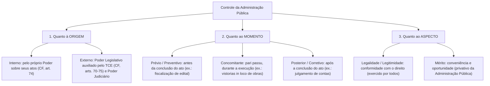
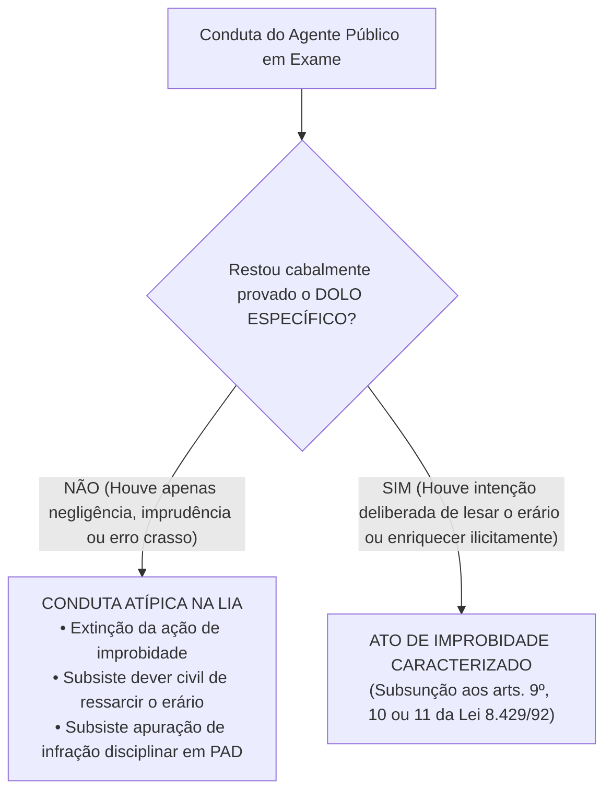
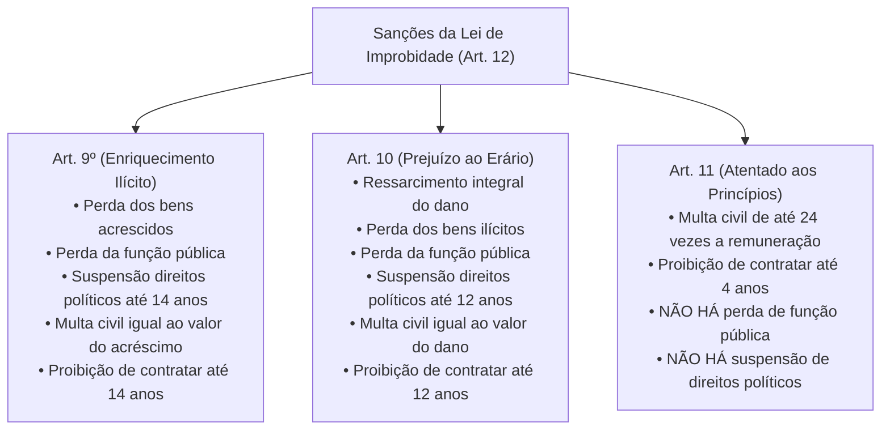

# 05 - Controle da Administração Pública e Improbidade Administrativa (Lei 8.429/1992 e Lei 14.230/2021)

> **Matéria:** Noções de Direito Administrativo  
> **Cargo:** A01 – Técnico de Controle Externo – Especialidade: Técnico Administrativo  
> **Arquivo:** `05_controle_da_administracao_e_improbidade_administrativa.md`  

---

## 📌 Ementa / Itens do Edital
- Controle da Administração Pública: conceito, fundamentos e classificações
- Classificação quanto à origem (Interno e Externo), momento (Prévio, Concomitante e Posterior) e aspecto (Legalidade e Mérito)
- Controle Legislativo e a atuação constitucional do Tribunal de Contas
- Controle Judicial: limites da atuação do Judiciário sobre o mérito administrativo e princípios da razoabilidade e proporcionalidade
- Instrumentos de controle judicial: Mandado de Segurança, Ação Popular e Ação Civil Pública
- Lei de Improbidade Administrativa (Lei Federal nº 8.429/1992 com redação dada pela Lei Federal nº 14.230/2021 e alterações)
- Sujeitos ativo e passivo dos atos de improbidade
- Elemento subjetivo: extinção da modalidade culposa e exigência de dolo específico (Tema 1.199 do STF)
- Tipologia dos atos de improbidade: Enriquecimento Ilícito (art. 9º), Prejuízo ao Erário (art. 10) e Atentado aos Princípios (art. 11)
- Sanções cominadas e regime prescricional unificado e intercorrente

---

## 🧭 Sumário

1. [Teoria Geral do Controle da Administração Pública](#1-teoria-geral-do-controle-da-administracao-publica)
    1. [Fundamento Republicano e Sistema de Freios e Contrapesos](#11-fundamento-republicano-e-sistema-de-freios-e-contrapesos)
    2. [Classificação Quanto à Origem: Controle Interno vs. Controle Externo](#12-classificacao-quanto-a-origem-controle-interno-vs-controle-externo)
    3. [Classificação Quanto ao Momento: Prévio, Concomitante e Posterior](#13-classificacao-quanto-ao-momento-previo-concomitante-e-posterior)
    4. [Classificação Quanto ao Aspecto: Controle de Legalidade vs. Mérito](#14-classificacao-quanto-ao-aspecto-controle-de-legalidade-vs-merito)
    5. [Teste 045](#Teste-045)
    6. [Teste 046](#Teste-046)
2. [O Controle Legislativo e a Atuação dos Tribunais de Contas](#2-o-controle-legislativo-e-a-atuacao-dos-tribunais-de-contas)
    1. [A Função Constitucional do Tribunal de Contas (CF/88, arts. 70 a 75)](#21-a-funcao-constitucional-do-tribunal-de-contas-cf88-arts-70-a-75)
    2. [Natureza das Decisões e Título Executivo Extrajudicial](#22-natureza-das-decisoes-e-titulo-executivo-extrajudicial)
    3. [Teste 047](#Teste-047)
    4. [Teste 048](#Teste-048)
3. [O Controle Judicial dos Atos Administrativos](#3-o-controle-judicial-dos-atos-administrativos)
    1. [Limites do Controle Judicial sobre o Mérito Administrativo](#31-limites-do-controle-judicial-sobre-o-merito-administrativo)
    2. [Anulação por Desvio de Finalidade e a Teoria dos Motivos Determinantes](#32-anulacao-por-desvio-de-finalidade-e-a-teoria-dos-motivos-determinantes)
    3. [Ações Constitucionais de Controle: Mandado de Segurança, Ação Popular e ACP](#33-acoes-constitucionais-de-controle-mandado-de-seguranca-acao-popular-e-acp)
    4. [Teste 049](#Teste-049)
    5. [Teste 050](#Teste-050)
4. [A Nova Lei de Improbidade Administrativa (Lei 8.429/1992 e Lei 14.230/2021)](#4-a-nova-lei-de-improbidade-administrativa-lei-84291992-e-lei-142302021)
    1. [Sujeitos Ativos e Passivos da Improbidade Administrativa](#41-sujeitos-ativos-e-passivos-da-improbidade-administrativa)
    2. [O Elemento Subjetivo e a Extinção da Culpa (Tema 1.199 / STF)](#42-o-elemento-subjetivo-e-a-extincao-da-culpa-tema-1199-stf)
    3. [Proibição do Crime de Hermenêutica no Âmbito da LIA](#43-proibicao-do-crime-de-hermeneutica-no-ambito-da-lia)
    4. [Teste 051](#Teste-051)
    5. [Teste 052](#Teste-052)
5. [Tipologia dos Atos de Improbidade e Quadro Sancionatório](#5-tipologia-dos-atos-de-improbidade-e-quadro-sancionatorio)
    1. [Enriquecimento Ilícito (Art. 9º da LIA)](#51-enriquecimento-ilicito-art-9o-da-lia)
    2. [Prejuízo ao Erário (Art. 10 da LIA)](#52-prejuizo-ao-erario-art-10-da-lia)
    3. [Atentado aos Princípios da Administração (Art. 11 da LIA - Rol Taxativo)](#53-atentado-aos-principios-da-administracao-art-11-da-lia-rol-taxativo)
    4. [Matriz Comparativa de Sanções do Artigo 12 da LIA](#54-matriz-comparativa-de-sancoes-do-artigo-12-da-lia)
    5. [Regime Prescricional Geral e Intercorrente (Art. 23 da LIA)](#55-regime-prescricional-geral-e-intercorrente-art-23-da-lia)
    6. [Teste 053](#Teste-053)
    7. [Teste 054](#Teste-054)
    8. [Teste 055](#Teste-055)
6. [Fontes Recomendadas na Internet](#6-fontes-recomendadas-na-internet)

---

## 1. Teoria Geral do Controle da Administração Pública

O controle da Administração Pública compreende o conjunto de mecanismos jurídicos e institucionais mediante os quais se fiscaliza, orienta, corrige e revisa a atuação dos órgãos, agentes e entidades do Estado, com vistas a assegurar a observância da legalidade, moralidade, economicidade e a consecução do interesse coletivo.

### 1.1 Fundamento Republicano e Sistema de Freios e Contrapesos

No Estado Democrático de Direito, nenhum poder estatal é absoluto ou imune a fiscalização. O controle administrativo fundamenta-se:

1. No **Princípio Republicano** (prestação de contas obrigatória de todo aquele que gere recursos públicos);
2. No **Princípio da Indisponibilidade do Interesse Público** (o administrador gere patrimônio alheio);
3. No **Sistema de Freios e Contrapesos (*Checks and Balances*)**, consagrado pelo art. 2º da CF/88, segundo o qual os Poderes Legislativo, Executivo e Judiciário são harmônicos e independentes, exercendo controles recíprocos uns sobre os outros.

### 1.2 Classificação Quanto à Origem: Controle Interno vs. Controle Externo

- **Controle Interno (CF/88, art. 74):** Exercido por cada um dos Poderes (Executivo, Legislativo e Judiciário) e pelo Ministério Público sobre sua própria estrutura administrativa e órgãos subordinados. Funda-se na hierarquia e na autotutela. Suas finalidades constitucionais compreendem: avaliar o cumprimento de metas do PPA, comprovar a legalidade da gestão orçamentária, exercer o controle de operações de crédito e apoiar o controle externo em sua missão institucional.
- **Controle Externo (CF/88, art. 70 a 75):** Exercido por um Poder sobre a atuação administrativa de outro Poder ou sobre terceiros gestores de recursos públicos. No plano federativo, é titularizado privativamente pelo **Poder Legislativo** (Assembleia Legislativa / Congresso Nacional), com o auxílio técnico, operacional e constitucional autônomo do **Tribunal de Contas**. Também abrange o controle jurisdicional repressivo exercido pelo Poder Judiciário.

### 1.3 Classificação Quanto ao Momento: Prévio, Concomitante e Posterior

- **Controle Prévio (Preventivo ou *a priori*):** Realizado antes da consumação ou produção de efeitos do ato administrativo, com o objetivo de prevenir irregularidades e evitar lesões ao erário (ex.: apreciação prévia de editais de concessão vultosos pelo TCE; aprovação legislativa de indicados a cargos de agências reguladoras).
- **Controle Concomitante (Simultâneo ou *pari passu*):** Realizado simultaneamente à execução material da atividade administrativa, em tempo real (ex.: auditorias de acompanhamento de execução orçamentária; fiscalizações e vistorias *in loco* em canteiros de obras rodoviárias estaduais).
- **Controle Posterior (Corretivo ou *a posteriori*):** Realizado após a consumação integral do ato administrativo ou do encerramento do exercício financeiro, visando sancionar faltas, anular ilegalidades ou certificar a higidez das contas (ex.: julgamento de tomadas de contas especiais; auditorias de conformidade posteriores; homologação ou rejeição das contas de gestores).

### 1.4 Classificação Quanto ao Aspecto: Controle de Legalidade vs. Mérito

- **Controle de Legalidade / Legitimidade:** Avalia a conformidade formal e material do ato administrativo com a Constituição, leis, decretos, súmulas vinculantes e princípios de direito público (razoabilidade, proporcionalidade e moralidade). Pode ser exercido pela própria Administração, pelo Tribunal de Contas e pelo Poder Judiciário.
- **Controle de Mérito:** Avalia a **conveniência e oportunidade** da decisão administrativa tomada dentro da margem de discricionariedade permitida pela lei. É atribuição **privativa e exclusiva da própria Administração Pública**, sendo vedado ao Judiciário ou ao Tribunal de Contas substituir o juízo de mérito do administrador.

---

## 2. O Controle Legislativo e a Atuação dos Tribunais de Contas

### 2.1 A Função Constitucional do Tribunal de Contas (CF/88, arts. 70 a 75)

O controle externo a cargo do Poder Legislativo é exercido com o auxílio técnico do Tribunal de Contas do Estado (TCE-GO). As Cortes de Contas ostentam envergadura e autonomia constitucional direta, exercendo competências indelegáveis:

1. **Julgamento de Contas dos Administradores Públicos (Art. 71, II):** Julgar as contas de todos os ordenadores de despesa, dirigentes de estatais e gestores responsáveis por dinheiros, bens e valores públicos estaduais.
2. **Apreciação das Contas do Chefe do Executivo (Art. 71, I):** Emitir **parecer prévio** conclusivo sobre as contas anuais prestadas pelo Governador do Estado (o julgamento definitivo cabe à Assembleia Legislativa).
3. **Fiscalização Operacional e Financeira (Art. 71, IV):** Realizar inspeções e auditorias de natureza contábil, financeira, orçamentária, operacional e patrimonial.
4. **Fiscalização de Atos de Admissão e Aposentadoria (Art. 71, III):** Apreciar, para fins de registro, a legalidade dos atos de admissão de pessoal (salvo cargos comissionados) e de concessão inicial de aposentadorias, reformas e pensões.
5. **Aplicação de Sanções (Art. 71, VIII):** Aplicar aos responsáveis as sanções previstas em sua Lei Orgânica, incluindo multas pecuniárias, imputação de débito e inabilitação temporária para o exercício de cargo em comissão.

### 2.2 Natureza das Decisões e Título Executivo Extrajudicial

- **Eficácia de Título Executivo (CF/88, art. 71, § 3º):** As decisões do Tribunal de Contas de que resulte imputação de débito ou cominação de multa pecuniária possuem **eficácia de título executivo extrajudicial**.
- **Execução do Título:** A cobrança judicial não é executada pelo próprio Tribunal de Contas, mas sim pelo ente público lesado (a Procuradoria-Geral do Estado - PGE promove a competente Ação de Execução Fiscal perante a Vara da Fazenda Pública).

---

## 3. O Controle Judicial dos Atos Administrativos

Em razão do princípio da inafastabilidade da tutela jurisdicional (CF/88, art. 5º, XXXV: *"a lei não excluirá da apreciação do Poder Judiciário lesão ou ameaça a direito"*), o Brasil adota o sistema de jurisdição una (sistema inglês), cabendo unicamente ao Poder Judiciário dizer o direito com força definitiva de coisa julgada material.

### 3.1 Limites do Controle Judicial sobre o Mérito Administrativo

- **Veto de Substituição de Mérito:** O juiz não pode substituir a valoração legítima de conveniência e oportunidade do administrador eleito ou concursado (ex.: escolher entre asfaltar a rua A ou reformar o posto de saúde B, quando ambas as opções são legais e orçamentariamente viáveis).
- **Proibição de Revogação Judicial:** O Poder Judiciário, no exercício de sua função jurisdicional, **NUNCA revoga atos do Poder Executivo**. O Judiciário apenas **anula** atos administrativos que padeçam de vícios de ilegalidade originária.

### 3.2 Anulação por Desvio de Finalidade e a Teoria dos Motivos Determinantes

O controle judicial sobre atos discricionários não se restringe à literalidade da lei, alcançando a legalidade ampla e os princípios constitucionais:

- **Desvio de Finalidade:** O Judiciário deve decretar a anulação do ato se restar demonstrado que a autoridade usou de sua competência legal para perseguir um desafeto pessoal, satisfazer capricho ou favorecer correligionários.
- **Teoria dos Motivos Determinantes:** Se a motivação alegada no ato for comprovadamente falsa, inexistente ou contraditória com os fatos da realidade, o ato é nulo por vício de motivo, devendo o Judiciário anulá-lo com efeitos retroativos (*ex tunc*).

### 3.3 Ações Constitucionais de Controle: Mandado de Segurança, Ação Popular e ACP

| Ação Constitucional | Base Normativa | Legitimidade Ativa | Objeto / Finalidade Principal | Particularidades Processuais |
| :--- | :--- | :--- | :--- | :--- |
| **Mandado de Segurança** | CF, art. 5º, LXIX; Lei 12.016/2009 | Pessoa física ou jurídica titular do direito | Proteger **direito líquido e certo**, não amparado por *habeas corpus* ou *habeas data*, contra ato ilegal ou abuso de poder | Exige **prova documental pré-constituída**; não admite dilação probatória; prazo decadencial de 120 dias. |
| **Ação Popular** | CF, art. 5º, LXXIII; Lei 4.717/1965 | **Qualquer cidadão brasileiro** no gozo de seus direitos políticos (título de eleitor) | Anular ato lesivo ao **patrimônio público**, à **moralidade administrativa**, ao **meio ambiente** e ao **patrimônio histórico e cultural** | Autor fica **isento de custas judiciais e sucumbência**, salvo comprovada má-fé. |
| **Ação Civil Pública** | CF, art. 129, III; Lei 7.347/1985 | Ministério Público, Defensoria Pública, Entes Federados, Autarquias e Associações constituídas há mais de 1 ano | Tutela de **direitos difusos, coletivos e individuais homogêneos** (meio ambiente, patrimônio público, consumidor) | Permite condenação em dinheiro (revertida a fundo público) e obrigação de fazer/não fazer. |

---

## 4. A Nova Lei de Improbidade Administrativa (Lei 8.429/1992 e Lei 14.230/2021)

A Lei Federal nº 14.230/2021 promoveu a mais profunda reforma na Lei de Improbidade Administrativa (LIA - Lei nº 8.429/1992), transformando o diploma em um estatuto de Direito Administrativo Sancionador rígido, com garantias processuais do direito punitivo.

### 4.1 Sujeitos Ativos e Passivos da Improbidade Administrativa

- **Sujeito Ativo (Art. 2º):** Considera-se agente público para os efeitos desta Lei o agente político, o servidor público e todo aquele que exerce, ainda que transitoriamente ou sem remuneração, por eleição, nomeação, designação, contratação ou qualquer outra forma de investidura ou vínculo, mandato, cargo, emprego ou função nas entidades públicas.
- **Particular em Concurso (Art. 3º):** As disposições da LIA aplicam-se àquele que, mesmo não sendo agente público, **induza ou concorra dolosamente** para a prática do ato de improbidade.  
  > ⚠️ **Regra Consolidada STJ/STF:** Não é cabível ação de improbidade exclusivamente em face de particular desacompanhado de agente público no polo passivo!

### 4.2 O Elemento Subjetivo e a Extinção da Culpa (Tema 1.199 / STF)

A alteração mais radical da Lei nº 14.230/2021 consistiu na **abolição total e expressa da modalidade culposa** para todos os atos de improbidade administrativa.

#### Tese Vinculante do Tema 1.199 do STF (RE 1.205.746):
1. **Exigência de Dolo Específico:** É necessária a comprovação de responsabilidade subjetiva com **dolo específico** para a tipificação de qualquer ato de improbidade administrativa (artigos 9º, 10 e 11). Não basta dolo genérico; exige-se a demonstração da vontade livre e consciente de alcançar o resultado ilícito, acompanhada do fim especial de agir.
2. **Extinção da Culpa (Inclusive Culpa Grave):** A negligência crassa, a imprudência, a imperícia ou o erro de gestão administrativa, ainda que inescusáveis, **NÃO configuram improbidade administrativa**. O agente negligente pode responder disciplinarmente no estatuto funcional ou em ação regressiva civil comum de reparação ao erário, mas não sob a pecha desonrosa da improbidade.
3. **Direito Intertemporal:**
    - *Processos com trânsito em julgado:* A nova lei **NÃO retroage** para desconstituir condenações culposas já consolidadas pela coisa julgada material.
    - *Processos em andamento:* A revogação da culpa **aplica-se imediatamente e de forma retroativa** a todas as ações de improbidade em curso em qualquer grau de jurisdição.

### 4.3 Proibição do Crime de Hermenêutica no Âmbito da LIA

O art. 1º, § 8º, da LIA estabelece expressamente que **não configura improbidade a ação ou omissão decorrente de divergência interpretativa da lei**, baseada em jurisprudência, ainda que não pacificada, mesmo que não venha a ser posteriormente a prevalecente nos tribunais judiciais ou de contas.

---

## 5. Tipologia dos Atos de Improbidade e Quadro Sancionatório

### 5.1 Enriquecimento Ilícito (Art. 9º da LIA)

Ocorre quando o agente aufere qualquer tipo de vantagem patrimonial indevida em razão do exercício de cargo, mandato, função ou emprego público.

- *Exemplos:* Receber propina, comissão ou presente oneroso; utilizar bens, veículos ou servidores públicos em obras ou serviços particulares; incorporar ao patrimônio pessoal bens públicos; evolução patrimonial desproporcional à renda declarada.
- **Natureza do Rol:** Rol **exemplificativo** (*numerus apertus*).

### 5.2 Prejuízo ao Erário (Art. 10 da LIA)

Consiste em qualquer ação ou omissão dolosa que enseje, efetiva e comprovadamente, perda patrimonial, desvio, apropriação, malbaratamento ou dilapidação dos bens ou haveres públicos.

- **Exigência de Dano Efetivo e Real:** A Lei nº 14.230/2021 **proibiu o dano presumido (*in re ipsa*)**. Para que haja condenação pelo art. 10, a acusação deve comprovar documental e pericialmente o prejuízo financeiro concreto experimentado pelos cofres públicos.
- **Natureza do Rol:** Rol considerado **taxativo** pela nova redação legal.

### 5.3 Atentado aos Princípios da Administração (Art. 11 da LIA - Rol Taxativo)

Trata de condutas dolosas que violam os deveres de honestidade, imparcialidade e legalidade expressamente descritos no texto da lei.

- **ROL ESTRITAMENTE TAXATIVO (*Numerus Clausus*):** O art. 11 passou a ter um rol fechado. Somente configuram improbidade por violação a princípios as condutas literalmente previstas em seus incisos:
    - *Inciso III:* Revelar fato ou circunstância de que tem ciência em razão das atribuições e que deva permanecer em segredo;
    - *Inciso IV:* Negar publicidade aos atos oficiais (salvo sigilo legal);
    - *Inciso V:* Frustrar a licitude de concurso público;
    - *Inciso VIII:* Recusar cumprimento a lei federal sem declaração de inconstitucionalidade;
    - *Inciso XI:* Praticar nepotismo (nomeação de cônjuge, companheiro ou parente até 3º grau).

### 5.4 Matriz Comparativa de Sanções do Artigo 12 da LIA

| Tipo de Improbidade | Natureza do Rol | Suspensão dos Direitos Políticos | Perda da Função Pública? | Multa Civil Máxima | Proibição de Contratar / Benefícios |
| :--- | :---: | :---: | :---: | :---: | :---: |
| **Art. 9º (Enriquecimento Ilícito)** | Exemplificativo | Até **14 anos** | **SIM** (atinge o cargo exercido à época) | Até o valor do **acréscimo patrimonial** | Até **14 anos** |
| **Art. 10 (Prejuízo ao Erário)** | Taxativo | Até **12 anos** | **SIM** | Até o valor do **dano efetivo** | Até **12 anos** |
| **Art. 11 (Atentado a Princípios)** | **Estritamente Taxativo** | **NÃO HÁ MAIS** | **NÃO HÁ MAIS** | Até **24 vezes a remuneração** do agente | Até **4 anos** |

> 🚨 **ALERTA CRÍTICO DE PROVA FCC:**  
> A eliminação das penas de perda da função pública e suspensão dos direitos políticos no **artigo 11** é uma das novidades mais exploradas pela FCC. O candidato desatualizado marca que houve perda de cargo por atentado a princípios, errando a questão. Para o art. 11 subsistem apenas a **multa civil de até 24 remunerações** e a **proibição de contratar por até 4 anos**!

### 5.5 Regime Prescricional Geral e Intercorrente (Art. 23 da LIA)

- **Prazo Prescricional Unificado:** A ação para a aplicação das sanções da LIA prescreve em **8 (oito) anos**, contados a partir da data da ocorrência do fato ou, no caso de infrações permanentes, do dia em que cessou a permanência.
- **Prescrição Intercorrente (Art. 23, § 4º a § 8º):** A instauração do inquérito civil ou da ação judicial interrompe a prescrição. Uma vez interrompida com o ajuizamento da ação, o prazo recomeça a correr pela metade: prescreve a pretensão se o processo judicial ficar paralisado por mais de **4 (quatro) anos** entre marcos interruptivos (como publicação de sentenças ou acórdãos condenatórios).

---

## 6. Fontes Recomendadas na Internet

- [Lei Federal nº 8.429/1992 Compilada (Lei de Improbidade Administrativa)](https://www.planalto.gov.br/ccivil_03/leis/l8429compilada.htm)  
  Texto oficial compilado com as profundas alterações introduzidas pela Lei nº 14.230/2021 quanto a dolo específico, tipicidade e prescrição.
- [Lei Federal nº 14.230/2021 (Reforma da Lei de Improbidade Administrativa)](https://www.planalto.gov.br/ccivil_03/_ato2019-2022/2021/lei/l14230.htm)  
  Diploma reformador que extinguiu a modalidade culposa, tornou taxativo o rol do art. 11 e instituiu a prescrição intercorrente.
- [STF - Tema 1.199 da Repercussão Geral (Dolo Específico e Irretroatividade na LIA)](https://portal.stf.jus.br/jurisprudencia/repercussaoGeral/tema.asp?num=1199)  
  Julgamento histórico do STF que confirmou a extinção da improbidade culposa e definiu as regras de direito intertemporal da Lei nº 14.230/2021.
- [Constituição Federal de 1988 - Arts. 70 a 75 (Fiscalização Contábil, Financeira e Orçamentária)](https://www.planalto.gov.br/ccivil_03/constituicao/constituicao.htm#art70)  
  Regramento constitucional do controle externo exercido pelo Poder Legislativo com o auxílio dos Tribunais de Contas e do controle interno.
- [Lei Federal nº 12.846/2013 (Lei Anticorrupção Empresarial)](https://www.planalto.gov.br/ccivil_03/_ato2011-2014/2013/lei/l12846.htm)  
  Dispõe sobre a responsabilização administrativa e civil objetiva de pessoas jurídicas pela prática de atos contra a administração pública.
- [Lei Federal nº 4.717/1965 (Lei da Ação Popular)](https://www.planalto.gov.br/ccivil_03/leis/l4717.htm)  
  Estatuto da ação constitucional privativa do cidadão eleitor para defesa da moralidade administrativa e do patrimônio público.
* DI PIETRO, Maria Sylvia Zanella. **Direito Administrativo**. 37. ed. Rio de Janeiro: Forense, 2024. (Cap. 18 e Cap. 19 - Controle da Administração Pública e Improbidade Administrativa).
* CARVALHO FILHO, José dos Santos. **Manual de Direito Administrativo**. 38. ed. Barueri: Atlas, 2024. (Cap. 20 e Cap. 22 - Controle da Administração e Improbidade Administrativa na Lei 14.230/2021).
* NEVES, Daniel Amorim Assumpção; OLIVEIRA, Rafael Carvalho Rezende. **Improbidade Administrativa: Direito Material e Processual**. 10. ed. Rio de Janeiro: Forense, 2023. (Cap. 3 a Cap. 8 - Nova Sistemática da Lei 8.429/1992).
