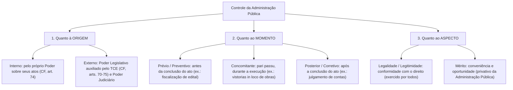
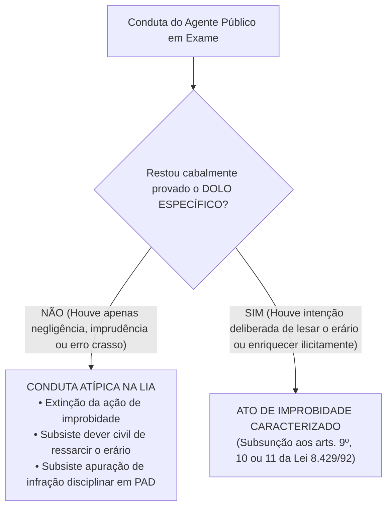
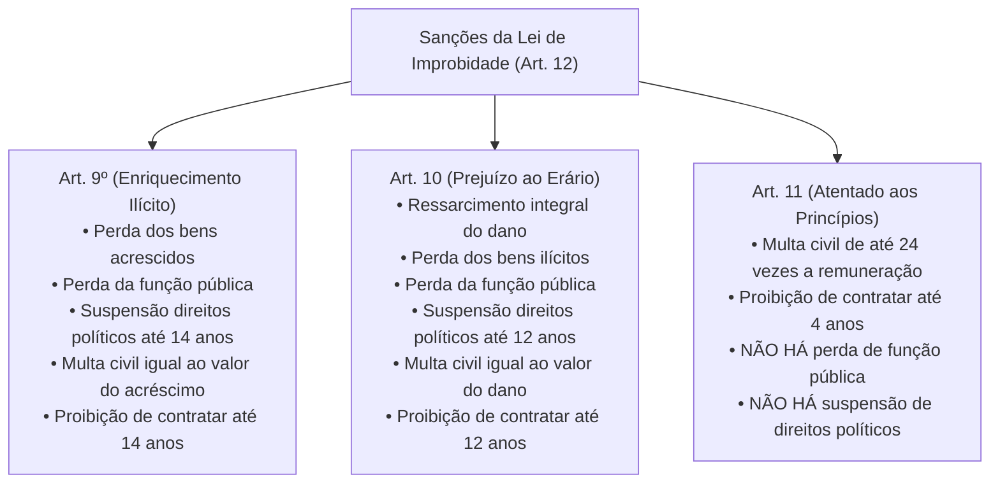

# 05 - Controle da Administração Pública e Improbidade Administrativa (Lei 8.429/1992 e Lei 14.230/2021)

> **Matéria:** Noções de Direito Administrativo  
> **Cargo:** A01 – Técnico de Controle Externo – Especialidade: Técnico Administrativo  
> **Arquivo:** `05_controle_da_administracao_e_improbidade_administrativa.md`  

---

## 📌 Ementa / Itens do Edital
- Controle da Administração Pública: conceito, fundamentos e classificações
- Classificação quanto à origem (Interno e Externo), momento (Prévio, Concomitante e Posterior) e aspecto (Legalidade e Mérito)
- Controle Legislativo e a atuação constitucional do Tribunal de Contas
- Controle Judicial: limites da atuação do Judiciário sobre o mérito administrativo e princípios da razoabilidade e proporcionalidade
- Instrumentos de controle judicial: Mandado de Segurança, Ação Popular e Ação Civil Pública
- Lei de Improbidade Administrativa (Lei Federal nº 8.429/1992 com redação dada pela Lei Federal nº 14.230/2021 e alterações)
- Sujeitos ativo e passivo dos atos de improbidade
- Elemento subjetivo: extinção da modalidade culposa e exigência de dolo específico (Tema 1.199 do STF)
- Tipologia dos atos de improbidade: Enriquecimento Ilícito (art. 9º), Prejuízo ao Erário (art. 10) e Atentado aos Princípios (art. 11)
- Sanções cominadas e regime prescricional unificado e intercorrente

---

## 🧭 Sumário

1. [Teoria Geral do Controle da Administração Pública](#1-teoria-geral-do-controle-da-administracao-publica)
    1. [Fundamento Republicano e Sistema de Freios e Contrapesos](#11-fundamento-republicano-e-sistema-de-freios-e-contrapesos)
    2. [Classificação Quanto à Origem: Controle Interno vs. Controle Externo](#12-classificacao-quanto-a-origem-controle-interno-vs-controle-externo)
    3. [Classificação Quanto ao Momento: Prévio, Concomitante e Posterior](#13-classificacao-quanto-ao-momento-previo-concomitante-e-posterior)
    4. [Classificação Quanto ao Aspecto: Controle de Legalidade vs. Mérito](#14-classificacao-quanto-ao-aspecto-controle-de-legalidade-vs-merito)
    5. [Teste 045](#Teste-045)
    6. [Teste 046](#Teste-046)
2. [O Controle Legislativo e a Atuação dos Tribunais de Contas](#2-o-controle-legislativo-e-a-atuacao-dos-tribunais-de-contas)
    1. [A Função Constitucional do Tribunal de Contas (CF/88, arts. 70 a 75)](#21-a-funcao-constitucional-do-tribunal-de-contas-cf88-arts-70-a-75)
    2. [Natureza das Decisões e Título Executivo Extrajudicial](#22-natureza-das-decisoes-e-titulo-executivo-extrajudicial)
    3. [Teste 047](#Teste-047)
    4. [Teste 048](#Teste-048)
3. [O Controle Judicial dos Atos Administrativos](#3-o-controle-judicial-dos-atos-administrativos)
    1. [Limites do Controle Judicial sobre o Mérito Administrativo](#31-limites-do-controle-judicial-sobre-o-merito-administrativo)
    2. [Anulação por Desvio de Finalidade e a Teoria dos Motivos Determinantes](#32-anulacao-por-desvio-de-finalidade-e-a-teoria-dos-motivos-determinantes)
    3. [Ações Constitucionais de Controle: Mandado de Segurança, Ação Popular e ACP](#33-acoes-constitucionais-de-controle-mandado-de-seguranca-acao-popular-e-acp)
    4. [Teste 049](#Teste-049)
    5. [Teste 050](#Teste-050)
4. [A Nova Lei de Improbidade Administrativa (Lei 8.429/1992 e Lei 14.230/2021)](#4-a-nova-lei-de-improbidade-administrativa-lei-84291992-e-lei-142302021)
    1. [Sujeitos Ativos e Passivos da Improbidade Administrativa](#41-sujeitos-ativos-e-passivos-da-improbidade-administrativa)
    2. [O Elemento Subjetivo e a Extinção da Culpa (Tema 1.199 / STF)](#42-o-elemento-subjetivo-e-a-extincao-da-culpa-tema-1199-stf)
    3. [Proibição do Crime de Hermenêutica no Âmbito da LIA](#43-proibicao-do-crime-de-hermeneutica-no-ambito-da-lia)
    4. [Teste 051](#Teste-051)
    5. [Teste 052](#Teste-052)
5. [Tipologia dos Atos de Improbidade e Quadro Sancionatório](#5-tipologia-dos-atos-de-improbidade-e-quadro-sancionatorio)
    1. [Enriquecimento Ilícito (Art. 9º da LIA)](#51-enriquecimento-ilicito-art-9o-da-lia)
    2. [Prejuízo ao Erário (Art. 10 da LIA)](#52-prejuizo-ao-erario-art-10-da-lia)
    3. [Atentado aos Princípios da Administração (Art. 11 da LIA - Rol Taxativo)](#53-atentado-aos-principios-da-administracao-art-11-da-lia-rol-taxativo)
    4. [Matriz Comparativa de Sanções do Artigo 12 da LIA](#54-matriz-comparativa-de-sancoes-do-artigo-12-da-lia)
    5. [Regime Prescricional Geral e Intercorrente (Art. 23 da LIA)](#55-regime-prescricional-geral-e-intercorrente-art-23-da-lia)
    6. [Teste 053](#Teste-053)
    7. [Teste 054](#Teste-054)
    8. [Teste 055](#Teste-055)
6. [Fontes Recomendadas na Internet](#6-fontes-recomendadas-na-internet)

---

## 1. Teoria Geral do Controle da Administração Pública

O controle da Administração Pública compreende o conjunto de mecanismos jurídicos e institucionais mediante os quais se fiscaliza, orienta, corrige e revisa a atuação dos órgãos, agentes e entidades do Estado, com vistas a assegurar a observância da legalidade, moralidade, economicidade e a consecução do interesse coletivo.

### 1.1 Fundamento Republicano e Sistema de Freios e Contrapesos

No Estado Democrático de Direito, nenhum poder estatal é absoluto ou imune a fiscalização. O controle administrativo fundamenta-se:

1. No **Princípio Republicano** (prestação de contas obrigatória de todo aquele que gere recursos públicos);
2. No **Princípio da Indisponibilidade do Interesse Público** (o administrador gere patrimônio alheio);
3. No **Sistema de Freios e Contrapesos (*Checks and Balances*)**, consagrado pelo art. 2º da CF/88, segundo o qual os Poderes Legislativo, Executivo e Judiciário são harmônicos e independentes, exercendo controles recíprocos uns sobre os outros.

### 1.2 Classificação Quanto à Origem: Controle Interno vs. Controle Externo

- **Controle Interno (CF/88, art. 74):** Exercido por cada um dos Poderes (Executivo, Legislativo e Judiciário) e pelo Ministério Público sobre sua própria estrutura administrativa e órgãos subordinados. Funda-se na hierarquia e na autotutela. Suas finalidades constitucionais compreendem: avaliar o cumprimento de metas do PPA, comprovar a legalidade da gestão orçamentária, exercer o controle de operações de crédito e apoiar o controle externo em sua missão institucional.
- **Controle Externo (CF/88, art. 70 a 75):** Exercido por um Poder sobre a atuação administrativa de outro Poder ou sobre terceiros gestores de recursos públicos. No plano federativo, é titularizado privativamente pelo **Poder Legislativo** (Assembleia Legislativa / Congresso Nacional), com o auxílio técnico, operacional e constitucional autônomo do **Tribunal de Contas**. Também abrange o controle jurisdicional repressivo exercido pelo Poder Judiciário.

### 1.3 Classificação Quanto ao Momento: Prévio, Concomitante e Posterior

- **Controle Prévio (Preventivo ou *a priori*):** Realizado antes da consumação ou produção de efeitos do ato administrativo, com o objetivo de prevenir irregularidades e evitar lesões ao erário (ex.: apreciação prévia de editais de concessão vultosos pelo TCE; aprovação legislativa de indicados a cargos de agências reguladoras).
- **Controle Concomitante (Simultâneo ou *pari passu*):** Realizado simultaneamente à execução material da atividade administrativa, em tempo real (ex.: auditorias de acompanhamento de execução orçamentária; fiscalizações e vistorias *in loco* em canteiros de obras rodoviárias estaduais).
- **Controle Posterior (Corretivo ou *a posteriori*):** Realizado após a consumação integral do ato administrativo ou do encerramento do exercício financeiro, visando sancionar faltas, anular ilegalidades ou certificar a higidez das contas (ex.: julgamento de tomadas de contas especiais; auditorias de conformidade posteriores; homologação ou rejeição das contas de gestores).

### 1.4 Classificação Quanto ao Aspecto: Controle de Legalidade vs. Mérito

- **Controle de Legalidade / Legitimidade:** Avalia a conformidade formal e material do ato administrativo com a Constituição, leis, decretos, súmulas vinculantes e princípios de direito público (razoabilidade, proporcionalidade e moralidade). Pode ser exercido pela própria Administração, pelo Tribunal de Contas e pelo Poder Judiciário.
- **Controle de Mérito:** Avalia a **conveniência e oportunidade** da decisão administrativa tomada dentro da margem de discricionariedade permitida pela lei. É atribuição **privativa e exclusiva da própria Administração Pública**, sendo vedado ao Judiciário ou ao Tribunal de Contas substituir o juízo de mérito do administrador.

---

## 2. O Controle Legislativo e a Atuação dos Tribunais de Contas

### 2.1 A Função Constitucional do Tribunal de Contas (CF/88, arts. 70 a 75)

O controle externo a cargo do Poder Legislativo é exercido com o auxílio técnico do Tribunal de Contas do Estado (TCE-GO). As Cortes de Contas ostentam envergadura e autonomia constitucional direta, exercendo competências indelegáveis:

1. **Julgamento de Contas dos Administradores Públicos (Art. 71, II):** Julgar as contas de todos os ordenadores de despesa, dirigentes de estatais e gestores responsáveis por dinheiros, bens e valores públicos estaduais.
2. **Apreciação das Contas do Chefe do Executivo (Art. 71, I):** Emitir **parecer prévio** conclusivo sobre as contas anuais prestadas pelo Governador do Estado (o julgamento definitivo cabe à Assembleia Legislativa).
3. **Fiscalização Operacional e Financeira (Art. 71, IV):** Realizar inspeções e auditorias de natureza contábil, financeira, orçamentária, operacional e patrimonial.
4. **Fiscalização de Atos de Admissão e Aposentadoria (Art. 71, III):** Apreciar, para fins de registro, a legalidade dos atos de admissão de pessoal (salvo cargos comissionados) e de concessão inicial de aposentadorias, reformas e pensões.
5. **Aplicação de Sanções (Art. 71, VIII):** Aplicar aos responsáveis as sanções previstas em sua Lei Orgânica, incluindo multas pecuniárias, imputação de débito e inabilitação temporária para o exercício de cargo em comissão.

### 2.2 Natureza das Decisões e Título Executivo Extrajudicial

- **Eficácia de Título Executivo (CF/88, art. 71, § 3º):** As decisões do Tribunal de Contas de que resulte imputação de débito ou cominação de multa pecuniária possuem **eficácia de título executivo extrajudicial**.
- **Execução do Título:** A cobrança judicial não é executada pelo próprio Tribunal de Contas, mas sim pelo ente público lesado (a Procuradoria-Geral do Estado - PGE promove a competente Ação de Execução Fiscal perante a Vara da Fazenda Pública).

---

## 3. O Controle Judicial dos Atos Administrativos

Em razão do princípio da inafastabilidade da tutela jurisdicional (CF/88, art. 5º, XXXV: *"a lei não excluirá da apreciação do Poder Judiciário lesão ou ameaça a direito"*), o Brasil adota o sistema de jurisdição una (sistema inglês), cabendo unicamente ao Poder Judiciário dizer o direito com força definitiva de coisa julgada material.

### 3.1 Limites do Controle Judicial sobre o Mérito Administrativo

- **Veto de Substituição de Mérito:** O juiz não pode substituir a valoração legítima de conveniência e oportunidade do administrador eleito ou concursado (ex.: escolher entre asfaltar a rua A ou reformar o posto de saúde B, quando ambas as opções são legais e orçamentariamente viáveis).
- **Proibição de Revogação Judicial:** O Poder Judiciário, no exercício de sua função jurisdicional, **NUNCA revoga atos do Poder Executivo**. O Judiciário apenas **anula** atos administrativos que padeçam de vícios de ilegalidade originária.

### 3.2 Anulação por Desvio de Finalidade e a Teoria dos Motivos Determinantes

O controle judicial sobre atos discricionários não se restringe à literalidade da lei, alcançando a legalidade ampla e os princípios constitucionais:

- **Desvio de Finalidade:** O Judiciário deve decretar a anulação do ato se restar demonstrado que a autoridade usou de sua competência legal para perseguir um desafeto pessoal, satisfazer capricho ou favorecer correligionários.
- **Teoria dos Motivos Determinantes:** Se a motivação alegada no ato for comprovadamente falsa, inexistente ou contraditória com os fatos da realidade, o ato é nulo por vício de motivo, devendo o Judiciário anulá-lo com efeitos retroativos (*ex tunc*).

### 3.3 Ações Constitucionais de Controle: Mandado de Segurança, Ação Popular e ACP

| Ação Constitucional | Base Normativa | Legitimidade Ativa | Objeto / Finalidade Principal | Particularidades Processuais |
| :--- | :--- | :--- | :--- | :--- |
| **Mandado de Segurança** | CF, art. 5º, LXIX; Lei 12.016/2009 | Pessoa física ou jurídica titular do direito | Proteger **direito líquido e certo**, não amparado por *habeas corpus* ou *habeas data*, contra ato ilegal ou abuso de poder | Exige **prova documental pré-constituída**; não admite dilação probatória; prazo decadencial de 120 dias. |
| **Ação Popular** | CF, art. 5º, LXXIII; Lei 4.717/1965 | **Qualquer cidadão brasileiro** no gozo de seus direitos políticos (título de eleitor) | Anular ato lesivo ao **patrimônio público**, à **moralidade administrativa**, ao **meio ambiente** e ao **patrimônio histórico e cultural** | Autor fica **isento de custas judiciais e sucumbência**, salvo comprovada má-fé. |
| **Ação Civil Pública** | CF, art. 129, III; Lei 7.347/1985 | Ministério Público, Defensoria Pública, Entes Federados, Autarquias e Associações constituídas há mais de 1 ano | Tutela de **direitos difusos, coletivos e individuais homogêneos** (meio ambiente, patrimônio público, consumidor) | Permite condenação em dinheiro (revertida a fundo público) e obrigação de fazer/não fazer. |

---

## 4. A Nova Lei de Improbidade Administrativa (Lei 8.429/1992 e Lei 14.230/2021)

A Lei Federal nº 14.230/2021 promoveu a mais profunda reforma na Lei de Improbidade Administrativa (LIA - Lei nº 8.429/1992), transformando o diploma em um estatuto de Direito Administrativo Sancionador rígido, com garantias processuais do direito punitivo.

### 4.1 Sujeitos Ativos e Passivos da Improbidade Administrativa

- **Sujeito Ativo (Art. 2º):** Considera-se agente público para os efeitos desta Lei o agente político, o servidor público e todo aquele que exerce, ainda que transitoriamente ou sem remuneração, por eleição, nomeação, designação, contratação ou qualquer outra forma de investidura ou vínculo, mandato, cargo, emprego ou função nas entidades públicas.
- **Particular em Concurso (Art. 3º):** As disposições da LIA aplicam-se àquele que, mesmo não sendo agente público, **induza ou concorra dolosamente** para a prática do ato de improbidade.  
  > ⚠️ **Regra Consolidada STJ/STF:** Não é cabível ação de improbidade exclusivamente em face de particular desacompanhado de agente público no polo passivo!

### 4.2 O Elemento Subjetivo e a Extinção da Culpa (Tema 1.199 / STF)

A alteração mais radical da Lei nº 14.230/2021 consistiu na **abolição total e expressa da modalidade culposa** para todos os atos de improbidade administrativa.

#### Tese Vinculante do Tema 1.199 do STF (RE 1.205.746):
1. **Exigência de Dolo Específico:** É necessária a comprovação de responsabilidade subjetiva com **dolo específico** para a tipificação de qualquer ato de improbidade administrativa (artigos 9º, 10 e 11). Não basta dolo genérico; exige-se a demonstração da vontade livre e consciente de alcançar o resultado ilícito, acompanhada do fim especial de agir.
2. **Extinção da Culpa (Inclusive Culpa Grave):** A negligência crassa, a imprudência, a imperícia ou o erro de gestão administrativa, ainda que inescusáveis, **NÃO configuram improbidade administrativa**. O agente negligente pode responder disciplinarmente no estatuto funcional ou em ação regressiva civil comum de reparação ao erário, mas não sob a pecha desonrosa da improbidade.
3. **Direito Intertemporal:**
    - *Processos com trânsito em julgado:* A nova lei **NÃO retroage** para desconstituir condenações culposas já consolidadas pela coisa julgada material.
    - *Processos em andamento:* A revogação da culpa **aplica-se imediatamente e de forma retroativa** a todas as ações de improbidade em curso em qualquer grau de jurisdição.

### 4.3 Proibição do Crime de Hermenêutica no Âmbito da LIA

O art. 1º, § 8º, da LIA estabelece expressamente que **não configura improbidade a ação ou omissão decorrente de divergência interpretativa da lei**, baseada em jurisprudência, ainda que não pacificada, mesmo que não venha a ser posteriormente a prevalecente nos tribunais judiciais ou de contas.

---

### Teste 001
**(FGV – TJ/SC – 2026 – Analista Administrativo)**
João, servidor público ocupante de cargo de provimento efetivo da Administração Pública indireta do Estado Delta, aceitou vantagem indevida dada pela sociedade empresária Sigma, para que fosse favorecida em determinada licitação. Para que seja atribuído ato ilícito a Sigma, na perspectiva da Lei nº 12.846/2013, é correto afirmar que

* **A)** deve ocorrer a prévia condenação de João pela prática de ato de improbidade administrativa.
* **B)** deve ser previamente demonstrada a responsabilidade individual de um dirigente a ela vinculado.
* **C)** pode ser perquirida a responsabilização de Sigma, independentemente da culpabilidade de um dos seus dirigentes.
* **D)** pode ser perquirida a responsabilidade administrativa de Sigma, independentemente do elemento subjetivo do agir, mas não a responsabilidade na instância civil.
* **E)** deve ser demonstrada a existência de cláusula de anuência à responsabilização, no edital da licitação, paralelamente à responsabilização com base na Lei nº 8.429/1992.

---

> **Comentário Detalhado:**
>
> - **A)** **Incorreta.** A opção apresenta proposição em desacordo com os fundamentos teóricos e técnicos do tópico ao afirmar que "deve ocorrer a prévia condenação de João pela prática de ato de improbidade administrativa". De acordo com a teoria estudada em *6. Fontes Recomendadas na Internet*, dispõe sobre a responsabilização administrativa e civil objetiva de pessoas jurídicas pela prática de atos contra a administração pública.
> - **B)** **Incorreta.** A opção apresenta proposição em desacordo com os fundamentos teóricos e técnicos do tópico ao afirmar que "deve ser previamente demonstrada a responsabilidade individual de um dirigente a ela vinculado". De acordo com a teoria estudada em *Tese Vinculante do Tema 1.199 do STF (RE 1.205.746):*, exigência de Dolo Específico: É necessária a comprovação de responsabilidade subjetiva com dolo específico para a tipificação de qualquer ato de improbidade administrativa (artigos 9º, 10 e 11). Não basta dolo genérico; exige se a demonstração da vontade livre e consciente de alcançar o resultado ilícito, acompanhada do fim especial de agir.
> - **C)** **Correta.** Conforme fundamentado na seção *1.4 Classificação Quanto ao Aspecto: Controle de Legalidade vs. Mérito* deste guia, controle de Legalidade / Legitimidade: Avalia a conformidade formal e material do ato administrativo com a Constituição, leis, decretos, súmulas vinculantes e princípios de direito público (razoabilidade, proporcionalidade e moralidade). Pode ser exercido pela própria Administração, pelo Tribunal de Contas e pelo Poder Judiciário. Dessa forma, está plenamente correta a assertiva da banca (FGV – TJ/SC/2026) ao estabelecer que "pode ser perquirida a responsabilização de Sigma, independentemente da culpabilidade de um dos seus dirigentes".
> - **D)** **Incorreta.** A opção apresenta proposição em desacordo com os fundamentos teóricos e técnicos do tópico ao afirmar que "pode ser perquirida a responsabilidade administrativa de Sigma, independentemente do elemento subjetivo do agir...". De acordo com a teoria estudada em *4.2 O Elemento Subjetivo e a Extinção da Culpa (Tema 1.199 / STF)*, a alteração mais radical da Lei nº 14.230/2021 consistiu na abolição total e expressa da modalidade culposa para todos os atos de improbidade administrativa.
> - **E)** **Incorreta.** A opção apresenta proposição em desacordo com os fundamentos teóricos e técnicos do tópico ao afirmar que "deve ser demonstrada a existência de cláusula de anuência à responsabilização, no edital da licitação...". De acordo com a teoria estudada em *4. A Nova Lei de Improbidade Administrativa (Lei 8.429/1992 e Lei 14.230/2021)*, a Lei Federal nº 14.230/2021 promoveu a mais profunda reforma na Lei de Improbidade Administrativa (LIA Lei nº 8.429/1992), transformando o diploma em um estatuto de Direito Administrativo Sancionador rígido, com garantias processuais do direito punitivo.
>
> **Gabarito: C**

---

### Teste 002
**(FGV – TJ/AP – 2023 – Analista Judiciario Apoio Especializado Tecnologia Da Informacao Banco De Dados)**
Semana passada, Adroaldo, no exercício das atribuições do cargo efetivo em que está lotado no Estado do Amapá, praticou a conduta de negar publicidade a determinado ato oficial, sob o fundamento de que ele está gravado de sigilo, classificado como informação secreta, que, mediante a devida motivação, foi considerada imprescindível para a segurança da sociedade e do Estado. Acerca dessa situação hipotética, considerando o disposto na Lei nº 8.429/1992, com a redação conferida pela Lei nº 14.230/2021, é correto afirmar que:

* **A)** caso caracterizado o dolo na realização de tal conduta, ficará configurado o ato de improbidade que atenta contra os princípios da Administração Pública, diante da previsão específica no respectivo dispositivo da Lei de Improbidade;
* **B)** independentemente da caracterização de dolo, a conduta em questão não configura ato de improbidade que atenta contra os princípios da Administração Pública, tanto que excepcionada pela própria Lei de Improbidade Administrativa;
* **C)** considerando que o rol atinente aos atos de improbidade que atentam contra os princípios da Administração Pública é exemplificativo, a conduta em análise deve assim ser caracterizada, ainda que o servidor tenha agido com culpa;
* **D)** considerando que a negativa de publicidade não consta do rol taxativo das condutas que configuram o ato de improbidade que atenta contra os princípios da Administração Pública, a conduta em apreço não poderia ser assim caracterizada ainda que a informação não estivesse gravada de sigilo;
* **E)** considerando que a conduta em cotejo não pode ser caracterizada como ato de improbidade que atenta contra os princípios da Administração Pública, para tanto, é imprescindível o enriquecimento sem causa ou a lesão ao erário.

---

> **Comentário Detalhado:**
>
> - **A)** **Incorreta.** A opção apresenta proposição em desacordo com os fundamentos teóricos e técnicos do tópico ao afirmar que "caso caracterizado o dolo na realização de tal conduta, ficará configurado o ato de improbidade que atenta contra...". De acordo com a teoria estudada em *Tese Vinculante do Tema 1.199 do STF (RE 1.205.746):*, tESTE "SIM (Houve intenção deliberada de lesar o erário ou enriquecer ilicitamente)" TIP["ATO DE IMPROBIDADE CARACTERIZADO<br/ (Subsunção aos arts. 9º, 10 ou 11 da Lei 8.429/92)"].
> - **B)** **Correta.** Conforme fundamentado na seção *Tese Vinculante do Tema 1.199 do STF (RE 1.205.746):* deste guia, aTO["Conduta do Agente Público em Exame"] TESTE{"Restou cabalmente provado o DOLO ESPECÍFICO?"}. Dessa forma, está plenamente correta a assertiva da banca (FGV – TJ/AP/2023) ao estabelecer que "independentemente da caracterização de dolo, a conduta em questão não configura ato de improbidade que atenta...".
> - **C)** **Incorreta.** A opção apresenta proposição em desacordo com os fundamentos teóricos e técnicos do tópico ao afirmar que "considerando que o rol atinente aos atos de improbidade que atentam contra os princípios da Administração Pública...". De acordo com a teoria estudada em *4.3 Proibição do Crime de Hermenêutica no Âmbito da LIA*, o art. 1º, § 8º, da LIA estabelece expressamente que não configura improbidade a ação ou omissão decorrente de divergência interpretativa da lei, baseada em jurisprudência, ainda que não pacificada, mesmo que não venha a ser posteriormente a prevalecente nos tribunais judiciais ou de contas.
> - **D)** **Incorreta.** A opção apresenta proposição em desacordo com os fundamentos teóricos e técnicos do tópico ao afirmar que "considerando que a negativa de publicidade não consta do rol taxativo das condutas que configuram o ato de...". De acordo com a teoria estudada em *5.3 Atentado aos Princípios da Administração (Art. 11 da LIA - Rol Taxativo)*, inciso IV: Negar publicidade aos atos oficiais (salvo sigilo legal).
> - **E)** **Incorreta.** A opção apresenta proposição em desacordo com os fundamentos teóricos e técnicos do tópico ao afirmar que "considerando que a conduta em cotejo não pode ser caracterizada como ato de improbidade que atenta contra os...". De acordo com a teoria estudada em *1.4 Classificação Quanto ao Aspecto: Controle de Legalidade vs. Mérito*, controle de Legalidade / Legitimidade: Avalia a conformidade formal e material do ato administrativo com a Constituição, leis, decretos, súmulas vinculantes e princípios de direito público (razoabilidade, proporcionalidade e moralidade). Pode ser exercido pela própria Administração, pelo Tribunal de Contas e pelo Poder Judiciário.
>
> **Gabarito: B**

---

### Teste 003
**(FGV – TRT da 24º Região – 2025 – Analista Judiciário - Área Administrativa - Contabilidade)**
De acordo com a Lei de Improbidade Administrativa (Lei nº 8.429/1992), relacione os atos de improbidade administrativa listados a seguir ao seu respectivo exemplo. 1. Atos de Improbidade Administrativa que importam enriquecimento ilícito. 2. Atos de Improbidade Administrativa que causam prejuízo ao erário. 3. Atos de Improbidade Administrativa que atentam contra os princípios da Administração Pública. ( ) conceder benefício administrativo ou fiscal sem a observância das formalidades legais ou regulamentares aplicáveis à espécie. ( ) deixar de prestar contas quando esteja obrigado a fazê-lo, desde que disponha das condições para isso, com vistas a ocultar irregularidades. ( ) perceber vantagem econômica, direta ou indireta, para facilitar a alienação, permuta ou locação de bem público ou o fornecimento de serviço por ente estatal por preço inferior ao valor de mercado. Assinale a alternativa que mostra a relação correta, segundo a ordem apresentada.

* **A)** 1 – 2 – 3.
* **B)** 1 – 3 – 2.
* **C)** 2 – 1 – 3.
* **D)** 2 – 3 – 1.
* **E)** 3 – 2 – 1.

---

> **Comentário Detalhado:**
>
> - **A)** **Incorreta.** A opção apresenta proposição em desacordo com os fundamentos teóricos e técnicos do tópico ao afirmar que "1 – 2 – 3". De acordo com a teoria estudada em *6. Fontes Recomendadas na Internet*, lei Federal nº 8.429/1992 Compilada (Lei de Improbidade Administrativa).
> - **B)** **Incorreta.** A opção apresenta proposição em desacordo com os fundamentos teóricos e técnicos do tópico ao afirmar que "1 – 3 – 2". De acordo com a teoria estudada em *6. Fontes Recomendadas na Internet*, nEVES, Daniel Amorim Assumpção; OLIVEIRA, Rafael Carvalho Rezende. Improbidade Administrativa: Direito Material e Processual. 10. ed. Rio de Janeiro: Forense, 2023. (Cap. 3 a Cap. 8 Nova Sistemática da Lei 8.429/1992).
> - **C)** **Incorreta.** A opção apresenta proposição em desacordo com os fundamentos teóricos e técnicos do tópico ao afirmar que "2 – 1 – 3". De acordo com a teoria estudada em *1. Teoria Geral do Controle da Administração Pública*, o controle da Administração Pública compreende o conjunto de mecanismos jurídicos e institucionais mediante os quais se fiscaliza, orienta, corrige e revisa a atuação dos órgãos, agentes e entidades do Estado, com vistas a assegurar a observância da legalidade, moralidade, economicidade e a consecução do interesse coletivo.
> - **D)** **Correta.** Conforme fundamentado na seção *4. A Nova Lei de Improbidade Administrativa (Lei 8.429/1992 e Lei 14.230/2021)* deste guia, a Lei Federal nº 14.230/2021 promoveu a mais profunda reforma na Lei de Improbidade Administrativa (LIA Lei nº 8.429/1992), transformando o diploma em um estatuto de Direito Administrativo Sancionador rígido, com garantias processuais do direito punitivo. Dessa forma, está plenamente correta a assertiva da banca (FGV – TRT da 24º Região/2025) ao estabelecer que "2 – 3 – 1".
> - **E)** **Incorreta.** A opção apresenta proposição em desacordo com os fundamentos teóricos e técnicos do tópico ao afirmar que "3 – 2 – 1". De acordo com a teoria estudada em *2.2 Natureza das Decisões e Título Executivo Extrajudicial*, execução do Título: A cobrança judicial não é executada pelo próprio Tribunal de Contas, mas sim pelo ente público lesado (a Procuradoria Geral do Estado PGE promove a competente Ação de Execução Fiscal perante a Vara da Fazenda Pública).
>
> **Gabarito: D**

---

### Teste 004
**(FGV – TRT 16ª – 2022 – Analista Judiciário (Área Administrativa - Tecnologia da Informação))**
Antônio, agente público, foi acusado, por seu superior hierárquico, de ter causado dano ao Erário, o que foi reduzido a termo em representação na qual lhe atribuiu ato de improbidade tipificado na Lei nº 8.429/1992. À luz da sistemática legal, é correto afirmar que a tipologia da Lei nº 8.429/1992, na qual pode ser enquadrada a mencionada conduta de Antônio, é

* **A)** taxativa, admitindo apenas o dolo.
* **B)** taxativa, admitindo o dolo e a culpa.
* **C)** exemplificativa, admitindo apenas o dolo.
* **D)** exemplificativa, admitindo o dolo e a culpa.
* **E)** exemplificativa, sendo estruturada com base na responsabilidade objetiva.

---

> **Comentário Detalhado:**
>
> - **A)** **Incorreta.** A opção incorre em restrição indevida ao limitar o escopo conceitual ao afirmar que "taxativa, admitindo apenas o dolo". De acordo com a teoria estudada em *6. Fontes Recomendadas na Internet*, nEVES, Daniel Amorim Assumpção; OLIVEIRA, Rafael Carvalho Rezende. Improbidade Administrativa: Direito Material e Processual. 10. ed. Rio de Janeiro: Forense, 2023. (Cap. 3 a Cap. 8 Nova Sistemática da Lei 8.429/1992).
> - **B)** **Incorreta.** A opção apresenta proposição em desacordo com os fundamentos teóricos e técnicos do tópico ao afirmar que "taxativa, admitindo o dolo e a culpa". De acordo com a teoria estudada em *Tese Vinculante do Tema 1.199 do STF (RE 1.205.746):*, extinção da Culpa (Inclusive Culpa Grave): A negligência crassa, a imprudência, a imperícia ou o erro de gestão administrativa, ainda que inescusáveis, NÃO configuram improbidade administrativa. O agente negligente pode responder disciplinarmente no estatuto funcional ou em ação regressiva civil comum de reparação ao erário, mas não sob a pecha desonrosa da improbidade.
> - **C)** **Correta.** Conforme fundamentado na seção *Tese Vinculante do Tema 1.199 do STF (RE 1.205.746):* deste guia, aTO["Conduta do Agente Público em Exame"] TESTE{"Restou cabalmente provado o DOLO ESPECÍFICO?"}. Dessa forma, está plenamente correta a assertiva da banca (FGV – TRT 16ª/2022) ao estabelecer que "exemplificativa, admitindo apenas o dolo".
> - **D)** **Incorreta.** A opção apresenta proposição em desacordo com os fundamentos teóricos e técnicos do tópico ao afirmar que "exemplificativa, admitindo o dolo e a culpa". De acordo com a teoria estudada em *4.2 O Elemento Subjetivo e a Extinção da Culpa (Tema 1.199 / STF)*, a alteração mais radical da Lei nº 14.230/2021 consistiu na abolição total e expressa da modalidade culposa para todos os atos de improbidade administrativa.
> - **E)** **Incorreta.** A opção apresenta proposição em desacordo com os fundamentos teóricos e técnicos do tópico ao afirmar que "exemplificativa, sendo estruturada com base na responsabilidade objetiva". De acordo com a teoria estudada em *Tese Vinculante do Tema 1.199 do STF (RE 1.205.746):*, exigência de Dolo Específico: É necessária a comprovação de responsabilidade subjetiva com dolo específico para a tipificação de qualquer ato de improbidade administrativa (artigos 9º, 10 e 11). Não basta dolo genérico; exige se a demonstração da vontade livre e consciente de alcançar o resultado ilícito, acompanhada do fim especial de agir.
>
> **Gabarito: C**

---

### Teste 005
**(FGV – TRT 1ª – 2024 – Analista Judiciário - Área Administrativa)**
No exercício da função relativa ao cargo de técnico do Tribunal Regional Federal da 1ª Região, no qual foi regularmente investido, Astolfo praticou a conduta de revelar fato de que tinha ciência em razão das atribuições e que devia permanecer em segredo, promovendo beneficiamento por informação privilegiada, sendo certo que ele assevera que a sua conduta foi culposa. Diante dessa situação hipotética, à luz do disposto na Lei nº 8.429/1992, com a redação conferida pela Lei nº 14.230/2021, a aludida conduta de Astolfo:

* **A)** está tipificada dentre os atos de improbidade que atentam contra os princípios da Administração Pública, que não admitem a modalidade culposa e cujo rol é taxativo;
* **B)** está tipificada dentre os atos de improbidade em todas as situações consagradas na norma, que comportam rol exemplificativo e que admitem a modalidade culposa e a dolosa;
* **C)** está tipificada dentre os atos de improbidade que importam em enriquecimento ilícito, cujo rol é taxativo e que admitem somente a modalidade dolosa;
* **D)** não está tipificada em nenhum dos atos de improbidade que atentam contra os princípios da Administração Pública, que admitem as modalidades culposa e dolosa, cujo rol é exemplificativo;
* **E)** não está tipificada dentre quaisquer dos atos de improbidade consagrados na aludida norma, que pormenoriza as condutas puníveis de forma taxativa em todos os casos e que não admitem a modalidade culposa em nenhuma hipótese.

---

> **Comentário Detalhado:**
>
> - **A)** **Correta.** Conforme fundamentado na seção *5.3 Atentado aos Princípios da Administração (Art. 11 da LIA - Rol Taxativo)* deste guia, inciso III: Revelar fato ou circunstância de que tem ciência em razão das atribuições e que deva permanecer em segredo. Dessa forma, está plenamente correta a assertiva da banca (FGV – TRT 1ª/2024) ao estabelecer que "está tipificada dentre os atos de improbidade que atentam contra os princípios da Administração Pública, que não...".
> - **B)** **Incorreta.** A opção apresenta proposição em desacordo com os fundamentos teóricos e técnicos do tópico ao afirmar que "está tipificada dentre os atos de improbidade em todas as situações consagradas na norma, que comportam rol...". De acordo com a teoria estudada em *4.2 O Elemento Subjetivo e a Extinção da Culpa (Tema 1.199 / STF)*, a alteração mais radical da Lei nº 14.230/2021 consistiu na abolição total e expressa da modalidade culposa para todos os atos de improbidade administrativa.
> - **C)** **Incorreta.** A opção incorre em restrição indevida ao limitar o escopo conceitual ao afirmar que "está tipificada dentre os atos de improbidade que importam em enriquecimento ilícito, cujo rol é taxativo e que...". De acordo com a teoria estudada em *6. Fontes Recomendadas na Internet*, diploma reformador que extinguiu a modalidade culposa, tornou taxativo o rol do art. 11 e instituiu a prescrição intercorrente.
> - **D)** **Incorreta.** A opção apresenta proposição em desacordo com os fundamentos teóricos e técnicos do tópico ao afirmar que "não está tipificada em nenhum dos atos de improbidade que atentam contra os princípios da Administração Pública...". De acordo com a teoria estudada em *5.3 Atentado aos Princípios da Administração (Art. 11 da LIA - Rol Taxativo)*, inciso IV: Negar publicidade aos atos oficiais (salvo sigilo legal).
> - **E)** **Incorreta.** A opção apresenta vedação ou negativa absoluta incompatível com a regra aplicável ao afirmar que "não está tipificada dentre quaisquer dos atos de improbidade consagrados na aludida norma, que pormenoriza as...". De acordo com a teoria estudada em *5.3 Atentado aos Princípios da Administração (Art. 11 da LIA - Rol Taxativo)*, rOL ESTRITAMENTE TAXATIVO ( Numerus Clausus ): O art. 11 passou a ter um rol fechado. Somente configuram improbidade por violação a princípios as condutas literalmente previstas em seus incisos.
>
> **Gabarito: A**

---

### Teste 006
**(FGV – TRF/1 – 2024 – Analista Judiciario Area Apoio Especializado Especialidade Suporte Em Tecnologia Da Informacao)**
Diante do incremento de seu patrimônio e do receio de levantar suspeitas sobre a origem lícita dos valores acrescidos, que foram declarados em seu imposto de renda, Josefine se recusou, de forma expressa, a apresentar a respectiva declaração de bens atinente dentro do prazo determinado pela Administração. Considerando a específica previsão acerca do tema, constante da Lei nº 8.429/1992, com a redação conferida pela Lei nº 14.230/2021, a recusa de Josefine será apenada com a sanção de:

* **A)** advertência;
* **B)** demissão;
* **C)** repreensão;
* **D)** suspensão de 15 (quinze) dias, com prejuízo da remuneração;
* **E)** suspensão por até 30 (trinta) dias, sem prejuízo da remuneração.

---

> **Comentário Detalhado:**
>
> - **A)** **Incorreta.** A opção apresenta proposição em desacordo com os fundamentos teóricos e técnicos do tópico ao afirmar que "advertência". De acordo com a teoria estudada em *4. A Nova Lei de Improbidade Administrativa (Lei 8.429/1992 e Lei 14.230/2021)*, a Lei Federal nº 14.230/2021 promoveu a mais profunda reforma na Lei de Improbidade Administrativa (LIA Lei nº 8.429/1992), transformando o diploma em um estatuto de Direito Administrativo Sancionador rígido, com garantias processuais do direito punitivo.
> - **B)** **Correta.** Conforme fundamentado na seção *4.2 O Elemento Subjetivo e a Extinção da Culpa (Tema 1.199 / STF)* deste guia, a alteração mais radical da Lei nº 14.230/2021 consistiu na abolição total e expressa da modalidade culposa para todos os atos de improbidade administrativa. Dessa forma, está plenamente correta a assertiva da banca (FGV – TRF/1/2024) ao estabelecer que "demissão".
> - **C)** **Incorreta.** A opção apresenta proposição em desacordo com os fundamentos teóricos e técnicos do tópico ao afirmar que "repreensão". De acordo com a teoria estudada em *5.1 Enriquecimento Ilícito (Art. 9º da LIA)*, exemplos: Receber propina, comissão ou presente oneroso; utilizar bens, veículos ou servidores públicos em obras ou serviços particulares; incorporar ao patrimônio pessoal bens públicos; evolução patrimonial desproporcional à renda declarada.
> - **D)** **Incorreta.** A opção apresenta proposição em desacordo com os fundamentos teóricos e técnicos do tópico ao afirmar que "suspensão de 15 (quinze) dias, com prejuízo da remuneração". De acordo com a teoria estudada em *5.4 Matriz Comparativa de Sanções do Artigo 12 da LIA*, sANC S10["Art. 10 (Prejuízo ao Erário)<br/ • Ressarcimento integral do dano<br/ • Perda dos bens ilícitos<br/ • Perda da função pública<br/ • Suspensão direitos políticos até 12 anos<br/ • Multa civil igual ao valor do dano<br/ • Proibição de contratar até 12 anos"].
> - **E)** **Incorreta.** A opção apresenta proposição em desacordo com os fundamentos teóricos e técnicos do tópico ao afirmar que "suspensão por até 30 (trinta) dias, sem prejuízo da remuneração". De acordo com a teoria estudada em *5.4 Matriz Comparativa de Sanções do Artigo 12 da LIA*, sANC S11["Art. 11 (Atentado aos Princípios)<br/ • Multa civil de até 24 vezes a remuneração<br/ • Proibição de contratar até 4 anos<br/ • NÃO HÁ perda de função pública<br/ • NÃO HÁ suspensão de direitos políticos"].
>
> **Gabarito: B**

---

### Teste 007
**(CEBRASPE – TJ/DFT – 2015 – Analista Judiciario Suporte Em Tecnologia Da Informacao)**
Ao negar publicidade a ato oficial, o servidor público comete ato de improbidade administrativa, o que atenta contra os princípios da administração pública. Para tanto, torna-se irrelevante considerar se houve ação de caráter doloso ou culposo.

* **C)** Certo
* **E)** Errado

---

> **Comentário Detalhado:**
>
> - **C)** **Incorreta.** A proposição apresenta proposição em desacordo com os fundamentos teóricos e técnicos do tópico ao afirmar que "Ao negar publicidade a ato oficial, o servidor público comete ato de improbidade administrativa, o que atenta...". De acordo com a teoria em *5.3 Atentado aos Princípios da Administração (Art. 11 da LIA - Rol Taxativo)*, inciso IV: Negar publicidade aos atos oficiais (salvo sigilo legal).
> - **E)** **Correta.** O item está **Errado** (gabarito oficial: **E**), pois contraria a disciplina teórica aplicável.
>
> **Gabarito: E**

---

### Teste 008
**(CEBRASPE – TJ/DFT – 2015 – Analista Judiciario Suporte Em Tecnologia Da Informacao)**
Considerando a interpretação conferida pelo Supremo Tribunal Federal ao conceito de agentes públicos, todos os agentes políticos estão sujeitos às disposições da Lei de Improbidade Administrativa.

* **C)** Certo
* **E)** Errado

---

> **Comentário Detalhado:**
>
> - **C)** **Incorreta.** A proposição apresenta proposição em desacordo com os fundamentos teóricos e técnicos do tópico ao afirmar que "Considerando a interpretação conferida pelo Supremo Tribunal Federal ao conceito de agentes públicos, todos...". De acordo com a teoria em *4.1 Sujeitos Ativos e Passivos da Improbidade Administrativa*, particular em Concurso (Art. 3º): As disposições da LIA aplicam se àquele que, mesmo não sendo agente público, induza ou concorra dolosamente para a prática do ato de improbidade.
> - **E)** **Correta.** O item está **Errado** (gabarito oficial: **E**), pois contraria a disciplina teórica aplicável.
>
> **Gabarito: E**

---

### Teste 009
**(FGV – TCE/PA – 2024 – Auditor de Controle Externo - Fiscalização - Ciências Atuariais)**
A Lei nº 8.429/92 tipifica os atos de improbidade que importam em enriquecimento ilícito, os que causam lesão ao erário e os que atentam contra os princípios da Administração Pública. Nesse contexto, à luz do mencionado Diploma Legal, é correto afirmar que são passíveis de responsabilização objetiva

* **A)** todos os atos de improbidade tipificados na norma em questão.
* **B)** os atos de improbidade que importam em enriquecimento ilícito.
* **C)** os atos de improbidade que causam prejuízo ao erário.
* **D)** os atos de improbidade que atentam contra os princípios da Administração Pública.
* **E)** nenhum dos atos de improbidade tipificados na norma em questão.

---

> **Comentário Detalhado:**
>
> - **A)** **Incorreta.** A opção apresenta proposição em desacordo com os fundamentos teóricos e técnicos do tópico ao afirmar que "todos os atos de improbidade tipificados na norma em questão". De acordo com a teoria estudada em *4.2 O Elemento Subjetivo e a Extinção da Culpa (Tema 1.199 / STF)*, a alteração mais radical da Lei nº 14.230/2021 consistiu na abolição total e expressa da modalidade culposa para todos os atos de improbidade administrativa.
> - **B)** **Incorreta.** A opção apresenta proposição em desacordo com os fundamentos teóricos e técnicos do tópico ao afirmar que "os atos de improbidade que importam em enriquecimento ilícito". De acordo com a teoria estudada em *5.1 Enriquecimento Ilícito (Art. 9º da LIA)*, ocorre quando o agente aufere qualquer tipo de vantagem patrimonial indevida em razão do exercício de cargo, mandato, função ou emprego público.
> - **C)** **Incorreta.** A opção apresenta proposição em desacordo com os fundamentos teóricos e técnicos do tópico ao afirmar que "os atos de improbidade que causam prejuízo ao erário". De acordo com a teoria estudada em *5.2 Prejuízo ao Erário (Art. 10 da LIA)*, natureza do Rol: Rol considerado taxativo pela nova redação legal.
> - **D)** **Incorreta.** A opção apresenta proposição em desacordo com os fundamentos teóricos e técnicos do tópico ao afirmar que "os atos de improbidade que atentam contra os princípios da Administração Pública". De acordo com a teoria estudada em *5.3 Atentado aos Princípios da Administração (Art. 11 da LIA - Rol Taxativo)*, inciso IV: Negar publicidade aos atos oficiais (salvo sigilo legal).
> - **E)** **Correta.** Conforme fundamentado na seção *6. Fontes Recomendadas na Internet* deste guia, dispõe sobre a responsabilização administrativa e civil objetiva de pessoas jurídicas pela prática de atos contra a administração pública. Dessa forma, está plenamente correta a assertiva da banca (FGV – TCE/PA/2024) ao estabelecer que "nenhum dos atos de improbidade tipificados na norma em questão".
>
> **Gabarito: E**

---

### Teste 010
**(FGV – TCE/SC – 2026 – Auditor Fiscal de Controle Externo - Administração)**
Ao realizar um estudo comparativo entre o acordo de leniência, elencado na Lei nº 12.846/2013 e o acordo de não persecução civil, previsto na Lei nº 8.429/92, com a redação conferida pela Lei nº 14.230/2021, Ana concluiu corretamente que

* **A)** tanto o acordo de não persecução civil quanto o acordo de leniência dependem de homologação judicial para surtirem efeitos, independentemente de o instrumento consensual ser formalizado antes ou depois do ajuizamento das demandas pertinentes.
* **B)** o acordo de leniência não exime a pessoa jurídica da reparação integral do dano ao erário, no que se distingue do acordo de não persecução civil, instrumento por meio do qual o interessado poderá alcançar o abatimento de até metade de tal montante.
* **C)** a celebração do acordo de não persecução civil depende da oitiva do ente federativo lesado, em momento anterior ou posterior à propositura da ação, requisito que não está previsto para a formalização do acordo de leniência.
* **D)** os efeitos do acordo de leniência não poderão ser estendidos às pessoas jurídicas que integram o mesmo grupo econômico, de fato e de direito, ainda que firmem o acordo em conjunto e sejam respeitadas as condições nele estabelecidas.
* **E)** em caso de descumprimento do acordo de leniência ou do acordo de não persecução civil, o interessado ficará impedido de celebrar novo instrumento consensual pelo prazo mínimo de 5 (cinco) anos a contar do descumprimento.

---

> **Comentário Detalhado:**
>
> - **A)** **Incorreta.** A opção apresenta proposição em desacordo com os fundamentos teóricos e técnicos do tópico ao afirmar que "tanto o acordo de não persecução civil quanto o acordo de leniência dependem de homologação judicial para surtirem...". De acordo com a teoria estudada em *1.3 Classificação Quanto ao Momento: Prévio, Concomitante e Posterior*, controle Prévio (Preventivo ou a priori ): Realizado antes da consumação ou produção de efeitos do ato administrativo, com o objetivo de prevenir irregularidades e evitar lesões ao erário (ex.: apreciação prévia de editais de concessão vultosos pelo TCE; aprovação legislativa de indicados a cargos de agências reguladoras).
> - **B)** **Incorreta.** A opção apresenta proposição em desacordo com os fundamentos teóricos e técnicos do tópico ao afirmar que "o acordo de leniência não exime a pessoa jurídica da reparação integral do dano ao erário, no que se distingue do...". De acordo com a teoria estudada em *5.4 Matriz Comparativa de Sanções do Artigo 12 da LIA*, sANC S10["Art. 10 (Prejuízo ao Erário)<br/ • Ressarcimento integral do dano<br/ • Perda dos bens ilícitos<br/ • Perda da função pública<br/ • Suspensão direitos políticos até 12 anos<br/ • Multa civil igual ao valor do dano<br/ • Proibição de contratar até 12 anos"].
> - **C)** **Correta.** Conforme fundamentado na seção *2.2 Natureza das Decisões e Título Executivo Extrajudicial* deste guia, execução do Título: A cobrança judicial não é executada pelo próprio Tribunal de Contas, mas sim pelo ente público lesado (a Procuradoria Geral do Estado PGE promove a competente Ação de Execução Fiscal perante a Vara da Fazenda Pública). Dessa forma, está plenamente correta a assertiva da banca (FGV – TCE/SC/2026) ao estabelecer que "a celebração do acordo de não persecução civil depende da oitiva do ente federativo lesado, em momento anterior ou...".
> - **D)** **Incorreta.** A opção apresenta proposição em desacordo com os fundamentos teóricos e técnicos do tópico ao afirmar que "os efeitos do acordo de leniência não poderão ser estendidos às pessoas jurídicas que integram o mesmo grupo...". De acordo com a teoria estudada em *6. Fontes Recomendadas na Internet*, dispõe sobre a responsabilização administrativa e civil objetiva de pessoas jurídicas pela prática de atos contra a administração pública.
> - **E)** **Incorreta.** A opção apresenta proposição em desacordo com os fundamentos teóricos e técnicos do tópico ao afirmar que "em caso de descumprimento do acordo de leniência ou do acordo de não persecução civil, o interessado ficará...". De acordo com a teoria estudada em *5.5 Regime Prescricional Geral e Intercorrente (Art. 23 da LIA)*, prazo Prescricional Unificado: A ação para a aplicação das sanções da LIA prescreve em 8 (oito) anos, contados a partir da data da ocorrência do fato ou, no caso de infrações permanentes, do dia em que cessou a permanência.
>
> **Gabarito: C**

---

### Teste 011
**(FGV – TCE/SC – 2026 – Auditor Fiscal de Controle Externo - Administração)**
Letícia, servidora do TCE-RJ, pratica infração disciplinar passível de sanção de suspensão das funções por até 30 dias. Logo após o incidente, por sua espontânea vontade e eficiência, reduz as consequências de seu próprio ato, minimizando os impactos para a administração pública, o que leva à aplicação do Termo de Ajustamento de Conduta (TAC). Acerca de referido instrumento de resolução consensual, considerando as disposições da Resolução N. TC-302/2026, que trata da Política de Gestão e Controle da Disciplina, é correto afirmar que

* **A)** o TAC pode ser aplicado ao mesmo servidor mais de uma vez, observados os requisitos previstos na resolução N. TC-302/2026.
* **B)** o servidor poderá propor a celebração do TAC em até 2 anos após tomar conhecimento do processo disciplinar, se já não houver sido aplicada pena nesse ínterim.
* **C)** as comissões sindicantes e processantes não poderão propor TAC em procedimentos disciplinares em curso, sendo a propositura ato exclusivo do servidor infrator.
* **D)** o histórico funcional do servidor ou a manifestação de superiores hierárquicos ou da Corregedoria-Geral acerca de sua conduta precedente não são requisitos para celebração do TAC.
* **E)** o servidor em estágio probatório pode ser beneficiado com o TAC caso sua conduta tenha se dado em razão de inexperiência e não configure ato doloso de improbidade administrativa.

---

> **Comentário Detalhado:**
>
> - **A)** **Correta.** Conforme fundamentado na seção *1.4 Classificação Quanto ao Aspecto: Controle de Legalidade vs. Mérito* deste guia, controle de Legalidade / Legitimidade: Avalia a conformidade formal e material do ato administrativo com a Constituição, leis, decretos, súmulas vinculantes e princípios de direito público (razoabilidade, proporcionalidade e moralidade). Pode ser exercido pela própria Administração, pelo Tribunal de Contas e pelo Poder Judiciário. Dessa forma, está plenamente correta a assertiva da banca (FGV – TCE/SC/2026) ao estabelecer que "o TAC pode ser aplicado ao mesmo servidor mais de uma vez, observados os requisitos previstos na resolução N. TC...".
> - **B)** **Incorreta.** A opção apresenta proposição em desacordo com os fundamentos teóricos e técnicos do tópico ao afirmar que "o servidor poderá propor a celebração do TAC em até 2 anos após tomar conhecimento do processo disciplinar, se já...". De acordo com a teoria estudada em *Tese Vinculante do Tema 1.199 do STF (RE 1.205.746):*, tESTE "NÃO (Houve apenas negligência, imprudência ou erro crasso)" ATIP["CONDUTA ATÍPICA NA LIA<br/ • Extinção da ação de improbidade<br/ • Subsiste dever civil de ressarcir o erário<br/ • Subsiste apuração de infração disciplinar em PAD"].
> - **C)** **Incorreta.** A opção apresenta proposição em desacordo com os fundamentos teóricos e técnicos do tópico ao afirmar que "as comissões sindicantes e processantes não poderão propor TAC em procedimentos disciplinares em curso, sendo a...". De acordo com a teoria estudada em *4.1 Sujeitos Ativos e Passivos da Improbidade Administrativa*, particular em Concurso (Art. 3º): As disposições da LIA aplicam se àquele que, mesmo não sendo agente público, induza ou concorra dolosamente para a prática do ato de improbidade.
> - **D)** **Incorreta.** A opção apresenta proposição em desacordo com os fundamentos teóricos e técnicos do tópico ao afirmar que "o histórico funcional do servidor ou a manifestação de superiores hierárquicos ou da Corregedoria Geral acerca de...". De acordo com a teoria estudada em *Tese Vinculante do Tema 1.199 do STF (RE 1.205.746):*, extinção da Culpa (Inclusive Culpa Grave): A negligência crassa, a imprudência, a imperícia ou o erro de gestão administrativa, ainda que inescusáveis, NÃO configuram improbidade administrativa. O agente negligente pode responder disciplinarmente no estatuto funcional ou em ação regressiva civil comum de reparação ao erário, mas não sob a pecha desonrosa da improbidade.
> - **E)** **Incorreta.** A opção apresenta proposição em desacordo com os fundamentos teóricos e técnicos do tópico ao afirmar que "o servidor em estágio probatório pode ser beneficiado com o TAC caso sua conduta tenha se dado em razão de...". De acordo com a teoria estudada em *Tese Vinculante do Tema 1.199 do STF (RE 1.205.746):*, aTO["Conduta do Agente Público em Exame"] TESTE{"Restou cabalmente provado o DOLO ESPECÍFICO?"}.
>
> **Gabarito: A**

---

### Teste 012
**(FGV – TCE/SC – 2026 – Auditor Fiscal de Controle Externo - Ciências da Computação, Sistemas de Informação...)**
Em março de 2026, após a observância do contraditório e da ampla defesa, Bernardo foi condenado, pelo juízo competente no Estado de Santa Catarina, pela prática de ato doloso de improbidade administrativa, sendo-lhe aplicada a penalidade de multa civil no montante de vinte e quatro vezes o valor da sua remuneração. Nesse cenário, considerando as disposições da Lei nº 8.429/1992, é correto afirmar que Bernardo praticou a conduta de

* **A)** descumprir as normas relativas à celebração, fiscalização e aprovação de contas de parcerias firmadas pela Administração Pública com entidades privadas.
* **B)** frustrar a licitude de processo seletivo para celebração de parcerias com entidades sem fins lucrativos, acarretando perda patrimonial efetiva.
* **C)** conceder benefício administrativo ou fiscal sem a observância das formalidades legais ou regulamentares aplicáveis à espécie.
* **D)** perceber vantagem econômica para intermediar a liberação ou aplicação de verba pública de qualquer natureza.
* **E)** celebrar contrato de rateio de consórcio público sem suficiente e prévia dotação orçamentária.

---

> **Comentário Detalhado:**
>
> - **A)** **Correta.** Conforme fundamentado na seção *1.4 Classificação Quanto ao Aspecto: Controle de Legalidade vs. Mérito* deste guia, controle de Mérito: Avalia a conveniência e oportunidade da decisão administrativa tomada dentro da margem de discricionariedade permitida pela lei. É atribuição privativa e exclusiva da própria Administração Pública, sendo vedado ao Judiciário ou ao Tribunal de Contas substituir o juízo de mérito do administrador. Dessa forma, está plenamente correta a assertiva da banca (FGV – TCE/SC/2026) ao estabelecer que "descumprir as normas relativas à celebração, fiscalização e aprovação de contas de parcerias firmadas pela...".
> - **B)** **Incorreta.** A opção apresenta proposição em desacordo com os fundamentos teóricos e técnicos do tópico ao afirmar que "frustrar a licitude de processo seletivo para celebração de parcerias com entidades sem fins lucrativos...". De acordo com a teoria estudada em *5.3 Atentado aos Princípios da Administração (Art. 11 da LIA - Rol Taxativo)*, inciso V: Frustrar a licitude de concurso público.
> - **C)** **Incorreta.** A opção apresenta proposição em desacordo com os fundamentos teóricos e técnicos do tópico ao afirmar que "conceder benefício administrativo ou fiscal sem a observância das formalidades legais ou regulamentares aplicáveis...". De acordo com a teoria estudada em *1. Teoria Geral do Controle da Administração Pública*, o controle da Administração Pública compreende o conjunto de mecanismos jurídicos e institucionais mediante os quais se fiscaliza, orienta, corrige e revisa a atuação dos órgãos, agentes e entidades do Estado, com vistas a assegurar a observância da legalidade, moralidade, economicidade e a consecução do interesse coletivo.
> - **D)** **Incorreta.** A opção promove generalização excessiva que desconsidera as condições técnicas e normativas ao afirmar que "perceber vantagem econômica para intermediar a liberação ou aplicação de verba pública de qualquer natureza". De acordo com a teoria estudada em *4.1 Sujeitos Ativos e Passivos da Improbidade Administrativa*, sujeito Ativo (Art. 2º): Considera se agente público para os efeitos desta Lei o agente político, o servidor público e todo aquele que exerce, ainda que transitoriamente ou sem remuneração, por eleição, nomeação, designação, contratação ou qualquer outra forma de investidura ou vínculo, mandato, cargo, emprego ou função nas entidades públicas.
> - **E)** **Incorreta.** A opção apresenta proposição em desacordo com os fundamentos teóricos e técnicos do tópico ao afirmar que "celebrar contrato de rateio de consórcio público sem suficiente e prévia dotação orçamentária". De acordo com a teoria estudada em *1.3 Classificação Quanto ao Momento: Prévio, Concomitante e Posterior*, controle Prévio (Preventivo ou a priori ): Realizado antes da consumação ou produção de efeitos do ato administrativo, com o objetivo de prevenir irregularidades e evitar lesões ao erário (ex.: apreciação prévia de editais de concessão vultosos pelo TCE; aprovação legislativa de indicados a cargos de agências reguladoras).
>
> **Gabarito: A**

---

## 5. Tipologia dos Atos de Improbidade e Quadro Sancionatório

### 5.1 Enriquecimento Ilícito (Art. 9º da LIA)

Ocorre quando o agente aufere qualquer tipo de vantagem patrimonial indevida em razão do exercício de cargo, mandato, função ou emprego público.

- *Exemplos:* Receber propina, comissão ou presente oneroso; utilizar bens, veículos ou servidores públicos em obras ou serviços particulares; incorporar ao patrimônio pessoal bens públicos; evolução patrimonial desproporcional à renda declarada.
- **Natureza do Rol:** Rol **exemplificativo** (*numerus apertus*).

### 5.2 Prejuízo ao Erário (Art. 10 da LIA)

Consiste em qualquer ação ou omissão dolosa que enseje, efetiva e comprovadamente, perda patrimonial, desvio, apropriação, malbaratamento ou dilapidação dos bens ou haveres públicos.

- **Exigência de Dano Efetivo e Real:** A Lei nº 14.230/2021 **proibiu o dano presumido (*in re ipsa*)**. Para que haja condenação pelo art. 10, a acusação deve comprovar documental e pericialmente o prejuízo financeiro concreto experimentado pelos cofres públicos.
- **Natureza do Rol:** Rol considerado **taxativo** pela nova redação legal.

### 5.3 Atentado aos Princípios da Administração (Art. 11 da LIA - Rol Taxativo)

Trata de condutas dolosas que violam os deveres de honestidade, imparcialidade e legalidade expressamente descritos no texto da lei.

- **ROL ESTRITAMENTE TAXATIVO (*Numerus Clausus*):** O art. 11 passou a ter um rol fechado. Somente configuram improbidade por violação a princípios as condutas literalmente previstas em seus incisos:
    - *Inciso III:* Revelar fato ou circunstância de que tem ciência em razão das atribuições e que deva permanecer em segredo;
    - *Inciso IV:* Negar publicidade aos atos oficiais (salvo sigilo legal);
    - *Inciso V:* Frustrar a licitude de concurso público;
    - *Inciso VIII:* Recusar cumprimento a lei federal sem declaração de inconstitucionalidade;
    - *Inciso XI:* Praticar nepotismo (nomeação de cônjuge, companheiro ou parente até 3º grau).

### 5.4 Matriz Comparativa de Sanções do Artigo 12 da LIA

| Tipo de Improbidade | Natureza do Rol | Suspensão dos Direitos Políticos | Perda da Função Pública? | Multa Civil Máxima | Proibição de Contratar / Benefícios |
| :--- | :---: | :---: | :---: | :---: | :---: |
| **Art. 9º (Enriquecimento Ilícito)** | Exemplificativo | Até **14 anos** | **SIM** (atinge o cargo exercido à época) | Até o valor do **acréscimo patrimonial** | Até **14 anos** |
| **Art. 10 (Prejuízo ao Erário)** | Taxativo | Até **12 anos** | **SIM** | Até o valor do **dano efetivo** | Até **12 anos** |
| **Art. 11 (Atentado a Princípios)** | **Estritamente Taxativo** | **NÃO HÁ MAIS** | **NÃO HÁ MAIS** | Até **24 vezes a remuneração** do agente | Até **4 anos** |

> 🚨 **ALERTA CRÍTICO DE PROVA FCC:**  
> A eliminação das penas de perda da função pública e suspensão dos direitos políticos no **artigo 11** é uma das novidades mais exploradas pela FCC. O candidato desatualizado marca que houve perda de cargo por atentado a princípios, errando a questão. Para o art. 11 subsistem apenas a **multa civil de até 24 remunerações** e a **proibição de contratar por até 4 anos**!

### 5.5 Regime Prescricional Geral e Intercorrente (Art. 23 da LIA)

- **Prazo Prescricional Unificado:** A ação para a aplicação das sanções da LIA prescreve em **8 (oito) anos**, contados a partir da data da ocorrência do fato ou, no caso de infrações permanentes, do dia em que cessou a permanência.
- **Prescrição Intercorrente (Art. 23, § 4º a § 8º):** A instauração do inquérito civil ou da ação judicial interrompe a prescrição. Uma vez interrompida com o ajuizamento da ação, o prazo recomeça a correr pela metade: prescreve a pretensão se o processo judicial ficar paralisado por mais de **4 (quatro) anos** entre marcos interruptivos (como publicação de sentenças ou acórdãos condenatórios).

---

## 6. Fontes Recomendadas na Internet

- [Lei Federal nº 8.429/1992 Compilada (Lei de Improbidade Administrativa)](https://www.planalto.gov.br/ccivil_03/leis/l8429compilada.htm)  
  Texto oficial compilado com as profundas alterações introduzidas pela Lei nº 14.230/2021 quanto a dolo específico, tipicidade e prescrição.
- [Lei Federal nº 14.230/2021 (Reforma da Lei de Improbidade Administrativa)](https://www.planalto.gov.br/ccivil_03/_ato2019-2022/2021/lei/l14230.htm)  
  Diploma reformador que extinguiu a modalidade culposa, tornou taxativo o rol do art. 11 e instituiu a prescrição intercorrente.
- [STF - Tema 1.199 da Repercussão Geral (Dolo Específico e Irretroatividade na LIA)](https://portal.stf.jus.br/jurisprudencia/repercussaoGeral/tema.asp?num=1199)  
  Julgamento histórico do STF que confirmou a extinção da improbidade culposa e definiu as regras de direito intertemporal da Lei nº 14.230/2021.
- [Constituição Federal de 1988 - Arts. 70 a 75 (Fiscalização Contábil, Financeira e Orçamentária)](https://www.planalto.gov.br/ccivil_03/constituicao/constituicao.htm#art70)  
  Regramento constitucional do controle externo exercido pelo Poder Legislativo com o auxílio dos Tribunais de Contas e do controle interno.
- [Lei Federal nº 12.846/2013 (Lei Anticorrupção Empresarial)](https://www.planalto.gov.br/ccivil_03/_ato2011-2014/2013/lei/l12846.htm)  
  Dispõe sobre a responsabilização administrativa e civil objetiva de pessoas jurídicas pela prática de atos contra a administração pública.
- [Lei Federal nº 4.717/1965 (Lei da Ação Popular)](https://www.planalto.gov.br/ccivil_03/leis/l4717.htm)  
  Estatuto da ação constitucional privativa do cidadão eleitor para defesa da moralidade administrativa e do patrimônio público.
* DI PIETRO, Maria Sylvia Zanella. **Direito Administrativo**. 37. ed. Rio de Janeiro: Forense, 2024. (Cap. 18 e Cap. 19 - Controle da Administração Pública e Improbidade Administrativa).
* CARVALHO FILHO, José dos Santos. **Manual de Direito Administrativo**. 38. ed. Barueri: Atlas, 2024. (Cap. 20 e Cap. 22 - Controle da Administração e Improbidade Administrativa na Lei 14.230/2021).
* NEVES, Daniel Amorim Assumpção; OLIVEIRA, Rafael Carvalho Rezende. **Improbidade Administrativa: Direito Material e Processual**. 10. ed. Rio de Janeiro: Forense, 2023. (Cap. 3 a Cap. 8 - Nova Sistemática da Lei 8.429/1992).
