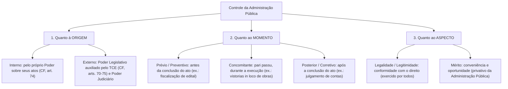
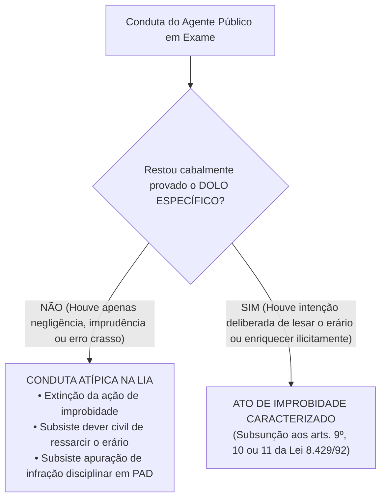
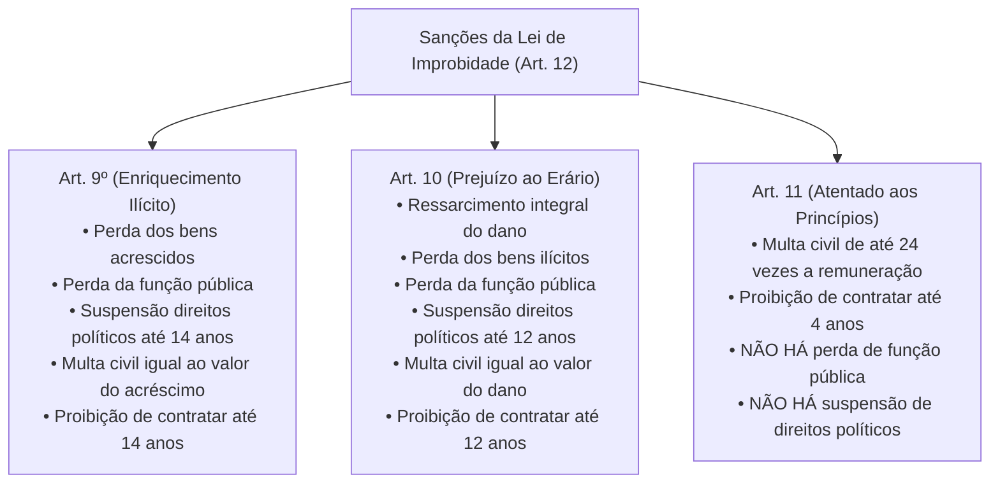

# 05 - Controle da Administração Pública e Improbidade Administrativa (Lei 8.429/1992 e Lei 14.230/2021)

> **Matéria:** Noções de Direito Administrativo  
> **Cargo:** A01 – Técnico de Controle Externo – Especialidade: Técnico Administrativo  
> **Arquivo:** `05_controle_da_administracao_e_improbidade_administrativa.md`  

---

## 📌 Ementa / Itens do Edital
- Controle da Administração Pública: conceito, fundamentos e classificações
- Classificação quanto à origem (Interno e Externo), momento (Prévio, Concomitante e Posterior) e aspecto (Legalidade e Mérito)
- Controle Legislativo e a atuação constitucional do Tribunal de Contas
- Controle Judicial: limites da atuação do Judiciário sobre o mérito administrativo e princípios da razoabilidade e proporcionalidade
- Instrumentos de controle judicial: Mandado de Segurança, Ação Popular e Ação Civil Pública
- Lei de Improbidade Administrativa (Lei Federal nº 8.429/1992 com redação dada pela Lei Federal nº 14.230/2021 e alterações)
- Sujeitos ativo e passivo dos atos de improbidade
- Elemento subjetivo: extinção da modalidade culposa e exigência de dolo específico (Tema 1.199 do STF)
- Tipologia dos atos de improbidade: Enriquecimento Ilícito (art. 9º), Prejuízo ao Erário (art. 10) e Atentado aos Princípios (art. 11)
- Sanções cominadas e regime prescricional unificado e intercorrente

---

## 🧭 Sumário

1. [Teoria Geral do Controle da Administração Pública](#1-teoria-geral-do-controle-da-administracao-publica)
    1. [Fundamento Republicano e Sistema de Freios e Contrapesos](#11-fundamento-republicano-e-sistema-de-freios-e-contrapesos)
    2. [Classificação Quanto à Origem: Controle Interno vs. Controle Externo](#12-classificacao-quanto-a-origem-controle-interno-vs-controle-externo)
    3. [Classificação Quanto ao Momento: Prévio, Concomitante e Posterior](#13-classificacao-quanto-ao-momento-previo-concomitante-e-posterior)
    4. [Classificação Quanto ao Aspecto: Controle de Legalidade vs. Mérito](#14-classificacao-quanto-ao-aspecto-controle-de-legalidade-vs-merito)
    5. [Teste 045](#Teste-045)
    6. [Teste 046](#Teste-046)
2. [O Controle Legislativo e a Atuação dos Tribunais de Contas](#2-o-controle-legislativo-e-a-atuacao-dos-tribunais-de-contas)
    1. [A Função Constitucional do Tribunal de Contas (CF/88, arts. 70 a 75)](#21-a-funcao-constitucional-do-tribunal-de-contas-cf88-arts-70-a-75)
    2. [Natureza das Decisões e Título Executivo Extrajudicial](#22-natureza-das-decisoes-e-titulo-executivo-extrajudicial)
    3. [Teste 047](#Teste-047)
    4. [Teste 048](#Teste-048)
3. [O Controle Judicial dos Atos Administrativos](#3-o-controle-judicial-dos-atos-administrativos)
    1. [Limites do Controle Judicial sobre o Mérito Administrativo](#31-limites-do-controle-judicial-sobre-o-merito-administrativo)
    2. [Anulação por Desvio de Finalidade e a Teoria dos Motivos Determinantes](#32-anulacao-por-desvio-de-finalidade-e-a-teoria-dos-motivos-determinantes)
    3. [Ações Constitucionais de Controle: Mandado de Segurança, Ação Popular e ACP](#33-acoes-constitucionais-de-controle-mandado-de-seguranca-acao-popular-e-acp)
    4. [Teste 049](#Teste-049)
    5. [Teste 050](#Teste-050)
4. [A Nova Lei de Improbidade Administrativa (Lei 8.429/1992 e Lei 14.230/2021)](#4-a-nova-lei-de-improbidade-administrativa-lei-84291992-e-lei-142302021)
    1. [Sujeitos Ativos e Passivos da Improbidade Administrativa](#41-sujeitos-ativos-e-passivos-da-improbidade-administrativa)
    2. [O Elemento Subjetivo e a Extinção da Culpa (Tema 1.199 / STF)](#42-o-elemento-subjetivo-e-a-extincao-da-culpa-tema-1199-stf)
    3. [Proibição do Crime de Hermenêutica no Âmbito da LIA](#43-proibicao-do-crime-de-hermeneutica-no-ambito-da-lia)
    4. [Teste 051](#Teste-051)
    5. [Teste 052](#Teste-052)
5. [Tipologia dos Atos de Improbidade e Quadro Sancionatório](#5-tipologia-dos-atos-de-improbidade-e-quadro-sancionatorio)
    1. [Enriquecimento Ilícito (Art. 9º da LIA)](#51-enriquecimento-ilicito-art-9o-da-lia)
    2. [Prejuízo ao Erário (Art. 10 da LIA)](#52-prejuizo-ao-erario-art-10-da-lia)
    3. [Atentado aos Princípios da Administração (Art. 11 da LIA - Rol Taxativo)](#53-atentado-aos-principios-da-administracao-art-11-da-lia-rol-taxativo)
    4. [Matriz Comparativa de Sanções do Artigo 12 da LIA](#54-matriz-comparativa-de-sancoes-do-artigo-12-da-lia)
    5. [Regime Prescricional Geral e Intercorrente (Art. 23 da LIA)](#55-regime-prescricional-geral-e-intercorrente-art-23-da-lia)
    6. [Teste 053](#Teste-053)
    7. [Teste 054](#Teste-054)
    8. [Teste 055](#Teste-055)
6. [Fontes Recomendadas na Internet](#6-fontes-recomendadas-na-internet)

---

## 1. Teoria Geral do Controle da Administração Pública

O controle da Administração Pública compreende o conjunto de mecanismos jurídicos e institucionais mediante os quais se fiscaliza, orienta, corrige e revisa a atuação dos órgãos, agentes e entidades do Estado, com vistas a assegurar a observância da legalidade, moralidade, economicidade e a consecução do interesse coletivo.

### 1.1 Fundamento Republicano e Sistema de Freios e Contrapesos

No Estado Democrático de Direito, nenhum poder estatal é absoluto ou imune a fiscalização. O controle administrativo fundamenta-se:

1. No **Princípio Republicano** (prestação de contas obrigatória de todo aquele que gere recursos públicos);
2. No **Princípio da Indisponibilidade do Interesse Público** (o administrador gere patrimônio alheio);
3. No **Sistema de Freios e Contrapesos (*Checks and Balances*)**, consagrado pelo art. 2º da CF/88, segundo o qual os Poderes Legislativo, Executivo e Judiciário são harmônicos e independentes, exercendo controles recíprocos uns sobre os outros.

### 1.2 Classificação Quanto à Origem: Controle Interno vs. Controle Externo

- **Controle Interno (CF/88, art. 74):** Exercido por cada um dos Poderes (Executivo, Legislativo e Judiciário) e pelo Ministério Público sobre sua própria estrutura administrativa e órgãos subordinados. Funda-se na hierarquia e na autotutela. Suas finalidades constitucionais compreendem: avaliar o cumprimento de metas do PPA, comprovar a legalidade da gestão orçamentária, exercer o controle de operações de crédito e apoiar o controle externo em sua missão institucional.
- **Controle Externo (CF/88, art. 70 a 75):** Exercido por um Poder sobre a atuação administrativa de outro Poder ou sobre terceiros gestores de recursos públicos. No plano federativo, é titularizado privativamente pelo **Poder Legislativo** (Assembleia Legislativa / Congresso Nacional), com o auxílio técnico, operacional e constitucional autônomo do **Tribunal de Contas**. Também abrange o controle jurisdicional repressivo exercido pelo Poder Judiciário.

### 1.3 Classificação Quanto ao Momento: Prévio, Concomitante e Posterior

- **Controle Prévio (Preventivo ou *a priori*):** Realizado antes da consumação ou produção de efeitos do ato administrativo, com o objetivo de prevenir irregularidades e evitar lesões ao erário (ex.: apreciação prévia de editais de concessão vultosos pelo TCE; aprovação legislativa de indicados a cargos de agências reguladoras).
- **Controle Concomitante (Simultâneo ou *pari passu*):** Realizado simultaneamente à execução material da atividade administrativa, em tempo real (ex.: auditorias de acompanhamento de execução orçamentária; fiscalizações e vistorias *in loco* em canteiros de obras rodoviárias estaduais).
- **Controle Posterior (Corretivo ou *a posteriori*):** Realizado após a consumação integral do ato administrativo ou do encerramento do exercício financeiro, visando sancionar faltas, anular ilegalidades ou certificar a higidez das contas (ex.: julgamento de tomadas de contas especiais; auditorias de conformidade posteriores; homologação ou rejeição das contas de gestores).

### 1.4 Classificação Quanto ao Aspecto: Controle de Legalidade vs. Mérito

- **Controle de Legalidade / Legitimidade:** Avalia a conformidade formal e material do ato administrativo com a Constituição, leis, decretos, súmulas vinculantes e princípios de direito público (razoabilidade, proporcionalidade e moralidade). Pode ser exercido pela própria Administração, pelo Tribunal de Contas e pelo Poder Judiciário.
- **Controle de Mérito:** Avalia a **conveniência e oportunidade** da decisão administrativa tomada dentro da margem de discricionariedade permitida pela lei. É atribuição **privativa e exclusiva da própria Administração Pública**, sendo vedado ao Judiciário ou ao Tribunal de Contas substituir o juízo de mérito do administrador.

---

### Teste 045
**(FGV – TCE-SC – Auditor Fiscal de Controle Externo Administracao – 2026)**
Um Estado federado aprovou, por meio de lei específica, um programa de habitação social destinado a famílias de baixa renda, com dotação orçamentária prevista no PPA e na LOA vigentes. Dois anos após o início da execução, um relatório interno da Secretaria de Habitação apontou que apenas 18% das unidades habitacionais previstas haviam sido entregues, embora 74% dos recursos já tivessem sido empenhados. O Secretário de Habitação, ao ser questionado pela imprensa, afirmou que o Tribunal de Contas somente poderia atuar ao final do exercício financeiro e que, enquanto o programa estivesse em execução, a avaliação dos resultados era prerrogativa exclusiva do Poder Executivo, sendo vedada qualquer interferência externa no mérito das escolhas de gestão. Com base nas competências constitucionais dos órgãos de controle externo e no papel do Poder Legislativo, no ciclo de políticas públicas, a afirmação do Secretário é

* **A)** inconstitucional em ambos os aspectos: o Tribunal de Contas pode realizar auditorias operacionais durante a execução do programa e o Poder Legislativo tem competência para fiscalizar a eficácia, eficiência e economicidade das políticas públicas em curso, não se limitando ao exame da legalidade formal das despesas.
* **B)** parcialmente correta: embora o Tribunal de Contas possa atuar durante a execução, a avaliação do mérito das escolhas de gestão, como o ritmo de entrega das unidades habitacionais, é prerrogativa do Poder Executivo, insuscetível de controle externo enquanto não configurada ilegalidade formal na aplicação dos recursos.
* **C)** correta quanto ao Tribunal de Contas, pois sua atuação durante a execução restringe-se à fiscalização de contratos individualmente considerados, não abrangendo a avaliação de resultados e metas de programas governamentais em andamento.
* **D)** correta quanto ao Poder Legislativo, pois a Constituição Federal reserva ao Executivo a avaliação dos programas governamentais durante a implementação, cabendo ao Legislativo apenas apreciar as contas ao final do exercício e deliberar sobre créditos adicionais solicitados pelo Executivo.
* **E)** inconstitucional apenas quanto ao Tribunal de Contas, pois o Legislativo, de fato, não pode interferir no mérito das escolhas de gestão do Executivo durante a execução de programas aprovados em lei, sob pena de violação ao princípio da separação dos Poderes.

---

> **Comentário Detalhado:**
>
> - **A)** **Incorreta.** A opção apresenta proposição em desacordo com os fundamentos teóricos e técnicos do tópico ao afirmar que "inconstitucional em ambos os aspectos: o Tribunal de Contas pode realizar auditorias operacionais durante a...". De acordo com a teoria estudada em *1.4 Classificação Quanto ao Aspecto: Controle de Legalidade vs. Mérito*, pode ser exercido pela própria Administração, pelo Tribunal de Contas e pelo Poder Judiciário.
> - **B)** **Correta.** Conforme fundamentado na seção *3.1 Limites do Controle Judicial sobre o Mérito Administrativo* deste guia, proibição de Revogação Judicial: O Poder Judiciário, no exercício de sua função jurisdicional, NUNCA revoga atos do Poder Executivo. O Judiciário apenas anula atos administrativos que padeçam de vícios de ilegalidade originária. Dessa forma, está plenamente correta a assertiva da banca (FGV – TCE-SC/2026) ao estabelecer que "parcialmente correta: embora o Tribunal de Contas possa atuar durante a execução, a avaliação do mérito das...".
> - **C)** **Incorreta.** A opção apresenta proposição em desacordo com os fundamentos teóricos e técnicos do tópico ao afirmar que "correta quanto ao Tribunal de Contas, pois sua atuação durante a execução restringe-se à fiscalização de contratos...". De acordo com a teoria estudada em *1.2 Classificação Quanto à Origem: Controle Interno vs. Controle Externo*, suas finalidades constitucionais compreendem: avaliar o cumprimento de metas do PPA, comprovar a legalidade da gestão orçamentária, exercer o controle de operações de crédito e apoiar o controle externo em sua missão institucional.
> - **D)** **Incorreta.** A opção incorre em restrição indevida ao limitar o escopo conceitual ao afirmar que "correta quanto ao Poder Legislativo, pois a Constituição Federal reserva ao Executivo a avaliação dos programas...". De acordo com a teoria estudada em *1.4 Classificação Quanto ao Aspecto: Controle de Legalidade vs. Mérito*, controle de Legalidade / Legitimidade: Avalia a conformidade formal e material do ato administrativo com a Constituição, leis, decretos, súmulas vinculantes e princípios de direito público (razoabilidade, proporcionalidade e moralidade).
> - **E)** **Incorreta.** A opção incorre em restrição indevida ao limitar o escopo conceitual ao afirmar que "inconstitucional apenas quanto ao Tribunal de Contas, pois o Legislativo, de fato, não pode interferir no mérito...". De acordo com a teoria estudada em *1.2 Classificação Quanto à Origem: Controle Interno vs. Controle Externo*, controle Interno (CF/88, art. 74): Exercido por cada um dos Poderes (Executivo, Legislativo e Judiciário) e pelo Ministério Público sobre sua própria estrutura administrativa e órgãos subordinados. Funda-se na hierarquia e na autotutela.
>
> **Gabarito: B**

---

### Teste 046
**(FGV – TCE-SC – Auditor Fiscal de Controle Externo Ciencias Contabeis – 2026)**
Caso ocorra ilegalidade ou irregularidade nos atos de gestão de quaisquer órgãos ou entidade pública, caberá ao Tribunal de Contas fixar o prazo para cumprimento da lei. Quando não atendido o ato administrativo, o Tribunal deverá determinar a sustação do ato impugnado. Essa função autoriza aos Tribunais de Contas aplicarem sanções por ilegalidade de contas e despesas apresentadas pelos órgãos governamentais. Tais decisões sancionatórias dos Tribunais de Contas têm eficácia de título executivo, embora os Tribunais não tenham competência para executá-las, pois, caberá a execução às entidades públicas beneficiárias. A função do Tribunal, no caso desse texto, pode ser adequadamente chamada de função

* **A)** normativa.
* **B)** corretiva.
* **C)** de Ouvidoria.
* **D)** informativa.
* **E)** consultiva.

---

> **Comentário Detalhado:**
>
> - **A)** **Correta.** Conforme fundamentado na seção *2.2 Natureza das Decisões e Título Executivo Extrajudicial* deste guia, eficácia de Título Executivo (CF/88, art. 71, § 3º): As decisões do Tribunal de Contas de que resulte imputação de débito ou cominação de multa pecuniária possuem eficácia de título executivo extrajudicial. Dessa forma, está plenamente correta a assertiva da banca (FGV – TCE-SC/2026) ao estabelecer que "normativa".
> - **B)** **Incorreta.** A opção apresenta proposição em desacordo com os fundamentos teóricos e técnicos do tópico ao afirmar que "corretiva". De acordo com a teoria estudada em *2.2 Natureza das Decisões e Título Executivo Extrajudicial*, execução do Título: A cobrança judicial não é executada pelo próprio Tribunal de Contas, mas sim pelo ente público lesado (a Procuradoria-Geral do Estado - PGE promove a competente Ação de Execução Fiscal perante a Vara da Fazenda Pública).
> - **C)** **Incorreta.** A opção apresenta proposição em desacordo com os fundamentos teóricos e técnicos do tópico ao afirmar que "de Ouvidoria". De acordo com a teoria estudada em *3.1 Limites do Controle Judicial sobre o Mérito Administrativo*, proibição de Revogação Judicial: O Poder Judiciário, no exercício de sua função jurisdicional, NUNCA revoga atos do Poder Executivo. O Judiciário apenas anula atos administrativos que padeçam de vícios de ilegalidade originária.
> - **D)** **Incorreta.** A opção apresenta proposição em desacordo com os fundamentos teóricos e técnicos do tópico ao afirmar que "informativa". De acordo com a teoria estudada em *3.3 Ações Constitucionais de Controle: Mandado de Segurança, Ação Popular e ACP*, ação Constitucional: Base Normativa — Legitimidade Ativa — Objeto / Finalidade Principal — Particularidades Processuais.
> - **E)** **Incorreta.** A opção apresenta proposição em desacordo com os fundamentos teóricos e técnicos do tópico ao afirmar que "consultiva". De acordo com a teoria estudada em *4.1 Sujeitos Ativos e Passivos da Improbidade Administrativa*, sujeito Ativo (Art. 2º): Considera-se agente público para os efeitos desta Lei o agente político, o servidor público e todo aquele que exerce, ainda que transitoriamente ou sem remuneração, por eleição, nomeação, designação, contratação ou qualquer outra forma de investidura ou vínculo, mandato, cargo, emprego ou função nas entidades públicas.
>
> **Gabarito: A**

---

## 2. O Controle Legislativo e a Atuação dos Tribunais de Contas

### 2.1 A Função Constitucional do Tribunal de Contas (CF/88, arts. 70 a 75)

O controle externo a cargo do Poder Legislativo é exercido com o auxílio técnico do Tribunal de Contas do Estado (TCE-GO). As Cortes de Contas ostentam envergadura e autonomia constitucional direta, exercendo competências indelegáveis:

1. **Julgamento de Contas dos Administradores Públicos (Art. 71, II):** Julgar as contas de todos os ordenadores de despesa, dirigentes de estatais e gestores responsáveis por dinheiros, bens e valores públicos estaduais.
2. **Apreciação das Contas do Chefe do Executivo (Art. 71, I):** Emitir **parecer prévio** conclusivo sobre as contas anuais prestadas pelo Governador do Estado (o julgamento definitivo cabe à Assembleia Legislativa).
3. **Fiscalização Operacional e Financeira (Art. 71, IV):** Realizar inspeções e auditorias de natureza contábil, financeira, orçamentária, operacional e patrimonial.
4. **Fiscalização de Atos de Admissão e Aposentadoria (Art. 71, III):** Apreciar, para fins de registro, a legalidade dos atos de admissão de pessoal (salvo cargos comissionados) e de concessão inicial de aposentadorias, reformas e pensões.
5. **Aplicação de Sanções (Art. 71, VIII):** Aplicar aos responsáveis as sanções previstas em sua Lei Orgânica, incluindo multas pecuniárias, imputação de débito e inabilitação temporária para o exercício de cargo em comissão.

### 2.2 Natureza das Decisões e Título Executivo Extrajudicial

- **Eficácia de Título Executivo (CF/88, art. 71, § 3º):** As decisões do Tribunal de Contas de que resulte imputação de débito ou cominação de multa pecuniária possuem **eficácia de título executivo extrajudicial**.
- **Execução do Título:** A cobrança judicial não é executada pelo próprio Tribunal de Contas, mas sim pelo ente público lesado (a Procuradoria-Geral do Estado - PGE promove a competente Ação de Execução Fiscal perante a Vara da Fazenda Pública).

---

### Teste 047
**(FGV – TCE-SC – Auditor Fiscal de Controle Externo Administracao – 2026)**
Caso ocorra ilegalidade ou irregularidade nos atos de gestão de quaisquer órgãos ou entidade pública, caberá ao Tribunal de Contas fixar o prazo para cumprimento da lei. Quando não atendido o ato administrativo, o Tribunal deverá determinar a sustação do ato impugnado. Essa função autoriza aos Tribunais de Contas a aplicarem sanções por ilegalidade de contas e despesas apresentadas pelos órgãos governamentais. Tais decisões sancionatórias dos Tribunais de Contas têm eficácia de título executivo, embora os Tribunais não tenham competência para executá-las, pois, caberá a execução às entidades públicas beneficiárias. A função do Tribunal, no caso desse texto, pode ser adequadamente chamada de função

* **A)** normativa.
* **B)** corretiva.
* **C)** de Ouvidoria.
* **D)** informativa.
* **E)** consultiva.

---

> **Comentário Detalhado:**
>
> - **A)** **Correta.** Conforme fundamentado na seção *2.2 Natureza das Decisões e Título Executivo Extrajudicial* deste guia, eficácia de Título Executivo (CF/88, art. 71, § 3º): As decisões do Tribunal de Contas de que resulte imputação de débito ou cominação de multa pecuniária possuem eficácia de título executivo extrajudicial. Dessa forma, está plenamente correta a assertiva da banca (FGV – TCE-SC/2026) ao estabelecer que "normativa".
> - **B)** **Incorreta.** A opção apresenta proposição em desacordo com os fundamentos teóricos e técnicos do tópico ao afirmar que "corretiva". De acordo com a teoria estudada em *2.2 Natureza das Decisões e Título Executivo Extrajudicial*, execução do Título: A cobrança judicial não é executada pelo próprio Tribunal de Contas, mas sim pelo ente público lesado (a Procuradoria-Geral do Estado - PGE promove a competente Ação de Execução Fiscal perante a Vara da Fazenda Pública).
> - **C)** **Incorreta.** A opção apresenta proposição em desacordo com os fundamentos teóricos e técnicos do tópico ao afirmar que "de Ouvidoria". De acordo com a teoria estudada em *3.1 Limites do Controle Judicial sobre o Mérito Administrativo*, proibição de Revogação Judicial: O Poder Judiciário, no exercício de sua função jurisdicional, NUNCA revoga atos do Poder Executivo. O Judiciário apenas anula atos administrativos que padeçam de vícios de ilegalidade originária.
> - **D)** **Incorreta.** A opção apresenta proposição em desacordo com os fundamentos teóricos e técnicos do tópico ao afirmar que "informativa". De acordo com a teoria estudada em *3.3 Ações Constitucionais de Controle: Mandado de Segurança, Ação Popular e ACP*, ação Constitucional: Base Normativa — Legitimidade Ativa — Objeto / Finalidade Principal — Particularidades Processuais.
> - **E)** **Incorreta.** A opção apresenta proposição em desacordo com os fundamentos teóricos e técnicos do tópico ao afirmar que "consultiva". De acordo com a teoria estudada em *4.1 Sujeitos Ativos e Passivos da Improbidade Administrativa*, sujeito Ativo (Art. 2º): Considera-se agente público para os efeitos desta Lei o agente político, o servidor público e todo aquele que exerce, ainda que transitoriamente ou sem remuneração, por eleição, nomeação, designação, contratação ou qualquer outra forma de investidura ou vínculo, mandato, cargo, emprego ou função nas entidades públicas.
>
> **Gabarito: A**

---

### Teste 048
**(FGV – TCE-PA – Auditor de Controle Externo Administrativa Gestao Governamental – 2024)**
O Governador do Estado do Pará deve encaminhar ao Tribunal de Contas as contas correspondentes ao último exercício financeiro, para fins de emissão de parecer prévio. Ao consultar sua assessoria em relação ao alcance e ao procedimento afeto à análise dessa prestação de contas, foi corretamente esclarecido ao Chefe do Poder Executivo, à luz da sistemática estabelecida na Lei Complementar estadual nº 81/2012, que

* **A)** as contas compreendem as atividades dos Poderes Executivo, Legislativo e Judiciário, dos Tribunais de Contas do Estado, dos Ministérios Públicos e da Defensoria Pública.
* **B)** o parecer prévio se desenvolve em bases puramente inquisitoriais, devendo ser assegurados, no âmbito da Assembleia Legislativa, o contraditório e a ampla defesa.
* **C)** essa prestação consiste no Balanço Geral do Estado, no Relatório do Órgão Central do Sistema de Controle Interno do Poder Executivo e no Relatório de Auditoria Independente.
* **D)** o parecer prévio deve ser estruturado em capítulos, sendo cada qual direcionado a uma estrutura orgânica diretamente subordinada ao Poder Executivo, com a menção, ao final, da conclusão pela aprovação, ou não.
* **E)** o parecer prévio deve ser exarado no prazo de sessenta dias, prorrogáveis, a juízo da Assembleia Legislativa, por mais trinta dias, veiculando análise conclusiva sobre os aspectos contábil, financeiro, orçamentário, operacional e patrimonial. História, Geografia e Conhecimentos do Estado do Pará

---

> **Comentário Detalhado:**
>
> - **A)** **Correta.** Conforme fundamentado na seção *2.1 A Função Constitucional do Tribunal de Contas (CF/88, arts. 70 a 75)* deste guia, apreciação das Contas do Chefe do Executivo (Art. 71, I): Emitir parecer prévio conclusivo sobre as contas anuais prestadas pelo Governador do Estado (o julgamento definitivo cabe à Assembleia Legislativa). Dessa forma, está plenamente correta a assertiva da banca (FGV – TCE-PA/2024) ao estabelecer que "as contas compreendem as atividades dos Poderes Executivo, Legislativo e Judiciário, dos Tribunais de Contas do...".
> - **B)** **Incorreta.** A opção apresenta proposição em desacordo com os fundamentos teóricos e técnicos do tópico ao afirmar que "o parecer prévio se desenvolve em bases puramente inquisitoriais, devendo ser assegurados, no âmbito da Assembleia...". De acordo com a teoria estudada em *4.3 Proibição do Crime de Hermenêutica no Âmbito da LIA*, o art. 1º, § 8º, da LIA estabelece expressamente que não configura improbidade a ação ou omissão decorrente de divergência interpretativa da lei, baseada em jurisprudência, ainda que não pacificada, mesmo que não venha a ser posteriormente a prevalecente nos tribunais judiciais ou de contas.
> - **C)** **Incorreta.** A opção apresenta proposição em desacordo com os fundamentos teóricos e técnicos do tópico ao afirmar que "essa prestação consiste no Balanço Geral do Estado, no Relatório do Órgão Central do Sistema de Controle Interno...". De acordo com a teoria estudada em *6. Fontes Recomendadas na Internet*, regramento constitucional do controle externo exercido pelo Poder Legislativo com o auxílio dos Tribunais de Contas e do controle interno.
> - **D)** **Incorreta.** A opção apresenta proposição em desacordo com os fundamentos teóricos e técnicos do tópico ao afirmar que "o parecer prévio deve ser estruturado em capítulos, sendo cada qual direcionado a uma estrutura orgânica...". De acordo com a teoria estudada em *1.2 Classificação Quanto à Origem: Controle Interno vs. Controle Externo*, controle Interno (CF/88, art. 74): Exercido por cada um dos Poderes (Executivo, Legislativo e Judiciário) e pelo Ministério Público sobre sua própria estrutura administrativa e órgãos subordinados. Funda-se na hierarquia e na autotutela.
> - **E)** **Incorreta.** A opção apresenta proposição em desacordo com os fundamentos teóricos e técnicos do tópico ao afirmar que "o parecer prévio deve ser exarado no prazo de sessenta dias, prorrogáveis, a juízo da Assembleia Legislativa, por...". De acordo com a teoria estudada em *1.2 Classificação Quanto à Origem: Controle Interno vs. Controle Externo*, no plano federativo, é titularizado privativamente pelo Poder Legislativo (Assembleia Legislativa / Congresso Nacional), com o auxílio técnico, operacional e constitucional autônomo do Tribunal de Contas.
>
> **Gabarito: A**

---

## 3. O Controle Judicial dos Atos Administrativos

Em razão do princípio da inafastabilidade da tutela jurisdicional (CF/88, art. 5º, XXXV: *"a lei não excluirá da apreciação do Poder Judiciário lesão ou ameaça a direito"*), o Brasil adota o sistema de jurisdição una (sistema inglês), cabendo unicamente ao Poder Judiciário dizer o direito com força definitiva de coisa julgada material.

### 3.1 Limites do Controle Judicial sobre o Mérito Administrativo

- **Veto de Substituição de Mérito:** O juiz não pode substituir a valoração legítima de conveniência e oportunidade do administrador eleito ou concursado (ex.: escolher entre asfaltar a rua A ou reformar o posto de saúde B, quando ambas as opções são legais e orçamentariamente viáveis).
- **Proibição de Revogação Judicial:** O Poder Judiciário, no exercício de sua função jurisdicional, **NUNCA revoga atos do Poder Executivo**. O Judiciário apenas **anula** atos administrativos que padeçam de vícios de ilegalidade originária.

### 3.2 Anulação por Desvio de Finalidade e a Teoria dos Motivos Determinantes

O controle judicial sobre atos discricionários não se restringe à literalidade da lei, alcançando a legalidade ampla e os princípios constitucionais:

- **Desvio de Finalidade:** O Judiciário deve decretar a anulação do ato se restar demonstrado que a autoridade usou de sua competência legal para perseguir um desafeto pessoal, satisfazer capricho ou favorecer correligionários.
- **Teoria dos Motivos Determinantes:** Se a motivação alegada no ato for comprovadamente falsa, inexistente ou contraditória com os fatos da realidade, o ato é nulo por vício de motivo, devendo o Judiciário anulá-lo com efeitos retroativos (*ex tunc*).

### 3.3 Ações Constitucionais de Controle: Mandado de Segurança, Ação Popular e ACP

| Ação Constitucional | Base Normativa | Legitimidade Ativa | Objeto / Finalidade Principal | Particularidades Processuais |
| :--- | :--- | :--- | :--- | :--- |
| **Mandado de Segurança** | CF, art. 5º, LXIX; Lei 12.016/2009 | Pessoa física ou jurídica titular do direito | Proteger **direito líquido e certo**, não amparado por *habeas corpus* ou *habeas data*, contra ato ilegal ou abuso de poder | Exige **prova documental pré-constituída**; não admite dilação probatória; prazo decadencial de 120 dias. |
| **Ação Popular** | CF, art. 5º, LXXIII; Lei 4.717/1965 | **Qualquer cidadão brasileiro** no gozo de seus direitos políticos (título de eleitor) | Anular ato lesivo ao **patrimônio público**, à **moralidade administrativa**, ao **meio ambiente** e ao **patrimônio histórico e cultural** | Autor fica **isento de custas judiciais e sucumbência**, salvo comprovada má-fé. |
| **Ação Civil Pública** | CF, art. 129, III; Lei 7.347/1985 | Ministério Público, Defensoria Pública, Entes Federados, Autarquias e Associações constituídas há mais de 1 ano | Tutela de **direitos difusos, coletivos e individuais homogêneos** (meio ambiente, patrimônio público, consumidor) | Permite condenação em dinheiro (revertida a fundo público) e obrigação de fazer/não fazer. |

---

### Teste 049
**(CEBRASPE – TJ-RJ – Analista Judiciario Grupo Tecnologia da Informacao Analista de Negocios – 2021)**
Em julgamento em que examinou a constitucionalidade de determinado ato normativo da administração pública, o Poder Judiciário considerou que “As atividades do Estado estão sujeitas à observância de preceitos fundamentais de natureza constitucional que, encontrando fundamento teórico no princípio da proporcionalidade, veda os excessos e as condutas desarrazoadas do poder público”. Ao tratar do abuso de poder estatal, sob a perspectiva da proporcionalidade e da razoabilidade, o trecho apresentado na situação hipotética precedente contém fundamento embasado no aspecto substancial do princípio do(a)

* **A)** devido processo legal.
* **B)** juiz natural.
* **C)** ampla defesa.
* **D)** contraditório.
* **E)** inércia.

---

> **Comentário Detalhado:**
>
> - **A)** **Correta.** Conforme fundamentado na seção *1.4 Classificação Quanto ao Aspecto: Controle de Legalidade vs. Mérito* deste guia, controle de Legalidade / Legitimidade: Avalia a conformidade formal e material do ato administrativo com a Constituição, leis, decretos, súmulas vinculantes e princípios de direito público (razoabilidade, proporcionalidade e moralidade). Dessa forma, está plenamente correta a assertiva da banca (CEBRASPE – TJ-RJ/2021) ao estabelecer que "devido processo legal".
> - **B)** **Incorreta.** A opção apresenta proposição em desacordo com os fundamentos teóricos e técnicos do tópico ao afirmar que "juiz natural". De acordo com a teoria estudada em *3.1 Limites do Controle Judicial sobre o Mérito Administrativo*, veto de Substituição de Mérito: O juiz não pode substituir a valoração legítima de conveniência e oportunidade do administrador eleito ou concursado (ex.: escolher entre asfaltar a rua A ou reformar o posto de saúde B, quando ambas as opções são legais e orçamentariamente viáveis).
> - **C)** **Incorreta.** A opção apresenta proposição em desacordo com os fundamentos teóricos e técnicos do tópico ao afirmar que "ampla defesa". De acordo com a teoria estudada em *6. Fontes Recomendadas na Internet*, estatuto da ação constitucional privativa do cidadão eleitor para defesa da moralidade administrativa e do patrimônio público.
> - **D)** **Incorreta.** A opção apresenta proposição em desacordo com os fundamentos teóricos e técnicos do tópico ao afirmar que "contraditório". De acordo com a teoria estudada em *3.2 Anulação por Desvio de Finalidade e a Teoria dos Motivos Determinantes*, desvio de Finalidade: O Judiciário deve decretar a anulação do ato se restar demonstrado que a autoridade usou de sua competência legal para perseguir um desafeto pessoal, satisfazer capricho ou favorecer correligionários.
> - **E)** **Incorreta.** A opção apresenta proposição em desacordo com os fundamentos teóricos e técnicos do tópico ao afirmar que "inércia". De acordo com a teoria estudada em *5.2 Prejuízo ao Erário (Art. 10 da LIA)*, natureza do Rol: Rol considerado taxativo pela nova redação legal.
>
> **Gabarito: A**

---

### Teste 050
**(FGV – TCE-GO – Analista de Controle Externo Juridica – 2024)**
Diante das orientações consolidadas pelo Supremo Tribunal Federal acerca da temática da improbidade administrativa, notadamente após as alterações promovidas 14.230/2021 na Lei nº 8.429/92, é correto afirmar que

* **A)** o novo regime prevê a responsabilização objetiva pela prática de atos de improbidade administrativa.
* **B)** são prescritíveis as ações de ressarcimento ao erário decorrentes de atos de improbidade dolosos que ocasionam lesão aos cofres públicos.
* **C)** a revogação da modalidade culposa deve retroagir para beneficiar os agentes públicos condenados pela prática do ato de improbidade.
* **D)** o regime prescricional previsto no novel diploma é irretroativo, aplicando-se os novos marcos temporais a partir da publicação da lei.
* **E)** os entes federativos não têm legitimidade para ajuizar ação de improbidade administrativa nas situações em que sejam lesados, diante da exclusividade conferida ao Ministério Público para tanto.

---

> **Comentário Detalhado:**
>
> - **A)** **Incorreta.** A opção apresenta proposição em desacordo com os fundamentos teóricos e técnicos do tópico ao afirmar que "o novo regime prevê a responsabilização objetiva pela prática de atos de improbidade administrativa". De acordo com a teoria estudada em *6. Fontes Recomendadas na Internet*, dispõe sobre a responsabilização administrativa e civil objetiva de pessoas jurídicas pela prática de atos contra a administração pública.
> - **B)** **Incorreta.** A opção apresenta proposição em desacordo com os fundamentos teóricos e técnicos do tópico ao afirmar que "são prescritíveis as ações de ressarcimento ao erário decorrentes de atos de improbidade dolosos que ocasionam...". De acordo com a teoria estudada em *5.2 Prejuízo ao Erário (Art. 10 da LIA)*, exigência de Dano Efetivo e Real: A Lei nº 14.230/2021 proibiu o dano presumido (*in re ipsa*). Para que haja condenação pelo art. 10, a acusação deve comprovar documental e pericialmente o prejuízo financeiro concreto experimentado pelos cofres públicos.
> - **C)** **Incorreta.** A opção apresenta proposição em desacordo com os fundamentos teóricos e técnicos do tópico ao afirmar que "a revogação da modalidade culposa deve retroagir para beneficiar os agentes públicos condenados pela prática do...". De acordo com a teoria estudada em *4.2 O Elemento Subjetivo e a Extinção da Culpa (Tema 1.199 / STF)*, a alteração mais radical da Lei nº 14.230/2021 consistiu na abolição total e expressa da modalidade culposa para todos os atos de improbidade administrativa.
> - **D)** **Incorreta.** A opção apresenta proposição em desacordo com os fundamentos teóricos e técnicos do tópico ao afirmar que "o regime prescricional previsto no novel diploma é irretroativo, aplicando-se os novos marcos temporais a partir...". De acordo com a teoria estudada em *5.5 Regime Prescricional Geral e Intercorrente (Art. 23 da LIA)*, uma vez interrompida com o ajuizamento da ação, o prazo recomeça a correr pela metade: prescreve a pretensão se o processo judicial ficar paralisado por mais de 4 (quatro) anos entre marcos interruptivos (como publicação de sentenças ou acórdãos condenatórios).
> - **E)** **Correta.** Conforme fundamentado na seção *3.3 Ações Constitucionais de Controle: Mandado de Segurança, Ação Popular e ACP* deste guia, lei 7.347/1985 — Ministério Público, Defensoria Pública, Entes Federados, Autarquias e Associações constituídas há mais de 1 ano — Tutela de direitos difusos, coletivos e individuais homogêneos (meio ambiente, patrimônio público, consumidor) — Permite condenação em dinheiro (revertida a fundo público) e obrigação de fazer/não fazer. Dessa forma, está plenamente correta a assertiva da banca (FGV – TCE-GO/2024) ao estabelecer que "os entes federativos não têm legitimidade para ajuizar ação de improbidade administrativa nas situações em que...".
>
> **Gabarito: E**

---

## 4. A Nova Lei de Improbidade Administrativa (Lei 8.429/1992 e Lei 14.230/2021)

A Lei Federal nº 14.230/2021 promoveu a mais profunda reforma na Lei de Improbidade Administrativa (LIA - Lei nº 8.429/1992), transformando o diploma em um estatuto de Direito Administrativo Sancionador rígido, com garantias processuais do direito punitivo.

### 4.1 Sujeitos Ativos e Passivos da Improbidade Administrativa

- **Sujeito Ativo (Art. 2º):** Considera-se agente público para os efeitos desta Lei o agente político, o servidor público e todo aquele que exerce, ainda que transitoriamente ou sem remuneração, por eleição, nomeação, designação, contratação ou qualquer outra forma de investidura ou vínculo, mandato, cargo, emprego ou função nas entidades públicas.
- **Particular em Concurso (Art. 3º):** As disposições da LIA aplicam-se àquele que, mesmo não sendo agente público, **induza ou concorra dolosamente** para a prática do ato de improbidade.  
  > ⚠️ **Regra Consolidada STJ/STF:** Não é cabível ação de improbidade exclusivamente em face de particular desacompanhado de agente público no polo passivo!

### 4.2 O Elemento Subjetivo e a Extinção da Culpa (Tema 1.199 / STF)

A alteração mais radical da Lei nº 14.230/2021 consistiu na **abolição total e expressa da modalidade culposa** para todos os atos de improbidade administrativa.

#### Tese Vinculante do Tema 1.199 do STF (RE 1.205.746):
1. **Exigência de Dolo Específico:** É necessária a comprovação de responsabilidade subjetiva com **dolo específico** para a tipificação de qualquer ato de improbidade administrativa (artigos 9º, 10 e 11). Não basta dolo genérico; exige-se a demonstração da vontade livre e consciente de alcançar o resultado ilícito, acompanhada do fim especial de agir.
2. **Extinção da Culpa (Inclusive Culpa Grave):** A negligência crassa, a imprudência, a imperícia ou o erro de gestão administrativa, ainda que inescusáveis, **NÃO configuram improbidade administrativa**. O agente negligente pode responder disciplinarmente no estatuto funcional ou em ação regressiva civil comum de reparação ao erário, mas não sob a pecha desonrosa da improbidade.
3. **Direito Intertemporal:**
    - *Processos com trânsito em julgado:* A nova lei **NÃO retroage** para desconstituir condenações culposas já consolidadas pela coisa julgada material.
    - *Processos em andamento:* A revogação da culpa **aplica-se imediatamente e de forma retroativa** a todas as ações de improbidade em curso em qualquer grau de jurisdição.

### 4.3 Proibição do Crime de Hermenêutica no Âmbito da LIA

O art. 1º, § 8º, da LIA estabelece expressamente que **não configura improbidade a ação ou omissão decorrente de divergência interpretativa da lei**, baseada em jurisprudência, ainda que não pacificada, mesmo que não venha a ser posteriormente a prevalecente nos tribunais judiciais ou de contas.

---

### Teste 051
**(FGV – TJ-AP – Analista Judiciario Apoio Especializado Tecnologia da Informacao Banco de Dados – 2023)**
Semana passada, Adroaldo, no exercício das atribuições do cargo efetivo em que está lotado no Estado do Amapá, praticou a conduta de negar publicidade a determinado ato oficial, sob o fundamento de que ele está gravado de sigilo, classificado como informação secreta, que, mediante a devida motivação, foi considerada imprescindível para a segurança da sociedade e do Estado. Acerca dessa situação hipotética, considerando o disposto na Lei nº 8.429/1992, com a redação conferida pela Lei nº 14.230/2021, é correto afirmar que:

* **A)** caso caracterizado o dolo na realização de tal conduta, ficará configurado o ato de improbidade que atenta contra os princípios da Administração Pública, diante da previsão específica no respectivo dispositivo da Lei de Improbidade;
* **B)** independentemente da caracterização de dolo, a conduta em questão não configura ato de improbidade que atenta contra os princípios da Administração Pública, tanto que excepcionada pela própria Lei de Improbidade Administrativa;
* **C)** considerando que o rol atinente aos atos de improbidade que atentam contra os princípios da Administração Pública é exemplificativo, a conduta em análise deve assim ser caracterizada, ainda que o servidor tenha agido com culpa;
* **D)** considerando que a negativa de publicidade não consta do rol taxativo das condutas que configuram o ato de improbidade que atenta contra os princípios da Administração Pública, a conduta em apreço não poderia ser assim caracterizada ainda que a informação não estivesse gravada de sigilo;
* **E)** considerando que a conduta em cotejo não pode ser caracterizada como ato de improbidade que atenta contra os princípios da Administração Pública, para tanto, é imprescindível o enriquecimento sem causa ou a lesão ao erário.

---

> **Comentário Detalhado:**
>
> - **A)** **Incorreta.** A opção apresenta proposição em desacordo com os fundamentos teóricos e técnicos do tópico ao afirmar que "caso caracterizado o dolo na realização de tal conduta, ficará configurado o ato de improbidade que atenta contra...". De acordo com a teoria estudada em *3.3 Ações Constitucionais de Controle: Mandado de Segurança, Ação Popular e ACP*, lei 12.016/2009 — Pessoa física ou jurídica titular do direito — Proteger direito líquido e certo, não amparado por *habeas corpus* ou *habeas data*, contra ato ilegal ou abuso de poder — Exige prova documental pré-constituída; não admite dilação probatória; prazo decadencial de 120 dias.
> - **B)** **Correta.** Conforme fundamentado na seção *Tese Vinculante do Tema 1.199 do STF (RE 1.205.746):* deste guia, exigência de Dolo Específico: É necessária a comprovação de responsabilidade subjetiva com dolo específico para a tipificação de qualquer ato de improbidade administrativa (artigos 9º, 10 e 11). Dessa forma, está plenamente correta a assertiva da banca (FGV – TJ-AP/2023) ao estabelecer que "independentemente da caracterização de dolo, a conduta em questão não configura ato de improbidade que atenta...".
> - **C)** **Incorreta.** A opção apresenta proposição em desacordo com os fundamentos teóricos e técnicos do tópico ao afirmar que "considerando que o rol atinente aos atos de improbidade que atentam contra os princípios da Administração Pública...". De acordo com a teoria estudada em *4.3 Proibição do Crime de Hermenêutica no Âmbito da LIA*, o art. 1º, § 8º, da LIA estabelece expressamente que não configura improbidade a ação ou omissão decorrente de divergência interpretativa da lei, baseada em jurisprudência, ainda que não pacificada, mesmo que não venha a ser posteriormente a prevalecente nos tribunais judiciais ou de contas.
> - **D)** **Incorreta.** A opção apresenta proposição em desacordo com os fundamentos teóricos e técnicos do tópico ao afirmar que "considerando que a negativa de publicidade não consta do rol taxativo das condutas que configuram o ato de...". De acordo com a teoria estudada em *5.3 Atentado aos Princípios da Administração (Art. 11 da LIA - Rol Taxativo)*, *Inciso IV:* Negar publicidade aos atos oficiais (salvo sigilo legal).
> - **E)** **Incorreta.** A opção apresenta proposição em desacordo com os fundamentos teóricos e técnicos do tópico ao afirmar que "considerando que a conduta em cotejo não pode ser caracterizada como ato de improbidade que atenta contra os...". De acordo com a teoria estudada em *1.4 Classificação Quanto ao Aspecto: Controle de Legalidade vs. Mérito*, pode ser exercido pela própria Administração, pelo Tribunal de Contas e pelo Poder Judiciário.
>
> **Gabarito: B**

---

### Teste 052
**(FGV – TCE-SC – Auditor Fiscal de Controle Externo Ciencias da Computacao Sistemas de Informacao – 2026)**
Acerca da responsabilização com base na Lei de Improbidade Administrativa (Lei nº 8.429/92), levando em conta a moderna orientação dos Tribunais Superiores, após as modificações promovidas pela Lei nº 14.230/2021, assinale a afirmativa correta.

* **A)** Apenas os atos de improbidade que importam em enriquecimento ilícito admitem a responsabilização do agente em razão de culpa grave, nos demais casos é necessário dolo específico para fins de aplicação das penalidades previstas na respectiva norma.
* **B)** A revogação de conduta constante do rol dos atos de improbidade que atentam contra os princípios da Administração Pública não deve ser considerada nos processos em curso que estiverem em fase recursal, os quais deverão prosseguir com base na redação antiga da lei.
* **C)** O novo regime prescricional previsto na norma em comento é irretroativo, aplicando-se os novos marcos temporais a partir da publicação da lei, diante da necessidade de observância dos princípios da segurança jurídica, do acesso à Justiça e da proteção da confiança.
* **D)** O Ministério Público tem legitimidade exclusiva para o ajuizamento da ação de improbidade que importa em prejuízo ao erário, não sendo admitida a propositura da demanda pelo ente ou entidade lesada pela conduta ímproba.
* **E)** A caracterização do ato de improbidade que causa prejuízo ao erário em razão da conduta de dispensa indevida de processo licitatório independe da comprovação do efetivo prejuízo, pois o dano é presumido (in re ipsa). Direito (Administrativo, Constitucional e Financeiro)

---

> **Comentário Detalhado:**
>
> - **A)** **Incorreta.** A opção incorre em restrição indevida ao limitar o escopo conceitual ao afirmar que "Apenas os atos de improbidade que importam em enriquecimento ilícito admitem a responsabilização do agente em...". De acordo com a teoria estudada em *6. Fontes Recomendadas na Internet*, dispõe sobre a responsabilização administrativa e civil objetiva de pessoas jurídicas pela prática de atos contra a administração pública.
> - **B)** **Correta.** Conforme fundamentado na seção *Tese Vinculante do Tema 1.199 do STF (RE 1.205.746):* deste guia, *Processos em andamento:* A revogação da culpa aplica-se imediatamente e de forma retroativa a todas as ações de improbidade em curso em qualquer grau de jurisdição. Dessa forma, está plenamente correta a assertiva da banca (FGV – TCE-SC/2026) ao estabelecer que "A revogação de conduta constante do rol dos atos de improbidade que atentam contra os princípios da Administração...".
> - **C)** **Incorreta.** A opção apresenta proposição em desacordo com os fundamentos teóricos e técnicos do tópico ao afirmar que "O novo regime prescricional previsto na norma em comento é irretroativo, aplicando-se os novos marcos temporais a...". De acordo com a teoria estudada em *5.5 Regime Prescricional Geral e Intercorrente (Art. 23 da LIA)*, uma vez interrompida com o ajuizamento da ação, o prazo recomeça a correr pela metade: prescreve a pretensão se o processo judicial ficar paralisado por mais de 4 (quatro) anos entre marcos interruptivos (como publicação de sentenças ou acórdãos condenatórios).
> - **D)** **Incorreta.** A opção apresenta proposição em desacordo com os fundamentos teóricos e técnicos do tópico ao afirmar que "O Ministério Público tem legitimidade exclusiva para o ajuizamento da ação de improbidade que importa em prejuízo...". De acordo com a teoria estudada em *5.2 Prejuízo ao Erário (Art. 10 da LIA)*, exigência de Dano Efetivo e Real: A Lei nº 14.230/2021 proibiu o dano presumido (*in re ipsa*). Para que haja condenação pelo art. 10, a acusação deve comprovar documental e pericialmente o prejuízo financeiro concreto experimentado pelos cofres públicos.
> - **E)** **Incorreta.** A opção afasta requisito ou relação estrutural exigida pela matéria ao afirmar que "A caracterização do ato de improbidade que causa prejuízo ao erário em razão da conduta de dispensa indevida de...". De acordo com a teoria estudada em *5.4 Matriz Comparativa de Sanções do Artigo 12 da LIA*, art. 10 (Prejuízo ao Erário): Taxativo — Até 12 anos — SIM — Até o valor do dano efetivo — Até 12 anos.
>
> **Gabarito: B**

---

## 5. Tipologia dos Atos de Improbidade e Quadro Sancionatório

### 5.1 Enriquecimento Ilícito (Art. 9º da LIA)

Ocorre quando o agente aufere qualquer tipo de vantagem patrimonial indevida em razão do exercício de cargo, mandato, função ou emprego público.

- *Exemplos:* Receber propina, comissão ou presente oneroso; utilizar bens, veículos ou servidores públicos em obras ou serviços particulares; incorporar ao patrimônio pessoal bens públicos; evolução patrimonial desproporcional à renda declarada.
- **Natureza do Rol:** Rol **exemplificativo** (*numerus apertus*).

### 5.2 Prejuízo ao Erário (Art. 10 da LIA)

Consiste em qualquer ação ou omissão dolosa que enseje, efetiva e comprovadamente, perda patrimonial, desvio, apropriação, malbaratamento ou dilapidação dos bens ou haveres públicos.

- **Exigência de Dano Efetivo e Real:** A Lei nº 14.230/2021 **proibiu o dano presumido (*in re ipsa*)**. Para que haja condenação pelo art. 10, a acusação deve comprovar documental e pericialmente o prejuízo financeiro concreto experimentado pelos cofres públicos.
- **Natureza do Rol:** Rol considerado **taxativo** pela nova redação legal.

### 5.3 Atentado aos Princípios da Administração (Art. 11 da LIA - Rol Taxativo)

Trata de condutas dolosas que violam os deveres de honestidade, imparcialidade e legalidade expressamente descritos no texto da lei.

- **ROL ESTRITAMENTE TAXATIVO (*Numerus Clausus*):** O art. 11 passou a ter um rol fechado. Somente configuram improbidade por violação a princípios as condutas literalmente previstas em seus incisos:
    - *Inciso III:* Revelar fato ou circunstância de que tem ciência em razão das atribuições e que deva permanecer em segredo;
    - *Inciso IV:* Negar publicidade aos atos oficiais (salvo sigilo legal);
    - *Inciso V:* Frustrar a licitude de concurso público;
    - *Inciso VIII:* Recusar cumprimento a lei federal sem declaração de inconstitucionalidade;
    - *Inciso XI:* Praticar nepotismo (nomeação de cônjuge, companheiro ou parente até 3º grau).

### 5.4 Matriz Comparativa de Sanções do Artigo 12 da LIA

| Tipo de Improbidade | Natureza do Rol | Suspensão dos Direitos Políticos | Perda da Função Pública? | Multa Civil Máxima | Proibição de Contratar / Benefícios |
| :--- | :---: | :---: | :---: | :---: | :---: |
| **Art. 9º (Enriquecimento Ilícito)** | Exemplificativo | Até **14 anos** | **SIM** (atinge o cargo exercido à época) | Até o valor do **acréscimo patrimonial** | Até **14 anos** |
| **Art. 10 (Prejuízo ao Erário)** | Taxativo | Até **12 anos** | **SIM** | Até o valor do **dano efetivo** | Até **12 anos** |
| **Art. 11 (Atentado a Princípios)** | **Estritamente Taxativo** | **NÃO HÁ MAIS** | **NÃO HÁ MAIS** | Até **24 vezes a remuneração** do agente | Até **4 anos** |

> 🚨 **ALERTA CRÍTICO DE PROVA FCC:**  
> A eliminação das penas de perda da função pública e suspensão dos direitos políticos no **artigo 11** é uma das novidades mais exploradas pela FCC. O candidato desatualizado marca que houve perda de cargo por atentado a princípios, errando a questão. Para o art. 11 subsistem apenas a **multa civil de até 24 remunerações** e a **proibição de contratar por até 4 anos**!

### 5.5 Regime Prescricional Geral e Intercorrente (Art. 23 da LIA)

- **Prazo Prescricional Unificado:** A ação para a aplicação das sanções da LIA prescreve em **8 (oito) anos**, contados a partir da data da ocorrência do fato ou, no caso de infrações permanentes, do dia em que cessou a permanência.
- **Prescrição Intercorrente (Art. 23, § 4º a § 8º):** A instauração do inquérito civil ou da ação judicial interrompe a prescrição. Uma vez interrompida com o ajuizamento da ação, o prazo recomeça a correr pela metade: prescreve a pretensão se o processo judicial ficar paralisado por mais de **4 (quatro) anos** entre marcos interruptivos (como publicação de sentenças ou acórdãos condenatórios).

---

### Teste 053
**(FGV – TRT-1 – Analista Judiciario Area Administrativa – 2024)**
No exercício da função relativa ao cargo de técnico do Tribunal Regional Federal da 1ª Região, no qual foi regularmente investido, Astolfo praticou a conduta de revelar fato de que tinha ciência em razão das atribuições e que devia permanecer em segredo, promovendo beneficiamento por informação privilegiada, sendo certo que ele assevera que a sua conduta foi culposa. Diante dessa situação hipotética, à luz do disposto na Lei nº 8.429/1992, com a redação conferida pela Lei nº 14.230/2021, a aludida conduta de Astolfo:

* **A)** está tipificada dentre os atos de improbidade que atentam contra os princípios da Administração Pública, que não admitem a modalidade culposa e cujo rol é taxativo;
* **B)** está tipificada dentre os atos de improbidade em todas as situações consagradas na norma, que comportam rol exemplificativo e que admitem a modalidade culposa e a dolosa;
* **C)** está tipificada dentre os atos de improbidade que importam em enriquecimento ilícito, cujo rol é taxativo e que admitem somente a modalidade dolosa;
* **D)** não está tipificada em nenhum dos atos de improbidade que atentam contra os princípios da Administração Pública, que admitem as modalidades culposa e dolosa, cujo rol é exemplificativo;
* **E)** não está tipificada dentre quaisquer dos atos de improbidade consagrados na aludida norma, que pormenoriza as condutas puníveis de forma taxativa em todos os casos e que não admitem a modalidade culposa em nenhuma hipótese.

---

> **Comentário Detalhado:**
>
> - **A)** **Incorreta.** A opção apresenta proposição em desacordo com os fundamentos teóricos e técnicos do tópico ao afirmar que "está tipificada dentre os atos de improbidade que atentam contra os princípios da Administração Pública, que não...". De acordo com a teoria estudada em *4.2 O Elemento Subjetivo e a Extinção da Culpa (Tema 1.199 / STF)*, a alteração mais radical da Lei nº 14.230/2021 consistiu na abolição total e expressa da modalidade culposa para todos os atos de improbidade administrativa.
> - **B)** **Incorreta.** A opção apresenta proposição em desacordo com os fundamentos teóricos e técnicos do tópico ao afirmar que "está tipificada dentre os atos de improbidade em todas as situações consagradas na norma, que comportam rol...". De acordo com a teoria estudada em *6. Fontes Recomendadas na Internet*, diploma reformador que extinguiu a modalidade culposa, tornou taxativo o rol do art. 11 e instituiu a prescrição intercorrente.
> - **C)** **Incorreta.** A opção incorre em restrição indevida ao limitar o escopo conceitual ao afirmar que "está tipificada dentre os atos de improbidade que importam em enriquecimento ilícito, cujo rol é taxativo e que...". De acordo com a teoria estudada em *5.1 Enriquecimento Ilícito (Art. 9º da LIA)*, natureza do Rol: Rol exemplificativo (*numerus apertus*).
> - **D)** **Correta.** Conforme fundamentado na seção *5.3 Atentado aos Princípios da Administração (Art. 11 da LIA - Rol Taxativo)* deste guia, *Inciso III:* Revelar fato ou circunstância de que tem ciência em razão das atribuições e que deva permanecer em segredo. Dessa forma, está plenamente correta a assertiva da banca (FGV – TRT-1/2024) ao estabelecer que "não está tipificada em nenhum dos atos de improbidade que atentam contra os princípios da Administração Pública...".
> - **E)** **Incorreta.** A opção apresenta vedação ou negativa absoluta incompatível com a regra aplicável ao afirmar que "não está tipificada dentre quaisquer dos atos de improbidade consagrados na aludida norma, que pormenoriza as...". De acordo com a teoria estudada em *5.3 Atentado aos Princípios da Administração (Art. 11 da LIA - Rol Taxativo)*, rOL ESTRITAMENTE TAXATIVO (*Numerus Clausus*): O art. 11 passou a ter um rol fechado. Somente configuram improbidade por violação a princípios as condutas literalmente previstas em seus incisos.
>
> **Gabarito: D**

---

### Teste 054
**(FGV – TRT-24 – Analista Judiciario Area Administrativa Contabilidade – 2025)**
De acordo com a Lei de Improbidade Administrativa (Lei nº 8.429/1992), relacione os atos de improbidade administrativa listados a seguir ao seu respectivo exemplo. 1. Atos de Improbidade Administrativa que importam enriquecimento ilícito. 2. Atos de Improbidade Administrativa que causam prejuízo ao erário. 3. Atos de Improbidade Administrativa que atentam contra os princípios da Administração Pública. ( ) conceder benefício administrativo ou fiscal sem a observância das formalidades legais ou regulamentares aplicáveis à espécie. ( ) deixar de prestar contas quando esteja obrigado a fazê-lo, desde que disponha das condições para isso, com vistas a ocultar irregularidades. ( ) perceber vantagem econômica, direta ou indireta, para facilitar a alienação, permuta ou locação de bem público ou o fornecimento de serviço por ente estatal por preço inferior ao valor de mercado. Assinale a alternativa que mostra a relação correta, segundo a ordem apresentada.

* **A)** 1 – 2 – 3.
* **B)** 1 – 3 – 2.
* **C)** 2 – 1 – 3.
* **D)** 2 – 3 – 1.
* **E)** 3 – 2 – 1.

---

> **Comentário Detalhado:**
>
> - **A)** **Incorreta.** A opção apresenta proposição em desacordo com os fundamentos teóricos e técnicos do tópico ao afirmar que "1 – 2 – 3". De acordo com a teoria estudada em *5.1 Enriquecimento Ilícito (Art. 9º da LIA)*, ocorre quando o agente aufere qualquer tipo de vantagem patrimonial indevida em razão do exercício de cargo, mandato, função ou emprego público.
> - **B)** **Incorreta.** A opção apresenta proposição em desacordo com os fundamentos teóricos e técnicos do tópico ao afirmar que "1 – 3 – 2". De acordo com a teoria estudada em *5.4 Matriz Comparativa de Sanções do Artigo 12 da LIA*, art. 9º (Enriquecimento Ilícito): Exemplificativo — Até 14 anos — SIM (atinge o cargo exercido à época) — Até o valor do acréscimo patrimonial — Até 14 anos.
> - **C)** **Incorreta.** A opção apresenta proposição em desacordo com os fundamentos teóricos e técnicos do tópico ao afirmar que "2 – 1 – 3". De acordo com a teoria estudada em *5.4 Matriz Comparativa de Sanções do Artigo 12 da LIA*, art. 10 (Prejuízo ao Erário): Taxativo — Até 12 anos — SIM — Até o valor do dano efetivo — Até 12 anos.
> - **D)** **Correta.** Conforme fundamentado na seção *4. A Nova Lei de Improbidade Administrativa (Lei 8.429/1992 e Lei 14.230/2021)* deste guia, a Lei Federal nº 14.230/2021 promoveu a mais profunda reforma na Lei de Improbidade Administrativa (LIA - Lei nº 8.429/1992), transformando o diploma em um estatuto de Direito Administrativo Sancionador rígido, com garantias processuais do direito punitivo. Dessa forma, está plenamente correta a assertiva da banca (FGV – TRT-24/2025) ao estabelecer que "2 – 3 – 1".
> - **E)** **Incorreta.** A opção apresenta proposição em desacordo com os fundamentos teóricos e técnicos do tópico ao afirmar que "3 – 2 – 1". De acordo com a teoria estudada em *6. Fontes Recomendadas na Internet*, lei Federal nº 8.429/1992 Compilada (Lei de Improbidade Administrativa).
>
> **Gabarito: D**

---

### Teste 055
**(FGV – TCE-SC – Auditor Fiscal de Controle Externo Administracao – 2026)**
Os atos de improbidade administrativa são ações ou omissões dolosas que violam os deveres de honestidade, probidade e boafé. Considerando as disposições da Lei nº 8.429/1992, com a redação dada pela Lei nº 14.230/2021, a respeito dos referidos atos, é correto afirmar que

* **A)** constitui ato de improbidade administrativa que causa prejuízo ao erário deixar a Assembleia Legislativa de apreciar o parecer prévio de Contas do Governador emitido pelo Tribunal de Contas Estadual, no prazo de 60 dias a contar do seu recebimento.
* **B)** constitui ato de improbidade administrativa que causa prejuízo ao erário deixar a Câmara Municipal de apreciar o parecer prévio de Contas do Prefeito Municipal emitido pelo Tribunal de Contas do Município, no prazo de 30 dias a contar do seu recebimento.
* **C)** constitui ato de improbidade administrativa que atenta contra os princípios da administração pública deixar de prestar contas quando esteja obrigado a fazê-lo, desde que disponha das condições para isso, com vistas a ocultar irregularidades
* **D)** constitui ato de improbidade administrativa que importa enriquecimento ilícito deixar o Tribunal de Contas de proferir provimento final em tomada de contas especial no prazo de 5 anos a contar do fato gerador, desde que o valor não supere o limite de alçada.
* **E)** constitui ato de improbidade administrativa que causa prejuízo ao erário deixar de prestar contas quando esteja obrigado a fazê-lo, desde que disponha das condições para isso, com vistas a ocultar irregularidades ou permitir a mudança em situação de fato ou de direito.

---

> **Comentário Detalhado:**
>
> - **A)** **Correta.** Conforme fundamentado na seção *2.1 A Função Constitucional do Tribunal de Contas (CF/88, arts. 70 a 75)* deste guia, apreciação das Contas do Chefe do Executivo (Art. 71, I): Emitir parecer prévio conclusivo sobre as contas anuais prestadas pelo Governador do Estado (o julgamento definitivo cabe à Assembleia Legislativa). Dessa forma, está plenamente correta a assertiva da banca (FGV – TCE-SC/2026) ao estabelecer que "constitui ato de improbidade administrativa que causa prejuízo ao erário deixar a Assembleia Legislativa de...".
> - **B)** **Incorreta.** A opção apresenta proposição em desacordo com os fundamentos teóricos e técnicos do tópico ao afirmar que "constitui ato de improbidade administrativa que causa prejuízo ao erário deixar a Câmara Municipal de apreciar o...". De acordo com a teoria estudada em *1.3 Classificação Quanto ao Momento: Prévio, Concomitante e Posterior*, controle Prévio (Preventivo ou *a priori*): Realizado antes da consumação ou produção de efeitos do ato administrativo, com o objetivo de prevenir irregularidades e evitar lesões ao erário (ex.: apreciação prévia de editais de concessão vultosos pelo TCE; aprovação legislativa de indicados a cargos de agências reguladoras).
> - **C)** **Incorreta.** A opção apresenta proposição em desacordo com os fundamentos teóricos e técnicos do tópico ao afirmar que "constitui ato de improbidade administrativa que atenta contra os princípios da administração pública deixar de...". De acordo com a teoria estudada em *5.3 Atentado aos Princípios da Administração (Art. 11 da LIA - Rol Taxativo)*, trata de condutas dolosas que violam os deveres de honestidade, imparcialidade e legalidade expressamente descritos no texto da lei.
> - **D)** **Incorreta.** A opção apresenta proposição em desacordo com os fundamentos teóricos e técnicos do tópico ao afirmar que "constitui ato de improbidade administrativa que importa enriquecimento ilícito deixar o Tribunal de Contas de...". De acordo com a teoria estudada em *5.4 Matriz Comparativa de Sanções do Artigo 12 da LIA*, art. 9º (Enriquecimento Ilícito): Exemplificativo — Até 14 anos — SIM (atinge o cargo exercido à época) — Até o valor do acréscimo patrimonial — Até 14 anos.
> - **E)** **Incorreta.** A opção apresenta proposição em desacordo com os fundamentos teóricos e técnicos do tópico ao afirmar que "constitui ato de improbidade administrativa que causa prejuízo ao erário deixar de prestar contas quando esteja...". De acordo com a teoria estudada em *4. A Nova Lei de Improbidade Administrativa (Lei 8.429/1992 e Lei 14.230/2021)*, a Lei Federal nº 14.230/2021 promoveu a mais profunda reforma na Lei de Improbidade Administrativa (LIA - Lei nº 8.429/1992), transformando o diploma em um estatuto de Direito Administrativo Sancionador rígido, com garantias processuais do direito punitivo.
>
> **Gabarito: A**

---

## 6. Fontes Recomendadas na Internet

- [Lei Federal nº 8.429/1992 Compilada (Lei de Improbidade Administrativa)](https://www.planalto.gov.br/ccivil_03/leis/l8429compilada.htm)  
  Texto oficial compilado com as profundas alterações introduzidas pela Lei nº 14.230/2021 quanto a dolo específico, tipicidade e prescrição.
- [Lei Federal nº 14.230/2021 (Reforma da Lei de Improbidade Administrativa)](https://www.planalto.gov.br/ccivil_03/_ato2019-2022/2021/lei/l14230.htm)  
  Diploma reformador que extinguiu a modalidade culposa, tornou taxativo o rol do art. 11 e instituiu a prescrição intercorrente.
- [STF - Tema 1.199 da Repercussão Geral (Dolo Específico e Irretroatividade na LIA)](https://portal.stf.jus.br/jurisprudencia/repercussaoGeral/tema.asp?num=1199)  
  Julgamento histórico do STF que confirmou a extinção da improbidade culposa e definiu as regras de direito intertemporal da Lei nº 14.230/2021.
- [Constituição Federal de 1988 - Arts. 70 a 75 (Fiscalização Contábil, Financeira e Orçamentária)](https://www.planalto.gov.br/ccivil_03/constituicao/constituicao.htm#art70)  
  Regramento constitucional do controle externo exercido pelo Poder Legislativo com o auxílio dos Tribunais de Contas e do controle interno.
- [Lei Federal nº 12.846/2013 (Lei Anticorrupção Empresarial)](https://www.planalto.gov.br/ccivil_03/_ato2011-2014/2013/lei/l12846.htm)  
  Dispõe sobre a responsabilização administrativa e civil objetiva de pessoas jurídicas pela prática de atos contra a administração pública.
- [Lei Federal nº 4.717/1965 (Lei da Ação Popular)](https://www.planalto.gov.br/ccivil_03/leis/l4717.htm)  
  Estatuto da ação constitucional privativa do cidadão eleitor para defesa da moralidade administrativa e do patrimônio público.
* DI PIETRO, Maria Sylvia Zanella. **Direito Administrativo**. 37. ed. Rio de Janeiro: Forense, 2024. (Cap. 18 e Cap. 19 - Controle da Administração Pública e Improbidade Administrativa).
* CARVALHO FILHO, José dos Santos. **Manual de Direito Administrativo**. 38. ed. Barueri: Atlas, 2024. (Cap. 20 e Cap. 22 - Controle da Administração e Improbidade Administrativa na Lei 14.230/2021).
* NEVES, Daniel Amorim Assumpção; OLIVEIRA, Rafael Carvalho Rezende. **Improbidade Administrativa: Direito Material e Processual**. 10. ed. Rio de Janeiro: Forense, 2023. (Cap. 3 a Cap. 8 - Nova Sistemática da Lei 8.429/1992).
