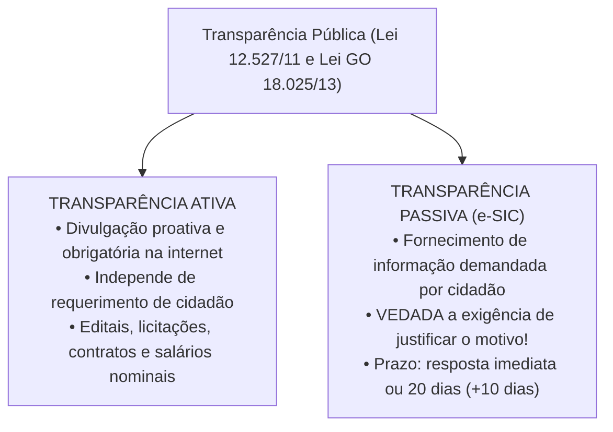
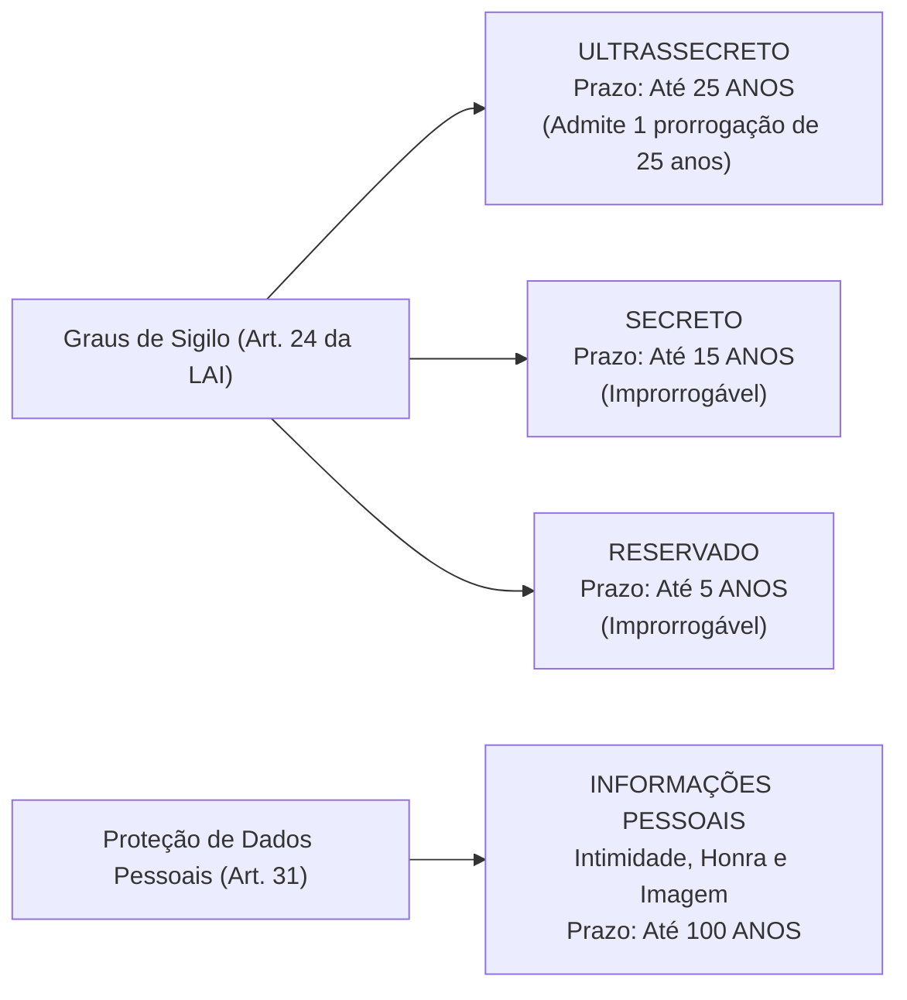
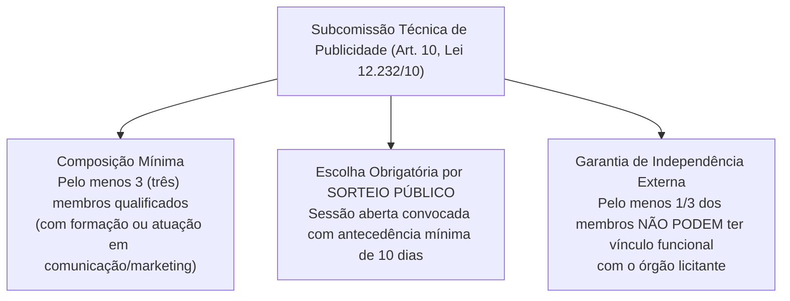

# 06 - Acesso à Informação (LAI Federal e Estadual GO) e Serviços de Publicidade

> **Matéria:** Noções de Direito Administrativo  
> **Cargo:** A01 – Técnico de Controle Externo – Especialidade: Técnico Administrativo  
> **Arquivo:** `06_acesso_a_informacao_e_contratos_publicidade.md`  

---

## 📌 Ementa / Itens do Edital
- Direito de acesso à informação e transparência pública
- Lei Federal nº 12.527/2011 (Lei de Acesso à Informação - LAI)
- Lei Estadual de Goiás nº 18.025/2013 (Acesso à informação no âmbito do Estado de Goiás)
- Transparência ativa vs. transparência passiva; Serviço de Informações ao Cidadão (SIC)
- Prazos, pedidos e recursos no procedimento de acesso à informação
- Classificação de informações sigilosas: graus de sigilo (ultrassecreto, secreto e reservado), prazos e proteção a dados pessoais (100 anos)
- Contratação de serviços de publicidade pela Administração Pública: Lei Federal nº 12.232/2010 e alterações
- Julgamento por subcomissão técnica e vedação da modalidade pregão para serviços de criação publicitária

---

## 🧭 Sumário

1. [Transparência Pública e Regime da Lei de Acesso à Informação](#1-transparencia-publica-e-regime-da-lei-de-acesso-a-informacao)
    1. [Diretrizes Fundamentais: A Publicidade como Regra Geral](#11-diretrizes-fundamentais-a-publicidade-como-regra-geral)
    2. [Transparência Ativa e a Divulgação de Vencimentos (Tema 483 / STF)](#12-transparencia-ativa-e-a-divulgacao-de-vencimentos-tema-483-stf)
    3. [Transparência Passiva e a Vedação de Justificativa (Art. 10, § 3º)](#13-transparencia-passiva-e-a-vedacao-de-justificativa-art-10-3o)
    4. [Prazos Procedimentais e Regime Recursal](#14-prazos-procedimentais-e-regime-recursal)
    5. [Teste 056](#Teste-056)
    6. [Teste 057](#Teste-057)
    7. [Teste 058](#Teste-058)
    8. [Teste 059](#Teste-059)
2. [Classificação de Informações Sigilosas e Proteção de Dados Pessoais](#2-classificacao-de-informacoes-sigilosas-e-protecao-de-dados-pessoais)
    1. [Graus de Sigilo e Prazos Máximos de Restrição](#21-graus-de-sigilo-e-prazos-maximos-de-restricao)
    2. [Competência Funcional para Classificação no Estado de Goiás](#22-competencia-funcional-para-classificacao-no-estado-de-goias)
    3. [Proteção de Informações Pessoais (100 Anos)](#23-protecao-de-informacoes-pessoais-100-anos)
    4. [Vedação Absoluta de Sigilo: Violações a Direitos Humanos](#24-vedacao-absoluta-de-sigilo-violacoes-a-direitos-humanos)
    5. [Teste 060](#Teste-060)
    6. [Teste 061](#Teste-061)
    7. [Teste 062](#Teste-062)
3. [Licitações e Contratos de Serviços de Publicidade (Lei nº 12.232/2010)](#3-licitacoes-e-contratos-de-servicos-de-publicidade-lei-no-122322010)
    1. [Objeto Específico e a Vedação Categórica ao Pregão](#31-objeto-especifico-e-a-vedacao-categorica-ao-pregao)
    2. [Tipos Licitatórios Obrigatórios](#32-tipos-licitatorios-obrigatorios)
    3. [A Subcomissão Técnica de Julgamento (Art. 10)](#33-a-subcomissao-tecnica-de-julgamento-art-10)
    4. [Julgamento às Cegas e Proposta Técnica Desidentificada](#34-julgamento-as-cegas-e-proposta-tecnica-desidentificada)
    5. [Teste 063](#Teste-063)
    6. [Teste 064](#Teste-064)
    7. [Teste 065](#Teste-065)
4. [Fontes Recomendadas na Internet](#4-fontes-recomendadas-na-internet)

---

## 1. Transparência Pública e Regime da Lei de Acesso à Informação

O direito fundamental de acesso à informação pública, assegurado pelo art. 5º, inciso XXXIII, pelo art. 37, § 3º, II e pelo art. 216, § 2º da Constituição Federal, encontra-se disciplinado em âmbito nacional pela **Lei Federal nº 12.527/2011 (LAI)** e, no âmbito estadual goiano, pela **Lei Estadual de Goiás nº 18.025/2013**, incidindo sobre todos os Poderes do Estado, incluindo o Tribunal de Contas do Estado de Goiás (TCE-GO).

### 1.1 Diretrizes Fundamentais: A Publicidade como Regra Geral

O regime democrático inverte a lógica tradicional do segredo de Estado, assentando os seguintes pilares cogentes:

1. **Publicidade como Preceito Geral e Sigilo como Exceção:** Toda informação sob a custódia do Estado é originariamente pública; a restrição de acesso somente é admitida em caráter temporário, fundamentado e em rol estrito de hipóteses legais;
2. **Divulgação de Informações de Interesse Público Independentemente de Solicitações:** Dever estatal de transparência proativa contínua;
3. **Utilização de Meios de Comunicação Viabilizados pela Tecnologia:** Disponibilização de portais na internet em formatos eletrônicos abertos e estruturados;
4. **Fomento ao Controle Social da Administração Pública:** Viabilização do escrutínio republicano pelo cidadão.

### 1.2 Transparência Ativa e a Divulgação de Vencimentos (Tema 483 / STF)

A **transparência ativa** compreende o dever imposto aos órgãos públicos de veicular, em seus sítios oficiais na internet, independentemente de qualquer requerimento prévio de cidadãos, um rol mínimo de informações administrativas: estrutura organizacional, repasses financeiros, execução orçamentária detalhada, procedimentos licitatórios com editais e contratos na íntegra, relatórios de gestão fiscal e dados de auditoria externa.

#### A Divulgação Nominal de Remuneração e o Tema 483 do STF:
Uma das controvérsias mais relevantes decididas pelo Pretório Excelso refere-se à publicação dos salários de servidores públicos. No julgamento do **Tema 483 da Repercussão Geral (RE 652.777)**, o STF fixou a seguinte tese vinculante:
> *"É legítima a publicação, inclusive em sítio eletrônico mantido pela Administração Pública, dos nomes dos seus servidores e do valor dos correspondentes vencimentos e vantagens pecuniárias."*

- **Fundamento Constitucional:** A remuneração do servidor decorre do exercício de função pública remunerada com recursos arrecadados de toda a sociedade. A publicidade nominal e individualizada atende aos princípios republicano e da moralidade administrativa, não configurando invasão ilícita na intimidade ou na vida privada dos agentes públicos.

### 1.3 Transparência Passiva e a Vedação de Justificativa (Art. 10, § 3º)

A **transparência passiva** instrumentaliza o dever do poder público de responder a demandas específicas formuladas por qualquer interessado por meio do **Serviço de Informações ao Cidadão (SIC / e-SIC)**.

> 🚨 **REGRA DE OURO / ALERTA CRÍTICO FCC:**  
> O art. 10, § 3º, da Lei Federal nº 12.527/2011 (reproduzido textualmente na Lei Estadual/GO nº 18.025/2013) estabelece expressamente:  
> **"São vedadas quaisquer exigências relativas aos motivos determinantes da solicitação de informações de interesse público."**  
> O cidadão não precisa demonstrar interesse pessoal, não precisa de representação por advogado e **não precisa justificar o porquê** de estar solicitando a informação. Qualquer indeferimento administrativo fundado em "falta de legítimo interesse" ou "ausência de justificativa" é flagrantemente ilegal!

### 1.4 Prazos Procedimentais e Regime Recursal

O procedimento de atendimento às solicitações de informação rege-se pelos seguintes parâmetros temporais estritos:

- **Acesso Imediato:** Se a informação solicitada estiver disponível de pronto, o órgão deve franqueá-la de imediato ao requerente.
- **Prazo Ordinário:** Não sendo possível o acesso imediato, o órgão tem até **20 (vinte) dias** para prestar a informação, indicar que não possui a informação (apontando, se souber, o órgão correto) ou comunicar a recusa fundamentada de sigilo.
- **Prorrogação Justificada:** O prazo de 20 dias pode ser prorrogado por mais **10 (dez) dias** (totalizando até 30 dias), desde que haja **justificativa expressa prévia** comunicada formalmente ao cidadão antes do vencimento do prazo originário.
- **Recursos Administrativos:** No caso de indeferimento de acesso ou de omissão de resposta, o interessado pode interpor recurso administrativo no prazo de **10 (dez) dias** a contar da ciência da decisão, dirigido à autoridade hierarquicamente superior à que negou a informação, que terá o prazo de 5 (cinco) dias para deliberar.

---

## 2. Classificação de Informações Sigilosas e Proteção de Dados Pessoais

O sigilo é exceção estrita no ordenamento jurídico, admitido apenas quando a publicidade puser em risco a segurança da sociedade (vida, saúde ou integridade da população) ou do Estado (soberania, relações internacionais, inteligência, investigações).

### 2.1 Graus de Sigilo e Prazos Máximos de Restrição

A Lei Federal nº 12.527/2011 (art. 24) e a Lei Estadual nº 18.025/2013 classificam as informações sigilosas em três graus de hierarquia estrita:

| Grau de Sigilo | Prazo Máximo de Restrição | Possibilidade de Prorrogação? | Autoridade Competente em Goiás |
| :--- | :---: | :---: | :--- |
| **Ultrassecreto** | Até **25 anos** | **SIM** (apenas uma única vez, por igual período) | Governador do Estado e Presidentes dos Poderes / Tribunal de Contas |
| **Secreto** | Até **15 anos** | **NÃO** (prazo improrrogável) | Governador, Secretários de Estado e dirigentes máximos de autarquias |
| **Reservado** | Até **5 anos** | **NÃO** (prazo improrrogável) | Autoridades que exerçam funções de direção, chefia ou comando |

### 2.2 Competência Funcional para Classificação no Estado de Goiás

A classificação do sigilo é privativa de autoridades com expressa investidura legal:

- A classificação no grau **ultrassecreto** exige a chancela pessoal do Chefe do Poder Executivo (Governador) ou dos Presidentes da Assembleia Legislativa, do Tribunal de Justiça e do Tribunal de Contas.
- O grau **secreto** pode ser delegado até o nível de Secretários de Estado e dirigentes máximos de autarquias e fundações.
- O grau **reservado** pode ser firmado por autoridades que exerçam atribuições de direção, chefia ou assessoria superior.

### 2.3 Proteção de Informações Pessoais (100 Anos)

O art. 31 da LAI estabelece regime especial de proteção para as informações pessoais relativas à **intimidade, vida privada, honra e imagem**:

- Têm acesso restrito a agentes públicos legalmente autorizados e à própria pessoa a que se referem, independentemente de classificação de sigilo;
- O prazo máximo de restrição de acesso a informações pessoais sensíveis é de **até 100 (cem) anos**, a contar da data de sua produção.

### 2.4 Vedação Absoluta de Sigilo: Violações a Direitos Humanos

> 🚨 **ALERTA CRÍTICO DE PROVA FCC:**  
> O art. 21, parágrafo único, da LAI consagra uma vedação intransponível:  
> **Não pode ser objeto de qualquer classificação de sigilo nem ter seu acesso restringido a informação ou documento que verse sobre condutas que impliquem violação a direitos humanos praticadas por agentes públicos ou a mando de autoridades públicas!**

---

## 3. Licitações e Contratos de Serviços de Publicidade (Lei nº 12.232/2010)

A contratação de serviços de publicidade institucional pela Administração Pública direta e indireta de qualquer dos Poderes da União, Estados, DF e Municípios submete-se a regime jurídico especialíssimo regido pela **Lei Federal nº 12.232/2010** (combinada subsidiariamente com a Lei Geral de Licitações nº 14.133/2021).

### 3.1 Objeto Específico e a Vedação Categórica ao Pregão

- **Abrangência do Objeto (Art. 2º):** Destina-se exclusivamente à contratação de serviços prestados por intermédio de agências de propaganda, compreendendo o conjunto de atividades integradas de estudo, planejamento, conceituação, concepção, criação, execução interna e distribuição de peças e campanhas publicitárias.
- **VEDAÇÃO ABSOLUTA AO PREGÃO (Art. 5º da Lei 12.232/2010 c/c Art. 29 da Lei 14.133/2021):**  
  A criação publicitária constitui serviço eminentemente intelectual, subjetivo e artístico, cujos padrões de desempenho e qualidade não podem ser prévia e objetivamente definidos por especificações usuais de mercado. Portanto, **é terminantemente PROIBIDA a utilização da modalidade PREGÃO** para a contratação de serviços de publicidade que envolvam esforço criativo!

### 3.2 Tipos Licitatórios Obrigatórios

Por expressa imposição do art. 5º da Lei nº 12.232/2010, as licitações para serviços de publicidade devem ser processadas e julgadas **obrigatoriamente** por meio de um dos seguintes tipos licitatórios:

1. **Melhor Técnica**; ou
2. **Técnica e Preço**.

### 3.3 A Subcomissão Técnica de Julgamento (Art. 10)

Para julgar a proposta técnica das agências concorrentes, a lei afasta a comissão permanente genérica e exige a criação de uma **Subcomissão Técnica especializada**, que obedece a requisitos estritos:

1. **Número de Membros:** Composta por, no mínimo, **3 (três) membros** qualificados (com formação superior ou experiência comprovada na área de publicidade, comunicação social ou marketing);
2. **Sorteio Público:** A escolha dos membros é realizada obrigatoriamente por **sorteio público**, a partir de uma lista prévia com número de nomes pelo menos três vezes superior ao número de vagas;
3. **Regra de Desvinculação Funcional (Mínimo de 1/3 Externo):** Para assegurar a idoneidade e evitar favorecimentos políticos, a lei exige que **pelo menos um terço (1/3)** dos integrantes da subcomissão técnica seja composto por profissionais que **não mantenham nenhum vínculo funcional ou contratual com o órgão licitante**.

### 3.4 Julgamento às Cegas e Proposta Técnica Desidentificada

Para garantir o julgamento impessoal e estritamente técnico:

- A proposta técnica deve ser entregue em invólucro opaco e lacrado, **sem qualquer logotipo, marca, slogan, rubrica ou sinal que identifique a agência licitante** (*proposta apócrifa*);
- A violação da desidentificação acarreta a **desclassificação sumária e imediata** da proposta;
- A Subcomissão Técnica atribui as notas técnicas em sessão secreta de análise, e somente após a consolidação das notas os invólucros de identificação são abertos perante todos os licitantes.

---

## 4. Fontes Recomendadas na Internet

- [Lei Federal nº 12.527/2011 (Lei de Acesso à Informação - LAI)](https://www.planalto.gov.br/ccivil_03/_ato2011-2014/2011/lei/l12527.htm)  
  Regulamento nacional que fixa as diretrizes da transparência ativa e passiva, prazos do SIC e graus de classificação de sigilo.
- [Lei Estadual de Goiás nº 18.025/2013 (Lei de Acesso à Informação no Estado de Goiás)](https://legisla.casacivil.go.gov.br/pesquisa_legislacao/83437/lei-18025)  
  Marco normativo goiano de acesso à informação, transparência pública e competências para classificação de sigilo em âmbito estadual.
- [Lei Federal nº 12.232/2010 (Contratação de Serviços de Publicidade pela Administração Pública)](https://www.planalto.gov.br/ccivil_03/_ato2007-2010/2010/lei/l12232.htm)  
  Disciplina as licitações e contratos de serviços de publicidade institucional, o sorteio da subcomissão técnica e a vedação ao pregão.
- [STF - Tema 483 da Repercussão Geral (Divulgação Nominal de Remuneração de Servidores)](https://portal.stf.jus.br/jurisprudencia/repercussaoGeral/tema.asp?num=483)  
  Precedente vinculante consolidando a legitimidade da divulgação de nomes e vencimentos de servidores públicos em portais da transparência.
- [Lei Federal nº 14.133/2021 (Nova Lei de Licitações - Artigo 29)](https://www.planalto.gov.br/ccivil_03/_ato2019-2022/2021/lei/l14133.htm#art29)  
  Dispositivo que reitera a inaplicabilidade do pregão para contratações de serviços técnicos especializados e de publicidade criativa.
* DI PIETRO, Maria Sylvia Zanella. **Direito Administrativo**. 37. ed. Rio de Janeiro: Forense, 2024. (Cap. 3 e Cap. 9 - Princípio da Publicidade, Lei de Acesso à Informação e Licitações Especiais).
* CARVALHO FILHO, José dos Santos. **Manual de Direito Administrativo**. 38. ed. Barueri: Atlas, 2024. (Cap. 1 e Cap. 6 - Transparência Administrativa, Sigilo Oficial e Regime da Lei 12.527/2011).
* JUSTEN FILHO, Marçal. **Comentários à Lei de Licitações e Contratações Administrativas: Lei 14.133/2021**. 2. ed. São Paulo: Thomson Reuters Brasil, 2023. (Comentários aos arts. 1º a 5º e Regimes Licitatórios Especiais da Lei 12.232/2010).
