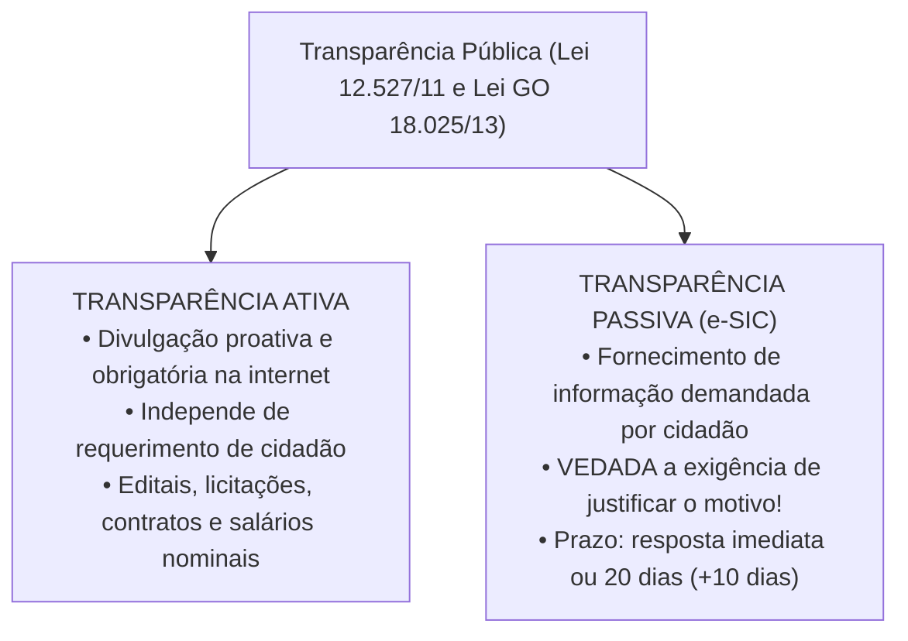
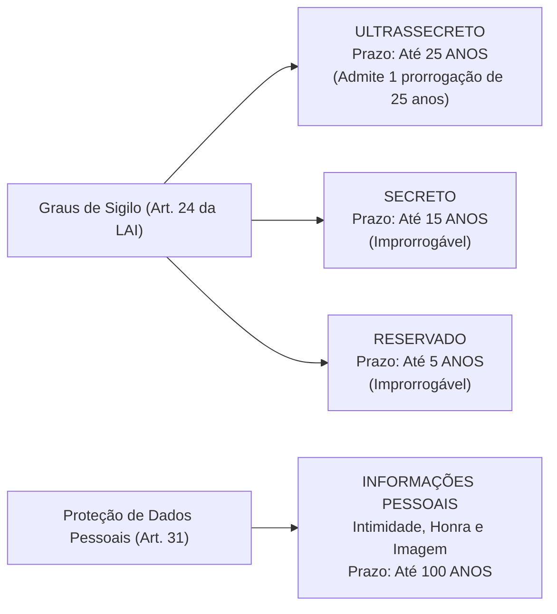
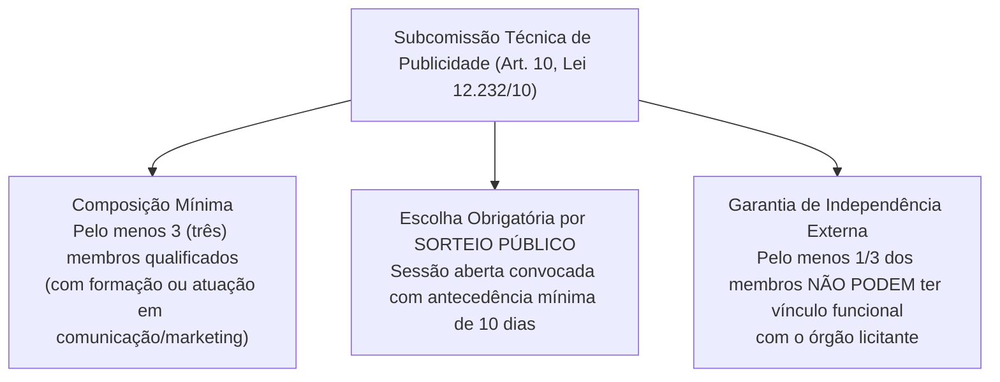

# 06 - Acesso à Informação (LAI Federal e Estadual GO) e Serviços de Publicidade

> **Matéria:** Noções de Direito Administrativo  
> **Cargo:** A01 – Técnico de Controle Externo – Especialidade: Técnico Administrativo  
> **Arquivo:** `06_acesso_a_informacao_e_contratos_publicidade.md`  

---

## 📌 Ementa / Itens do Edital
- Direito de acesso à informação e transparência pública
- Lei Federal nº 12.527/2011 (Lei de Acesso à Informação - LAI)
- Lei Estadual de Goiás nº 18.025/2013 (Acesso à informação no âmbito do Estado de Goiás)
- Transparência ativa vs. transparência passiva; Serviço de Informações ao Cidadão (SIC)
- Prazos, pedidos e recursos no procedimento de acesso à informação
- Classificação de informações sigilosas: graus de sigilo (ultrassecreto, secreto e reservado), prazos e proteção a dados pessoais (100 anos)
- Contratação de serviços de publicidade pela Administração Pública: Lei Federal nº 12.232/2010 e alterações
- Julgamento por subcomissão técnica e vedação da modalidade pregão para serviços de criação publicitária

---

## 🧭 Sumário

1. [Transparência Pública e Regime da Lei de Acesso à Informação](#1-transparencia-publica-e-regime-da-lei-de-acesso-a-informacao)
    1. [Diretrizes Fundamentais: A Publicidade como Regra Geral](#11-diretrizes-fundamentais-a-publicidade-como-regra-geral)
    2. [Transparência Ativa e a Divulgação de Vencimentos (Tema 483 / STF)](#12-transparencia-ativa-e-a-divulgacao-de-vencimentos-tema-483-stf)
    3. [Transparência Passiva e a Vedação de Justificativa (Art. 10, § 3º)](#13-transparencia-passiva-e-a-vedacao-de-justificativa-art-10-3o)
    4. [Prazos Procedimentais e Regime Recursal](#14-prazos-procedimentais-e-regime-recursal)
    5. [Teste 056](#Teste-056)
    6. [Teste 057](#Teste-057)
    7. [Teste 058](#Teste-058)
    8. [Teste 059](#Teste-059)
2. [Classificação de Informações Sigilosas e Proteção de Dados Pessoais](#2-classificacao-de-informacoes-sigilosas-e-protecao-de-dados-pessoais)
    1. [Graus de Sigilo e Prazos Máximos de Restrição](#21-graus-de-sigilo-e-prazos-maximos-de-restricao)
    2. [Competência Funcional para Classificação no Estado de Goiás](#22-competencia-funcional-para-classificacao-no-estado-de-goias)
    3. [Proteção de Informações Pessoais (100 Anos)](#23-protecao-de-informacoes-pessoais-100-anos)
    4. [Vedação Absoluta de Sigilo: Violações a Direitos Humanos](#24-vedacao-absoluta-de-sigilo-violacoes-a-direitos-humanos)
    5. [Teste 060](#Teste-060)
    6. [Teste 061](#Teste-061)
    7. [Teste 062](#Teste-062)
3. [Licitações e Contratos de Serviços de Publicidade (Lei nº 12.232/2010)](#3-licitacoes-e-contratos-de-servicos-de-publicidade-lei-no-122322010)
    1. [Objeto Específico e a Vedação Categórica ao Pregão](#31-objeto-especifico-e-a-vedacao-categorica-ao-pregao)
    2. [Tipos Licitatórios Obrigatórios](#32-tipos-licitatorios-obrigatorios)
    3. [A Subcomissão Técnica de Julgamento (Art. 10)](#33-a-subcomissao-tecnica-de-julgamento-art-10)
    4. [Julgamento às Cegas e Proposta Técnica Desidentificada](#34-julgamento-as-cegas-e-proposta-tecnica-desidentificada)
    5. [Teste 063](#Teste-063)
    6. [Teste 064](#Teste-064)
    7. [Teste 065](#Teste-065)
4. [Fontes Recomendadas na Internet](#4-fontes-recomendadas-na-internet)

---

## 1. Transparência Pública e Regime da Lei de Acesso à Informação

O direito fundamental de acesso à informação pública, assegurado pelo art. 5º, inciso XXXIII, pelo art. 37, § 3º, II e pelo art. 216, § 2º da Constituição Federal, encontra-se disciplinado em âmbito nacional pela **Lei Federal nº 12.527/2011 (LAI)** e, no âmbito estadual goiano, pela **Lei Estadual de Goiás nº 18.025/2013**, incidindo sobre todos os Poderes do Estado, incluindo o Tribunal de Contas do Estado de Goiás (TCE-GO).

### 1.1 Diretrizes Fundamentais: A Publicidade como Regra Geral

O regime democrático inverte a lógica tradicional do segredo de Estado, assentando os seguintes pilares cogentes:

1. **Publicidade como Preceito Geral e Sigilo como Exceção:** Toda informação sob a custódia do Estado é originariamente pública; a restrição de acesso somente é admitida em caráter temporário, fundamentado e em rol estrito de hipóteses legais;
2. **Divulgação de Informações de Interesse Público Independentemente de Solicitações:** Dever estatal de transparência proativa contínua;
3. **Utilização de Meios de Comunicação Viabilizados pela Tecnologia:** Disponibilização de portais na internet em formatos eletrônicos abertos e estruturados;
4. **Fomento ao Controle Social da Administração Pública:** Viabilização do escrutínio republicano pelo cidadão.

### 1.2 Transparência Ativa e a Divulgação de Vencimentos (Tema 483 / STF)

A **transparência ativa** compreende o dever imposto aos órgãos públicos de veicular, em seus sítios oficiais na internet, independentemente de qualquer requerimento prévio de cidadãos, um rol mínimo de informações administrativas: estrutura organizacional, repasses financeiros, execução orçamentária detalhada, procedimentos licitatórios com editais e contratos na íntegra, relatórios de gestão fiscal e dados de auditoria externa.

#### A Divulgação Nominal de Remuneração e o Tema 483 do STF:
Uma das controvérsias mais relevantes decididas pelo Pretório Excelso refere-se à publicação dos salários de servidores públicos. No julgamento do **Tema 483 da Repercussão Geral (RE 652.777)**, o STF fixou a seguinte tese vinculante:
> *"É legítima a publicação, inclusive em sítio eletrônico mantido pela Administração Pública, dos nomes dos seus servidores e do valor dos correspondentes vencimentos e vantagens pecuniárias."*

- **Fundamento Constitucional:** A remuneração do servidor decorre do exercício de função pública remunerada com recursos arrecadados de toda a sociedade. A publicidade nominal e individualizada atende aos princípios republicano e da moralidade administrativa, não configurando invasão ilícita na intimidade ou na vida privada dos agentes públicos.

### 1.3 Transparência Passiva e a Vedação de Justificativa (Art. 10, § 3º)

A **transparência passiva** instrumentaliza o dever do poder público de responder a demandas específicas formuladas por qualquer interessado por meio do **Serviço de Informações ao Cidadão (SIC / e-SIC)**.

> 🚨 **REGRA DE OURO / ALERTA CRÍTICO FCC:**  
> O art. 10, § 3º, da Lei Federal nº 12.527/2011 (reproduzido textualmente na Lei Estadual/GO nº 18.025/2013) estabelece expressamente:  
> **"São vedadas quaisquer exigências relativas aos motivos determinantes da solicitação de informações de interesse público."**  
> O cidadão não precisa demonstrar interesse pessoal, não precisa de representação por advogado e **não precisa justificar o porquê** de estar solicitando a informação. Qualquer indeferimento administrativo fundado em "falta de legítimo interesse" ou "ausência de justificativa" é flagrantemente ilegal!

### 1.4 Prazos Procedimentais e Regime Recursal

O procedimento de atendimento às solicitações de informação rege-se pelos seguintes parâmetros temporais estritos:

- **Acesso Imediato:** Se a informação solicitada estiver disponível de pronto, o órgão deve franqueá-la de imediato ao requerente.
- **Prazo Ordinário:** Não sendo possível o acesso imediato, o órgão tem até **20 (vinte) dias** para prestar a informação, indicar que não possui a informação (apontando, se souber, o órgão correto) ou comunicar a recusa fundamentada de sigilo.
- **Prorrogação Justificada:** O prazo de 20 dias pode ser prorrogado por mais **10 (dez) dias** (totalizando até 30 dias), desde que haja **justificativa expressa prévia** comunicada formalmente ao cidadão antes do vencimento do prazo originário.
- **Recursos Administrativos:** No caso de indeferimento de acesso ou de omissão de resposta, o interessado pode interpor recurso administrativo no prazo de **10 (dez) dias** a contar da ciência da decisão, dirigido à autoridade hierarquicamente superior à que negou a informação, que terá o prazo de 5 (cinco) dias para deliberar.

---

### Teste 056
**(FGV – TJ-SC – Analista Administrativo – 2026)**
A Lei nº 12.527/2011 (Lei de Acesso à Informação) e a Lei Complementar nº 131/2009, que acrescentou dispositivos à Lei de Responsabilidade Fiscal, estabelecem deveres de divulgação de informações pelos órgãos e entidades públicos, distinguindo-se duas modalidades de prestação dessas informações, conforme exista ou não provocação do interessado. Na Secretaria Estadual de Planejamento, foram registradas, em determinada semana, as seguintes ocorrências: I. publicação espontânea, no portal eletrônico do órgão, dos dados relativos à execução orçamentária e financeira, com atualização em tempo real, contendo informações pormenorizadas sobre receitas e despesas; II. fornecimento de cópia integral de contrato administrativo a cidadão que apresentou requerimento formal por meio do Serviço de Informação ao Cidadão (SIC), no prazo legal de resposta; e III. divulgação, em sítio oficial, do rol de competências, da estrutura organizacional, dos endereços e telefones das respectivas unidades e dos horários de atendimento ao público, independentemente de qualquer solicitação. As ocorrências I, II e III correspondem, respectivamente, às hipóteses de transparência

* **A)** passiva, ativa e passiva.
* **B)** ativa, passiva e ativa.
* **C)** ativa, ativa e passiva.
* **D)** passiva, passiva e ativa.
* **E)** ativa, passiva e passiva.

---

> **Comentário Detalhado:**
>
> - **A)** **Correta.** Conforme fundamentado na seção *1.2 Transparência Ativa e a Divulgação de Vencimentos (Tema 483 / STF)* deste guia, a transparência ativa compreende o dever imposto aos órgãos públicos de veicular, em seus sítios oficiais na internet, independentemente de qualquer requerimento prévio de cidadãos, um rol mínimo de informações administrativas: estrutura organizacional, repasses financeiros, execução orçamentária detalhada, procedimentos licitatórios com editais e contratos na íntegra, relatórios de gestão fiscal e dados de auditoria externa. Dessa forma, está plenamente correta a assertiva da banca (FGV – TJ-SC/2026) ao estabelecer que "passiva, ativa e passiva".
> - **B)** **Incorreta.** A opção apresenta proposição em desacordo com os fundamentos teóricos e técnicos do tópico ao afirmar que "ativa, passiva e ativa". De acordo com a teoria estudada em *1.3 Transparência Passiva e a Vedação de Justificativa (Art. 10, § 3º)*, a transparência passiva instrumentaliza o dever do poder público de responder a demandas específicas formuladas por qualquer interessado por meio do Serviço de Informações ao Cidadão (SIC / e-SIC).
> - **C)** **Incorreta.** A opção apresenta proposição em desacordo com os fundamentos teóricos e técnicos do tópico ao afirmar que "ativa, ativa e passiva". De acordo com a teoria estudada em *4. Fontes Recomendadas na Internet*, regulamento nacional que fixa as diretrizes da transparência ativa e passiva, prazos do SIC e graus de classificação de sigilo.
> - **D)** **Incorreta.** A opção apresenta proposição em desacordo com os fundamentos teóricos e técnicos do tópico ao afirmar que "passiva, passiva e ativa". De acordo com a teoria estudada em *1.3 Transparência Passiva e a Vedação de Justificativa (Art. 10, § 3º)*, o art. 10, § 3º, da Lei Federal nº 12.527/2011 (reproduzido textualmente na Lei Estadual/GO nº 18.025/2013) estabelece expressamente.
> - **E)** **Incorreta.** A opção apresenta proposição em desacordo com os fundamentos teóricos e técnicos do tópico ao afirmar que "ativa, passiva e passiva". De acordo com a teoria estudada em *1.4 Prazos Procedimentais e Regime Recursal*, recursos Administrativos: No caso de indeferimento de acesso ou de omissão de resposta, o interessado pode interpor recurso administrativo no prazo de 10 (dez) dias a contar da ciência da decisão, dirigido à autoridade hierarquicamente superior à que negou a informação, que terá o prazo de 5 (cinco) dias para deliberar.
>
> **Gabarito: A**

---

### Teste 057
**(FGV – TCE-PA – Auditor de Controle Externo Administrativa Direito – 2024)**
A Lei nº 12.527/2011, conhecida como a Lei de Acesso à Informação – LAI, regulamenta o direito constitucional de acesso às informações públicas. Sobre o tema, analise as afirmativas a seguir. I. A LAI restringe a divulgação de informação pessoal relativa à intimidade, vida privada, honra e imagem. II. As empresas públicas não se submetem ao regime da LAI. III. O serviço de busca e fornecimento da informação pública poderá ser remunerado mediante taxa. Está correto o que se afirma em

* **A)** I, apenas.
* **B)** I e II, apenas.
* **C)** II e III, apenas.
* **D)** I e III, apenas.
* **E)** III, apenas.

---

> **Comentário Detalhado:**
>
> - **A)** **Incorreta.** A opção incorre em restrição indevida ao limitar o escopo conceitual ao afirmar que "I, apenas". De acordo com a teoria estudada em *1. Transparência Pública e Regime da Lei de Acesso à Informação*, o direito fundamental de acesso à informação pública, assegurado pelo art. 5º, inciso XXXIII, pelo art. 37, § 3º, II e pelo art. 216, § 2º da Constituição Federal, encontra-se disciplinado em âmbito nacional pela Lei Federal nº 12.527/2011 (LAI) e, no âmbito estadual goiano, pela Lei Estadual de Goiás nº 18.025/2013, incidindo sobre todos os Poderes do Estado, incluindo o Tribunal de Contas do Estado de Goiás (TCE-GO).
> - **B)** **Incorreta.** A opção incorre em restrição indevida ao limitar o escopo conceitual ao afirmar que "I e II, apenas". De acordo com a teoria estudada em *A Divulgação Nominal de Remuneração e o Tema 483 do STF:*, a publicidade nominal e individualizada atende aos princípios republicano e da moralidade administrativa, não configurando invasão ilícita na intimidade ou na vida privada dos agentes públicos.
> - **C)** **Correta.** Conforme fundamentado na seção *2.3 Proteção de Informações Pessoais (100 Anos)* deste guia, o art. 31 da LAI estabelece regime especial de proteção para as informações pessoais relativas à intimidade, vida privada, honra e imagem. Dessa forma, está plenamente correta a assertiva da banca (FGV – TCE-PA/2024) ao estabelecer que "II e III, apenas".
> - **D)** **Incorreta.** A opção incorre em restrição indevida ao limitar o escopo conceitual ao afirmar que "I e III, apenas". De acordo com a teoria estudada em *4. Fontes Recomendadas na Internet*, lei Federal nº 12.527/2011 (Lei de Acesso à Informação - LAI).
> - **E)** **Incorreta.** A opção incorre em restrição indevida ao limitar o escopo conceitual ao afirmar que "III, apenas". De acordo com a teoria estudada em *4. Fontes Recomendadas na Internet*, cARVALHO FILHO, José dos Santos. Manual de Direito Administrativo. 38. ed. Barueri: Atlas, 2024. (Cap. 1 e Cap. 6 - Transparência Administrativa, Sigilo Oficial e Regime da Lei 12.527/2011).
>
> **Gabarito: C**

---

### Teste 058
**(FGV – TJ-SC – Analista Administrativo – 2026)**
O Portal da Transparência do governo federal brasileiro, criado em 2004, constitui hoje a mais popular e premiada solução de transparência do governo brasileiro, cuja finalidade é franquear informações on-line sobre a máquina estatal no país. Sua trajetória se insere no ciclo de reformas para a transparência na América Latina, impulsionado pelo discurso da boa governança e pela associação entre opacidade estatal e práticas corruptas. Sobre o Portal da Transparência como instrumento de controle social, é correto afirmar que

* **A)** constitui instrumento de transparência passiva, pois condiciona o acesso às informações sobre a máquina estatal à apresentação de requerimento prévio pelo cidadão interessado.
* **B)** foi desenvolvido pelo Tribunal de Contas da União, no exercício de suas competências constitucionais de fiscalização contábil, financeira e orçamentária da Administração Pública Federal.
* **C)** representa instrumento de transparência ativa que franqueia, em formato on-line, informações sobre receitas, despesas, salários e contratos, fortalecendo simultaneamente o controle social e o controle governamental.
* **D)** corresponde ao canal eletrônico de divulgação periódica do Relatório Resumido de Execução Orçamentária e do Relatório de Gestão Fiscal, em ciclos quadrimestrais de prestação de contas dirigidos primariamente aos órgãos de controle externo.
* **E)** opera como sistema eletrônico destinado ao recebimento e ao processamento de pedidos individuais de acesso à informação dirigidos aos órgãos e entidades da Administração Pública federal, com posterior encaminhamento das respostas aos requerentes.

---

> **Comentário Detalhado:**
>
> - **A)** **Incorreta.** A opção apresenta proposição em desacordo com os fundamentos teóricos e técnicos do tópico ao afirmar que "constitui instrumento de transparência passiva, pois condiciona o acesso às informações sobre a máquina estatal à...". De acordo com a teoria estudada em *1.2 Transparência Ativa e a Divulgação de Vencimentos (Tema 483 / STF)*, a transparência ativa compreende o dever imposto aos órgãos públicos de veicular, em seus sítios oficiais na internet, independentemente de qualquer requerimento prévio de cidadãos, um rol mínimo de informações administrativas: estrutura organizacional, repasses financeiros, execução orçamentária detalhada, procedimentos licitatórios com editais e contratos na íntegra, relatórios de gestão fiscal e dados de auditoria externa.
> - **B)** **Correta.** Conforme fundamentado na seção *3. Licitações e Contratos de Serviços de Publicidade (Lei nº 12.232/2010)* deste guia, a contratação de serviços de publicidade institucional pela Administração Pública direta e indireta de qualquer dos Poderes da União, Estados, DF e Municípios submete-se a regime jurídico especialíssimo regido pela Lei Federal nº 12.232/2010 (combinada subsidiariamente com a Lei Geral de Licitações nº 14.133/2021). Dessa forma, está plenamente correta a assertiva da banca (FGV – TJ-SC/2026) ao estabelecer que "foi desenvolvido pelo Tribunal de Contas da União, no exercício de suas competências constitucionais de...".
> - **C)** **Incorreta.** A opção apresenta proposição em desacordo com os fundamentos teóricos e técnicos do tópico ao afirmar que "representa instrumento de transparência ativa que franqueia, em formato on-line, informações sobre receitas...". De acordo com a teoria estudada em *1.1 Diretrizes Fundamentais: A Publicidade como Regra Geral*, fomento ao Controle Social da Administração Pública: Viabilização do escrutínio republicano pelo cidadão.
> - **D)** **Incorreta.** A opção apresenta proposição em desacordo com os fundamentos teóricos e técnicos do tópico ao afirmar que "corresponde ao canal eletrônico de divulgação periódica do Relatório Resumido de Execução Orçamentária e do...". De acordo com a teoria estudada em *A Divulgação Nominal de Remuneração e o Tema 483 do STF:*, *"É legítima a publicação, inclusive em sítio eletrônico mantido pela Administração Pública, dos nomes dos seus servidores e do valor dos correspondentes vencimentos e vantagens pecuniárias."*.
> - **E)** **Incorreta.** A opção apresenta proposição em desacordo com os fundamentos teóricos e técnicos do tópico ao afirmar que "opera como sistema eletrônico destinado ao recebimento e ao processamento de pedidos individuais de acesso à...". De acordo com a teoria estudada em *4. Fontes Recomendadas na Internet*, marco normativo goiano de acesso à informação, transparência pública e competências para classificação de sigilo em âmbito estadual.
>
> **Gabarito: B**

---

### Teste 059
**(FGV – TCE-SC – Auditor Fiscal de Controle Externo Administracao – 2026)**
A Lei de Acesso à Informação (LAI – Lei nº 12.527/2011) estabelece os procedimentos a serem observados pelos órgãos e entidades públicas, com a finalidade de garantir o acesso dos cidadãos às informações produzidas ou custodiadas pelo Estado. Um cidadão formulou pedido de acesso a documentos relacionados a contrato firmado por autarquia federal, sem apresentar qualquer justificativa para a solicitação. O órgão, por sua vez, indeferiu o pedido sob o argumento de que a ausência de motivação pelo requerente impediria a análise da pertinência do acesso. Com base na LAI, assinale a afirmativa correta.

* **A)** O indeferimento foi correto, pois a LAI exige que o requerente indique as razões do pedido de acesso à informação, permitindo ao órgão avaliar a pertinência e a finalidade da solicitação antes de conceder o acesso.
* **B)** O indeferimento foi correto apenas em relação a contratos que envolvam informações de caráter pessoal de terceiros, hipótese em que a LAI exige motivação expressa do requerente para fins de ponderação entre o direito de acesso e a proteção de dados.
* **C)** O indeferimento foi incorreto, pois a LAI veda expressamente a exigência de motivação como condição para o pedido de acesso à informação, sendo suficiente a identificação do requerente, e as informações contratuais de entidades públicas enquadram-se como informações de transparência ativa obrigatória.
* **D)** O indeferimento foi incorreto quanto à ausência de motivação, mas seria válido caso o contrato envolvesse valores acima do limite legal, hipótese em que a LAI autoriza a classificação das informações contratuais como sigilosas.
* **E)** O indeferimento foi incorreto, pois a LAI dispensa até mesmo a identificação do requerente para fins de pedido de acesso à informação, bastando a formalização da solicitação pelo canal oficial do órgão.

---

> **Comentário Detalhado:**
>
> - **A)** **Incorreta.** A opção apresenta proposição em desacordo com os fundamentos teóricos e técnicos do tópico ao afirmar que "O indeferimento foi correto, pois a LAI exige que o requerente indique as razões do pedido de acesso à informação...". De acordo com a teoria estudada em *1.4 Prazos Procedimentais e Regime Recursal*, prazo Ordinário: Não sendo possível o acesso imediato, o órgão tem até 20 (vinte) dias para prestar a informação, indicar que não possui a informação (apontando, se souber, o órgão correto) ou comunicar a recusa fundamentada de sigilo.
> - **B)** **Incorreta.** A opção incorre em restrição indevida ao limitar o escopo conceitual ao afirmar que "O indeferimento foi correto apenas em relação a contratos que envolvam informações de caráter pessoal de...". De acordo com a teoria estudada em *1.2 Transparência Ativa e a Divulgação de Vencimentos (Tema 483 / STF)*, a transparência ativa compreende o dever imposto aos órgãos públicos de veicular, em seus sítios oficiais na internet, independentemente de qualquer requerimento prévio de cidadãos, um rol mínimo de informações administrativas: estrutura organizacional, repasses financeiros, execução orçamentária detalhada, procedimentos licitatórios com editais e contratos na íntegra, relatórios de gestão fiscal e dados de auditoria externa.
> - **C)** **Incorreta.** A opção apresenta vedação ou negativa absoluta incompatível com a regra aplicável ao afirmar que "O indeferimento foi incorreto, pois a LAI veda expressamente a exigência de motivação como condição para o pedido...". De acordo com a teoria estudada em *1. Transparência Pública e Regime da Lei de Acesso à Informação*, o direito fundamental de acesso à informação pública, assegurado pelo art. 5º, inciso XXXIII, pelo art. 37, § 3º, II e pelo art. 216, § 2º da Constituição Federal, encontra-se disciplinado em âmbito nacional pela Lei Federal nº 12.527/2011 (LAI) e, no âmbito estadual goiano, pela Lei Estadual de Goiás nº 18.025/2013, incidindo sobre todos os Poderes do Estado, incluindo o Tribunal de Contas do Estado de Goiás (TCE-GO).
> - **D)** **Incorreta.** A opção apresenta proposição em desacordo com os fundamentos teóricos e técnicos do tópico ao afirmar que "O indeferimento foi incorreto quanto à ausência de motivação, mas seria válido caso o contrato envolvesse valores...". De acordo com a teoria estudada em *1.4 Prazos Procedimentais e Regime Recursal*, recursos Administrativos: No caso de indeferimento de acesso ou de omissão de resposta, o interessado pode interpor recurso administrativo no prazo de 10 (dez) dias a contar da ciência da decisão, dirigido à autoridade hierarquicamente superior à que negou a informação, que terá o prazo de 5 (cinco) dias para deliberar.
> - **E)** **Correta.** Conforme fundamentado na seção *1.4 Prazos Procedimentais e Regime Recursal* deste guia, acesso Imediato: Se a informação solicitada estiver disponível de pronto, o órgão deve franqueá-la de imediato ao requerente. Dessa forma, está plenamente correta a assertiva da banca (FGV – TCE-SC/2026) ao estabelecer que "O indeferimento foi incorreto, pois a LAI dispensa até mesmo a identificação do requerente para fins de pedido de...".
>
> **Gabarito: E**

---

## 2. Classificação de Informações Sigilosas e Proteção de Dados Pessoais

O sigilo é exceção estrita no ordenamento jurídico, admitido apenas quando a publicidade puser em risco a segurança da sociedade (vida, saúde ou integridade da população) ou do Estado (soberania, relações internacionais, inteligência, investigações).

### 2.1 Graus de Sigilo e Prazos Máximos de Restrição

A Lei Federal nº 12.527/2011 (art. 24) e a Lei Estadual nº 18.025/2013 classificam as informações sigilosas em três graus de hierarquia estrita:

| Grau de Sigilo | Prazo Máximo de Restrição | Possibilidade de Prorrogação? | Autoridade Competente em Goiás |
| :--- | :---: | :---: | :--- |
| **Ultrassecreto** | Até **25 anos** | **SIM** (apenas uma única vez, por igual período) | Governador do Estado e Presidentes dos Poderes / Tribunal de Contas |
| **Secreto** | Até **15 anos** | **NÃO** (prazo improrrogável) | Governador, Secretários de Estado e dirigentes máximos de autarquias |
| **Reservado** | Até **5 anos** | **NÃO** (prazo improrrogável) | Autoridades que exerçam funções de direção, chefia ou comando |

### 2.2 Competência Funcional para Classificação no Estado de Goiás

A classificação do sigilo é privativa de autoridades com expressa investidura legal:

- A classificação no grau **ultrassecreto** exige a chancela pessoal do Chefe do Poder Executivo (Governador) ou dos Presidentes da Assembleia Legislativa, do Tribunal de Justiça e do Tribunal de Contas.
- O grau **secreto** pode ser delegado até o nível de Secretários de Estado e dirigentes máximos de autarquias e fundações.
- O grau **reservado** pode ser firmado por autoridades que exerçam atribuições de direção, chefia ou assessoria superior.

### 2.3 Proteção de Informações Pessoais (100 Anos)

O art. 31 da LAI estabelece regime especial de proteção para as informações pessoais relativas à **intimidade, vida privada, honra e imagem**:

- Têm acesso restrito a agentes públicos legalmente autorizados e à própria pessoa a que se referem, independentemente de classificação de sigilo;
- O prazo máximo de restrição de acesso a informações pessoais sensíveis é de **até 100 (cem) anos**, a contar da data de sua produção.

### 2.4 Vedação Absoluta de Sigilo: Violações a Direitos Humanos

> 🚨 **ALERTA CRÍTICO DE PROVA FCC:**  
> O art. 21, parágrafo único, da LAI consagra uma vedação intransponível:  
> **Não pode ser objeto de qualquer classificação de sigilo nem ter seu acesso restringido a informação ou documento que verse sobre condutas que impliquem violação a direitos humanos praticadas por agentes públicos ou a mando de autoridades públicas!**

---

### Teste 060
**(FGV – TRT-24 – Analista Judiciario Area Administrativa Sem Especialidade – 2025)**
A Lei de Acesso à Informação (LAI), Lei n.° 12.527/2011, reforça o compromisso da Administração Pública com a transparência e a ética, promovendo o acesso do cidadão às informações governamentais como instrumento fundamental para o controle social e o fortalecimento da democracia. Assinale a opção que apresenta corretamente uma disposição das informações pessoais da LAI.

* **A)** Informações pessoais podem ser divulgadas livremente após 10 anos, desde que não envolvam agentes públicos.
* **B)** O acesso a informações relativas à intimidade, vida privada, honra e imagem é restrito por até 50 anos, salvo decisão judicial.
* **C)** A divulgação de informações pessoais depende exclusivamente de ordem judicial, independentemente de consentimento da pessoa envolvida.
* **D)** A restrição de acesso a informações pessoais pode ser utilizada para impedir investigações de irregularidades que envolvam o titular dos dados.
* **E)** O tratamento de informações pessoais deve respeitar a intimidade e os direitos individuais, sendo vedado seu uso indevido, sob pena de responsabilização.

---

> **Comentário Detalhado:**
>
> - **A)** **Incorreta.** A opção apresenta proposição em desacordo com os fundamentos teóricos e técnicos do tópico ao afirmar que "Informações pessoais podem ser divulgadas livremente após 10 anos, desde que não envolvam agentes públicos". De acordo com a teoria estudada em *2.3 Proteção de Informações Pessoais (100 Anos)*, têm acesso restrito a agentes públicos legalmente autorizados e à própria pessoa a que se referem, independentemente de classificação de sigilo.
> - **B)** **Incorreta.** A opção apresenta proposição em desacordo com os fundamentos teóricos e técnicos do tópico ao afirmar que "O acesso a informações relativas à intimidade, vida privada, honra e imagem é restrito por até 50 anos, salvo...". De acordo com a teoria estudada em *2.3 Proteção de Informações Pessoais (100 Anos)*, o art. 31 da LAI estabelece regime especial de proteção para as informações pessoais relativas à intimidade, vida privada, honra e imagem.
> - **C)** **Incorreta.** A opção incorre em restrição indevida ao limitar o escopo conceitual ao afirmar que "A divulgação de informações pessoais depende exclusivamente de ordem judicial, independentemente de consentimento...". De acordo com a teoria estudada em *1.2 Transparência Ativa e a Divulgação de Vencimentos (Tema 483 / STF)*, a transparência ativa compreende o dever imposto aos órgãos públicos de veicular, em seus sítios oficiais na internet, independentemente de qualquer requerimento prévio de cidadãos, um rol mínimo de informações administrativas: estrutura organizacional, repasses financeiros, execução orçamentária detalhada, procedimentos licitatórios com editais e contratos na íntegra, relatórios de gestão fiscal e dados de auditoria externa.
> - **D)** **Correta.** Conforme fundamentado na seção *2. Classificação de Informações Sigilosas e Proteção de Dados Pessoais* deste guia, o sigilo é exceção estrita no ordenamento jurídico, admitido apenas quando a publicidade puser em risco a segurança da sociedade (vida, saúde ou integridade da população) ou do Estado (soberania, relações internacionais, inteligência, investigações). Dessa forma, está plenamente correta a assertiva da banca (FGV – TRT-24/2025) ao estabelecer que "A restrição de acesso a informações pessoais pode ser utilizada para impedir investigações de irregularidades que...".
> - **E)** **Incorreta.** A opção apresenta proposição em desacordo com os fundamentos teóricos e técnicos do tópico ao afirmar que "O tratamento de informações pessoais deve respeitar a intimidade e os direitos individuais, sendo vedado seu uso...". De acordo com a teoria estudada em *2.4 Vedação Absoluta de Sigilo: Violações a Direitos Humanos*, não pode ser objeto de qualquer classificação de sigilo nem ter seu acesso restringido a informação ou documento que verse sobre condutas que impliquem violação a direitos humanos praticadas por agentes públicos ou a mando de autoridades públicas!.
>
> **Gabarito: D**

---

### Teste 061
**(FGV – TRT-1 – Analista Judiciario Area Administrativa – 2024)**
De acordo com a Lei nº 12.527/2011, cabe aos órgãos e entidades do Poder Público, observados os procedimentos específicos aplicáveis e as normas, assegurar a proteção da informação sigilosa. É correto afirmar acerca desse tema, à luz do mencionado diploma legal, que:

* **A)** o prazo máximo de restrição de acesso para informação classificada como secreta é de vinte e cinco anos, vigorando a partir da data de sua produção;
* **B)** as informações cuja divulgação ou acesso irrestrito possam prejudicar ou causar risco a projetos de pesquisa e desenvolvimento científico ou tecnológico não podem ser consideradas como imprescindíveis à segurança da sociedade e do Estado e, portanto, passíveis de classificação de sigilo;
* **C)** a classificação do sigilo de informações no âmbito da Administração Pública federal no grau reservado é de competência de todos os servidores públicos federais que tenham sido regularmente investidos em cargos efetivos;
* **D)** o requerente deverá ser informado sobre a possibilidade de recurso, prazos e condições para sua interposição, quando não for autorizado o acesso por se tratar de informação total ou parcialmente sigilosa, devendo, ainda, ser-lhe indicada a autoridade competente para sua apreciação;
* **E)** o disposto na aludida norma abarca as situações previstas nas demais hipóteses legais de sigilo e de segredo de justiça, além de hipóteses de segredo industrial decorrentes da exploração direta de atividade econômica pelo Estado, afastando, por conseguinte, a aplicação das respectivas normas.

---

> **Comentário Detalhado:**
>
> - **A)** **Incorreta.** A opção apresenta proposição em desacordo com os fundamentos teóricos e técnicos do tópico ao afirmar que "o prazo máximo de restrição de acesso para informação classificada como secreta é de vinte e cinco anos, vigorando...". De acordo com a teoria estudada em *1.4 Prazos Procedimentais e Regime Recursal*, recursos Administrativos: No caso de indeferimento de acesso ou de omissão de resposta, o interessado pode interpor recurso administrativo no prazo de 10 (dez) dias a contar da ciência da decisão, dirigido à autoridade hierarquicamente superior à que negou a informação, que terá o prazo de 5 (cinco) dias para deliberar.
> - **B)** **Incorreta.** A opção apresenta proposição em desacordo com os fundamentos teóricos e técnicos do tópico ao afirmar que "as informações cuja divulgação ou acesso irrestrito possam prejudicar ou causar risco a projetos de pesquisa e...". De acordo com a teoria estudada em *2. Classificação de Informações Sigilosas e Proteção de Dados Pessoais*, o sigilo é exceção estrita no ordenamento jurídico, admitido apenas quando a publicidade puser em risco a segurança da sociedade (vida, saúde ou integridade da população) ou do Estado (soberania, relações internacionais, inteligência, investigações).
> - **C)** **Incorreta.** A opção apresenta proposição em desacordo com os fundamentos teóricos e técnicos do tópico ao afirmar que "a classificação do sigilo de informações no âmbito da Administração Pública federal no grau reservado é de...". De acordo com a teoria estudada em *2.2 Competência Funcional para Classificação no Estado de Goiás*, o grau reservado pode ser firmado por autoridades que exerçam atribuições de direção, chefia ou assessoria superior.
> - **D)** **Correta.** Conforme fundamentado na seção *2.1 Graus de Sigilo e Prazos Máximos de Restrição* deste guia, grau de Sigilo: Prazo Máximo de Restrição — Possibilidade de Prorrogação? — Autoridade Competente em Goiás. Dessa forma, está plenamente correta a assertiva da banca (FGV – TRT-1/2024) ao estabelecer que "o requerente deverá ser informado sobre a possibilidade de recurso, prazos e condições para sua interposição...".
> - **E)** **Incorreta.** A opção apresenta proposição em desacordo com os fundamentos teóricos e técnicos do tópico ao afirmar que "o disposto na aludida norma abarca as situações previstas nas demais hipóteses legais de sigilo e de segredo de...". De acordo com a teoria estudada em *1.1 Diretrizes Fundamentais: A Publicidade como Regra Geral*, publicidade como Preceito Geral e Sigilo como Exceção: Toda informação sob a custódia do Estado é originariamente pública; a restrição de acesso somente é admitida em caráter temporário, fundamentado e em rol estrito de hipóteses legais.
>
> **Gabarito: D**

---

### Teste 062
**(FGV – TCE-PA – Auditor de Controle Externo Administrativa Gestao Governamental – 2024)**
Após uma catástrofe verificada em determinada localidade, o Poder Público municipal planejou e divulgou que iria implementar certa política pública de contenção de desastres, mediante o estabelecimento de metas a serem atingidas, com prazo determinado, sendo certo que foi realizada audiência pública para tal finalidade. Passados dois anos de tal divulgação, por não vislumbrar as melhorias anunciadas, certa associação de moradores almeja buscar informações quanto à materialização de tal projeto. Diante dessa situação hipotética, à luz disposto na Lei nº 12.527/2011, é correto afirmar que

* **A)** a associação em questão apenas pode solicitar as informações almejadas, caso tenha participado da audiência pública.
* **B)** o Poder Público não é obrigado a fornecer as informações em questão se a associação não apresentar os motivos determinantes para o pedido de acesso formalizado.
* **C)** as matérias atinentes a políticas públicas, por natureza estão inseridas dentre aquelas que dizem respeito à segurança da sociedade e, por isso, sempre estarão abarcadas por sigilo.
* **D)** o Poder Público pode exigir a identificação do requerente de acesso à informação em questão, para a verificação da pertinência temática, sem o que pode inviabilizar a solicitação.
* **E)** o direito de acesso abarca às informações relativas à implementação, acompanhamento e resultados dos programas, projetos e ações dos órgãos e entidades públicas, bem como metas e indicadores propostos.

---

> **Comentário Detalhado:**
>
> - **A)** **Incorreta.** A opção incorre em restrição indevida ao limitar o escopo conceitual ao afirmar que "a associação em questão apenas pode solicitar as informações almejadas, caso tenha participado da audiência pública". De acordo com a teoria estudada em *1.4 Prazos Procedimentais e Regime Recursal*, recursos Administrativos: No caso de indeferimento de acesso ou de omissão de resposta, o interessado pode interpor recurso administrativo no prazo de 10 (dez) dias a contar da ciência da decisão, dirigido à autoridade hierarquicamente superior à que negou a informação, que terá o prazo de 5 (cinco) dias para deliberar.
> - **B)** **Incorreta.** A opção apresenta proposição em desacordo com os fundamentos teóricos e técnicos do tópico ao afirmar que "o Poder Público não é obrigado a fornecer as informações em questão se a associação não apresentar os motivos...". De acordo com a teoria estudada em *1.3 Transparência Passiva e a Vedação de Justificativa (Art. 10, § 3º)*, "São vedadas quaisquer exigências relativas aos motivos determinantes da solicitação de informações de interesse público.".
> - **C)** **Incorreta.** A opção promove generalização excessiva que desconsidera as condições técnicas e normativas ao afirmar que "as matérias atinentes a políticas públicas, por natureza estão inseridas dentre aquelas que dizem respeito à...". De acordo com a teoria estudada em *2. Classificação de Informações Sigilosas e Proteção de Dados Pessoais*, o sigilo é exceção estrita no ordenamento jurídico, admitido apenas quando a publicidade puser em risco a segurança da sociedade (vida, saúde ou integridade da população) ou do Estado (soberania, relações internacionais, inteligência, investigações).
> - **D)** **Incorreta.** A opção apresenta proposição em desacordo com os fundamentos teóricos e técnicos do tópico ao afirmar que "o Poder Público pode exigir a identificação do requerente de acesso à informação em questão, para a verificação da...". De acordo com a teoria estudada em *2.4 Vedação Absoluta de Sigilo: Violações a Direitos Humanos*, não pode ser objeto de qualquer classificação de sigilo nem ter seu acesso restringido a informação ou documento que verse sobre condutas que impliquem violação a direitos humanos praticadas por agentes públicos ou a mando de autoridades públicas!.
> - **E)** **Correta.** Conforme fundamentado na seção *1.2 Transparência Ativa e a Divulgação de Vencimentos (Tema 483 / STF)* deste guia, a transparência ativa compreende o dever imposto aos órgãos públicos de veicular, em seus sítios oficiais na internet, independentemente de qualquer requerimento prévio de cidadãos, um rol mínimo de informações administrativas: estrutura organizacional, repasses financeiros, execução orçamentária detalhada, procedimentos licitatórios com editais e contratos na íntegra, relatórios de gestão fiscal e dados de auditoria externa. Dessa forma, está plenamente correta a assertiva da banca (FGV – TCE-PA/2024) ao estabelecer que "o direito de acesso abarca às informações relativas à implementação, acompanhamento e resultados dos programas...".
>
> **Gabarito: E**

---

## 3. Licitações e Contratos de Serviços de Publicidade (Lei nº 12.232/2010)

A contratação de serviços de publicidade institucional pela Administração Pública direta e indireta de qualquer dos Poderes da União, Estados, DF e Municípios submete-se a regime jurídico especialíssimo regido pela **Lei Federal nº 12.232/2010** (combinada subsidiariamente com a Lei Geral de Licitações nº 14.133/2021).

### 3.1 Objeto Específico e a Vedação Categórica ao Pregão

- **Abrangência do Objeto (Art. 2º):** Destina-se exclusivamente à contratação de serviços prestados por intermédio de agências de propaganda, compreendendo o conjunto de atividades integradas de estudo, planejamento, conceituação, concepção, criação, execução interna e distribuição de peças e campanhas publicitárias.
- **VEDAÇÃO ABSOLUTA AO PREGÃO (Art. 5º da Lei 12.232/2010 c/c Art. 29 da Lei 14.133/2021):**  
  A criação publicitária constitui serviço eminentemente intelectual, subjetivo e artístico, cujos padrões de desempenho e qualidade não podem ser prévia e objetivamente definidos por especificações usuais de mercado. Portanto, **é terminantemente PROIBIDA a utilização da modalidade PREGÃO** para a contratação de serviços de publicidade que envolvam esforço criativo!

### 3.2 Tipos Licitatórios Obrigatórios

Por expressa imposição do art. 5º da Lei nº 12.232/2010, as licitações para serviços de publicidade devem ser processadas e julgadas **obrigatoriamente** por meio de um dos seguintes tipos licitatórios:

1. **Melhor Técnica**; ou
2. **Técnica e Preço**.

### 3.3 A Subcomissão Técnica de Julgamento (Art. 10)

Para julgar a proposta técnica das agências concorrentes, a lei afasta a comissão permanente genérica e exige a criação de uma **Subcomissão Técnica especializada**, que obedece a requisitos estritos:

1. **Número de Membros:** Composta por, no mínimo, **3 (três) membros** qualificados (com formação superior ou experiência comprovada na área de publicidade, comunicação social ou marketing);
2. **Sorteio Público:** A escolha dos membros é realizada obrigatoriamente por **sorteio público**, a partir de uma lista prévia com número de nomes pelo menos três vezes superior ao número de vagas;
3. **Regra de Desvinculação Funcional (Mínimo de 1/3 Externo):** Para assegurar a idoneidade e evitar favorecimentos políticos, a lei exige que **pelo menos um terço (1/3)** dos integrantes da subcomissão técnica seja composto por profissionais que **não mantenham nenhum vínculo funcional ou contratual com o órgão licitante**.

### 3.4 Julgamento às Cegas e Proposta Técnica Desidentificada

Para garantir o julgamento impessoal e estritamente técnico:

- A proposta técnica deve ser entregue em invólucro opaco e lacrado, **sem qualquer logotipo, marca, slogan, rubrica ou sinal que identifique a agência licitante** (*proposta apócrifa*);
- A violação da desidentificação acarreta a **desclassificação sumária e imediata** da proposta;
- A Subcomissão Técnica atribui as notas técnicas em sessão secreta de análise, e somente após a consolidação das notas os invólucros de identificação são abertos perante todos os licitantes.

---

### Teste 063
**(FGV – TRT-24 – Analista Judiciario Area Administrativa Contabilidade – 2025)**
De acordo com a Lei de Acesso à Informação (Lei nº 12.527/2011), informação sigilosa é aquele submetida temporariamente à restrição de acesso público devido à(ao)

* **A)** sua abrangência nacional.
* **B)** seu alto custo de obtenção.
* **C)** sua associação com pessoas influentes no país.
* **D)** sua importância e destaque na econômica nacional.
* **E)** sua imprescindibilidade para a segurança da sociedade e do Estado.

---

> **Comentário Detalhado:**
>
> - **A)** **Incorreta.** A opção apresenta proposição em desacordo com os fundamentos teóricos e técnicos do tópico ao afirmar que "sua abrangência nacional". De acordo com a teoria estudada em *1. Transparência Pública e Regime da Lei de Acesso à Informação*, o direito fundamental de acesso à informação pública, assegurado pelo art. 5º, inciso XXXIII, pelo art. 37, § 3º, II e pelo art. 216, § 2º da Constituição Federal, encontra-se disciplinado em âmbito nacional pela Lei Federal nº 12.527/2011 (LAI) e, no âmbito estadual goiano, pela Lei Estadual de Goiás nº 18.025/2013, incidindo sobre todos os Poderes do Estado, incluindo o Tribunal de Contas do Estado de Goiás (TCE-GO).
> - **B)** **Incorreta.** A opção apresenta proposição em desacordo com os fundamentos teóricos e técnicos do tópico ao afirmar que "seu alto custo de obtenção". De acordo com a teoria estudada em *4. Fontes Recomendadas na Internet*, lei Federal nº 12.527/2011 (Lei de Acesso à Informação - LAI).
> - **C)** **Incorreta.** A opção apresenta proposição em desacordo com os fundamentos teóricos e técnicos do tópico ao afirmar que "sua associação com pessoas influentes no país". De acordo com a teoria estudada em *A Divulgação Nominal de Remuneração e o Tema 483 do STF:*, fundamento Constitucional: A remuneração do servidor decorre do exercício de função pública remunerada com recursos arrecadados de toda a sociedade.
> - **D)** **Incorreta.** A opção apresenta proposição em desacordo com os fundamentos teóricos e técnicos do tópico ao afirmar que "sua importância e destaque na econômica nacional". De acordo com a teoria estudada em *4. Fontes Recomendadas na Internet*, regulamento nacional que fixa as diretrizes da transparência ativa e passiva, prazos do SIC e graus de classificação de sigilo.
> - **E)** **Correta.** Conforme fundamentado na seção *2. Classificação de Informações Sigilosas e Proteção de Dados Pessoais* deste guia, o sigilo é exceção estrita no ordenamento jurídico, admitido apenas quando a publicidade puser em risco a segurança da sociedade (vida, saúde ou integridade da população) ou do Estado (soberania, relações internacionais, inteligência, investigações). Dessa forma, está plenamente correta a assertiva da banca (FGV – TRT-24/2025) ao estabelecer que "sua imprescindibilidade para a segurança da sociedade e do Estado".
>
> **Gabarito: E**

---

### Teste 064
**(FGV – TCE-GO – Analista de Controle Externo Ciencias Contabeis – 2024)**
Maria, pessoa natural, com trinta anos de idade, que jamais tinha providenciado o seu alistamento eleitoral, almejava ter acesso a informações de interesse coletivo que se encontravam em poder de determinada estrutura orgânica do Poder Executivo do Estado Alfa. À luz dos balizamentos estabelecidos pela Lei Estadual nº 18.025/2013, é correto afirmar que Maria

* **A)** ao formular o pedido de acesso à informação, deve se identificar a apresentar documento comprobatório de sua identidade.
* **B)** precisa apresentar o pedido de acesso à informação por meio eletrônico, sendo vedado fazê-lo por meio físico.
* **C)** deve apresentar o requerimento de acesso à informação com o uso de formulário padronizado.
* **D)** deve apresentar justificativa para o acesso às informações almejadas.
* **E)** não pode ter acesso às informações almejadas, isto por não ser cidadã.

---

> **Comentário Detalhado:**
>
> - **A)** **Incorreta.** A opção apresenta proposição em desacordo com os fundamentos teóricos e técnicos do tópico ao afirmar que "ao formular o pedido de acesso à informação, deve se identificar a apresentar documento comprobatório de sua...". De acordo com a teoria estudada em *2.4 Vedação Absoluta de Sigilo: Violações a Direitos Humanos*, não pode ser objeto de qualquer classificação de sigilo nem ter seu acesso restringido a informação ou documento que verse sobre condutas que impliquem violação a direitos humanos praticadas por agentes públicos ou a mando de autoridades públicas!.
> - **B)** **Incorreta.** A opção apresenta proposição em desacordo com os fundamentos teóricos e técnicos do tópico ao afirmar que "precisa apresentar o pedido de acesso à informação por meio eletrônico, sendo vedado fazê-lo por meio físico". De acordo com a teoria estudada em *1.4 Prazos Procedimentais e Regime Recursal*, prazo Ordinário: Não sendo possível o acesso imediato, o órgão tem até 20 (vinte) dias para prestar a informação, indicar que não possui a informação (apontando, se souber, o órgão correto) ou comunicar a recusa fundamentada de sigilo.
> - **C)** **Correta.** Conforme fundamentado na seção *1.4 Prazos Procedimentais e Regime Recursal* deste guia, acesso Imediato: Se a informação solicitada estiver disponível de pronto, o órgão deve franqueá-la de imediato ao requerente. Dessa forma, está plenamente correta a assertiva da banca (FGV – TCE-GO/2024) ao estabelecer que "deve apresentar o requerimento de acesso à informação com o uso de formulário padronizado".
> - **D)** **Incorreta.** A opção apresenta proposição em desacordo com os fundamentos teóricos e técnicos do tópico ao afirmar que "deve apresentar justificativa para o acesso às informações almejadas". De acordo com a teoria estudada em *1.2 Transparência Ativa e a Divulgação de Vencimentos (Tema 483 / STF)*, a transparência ativa compreende o dever imposto aos órgãos públicos de veicular, em seus sítios oficiais na internet, independentemente de qualquer requerimento prévio de cidadãos, um rol mínimo de informações administrativas: estrutura organizacional, repasses financeiros, execução orçamentária detalhada, procedimentos licitatórios com editais e contratos na íntegra, relatórios de gestão fiscal e dados de auditoria externa.
> - **E)** **Incorreta.** A opção apresenta proposição em desacordo com os fundamentos teóricos e técnicos do tópico ao afirmar que "não pode ter acesso às informações almejadas, isto por não ser cidadã". De acordo com a teoria estudada em *1. Transparência Pública e Regime da Lei de Acesso à Informação*, o direito fundamental de acesso à informação pública, assegurado pelo art. 5º, inciso XXXIII, pelo art. 37, § 3º, II e pelo art. 216, § 2º da Constituição Federal, encontra-se disciplinado em âmbito nacional pela Lei Federal nº 12.527/2011 (LAI) e, no âmbito estadual goiano, pela Lei Estadual de Goiás nº 18.025/2013, incidindo sobre todos os Poderes do Estado, incluindo o Tribunal de Contas do Estado de Goiás (TCE-GO).
>
> **Gabarito: C**

---

### Teste 065
**(FGV – TRF-1 – Analista Judiciario Area Apoio Especializado Especialidade Suporte Em Tecnologia da Informacao – 2024)**
Na qualidade de servidor público federal estável, Manuel visa a defender, junto à Administração Pública Federal, interesse legítimo, que afeta interesse patrimonial, relativo a descontos que vêm sendo efetuados em sua remuneração, razão pela qual decidiu perquirir as normas previstas na Lei nº 8.112/1990 sobre o direito de petição. Nesse contexto, é correto afirmar que:

* **A)** o direito de requerer de Manuel prescreve no prazo de três anos, na medida em que se trata de questão que afeta o interesse patrimonial;
* **B)** Manuel não poderá apresentar pedido de reconsideração à autoridade que houver expedido o ato ou proferido a primeira decisão;
* **C)** o prazo para a interposição de pedido de reconsideração ou de recurso por Manuel é de até 10 (dez) dias úteis, a contar da publicação ou da ciência pelo interessado da decisão recorrida;
* **D)** na hipótese de indeferimento do pedido de reconsideração de Manuel, caberá recurso, que poderá ser recebido com efeito suspensivo, a juízo da autoridade competente;
* **E)** eventual requerimento ou recurso de Manuel deve ser encaminhado diretamente à autoridade competente para a decisão, independentemente do intermédio daquela a que estiver imediatamente subordinado.

---

> **Comentário Detalhado:**
>
> - **A)** **Incorreta.** A opção apresenta proposição em desacordo com os fundamentos teóricos e técnicos do tópico ao afirmar que "o direito de requerer de Manuel prescreve no prazo de três anos, na medida em que se trata de questão que afeta o...". De acordo com a teoria estudada em *2.1 Graus de Sigilo e Prazos Máximos de Restrição*, grau de Sigilo: Prazo Máximo de Restrição — Possibilidade de Prorrogação? — Autoridade Competente em Goiás.
> - **B)** **Incorreta.** A opção apresenta proposição em desacordo com os fundamentos teóricos e técnicos do tópico ao afirmar que "Manuel não poderá apresentar pedido de reconsideração à autoridade que houver expedido o ato ou proferido a...". De acordo com a teoria estudada em *1.3 Transparência Passiva e a Vedação de Justificativa (Art. 10, § 3º)*, qualquer indeferimento administrativo fundado em "falta de legítimo interesse" ou "ausência de justificativa" é flagrantemente ilegal!.
> - **C)** **Incorreta.** A opção apresenta proposição em desacordo com os fundamentos teóricos e técnicos do tópico ao afirmar que "o prazo para a interposição de pedido de reconsideração ou de recurso por Manuel é de até 10 (dez) dias úteis, a...". De acordo com a teoria estudada em *1.4 Prazos Procedimentais e Regime Recursal*, prorrogação Justificada: O prazo de 20 dias pode ser prorrogado por mais 10 (dez) dias (totalizando até 30 dias), desde que haja justificativa expressa prévia comunicada formalmente ao cidadão antes do vencimento do prazo originário.
> - **D)** **Correta.** Conforme fundamentado na seção *1.4 Prazos Procedimentais e Regime Recursal* deste guia, recursos Administrativos: No caso de indeferimento de acesso ou de omissão de resposta, o interessado pode interpor recurso administrativo no prazo de 10 (dez) dias a contar da ciência da decisão, dirigido à autoridade hierarquicamente superior à que negou a informação, que terá o prazo de 5 (cinco) dias para deliberar. Dessa forma, está plenamente correta a assertiva da banca (FGV – TRF-1/2024) ao estabelecer que "na hipótese de indeferimento do pedido de reconsideração de Manuel, caberá recurso, que poderá ser recebido com...".
> - **E)** **Incorreta.** A opção apresenta proposição em desacordo com os fundamentos teóricos e técnicos do tópico ao afirmar que "eventual requerimento ou recurso de Manuel deve ser encaminhado diretamente à autoridade competente para a...". De acordo com a teoria estudada em *1.4 Prazos Procedimentais e Regime Recursal*, acesso Imediato: Se a informação solicitada estiver disponível de pronto, o órgão deve franqueá-la de imediato ao requerente.
>
> **Gabarito: D**

---

## 4. Fontes Recomendadas na Internet

- [Lei Federal nº 12.527/2011 (Lei de Acesso à Informação - LAI)](https://www.planalto.gov.br/ccivil_03/_ato2011-2014/2011/lei/l12527.htm)  
  Regulamento nacional que fixa as diretrizes da transparência ativa e passiva, prazos do SIC e graus de classificação de sigilo.
- [Lei Estadual de Goiás nº 18.025/2013 (Lei de Acesso à Informação no Estado de Goiás)](https://legisla.casacivil.go.gov.br/pesquisa_legislacao/83437/lei-18025)  
  Marco normativo goiano de acesso à informação, transparência pública e competências para classificação de sigilo em âmbito estadual.
- [Lei Federal nº 12.232/2010 (Contratação de Serviços de Publicidade pela Administração Pública)](https://www.planalto.gov.br/ccivil_03/_ato2007-2010/2010/lei/l12232.htm)  
  Disciplina as licitações e contratos de serviços de publicidade institucional, o sorteio da subcomissão técnica e a vedação ao pregão.
- [STF - Tema 483 da Repercussão Geral (Divulgação Nominal de Remuneração de Servidores)](https://portal.stf.jus.br/jurisprudencia/repercussaoGeral/tema.asp?num=483)  
  Precedente vinculante consolidando a legitimidade da divulgação de nomes e vencimentos de servidores públicos em portais da transparência.
- [Lei Federal nº 14.133/2021 (Nova Lei de Licitações - Artigo 29)](https://www.planalto.gov.br/ccivil_03/_ato2019-2022/2021/lei/l14133.htm#art29)  
  Dispositivo que reitera a inaplicabilidade do pregão para contratações de serviços técnicos especializados e de publicidade criativa.
* DI PIETRO, Maria Sylvia Zanella. **Direito Administrativo**. 37. ed. Rio de Janeiro: Forense, 2024. (Cap. 3 e Cap. 9 - Princípio da Publicidade, Lei de Acesso à Informação e Licitações Especiais).
* CARVALHO FILHO, José dos Santos. **Manual de Direito Administrativo**. 38. ed. Barueri: Atlas, 2024. (Cap. 1 e Cap. 6 - Transparência Administrativa, Sigilo Oficial e Regime da Lei 12.527/2011).
* JUSTEN FILHO, Marçal. **Comentários à Lei de Licitações e Contratações Administrativas: Lei 14.133/2021**. 2. ed. São Paulo: Thomson Reuters Brasil, 2023. (Comentários aos arts. 1º a 5º e Regimes Licitatórios Especiais da Lei 12.232/2010).
