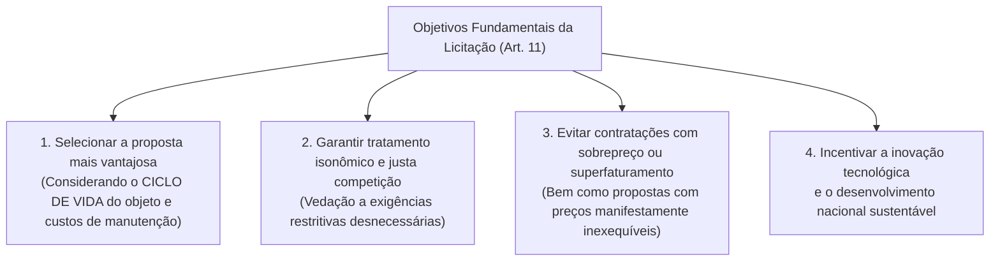
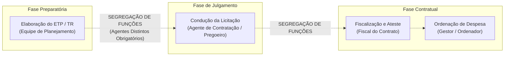
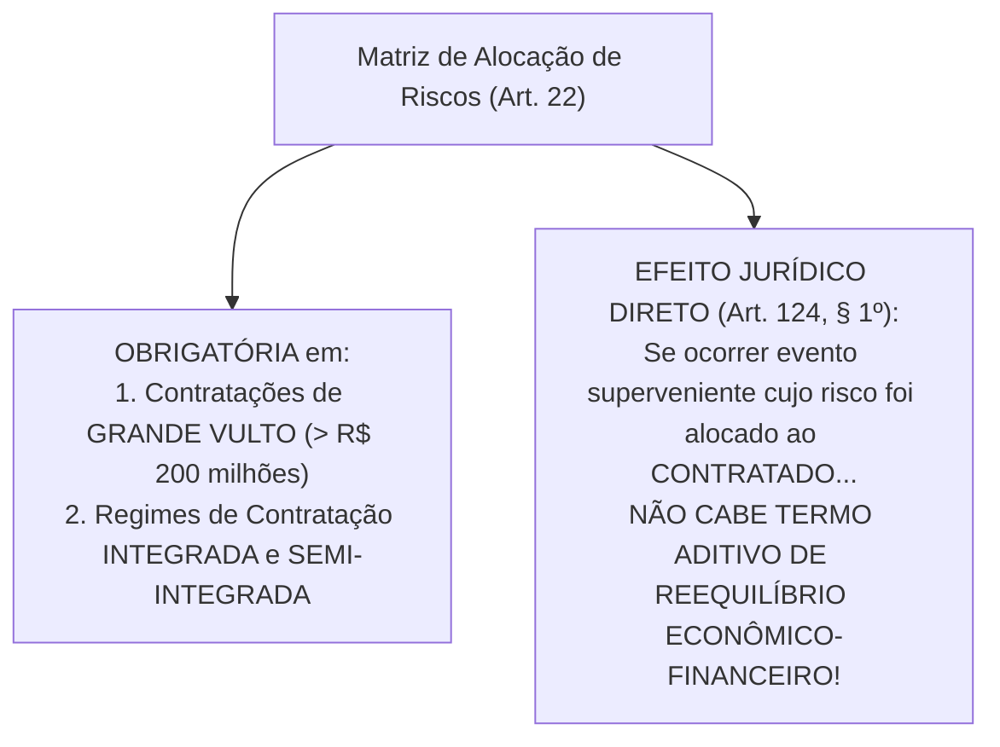

# 01 - Governança, Planejamento da Contratação, ETP, TR e Matriz de Riscos (Lei 14.133/2021)

> **Matéria:** Licitações e Contratos Administrativos  
> **Cargo:** A01 – Técnico de Controle Externo – Especialidade: Técnico Administrativo  
> **Arquivo:** `01_governanca_planejamento_etp_tr_e_matriz_riscos.md`  

---

## 📌 Ementa / Itens do Edital
- Princípios gerais e regime da Lei Federal nº 14.133/2021 (Nova Lei de Licitações e Contratos Administrativos - NLLC)
- Governança das contratações públicas e gestão por competências
- Agentes públicos na licitação: Agente de Contratação, Pregoeiro, Equipe de Apoio e Comissão de Contratação
- Princípio da Segregação de Funções e vedação de conflito de interesses
- Planejamento das contratações públicas: Plano de Contratações Anual (PCA)
- Estudo Técnico Preliminar (ETP): conceito, conteúdo obrigatório e facultativo
- Termo de Referência (TR), Projeto Básico e Projeto Executivo
- Matriz de Alocação de Riscos: conceito, finalidade e equilíbrio econômico-financeiro originário
- Portal Nacional de Contratações Públicas (PNCP): natureza, atribuições e publicidade centralizada

---

## 🧭 Sumário

1. [Princípios Gerais e Regime da Lei Federal nº 14.133/2021 (NLLC)](#1-principios-gerais-e-regime-da-lei-federal-no-141332021-nllc)
    1. [Âmbito de Aplicação Subjetivo e Objetos Abrangidos](#11-ambito-de-aplicacao-subjetivo-e-objetos-abrangidos)
    2. [Os Objetivos Fundamentais do Processo Licitatório (Art. 11)](#12-os-objetivos-fundamentais-do-processo-licitatorio-art-11)
    3. [Governança das Contratações e Gestão por Competências](#13-governanca-das-contratacoes-e-gestao-por-competencias)
    4. [Teste 066](#Teste-066)
    5. [Teste 067](#Teste-067)
2. [Agentes Públicos da Contratação e Segregação de Funções](#2-agentes-publicos-da-contratacao-e-segregacao-de-funcoes)
    1. [O Agente de Contratação e o Pregoeiro](#21-o-agente-de-contratacao-e-o-pregoeiro)
    2. [Comissão de Contratação e a Regra do Diálogo Competitivo](#22-comissao-de-contratacao-e-a-regra-do-dialogo-competitivo)
    3. [O Princípio da Segregação de Funções e Conflito de Interesses](#23-o-principio-da-segregacao-de-funcoes-e-conflito-de-interesses)
    4. [Defesa Jurídica Institucional dos Agentes (Art. 10)](#24-defesa-juridica-institucional-dos-agentes-art-10)
    5. [Teste 068](#Teste-068)
    6. [Teste 069](#Teste-069)
    7. [Teste 070](#Teste-070)
    8. [Teste 071](#Teste-071)
3. [Planejamento das Contratações e Instrumentos Preparatórios](#3-planejamento-das-contratacoes-e-instrumentos-preparatorios)
    1. [Plano de Contratações Anual (PCA) e Integração Orçamentária](#31-plano-de-contratacoes-anual-pca-e-integracao-orcamentaria)
    2. [Estudo Técnico Preliminar (ETP): Conceito e Elementos Obrigatórios](#32-estudo-tecnico-preliminar-etp-conceito-e-elementos-obrigatorios)
    3. [Termo de Referência vs. Projeto Básico e Projeto Executivo](#33-termo-de-referencia-vs-projeto-basico-e-projeto-executivo)
    4. [Matriz de Alocação de Riscos e Equilíbrio Econômico-Financeiro](#34-matriz-de-alocacao-de-riscos-e-equilibrio-economico-financeiro)
    5. [Teste 072](#Teste-072)
    6. [Teste 073](#Teste-073)
    7. [Teste 074](#Teste-074)
    8. [Teste 075](#Teste-075)
4. [O Portal Nacional de Contratações Públicas (PNCP)](#4-o-portal-nacional-de-contratacoes-publicas-pncp)
    1. [Natureza e Atribuições Centrais do Portal](#41-natureza-e-atribuicoes-centrais-do-portal)
    2. [A Divulgação no PNCP como Requisito Indispensável de Eficácia (Art. 94)](#42-a-divulgacao-no-pncp-como-requisito-indispensavel-de-eficacia-art-94)
    3. [Teste 076](#Teste-076)
5. [Fontes Recomendadas na Internet](#5-fontes-recomendadas-na-internet)

---

## 1. Princípios Gerais e Regime da Lei Federal nº 14.133/2021 (NLLC)

A **Lei Federal nº 14.133/2021** (Nova Lei de Licitações e Contratos Administrativos - NLLC) consolidou o regime jurídico das compras públicas no Brasil, revogando expressamente a Lei nº 8.666/1993, a Lei do Pregão (Lei nº 10.520/2002) e o Regime Diferenciado de Contratações Públicas (RDC - Lei nº 12.462/2011).

### 1.1 Âmbito de Aplicação Subjetivo e Objetos Abrangidos

- **Entes Abrangidos (Art. 1º):** Submetem-se aos seus comandos a Administração Pública direta, autárquica e fundacional de todos os entes federados (União, Estados, Distrito Federal e Municípios), abrangendo os Poderes Executivo, Legislativo e Judiciário, além do Tribunal de Contas e do Ministério Público no exercício de suas funções administrativas atípicas.
- **Ressalva das Empresas Estatais:** As empresas públicas e as sociedades de economia mista continuam submetidas ao seu regime licitatório e contratual próprio preconizado pela **Lei Federal nº 13.303/2016**, aplicando-se-lhes a NLLC apenas no capítulo referente aos crimes em licitações e contratos (arts. 337-E a 337-P do Código Penal, inseridos pelo art. 178 da Lei 14.133/2021).
- **Princípios Expressos (Art. 5º):** Legalidade, impessoalidade, moralidade, publicidade, eficiência, interesse público, probidade administrativa, igualdade, planejamento, transparência, eficácia, segregação de funções, motivação, vinculação ao edital, julgamento objetivo, segurança jurídica, razoabilidade, proporcionalidade, celeridade, economicidade e desenvolvimento nacional sustentável.

### 1.2 Os Objetivos Fundamentais do Processo Licitatório (Art. 11)

A NLLC inovou ao estruturar quatro objetivos finalísticos obrigatórios a serem perseguidos pela Administração:

### 1.3 Governança das Contratações e Gestão por Competências

A NLLC elevou a governança ao patamar de exigência legal expressa (art. 11, parágrafo único):

- A alta administração do órgão ou entidade é responsável pela implementação e fiscalização contínua de mecanismos de liderança, estratégia e controle;
- Exige **gestão por competências**, determinando que os agentes públicos designados para atuar na área de licitações possuam formação compatível ou qualificação atestada por certificação profissional emitida por escola de governo.

---

### Teste 066
**(FGV – TJ/MT – 2024 – Analista Judiciario Tecnologia Da Informacao)**
O planejamento estratégico de TI é uma prática essencial para assegurar que as atividades e investimentos em tecnologia estejam alinhados com os objetivos organizacionais e que a TI contribua diretamente para o sucesso do negócio. Uma prática recomendada no processo de planejamento estratégico de TI é

* **A)** priorizar exclusivamente a implementação de tecnologias emergentes para manter a TI atualizada com as últimas tendências do mercado.
* **B)** definir um orçamento fixo anual para TI, independentemente das mudanças nos objetivos e prioridades estratégicas da organização.
* **C)** estabelecer metas de TI focadas principalmente na redução de custos, com o objetivo de minimizar o impacto financeiro da tecnologia na organização.
* **D)** centralizar todas as decisões de TI no setor técnico, sem envolver outras áreas da empresa, para aumentar a eficiência operacional.
* **E)** realizar análises periódicas de cenário e reavaliar o plano estratégico de TI para garantir que ele continue alinhado com os objetivos organizacionais e com o ambiente de negócios.

---

> **Comentário Detalhado:**
>
> - **A)** **Incorreta.** A opção incorre em restrição indevida ao limitar o escopo conceitual ao afirmar que "priorizar exclusivamente a implementação de tecnologias emergentes para manter a TI atualizada com as últimas...". De acordo com a teoria estudada em *3.1 Plano de Contratações Anual (PCA) e Integração Orçamentária*, seu objetivo primordial é racionalizar as compras públicas, viabilizar o ganho de escala e garantir a perfeita compatibilização das despesas com as metas do Plano Plurianual (PPA), da Lei de Diretrizes Orçamentárias (LDO) e da Lei Orçamentária Anual (LOA).
> - **B)** **Incorreta.** A opção apresenta proposição em desacordo com os fundamentos teóricos e técnicos do tópico ao afirmar que "definir um orçamento fixo anual para TI, independentemente das mudanças nos objetivos e prioridades estratégicas...". De acordo com a teoria estudada em *1.2 Os Objetivos Fundamentais do Processo Licitatório (Art. 11)*, a NLLC inovou ao estruturar quatro objetivos finalísticos obrigatórios a serem perseguidos pela Administração.
> - **C)** **Incorreta.** A opção apresenta proposição em desacordo com os fundamentos teóricos e técnicos do tópico ao afirmar que "estabelecer metas de TI focadas principalmente na redução de custos, com o objetivo de minimizar o impacto...". De acordo com a teoria estudada em *1.1 Âmbito de Aplicação Subjetivo e Objetos Abrangidos*, princípios Expressos (Art. 5º): Legalidade, impessoalidade, moralidade, publicidade, eficiência, interesse público, probidade administrativa, igualdade, planejamento, transparência, eficácia, segregação de funções, motivação, vinculação ao edital, julgamento objetivo, segurança jurídica, razoabilidade, proporcionalidade, celeridade, economicidade e desenvolvimento nacional sustentável.
> - **D)** **Incorreta.** A opção apresenta proposição em desacordo com os fundamentos teóricos e técnicos do tópico ao afirmar que "centralizar todas as decisões de TI no setor técnico, sem envolver outras áreas da empresa, para aumentar a...". De acordo com a teoria estudada em *2.1 O Agente de Contratação e o Pregoeiro*, o Agente de Contratação (art. 8º) é a pessoa física designada pela autoridade competente para tomar decisões, acompanhar o trâmite da licitação, dar impulso ao procedimento e executar quaisquer outras atividades necessárias ao bom andamento do certame até a homologação.
> - **E)** **Correta.** Conforme fundamentado na seção *3.1 Plano de Contratações Anual (PCA) e Integração Orçamentária* deste guia, o art. 12, VII, preconiza a elaboração do Plano de Contratações Anual (PCA), instrumento de governança que consolida todas as compras e contratações que o órgão pretende realizar no exercício financeiro subsequente. Dessa forma, está plenamente correta a assertiva da banca (FGV – TJ/MT/2024) ao estabelecer que "realizar análises periódicas de cenário e reavaliar o plano estratégico de TI para garantir que ele continue...".
>
> **Gabarito: E**

---

### Teste 067
**(FGV – TRF/1 – 2024 – Analista Judiciario Area Apoio Especializado Especialidade Suporte Em Tecnologia Da Informacao)**
Os princípios de governança do COBIT 2019® descrevem os principais requisitos de um sistema de governança para informações e tecnologia da organização. O princípio “sistema de governança dinâmico” determina que um sistema de governança deve:

* **A)** atender às necessidades das partes interessadas;
* **B)** distinguir claramente entre as atividades e estruturas de governança e gestão;
* **C)** ser construído a partir de vários componentes, que podem ser de diferentes tipos e que trabalham juntos;
* **D)** ser capaz de considerar os impactos da alteração de um ou mais fatores de desenho no sistema de governança;
* **E)** ser adaptado para as necessidades da organização usando um conjunto de fatores de desenho como parâmetros para adaptar e priorizar os componentes do sistema de governança.

---

> **Comentário Detalhado:**
>
> - **A)** **Incorreta.** A opção apresenta proposição em desacordo com os fundamentos teóricos e técnicos do tópico ao afirmar que "atender às necessidades das partes interessadas". De acordo com a teoria estudada em *2.3 O Princípio da Segregação de Funções e Conflito de Interesses*, conceito: Impõe a repartição criteriosa de funções entre agentes públicos distintos, vedando expressamente a concentração de atribuições mais suscetíveis a riscos em uma mesma autoridade.
> - **B)** **Incorreta.** A opção apresenta proposição em desacordo com os fundamentos teóricos e técnicos do tópico ao afirmar que "distinguir claramente entre as atividades e estruturas de governança e gestão". De acordo com a teoria estudada em *1.3 Governança das Contratações e Gestão por Competências*, a NLLC elevou a governança ao patamar de exigência legal expressa (art. 11, parágrafo único).
> - **C)** **Incorreta.** A opção apresenta proposição em desacordo com os fundamentos teóricos e técnicos do tópico ao afirmar que "ser construído a partir de vários componentes, que podem ser de diferentes tipos e que trabalham juntos". De acordo com a teoria estudada em *1.3 Governança das Contratações e Gestão por Competências*, a alta administração do órgão ou entidade é responsável pela implementação e fiscalização contínua de mecanismos de liderança, estratégia e controle.
> - **D)** **Correta.** Conforme fundamentado na seção *3.2 Estudo Técnico Preliminar (ETP): Conceito e Elementos Obrigatórios* deste guia, ele evidencia o problema público a ser resolvido e avalia comparativamente as alternativas viáveis disponíveis no mercado para eleger a solução mais eficiente (art. 18). Dessa forma, está plenamente correta a assertiva da banca (FGV – TRF/1/2024) ao estabelecer que "ser capaz de considerar os impactos da alteração de um ou mais fatores de desenho no sistema de governança".
> - **E)** **Incorreta.** A opção apresenta proposição em desacordo com os fundamentos teóricos e técnicos do tópico ao afirmar que "ser adaptado para as necessidades da organização usando um conjunto de fatores de desenho como parâmetros para...". De acordo com a teoria estudada em *1.3 Governança das Contratações e Gestão por Competências*, exige gestão por competências, determinando que os agentes públicos designados para atuar na área de licitações possuam formação compatível ou qualificação atestada por certificação profissional emitida por escola de governo.
>
> **Gabarito: D**

---

## 2. Agentes Públicos da Contratação e Segregação de Funções

### 2.1 O Agente de Contratação e o Pregoeiro

O **Agente de Contratação** (art. 8º) é a pessoa física designada pela autoridade competente para tomar decisões, acompanhar o trâmite da licitação, dar impulso ao procedimento e executar quaisquer outras atividades necessárias ao bom andamento do certame até a homologação.

- **Requisito Obrigatório de Investidura:** Deve ser, preferencialmente, **servidor efetivo ou empregado público dos quadros permanentes** da Administração Pública.  
  > 🚨 **ALERTA CRÍTICO FCC:** É vedada a designação exclusiva de cidadão ocupante de cargo em comissão sem vínculo efetivo com o ente federado para atuar como Agente de Contratação!
- **Responsabilidade Individual:** Responde **individualmente** pelos atos que praticar na condução do procedimento, salvo quando for induzido a erro pela atuação de sua equipe de apoio ou comissão.
- **Pregoeiro:** É a denominação atribuída ao agente de contratação quando a licitação for processada na modalidade **Pregão** (art. 8º, § 5º).

### 2.2 Comissão de Contratação e a Regra do Diálogo Competitivo

A condução por comissão colegiada constitui exceção à regra geral do agente individual:

- **Composição da Comissão:** Composta por, no mínimo, **3 (três) membros**, sendo a maioria servidores efetivos ou empregados públicos permanentes. Os membros respondem solidariamente por todos os atos, ressalvado o membro que manifestar voto divergente registrado expressamente em ata (art. 8º, § 1º).
- **Hipóteses de Atuação:** Bens e serviços especiais; procedimentos auxiliares; e obrigatoriamente no **Diálogo Competitivo**.

> 💡 **Regra Canônica FCC:**  
> Na modalidade **Diálogo Competitivo**, a condução por **comissão de contratação de no mínimo 3 servidores efetivos** é **OBRIGATÓRIA** por expressa exigência do art. 32, inciso XI, da Lei nº 14.133/2021. Jamais pode ser conduzida por agente monocrático isolado!

### 2.3 O Princípio da Segregação de Funções e Conflito de Interesses

Positivado formalmente no art. 5º e detalhado no art. 7º, § 1º, da NLLC:

- **Conceito:** Impõe a repartição criteriosa de funções entre agentes públicos distintos, vedando expressamente a concentração de atribuições mais suscetíveis a riscos em uma mesma autoridade;
- **Aplicação Prática Inegociável:**
    1. O agente que elabora o Estudo Técnico Preliminar e o Termo de Referência (fase interna) **não deve conduzir o julgamento das propostas** como agente de contratação (fase externa);
    2. O agente que julga e adjudica a licitação **não pode atuar como fiscal ou gestor do contrato**, nem ser o responsável por atestar faturas e autorizar pagamentos financeiros.

### 2.4 Defesa Jurídica Institucional dos Agentes (Art. 10)

Se o agente público for demandado nas esferas judicial ou controladora (perante o Tribunal de Contas) em virtude de atos praticados em estrito cumprimento do dever legal na licitação, **terá direito à representação judicial pela Advocacia Pública** (Procuradoria do Estado), desde que sua conduta tenha sido previamente respaldada por parecer jurídico da assessoria do órgão.

---

### Teste 068
**(FGV – TCE/SC – 2026 – Auditor Fiscal de Controle Externo - Administração)**
Carolina é analista de controle externo de um Tribunal de Contas estadual. Em determinada semana, ela se depara com as seguintes demandas simultâneas: I. elaborar, até o fim do dia, o relatório de instrução de um processo com prazo regimental vencendo às 18h, sob pena de nulidade da autuação; II. responder a e-mails de colegas solicitando informações sobre procedimentos administrativos de rotina, sem prazo definido; III. desenvolver um plano de capacitação para a equipe, atividade estratégica alinhada ao planejamento anual do tribunal, sem data de entrega imediata; e IV. participar de uma reunião convocada com urgência por outro setor para discutir a pauta da confraternização de fim de ano. Para organizar essas demandas, Carolina as classifica segundo dois critérios (importância e urgência), identificando quais devem ser executadas imediatamente, quais devem ser agendadas, quais devem ser delegadas e quais devem ser eliminadas ou postergadas. Nesse caso, Carolina utiliza a seguinte técnica de gestão de tarefas:

* **A)** Método GTD (Getting Things Done).
* **B)** Técnica Pomodoro.
* **C)** Método Kanban.
* **D)** Matriz de Eisenhower.
* **E)** Método OKR (Objectives and Key Results).

---

> **Comentário Detalhado:**
>
> - **A)** **Incorreta.** A opção apresenta proposição em desacordo com os fundamentos teóricos e técnicos do tópico ao afirmar que "Método GTD (Getting Things Done)". De acordo com a teoria estudada em *3.4 Matriz de Alocação de Riscos e Equilíbrio Econômico-Financeiro*, obrigatoriedade: É obrigatória nas contratações de grande vulto (valor que ultrapassa R$ 200.000.000,00) e nos regimes de contratação integrada e semi-integrada.
> - **B)** **Incorreta.** A opção apresenta proposição em desacordo com os fundamentos teóricos e técnicos do tópico ao afirmar que "Técnica Pomodoro". De acordo com a teoria estudada em *3.4 Matriz de Alocação de Riscos e Equilíbrio Econômico-Financeiro*, vedação ao Reequilíbrio Econômico-Financeiro (Art. 124, § 1º): Se determinado evento imprevisível ou oscilação de mercado ocorrer, mas sua responsabilidade financeira tiver sido previamente alocada à contratada na matriz de riscos, a empresa NÃO tem direito a aditivo de reequilíbrio econômico-financeiro.
> - **C)** **Incorreta.** A opção apresenta proposição em desacordo com os fundamentos teóricos e técnicos do tópico ao afirmar que "Método Kanban". De acordo com a teoria estudada em *3.4 Matriz de Alocação de Riscos e Equilíbrio Econômico-Financeiro*, o risco já foi precificado e assumido pela empresa em sua proposta licitatória originária.
> - **D)** **Correta.** Conforme fundamentado na seção *3.4 Matriz de Alocação de Riscos e Equilíbrio Econômico-Financeiro* deste guia, a Matriz de Alocação de Riscos (art. 6º, XXVII e art. 22) é a cláusula contratual que promove a divisão objetiva e contratual de encargos financeiros e riscos supervenientes entre a Administração Pública e o contratado. Dessa forma, está plenamente correta a assertiva da banca (FGV – TCE/SC/2026) ao estabelecer que "Matriz de Eisenhower".
> - **E)** **Incorreta.** A opção apresenta proposição em desacordo com os fundamentos teóricos e técnicos do tópico ao afirmar que "Método OKR (Objectives and Key Results)". De acordo com a teoria estudada em *3.1 Plano de Contratações Anual (PCA) e Integração Orçamentária*, o art. 12, VII, preconiza a elaboração do Plano de Contratações Anual (PCA), instrumento de governança que consolida todas as compras e contratações que o órgão pretende realizar no exercício financeiro subsequente.
>
> **Gabarito: D**

---

### Teste 069
**(FGV – TJ/SC – 2026 – Analista Administrativo)**
Na elaboração da Lei de Diretrizes Orçamentárias (LDO), determinado ente federativo deixou de incluir avaliação de passivos contingentes e de outros riscos capazes de afetar as contas públicas, sob o argumento de que tais eventos seriam imprevisíveis e, portanto, dispensariam previsão formal. À luz da Lei de Responsabilidade Fiscal, é correto afirmar que

* **A)** os riscos fiscais somente devem ser tratados na Lei Orçamentária Anual.
* **B)** a LDO deve conter Anexo de Riscos Fiscais com avaliação e medidas a serem adotadas.
* **C)** a omissão é justificável, desde que haja previsão genérica de reserva de contingência na Lei Orçamentária Anual.
* **D)** a avaliação de riscos fiscais é facultativa, podendo ser substituída por metas fiscais anuais.
* **E)** a avaliação de riscos fiscais deve constar exclusivamente do Plano Plurianual.

---

> **Comentário Detalhado:**
>
> - **A)** **Incorreta.** A opção incorre em restrição indevida ao limitar o escopo conceitual ao afirmar que "os riscos fiscais somente devem ser tratados na Lei Orçamentária Anual". De acordo com a teoria estudada em *3.1 Plano de Contratações Anual (PCA) e Integração Orçamentária*, o art. 12, VII, preconiza a elaboração do Plano de Contratações Anual (PCA), instrumento de governança que consolida todas as compras e contratações que o órgão pretende realizar no exercício financeiro subsequente.
> - **B)** **Correta.** Conforme fundamentado na seção *3.1 Plano de Contratações Anual (PCA) e Integração Orçamentária* deste guia, seu objetivo primordial é racionalizar as compras públicas, viabilizar o ganho de escala e garantir a perfeita compatibilização das despesas com as metas do Plano Plurianual (PPA), da Lei de Diretrizes Orçamentárias (LDO) e da Lei Orçamentária Anual (LOA). Dessa forma, está plenamente correta a assertiva da banca (FGV – TJ/SC/2026) ao estabelecer que "a LDO deve conter Anexo de Riscos Fiscais com avaliação e medidas a serem adotadas".
> - **C)** **Incorreta.** A opção apresenta proposição em desacordo com os fundamentos teóricos e técnicos do tópico ao afirmar que "a omissão é justificável, desde que haja previsão genérica de reserva de contingência na Lei Orçamentária Anual". De acordo com a teoria estudada em *3.4 Matriz de Alocação de Riscos e Equilíbrio Econômico-Financeiro*, vedação ao Reequilíbrio Econômico-Financeiro (Art. 124, § 1º): Se determinado evento imprevisível ou oscilação de mercado ocorrer, mas sua responsabilidade financeira tiver sido previamente alocada à contratada na matriz de riscos, a empresa NÃO tem direito a aditivo de reequilíbrio econômico-financeiro.
> - **D)** **Incorreta.** A opção afasta requisito ou relação estrutural exigida pela matéria ao afirmar que "a avaliação de riscos fiscais é facultativa, podendo ser substituída por metas fiscais anuais". De acordo com a teoria estudada em *2.1 O Agente de Contratação e o Pregoeiro*, requisito Obrigatório de Investidura: Deve ser, preferencialmente, servidor efetivo ou empregado público dos quadros permanentes da Administração Pública.
> - **E)** **Incorreta.** A opção incorre em restrição indevida ao limitar o escopo conceitual ao afirmar que "a avaliação de riscos fiscais deve constar exclusivamente do Plano Plurianual". De acordo com a teoria estudada em *2.3 O Princípio da Segregação de Funções e Conflito de Interesses*, o agente que elabora o Estudo Técnico Preliminar e o Termo de Referência (fase interna) não deve conduzir o julgamento das propostas como agente de contratação (fase externa).
>
> **Gabarito: B**

---

### Teste 070
**(FCC – TCE/GO – 2009 – Analista de Controle Externo - Gestão de Conhecimento)**
Ao planejar e implantar serviços reprográficos em uma V. Segundo o AACR-2, a área dos detalhes específi- biblioteca, além dos aspectos administrativos, físicos e cos do documento, cuja citação é obrigatória, financeiros, deve-se considerar aplica-se a monografias, livros, folhetos e folhas soltas impressas.

* **A)** acompanhar o usuário durante todo o processo de busca de informação.
* **B)** auxiliar leitores no momento da utilização de docu- dada em formato eletrônico. mentos com a finalidade de estudo e pesquisa.
* **C)** responder perguntas e orientar o consulente no uso internet oferecidos aos usuários. das obras de referência.
* **D)** não necessite ser proprietária do documento solicita- criando um ambiente amistoso no qual o leitor se do pelo usuário. sinta à vontade.
* **E)** transforme o seu acervo físico em documentos a um serviço capacitado para satisfazer essa virtuais de acesso remoto. necessidade. _________________________________________________________ _________________________________________________________

---

> **Comentário Detalhado:**
>
> - **A)** **Correta.** Conforme fundamentado na seção *2.1 O Agente de Contratação e o Pregoeiro* deste guia, o Agente de Contratação (art. 8º) é a pessoa física designada pela autoridade competente para tomar decisões, acompanhar o trâmite da licitação, dar impulso ao procedimento e executar quaisquer outras atividades necessárias ao bom andamento do certame até a homologação. Dessa forma, está plenamente correta a assertiva da banca (FCC – TCE/GO/2009) ao estabelecer que "acompanhar o usuário durante todo o processo de busca de informação".
> - **B)** **Incorreta.** A opção apresenta proposição em desacordo com os fundamentos teóricos e técnicos do tópico ao afirmar que "auxiliar leitores no momento da utilização de docu- dada em formato eletrônico. mentos com a finalidade de estudo...". De acordo com a teoria estudada em *2.3 O Princípio da Segregação de Funções e Conflito de Interesses*, o agente que elabora o Estudo Técnico Preliminar e o Termo de Referência (fase interna) não deve conduzir o julgamento das propostas como agente de contratação (fase externa).
> - **C)** **Incorreta.** A opção apresenta proposição em desacordo com os fundamentos teóricos e técnicos do tópico ao afirmar que "responder perguntas e orientar o consulente no uso internet oferecidos aos usuários. das obras de referência". De acordo com a teoria estudada em *3.3 Termo de Referência vs. Projeto Básico e Projeto Executivo*, projeto Básico (Art. 6º, XXV): Documento elaborado para obras e serviços de engenharia, contendo elementos técnicos precisos e consolidados que permitam a perfeita identificação do empreendimento e a estimativa de custos de cada etapa construtiva.
> - **D)** **Incorreta.** A opção apresenta proposição em desacordo com os fundamentos teóricos e técnicos do tópico ao afirmar que "não necessite ser proprietária do documento solicita- criando um ambiente amistoso no qual o leitor se do pelo...". De acordo com a teoria estudada em *3.3 Termo de Referência vs. Projeto Básico e Projeto Executivo*, termo de Referência (TR - Art. 6º, XXIII): Documento elaborado para a contratação de bens e serviços em geral, contendo os elementos técnicos necessários para caracterizar o objeto de forma clara, o modelo de execução, os critérios de medição e pagamento e os parâmetros de aceitabilidade das propostas.
> - **E)** **Incorreta.** A opção apresenta proposição em desacordo com os fundamentos teóricos e técnicos do tópico ao afirmar que "transforme o seu acervo físico em documentos a um serviço capacitado para satisfazer essa virtuais de acesso...". De acordo com a teoria estudada em *1.2 Os Objetivos Fundamentais do Processo Licitatório (Art. 11)*, a NLLC inovou ao estruturar quatro objetivos finalísticos obrigatórios a serem perseguidos pela Administração.
>
> **Gabarito: A**

---

### Teste 071
**(FCC – TCE/GO – 2009 – Analista de Controle Externo - Gestão de Conhecimento)**
O autor vale-se da referência do assalto no bar da esquina (Aristides Bianco, inédito) aos confrontos do Oriente Médio para 1. O autor do texto mostra-se, fundamentalmente, insatisfeito

* **A)** Parece pouco, mas é mais que muito. A respeito do termo etnia
* **B)** O ideal talvez fosse um meio termo. Por etnia entende-se um grupo de pessoas que parti-
* **C)** (...) partiria de nós mesmos a violação desse estado (...) lham vários atributos, como espaço geográfico, língua, costu-
* **D)** Minha utopia é esta: acordar num dia sem notícias mes e valores, e que reivindicam para si o mesmo nome étnico (...) e a mesma ascendência. Mas sempre há nisso grande dose de
* **E)** (...) pura e permanente percepção de si e do mundo. subjetividade. Daí ser difícil estabelecer fronteiras claras entre _________________________________________________________ as etnias e quantificar os grupos étnicos existentes no planeta.

---

> **Comentário Detalhado:**
>
> - **A)** **Incorreta.** A opção apresenta proposição em desacordo com os fundamentos teóricos e técnicos do tópico ao afirmar que "Parece pouco, mas é mais que muito. A respeito do termo etnia". De acordo com a teoria estudada em *2.3 O Princípio da Segregação de Funções e Conflito de Interesses*, conceito: Impõe a repartição criteriosa de funções entre agentes públicos distintos, vedando expressamente a concentração de atribuições mais suscetíveis a riscos em uma mesma autoridade.
> - **B)** **Correta.** Conforme fundamentado na seção *2.3 O Princípio da Segregação de Funções e Conflito de Interesses* deste guia, o agente que elabora o Estudo Técnico Preliminar e o Termo de Referência (fase interna) não deve conduzir o julgamento das propostas como agente de contratação (fase externa). Dessa forma, está plenamente correta a assertiva da banca (FCC – TCE/GO/2009) ao estabelecer que "O ideal talvez fosse um meio termo. Por etnia entende-se um grupo de pessoas que parti-".
> - **C)** **Incorreta.** A opção apresenta proposição em desacordo com os fundamentos teóricos e técnicos do tópico ao afirmar que "(...) partiria de nós mesmos a violação desse estado (...) lham vários atributos, como espaço geográfico, língua...". De acordo com a teoria estudada em *3.3 Termo de Referência vs. Projeto Básico e Projeto Executivo*, termo de Referência (TR - Art. 6º, XXIII): Documento elaborado para a contratação de bens e serviços em geral, contendo os elementos técnicos necessários para caracterizar o objeto de forma clara, o modelo de execução, os critérios de medição e pagamento e os parâmetros de aceitabilidade das propostas.
> - **D)** **Incorreta.** A opção promove generalização excessiva que desconsidera as condições técnicas e normativas ao afirmar que "Minha utopia é esta: acordar num dia sem notícias mes e valores, e que reivindicam para si o mesmo nome étnico...". De acordo com a teoria estudada em *3.3 Termo de Referência vs. Projeto Básico e Projeto Executivo*, projeto Básico (Art. 6º, XXV): Documento elaborado para obras e serviços de engenharia, contendo elementos técnicos precisos e consolidados que permitam a perfeita identificação do empreendimento e a estimativa de custos de cada etapa construtiva.
> - **E)** **Incorreta.** A opção apresenta proposição em desacordo com os fundamentos teóricos e técnicos do tópico ao afirmar que "(...) pura e permanente percepção de si e do mundo. subjetividade. Daí ser difícil estabelecer fronteiras claras...". De acordo com a teoria estudada em *3.3 Termo de Referência vs. Projeto Básico e Projeto Executivo*, projeto Executivo (Art. 6º, XXVI): Conjunto dos elementos detalhados necessários e suficientes para a execução completa da obra civil.
>
> **Gabarito: B**

---

## 3. Planejamento das Contratações e Instrumentos Preparatórios

A Lei nº 14.133/2021 consagrou a centralidade da **fase preparatória**, superando a cultura de contratações improvisadas.

### 3.1 Plano de Contratações Anual (PCA) e Integração Orçamentária

- O art. 12, VII, preconiza a elaboração do **Plano de Contratações Anual (PCA)**, instrumento de governança que consolida todas as compras e contratações que o órgão pretende realizar no exercício financeiro subsequente.
- Seu objetivo primordial é racionalizar as compras públicas, viabilizar o ganho de escala e garantir a perfeita compatibilização das despesas com as metas do Plano Plurianual (PPA), da Lei de Diretrizes Orçamentárias (LDO) e da Lei Orçamentária Anual (LOA).

### 3.2 Estudo Técnico Preliminar (ETP): Conceito e Elementos Obrigatórios

O **Estudo Técnico Preliminar (ETP)** é o documento constitutivo da primeira etapa do planejamento de uma contratação. Ele evidencia o problema público a ser resolvido e avalia comparativamente as alternativas viáveis disponíveis no mercado para eleger a solução mais eficiente (art. 18).

#### Os 5 Elementos Obrigatórios do ETP (Art. 18, § 2º):
Embora o ETP contenha treze itens descritivos em seu roteiro geral, a NLLC fixou **cinco elementos com preenchimento obrigatório indispensável**:

1. Descrição da **necessidade da contratação**;
2. **Estimativa das quantidades** a serem contratadas, acompanhada de memória de cálculo detalhada;
3. **Estimativa do valor da contratação**, amparada em pesquisa prévia de preços;
4. **Justificativa para o parcelamento ou não** da solução de mercado;
5. **Posicionamento conclusivo** sobre a adequação da contratação para o atendimento da necessidade pública.

### 3.3 Termo de Referência vs. Projeto Básico e Projeto Executivo

- **Termo de Referência (TR - Art. 6º, XXIII):** Documento elaborado para a contratação de **bens e serviços em geral**, contendo os elementos técnicos necessários para caracterizar o objeto de forma clara, o modelo de execução, os critérios de medição e pagamento e os parâmetros de aceitabilidade das propostas.
- **Projeto Básico (Art. 6º, XXV):** Documento elaborado para **obras e serviços de engenharia**, contendo elementos técnicos precisos e consolidados que permitam a perfeita identificação do empreendimento e a estimativa de custos de cada etapa construtiva.
- **Projeto Executivo (Art. 6º, XXVI):** Conjunto dos elementos detalhados necessários e suficientes para a execução completa da obra civil.

### 3.4 Matriz de Alocação de Riscos e Equilíbrio Econômico-Financeiro

A **Matriz de Alocação de Riscos** (art. 6º, XXVII e art. 22) é a cláusula contratual que promove a divisão objetiva e contratual de encargos financeiros e riscos supervenientes entre a Administração Pública e o contratado.

- **Obrigatoriedade:** É obrigatória nas contratações de **grande vulto** (valor que ultrapassa R$ 200.000.000,00) e nos regimes de contratação integrada e semi-integrada.
- **Vedação ao Reequilíbrio Econômico-Financeiro (Art. 124, § 1º):** Se determinado evento imprevisível ou oscilação de mercado ocorrer, mas sua responsabilidade financeira tiver sido previamente alocada à contratada na matriz de riscos, **a empresa NÃO tem direito a aditivo de reequilíbrio econômico-financeiro**. O risco já foi precificado e assumido pela empresa em sua proposta licitatória originária.

---

### Teste 072
**(CEBRASPE – STF – 2013 – Analista Judiciario Suporte Em Tecnologia Da Informacao)**
Estudos técnicos preliminares, plano de trabalho, no caso da contratação de serviços, e o termo de referência ou projeto básico são requisitos mínimos exigidos no processo de planejamento da contratação de soluções em TI.

* **C)** Certo
* **E)** Errado

---

> **Comentário Detalhado:**
>
> - **C)** **Correta.** O item está **Certo**. Conforme fundamentado na seção *3.3 Termo de Referência vs. Projeto Básico e Projeto Executivo* deste guia, termo de Referência (TR - Art. 6º, XXIII): Documento elaborado para a contratação de bens e serviços em geral, contendo os elementos técnicos necessários para caracterizar o objeto de forma clara, o modelo de execução, os critérios de medição e pagamento e os parâmetros de aceitabilidade das propostas. Dessa forma, está plenamente correta a proposição da banca (CEBRASPE – STF/2013) ao afirmar que "Estudos técnicos preliminares, plano de trabalho, no caso da contratação de serviços, e o termo de referência...".
> - **E)** **Incorreta.** A marcação como **Errado** não procede, visto que a assertiva guarda integral conformidade com a teoria estudada em *3.3 Termo de Referência vs. Projeto Básico e Projeto Executivo*, segundo a qual projeto Básico (Art. 6º, XXV): Documento elaborado para obras e serviços de engenharia, contendo elementos técnicos precisos e consolidados que permitam a perfeita identificação do empreendimento e a estimativa de custos de cada etapa construtiva.
>
> **Gabarito: C**

---

### Teste 073
**(FGV – TRF/1 – 2024 – Analista Judiciario Area Apoio Especializado Especialidade Tecnologia Da Informacao)**
O TRF1 iniciou o planejamento da contratação para o desenvolvimento de uma nova solução tecnológica. A equipe de planejamento da contratação registrou, no estudo técnico preliminar, que a solução está aderente aos requisitos técnicos da plataforma digital do Poder Judiciário brasileiro (PDPJ-Br). Considerando a política pública para a governança e gestão do processo judicial eletrônico, a contratação da solução tecnológicas será proibida se:

* **A)** atender a peculiaridades regionais do Tribunal;
* **B)** causar redução dos custos com ações isoladas;
* **C)** causar dependência tecnológica do fornecedor;
* **D)** permitir o compartilhamento da solução na PDPJ-Br;
* **E)** permitir a coexistência com outras soluções da PDPJ-Br.

---

> **Comentário Detalhado:**
>
> - **A)** **Incorreta.** A opção apresenta proposição em desacordo com os fundamentos teóricos e técnicos do tópico ao afirmar que "atender a peculiaridades regionais do Tribunal". De acordo com a teoria estudada em *3.2 Estudo Técnico Preliminar (ETP): Conceito e Elementos Obrigatórios*, o Estudo Técnico Preliminar (ETP) é o documento constitutivo da primeira etapa do planejamento de uma contratação.
> - **B)** **Correta.** Conforme fundamentado na seção *3.3 Termo de Referência vs. Projeto Básico e Projeto Executivo* deste guia, projeto Básico (Art. 6º, XXV): Documento elaborado para obras e serviços de engenharia, contendo elementos técnicos precisos e consolidados que permitam a perfeita identificação do empreendimento e a estimativa de custos de cada etapa construtiva. Dessa forma, está plenamente correta a assertiva da banca (FGV – TRF/1/2024) ao estabelecer que "causar redução dos custos com ações isoladas".
> - **C)** **Incorreta.** A opção apresenta proposição em desacordo com os fundamentos teóricos e técnicos do tópico ao afirmar que "causar dependência tecnológica do fornecedor". De acordo com a teoria estudada em *3.2 Estudo Técnico Preliminar (ETP): Conceito e Elementos Obrigatórios*, ele evidencia o problema público a ser resolvido e avalia comparativamente as alternativas viáveis disponíveis no mercado para eleger a solução mais eficiente (art. 18).
> - **D)** **Incorreta.** A opção apresenta proposição em desacordo com os fundamentos teóricos e técnicos do tópico ao afirmar que "permitir o compartilhamento da solução na PDPJ-Br". De acordo com a teoria estudada em *Os 5 Elementos Obrigatórios do ETP (Art. 18, § 2º):*, justificativa para o parcelamento ou não da solução de mercado.
> - **E)** **Incorreta.** A opção apresenta proposição em desacordo com os fundamentos teóricos e técnicos do tópico ao afirmar que "permitir a coexistência com outras soluções da PDPJ-Br". De acordo com a teoria estudada em *2.1 O Agente de Contratação e o Pregoeiro*, o Agente de Contratação (art. 8º) é a pessoa física designada pela autoridade competente para tomar decisões, acompanhar o trâmite da licitação, dar impulso ao procedimento e executar quaisquer outras atividades necessárias ao bom andamento do certame até a homologação.
>
> **Gabarito: B**

---

### Teste 074
**(FCC – TRT 16ª – 2014 – Analista Judiciário - Tecnologia da Informação)**
O Capítulo II da Instrução Normativa MP/SLTI no 04, de 12 de novembro de 2010, está divido em 3 seções que contemplam todo o procedimento para execução das fases de Planejamento da Contratação, Seleção de Fornecedor e Gerenciamento do Contrato. Na Seção II do capítulo II, que trata da Seleção de Fornecedor, afirma-se que

* **A)** a fase de Seleção do Fornecedor se encerrará com a assinatura do contrato e com a nomeação do Gestor do Contrato.
* **B)** caberá exclusivamente à Área Jurídica apoiar tecnicamente o pregoeiro ou a Comissão de Licitação na análise e julgamento das propostas e dos recursos apresentados pelos licitantes.
* **C)** caberá exclusivamente à Área de Planejamento e Contratação apoiar tecnicamente o pregoeiro ou a Comissão de Licitação na resposta aos questionamentos ou às impugnações dos licitantes.
* **D)** caberá à Área de Licitações conduzir as etapas da fase de Seleção do Fornecedor.
* **E)** caberá à Área de Licitações analisar as sugestões feitas pela área de TI para o Termo de Referência ou Projeto Básico e demais documentos.

---

> **Comentário Detalhado:**
>
> - **A)** **Incorreta.** A opção apresenta proposição em desacordo com os fundamentos teóricos e técnicos do tópico ao afirmar que "a fase de Seleção do Fornecedor se encerrará com a assinatura do contrato e com a nomeação do Gestor do Contrato". De acordo com a teoria estudada em *4.2 A Divulgação no PNCP como Requisito Indispensável de Eficácia (Art. 94)*, *"Art. 94. A divulgação no Portal Nacional de Contratações Públicas (PNCP) é condição indispensável para a eficácia do contrato e de seus aditamentos e deverá ocorrer nos seguintes prazos, contados da data de sua assinatura:*.
> - **B)** **Incorreta.** A opção incorre em restrição indevida ao limitar o escopo conceitual ao afirmar que "caberá exclusivamente à Área Jurídica apoiar tecnicamente o pregoeiro ou a Comissão de Licitação na análise e...". De acordo com a teoria estudada em *4.2 A Divulgação no PNCP como Requisito Indispensável de Eficácia (Art. 94)*, sem a veiculação tempestiva no PNCP, o contrato administrativo é considerado inoperante, carecendo de eficácia jurídica para produzir obrigações e autorizar pagamentos com recursos públicos.
> - **C)** **Incorreta.** A opção incorre em restrição indevida ao limitar o escopo conceitual ao afirmar que "caberá exclusivamente à Área de Planejamento e Contratação apoiar tecnicamente o pregoeiro ou a Comissão de...". De acordo com a teoria estudada em *3. Planejamento das Contratações e Instrumentos Preparatórios*, a Lei nº 14.133/2021 consagrou a centralidade da fase preparatória, superando a cultura de contratações improvisadas.
> - **D)** **Correta.** Conforme fundamentado na seção *2.3 O Princípio da Segregação de Funções e Conflito de Interesses* deste guia, o agente que elabora o Estudo Técnico Preliminar e o Termo de Referência (fase interna) não deve conduzir o julgamento das propostas como agente de contratação (fase externa). Dessa forma, está plenamente correta a assertiva da banca (FCC – TRT 16ª/2014) ao estabelecer que "caberá à Área de Licitações conduzir as etapas da fase de Seleção do Fornecedor".
> - **E)** **Incorreta.** A opção apresenta proposição em desacordo com os fundamentos teóricos e técnicos do tópico ao afirmar que "caberá à Área de Licitações analisar as sugestões feitas pela área de TI para o Termo de Referência ou Projeto...". De acordo com a teoria estudada em *3.3 Termo de Referência vs. Projeto Básico e Projeto Executivo*, termo de Referência (TR - Art. 6º, XXIII): Documento elaborado para a contratação de bens e serviços em geral, contendo os elementos técnicos necessários para caracterizar o objeto de forma clara, o modelo de execução, os critérios de medição e pagamento e os parâmetros de aceitabilidade das propostas.
>
> **Gabarito: D**

---

### Teste 075
**(FGV – TRT 16ª – 2022 – Analista Judiciário (Área Administrativa - Tecnologia da Informação))**
João, Diretor de Licitações no âmbito da Administração Pública direta do Município Alfa, foi consultado por Maria sobre o documento necessário, previsto na Lei nº 14.133/2021, para a contratação de bens e serviços, isto com o objetivo de estabelecer os contornos básicos do objeto a ser contratado. João respondeu corretamente que

* **A)** o projeto básico é o documento necessário à contratação de bens.
* **B)** o anteprojeto é o documento necessário à contratação de bens e serviços.
* **C)** o termo de referência é o documento necessário à referida contratação.
* **D)** o projeto executivo é o documento necessário à contratação de bens e serviços.
* **E)** a matriz de objeto e riscos é o documento necessário à contratação de serviços.

---

> **Comentário Detalhado:**
>
> - **A)** **Incorreta.** A opção apresenta proposição em desacordo com os fundamentos teóricos e técnicos do tópico ao afirmar que "o projeto básico é o documento necessário à contratação de bens". De acordo com a teoria estudada em *3.3 Termo de Referência vs. Projeto Básico e Projeto Executivo*, projeto Básico (Art. 6º, XXV): Documento elaborado para obras e serviços de engenharia, contendo elementos técnicos precisos e consolidados que permitam a perfeita identificação do empreendimento e a estimativa de custos de cada etapa construtiva.
> - **B)** **Incorreta.** A opção apresenta proposição em desacordo com os fundamentos teóricos e técnicos do tópico ao afirmar que "o anteprojeto é o documento necessário à contratação de bens e serviços". De acordo com a teoria estudada em *2.2 Comissão de Contratação e a Regra do Diálogo Competitivo*, hipóteses de Atuação: Bens e serviços especiais; procedimentos auxiliares; e obrigatoriamente no Diálogo Competitivo.
> - **C)** **Correta.** Conforme fundamentado na seção *3.3 Termo de Referência vs. Projeto Básico e Projeto Executivo* deste guia, termo de Referência (TR - Art. 6º, XXIII): Documento elaborado para a contratação de bens e serviços em geral, contendo os elementos técnicos necessários para caracterizar o objeto de forma clara, o modelo de execução, os critérios de medição e pagamento e os parâmetros de aceitabilidade das propostas. Dessa forma, está plenamente correta a assertiva da banca (FGV – TRT 16ª/2022) ao estabelecer que "o termo de referência é o documento necessário à referida contratação".
> - **D)** **Incorreta.** A opção apresenta proposição em desacordo com os fundamentos teóricos e técnicos do tópico ao afirmar que "o projeto executivo é o documento necessário à contratação de bens e serviços". De acordo com a teoria estudada em *3.3 Termo de Referência vs. Projeto Básico e Projeto Executivo*, projeto Executivo (Art. 6º, XXVI): Conjunto dos elementos detalhados necessários e suficientes para a execução completa da obra civil.
> - **E)** **Incorreta.** A opção apresenta proposição em desacordo com os fundamentos teóricos e técnicos do tópico ao afirmar que "a matriz de objeto e riscos é o documento necessário à contratação de serviços". De acordo com a teoria estudada em *3.4 Matriz de Alocação de Riscos e Equilíbrio Econômico-Financeiro*, a Matriz de Alocação de Riscos (art. 6º, XXVII e art. 22) é a cláusula contratual que promove a divisão objetiva e contratual de encargos financeiros e riscos supervenientes entre a Administração Pública e o contratado.
>
> **Gabarito: C**

---

## 4. O Portal Nacional de Contratações Públicas (PNCP)

### 4.1 Natureza e Atribuições Centrais do Portal

O **Portal Nacional de Contratações Públicas (PNCP)**, disciplinado pelos arts. 174 a 176 da Lei nº 14.133/2021, é o sítio eletrônico oficial único de divulgação de compras públicas gerido pelo Comitê Gestor da Rede Nacional de Contratações Públicas.

- Suas atribuições envolvem centralizar a publicação de editais, atas de registro de preços, planos anuais de contratações, catálogos eletrônicos de padronização e o cadastro unificado de fornecedores impedidos e inidôneos.

### 4.2 A Divulgação no PNCP como Requisito Indispensável de Eficácia (Art. 94)

> *"Art. 94. A divulgação no Portal Nacional de Contratações Públicas (PNCP) é **condição indispensável para a eficácia do contrato e de seus aditamentos** e deverá ocorrer nos seguintes prazos, contados da data de sua assinatura:*  
> *I - 20 (vinte) dias úteis, no caso de licitação;*  
> *II - 10 (dez) dias úteis, no caso de contratação direta."*

> 🚨 **ALERTA DE PROVA FCC:**  
> A publicação no Diário Oficial e em jornais de grande circulação não substitui a divulgação no PNCP. Sem a veiculação tempestiva no PNCP, o contrato administrativo é considerado inoperante, **carecendo de eficácia jurídica** para produzir obrigações e autorizar pagamentos com recursos públicos.

---

### Teste 076
**(FGV – TCE/SC – 2026 – Auditor Fiscal De Controle Externo Engenharia Sanitaria)**
De acordo com a NR nº 11/2024 da Agência Nacional de Águas e Saneamento Básico, toda edificação permanente que disponha de redes públicas de abastecimento de água e de esgotamento sanitário deve, obrigatoriamente, estar ligada à rede pública. Desse modo, quanto a essa ligação, analise as afirmativas a seguir. I. É dever da prestadora do serviço público garantir que o usuário de edificações residenciais desative as soluções alternativas de esgotamento sanitário a partir da efetiva ligação à rede pública de esgotamento sanitário. II. Nas áreas cobertas por rede pública de esgotamento sanitário, onde o serviço de abastecimento de água é prestado regularmente, os pedidos de nova ligação de água serão atendidos pelo prestador de serviços mediante a solicitação simultânea de ligação do domicílio ao sistema de esgotamento sanitário disponível. III. O ponto de entrega de água e o de coleta de esgoto deve, preferencialmente, situar-se no limite do lote com o logradouro público e em local de fácil acesso. Está correto apenas o que se afirma em

* **A)** I.
* **B)** II.
* **C)** I e II.
* **D)** I e III.
* **E)** II e III.

---

> **Comentário Detalhado:**
>
> - **A)** **Incorreta.** A opção apresenta proposição em desacordo com os fundamentos teóricos e técnicos do tópico ao afirmar que "I". De acordo com a teoria estudada em *4.2 A Divulgação no PNCP como Requisito Indispensável de Eficácia (Art. 94)*, *"Art. 94. A divulgação no Portal Nacional de Contratações Públicas (PNCP) é condição indispensável para a eficácia do contrato e de seus aditamentos e deverá ocorrer nos seguintes prazos, contados da data de sua assinatura:*.
> - **B)** **Incorreta.** A opção apresenta proposição em desacordo com os fundamentos teóricos e técnicos do tópico ao afirmar que "II". De acordo com a teoria estudada em *2.1 O Agente de Contratação e o Pregoeiro*, requisito Obrigatório de Investidura: Deve ser, preferencialmente, servidor efetivo ou empregado público dos quadros permanentes da Administração Pública.
> - **C)** **Incorreta.** A opção apresenta proposição em desacordo com os fundamentos teóricos e técnicos do tópico ao afirmar que "I e II". De acordo com a teoria estudada em *2.2 Comissão de Contratação e a Regra do Diálogo Competitivo*, hipóteses de Atuação: Bens e serviços especiais; procedimentos auxiliares; e obrigatoriamente no Diálogo Competitivo.
> - **D)** **Incorreta.** A opção apresenta proposição em desacordo com os fundamentos teóricos e técnicos do tópico ao afirmar que "I e III". De acordo com a teoria estudada em *1. Princípios Gerais e Regime da Lei Federal nº 14.133/2021 (NLLC)*, a Lei Federal nº 14.133/2021 (Nova Lei de Licitações e Contratos Administrativos - NLLC) consolidou o regime jurídico das compras públicas no Brasil, revogando expressamente a Lei nº 8.666/1993, a Lei do Pregão (Lei nº 10.520/2002) e o Regime Diferenciado de Contratações Públicas (RDC - Lei nº 12.462/2011).
> - **E)** **Correta.** Conforme fundamentado na seção *4.1 Natureza e Atribuições Centrais do Portal* deste guia, o Portal Nacional de Contratações Públicas (PNCP), disciplinado pelos arts. 174 a 176 da Lei nº 14.133/2021, é o sítio eletrônico oficial único de divulgação de compras públicas gerido pelo Comitê Gestor da Rede Nacional de Contratações Públicas. Dessa forma, está plenamente correta a assertiva da banca (FGV – TCE/SC/2026) ao estabelecer que "II e III".
>
> **Gabarito: E**

---

## 5. Fontes Recomendadas na Internet

- [Lei Federal nº 14.133/2021 - Arts. 1º a 27 e 174 a 176 (Governança, Planejamento e PNCP)](https://www.planalto.gov.br/ccivil_03/_ato2019-2022/2021/lei/l14133.htm#art1)  
  Texto legal nacional que rege os princípios da licitação, agentes de contratação, segregação de funções, ETP, matriz de riscos e o PNCP.
- [Lei Federal nº 14.133/2021 - Art. 94 (Divulgação Obrigatória no PNCP como Condição de Eficácia)](https://www.planalto.gov.br/ccivil_03/_ato2019-2022/2021/lei/l14133.htm#art94)  
  Dispositivo que fixa os prazos de 20 e 10 dias úteis para divulgação de contratos e aditamentos no Portal Nacional de Contratações Públicas.
- [Decreto Federal nº 10.947/2022 (Regulamento do Plano de Contratações Anual - PCA)](https://www.planalto.gov.br/ccivil_03/_ato2019-2022/2022/decreto/D10947.htm)  
  Normas de elaboração do calendário anual de contratações integradas ao planejamento estratégico e às leis orçamentárias.
- [Compras.gov.br - Instruções Normativas SEGES sobre a Fase Preparatória e ETP (Lei 14.133/2021)](https://www.gov.br/compras/pt-br/acesso-a-informacao/legislacao/instrucoes-normativas)  
  Repositório normativo oficial das Instruções Normativas federais sobre pesquisa de preços, Estudo Técnico Preliminar (ETP) e Termo de Referência (TR).
- [Constituição Federal de 1988 - Art. 37, XXI (Obrigatoriedade Constitucional de Licitar)](https://www.planalto.gov.br/ccivil_03/constituicao/constituicao.htm#art37)  
  Matriz constitucional do dever de licitar, da isonomia entre concorrentes e da manutenção das condições efetivas da proposta.
* JUSTEN FILHO, Marçal. **Comentários à Lei de Licitações e Contratações Administrativas: Lei 14.133/2021**. 2. ed. São Paulo: Thomson Reuters Brasil, 2023. (Comentários aos arts. 5º a 27 - Governança, Agentes de Contratação, Segregação de Funções e Fase Preparatória).
* DI PIETRO, Maria Sylvia Zanella. **Direito Administrativo**. 37. ed. Rio de Janeiro: Forense, 2024. (Cap. 9 - Licitação Pública: Princípios, Governança, ETP, Termo de Referência e Matriz de Riscos).
* NIEBUHR, Joel de Menezes. **Licitação Pública e Contrato Administrativo**. 6. ed. Belo Horizonte: Fórum, 2023. (Cap. 4 e Cap. 5 - Planejamento da Contratação, Estudo Técnico Preliminar e PNCP).
