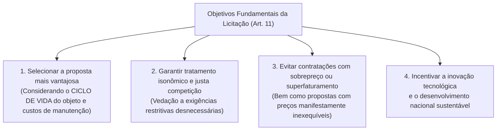
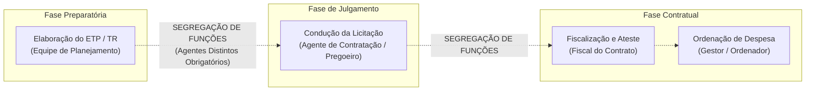
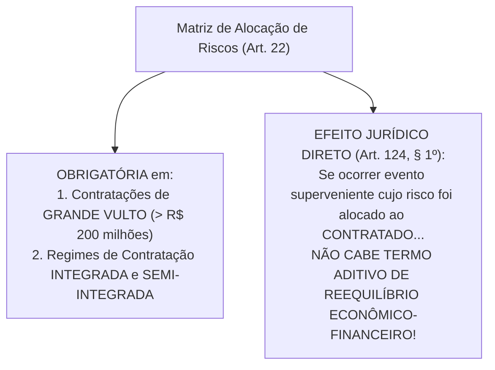

# 01 - Governança, Planejamento da Contratação, ETP, TR e Matriz de Riscos (Lei 14.133/2021)

> **Matéria:** Licitações e Contratos Administrativos  
> **Cargo:** A01 – Técnico de Controle Externo – Especialidade: Técnico Administrativo  
> **Arquivo:** `01_governanca_planejamento_etp_tr_e_matriz_riscos.md`  

---

## 📌 Ementa / Itens do Edital
- Princípios gerais e regime da Lei Federal nº 14.133/2021 (Nova Lei de Licitações e Contratos Administrativos - NLLC)
- Governança das contratações públicas e gestão por competências
- Agentes públicos na licitação: Agente de Contratação, Pregoeiro, Equipe de Apoio e Comissão de Contratação
- Princípio da Segregação de Funções e vedação de conflito de interesses
- Planejamento das contratações públicas: Plano de Contratações Anual (PCA)
- Estudo Técnico Preliminar (ETP): conceito, conteúdo obrigatório e facultativo
- Termo de Referência (TR), Projeto Básico e Projeto Executivo
- Matriz de Alocação de Riscos: conceito, finalidade e equilíbrio econômico-financeiro originário
- Portal Nacional de Contratações Públicas (PNCP): natureza, atribuições e publicidade centralizada

---

## 🧭 Sumário

1. [Princípios Gerais e Regime da Lei Federal nº 14.133/2021 (NLLC)](#1-principios-gerais-e-regime-da-lei-federal-no-141332021-nllc)
    1. [Âmbito de Aplicação Subjetivo e Objetos Abrangidos](#11-ambito-de-aplicacao-subjetivo-e-objetos-abrangidos)
    2. [Os Objetivos Fundamentais do Processo Licitatório (Art. 11)](#12-os-objetivos-fundamentais-do-processo-licitatorio-art-11)
    3. [Governança das Contratações e Gestão por Competências](#13-governanca-das-contratacoes-e-gestao-por-competencias)
    4. [Teste 066](#Teste-066)
    5. [Teste 067](#Teste-067)
2. [Agentes Públicos da Contratação e Segregação de Funções](#2-agentes-publicos-da-contratacao-e-segregacao-de-funcoes)
    1. [O Agente de Contratação e o Pregoeiro](#21-o-agente-de-contratacao-e-o-pregoeiro)
    2. [Comissão de Contratação e a Regra do Diálogo Competitivo](#22-comissao-de-contratacao-e-a-regra-do-dialogo-competitivo)
    3. [O Princípio da Segregação de Funções e Conflito de Interesses](#23-o-principio-da-segregacao-de-funcoes-e-conflito-de-interesses)
    4. [Defesa Jurídica Institucional dos Agentes (Art. 10)](#24-defesa-juridica-institucional-dos-agentes-art-10)
    5. [Teste 068](#Teste-068)
    6. [Teste 069](#Teste-069)
    7. [Teste 070](#Teste-070)
    8. [Teste 071](#Teste-071)
3. [Planejamento das Contratações e Instrumentos Preparatórios](#3-planejamento-das-contratacoes-e-instrumentos-preparatorios)
    1. [Plano de Contratações Anual (PCA) e Integração Orçamentária](#31-plano-de-contratacoes-anual-pca-e-integracao-orcamentaria)
    2. [Estudo Técnico Preliminar (ETP): Conceito e Elementos Obrigatórios](#32-estudo-tecnico-preliminar-etp-conceito-e-elementos-obrigatorios)
    3. [Termo de Referência vs. Projeto Básico e Projeto Executivo](#33-termo-de-referencia-vs-projeto-basico-e-projeto-executivo)
    4. [Matriz de Alocação de Riscos e Equilíbrio Econômico-Financeiro](#34-matriz-de-alocacao-de-riscos-e-equilibrio-economico-financeiro)
    5. [Teste 072](#Teste-072)
    6. [Teste 073](#Teste-073)
    7. [Teste 074](#Teste-074)
    8. [Teste 075](#Teste-075)
4. [O Portal Nacional de Contratações Públicas (PNCP)](#4-o-portal-nacional-de-contratacoes-publicas-pncp)
    1. [Natureza e Atribuições Centrais do Portal](#41-natureza-e-atribuicoes-centrais-do-portal)
    2. [A Divulgação no PNCP como Requisito Indispensável de Eficácia (Art. 94)](#42-a-divulgacao-no-pncp-como-requisito-indispensavel-de-eficacia-art-94)
    3. [Teste 076](#Teste-076)
5. [Fontes Recomendadas na Internet](#5-fontes-recomendadas-na-internet)

---

## 1. Princípios Gerais e Regime da Lei Federal nº 14.133/2021 (NLLC)

A **Lei Federal nº 14.133/2021** (Nova Lei de Licitações e Contratos Administrativos - NLLC) consolidou o regime jurídico das compras públicas no Brasil, revogando expressamente a Lei nº 8.666/1993, a Lei do Pregão (Lei nº 10.520/2002) e o Regime Diferenciado de Contratações Públicas (RDC - Lei nº 12.462/2011).

### 1.1 Âmbito de Aplicação Subjetivo e Objetos Abrangidos

- **Entes Abrangidos (Art. 1º):** Submetem-se aos seus comandos a Administração Pública direta, autárquica e fundacional de todos os entes federados (União, Estados, Distrito Federal e Municípios), abrangendo os Poderes Executivo, Legislativo e Judiciário, além do Tribunal de Contas e do Ministério Público no exercício de suas funções administrativas atípicas.
- **Ressalva das Empresas Estatais:** As empresas públicas e as sociedades de economia mista continuam submetidas ao seu regime licitatório e contratual próprio preconizado pela **Lei Federal nº 13.303/2016**, aplicando-se-lhes a NLLC apenas no capítulo referente aos crimes em licitações e contratos (arts. 337-E a 337-P do Código Penal, inseridos pelo art. 178 da Lei 14.133/2021).
- **Princípios Expressos (Art. 5º):** Legalidade, impessoalidade, moralidade, publicidade, eficiência, interesse público, probidade administrativa, igualdade, planejamento, transparência, eficácia, segregação de funções, motivação, vinculação ao edital, julgamento objetivo, segurança jurídica, razoabilidade, proporcionalidade, celeridade, economicidade e desenvolvimento nacional sustentável.

### 1.2 Os Objetivos Fundamentais do Processo Licitatório (Art. 11)

A NLLC inovou ao estruturar quatro objetivos finalísticos obrigatórios a serem perseguidos pela Administração:

### 1.3 Governança das Contratações e Gestão por Competências

A NLLC elevou a governança ao patamar de exigência legal expressa (art. 11, parágrafo único):

- A alta administração do órgão ou entidade é responsável pela implementação e fiscalização contínua de mecanismos de liderança, estratégia e controle;
- Exige **gestão por competências**, determinando que os agentes públicos designados para atuar na área de licitações possuam formação compatível ou qualificação atestada por certificação profissional emitida por escola de governo.

---

### Teste 066
**(FGV – TRF-1 – Analista Judiciario Area Apoio Especializado Especialidade Suporte Em Tecnologia da Informacao – 2024)**
Para além dos princípios previstos expressamente no Art. 37, caput, da CRFB/1988, as normas que versam sobre direito administrativo costumam elencar outros princípios relacionados às respectivas matérias (setoriais), tal como se observa no Art. 2º da Lei nº 9.784/1999, que trata do processo administrativo, e no Art. 5º da Lei nº 14.133/2021, que trata de licitações e contratos. Nesse contexto, os princípios que NÃO estão no aludido dispositivo constitucional, mas que constam textualmente das referidas normas, são, respectivamente:

* **A)** impessoalidade e vinculação ao edital;
* **B)** segregação de funções e moralidade;
* **C)** motivação e publicidade;
* **D)** proporcionalidade e planejamento;
* **E)** probidade administrativa e eficiência. Noções de Direito Constitucional

---

> **Comentário Detalhado:**
>
> - **A)** **Incorreta.** A opção apresenta proposição em desacordo com os fundamentos teóricos e técnicos do tópico ao afirmar que "impessoalidade e vinculação ao edital". De acordo com a teoria estudada em *1. Princípios Gerais e Regime da Lei Federal nº 14.133/2021 (NLLC)*, a Lei Federal nº 14.133/2021 (Nova Lei de Licitações e Contratos Administrativos - NLLC) consolidou o regime jurídico das compras públicas no Brasil, revogando expressamente a Lei nº 8.666/1993, a Lei do Pregão (Lei nº 10.520/2002) e o Regime Diferenciado de Contratações Públicas (RDC - Lei nº 12.462/2011).
> - **B)** **Incorreta.** A opção apresenta proposição em desacordo com os fundamentos teóricos e técnicos do tópico ao afirmar que "segregação de funções e moralidade". De acordo com a teoria estudada em *2.3 O Princípio da Segregação de Funções e Conflito de Interesses*, conceito: Impõe a repartição criteriosa de funções entre agentes públicos distintos, vedando expressamente a concentração de atribuições mais suscetíveis a riscos em uma mesma autoridade.
> - **C)** **Incorreta.** A opção apresenta proposição em desacordo com os fundamentos teóricos e técnicos do tópico ao afirmar que "motivação e publicidade". De acordo com a teoria estudada em *1.1 Âmbito de Aplicação Subjetivo e Objetos Abrangidos*, ressalva das Empresas Estatais: As empresas públicas e as sociedades de economia mista continuam submetidas ao seu regime licitatório e contratual próprio preconizado pela Lei Federal nº 13.303/2016, aplicando-se-lhes a NLLC apenas no capítulo referente aos crimes em licitações e contratos (arts. 337-E a 337-P do Código Penal, inseridos pelo art. 178 da Lei 14.133/2021).
> - **D)** **Correta.** Conforme fundamentado na seção *1.1 Âmbito de Aplicação Subjetivo e Objetos Abrangidos* deste guia, princípios Expressos (Art. 5º): Legalidade, impessoalidade, moralidade, publicidade, eficiência, interesse público, probidade administrativa, igualdade, planejamento, transparência, eficácia, segregação de funções, motivação, vinculação ao edital, julgamento objetivo, segurança jurídica, razoabilidade, proporcionalidade, celeridade, economicidade e desenvolvimento nacional sustentável. Dessa forma, está plenamente correta a assertiva da banca (FGV – TRF-1/2024) ao estabelecer que "proporcionalidade e planejamento".
> - **E)** **Incorreta.** A opção apresenta proposição em desacordo com os fundamentos teóricos e técnicos do tópico ao afirmar que "probidade administrativa e eficiência. Noções de Direito Constitucional". De acordo com a teoria estudada em *5. Fontes Recomendadas na Internet*, constituição Federal de 1988 - Art. 37, XXI (Obrigatoriedade Constitucional de Licitar).
>
> **Gabarito: D**

---

### Teste 067
**(FGV – TCE-GO – Analista de Controle Externo Ciencias Contabeis – 2024)**
A Lei nº 14.133/2021 define as funções dos Tribunais de Contas no contexto das normas que regem as licitações e contratos administrativos no Brasil. Assinale a opção que indica uma função dos Tribunais de Contas constante na Lei nº 14.133/2021.

* **A)** Julgar documentos relativos às licitações.
* **B)** Promover gestão por competências.
* **C)** Frustrar a competitividade em licitações com a participação de cooperativas.
* **D)** Estabelecer tratamento igualitário entre empresas brasileiras e estrangeiras.
* **E)** Promover congressos sobre contratações públicas.

---

> **Comentário Detalhado:**
>
> - **A)** **Incorreta.** A opção apresenta proposição em desacordo com os fundamentos teóricos e técnicos do tópico ao afirmar que "Julgar documentos relativos às licitações". De acordo com a teoria estudada em *1. Princípios Gerais e Regime da Lei Federal nº 14.133/2021 (NLLC)*, a Lei Federal nº 14.133/2021 (Nova Lei de Licitações e Contratos Administrativos - NLLC) consolidou o regime jurídico das compras públicas no Brasil, revogando expressamente a Lei nº 8.666/1993, a Lei do Pregão (Lei nº 10.520/2002) e o Regime Diferenciado de Contratações Públicas (RDC - Lei nº 12.462/2011).
> - **B)** **Incorreta.** A opção apresenta proposição em desacordo com os fundamentos teóricos e técnicos do tópico ao afirmar que "Promover gestão por competências". De acordo com a teoria estudada em *1.3 Governança das Contratações e Gestão por Competências*, exige gestão por competências, determinando que os agentes públicos designados para atuar na área de licitações possuam formação compatível ou qualificação atestada por certificação profissional emitida por escola de governo.
> - **C)** **Incorreta.** A opção apresenta proposição em desacordo com os fundamentos teóricos e técnicos do tópico ao afirmar que "Frustrar a competitividade em licitações com a participação de cooperativas". De acordo com a teoria estudada em *5. Fontes Recomendadas na Internet*, jUSTEN FILHO, Marçal. Comentários à Lei de Licitações e Contratações Administrativas: Lei 14.133/2021. 2. ed.
> - **D)** **Correta.** Conforme fundamentado na seção *1.1 Âmbito de Aplicação Subjetivo e Objetos Abrangidos* deste guia, ressalva das Empresas Estatais: As empresas públicas e as sociedades de economia mista continuam submetidas ao seu regime licitatório e contratual próprio preconizado pela Lei Federal nº 13.303/2016, aplicando-se-lhes a NLLC apenas no capítulo referente aos crimes em licitações e contratos (arts. 337-E a 337-P do Código Penal, inseridos pelo art. 178 da Lei 14.133/2021). Dessa forma, está plenamente correta a assertiva da banca (FGV – TCE-GO/2024) ao estabelecer que "Estabelecer tratamento igualitário entre empresas brasileiras e estrangeiras".
> - **E)** **Incorreta.** A opção apresenta proposição em desacordo com os fundamentos teóricos e técnicos do tópico ao afirmar que "Promover congressos sobre contratações públicas". De acordo com a teoria estudada em *4.1 Natureza e Atribuições Centrais do Portal*, o Portal Nacional de Contratações Públicas (PNCP), disciplinado pelos arts. 174 a 176 da Lei nº 14.133/2021, é o sítio eletrônico oficial único de divulgação de compras públicas gerido pelo Comitê Gestor da Rede Nacional de Contratações Públicas.
>
> **Gabarito: D**

---

## 2. Agentes Públicos da Contratação e Segregação de Funções

### 2.1 O Agente de Contratação e o Pregoeiro

O **Agente de Contratação** (art. 8º) é a pessoa física designada pela autoridade competente para tomar decisões, acompanhar o trâmite da licitação, dar impulso ao procedimento e executar quaisquer outras atividades necessárias ao bom andamento do certame até a homologação.

- **Requisito Obrigatório de Investidura:** Deve ser, preferencialmente, **servidor efetivo ou empregado público dos quadros permanentes** da Administração Pública.  
  > 🚨 **ALERTA CRÍTICO FCC:** É vedada a designação exclusiva de cidadão ocupante de cargo em comissão sem vínculo efetivo com o ente federado para atuar como Agente de Contratação!
- **Responsabilidade Individual:** Responde **individualmente** pelos atos que praticar na condução do procedimento, salvo quando for induzido a erro pela atuação de sua equipe de apoio ou comissão.
- **Pregoeiro:** É a denominação atribuída ao agente de contratação quando a licitação for processada na modalidade **Pregão** (art. 8º, § 5º).

### 2.2 Comissão de Contratação e a Regra do Diálogo Competitivo

A condução por comissão colegiada constitui exceção à regra geral do agente individual:

- **Composição da Comissão:** Composta por, no mínimo, **3 (três) membros**, sendo a maioria servidores efetivos ou empregados públicos permanentes. Os membros respondem solidariamente por todos os atos, ressalvado o membro que manifestar voto divergente registrado expressamente em ata (art. 8º, § 1º).
- **Hipóteses de Atuação:** Bens e serviços especiais; procedimentos auxiliares; e obrigatoriamente no **Diálogo Competitivo**.

> 💡 **Regra Canônica FCC:**  
> Na modalidade **Diálogo Competitivo**, a condução por **comissão de contratação de no mínimo 3 servidores efetivos** é **OBRIGATÓRIA** por expressa exigência do art. 32, inciso XI, da Lei nº 14.133/2021. Jamais pode ser conduzida por agente monocrático isolado!

### 2.3 O Princípio da Segregação de Funções e Conflito de Interesses

Positivado formalmente no art. 5º e detalhado no art. 7º, § 1º, da NLLC:

- **Conceito:** Impõe a repartição criteriosa de funções entre agentes públicos distintos, vedando expressamente a concentração de atribuições mais suscetíveis a riscos em uma mesma autoridade;
- **Aplicação Prática Inegociável:**
    1. O agente que elabora o Estudo Técnico Preliminar e o Termo de Referência (fase interna) **não deve conduzir o julgamento das propostas** como agente de contratação (fase externa);
    2. O agente que julga e adjudica a licitação **não pode atuar como fiscal ou gestor do contrato**, nem ser o responsável por atestar faturas e autorizar pagamentos financeiros.

### 2.4 Defesa Jurídica Institucional dos Agentes (Art. 10)

Se o agente público for demandado nas esferas judicial ou controladora (perante o Tribunal de Contas) em virtude de atos praticados em estrito cumprimento do dever legal na licitação, **terá direito à representação judicial pela Advocacia Pública** (Procuradoria do Estado), desde que sua conduta tenha sido previamente respaldada por parecer jurídico da assessoria do órgão.

---

### Teste 068
**(FGV – TJ-RR – Analista Judiciario Gestao e Governanca de Tecnologia da Informacao – 2024)**
A unidade de sustentabilidade prevista na resolução nº 400/21 deve, preferencialmente, ser subordinada diretamente à Presidência, à Secretária-Geral ou à Diretoria-Geral do órgão do Poder Judiciário. A seguinte lotação mínima deverá ser observada na unidade de sustentabilidade:

* **A)** 10 (dez) servidores(as), nos tribunais que possuam mais de 5.000 servidores do quadro de pessoal.
* **B)** 3 (três) servidores(as), nos tribunais que possuam mais de 5.000 servidores do quadro de pessoal.
* **C)** 4 (quatro) servidores(as), nos tribunais cuja quantidade de servidores seja inferior ao quantitativo de 5.000 servidores do quadro de pessoal.
* **D)** 3 (três) servidores(as), nos tribunais cuja quantidade de servidores seja inferior ao quantitativo de 5.000 servidores do quadro de pessoal.
* **E)** 6 (seis) servidores(as), nos tribunais que possuam mais de 5.000 servidores do quadro de pessoal.

---

> **Comentário Detalhado:**
>
> - **A)** **Incorreta.** A opção apresenta proposição em desacordo com os fundamentos teóricos e técnicos do tópico ao afirmar que "10 (dez) servidores(as), nos tribunais que possuam mais de 5.000 servidores do quadro de pessoal". De acordo com a teoria estudada em *2.2 Comissão de Contratação e a Regra do Diálogo Competitivo*, na modalidade Diálogo Competitivo, a condução por comissão de contratação de no mínimo 3 servidores efetivos é OBRIGATÓRIA por expressa exigência do art. 32, inciso XI, da Lei nº 14.133/2021. Jamais pode ser conduzida por agente monocrático isolado!.
> - **B)** **Correta.** Conforme fundamentado na seção *2.2 Comissão de Contratação e a Regra do Diálogo Competitivo* deste guia, composição da Comissão: Composta por, no mínimo, 3 (três) membros, sendo a maioria servidores efetivos ou empregados públicos permanentes. Dessa forma, está plenamente correta a assertiva da banca (FGV – TJ-RR/2024) ao estabelecer que "3 (três) servidores(as), nos tribunais que possuam mais de 5.000 servidores do quadro de pessoal".
> - **C)** **Incorreta.** A opção apresenta proposição em desacordo com os fundamentos teóricos e técnicos do tópico ao afirmar que "4 (quatro) servidores(as), nos tribunais cuja quantidade de servidores seja inferior ao quantitativo de 5.000...". De acordo com a teoria estudada em *3.2 Estudo Técnico Preliminar (ETP): Conceito e Elementos Obrigatórios*, ele evidencia o problema público a ser resolvido e avalia comparativamente as alternativas viáveis disponíveis no mercado para eleger a solução mais eficiente (art. 18).
> - **D)** **Incorreta.** A opção apresenta proposição em desacordo com os fundamentos teóricos e técnicos do tópico ao afirmar que "3 (três) servidores(as), nos tribunais cuja quantidade de servidores seja inferior ao quantitativo de 5.000...". De acordo com a teoria estudada em *2.1 O Agente de Contratação e o Pregoeiro*, requisito Obrigatório de Investidura: Deve ser, preferencialmente, servidor efetivo ou empregado público dos quadros permanentes da Administração Pública.
> - **E)** **Incorreta.** A opção apresenta proposição em desacordo com os fundamentos teóricos e técnicos do tópico ao afirmar que "6 (seis) servidores(as), nos tribunais que possuam mais de 5.000 servidores do quadro de pessoal". De acordo com a teoria estudada em *2.3 O Princípio da Segregação de Funções e Conflito de Interesses*, conceito: Impõe a repartição criteriosa de funções entre agentes públicos distintos, vedando expressamente a concentração de atribuições mais suscetíveis a riscos em uma mesma autoridade.
>
> **Gabarito: B**

---

### Teste 069
**(FGV – TCE-PA – Auditor de Controle Externo Administrativa Gestao Governamental – 2024)**
Instado a se manifestar acerca de contratos atinentes a compras a serem realizadas por determinada unidade gestora da Administração, notadamente sobre o planejamento, possibilidade de fracionamento de despesa e viabilidade de contratação direta em razão do valor, o agente da contratação Lucrécio, à luz do disposto na Lei nº 14.133/2021, esclareceu corretamente que

* **A)** o planejamento de compras deve ser realizado mês a mês, independentemente da expectativa de consumo anual.
* **B)** é possível o fracionamento da despesa para fins de adequação à contratação direta para a realização de compras, por se tratar de hipótese de inexigibilidade de licitação.
* **C)** com relação às compras, é vedado o parcelamento do objeto, mesmo quando for tecnicamente viável e economicamente vantajoso para a Administração Pública.
* **D)** para fins de que a licitação seja dispensável em razão do valor nos contratos em questão, há de ser considerado o somatório do que for despendido no exercício financeiro pela respectiva unidade gestora.
* **E)** as compras a serem contratadas diretamente pela Administração Pública em razão do valor são analisadas individualmente, independente do todo da despesa realizada com objetos de mesma natureza.

---

> **Comentário Detalhado:**
>
> - **A)** **Incorreta.** A opção apresenta proposição em desacordo com os fundamentos teóricos e técnicos do tópico ao afirmar que "o planejamento de compras deve ser realizado mês a mês, independentemente da expectativa de consumo anual". De acordo com a teoria estudada em *3.1 Plano de Contratações Anual (PCA) e Integração Orçamentária*, o art. 12, VII, preconiza a elaboração do Plano de Contratações Anual (PCA), instrumento de governança que consolida todas as compras e contratações que o órgão pretende realizar no exercício financeiro subsequente.
> - **B)** **Incorreta.** A opção apresenta proposição em desacordo com os fundamentos teóricos e técnicos do tópico ao afirmar que "é possível o fracionamento da despesa para fins de adequação à contratação direta para a realização de compras...". De acordo com a teoria estudada em *1. Princípios Gerais e Regime da Lei Federal nº 14.133/2021 (NLLC)*, a Lei Federal nº 14.133/2021 (Nova Lei de Licitações e Contratos Administrativos - NLLC) consolidou o regime jurídico das compras públicas no Brasil, revogando expressamente a Lei nº 8.666/1993, a Lei do Pregão (Lei nº 10.520/2002) e o Regime Diferenciado de Contratações Públicas (RDC - Lei nº 12.462/2011).
> - **C)** **Incorreta.** A opção apresenta proposição em desacordo com os fundamentos teóricos e técnicos do tópico ao afirmar que "com relação às compras, é vedado o parcelamento do objeto, mesmo quando for tecnicamente viável e economicamente...". De acordo com a teoria estudada em *1.1 Âmbito de Aplicação Subjetivo e Objetos Abrangidos*, entes Abrangidos (Art. 1º): Submetem-se aos seus comandos a Administração Pública direta, autárquica e fundacional de todos os entes federados (União, Estados, Distrito Federal e Municípios), abrangendo os Poderes Executivo, Legislativo e Judiciário, além do Tribunal de Contas e do Ministério Público no exercício de suas funções administrativas atípicas.
> - **D)** **Correta.** Conforme fundamentado na seção *3.4 Matriz de Alocação de Riscos e Equilíbrio Econômico-Financeiro* deste guia, obrigatoriedade: É obrigatória nas contratações de grande vulto (valor que ultrapassa R$ 200.000.000,00) e nos regimes de contratação integrada e semi-integrada. Dessa forma, está plenamente correta a assertiva da banca (FGV – TCE-PA/2024) ao estabelecer que "para fins de que a licitação seja dispensável em razão do valor nos contratos em questão, há de ser considerado o...".
> - **E)** **Incorreta.** A opção apresenta proposição em desacordo com os fundamentos teóricos e técnicos do tópico ao afirmar que "as compras a serem contratadas diretamente pela Administração Pública em razão do valor são analisadas...". De acordo com a teoria estudada em *1.1 Âmbito de Aplicação Subjetivo e Objetos Abrangidos*, ressalva das Empresas Estatais: As empresas públicas e as sociedades de economia mista continuam submetidas ao seu regime licitatório e contratual próprio preconizado pela Lei Federal nº 13.303/2016, aplicando-se-lhes a NLLC apenas no capítulo referente aos crimes em licitações e contratos (arts. 337-E a 337-P do Código Penal, inseridos pelo art. 178 da Lei 14.133/2021).
>
> **Gabarito: D**

---

### Teste 070
**(FGV – TCE-SC – Auditor Fiscal de Controle Externo Ciencias Contabeis – 2026)**
Em novembro de 2025, a Cia X detectou erro de escrituração no estoque, ocorrido no primeiro semestre do ano. O procedimento inadequado foi realizado intencionalmente para produzir um resultado melhor no ano. Como o erro foi considerado imaterial, a administração não pretende efetuar correção. O procedimento é considerado tecnicamente

* **A)** correto, uma vez que apenas erros materiais precisam ser corrigidos.
* **B)** correto, uma vez que não houve exigência de correção pela auditoria externa.
* **C)** correto, uma vez que será necessário corrigir a escrituração apenas a partir do ano seguinte.
* **D)** incorreto, uma vez que a administração não pode tomar decisões sem consultar o Conselho de Administração.
* **E)** incorreto, uma vez que o erro deve ser corrigido antes de as demonstrações contábeis serem autorizadas para publicação.

---

> **Comentário Detalhado:**
>
> - **A)** **Correta.** Conforme fundamentado na seção *2.1 O Agente de Contratação e o Pregoeiro* deste guia, requisito Obrigatório de Investidura: Deve ser, preferencialmente, servidor efetivo ou empregado público dos quadros permanentes da Administração Pública. Dessa forma, está plenamente correta a assertiva da banca (FGV – TCE-SC/2026) ao estabelecer que "correto, uma vez que apenas erros materiais precisam ser corrigidos".
> - **B)** **Incorreta.** A opção apresenta proposição em desacordo com os fundamentos teóricos e técnicos do tópico ao afirmar que "correto, uma vez que não houve exigência de correção pela auditoria externa". De acordo com a teoria estudada em *2.2 Comissão de Contratação e a Regra do Diálogo Competitivo*, na modalidade Diálogo Competitivo, a condução por comissão de contratação de no mínimo 3 servidores efetivos é OBRIGATÓRIA por expressa exigência do art. 32, inciso XI, da Lei nº 14.133/2021. Jamais pode ser conduzida por agente monocrático isolado!.
> - **C)** **Incorreta.** A opção incorre em restrição indevida ao limitar o escopo conceitual ao afirmar que "correto, uma vez que será necessário corrigir a escrituração apenas a partir do ano seguinte". De acordo com a teoria estudada em *2.3 O Princípio da Segregação de Funções e Conflito de Interesses*, o agente que julga e adjudica a licitação não pode atuar como fiscal ou gestor do contrato, nem ser o responsável por atestar faturas e autorizar pagamentos financeiros.
> - **D)** **Incorreta.** A opção apresenta proposição em desacordo com os fundamentos teóricos e técnicos do tópico ao afirmar que "incorreto, uma vez que a administração não pode tomar decisões sem consultar o Conselho de Administração". De acordo com a teoria estudada em *2.1 O Agente de Contratação e o Pregoeiro*, o Agente de Contratação (art. 8º) é a pessoa física designada pela autoridade competente para tomar decisões, acompanhar o trâmite da licitação, dar impulso ao procedimento e executar quaisquer outras atividades necessárias ao bom andamento do certame até a homologação.
> - **E)** **Incorreta.** A opção apresenta proposição em desacordo com os fundamentos teóricos e técnicos do tópico ao afirmar que "incorreto, uma vez que o erro deve ser corrigido antes de as demonstrações contábeis serem autorizadas para...". De acordo com a teoria estudada em *2.1 O Agente de Contratação e o Pregoeiro*, responsabilidade Individual: Responde individualmente pelos atos que praticar na condução do procedimento, salvo quando for induzido a erro pela atuação de sua equipe de apoio ou comissão.
>
> **Gabarito: A**

---

### Teste 071
**(FGV – TCE-PI – Auditor de Controle Externo Controle Externo Especifica de Area Comum – 2025)**
Ismar Viana destaca que é necessário “...afastar das atividades de controle o agente a quem é atribuído o mister de executar outras funções, tendo em vista que, no regular exercício da função de controle, quem controla não deve executar, quem executa não deve controlar.” (2019, p.12) O princípio da atividade de controle da Administração Pública a que se refere o autor é o

* **A)** da probidade.
* **B)** da objetividade.
* **C)** da impessoalidade.
* **D)** da segregação de funções.
* **E)** do ceticismo profissional.

---

> **Comentário Detalhado:**
>
> - **A)** **Incorreta.** A opção apresenta proposição em desacordo com os fundamentos teóricos e técnicos do tópico ao afirmar que "da probidade". De acordo com a teoria estudada em *1.1 Âmbito de Aplicação Subjetivo e Objetos Abrangidos*, princípios Expressos (Art. 5º): Legalidade, impessoalidade, moralidade, publicidade, eficiência, interesse público, probidade administrativa, igualdade, planejamento, transparência, eficácia, segregação de funções, motivação, vinculação ao edital, julgamento objetivo, segurança jurídica, razoabilidade, proporcionalidade, celeridade, economicidade e desenvolvimento nacional sustentável.
> - **B)** **Incorreta.** A opção apresenta proposição em desacordo com os fundamentos teóricos e técnicos do tópico ao afirmar que "da objetividade". De acordo com a teoria estudada em *2.3 O Princípio da Segregação de Funções e Conflito de Interesses*, o agente que julga e adjudica a licitação não pode atuar como fiscal ou gestor do contrato, nem ser o responsável por atestar faturas e autorizar pagamentos financeiros.
> - **C)** **Incorreta.** A opção apresenta proposição em desacordo com os fundamentos teóricos e técnicos do tópico ao afirmar que "da impessoalidade". De acordo com a teoria estudada em *2.3 O Princípio da Segregação de Funções e Conflito de Interesses*, positivado formalmente no art. 5º e detalhado no art. 7º, § 1º, da NLLC.
> - **D)** **Correta.** Conforme fundamentado na seção *2.3 O Princípio da Segregação de Funções e Conflito de Interesses* deste guia, o agente que elabora o Estudo Técnico Preliminar e o Termo de Referência (fase interna) não deve conduzir o julgamento das propostas como agente de contratação (fase externa). Dessa forma, está plenamente correta a assertiva da banca (FGV – TCE-PI/2025) ao estabelecer que "da segregação de funções".
> - **E)** **Incorreta.** A opção apresenta proposição em desacordo com os fundamentos teóricos e técnicos do tópico ao afirmar que "do ceticismo profissional". De acordo com a teoria estudada em *2.3 O Princípio da Segregação de Funções e Conflito de Interesses*, conceito: Impõe a repartição criteriosa de funções entre agentes públicos distintos, vedando expressamente a concentração de atribuições mais suscetíveis a riscos em uma mesma autoridade.
>
> **Gabarito: D**

---

## 3. Planejamento das Contratações e Instrumentos Preparatórios

A Lei nº 14.133/2021 consagrou a centralidade da **fase preparatória**, superando a cultura de contratações improvisadas.

### 3.1 Plano de Contratações Anual (PCA) e Integração Orçamentária

- O art. 12, VII, preconiza a elaboração do **Plano de Contratações Anual (PCA)**, instrumento de governança que consolida todas as compras e contratações que o órgão pretende realizar no exercício financeiro subsequente.
- Seu objetivo primordial é racionalizar as compras públicas, viabilizar o ganho de escala e garantir a perfeita compatibilização das despesas com as metas do Plano Plurianual (PPA), da Lei de Diretrizes Orçamentárias (LDO) e da Lei Orçamentária Anual (LOA).

### 3.2 Estudo Técnico Preliminar (ETP): Conceito e Elementos Obrigatórios

O **Estudo Técnico Preliminar (ETP)** é o documento constitutivo da primeira etapa do planejamento de uma contratação. Ele evidencia o problema público a ser resolvido e avalia comparativamente as alternativas viáveis disponíveis no mercado para eleger a solução mais eficiente (art. 18).

#### Os 5 Elementos Obrigatórios do ETP (Art. 18, § 2º):
Embora o ETP contenha treze itens descritivos em seu roteiro geral, a NLLC fixou **cinco elementos com preenchimento obrigatório indispensável**:

1. Descrição da **necessidade da contratação**;
2. **Estimativa das quantidades** a serem contratadas, acompanhada de memória de cálculo detalhada;
3. **Estimativa do valor da contratação**, amparada em pesquisa prévia de preços;
4. **Justificativa para o parcelamento ou não** da solução de mercado;
5. **Posicionamento conclusivo** sobre a adequação da contratação para o atendimento da necessidade pública.

### 3.3 Termo de Referência vs. Projeto Básico e Projeto Executivo

- **Termo de Referência (TR - Art. 6º, XXIII):** Documento elaborado para a contratação de **bens e serviços em geral**, contendo os elementos técnicos necessários para caracterizar o objeto de forma clara, o modelo de execução, os critérios de medição e pagamento e os parâmetros de aceitabilidade das propostas.
- **Projeto Básico (Art. 6º, XXV):** Documento elaborado para **obras e serviços de engenharia**, contendo elementos técnicos precisos e consolidados que permitam a perfeita identificação do empreendimento e a estimativa de custos de cada etapa construtiva.
- **Projeto Executivo (Art. 6º, XXVI):** Conjunto dos elementos detalhados necessários e suficientes para a execução completa da obra civil.

### 3.4 Matriz de Alocação de Riscos e Equilíbrio Econômico-Financeiro

A **Matriz de Alocação de Riscos** (art. 6º, XXVII e art. 22) é a cláusula contratual que promove a divisão objetiva e contratual de encargos financeiros e riscos supervenientes entre a Administração Pública e o contratado.

- **Obrigatoriedade:** É obrigatória nas contratações de **grande vulto** (valor que ultrapassa R$ 200.000.000,00) e nos regimes de contratação integrada e semi-integrada.
- **Vedação ao Reequilíbrio Econômico-Financeiro (Art. 124, § 1º):** Se determinado evento imprevisível ou oscilação de mercado ocorrer, mas sua responsabilidade financeira tiver sido previamente alocada à contratada na matriz de riscos, **a empresa NÃO tem direito a aditivo de reequilíbrio econômico-financeiro**. O risco já foi precificado e assumido pela empresa em sua proposta licitatória originária.

---

### Teste 072
**(FGV – TJ-RR – Analista Judiciario Gestao e Governanca de Tecnologia da Informacao – 2024)**
A Resolução CNJ nº 468, de 15 de julho de 2022, trata sobre diretrizes para as contratações de Solução de Tecnologia da Informação e Comunicação pelos órgãos submetidos ao controle administrativo e financeiro do Conselho Nacional de Justiça. Com relação à essa resolução, julgue as afirmativas a seguir. I. As contratações de STIC devem apresentar as seguintes fases: planejamento da contratação, seleção do fornecedor e gestão do contrato. II. Nas contratações, via de regra, deve-se adotar a métrica homem-hora para aferição de esforço. III. Na contratação por inexigibilidade, é facultativa a execução da fase de planejamento da contratação de STIC. Está correto o que se afirma em

* **A)** I, apenas.
* **B)** I e II, apenas.
* **C)** I e III, apenas.
* **D)** II e III, apenas.
* **E)** I, II e III.

---

> **Comentário Detalhado:**
>
> - **A)** **Correta.** Conforme fundamentado na seção *5. Fontes Recomendadas na Internet* deste guia, nIEBUHR, Joel de Menezes. Licitação Pública e Contrato Administrativo. 6. ed. Belo Horizonte: Fórum, 2023. (Cap. 4 e Cap. 5 - Planejamento da Contratação, Estudo Técnico Preliminar e PNCP). Dessa forma, está plenamente correta a assertiva da banca (FGV – TJ-RR/2024) ao estabelecer que "I, apenas".
> - **B)** **Incorreta.** A opção incorre em restrição indevida ao limitar o escopo conceitual ao afirmar que "I e II, apenas". De acordo com a teoria estudada em *3. Planejamento das Contratações e Instrumentos Preparatórios*, a Lei nº 14.133/2021 consagrou a centralidade da fase preparatória, superando a cultura de contratações improvisadas.
> - **C)** **Incorreta.** A opção incorre em restrição indevida ao limitar o escopo conceitual ao afirmar que "I e III, apenas". De acordo com a teoria estudada em *2.3 O Princípio da Segregação de Funções e Conflito de Interesses*, o agente que elabora o Estudo Técnico Preliminar e o Termo de Referência (fase interna) não deve conduzir o julgamento das propostas como agente de contratação (fase externa).
> - **D)** **Incorreta.** A opção incorre em restrição indevida ao limitar o escopo conceitual ao afirmar que "II e III, apenas". De acordo com a teoria estudada em *3.1 Plano de Contratações Anual (PCA) e Integração Orçamentária*, seu objetivo primordial é racionalizar as compras públicas, viabilizar o ganho de escala e garantir a perfeita compatibilização das despesas com as metas do Plano Plurianual (PPA), da Lei de Diretrizes Orçamentárias (LDO) e da Lei Orçamentária Anual (LOA).
> - **E)** **Incorreta.** A opção apresenta proposição em desacordo com os fundamentos teóricos e técnicos do tópico ao afirmar que "I, II e III". De acordo com a teoria estudada em *3.4 Matriz de Alocação de Riscos e Equilíbrio Econômico-Financeiro*, obrigatoriedade: É obrigatória nas contratações de grande vulto (valor que ultrapassa R$ 200.000.000,00) e nos regimes de contratação integrada e semi-integrada.
>
> **Gabarito: A**

---

### Teste 073
**(FGV – TCE-SC – Auditor Fiscal de Controle Externo Administracao – 2026)**
As atividades de controle interno são desenvolvidas em níveis de governança e gestão, denominadas pela legislação brasileira como “linhas de defesa”. Acerca dessa temática, considere as seguintes atividades de controle: I. Aplicação de procedimentos de gestão relativos à pesquisa e à formação de preços em um processo de contratação. II. Análise e assessoramento jurídico na elaboração de um edital de concorrência pública. III. Instauração de procedimento, pela unidade de controle interno da própria unidade organizacional, para verificar a adequação dos controles internos implementados. Assinale a opção que apresenta apenas atividades típicas de segunda linha de defesa.

* **A)** I.
* **B)** II.
* **C)** I e III.
* **D)** II e III.
* **E)** I, II e III.

---

> **Comentário Detalhado:**
>
> - **A)** **Incorreta.** A opção apresenta proposição em desacordo com os fundamentos teóricos e técnicos do tópico ao afirmar que "I". De acordo com a teoria estudada em *1.3 Governança das Contratações e Gestão por Competências*, exige gestão por competências, determinando que os agentes públicos designados para atuar na área de licitações possuam formação compatível ou qualificação atestada por certificação profissional emitida por escola de governo.
> - **B)** **Incorreta.** A opção apresenta proposição em desacordo com os fundamentos teóricos e técnicos do tópico ao afirmar que "II". De acordo com a teoria estudada em *2.1 O Agente de Contratação e o Pregoeiro*, o Agente de Contratação (art. 8º) é a pessoa física designada pela autoridade competente para tomar decisões, acompanhar o trâmite da licitação, dar impulso ao procedimento e executar quaisquer outras atividades necessárias ao bom andamento do certame até a homologação.
> - **C)** **Incorreta.** A opção apresenta proposição em desacordo com os fundamentos teóricos e técnicos do tópico ao afirmar que "I e III". De acordo com a teoria estudada em *3.1 Plano de Contratações Anual (PCA) e Integração Orçamentária*, o art. 12, VII, preconiza a elaboração do Plano de Contratações Anual (PCA), instrumento de governança que consolida todas as compras e contratações que o órgão pretende realizar no exercício financeiro subsequente.
> - **D)** **Incorreta.** A opção apresenta proposição em desacordo com os fundamentos teóricos e técnicos do tópico ao afirmar que "II e III". De acordo com a teoria estudada em *2.4 Defesa Jurídica Institucional dos Agentes (Art. 10)*, se o agente público for demandado nas esferas judicial ou controladora (perante o Tribunal de Contas) em virtude de atos praticados em estrito cumprimento do dever legal na licitação, terá direito à representação judicial pela Advocacia Pública (Procuradoria do Estado), desde que sua conduta tenha sido previamente respaldada por parecer jurídico da assessoria do órgão.
> - **E)** **Correta.** Conforme fundamentado na seção *Os 5 Elementos Obrigatórios do ETP (Art. 18, § 2º):* deste guia, estimativa do valor da contratação, amparada em pesquisa prévia de preços. Dessa forma, está plenamente correta a assertiva da banca (FGV – TCE-SC/2026) ao estabelecer que "I, II e III".
>
> **Gabarito: E**

---

### Teste 074
**(FGV – TCE-PA – Auditor de Controle Externo Administrativa Gestao Governamental – 2024)**
A Lei nº 14.133/2021 estabelece que as contratações públicas deverão submeter-se a práticas contínuas e permanentes de gestão de riscos e de controle preventivo, inclusive mediante adoção de recursos de tecnologia da informação, e, além de estar subordinadas ao controle social, sujeitar-se-ão às linhas de defesa nela delimitadas. Acerca do aludido tema, à luz do mencionado Diploma Legal, é correto afirmar que os Tribunal de Contas

* **A)** integram todas as linhas de defesa, em razão da relevância do controle por eles exercido.
* **B)** integram a primeira linha de defesa, juntamente com as autoridades que atuam na estrutura de governança do órgão ou entidade.
* **C)** integram a segunda linha de defesa, juntamente com as unidades de assessoramento jurídico.
* **D)** integram a terceira linha de defesa, juntamente o órgão central de controle interno da Administração.
* **E)** não integram tais linhas de defesa, que são compostas apenas pelos órgãos de controle interno.

---

> **Comentário Detalhado:**
>
> - **A)** **Incorreta.** A opção apresenta proposição em desacordo com os fundamentos teóricos e técnicos do tópico ao afirmar que "integram todas as linhas de defesa, em razão da relevância do controle por eles exercido". De acordo com a teoria estudada em *3.1 Plano de Contratações Anual (PCA) e Integração Orçamentária*, o art. 12, VII, preconiza a elaboração do Plano de Contratações Anual (PCA), instrumento de governança que consolida todas as compras e contratações que o órgão pretende realizar no exercício financeiro subsequente.
> - **B)** **Incorreta.** A opção apresenta proposição em desacordo com os fundamentos teóricos e técnicos do tópico ao afirmar que "integram a primeira linha de defesa, juntamente com as autoridades que atuam na estrutura de governança do órgão...". De acordo com a teoria estudada em *1.3 Governança das Contratações e Gestão por Competências*, a alta administração do órgão ou entidade é responsável pela implementação e fiscalização contínua de mecanismos de liderança, estratégia e controle.
> - **C)** **Incorreta.** A opção apresenta proposição em desacordo com os fundamentos teóricos e técnicos do tópico ao afirmar que "integram a segunda linha de defesa, juntamente com as unidades de assessoramento jurídico". De acordo com a teoria estudada em *1. Princípios Gerais e Regime da Lei Federal nº 14.133/2021 (NLLC)*, a Lei Federal nº 14.133/2021 (Nova Lei de Licitações e Contratos Administrativos - NLLC) consolidou o regime jurídico das compras públicas no Brasil, revogando expressamente a Lei nº 8.666/1993, a Lei do Pregão (Lei nº 10.520/2002) e o Regime Diferenciado de Contratações Públicas (RDC - Lei nº 12.462/2011).
> - **D)** **Correta.** Conforme fundamentado na seção *2.4 Defesa Jurídica Institucional dos Agentes (Art. 10)* deste guia, se o agente público for demandado nas esferas judicial ou controladora (perante o Tribunal de Contas) em virtude de atos praticados em estrito cumprimento do dever legal na licitação, terá direito à representação judicial pela Advocacia Pública (Procuradoria do Estado), desde que sua conduta tenha sido previamente respaldada por parecer jurídico da assessoria do órgão. Dessa forma, está plenamente correta a assertiva da banca (FGV – TCE-PA/2024) ao estabelecer que "integram a terceira linha de defesa, juntamente o órgão central de controle interno da Administração".
> - **E)** **Incorreta.** A opção incorre em restrição indevida ao limitar o escopo conceitual ao afirmar que "não integram tais linhas de defesa, que são compostas apenas pelos órgãos de controle interno". De acordo com a teoria estudada em *1.1 Âmbito de Aplicação Subjetivo e Objetos Abrangidos*, entes Abrangidos (Art. 1º): Submetem-se aos seus comandos a Administração Pública direta, autárquica e fundacional de todos os entes federados (União, Estados, Distrito Federal e Municípios), abrangendo os Poderes Executivo, Legislativo e Judiciário, além do Tribunal de Contas e do Ministério Público no exercício de suas funções administrativas atípicas.
>
> **Gabarito: D**

---

### Teste 075
**(FGV – TCE-PA – Auditor de Controle Externo Administrativa Gestao Governamental – 2024)**
No exercício de suas atribuições como auditor de controle externo do Tribunal de Contas do Estado do Pará, para fins de elaboração de certos contratos administrativos, Ednardo foi instado a se manifestar acerca da existência de discricionariedade quanto à previsão de matriz de alocação de riscos entre contratante e contratado nos respectivos editais. Nesse contexto, diante do disposto na Lei nº 14.133/2021, Ednardo respondeu corretamente que

* **A)** a previsão de matriz de risco submete-se à discricionariedade da Administração em qualquer contrato, independente do objeto ou do regime de execução.
* **B)** há discricionariedade quanto à previsão de matriz de risco nos contratos de fornecimento, nas locações e nos contratos de obra, ainda que sejam realizados pelo regime da contratação semi-integrada.
* **C)** nos contratos de grande vulto, além de outras hipóteses especificadas na lei de regência, notadamente quanto ao regime de execução, não há discricionariedade com relação à previsão de matriz de risco.
* **D)** nas hipóteses de contratação pelos regimes de empreitada integral e empreitada por preço global não há discricionariedade da Administração acerca da previsão de matriz de risco.
* **E)** dentre os regimes de execução indireta previstos na norma de regência, não há discricionariedade da Administração quanto à previsão de matriz de risco apenas em relação ao da contratação integrada.

---

> **Comentário Detalhado:**
>
> - **A)** **Incorreta.** A opção promove generalização excessiva que desconsidera as condições técnicas e normativas ao afirmar que "a previsão de matriz de risco submete-se à discricionariedade da Administração em qualquer contrato, independente...". De acordo com a teoria estudada em *3.4 Matriz de Alocação de Riscos e Equilíbrio Econômico-Financeiro*, obrigatoriedade: É obrigatória nas contratações de grande vulto (valor que ultrapassa R$ 200.000.000,00) e nos regimes de contratação integrada e semi-integrada.
> - **B)** **Incorreta.** A opção apresenta proposição em desacordo com os fundamentos teóricos e técnicos do tópico ao afirmar que "há discricionariedade quanto à previsão de matriz de risco nos contratos de fornecimento, nas locações e nos...". De acordo com a teoria estudada em *1.1 Âmbito de Aplicação Subjetivo e Objetos Abrangidos*, ressalva das Empresas Estatais: As empresas públicas e as sociedades de economia mista continuam submetidas ao seu regime licitatório e contratual próprio preconizado pela Lei Federal nº 13.303/2016, aplicando-se-lhes a NLLC apenas no capítulo referente aos crimes em licitações e contratos (arts. 337-E a 337-P do Código Penal, inseridos pelo art. 178 da Lei 14.133/2021).
> - **C)** **Correta.** Conforme fundamentado na seção *1. Princípios Gerais e Regime da Lei Federal nº 14.133/2021 (NLLC)* deste guia, a Lei Federal nº 14.133/2021 (Nova Lei de Licitações e Contratos Administrativos - NLLC) consolidou o regime jurídico das compras públicas no Brasil, revogando expressamente a Lei nº 8.666/1993, a Lei do Pregão (Lei nº 10.520/2002) e o Regime Diferenciado de Contratações Públicas (RDC - Lei nº 12.462/2011). Dessa forma, está plenamente correta a assertiva da banca (FGV – TCE-PA/2024) ao estabelecer que "nos contratos de grande vulto, além de outras hipóteses especificadas na lei de regência, notadamente quanto ao...".
> - **D)** **Incorreta.** A opção apresenta proposição em desacordo com os fundamentos teóricos e técnicos do tópico ao afirmar que "nas hipóteses de contratação pelos regimes de empreitada integral e empreitada por preço global não há...". De acordo com a teoria estudada em *3.4 Matriz de Alocação de Riscos e Equilíbrio Econômico-Financeiro*, o risco já foi precificado e assumido pela empresa em sua proposta licitatória originária.
> - **E)** **Incorreta.** A opção incorre em restrição indevida ao limitar o escopo conceitual ao afirmar que "dentre os regimes de execução indireta previstos na norma de regência, não há discricionariedade da Administração...". De acordo com a teoria estudada em *3.4 Matriz de Alocação de Riscos e Equilíbrio Econômico-Financeiro*, a Matriz de Alocação de Riscos (art. 6º, XXVII e art. 22) é a cláusula contratual que promove a divisão objetiva e contratual de encargos financeiros e riscos supervenientes entre a Administração Pública e o contratado.
>
> **Gabarito: C**

---

## 4. O Portal Nacional de Contratações Públicas (PNCP)

### 4.1 Natureza e Atribuições Centrais do Portal

O **Portal Nacional de Contratações Públicas (PNCP)**, disciplinado pelos arts. 174 a 176 da Lei nº 14.133/2021, é o sítio eletrônico oficial único de divulgação de compras públicas gerido pelo Comitê Gestor da Rede Nacional de Contratações Públicas.

- Suas atribuições envolvem centralizar a publicação de editais, atas de registro de preços, planos anuais de contratações, catálogos eletrônicos de padronização e o cadastro unificado de fornecedores impedidos e inidôneos.

### 4.2 A Divulgação no PNCP como Requisito Indispensável de Eficácia (Art. 94)

> *"Art. 94. A divulgação no Portal Nacional de Contratações Públicas (PNCP) é **condição indispensável para a eficácia do contrato e de seus aditamentos** e deverá ocorrer nos seguintes prazos, contados da data de sua assinatura:*  
> *I - 20 (vinte) dias úteis, no caso de licitação;*  
> *II - 10 (dez) dias úteis, no caso de contratação direta."*

> 🚨 **ALERTA DE PROVA FCC:**  
> A publicação no Diário Oficial e em jornais de grande circulação não substitui a divulgação no PNCP. Sem a veiculação tempestiva no PNCP, o contrato administrativo é considerado inoperante, **carecendo de eficácia jurídica** para produzir obrigações e autorizar pagamentos com recursos públicos.

---

### Teste 076
**(FGV – TCE-SC – Auditor Fiscal de Controle Externo Administracao – 2026)**
Durante atividade fiscalizatória exercida regularmente pela autoridade pública competente, descobriu-se que a empresa pública Alfa, integrante da Administração Indireta do Estado Beta, estava em descumprimento a um requisito de transparência previsto na legislação de regência. Nesse cenário, os requisitos de transparência apresentados a seguir estão elencados na Lei nº 13.303/2016, à exceção de um. Assinale-o.

* **A)** Elaboração de carta anual, subscrita pelos membros do Conselho de Administração, com a explicitação dos compromissos de consecução de objetivos de políticas públicas pela empresa pública, pela sociedade de economia mista e por suas subsidiárias, em atendimento ao interesse coletivo ou ao imperativo de segurança nacional que justificou a autorização para suas respectivas criações, com definição clara dos recursos a serem empregados para esse fim, bem como dos impactos econômico-financeiros da consecução desses objetivos, mensuráveis por meio de indicadores objetivos.
* **B)** Divulgação tempestiva e atualizada de informações relevantes, em especial as relativas a atividades desenvolvidas, estrutura de controle, fatores de risco, dados econômico-financeiros, comentários dos administradores sobre o desempenho, políticas e práticas de governança corporativa e descrição da composição e da remuneração da administração.
* **C)** Elaboração e divulgação da política de transações com partes relacionadas, em conformidade com os requisitos de competitividade, conformidade, transparência, equidade e comutatividade, que deverá ser revista, no mínimo, semestralmente e aprovada pelo Conselho Fiscal.
* **D)** Divulgação, em nota explicativa às demonstrações financeiras, dos dados operacionais e financeiros das atividades relacionadas à consecução dos fins de interesse coletivo ou de segurança nacional.
* **E)** Elaboração e divulgação de política de divulgação de informações, em conformidade com a legislação em vigor e com as melhores práticas.

---

> **Comentário Detalhado:**
>
> - **A)** **Incorreta.** A opção apresenta proposição em desacordo com os fundamentos teóricos e técnicos do tópico ao afirmar que "Elaboração de carta anual, subscrita pelos membros do Conselho de Administração, com a explicitação dos...". De acordo com a teoria estudada em *1.1 Âmbito de Aplicação Subjetivo e Objetos Abrangidos*, ressalva das Empresas Estatais: As empresas públicas e as sociedades de economia mista continuam submetidas ao seu regime licitatório e contratual próprio preconizado pela Lei Federal nº 13.303/2016, aplicando-se-lhes a NLLC apenas no capítulo referente aos crimes em licitações e contratos (arts. 337-E a 337-P do Código Penal, inseridos pelo art. 178 da Lei 14.133/2021).
> - **B)** **Incorreta.** A opção apresenta proposição em desacordo com os fundamentos teóricos e técnicos do tópico ao afirmar que "Divulgação tempestiva e atualizada de informações relevantes, em especial as relativas a atividades desenvolvidas...". De acordo com a teoria estudada em *3.4 Matriz de Alocação de Riscos e Equilíbrio Econômico-Financeiro*, a Matriz de Alocação de Riscos (art. 6º, XXVII e art. 22) é a cláusula contratual que promove a divisão objetiva e contratual de encargos financeiros e riscos supervenientes entre a Administração Pública e o contratado.
> - **C)** **Incorreta.** A opção apresenta proposição em desacordo com os fundamentos teóricos e técnicos do tópico ao afirmar que "Elaboração e divulgação da política de transações com partes relacionadas, em conformidade com os requisitos de...". De acordo com a teoria estudada em *2.3 O Princípio da Segregação de Funções e Conflito de Interesses*, o agente que julga e adjudica a licitação não pode atuar como fiscal ou gestor do contrato, nem ser o responsável por atestar faturas e autorizar pagamentos financeiros.
> - **D)** **Correta.** Conforme fundamentado na seção *1.1 Âmbito de Aplicação Subjetivo e Objetos Abrangidos* deste guia, princípios Expressos (Art. 5º): Legalidade, impessoalidade, moralidade, publicidade, eficiência, interesse público, probidade administrativa, igualdade, planejamento, transparência, eficácia, segregação de funções, motivação, vinculação ao edital, julgamento objetivo, segurança jurídica, razoabilidade, proporcionalidade, celeridade, economicidade e desenvolvimento nacional sustentável. Dessa forma, está plenamente correta a assertiva da banca (FGV – TCE-SC/2026) ao estabelecer que "Divulgação, em nota explicativa às demonstrações financeiras, dos dados operacionais e financeiros das atividades...".
> - **E)** **Incorreta.** A opção apresenta proposição em desacordo com os fundamentos teóricos e técnicos do tópico ao afirmar que "Elaboração e divulgação de política de divulgação de informações, em conformidade com a legislação em vigor e com...". De acordo com a teoria estudada em *2.1 O Agente de Contratação e o Pregoeiro*, o Agente de Contratação (art. 8º) é a pessoa física designada pela autoridade competente para tomar decisões, acompanhar o trâmite da licitação, dar impulso ao procedimento e executar quaisquer outras atividades necessárias ao bom andamento do certame até a homologação.
>
> **Gabarito: D**

---

## 5. Fontes Recomendadas na Internet

- [Lei Federal nº 14.133/2021 - Arts. 1º a 27 e 174 a 176 (Governança, Planejamento e PNCP)](https://www.planalto.gov.br/ccivil_03/_ato2019-2022/2021/lei/l14133.htm#art1)  
  Texto legal nacional que rege os princípios da licitação, agentes de contratação, segregação de funções, ETP, matriz de riscos e o PNCP.
- [Lei Federal nº 14.133/2021 - Art. 94 (Divulgação Obrigatória no PNCP como Condição de Eficácia)](https://www.planalto.gov.br/ccivil_03/_ato2019-2022/2021/lei/l14133.htm#art94)  
  Dispositivo que fixa os prazos de 20 e 10 dias úteis para divulgação de contratos e aditamentos no Portal Nacional de Contratações Públicas.
- [Decreto Federal nº 10.947/2022 (Regulamento do Plano de Contratações Anual - PCA)](https://www.planalto.gov.br/ccivil_03/_ato2019-2022/2022/decreto/D10947.htm)  
  Normas de elaboração do calendário anual de contratações integradas ao planejamento estratégico e às leis orçamentárias.
- [Compras.gov.br - Instruções Normativas SEGES sobre a Fase Preparatória e ETP (Lei 14.133/2021)](https://www.gov.br/compras/pt-br/acesso-a-informacao/legislacao/instrucoes-normativas)  
  Repositório normativo oficial das Instruções Normativas federais sobre pesquisa de preços, Estudo Técnico Preliminar (ETP) e Termo de Referência (TR).
- [Constituição Federal de 1988 - Art. 37, XXI (Obrigatoriedade Constitucional de Licitar)](https://www.planalto.gov.br/ccivil_03/constituicao/constituicao.htm#art37)  
  Matriz constitucional do dever de licitar, da isonomia entre concorrentes e da manutenção das condições efetivas da proposta.
* JUSTEN FILHO, Marçal. **Comentários à Lei de Licitações e Contratações Administrativas: Lei 14.133/2021**. 2. ed. São Paulo: Thomson Reuters Brasil, 2023. (Comentários aos arts. 5º a 27 - Governança, Agentes de Contratação, Segregação de Funções e Fase Preparatória).
* DI PIETRO, Maria Sylvia Zanella. **Direito Administrativo**. 37. ed. Rio de Janeiro: Forense, 2024. (Cap. 9 - Licitação Pública: Princípios, Governança, ETP, Termo de Referência e Matriz de Riscos).
* NIEBUHR, Joel de Menezes. **Licitação Pública e Contrato Administrativo**. 6. ed. Belo Horizonte: Fórum, 2023. (Cap. 4 e Cap. 5 - Planejamento da Contratação, Estudo Técnico Preliminar e PNCP).
