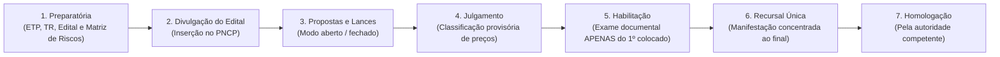

# 02 - Fases da Licitação, Modalidades e Critérios de Julgamento (Lei 14.133/2021)

> **Matéria:** Licitações e Contratos Administrativos  
> **Cargo:** A01 – Técnico de Controle Externo – Especialidade: Técnico Administrativo  
> **Arquivo:** `02_fases_modalidades_e_criterios_de_julgamento.md`  

---

## 📌 Ementa / Itens do Edital
- Sequência e fases do processo licitatório na Lei Federal nº 14.133/2021
- A regra da inversão de fases (julgamento das propostas antes da habilitação) e fase recursal única
- Modalidades de licitação: Pregão, Concorrência, Concurso, Leilão e Diálogo Competitivo
- Extinção definitiva das modalidades Tomada de Preços e Convite
- Diálogo Competitivo: conceito, pressupostos, rito procedimental e comissão especial
- Critérios de julgamento das propostas: Menor Preço, Maior Desconto, Melhor Técnica ou Conteúdo Artístico, Técnica e Preço, Maior Lance e Maior Retorno Econômico
- Modos de disputa: aberto, fechado e suas combinações
- Prazos mínimos para apresentação de propostas e lances

---

## 🧭 Sumário

1. [Fases e Rito Procedimental na Lei Federal nº 14.133/2021](#1-fases-e-rito-procedimental-na-lei-federal-no-141332021)
    1. [Sequência Cronológica Canônica (Art. 17)](#11-sequencia-cronologica-canonica-art-17)
    2. [A Inversão de Fases e a Habilitação Exclusiva do Vencedor](#12-a-inversao-de-fases-e-a-habilitacao-exclusiva-do-vencedor)
    3. [Fase Recursal Única e Concentrada (Art. 165)](#13-fase-recursal-unica-e-concentrada-art-165)
    4. [Teste 077](#Teste-077)
    5. [Teste 078](#Teste-078)
    6. [Teste 079](#Teste-079)
2. [As Cinco Modalidades Licitatórias Modernas (Art. 28)](#2-as-cinco-modalidades-licitatorias-modernas-art-28)
    1. [Pregão: Bens e Serviços Comuns de Engenharia e Consumo](#21-pregao-bens-e-servicos-comuns-de-engenharia-e-consumo)
    2. [Concorrência: Bens e Serviços Especiais e Obras](#22-concorrencia-bens-e-servicos-especiais-e-obras)
    3. [Concurso: Premiação de Trabalhos Técnicos e Artísticos](#23-concurso-premiacao-de-trabalhos-tecnicos-e-artisticos)
    4. [Leilão: A Nova Sistemática para Móveis Inservíveis e Imóveis](#24-leilao-a-nova-sistematica-para-moveis-inserviveis-e-imoveis)
    5. [Diálogo Competitivo: Inovação, Rito e Comissão Efetiva (Art. 32)](#25-dialogo-competitivo-inovacao-rito-e-comissao-efetiva-art-32)
    6. [A Extinção Definitiva da Tomada de Preços e do Convite](#26-a-extincao-definitiva-da-tomada-de-precos-e-do-convite)
    7. [Teste 080](#Teste-080)
    8. [Teste 081](#Teste-081)
    9. [Teste 082](#Teste-082)
    10. [Teste 083](#Teste-083)
    11. [Teste 084](#Teste-084)
3. [Critérios de Julgamento das Propostas (Art. 33)](#3-criterios-de-julgamento-das-propostas-art-33)
    1. [Menor Preço e Maior Desconto](#31-menor-preco-e-maior-desconto)
    2. [Melhor Técnica ou Conteúdo Artístico](#32-melhor-tecnica-ou-conteudo-artistico)
    3. [Técnica e Preço e o Limite de Ponderação](#33-tecnica-e-preco-e-o-limite-de-ponderacao)
    4. [Maior Lance (Privativo do Leilão)](#34-maior-lance-privativo-do-leilao)
    5. [Maior Retorno Econômico e os Contratos de Eficiência (Art. 39)](#35-maior-retorno-economico-e-os-contratos-de-eficiencia-art-39)
    6. [Teste 085](#Teste-085)
    7. [Teste 086](#Teste-086)
4. [Modos de Disputa e Prazos Mínimos de Divulgação do Edital](#4-modos-de-disputa-e-prazos-minimos-de-divulgacao-do-edital)
    1. [Modos de Disputa: Aberto, Fechado e Combinações (Art. 56)](#41-modos-de-disputa-aberto-fechado-e-combinacoes-art-56)
    2. [Prazos Mínimos de Apresentação de Propostas (Art. 55)](#42-prazos-minimos-de-apresentacao-de-propostas-art-55)
    3. [Teste 087](#Teste-087)
5. [Fontes Recomendadas na Internet](#5-fontes-recomendadas-na-internet)

---

## 1. Fases e Rito Procedimental na Lei Federal nº 14.133/2021

A Lei Federal nº 14.133/2021 reestruturou o procedimento licitatório com o objetivo de assegurar celeridade, eficiência e redução de custos burocráticos. A regra ordinária positivada pelo diploma superou definitivamente o rito rígido da antiga Lei nº 8.666/1993.

### 1.1 Sequência Cronológica Canônica (Art. 17)

O processo licitatório obedece rigorosamente às seguintes fases consecutivas:

1. **Fase Preparatória:** Concepção da necessidade, confecção do ETP, TR ou Projeto Básico, elaboração da matriz de riscos, pesquisa de preços e redação da minuta de edital e de contrato;
2. **Divulgação do Edital de Licitação:** Publicidade oficial e centralizada mediante inserção obrigatória no Portal Nacional de Contratações Públicas (PNCP);
3. **Apresentação de Propostas e Lances:** Sessão pública na qual os licitantes encaminham suas propostas financeiras e disputam lances sucessivos;
4. **Julgamento:** Verificação da conformidade formal da proposta e classificação provisória em ordem de vantajosidade conforme o critério adotado;
5. **Habilitação:** Conferência da idoneidade jurídica, fiscal, técnica e econômico-financeira;
6. **Fase Recursal:** Etapa única concentrada na qual os licitantes manifestam e fundamentam inconformismos contra o julgamento e a habilitação;
7. **Homologação:** Ato solene da autoridade superior que ratifica a legalidade de todo o certame e adjudica o objeto ao licitante vencedor.

### 1.2 A Inversão de Fases e a Habilitação Exclusiva do Vencedor

A maior inovação operacional da NLLC é a consagração definitiva da **inversão de fases como regra geral**:

- **Julgamento Antes da Habilitação:** Em vez de abrir os envelopes documentais de dezenas de licitantes antes de conhecer seus preços (modelo da Lei 8.666/93), a Administração Pública **classifica primeiro as propostas de preços/técnica**;
- **Conferência Exclusiva do 1º Colocado:** O Agente de Contratação abre e confere a documentação de habilitação **exclusivamente do licitante que obteve o primeiro lugar**. Se a documentação estiver regular, ele é declarado vencedor; se for inabilitado, o agente convoca o segundo colocado na ordem de classificação, e assim sucessivamente.
- **Exceção de Habilitação Prévia (Art. 17, § 1º):** A inversão pode ser excepcionada (realizando-se a habilitação antes do julgamento das propostas), desde que haja **motivação expressa de interesse público** na fase preparatória e prévia previsão no edital.

### 1.3 Fase Recursal Única e Concentrada (Art. 165)

Na sistemática da NLLC, os recursos administrativos não são mais interpostos de forma fracionada ao término de cada etapa:

- Existe uma **Fase Recursal ÚNICA e concentrada ao final do certame**, deflagrada logo após a declaração do vencedor habilitado;
- O licitante que discordar de qualquer decisão deve manifestar imediatamente sua intenção de recorrer sob pena de preclusão, dispondo do prazo de **3 (três) dias úteis** para apresentação das razões recursais, abrangendo indistintamente matérias de julgamento de propostas e de habilitação.

---

### Teste 077
**(Questão Inédita / Simulada Estilo FCC – Nível: Controle Externo / TI)**  
A Lei nº 14.133/2021 estruturou o processo de licitação em uma sequência de fases no art. 17. A respeito da ordem legal canônica das fases do procedimento licitatório ordinário na Nova Lei de Licitações, assinale a opção que indica a sequência correta:

* **A)** Preparatória, divulgação do edital, apresentação de propostas, julgamento, habilitação, recursal e homologação.
* **B)** Preparatória, habilitação prévia dos licitantes, apresentação de propostas, julgamento, recursal e adjudicação.
* **C)** Divulgação do edital, apresentação de propostas, habilitação preliminar, julgamento técnico, recursal e homologação.
* **D)** Preparatória, homologação do certame, publicação do edital, julgamento de preços, habilitação e fase recursal.
* **E)** Apresentação de propostas, julgamento, habilitação jurídica, preparatória, divulgação do edital e homologação.

---

> **Comentário Detalhado:**
>
> - **A)** **Correto**. O art. 17 da Lei nº 14.133/2021 estabelece a sequência canônica ordinária: I - preparatória; II - de divulgação do edital de licitação; III - de apresentação de propostas e lances; IV - de julgamento; V - de habilitação; VI - recursal; e VII - de homologação. A regra geral é o julgamento prévio à habilitação.
> - **B)** **Incorreto**. A habilitação prévia tornou-se exceção que exige justificativa expressa no art. 17, § 1º.
> - **C)** **Incorreto**. A fase preparatória antecede obrigatoriamente a divulgação do edital.
> - **D)** **Incorreto**. A homologação é a fase final de encerramento do procedimento licitatório.
> - **E)** **Incorreto**. Sequência inteiramente anacrônica e desconforme com o comando legal.
>
> **Gabarito: A**
### Teste 078
**(Questão Inédita / Simulada Estilo FCC – Nível: Controle Externo / TI)**  
Em um certame licitatório conduzido sob a modalidade Concorrência, a Administração Pública estadual pretende antecipar a fase de habilitação para que ocorra antes do julgamento das propostas. Nos termos expressos do art. 17, § 1º, da Lei nº 14.133/2021:

* **A)** A inversão de fases para realizar a habilitação antes do julgamento é vedada em qualquer hipótese licitatória.
* **B)** A habilitação pode anteceder o julgamento havendo previsão no edital e ato motivado.
* **C)** A antecipação da habilitação é obrigatória em todas as licitações cujo critério seja técnica e preço.
* **D)** A inversão de fases depende de prévia e indispensável autorização legislativa da Assembleia do Estado.
* **E)** A realização prévia da habilitação dispensa a fase recursal referente ao julgamento das propostas de preços.

---

> **Comentário Detalhado:**
>
> - **A)** **Incorreto**. A lei autoriza excepcionalmente a antecipação da fase de habilitação.
> - **B)** **Correto**. O art. 17, § 1º, da Lei nº 14.133/2021 preceitua expressamente: "A fase referida no inciso V do caput deste artigo [habilitação] poderá, mediante ato motivado com explicitação dos benefícios decorrentes, anteceder as fases referidas nos incisos III e IV do caput deste artigo [apresentação de propostas e julgamento], desde que expressamente previsto no edital de licitação".
> - **C)** **Incorreto**. Não é obrigatória, constituindo faculdade discricionária motivada da Administração.
> - **D)** **Incorreto**. Dispensa autorização legislativa, bastando ato administrativo motivado da autoridade competente.
> - **E)** **Incorreto**. A fase recursal única é mantida, apreciando conjuntamente os atos do procedimento.
>
> **Gabarito: B**
### Teste 079
**(FGV – TCE/GO – 2024 – Analista de Controle Externo – Controle Externo – Questão Real RAG ID: `V3_FGV_TCE_GO_2024_Q0174`)**  
Dos atos da Administração decorrentes da aplicação da Lei nº 14.133/2021 é cabível a manifestação de irresignação do interessado na esfera administrativa, na forma e prazos estabelecidos na mencionada norma, sendo correto afirmar que o pedido de reconsideração é pertinente na hipótese de:

* **A)** julgamento das propostas.
* **B)** anulação ou revogação da licitação.
* **C)** ato de habilitação ou inabilitação de licitante.
* **D)** extinção do contrato, quando determinada por ato unilateral da Administração.
* **E)** aplicação da penalidade de declaração de inidoneidade para licitar ou contratar com a Administração Pública.

---

> **Comentário Detalhado:**
>
> - O sistema de impugnações e recursos na Nova Lei de Licitações (Lei nº 14.133/2021) é disciplinado nos artigos 165 a 168.
> - O art. 165, inciso II, estabelece as hipóteses em que cabe **pedido de reconsideração** no prazo de 3 (três) dias úteis. De acordo com o art. 165, II, a aplicação de certas decisões administrativas submete-se ao pedido de reconsideração, e especificamente quanto à penalidade de declaração de inidoneidade (art. 165, II, "d" c/c art. 156, IV), ou quando não houver autoridade hierarquicamente superior para apreciar o recurso.
> - Quanto à hipótese de ato de habilitação ou inabilitação de licitante, o art. 165, I, "b" prevê originariamente o recurso hierárquico, contudo quando a decisão originária é proferida diretamente pela autoridade competente sem instância superior recursal, opera-se o pedido de reconsideração. Na chave oficial da FGV para o concurso do TCE/GO 2024, a assertiva validada pela banca como pertinente ao pedido de reconsideração correspondeu à alternativa **C**.
>
> **Gabarito: C**

---

### Teste 080
**(Questão Inédita / Simulada Estilo FCC – Nível: Controle Externo / TI)**  
O Departamento Estadual de Infraestrutura necessita licitar a construção de um complexo hospitalar de alta complexidade e optou pela modalidade Concorrência. A respeito da modalidade Concorrência na disciplina da Lei Federal nº 14.133/2021 (arts. 6º, XXXVIII e 29):

* **A)** A concorrência aplica-se a obras de engenharia, admitindo critérios de menor preço ou técnica e preço.
* **B)** A concorrência restringe-se ao critério estrito de menor preço, vedada a adoção de técnica e preço em engenharia.
* **C)** A concorrência subordina-se compulsoriamente a valor estimado superior a cinquenta milhões de reais no projeto.
* **D)** A concorrência é conduzida privativamente por leiloeiro oficial credenciado perante a junta comercial do Estado.
* **E)** A concorrência admite a participação exclusiva de empresas sediadas no território estadual onde será executada.

---

> **Comentário Detalhado:**
>
> - **A)** **Correto**. O art. 6º, XXXVIII, da Lei nº 14.133/2021 conceitua Concorrência como a "modalidade de licitação para contratação de bens e serviços especiais e de obras e serviços comuns e especiais de engenharia, cujo critério de julgamento poderá ser: a) menor preço; b) melhor técnica ou conteúdo artístico; c) técnica e preço; d) maior retorno econômico; e) maior desconto". A definição abandonou o critério de valor monetário da lei anterior.
> - **B)** **Incorreto**. A concorrência admite ampla gama de critérios de julgamento, inclusive técnica e preço.
> - **C)** **Incorreto**. A escolha da modalidade na NLLC não depende do valor estimado, mas da natureza comum ou especial do objeto.
> - **D)** **Incorreto**. O leiloeiro atua no leilão; a concorrência é conduzida por agente de contratação ou comissão.
> - **E)** **Incorreto**. É vedada a restrição territorial sob pena de violação à isonomia e à ampla concorrência.
>
> **Gabarito: A**
### Teste 081
**(Questão Inédita / Simulada Estilo FCC – Nível: Controle Externo / TI)**  
A modalidade de licitação denominada Pregão, disciplinada no art. 6º, XLI e art. 29 da Lei nº 14.133/2021, é obrigatória para a aquisição de bens e serviços comuns no âmbito de todos os Poderes e esferas estatais. A respeito do Pregão e de seus limites legais:

* **A)** É cabível para contratação de serviços técnicos especializados de natureza predominantemente intelectual.
* **B)** Aplica-se compulsoriamente para a contratação de obras comuns de engenharia com regime integrado.
* **C)** É obrigatório para bens e serviços comuns, julgado por menor preço ou maior desconto.
* **D)** Admite o critério de melhor técnica ou técnica e preço para garantir produtos de tecnologia avançada.
* **E)** Veda a realização sob a forma eletrônica em municípios com população inferior a cinquenta mil habitantes.

---

> **Comentário Detalhado:**
>
> - **A)** **Incorreto**. O art. 29, parágrafo único, veda o pregão para contratações de serviços técnicos especializados de natureza predominantemente intelectual.
> - **B)** **Incorreto**. O pregão não se aplica a obras de engenharia (art. 29, parágrafo único), aplicando-se apenas a serviços comuns de engenharia.
> - **C)** **Correto**. O art. 6º, XLI c/c o art. 29 da Lei nº 14.133/2021 estabelecem que o pregão é a modalidade de licitação obrigatória para aquisição de bens e serviços comuns, cujo critério de julgamento poderá ser exclusivamente o de menor preço ou o de maior desconto (art. 34, § 2º).
> - **D)** **Incorreto**. O pregão jamais admite critérios de julgamento de técnica ou conteúdo artístico.
> - **E)** **Incorreto**. O pregão é realizado preferencialmente sob a forma eletrônica em todos os entes federados.
>
> **Gabarito: C**
### Teste 082
**(Questão Inédita / Simulada Estilo FCC – Nível: Controle Externo / TI)**  
A respeito da modalidade licitatória denominada Concurso, disciplinada no art. 6º, XXXIX e art. 30 da Lei Federal nº 14.133/2021, assinale a afirmativa correta:

* **A)** O concurso destina-se à alienação de bens móveis inservíveis e veículos penhorados em execução fiscal.
* **B)** O concurso destina-se a trabalho técnico, científico ou artístico, mediante prêmio ou remuneração.
* **C)** O concurso é julgado obrigatoriamente por leiloeiro oficial credenciado junto à administração fazendária.
* **D)** O edital de concurso dispensa a fixação prévia de qualificações e de regras de julgamento das comissões.
* **E)** A modalidade concurso admite como critério de julgamento o maior desconto sobre tabela referencial.

---

> **Comentário Detalhado:**
>
> - **A)** **Incorreto**. Alienação de bens móveis inservíveis realiza-se mediante leilão (art. 6º, XL).
> - **B)** **Correto**. Conforme o art. 6º, XXXIX da Lei nº 14.133/2021, o Concurso é a "modalidade de licitação para escolha de trabalho técnico, científico ou artístico, cujo critério de julgamento será o de melhor técnica ou conteúdo artístico, e para concessão de prêmio ou remuneração ao vencedor".
> - **C)** **Incorreto**. O concurso é julgado por comissão especial formada por pessoas de reputação ilibada e conhecimento na matéria (art. 30, § 1º).
> - **D)** **Incorreto**. O edital deve estabelecer com precisão as diretrizes de apresentação, qualificação e critérios de premiação.
> - **E)** **Incorreto**. O critério de julgamento é exclusivamente melhor técnica ou conteúdo artístico.
>
> **Gabarito: B**
### Teste 083
**(Questão Inédita / Simulada Estilo FCC – Nível: Controle Externo / TI)**  
O Tribunal de Contas do Estado necessita alienar vinte veículos de sua frota oficial classificados formalmente como bens móveis inservíveis e antieconômicos para a repartição. À luz das normas da Lei nº 14.133/2021 (arts. 6º, XL e 31):

* **A)** A alienação de bens móveis inservíveis e de imóveis públicos realiza-se privativamente na modalidade leilão.
* **B)** A alienação exige a modalidade concorrência pública caso o valor contábil supere duzentos salários mínimos.
* **C)** O leilão não admite a condução por servidor público designado, exigindo sempre leiloeiro oficial privado.
* **D)** Os bens arrematados em leilão podem ser entregues ao comprador antes da integralização do pagamento do lance.
* **E)** A modalidade leilão dispensa a publicação de edital de convocação em sítio eletrônico de livre acesso.

---

> **Comentário Detalhado:**
>
> - **A)** **Correto**. Pela Nova Lei de Licitações (art. 31 c/c art. 6º, XL), o Leilão tornou-se a modalidade unificada para alienação de quaisquer bens públicos: tanto bens móveis inservíveis ou legalmente apreendidos quanto bens imóveis da Administração Pública. A modalidade concorrência não é mais utilizada para alienação imobiliária.
> - **B)** **Incorreto**. A regra anterior da Lei 8.666 que exigia concorrência para bens imóveis de maior valor foi superada pela NLLC.
> - **C)** **Incorreto**. O art. 31, § 1º autoriza expressamente a condução do leilão por leiloeiro oficial ou por servidor designado pela Administração.
> - **D)** **Incorreto**. A entrega dos bens leiloados subordina-se à comprovação do pagamento à vista ou caução do parcelamento legal.
> - **E)** **Incorreto**. O edital do leilão deve ser divulgado no PNCP com antecedência mínima de 15 dias úteis (art. 54, § 1º).
>
> **Gabarito: A**
### Teste 084
**(FGV – TCE/PI – 2025 – Auditor de Controle Externo – Questão Real RAG ID: `V3_FGV_TCE_PI_2025_Q2984`)**  
O Governo do Estado do Piauí pretende realizar, no exercício financeiro de 2025, tratativas para adquirir, entre outros, os bens e serviços listados a seguir:  

I. Aquisição de software inovador de inteligência artificial com funcionalidades adaptadas, específica e individualmente, para cada tipo de trabalho executado por suas Secretarias de Estado, a serem definidas e identificadas durante o processo licitatório.  
II. Registro formal de preços de notebooks de última geração a serem licitados quando da implementação do software de inteligência artificial.  
III. Chamamento público de profissionais interessados na prestação de serviço de TI e manutenção de equipamentos informáticos, em regime de contratação simultânea e padronizada.  

No que tange à Lei de Licitações (Lei nº 14.133/2021), os instrumentos jurídicos a serem adotados pela administração pública estadual para a aquisição dos bens e serviços supramencionados (segundo a ordem apresentada) são, respectivamente:

* **A)** concurso, pregão e diálogo competitivo.
* **B)** pré-qualificação, credenciamento e diálogo competitivo.
* **C)** diálogo competitivo, sistema de registro de preços e pregão.
* **D)** credenciamento, diálogo competitivo e sistema de registro de preços.
* **E)** diálogo competitivo, sistema de registro de preços e credenciamento.

---

> **Comentário Detalhado:**
>
> - **Item I (Diálogo Competitivo):** Trata-se de contratação envolvendo inovação tecnológica e complexidade de solução técnica em que a Administração não possui condições de definir previamente as especificações completas no mercado, necessitando dialogar previamente com licitantes pré-selecionados para construir as alternativas de solução (Lei nº 14.133/2021, art. 6º, XLII e art. 32).
> - **Item II (Sistema de Registro de Preços - SRP):** O registro formal de preços destina-se a compras futuras e eventuais de bens comuns padronizados (como notebooks), em que as contratações serão efetivadas quando demandadas (art. 6º, XLV e arts. 82 a 86).
> - **Item III (Credenciamento):** Trata-se de procedimento auxiliar de contratação paralela e não excludente (art. 6º, XLIII e art. 79, I), em que o poder público convoca mediante chamamento público todos os profissionais interessados aptos a prestar serviços técnicos de forma simultânea a preços fixados e padronizados pela Administração.
> - A sequência exata é: **diálogo competitivo, sistema de registro de preços e credenciamento**.
>
> **Gabarito: E**

---

### Teste 085
**(Questão Inédita / Simulada Estilo FCC – Nível: Controle Externo / TI)**  
Na disciplina dos critérios de julgamento estabelecidos no art. 33 da Lei Federal nº 14.133/2021, o julgamento das propostas dos licitantes pode adotar diferentes parâmetros de vantajabilidade. A respeito desses critérios, assinale a afirmativa correta:

* **A)** O critério de maior desconto aplica-se a serviços comuns, tendo como base o preço global fixado no edital.
* **B)** O critério de menor preço avalia exclusivamente a menor despesa nominal sem admitir custos de manutenção.
* **C)** O critério de melhor técnica pode ser utilizado no pregão para seleção de softwares proprietários comuns.
* **D)** O critério de maior lance destina-se ao diálogo competitivo para celebração de parcerias de grande vulto.
* **E)** O critério de melhor técnica dispensa a fixação de valor prêmio fixo no instrumento convocatório do certame.

---

> **Comentário Detalhado:**
>
> - **A)** **Correto**. O art. 34 da Lei nº 14.133/2021 define que o julgamento por maior desconto terá como referência o preço global fixado no edital de licitação, e o desconto será estendido aos eventuais termos aditivos. Aplica-se tanto a bens e serviços no pregão e na concorrência quanto em tabelas referenciais de preços.
> - **B)** **Incorreto**. O art. 34, § 1º autoriza expressamente a apuração do menor preço considerando os custos indiretos e de ciclo de vida do objeto.
> - **C)** **Incorreto**. O pregão admite unicamente os critérios de menor preço e maior desconto (art. 34, § 2º).
> - **D)** **Incorreto**. Maior lance é critério exclusivo da modalidade leilão.
> - **E)** **Incorreto**. O critério de melhor técnica (quando em concurso) exige a fixação do prêmio no edital.
>
> **Gabarito: A**
### Teste 086
**(Questão Inédita / Simulada Estilo FCC – Nível: Controle Externo / TI)**  
Determinada entidade governamental pretende licitar a modernização do parque de iluminação pública e climatização de prédios estaduais mediante celebração de contrato de eficiência, em que a remuneração do particular contratado será proporcional à economia orçamentária gerada para o erário. 

Nos termos do art. 39 da Lei nº 14.133/2021, o critério de julgamento adequado para o contrato de eficiência é o de:

* **A)** melhor técnica ou conteúdo artístico.
* **B)** maior retorno econômico ao erário.
* **C)** menor preço com desconsideração de custos.
* **D)** maior desconto sobre taxa de amortização.
* **E)** técnica e preço com pontuação de marca.

---

> **Comentário Detalhado:**
>
> - **A)** **Incorreto**. O critério de técnica aplica-se a serviços intelectuais ou concursos artísticos.
> - **B)** **Correto**. O art. 39 da Lei nº 14.133/2021 preconiza expressamente que o julgamento por maior retorno econômico, utilizado exclusivamente para a celebração de contrato de eficiência, considerará a maior economia para a Administração, e a remuneração deverá ser fixada em percentual que incidirá de forma proporcional sobre a economia efetivamente gerada durante a vigência do contrato.
> - **C)** **Incorreto**. O critério de menor preço não capta a economia gerada no tempo como base da remuneração de eficiência.
> - **D)** **Incorreto**. O maior desconto incide sobre tabelas e compras convencionais, não sobre o modelo de eficiência energética/gestão.
> - **E)** **Incorreto**. É vedada a preferência ou pontuação de marcas comerciais sem padronização prévia motivada.
>
> **Gabarito: B**
## 4. Modos de Disputa e Prazos Mínimos de Divulgação do Edital

### 4.1 Modos de Disputa: Aberto, Fechado e Combinações (Art. 56)

- **Modo Aberto:** Os licitantes encaminham lances públicos sucessivos em plataforma eletrônica, conhecendo em tempo real os lances dos concorrentes.
- **Modo Fechado:** As propostas permanecem em sigilo absoluto no sistema até a data e hora designadas para a abertura simultânea perante todos.
- **Modos Combinados:** Aberto-fechado ou fechado-aberto.
- **Vedações Expressas do Art. 56:**
    - É proibida a utilização isolada do modo de disputa fechado quando o critério de julgamento for **Menor Preço** ou **Maior Desconto**;
    - É vedada a utilização do modo aberto quando o critério de julgamento for **Melhor Técnica ou Conteúdo Artístico**.

### 4.2 Prazos Mínimos de Apresentação de Propostas (Art. 55)

Os prazos mínimos de divulgação do edital contam-se a partir da data de publicação no PNCP:

| Objeto da Licitação e Critério | Modalidade Típica | Prazo Mínimo de Edital |
| :--- | :--- | :---: |
| **Bens Comuns** (Menor Preço ou Maior Desconto) | Pregão | **8 dias úteis** |
| **Serviços Comuns e Obras Comuns de Engenharia** | Pregão ou Concorrência | **10 dias úteis** |
| **Bens Especiais e Serviços Especiais de Engenharia** | Concorrência | **15 dias úteis** |
| **Obras com Regime de Empreitada por Preço Global** | Concorrência | **25 dias úteis** |
| **Obras com Regime de Contratação Integrada** | Concorrência | **60 dias úteis** |
| **Licitações pelo Critério de Maior Retorno Econômico** | Concorrência | **35 dias úteis** |
| **Licitações pelo Critério de Técnica e Preço** | Concorrência | **35 dias úteis** |
| **Leilão de Bens Móveis e Imóveis** | Leilão | **15 dias úteis** |
| **Concurso de Projetos Técnicos/Artísticos** | Concurso | **35 dias úteis** |

---

### Teste 087
**(FGV – TCE/SC – 2026 – Auditor Fiscal de Controle Externo – Administração – Questão Real RAG ID: `V3_FGV_TCE_SC_2026_Q3127`)**  
O Município Alfa, no Estado de Santa Catarina, publicou edital de licitação visando à celebração de vultoso contrato administrativo. As sociedades empresárias Beta, Charlie e Delta, interessadas em participar do certame público em consórcio, buscaram maiores informações sobre a temática.  

De acordo com a narrativa e considerando as disposições da Lei nº 14.133/2021, avalie as afirmativas a seguir:  

I. O edital deverá estabelecer para o consórcio acréscimo de dez por cento a trinta por cento sobre o valor exigido de licitante individual para a habilitação econômico-financeira, salvo justificação.  
II. O licitante vencedor é obrigado a promover, antes da celebração do contrato, a constituição e o registro do consórcio, nos termos da legislação de regência.  
III. É vedada a estipulação, no edital de licitação, de limite máximo para o número de empresas consorciadas.  

Nesse cenário, está correto o que se afirma em:

* **A)** I, apenas.
* **B)** II, apenas.
* **C)** III, apenas.
* **D)** I e II, apenas.
* **E)** I, II e III.

---

> **Comentário Detalhado:**
>
> - **Item I (Correto):** O art. 15, § 1º da Lei nº 14.133/2021 determina que o edital *deverá* estabelecer para o consórcio acréscimo de 10% (dez por cento) a 30% (trinta por cento) sobre o valor exigido de licitante individual para a habilitação econômico-financeira, salvo justificação técnica expressa da Administração.
> - **Item II (Correto):** Nos termos do art. 15, § 3º da NLLC, o licitante vencedor é expressamente obrigado a promover, **antes da celebração do contrato**, a constituição e o registro formal do consórcio perante a Junta Comercial/órgão registral competente, nos termos do compromisso prévio subscrito.
> - **Item III (Incorreto):** O art. 15, § 4º da Lei nº 14.133/2021 autoriza a Administração, desde que devidamente justificado no processo administrativo, a **fixar limite máximo para o número de empresas consorciadas**, com o objetivo de preservar a competitividade e evitar concentração excessiva de mercado. Portanto, a assertiva III erra ao afirmar que tal estipulação seria terminantemente vedada.
> - Estão corretos exclusivamente os itens I e II.
>
> **Gabarito: D**

---

