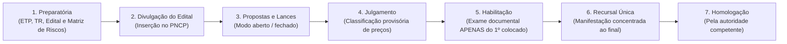
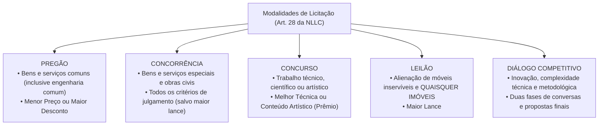

# 02 - Fases da Licitação, Modalidades e Critérios de Julgamento (Lei 14.133/2021)

> **Matéria:** Licitações e Contratos Administrativos  
> **Cargo:** A01 – Técnico de Controle Externo – Especialidade: Técnico Administrativo  
> **Arquivo:** `02_fases_modalidades_e_criterios_de_julgamento.md`  

---

## 📌 Ementa / Itens do Edital
- Sequência e fases do processo licitatório na Lei Federal nº 14.133/2021
- A regra da inversão de fases (julgamento das propostas antes da habilitação) e fase recursal única
- Modalidades de licitação: Pregão, Concorrência, Concurso, Leilão e Diálogo Competitivo
- Extinção definitiva das modalidades Tomada de Preços e Convite
- Diálogo Competitivo: conceito, pressupostos, rito procedimental e comissão especial
- Critérios de julgamento das propostas: Menor Preço, Maior Desconto, Melhor Técnica ou Conteúdo Artístico, Técnica e Preço, Maior Lance e Maior Retorno Econômico
- Modos de disputa: aberto, fechado e suas combinações
- Prazos mínimos para apresentação de propostas e lances

---

## 🧭 Sumário

1. [Fases e Rito Procedimental na Lei Federal nº 14.133/2021](#1-fases-e-rito-procedimental-na-lei-federal-no-141332021)
    1. [Sequência Cronológica Canônica (Art. 17)](#11-sequencia-cronologica-canonica-art-17)
    2. [A Inversão de Fases e a Habilitação Exclusiva do Vencedor](#12-a-inversao-de-fases-e-a-habilitacao-exclusiva-do-vencedor)
    3. [Fase Recursal Única e Concentrada (Art. 165)](#13-fase-recursal-unica-e-concentrada-art-165)
    4. [Teste 077](#Teste-077)
    5. [Teste 078](#Teste-078)
    6. [Teste 079](#Teste-079)
2. [As Cinco Modalidades Licitatórias Modernas (Art. 28)](#2-as-cinco-modalidades-licitatorias-modernas-art-28)
    1. [Pregão: Bens e Serviços Comuns de Engenharia e Consumo](#21-pregao-bens-e-servicos-comuns-de-engenharia-e-consumo)
    2. [Concorrência: Bens e Serviços Especiais e Obras](#22-concorrencia-bens-e-servicos-especiais-e-obras)
    3. [Concurso: Premiação de Trabalhos Técnicos e Artísticos](#23-concurso-premiacao-de-trabalhos-tecnicos-e-artisticos)
    4. [Leilão: A Nova Sistemática para Móveis Inservíveis e Imóveis](#24-leilao-a-nova-sistematica-para-moveis-inserviveis-e-imoveis)
    5. [Diálogo Competitivo: Inovação, Rito e Comissão Efetiva (Art. 32)](#25-dialogo-competitivo-inovacao-rito-e-comissao-efetiva-art-32)
    6. [A Extinção Definitiva da Tomada de Preços e do Convite](#26-a-extincao-definitiva-da-tomada-de-precos-e-do-convite)
    7. [Teste 080](#Teste-080)
    8. [Teste 081](#Teste-081)
    9. [Teste 082](#Teste-082)
    10. [Teste 083](#Teste-083)
    11. [Teste 084](#Teste-084)
3. [Critérios de Julgamento das Propostas (Art. 33)](#3-criterios-de-julgamento-das-propostas-art-33)
    1. [Menor Preço e Maior Desconto](#31-menor-preco-e-maior-desconto)
    2. [Melhor Técnica ou Conteúdo Artístico](#32-melhor-tecnica-ou-conteudo-artistico)
    3. [Técnica e Preço e o Limite de Ponderação](#33-tecnica-e-preco-e-o-limite-de-ponderacao)
    4. [Maior Lance (Privativo do Leilão)](#34-maior-lance-privativo-do-leilao)
    5. [Maior Retorno Econômico e os Contratos de Eficiência (Art. 39)](#35-maior-retorno-economico-e-os-contratos-de-eficiencia-art-39)
    6. [Teste 085](#Teste-085)
    7. [Teste 086](#Teste-086)
4. [Modos de Disputa e Prazos Mínimos de Divulgação do Edital](#4-modos-de-disputa-e-prazos-minimos-de-divulgacao-do-edital)
    1. [Modos de Disputa: Aberto, Fechado e Combinações (Art. 56)](#41-modos-de-disputa-aberto-fechado-e-combinacoes-art-56)
    2. [Prazos Mínimos de Apresentação de Propostas (Art. 55)](#42-prazos-minimos-de-apresentacao-de-propostas-art-55)
    3. [Teste 087](#Teste-087)
5. [Fontes Recomendadas na Internet](#5-fontes-recomendadas-na-internet)

---

## 1. Fases e Rito Procedimental na Lei Federal nº 14.133/2021

A Lei Federal nº 14.133/2021 reestruturou o procedimento licitatório com o objetivo de assegurar celeridade, eficiência e redução de custos burocráticos. A regra ordinária positivada pelo diploma superou definitivamente o rito rígido da antiga Lei nº 8.666/1993.

### 1.1 Sequência Cronológica Canônica (Art. 17)

O processo licitatório obedece rigorosamente às seguintes fases consecutivas:

1. **Fase Preparatória:** Concepção da necessidade, confecção do ETP, TR ou Projeto Básico, elaboração da matriz de riscos, pesquisa de preços e redação da minuta de edital e de contrato;
2. **Divulgação do Edital de Licitação:** Publicidade oficial e centralizada mediante inserção obrigatória no Portal Nacional de Contratações Públicas (PNCP);
3. **Apresentação de Propostas e Lances:** Sessão pública na qual os licitantes encaminham suas propostas financeiras e disputam lances sucessivos;
4. **Julgamento:** Verificação da conformidade formal da proposta e classificação provisória em ordem de vantajosidade conforme o critério adotado;
5. **Habilitação:** Conferência da idoneidade jurídica, fiscal, técnica e econômico-financeira;
6. **Fase Recursal:** Etapa única concentrada na qual os licitantes manifestam e fundamentam inconformismos contra o julgamento e a habilitação;
7. **Homologação:** Ato solene da autoridade superior que ratifica a legalidade de todo o certame e adjudica o objeto ao licitante vencedor.

### 1.2 A Inversão de Fases e a Habilitação Exclusiva do Vencedor

A maior inovação operacional da NLLC é a consagração definitiva da **inversão de fases como regra geral**:

- **Julgamento Antes da Habilitação:** Em vez de abrir os envelopes documentais de dezenas de licitantes antes de conhecer seus preços (modelo da Lei 8.666/93), a Administração Pública **classifica primeiro as propostas de preços/técnica**;
- **Conferência Exclusiva do 1º Colocado:** O Agente de Contratação abre e confere a documentação de habilitação **exclusivamente do licitante que obteve o primeiro lugar**. Se a documentação estiver regular, ele é declarado vencedor; se for inabilitado, o agente convoca o segundo colocado na ordem de classificação, e assim sucessivamente.
- **Exceção de Habilitação Prévia (Art. 17, § 1º):** A inversão pode ser excepcionada (realizando-se a habilitação antes do julgamento das propostas), desde que haja **motivação expressa de interesse público** na fase preparatória e prévia previsão no edital.

### 1.3 Fase Recursal Única e Concentrada (Art. 165)

Na sistemática da NLLC, os recursos administrativos não são mais interpostos de forma fracionada ao término de cada etapa:

- Existe uma **Fase Recursal ÚNICA e concentrada ao final do certame**, deflagrada logo após a declaração do vencedor habilitado;
- O licitante que discordar de qualquer decisão deve manifestar imediatamente sua intenção de recorrer sob pena de preclusão, dispondo do prazo de **3 (três) dias úteis** para apresentação das razões recursais, abrangendo indistintamente matérias de julgamento de propostas e de habilitação.

---

### Teste 077
**(FGV – TRT-24 – Analista Judiciario Area Administrativa Contabilidade – 2025)**
De acordo com a Lei nº 14.133/2021, após o resultado do processo de licitação, será facultado à Administração, quando o convocado não assinar o termo de contrato ou não aceitar ou não retirar o instrumento equivalente no prazo e nas condições estabelecidas, convocar os licitantes remanescentes, na ordem de classificação, para a celebração do contrato nas condições propostas pelo licitante vencedor. Em relação à hipótese de nenhum dos licitantes aceitar a contratação nos termos propostos, analise o que se afirma a seguir. I. A Administração poderá convocar os licitantes remanescentes para negociação, na ordem de classificação, com vistas à obtenção de preço melhor, mesmo que acima do preço do adjudicatário. II. A Administração poderá adjudicar e celebrar o contrato nas condições ofertadas pelos licitantes remanescentes, atendida a ordem classificatória, quando frustrada a negociação de melhor condição. III. A Administração poderá anular o edital de licitação e suspender as suas intenções originais em relação ao objeto da licitação. Está correto o que se afirma em

* **A)** I, apenas.
* **B)** I e II, apenas.
* **C)** I e III, apenas.
* **D)** II e III, apenas.
* **E)** I, II e III.

---

> **Comentário Detalhado:**
>
> - **A)** **Incorreta.** A opção incorre em restrição indevida ao limitar o escopo conceitual ao afirmar que "I, apenas". De acordo com a teoria estudada em *1.2 A Inversão de Fases e a Habilitação Exclusiva do Vencedor*, se a documentação estiver regular, ele é declarado vencedor; se for inabilitado, o agente convoca o segundo colocado na ordem de classificação, e assim sucessivamente.
> - **B)** **Correta.** Conforme fundamentado na seção *1.2 A Inversão de Fases e a Habilitação Exclusiva do Vencedor* deste guia, julgamento Antes da Habilitação: Em vez de abrir os envelopes documentais de dezenas de licitantes antes de conhecer seus preços (modelo da Lei 8.666/93), a Administração Pública classifica primeiro as propostas de preços/técnica. Dessa forma, está plenamente correta a assertiva da banca (FGV – TRT-24/2025) ao estabelecer que "I e II, apenas".
> - **C)** **Incorreta.** A opção incorre em restrição indevida ao limitar o escopo conceitual ao afirmar que "I e III, apenas". De acordo com a teoria estudada em *3. Critérios de Julgamento das Propostas (Art. 33)*, o art. 33 da Lei nº 14.133/2021 estabelece os critérios objetivos de julgamento que devem constar obrigatoriamente do edital.
> - **D)** **Incorreta.** A opção incorre em restrição indevida ao limitar o escopo conceitual ao afirmar que "II e III, apenas". De acordo com a teoria estudada em *1.3 Fase Recursal Única e Concentrada (Art. 165)*, o licitante que discordar de qualquer decisão deve manifestar imediatamente sua intenção de recorrer sob pena de preclusão, dispondo do prazo de 3 (três) dias úteis para apresentação das razões recursais, abrangendo indistintamente matérias de julgamento de propostas e de habilitação.
> - **E)** **Incorreta.** A opção apresenta proposição em desacordo com os fundamentos teóricos e técnicos do tópico ao afirmar que "I, II e III". De acordo com a teoria estudada em *5. Fontes Recomendadas na Internet*, lei Federal nº 14.133/2021 - Arts. 17 a 27 (Fases do Processo Licitatório e Inversão de Fases).
>
> **Gabarito: B**

---

### Teste 078
**(FGV – TCE-GO – Analista de Controle Externo Ciencias Contabeis – 2024)**
Após a fase de habilitação em determinado procedimento licitatório, realizado na modalidade concorrência, que seguiu a sequência estabelecida como regra na Lei nº 14.133/2021, surgiram dúvidas sobre o adequado encadeamento do certame, bem como quanto à viabilidade de apresentação de recursos administrativos, assim também acerca das peculiaridades das irresignações previstas na aludida norma. Nesse contexto, considerando o disposto no mencionado Diploma Legal, é correto afirmar que

* **A)** a fase de habilitação em questão é seguida da fase de julgamento, sendo certo que essa última só pode ser realizada após a apreciação dos recursos apresentados na fase anterior, diante de efeito suspensivo conferido às irresignações formuladas durante o procedimento.
* **B)** a fase de habilitação em questão é seguida da apreciação dos respectivos recursos, sendo certo que aqueles atinentes ao julgamento das propostas já foram examinados, antes da habilitação, diante do efeito suspensivo de tais irresignações em sede administrativa.
* **C)** a fase de habilitação em questão é seguida da homologação do certame, momento em que serão apreciados os recursos contra a habilitação e julgamento, mesmo que, em regra, tais irresignações não tenham efeito suspensivo, para que então possa ser promovido o encerramento do procedimento licitatório.
* **D)** a fase de habilitação em questão é seguida da recursal, sendo certo que os recursos são dotados de efeito suspensivo e apreciados em fase única quanto às questões atinentes à habilitação e ao julgamento, dependendo, no entanto, da imediata manifestação da intenção de recorrer, sob pena de preclusão.
* **E)** a fase de habilitação em questão é seguida da fase de encerramento, que poderá resultar na homologação, anulação ou revogação da licitação, independentemente da apreciação de recursos administrativos quanto as questões atinentes à habilitação e ao julgamento, que não são dotados de efeito suspensivo.

---

> **Comentário Detalhado:**
>
> - **A)** **Incorreta.** A opção apresenta proposição em desacordo com os fundamentos teóricos e técnicos do tópico ao afirmar que "a fase de habilitação em questão é seguida da fase de julgamento, sendo certo que essa última só pode ser...". De acordo com a teoria estudada em *1.2 A Inversão de Fases e a Habilitação Exclusiva do Vencedor*, exceção de Habilitação Prévia (Art. 17, § 1º): A inversão pode ser excepcionada (realizando-se a habilitação antes do julgamento das propostas), desde que haja motivação expressa de interesse público na fase preparatória e prévia previsão no edital.
> - **B)** **Incorreta.** A opção apresenta proposição em desacordo com os fundamentos teóricos e técnicos do tópico ao afirmar que "a fase de habilitação em questão é seguida da apreciação dos respectivos recursos, sendo certo que aqueles...". De acordo com a teoria estudada em *1.2 A Inversão de Fases e a Habilitação Exclusiva do Vencedor*, julgamento Antes da Habilitação: Em vez de abrir os envelopes documentais de dezenas de licitantes antes de conhecer seus preços (modelo da Lei 8.666/93), a Administração Pública classifica primeiro as propostas de preços/técnica.
> - **C)** **Incorreta.** A opção apresenta proposição em desacordo com os fundamentos teóricos e técnicos do tópico ao afirmar que "a fase de habilitação em questão é seguida da homologação do certame, momento em que serão apreciados os recursos...". De acordo com a teoria estudada em *1.1 Sequência Cronológica Canônica (Art. 17)*, fase Recursal: Etapa única concentrada na qual os licitantes manifestam e fundamentam inconformismos contra o julgamento e a habilitação.
> - **D)** **Incorreta.** A opção apresenta proposição em desacordo com os fundamentos teóricos e técnicos do tópico ao afirmar que "a fase de habilitação em questão é seguida da recursal, sendo certo que os recursos são dotados de efeito...". De acordo com a teoria estudada em *1.3 Fase Recursal Única e Concentrada (Art. 165)*, o licitante que discordar de qualquer decisão deve manifestar imediatamente sua intenção de recorrer sob pena de preclusão, dispondo do prazo de 3 (três) dias úteis para apresentação das razões recursais, abrangendo indistintamente matérias de julgamento de propostas e de habilitação.
> - **E)** **Correta.** Conforme fundamentado na seção *1.3 Fase Recursal Única e Concentrada (Art. 165)* deste guia, na sistemática da NLLC, os recursos administrativos não são mais interpostos de forma fracionada ao término de cada etapa. Dessa forma, está plenamente correta a assertiva da banca (FGV – TCE-GO/2024) ao estabelecer que "a fase de habilitação em questão é seguida da fase de encerramento, que poderá resultar na homologação, anulação...".
>
> **Gabarito: E**

---

### Teste 079
**(FGV – TJ-RR – Analista Judiciario Gestao e Governanca de Tecnologia da Informacao – 2024)**
Considerando conceitos básicos de contratações de TI, analise as afirmativas. I. Em sequência, segundo a Lei nº 14.133/2021, o processo licitatório deverá seguir as seguintes fases: preparatória; de divulgação do edital de licitação; de cadastramento; de apresentação de propostas e lances, quando for o caso; de julgamento; recursal; de habilitação; e de homologação. II. Segundo a IN 67/2021 da SEGES/ME, no caso de procedimento de contratação restar fracassado, o órgão poderá, dentre outras ações, valer-se, para a contratação, de proposta obtida na pesquisa de preços que serviu de base ao procedimento, se houver, privilegiando-se os menores preços, sempre que possível, e desde que atendidas às condições de habilitação exigidas. III. Segundo a Lei nº 14.133/2021, o processo de padronização deverá conter: parecer técnico sobre o produto, considerados especificações técnicas e estéticas, desempenho, análise de contratações anteriores, custo e condições de manutenção e garantia; despacho motivado do responsável técnico pela contratação, com a adoção do padrão; e síntese da justificativa e descrição sucinta do padrão definido, divulgadas em sítio eletrônico oficial. Está correto o que se afirma em

* **A)** I, apenas.
* **B)** II, apenas.
* **C)** III, apenas.
* **D)** I e II, apenas.
* **E)** I e III, apenas.

---

> **Comentário Detalhado:**
>
> - **A)** **Incorreta.** A opção incorre em restrição indevida ao limitar o escopo conceitual ao afirmar que "I, apenas". De acordo com a teoria estudada em *1.1 Sequência Cronológica Canônica (Art. 17)*, divulgação do Edital de Licitação: Publicidade oficial e centralizada mediante inserção obrigatória no Portal Nacional de Contratações Públicas (PNCP).
> - **B)** **Correta.** Conforme fundamentado na seção *1.2 A Inversão de Fases e a Habilitação Exclusiva do Vencedor* deste guia, exceção de Habilitação Prévia (Art. 17, § 1º): A inversão pode ser excepcionada (realizando-se a habilitação antes do julgamento das propostas), desde que haja motivação expressa de interesse público na fase preparatória e prévia previsão no edital. Dessa forma, está plenamente correta a assertiva da banca (FGV – TJ-RR/2024) ao estabelecer que "II, apenas".
> - **C)** **Incorreta.** A opção incorre em restrição indevida ao limitar o escopo conceitual ao afirmar que "III, apenas". De acordo com a teoria estudada em *1. Fases e Rito Procedimental na Lei Federal nº 14.133/2021*, a Lei Federal nº 14.133/2021 reestruturou o procedimento licitatório com o objetivo de assegurar celeridade, eficiência e redução de custos burocráticos.
> - **D)** **Incorreta.** A opção incorre em restrição indevida ao limitar o escopo conceitual ao afirmar que "I e II, apenas". De acordo com a teoria estudada em *1.1 Sequência Cronológica Canônica (Art. 17)*, fase Preparatória: Concepção da necessidade, confecção do ETP, TR ou Projeto Básico, elaboração da matriz de riscos, pesquisa de preços e redação da minuta de edital e de contrato.
> - **E)** **Incorreta.** A opção incorre em restrição indevida ao limitar o escopo conceitual ao afirmar que "I e III, apenas". De acordo com a teoria estudada em *5. Fontes Recomendadas na Internet*, lei Federal nº 14.133/2021 - Arts. 17 a 27 (Fases do Processo Licitatório e Inversão de Fases).
>
> **Gabarito: B**

---

## 2. As Cinco Modalidades Licitatórias Modernas (Art. 28)

O art. 28 da Lei Federal nº 14.133/2021 estabelece um rol taxativo com cinco modalidades licitatórias aplicáveis a toda a Administração Pública brasileira:

### 2.1 Pregão: Bens e Serviços Comuns de Engenharia e Consumo

- **Objeto Mandatório (Art. 29):** Modalidade de contratação obrigatória para **bens e serviços comuns**, incluindo expressamente os **serviços comuns de engenharia** (assim entendidos aqueles cujos padrões de desempenho e qualidade podem ser objetivamente descritos pelo edital por especificações usuais de mercado);
- **Critérios de Julgamento Permitidos:** Unicamente **Menor Preço** ou **Maior Desconto**;
- **Condução:** Conduzido pelo Pregoeiro, com auxílio da equipe de apoio.

### 2.2 Concorrência: Bens e Serviços Especiais e Obras

- **Objeto:** Modalidade de licitação destinada à contratação de **bens e serviços especiais**, obras e serviços de engenharia comuns e especiais;
- **Critérios de Julgamento:** Ampla flexibilidade, admitindo Menor Preço, Maior Desconto, Melhor Técnica, Técnica e Preço e Maior Retorno Econômico.

### 2.3 Concurso: Premiação de Trabalhos Técnicos e Artísticos

- **Objeto:** Escolha de trabalho técnico, científico ou artístico, de arquitetura ou urbanismo;
- **Contraprestação:** Concessão de prêmio ou remuneração ao vencedor;
- **Critério de Julgamento:** Melhor Técnica ou Conteúdo Artístico, avaliado por comissão especial qualificada.

### 2.4 Leilão: A Nova Sistemática para Móveis Inservíveis e Imóveis

- **Objeto Unificado (Art. 28, § 2º c/c Art. 31):** Modalidade obrigatória para alienação de **bens móveis inservíveis ou apreendidos** e de **QUAISQUER BENS IMÓVEIS** pertencentes ao Poder Público;
- **Critério de Julgamento:** Exclusivamente **Maior Lance** (igual ou superior à avaliação prévia);
- **Condução:** Pode ser conduzido por Leiloeiro Oficial matriculado ou por servidor público designado pela autoridade.

> 🚨 **MUDANÇA RADICAL DA LEI 14.133/2021:**  
> Sob a revogada Lei 8.666/93, a alienação de bens imóveis exigia Concorrência. Na Nova Lei de Licitações, **TODOS os imóveis públicos são alienados por LEILÃO**! Atenção redobrada às pegadinhas da FCC que afirmam que imóveis dependem de Concorrência.

### 2.5 Diálogo Competitivo: Inovação, Rito e Comissão Efetiva (Art. 32)

Modalidade moderna instituída pela NLLC, restrita a contratações de alta complexidade em que a Administração identifica uma necessidade pública, mas **não possui capacidade técnica de definir previamente as especificações do objeto**:

- **Hipóteses de Cabimento:** Inovação tecnológica; complexidade de engenharia ou software; impossibilidade de adaptar soluções de mercado existentes;
- **Estrutura em Duas Fases:**
    1. *Fase de Diálogos:* O edital publica os objetivos do órgão; os licitantes pré-selecionados debatem com a comissão técnica em reuniões gravadas para construir alternativas metodológicas;
    2. *Fase Competitiva Final:* Concluído o diálogo, abre-se a disputa final de propostas comerciais e técnicas com base na solução construída;

- **Condução Obrigatória por Comissão Efetiva:** O Diálogo Competitivo deve ser conduzido **obrigatoriamente por comissão de contratação composta de, no mínimo, 3 (três) servidores efetivos ou empregados permanentes** (art. 32, XI).

### 2.6 A Extinção Definitiva da Tomada de Preços e do Convite

A NLLC **extinguiu formal e definitivamente as modalidades Tomada de Preços e Convite**. Na nova ordem jurídica, as modalidades são delimitadas estritamente pela **natureza do objeto**, e jamais pelo valor econômico da contratação.

---

### Teste 080
**(FGV – TCE-SC – Auditor Fiscal de Controle Externo Administracao – 2026)**
Um estado federado celebrou contrato de Parceria Público- Privada (PPP) na modalidade concessão patrocinada para a construção e operação de um complexo hospitalar público, com prazo de 25 anos. O contrato prevê contraprestação pecuniária do poder concedente ao parceiro privado, condicionada ao desempenho mensurado por indicadores de qualidade assistencial. Durante a fase de execução, surgiram três controvérsias: I. o parceiro privado alegou que a contraprestação pública não poderia ser suspensa unilateralmente pelo poder concedente, ainda que houvesse inadimplemento parcial dos indicadores de desempenho previstos; II. a Secretaria de Fazenda questionou se o Estado poderia assumir compromissos de contraprestação futura sem constituir fundo garantidor ou oferecer outra forma de garantia ao parceiro privado; e III. o órgão de controle interno apontou que o contrato não havia sido precedido de licitação na modalidade concorrência, mas de diálogo competitivo, e que isso configuraria nulidade insanável. Considerando a Lei nº 11.079/2004 e suas alterações, assinale a afirmativa correta.

* **A)** As três controvérsias procedem: a contraprestação pública não pode ser suspensa unilateralmente em nenhuma hipótese; o Poder Público é obrigado a constituir fundo garantidor em todos os contratos de PPP; e o diálogo competitivo não é modalidade licitatória admitida para PPPs, configurando nulidade do contrato.
* **B)** Apenas a controvérsia I procede: a Lei nº 11.079/2004 veda expressamente a suspensão unilateral da contraprestação pública, mesmo diante de inadimplemento dos indicadores de desempenho pelo parceiro privado, pois o poder concedente dispõe apenas de sanções pecuniárias para responsabilizá-lo.
* **C)** As controvérsias I e III não procedem, e a controvérsia II procede parcialmente: a contraprestação pode ser reduzida proporcionalmente ao inadimplemento dos indicadores; o Poder Público não é obrigado a constituir fundo garantidor, mas deve oferecer alguma das garantias previstas na Lei nº 11.079/2004; e o diálogo competitivo é modalidade licitatória admitida para PPPs desde a Lei nº 14.133/2021, não configurando nulidade.
* **D)** Apenas a controvérsia III procede: o diálogo competitivo não é admitido para contratos de PPP, que exigem obrigatoriamente licitação na modalidade concorrência, nos termos originais da Lei nº 11.079/2004, independentemente das alterações promovidas pela Lei nº 14.133/2021.
* **E)** Nenhuma das três controvérsias procede integralmente: a

---

> **Comentário Detalhado:**
>
> - **A)** **Incorreta.** A opção apresenta vedação ou negativa absoluta incompatível com a regra aplicável ao afirmar que "As três controvérsias procedem: a contraprestação pública não pode ser suspensa unilateralmente em nenhuma...". De acordo com a teoria estudada em *2.5 Diálogo Competitivo: Inovação, Rito e Comissão Efetiva (Art. 32)*, condução Obrigatória por Comissão Efetiva: O Diálogo Competitivo deve ser conduzido obrigatoriamente por comissão de contratação composta de, no mínimo, 3 (três) servidores efetivos ou empregados permanentes (art. 32, XI).
> - **B)** **Correta.** Conforme fundamentado na seção *2.1 Pregão: Bens e Serviços Comuns de Engenharia e Consumo* deste guia, objeto Mandatório (Art. 29): Modalidade de contratação obrigatória para bens e serviços comuns, incluindo expressamente os serviços comuns de engenharia (assim entendidos aqueles cujos padrões de desempenho e qualidade podem ser objetivamente descritos pelo edital por especificações usuais de mercado). Dessa forma, está plenamente correta a assertiva da banca (FGV – TCE-SC/2026) ao estabelecer que "Apenas a controvérsia I procede: a Lei nº 11.079/2004 veda expressamente a suspensão unilateral da contraprestação...".
> - **C)** **Incorreta.** A opção apresenta proposição em desacordo com os fundamentos teóricos e técnicos do tópico ao afirmar que "As controvérsias I e III não procedem, e a controvérsia II procede parcialmente: a contraprestação pode ser...". De acordo com a teoria estudada em *5. Fontes Recomendadas na Internet*, dI PIETRO, Maria Sylvia Zanella. Direito Administrativo. 37. ed. Rio de Janeiro: Forense, 2024. (Cap. 9 - Modalidades Licitatórias, Diálogo Competitivo, Leilão e Procedimento da Lei 14.133/2021).
> - **D)** **Incorreta.** A opção incorre em restrição indevida ao limitar o escopo conceitual ao afirmar que "Apenas a controvérsia III procede: o diálogo competitivo não é admitido para contratos de PPP, que exigem...". De acordo com a teoria estudada em *2.2 Concorrência: Bens e Serviços Especiais e Obras*, objeto: Modalidade de licitação destinada à contratação de bens e serviços especiais, obras e serviços de engenharia comuns e especiais.
> - **E)** **Incorreta.** A opção apresenta proposição em desacordo com os fundamentos teóricos e técnicos do tópico ao afirmar que "Nenhuma das três controvérsias procede integralmente: a". De acordo com a teoria estudada em *2.3 Concurso: Premiação de Trabalhos Técnicos e Artísticos*, contraprestação: Concessão de prêmio ou remuneração ao vencedor.
>
> **Gabarito: B**

---

### Teste 081
**(FGV – TRT-24 – Analista Judiciario Area Administrativa Contabilidade – 2025)**
Uma entidade do setor público planeja realizar um trabalho de grande complexidade técnica. Para isso, deseja contratar um profissional técnico de notória especialização para compor a comissão de avaliação de critérios de técnica. Nesse caso, de acordo com a Lei nº 14.133/2021, a licitação é

* **A)** dispensável.
* **B)** obrigatória, em qualquer modalidade.
* **C)** obrigatória, na modalidade concurso.
* **D)** obrigatória, na modalidade concorrência.
* **E)** obrigatória, na modalidade diálogo competitivo.

---

> **Comentário Detalhado:**
>
> - **A)** **Correta.** Conforme fundamentado na seção *5. Fontes Recomendadas na Internet* deste guia, lei Federal nº 14.133/2021 - Arts. 28 a 39 (Modalidades de Licitação e Critérios de Julgamento). Dessa forma, está plenamente correta a assertiva da banca (FGV – TRT-24/2025) ao estabelecer que "dispensável".
> - **B)** **Incorreta.** A opção promove generalização excessiva que desconsidera as condições técnicas e normativas ao afirmar que "obrigatória, em qualquer modalidade". De acordo com a teoria estudada em *2.1 Pregão: Bens e Serviços Comuns de Engenharia e Consumo*, objeto Mandatório (Art. 29): Modalidade de contratação obrigatória para bens e serviços comuns, incluindo expressamente os serviços comuns de engenharia (assim entendidos aqueles cujos padrões de desempenho e qualidade podem ser objetivamente descritos pelo edital por especificações usuais de mercado).
> - **C)** **Incorreta.** A opção apresenta proposição em desacordo com os fundamentos teóricos e técnicos do tópico ao afirmar que "obrigatória, na modalidade concurso". De acordo com a teoria estudada em *2.4 Leilão: A Nova Sistemática para Móveis Inservíveis e Imóveis*, objeto Unificado (Art. 28, § 2º c/c Art. 31): Modalidade obrigatória para alienação de bens móveis inservíveis ou apreendidos e de QUAISQUER BENS IMÓVEIS pertencentes ao Poder Público.
> - **D)** **Incorreta.** A opção apresenta proposição em desacordo com os fundamentos teóricos e técnicos do tópico ao afirmar que "obrigatória, na modalidade concorrência". De acordo com a teoria estudada em *2.2 Concorrência: Bens e Serviços Especiais e Obras*, objeto: Modalidade de licitação destinada à contratação de bens e serviços especiais, obras e serviços de engenharia comuns e especiais.
> - **E)** **Incorreta.** A opção apresenta proposição em desacordo com os fundamentos teóricos e técnicos do tópico ao afirmar que "obrigatória, na modalidade diálogo competitivo". De acordo com a teoria estudada em *2.5 Diálogo Competitivo: Inovação, Rito e Comissão Efetiva (Art. 32)*, modalidade moderna instituída pela NLLC, restrita a contratações de alta complexidade em que a Administração identifica uma necessidade pública, mas não possui capacidade técnica de definir previamente as especificações do objeto.
>
> **Gabarito: A**

---

### Teste 082
**(FGV – TJ-MT – Analista Judiciario Tecnologia da Informacao – 2024)**
O Tribunal de Justiça do Estado Alfa pretende adquirir, mediante licitação, milhares de rolos de papel higiênico, com o objetivo de os distribuir para todos os cartórios e gabinetes dos juízos em âmbito estadual. Em síntese, busca-se a aquisição de bens comuns, sendo certo que será adotado, na licitação, o critério de julgamento do menor preço. Nesse cenário, considerando as disposições da Lei nº 14.133/2021, é correto afirmar que o Tribunal de Justiça do Estado Alfa adotará a seguinte modalidade de licitação:

* **A)** diálogo competitivo.
* **B)** credenciamento.
* **C)** pré-qualificação.
* **D)** pregão.
* **E)** leilão.

---

> **Comentário Detalhado:**
>
> - **A)** **Correta.** Conforme fundamentado na seção *5. Fontes Recomendadas na Internet* deste guia, dI PIETRO, Maria Sylvia Zanella. Direito Administrativo. 37. ed. Rio de Janeiro: Forense, 2024. (Cap. 9 - Modalidades Licitatórias, Diálogo Competitivo, Leilão e Procedimento da Lei 14.133/2021). Dessa forma, está plenamente correta a assertiva da banca (FGV – TJ-MT/2024) ao estabelecer que "diálogo competitivo".
> - **B)** **Incorreta.** A opção apresenta proposição em desacordo com os fundamentos teóricos e técnicos do tópico ao afirmar que "credenciamento". De acordo com a teoria estudada em *2.5 Diálogo Competitivo: Inovação, Rito e Comissão Efetiva (Art. 32)*, modalidade moderna instituída pela NLLC, restrita a contratações de alta complexidade em que a Administração identifica uma necessidade pública, mas não possui capacidade técnica de definir previamente as especificações do objeto.
> - **C)** **Incorreta.** A opção apresenta proposição em desacordo com os fundamentos teóricos e técnicos do tópico ao afirmar que "pré-qualificação". De acordo com a teoria estudada em *2.5 Diálogo Competitivo: Inovação, Rito e Comissão Efetiva (Art. 32)*, *Fase de Diálogos:* O edital publica os objetivos do órgão; os licitantes pré-selecionados debatem com a comissão técnica em reuniões gravadas para construir alternativas metodológicas.
> - **D)** **Incorreta.** A opção apresenta proposição em desacordo com os fundamentos teóricos e técnicos do tópico ao afirmar que "pregão". De acordo com a teoria estudada em *5. Fontes Recomendadas na Internet*, regramento do pregão, concorrência, concurso, leilão e diálogo competitivo, bem como dos seis critérios de julgamento.
> - **E)** **Incorreta.** A opção apresenta proposição em desacordo com os fundamentos teóricos e técnicos do tópico ao afirmar que "leilão". De acordo com a teoria estudada em *2.5 Diálogo Competitivo: Inovação, Rito e Comissão Efetiva (Art. 32)*, hipóteses de Cabimento: Inovação tecnológica; complexidade de engenharia ou software; impossibilidade de adaptar soluções de mercado existentes.
>
> **Gabarito: A**

---

### Teste 083
**(FCC – TCE-GO – Analista de Controle Externo Gestao de Conhecimento – 2009)**
A modalidade de licitação em que a disputa pelo fornecimento de bens ou serviços comuns é feita em sessão pública, por meio de propostas de preços escritas e lances verbais, denomina-se

* **A)** convite.
* **B)** registro de preço.
* **C)** leilão.
* **D)** tomada de preço.
* **E)** pregão.

---

> **Comentário Detalhado:**
>
> - **A)** **Incorreta.** A opção apresenta proposição em desacordo com os fundamentos teóricos e técnicos do tópico ao afirmar que "convite". De acordo com a teoria estudada em *2.6 A Extinção Definitiva da Tomada de Preços e do Convite*, a NLLC extinguiu formal e definitivamente as modalidades Tomada de Preços e Convite. Na nova ordem jurídica, as modalidades são delimitadas estritamente pela natureza do objeto, e jamais pelo valor econômico da contratação.
> - **B)** **Incorreta.** A opção apresenta proposição em desacordo com os fundamentos teóricos e técnicos do tópico ao afirmar que "registro de preço". De acordo com a teoria estudada em *2.1 Pregão: Bens e Serviços Comuns de Engenharia e Consumo*, critérios de Julgamento Permitidos: Unicamente Menor Preço ou Maior Desconto.
> - **C)** **Incorreta.** A opção apresenta proposição em desacordo com os fundamentos teóricos e técnicos do tópico ao afirmar que "leilão". De acordo com a teoria estudada em *2.1 Pregão: Bens e Serviços Comuns de Engenharia e Consumo*, condução: Conduzido pelo Pregoeiro, com auxílio da equipe de apoio.
> - **D)** **Incorreta.** A opção apresenta proposição em desacordo com os fundamentos teóricos e técnicos do tópico ao afirmar que "tomada de preço". De acordo com a teoria estudada em *4.2 Prazos Mínimos de Apresentação de Propostas (Art. 55)*, bens Comuns (Menor Preço ou Maior Desconto): Pregão — 8 dias úteis.
> - **E)** **Correta.** Conforme fundamentado na seção *2.1 Pregão: Bens e Serviços Comuns de Engenharia e Consumo* deste guia, objeto Mandatório (Art. 29): Modalidade de contratação obrigatória para bens e serviços comuns, incluindo expressamente os serviços comuns de engenharia (assim entendidos aqueles cujos padrões de desempenho e qualidade podem ser objetivamente descritos pelo edital por especificações usuais de mercado). Dessa forma, está plenamente correta a assertiva da banca (FCC – TCE-GO/2009) ao estabelecer que "pregão".
>
> **Gabarito: E**

---

### Teste 084
**(FGV – TCE-GO – Analista de Controle Externo Controle Externo – 2024)**
Após a fase de habilitação em determinado procedimento licitatório, realizado na modalidade concorrência, que seguiu a sequência estabelecida como regra na Lei nº 14.133/2021, surgiram dúvidas sobre o adequado encadeamento do certame, bem como quanto à viabilidade de apresentação de recursos administrativos, assim também acerca das peculiaridades das irresignações previstas na aludida norma. Nesse contexto, considerando o disposto no mencionado Diploma Legal, é correto afirmar que a fase de habilitação em questão

* **A)** é seguida da fase de julgamento, sendo certo que essa última só pode ser realizada após a apreciação dos recursos apresentados na fase anterior, diante de efeito suspensivo conferido às irresignações formuladas durante o procedimento.
* **B)** é seguida da apreciação dos respectivos recursos, sendo certo que aqueles atinentes ao julgamento das propostas já foram examinados, antes da habilitação, diante do efeito suspensivo de tais irresignações em sede administrativa.
* **C)** é seguida da homologação do certame, momento em que serão apreciados os recursos contra a habilitação e julgamento, mesmo que, em regra, tais irresignações não tenham efeito suspensivo, para que então possa ser promovido o encerramento do procedimento licitatório.
* **D)** é seguida da recursal, sendo certo que os recursos são dotados de efeito suspensivo e apreciados em fase única quanto às questões atinentes à habilitação e ao julgamento, dependendo, no entanto, da imediata manifestação da intenção de recorrer, sob pena de preclusão.
* **E)** é seguida da fase de encerramento, que poderá resultar na homologação, anulação ou revogação da licitação, independentemente da apreciação de recursos administrativos quanto as questões atinentes à habilitação e ao julgamento, que não são dotados de efeito suspensivo.

---

> **Comentário Detalhado:**
>
> - **A)** **Correta.** Conforme fundamentado na seção *1.2 A Inversão de Fases e a Habilitação Exclusiva do Vencedor* deste guia, exceção de Habilitação Prévia (Art. 17, § 1º): A inversão pode ser excepcionada (realizando-se a habilitação antes do julgamento das propostas), desde que haja motivação expressa de interesse público na fase preparatória e prévia previsão no edital. Dessa forma, está plenamente correta a assertiva da banca (FGV – TCE-GO/2024) ao estabelecer que "é seguida da fase de julgamento, sendo certo que essa última só pode ser realizada após a apreciação dos recursos...".
> - **B)** **Incorreta.** A opção apresenta proposição em desacordo com os fundamentos teóricos e técnicos do tópico ao afirmar que "é seguida da apreciação dos respectivos recursos, sendo certo que aqueles atinentes ao julgamento das propostas já...". De acordo com a teoria estudada em *1.2 A Inversão de Fases e a Habilitação Exclusiva do Vencedor*, julgamento Antes da Habilitação: Em vez de abrir os envelopes documentais de dezenas de licitantes antes de conhecer seus preços (modelo da Lei 8.666/93), a Administração Pública classifica primeiro as propostas de preços/técnica.
> - **C)** **Incorreta.** A opção apresenta proposição em desacordo com os fundamentos teóricos e técnicos do tópico ao afirmar que "é seguida da homologação do certame, momento em que serão apreciados os recursos contra a habilitação e...". De acordo com a teoria estudada em *1.3 Fase Recursal Única e Concentrada (Art. 165)*, existe uma Fase Recursal ÚNICA e concentrada ao final do certame, deflagrada logo após a declaração do vencedor habilitado.
> - **D)** **Incorreta.** A opção apresenta proposição em desacordo com os fundamentos teóricos e técnicos do tópico ao afirmar que "é seguida da recursal, sendo certo que os recursos são dotados de efeito suspensivo e apreciados em fase única...". De acordo com a teoria estudada em *1.3 Fase Recursal Única e Concentrada (Art. 165)*, o licitante que discordar de qualquer decisão deve manifestar imediatamente sua intenção de recorrer sob pena de preclusão, dispondo do prazo de 3 (três) dias úteis para apresentação das razões recursais, abrangendo indistintamente matérias de julgamento de propostas e de habilitação.
> - **E)** **Incorreta.** A opção apresenta proposição em desacordo com os fundamentos teóricos e técnicos do tópico ao afirmar que "é seguida da fase de encerramento, que poderá resultar na homologação, anulação ou revogação da licitação...". De acordo com a teoria estudada em *1.3 Fase Recursal Única e Concentrada (Art. 165)*, na sistemática da NLLC, os recursos administrativos não são mais interpostos de forma fracionada ao término de cada etapa.
>
> **Gabarito: A**

---

## 3. Critérios de Julgamento das Propostas (Art. 33)

O art. 33 da Lei nº 14.133/2021 estabelece os critérios objetivos de julgamento que devem constar obrigatoriamente do edital:

### 3.1 Menor Preço e Maior Desconto

- **Menor Preço:** O vencedor é o licitante que apresenta o menor valor financeiro global ou unitário para a execução do objeto.
- **Maior Desconto:** O licitante oferece o maior percentual de abatimento linear sobre uma tabela referencial de preços previamente divulgada pelo órgão no edital (muito comum em manutenção automotiva e compra de medicamentos).

### 3.2 Melhor Técnica ou Conteúdo Artístico

Considera exclusivamente a pontuação atribuída à proposta técnica ou artística formulada pelo participante, fixando o edital previamente o valor do prêmio ou da remuneração que será outorgada. Utilizado no **Concurso**.

### 3.3 Técnica e Preço e o Limite de Ponderação

Pondera a pontuação da proposta técnica combinada com a proposta de preço dos licitantes, atribuindo-se pesos específicos no edital:

- **Limite Legal de Ponderação (Art. 36, § 1º):** A pontuação atribuída à valoração técnica **não pode ultrapassar o teto máximo de 70% (setenta por cento)** da pontuação total.

### 3.4 Maior Lance (Privativo do Leilão)

Exclusivo da modalidade **Leilão**, declarando vencedor o proponente que oferecer o maior valor financeiro para a aquisição do patrimônio público disponibilizado.

### 3.5 Maior Retorno Econômico e os Contratos de Eficiência (Art. 39)

Critério inovador privativo da celebração de **Contratos de Eficiência**:

- O contratado assume a execução de melhorias estruturais (ex.: retrofit elétrico, modernização hidráulica, inteligência em tecnologia) para gerar economia concreta nos custos operacionais do Poder Público;
- **Composição da Proposta:** A proposta do licitante traz:
    1. A estimativa de economia financeira gerada para a Administração; e
    2. O percentual dessa economia que reterá como remuneração de seus serviços;

- O julgamento apura a **maior vantagem econômica líquida**: maior economia estimada menos a remuneração cobrada. Se a economia real aferida for menor que a proposta pelo licitante, a diferença é glosada e descontada de sua fatura.

---

### Teste 085
**(IBFC – TJ-MG – Analista Judiciario Classe C Analista de Tecnologia da Informacao – 2022)**
Conforme a Lei de Licitações e Contratos Administrativos (Lei nº 14.133/2021), assinale a alternativa incorreta.

* **A)** O edital de licitação poderá, na forma disposta em regulamento, exigir que percentual mínimo da mão de obra responsável pela execução do objeto da contratação seja constituído por mulheres vítimas de violência doméstica ou de indivíduos oriundos ou egressos do sistema prisional
* **B)** No julgamento das propostas por técnica e preço, deverão ser avaliadas e ponderadas as propostas técnicas e, em seguida, as propostas de preço apresentadas pelos licitantes, na proporção máxima de 65% (sessenta e cinco por cento) de valoração para a proposta técnica
* **C)** Na hipótese de aquisição de bens, os prazos mínimos para apresentação de propostas e lances, contados a partir da data de divulgação do edital de licitação, são de 8 (oito) dias úteis, quando adotados os critérios de julgamento de menor preço ou de maior desconto
* **D)** Poderá ser exigida, no momento da apresentação da proposta, a comprovação do recolhimento de quantia a título de garantia de proposta, como requisito de pré-habilitação. A garantia de proposta será devolvida aos licitantes no prazo de 10 (dez) dias úteis, contado da assinatura do contrato ou da data em que for declarada fracassada a licitação
* **E)** A Administração, nas compras para entrega futura e na execução de obras e serviços, poderá estabelecer no edital a exigência de capital mínimo ou de patrimônio líquido mínimo equivalente a até 10% (dez por cento) do valor estimado da contratação

---

> **Comentário Detalhado:**
>
> - **A)** **Incorreta.** A opção apresenta proposição em desacordo com os fundamentos teóricos e técnicos do tópico ao afirmar que "O edital de licitação poderá, na forma disposta em regulamento, exigir que percentual mínimo da mão de obra...". De acordo com a teoria estudada em *3.3 Técnica e Preço e o Limite de Ponderação*, pondera a pontuação da proposta técnica combinada com a proposta de preço dos licitantes, atribuindo-se pesos específicos no edital.
> - **B)** **Correta.** Conforme fundamentado na seção *3.3 Técnica e Preço e o Limite de Ponderação* deste guia, limite Legal de Ponderação (Art. 36, § 1º): A pontuação atribuída à valoração técnica não pode ultrapassar o teto máximo de 70% (setenta por cento) da pontuação total. Dessa forma, está plenamente correta a assertiva da banca (IBFC – TJ-MG/2022) ao estabelecer que "No julgamento das propostas por técnica e preço, deverão ser avaliadas e ponderadas as propostas técnicas e, em...".
> - **C)** **Incorreta.** A opção apresenta proposição em desacordo com os fundamentos teóricos e técnicos do tópico ao afirmar que "Na hipótese de aquisição de bens, os prazos mínimos para apresentação de propostas e lances, contados a partir da...". De acordo com a teoria estudada em *4.2 Prazos Mínimos de Apresentação de Propostas (Art. 55)*, os prazos mínimos de divulgação do edital contam-se a partir da data de publicação no PNCP.
> - **D)** **Incorreta.** A opção apresenta proposição em desacordo com os fundamentos teóricos e técnicos do tópico ao afirmar que "Poderá ser exigida, no momento da apresentação da proposta, a comprovação do recolhimento de quantia a título de...". De acordo com a teoria estudada em *1.3 Fase Recursal Única e Concentrada (Art. 165)*, o licitante que discordar de qualquer decisão deve manifestar imediatamente sua intenção de recorrer sob pena de preclusão, dispondo do prazo de 3 (três) dias úteis para apresentação das razões recursais, abrangendo indistintamente matérias de julgamento de propostas e de habilitação.
> - **E)** **Incorreta.** A opção apresenta proposição em desacordo com os fundamentos teóricos e técnicos do tópico ao afirmar que "A Administração, nas compras para entrega futura e na execução de obras e serviços, poderá estabelecer no edital a...". De acordo com a teoria estudada em *1.2 A Inversão de Fases e a Habilitação Exclusiva do Vencedor*, julgamento Antes da Habilitação: Em vez de abrir os envelopes documentais de dezenas de licitantes antes de conhecer seus preços (modelo da Lei 8.666/93), a Administração Pública classifica primeiro as propostas de preços/técnica.
>
> **Gabarito: B**

---

### Teste 086
**(FCC – TCE-GO – Analista de Controle Externo Gestao de Conhecimento – 2009)**
A modalidade de Licitação para registro de preços, realizada a critério do órgão gerenciador e mediante despacho devidamente fundamentado da autoridade máxima do órgão ou da entidade, é

* **A)** a tomada de preço.
* **B)** a concorrência do tipo técnica e preço.
* **C)** a tomada de preço do tipo técnica e preço.
* **D)** o pregão do tipo técnica e preço.
* **E)** a tomada de preço do menor preço.

---

> **Comentário Detalhado:**
>
> - **A)** **Incorreta.** A opção apresenta proposição em desacordo com os fundamentos teóricos e técnicos do tópico ao afirmar que "a tomada de preço". De acordo com a teoria estudada em *2.6 A Extinção Definitiva da Tomada de Preços e do Convite*, a NLLC extinguiu formal e definitivamente as modalidades Tomada de Preços e Convite. Na nova ordem jurídica, as modalidades são delimitadas estritamente pela natureza do objeto, e jamais pelo valor econômico da contratação.
> - **B)** **Correta.** Conforme fundamentado na seção *2.2 Concorrência: Bens e Serviços Especiais e Obras* deste guia, critérios de Julgamento: Ampla flexibilidade, admitindo Menor Preço, Maior Desconto, Melhor Técnica, Técnica e Preço e Maior Retorno Econômico. Dessa forma, está plenamente correta a assertiva da banca (FCC – TCE-GO/2009) ao estabelecer que "a concorrência do tipo técnica e preço".
> - **C)** **Incorreta.** A opção apresenta proposição em desacordo com os fundamentos teóricos e técnicos do tópico ao afirmar que "a tomada de preço do tipo técnica e preço". De acordo com a teoria estudada em *3.1 Menor Preço e Maior Desconto*, maior Desconto: O licitante oferece o maior percentual de abatimento linear sobre uma tabela referencial de preços previamente divulgada pelo órgão no edital (muito comum em manutenção automotiva e compra de medicamentos).
> - **D)** **Incorreta.** A opção apresenta proposição em desacordo com os fundamentos teóricos e técnicos do tópico ao afirmar que "o pregão do tipo técnica e preço". De acordo com a teoria estudada em *4.2 Prazos Mínimos de Apresentação de Propostas (Art. 55)*, serviços Comuns e Obras Comuns de Engenharia: Pregão ou Concorrência — 10 dias úteis.
> - **E)** **Incorreta.** A opção apresenta proposição em desacordo com os fundamentos teóricos e técnicos do tópico ao afirmar que "a tomada de preço do menor preço". De acordo com a teoria estudada em *4.1 Modos de Disputa: Aberto, Fechado e Combinações (Art. 56)*, é proibida a utilização isolada do modo de disputa fechado quando o critério de julgamento for Menor Preço ou Maior Desconto.
>
> **Gabarito: B**

---

## 4. Modos de Disputa e Prazos Mínimos de Divulgação do Edital

### 4.1 Modos de Disputa: Aberto, Fechado e Combinações (Art. 56)

- **Modo Aberto:** Os licitantes encaminham lances públicos sucessivos em plataforma eletrônica, conhecendo em tempo real os lances dos concorrentes.
- **Modo Fechado:** As propostas permanecem em sigilo absoluto no sistema até a data e hora designadas para a abertura simultânea perante todos.
- **Modos Combinados:** Aberto-fechado ou fechado-aberto.
- **Vedações Expressas do Art. 56:**
    - É proibida a utilização isolada do modo de disputa fechado quando o critério de julgamento for **Menor Preço** ou **Maior Desconto**;
    - É vedada a utilização do modo aberto quando o critério de julgamento for **Melhor Técnica ou Conteúdo Artístico**.

### 4.2 Prazos Mínimos de Apresentação de Propostas (Art. 55)

Os prazos mínimos de divulgação do edital contam-se a partir da data de publicação no PNCP:

| Objeto da Licitação e Critério | Modalidade Típica | Prazo Mínimo de Edital |
| :--- | :--- | :---: |
| **Bens Comuns** (Menor Preço ou Maior Desconto) | Pregão | **8 dias úteis** |
| **Serviços Comuns e Obras Comuns de Engenharia** | Pregão ou Concorrência | **10 dias úteis** |
| **Bens Especiais e Serviços Especiais de Engenharia** | Concorrência | **15 dias úteis** |
| **Obras com Regime de Empreitada por Preço Global** | Concorrência | **25 dias úteis** |
| **Obras com Regime de Contratação Integrada** | Concorrência | **60 dias úteis** |
| **Licitações pelo Critério de Maior Retorno Econômico** | Concorrência | **35 dias úteis** |
| **Licitações pelo Critério de Técnica e Preço** | Concorrência | **35 dias úteis** |
| **Leilão de Bens Móveis e Imóveis** | Leilão | **15 dias úteis** |
| **Concurso de Projetos Técnicos/Artísticos** | Concurso | **35 dias úteis** |

---

### Teste 087
**(FCC – TRT-24 – Analista Judiciario Tecnologia da Informacao – 2017)**
Em determinada semana o preço do tomate é 80% do preço da batata. Na semana seguinte o preço da batata cai 48% e o preço do tomate sobe 30%. Nessa segunda situação, para que o preço da batata se iguale ao preço do tomate, ele deverá subir

* **A)** 75%.
* **B)** 50%.
* **C)** 80%.
* **D)** 100%.
* **E)** 90%.

---

> **Comentário Detalhado:**
>
> - **A)** **Incorreta.** A opção apresenta proposição em desacordo com os fundamentos teóricos e técnicos do tópico ao afirmar que "75%". De acordo com a teoria estudada em *4.2 Prazos Mínimos de Apresentação de Propostas (Art. 55)*, bens Comuns (Menor Preço ou Maior Desconto): Pregão — 8 dias úteis.
> - **B)** **Correta.** Conforme fundamentado na seção *4.1 Modos de Disputa: Aberto, Fechado e Combinações (Art. 56)* deste guia, é proibida a utilização isolada do modo de disputa fechado quando o critério de julgamento for Menor Preço ou Maior Desconto. Dessa forma, está plenamente correta a assertiva da banca (FCC – TRT-24/2017) ao estabelecer que "50%".
> - **C)** **Incorreta.** A opção apresenta proposição em desacordo com os fundamentos teóricos e técnicos do tópico ao afirmar que "80%". De acordo com a teoria estudada em *4.2 Prazos Mínimos de Apresentação de Propostas (Art. 55)*, obras com Regime de Empreitada por Preço Global: Concorrência — 25 dias úteis.
> - **D)** **Incorreta.** A opção apresenta proposição em desacordo com os fundamentos teóricos e técnicos do tópico ao afirmar que "100%". De acordo com a teoria estudada em *2.1 Pregão: Bens e Serviços Comuns de Engenharia e Consumo*, critérios de Julgamento Permitidos: Unicamente Menor Preço ou Maior Desconto.
> - **E)** **Incorreta.** A opção apresenta proposição em desacordo com os fundamentos teóricos e técnicos do tópico ao afirmar que "90%". De acordo com a teoria estudada em *2.2 Concorrência: Bens e Serviços Especiais e Obras*, critérios de Julgamento: Ampla flexibilidade, admitindo Menor Preço, Maior Desconto, Melhor Técnica, Técnica e Preço e Maior Retorno Econômico.
>
> **Gabarito: B**

---

## 5. Fontes Recomendadas na Internet

- [Lei Federal nº 14.133/2021 - Arts. 17 a 27 (Fases do Processo Licitatório e Inversão de Fases)](https://www.planalto.gov.br/ccivil_03/_ato2019-2022/2021/lei/l14133.htm#art17)  
  Dispositivos que disciplinam a sequência ordinária das fases da licitação, habilitação do vencedor e fase recursal única.
- [Lei Federal nº 14.133/2021 - Arts. 28 a 39 (Modalidades de Licitação e Critérios de Julgamento)](https://www.planalto.gov.br/ccivil_03/_ato2019-2022/2021/lei/l14133.htm#art28)  
  Regramento do pregão, concorrência, concurso, leilão e diálogo competitivo, bem como dos seis critérios de julgamento.
- [Lei Federal nº 14.133/2021 - Arts. 55 a 70 (Prazos de Divulgação, Modos de Disputa e Habilitação)](https://www.planalto.gov.br/ccivil_03/_ato2019-2022/2021/lei/l14133.htm#art55)  
  Tabelas legais de prazos mínimos de apresentação de propostas e regras dos modos de disputa aberto e fechado.
- [Instrução Normativa SEGES/ME nº 73/2022 (Critérios de Julgamento por Menor Preço ou Maior Desconto)](https://www.gov.br/compras/pt-br/acesso-a-informacao/legislacao/instrucoes-normativas/instrucao-normativa-seges-me-no-73-de-30-de-setembro-de-2022)  
  Regulamento federal que disciplina a operacionalização eletrônica dos modos de disputa aberto, fechado e combinados.
- [Compras.gov.br - Instruções Normativas SEGES sobre Modalidades Licitatórias](https://www.gov.br/compras/pt-br/acesso-a-informacao/legislacao/instrucoes-normativas)  
  Acervo oficial de normas operacionais da Nova Lei de Licitações e Contratos Administrativos.
* JUSTEN FILHO, Marçal. **Comentários à Lei de Licitações e Contratações Administrativas: Lei 14.133/2021**. 2. ed. São Paulo: Thomson Reuters Brasil, 2023. (Comentários aos arts. 17 a 70 - Rito Procedimental, Modalidades e Critérios de Julgamento).
* DI PIETRO, Maria Sylvia Zanella. **Direito Administrativo**. 37. ed. Rio de Janeiro: Forense, 2024. (Cap. 9 - Modalidades Licitatórias, Diálogo Competitivo, Leilão e Procedimento da Lei 14.133/2021).
* CARVALHO FILHO, José dos Santos. **Manual de Direito Administrativo**. 38. ed. Barueri: Atlas, 2024. (Cap. 5 - Licitação: Fases, Modalidades, Modos de Disputa e Julgamento).
