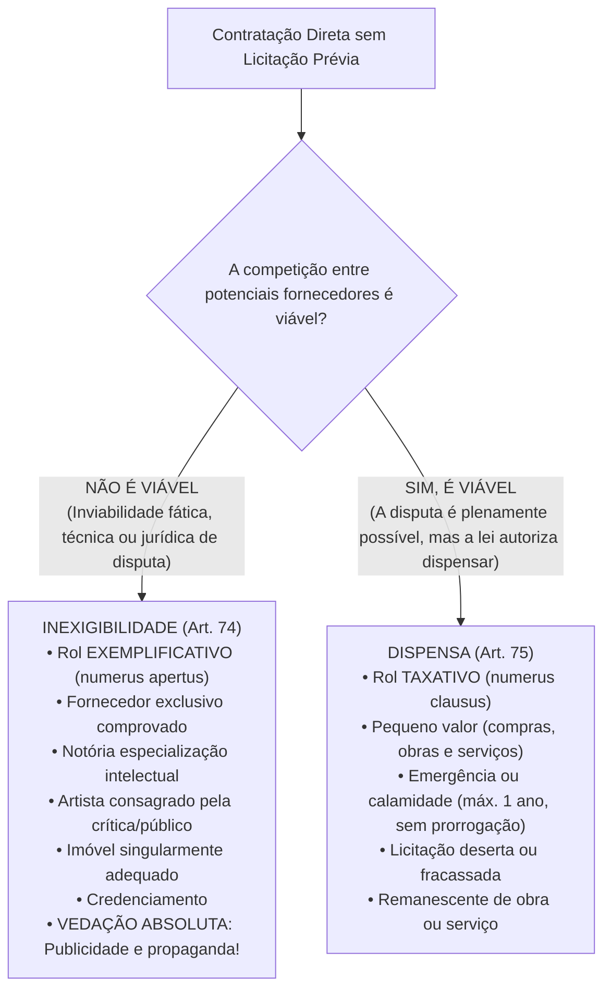
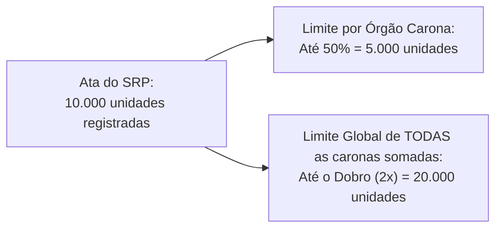

# 03 - Procedimentos Auxiliares e Contratação Direta (Dispensa e Inexigibilidade)

> **Matéria:** Licitações e Contratos Administrativos  
> **Cargo:** A01 – Técnico de Controle Externo – Especialidade: Técnico Administrativo  
> **Arquivo:** `03_procedimentos_auxiliares_e_contratacao_direta.md`  
> **Status:** 🟢 Teoria Aprofundada + 5 Questões FCC Comentadas (A a E)

---

## 📌 Ementa Oficial do Edital
- Procedimentos auxiliares das licitações e contratações (Art. 78 da Lei nº 14.133/2021).
- Credenciamento: hipóteses de cabimento e regras de remuneração.
- Pré-qualificação de fornecedores e produtos (pré-qualificação subjetiva e objetiva).
- Procedimento de Manifestação de Interesse (PMI).
- Sistema de Registro de Preços (SRP): órgão gerenciador, órgãos participantes e limites legais para órgãos não participantes ("caronas").
- Contratação Direta: processo de contratação direta e requisitos de instrução (Art. 72).
- Inexigibilidade de Licitação (Art. 74): inviabilidade de competição e rol exemplificativo.
- Serviços técnicos especializados de natureza predominantemente intelectual e notória especialização.
- Dispensa de Licitação (Art. 75): rol taxativo, dispensa por valor (pequeno valor), emergência, licitação deserta e fracassada.

---

## 🧭 Sumário

1. [Distinção Fundamental: Inexigibilidade x Dispensa de Licitação](#1-distincao-fundamental-inexigibilidade-x-dispensa-de-licitacao)
    1. [Teste 088](#Teste-088)
2. [Procedimentos Auxiliares da Lei nº 14.133/2021 (Art. 78)](#2-procedimentos-auxiliares-da-lei-no-141332021-art-78)
    1. [Credenciamento (Art. 79)](#21-credenciamento-art-79)
    2. [Pré-Qualificação Subjetiva e Objetiva (Art. 80)](#22-pre-qualificacao-subjetiva-e-objetiva-art-80)
    3. [Procedimento de Manifestação de Interesse - PMI (Art. 81)](#23-procedimento-de-manifestacao-de-interesse-pmi-art-81)
    4. [Sistema de Registro de Preços - SRP e Regras do Carona (Arts. 82 a 86)](#24-sistema-de-registro-de-precos-srp-e-regras-do-carona-arts-82-a-86)
    5. [Registro Cadastral Unificado (Art. 87)](#25-registro-cadastral-unificado-art-87)
    6. [Teste 089](#Teste-089)
    7. [Teste 090](#Teste-090)
    8. [Teste 091](#Teste-091)
    9. [Teste 092](#Teste-092)
3. [Processo Administrativo de Contratação Direta (Art. 72)](#3-processo-administrativo-de-contratacao-direta-art-72)
    1. [Teste 093](#Teste-093)
4. [Inexigibilidade de Licitação (Art. 74 - Inviabilidade de Competição)](#4-inexigibilidade-de-licitacao-art-74-inviabilidade-de-competicao)
    1. [Fornecedor e Prestador Exclusivo (Inciso I)](#41-fornecedor-e-prestador-exclusivo-inciso-i)
    2. [Profissional do Setor Artístico Consagrado (Inciso II)](#42-profissional-do-setor-artistico-consagrado-inciso-ii)
    3. [Serviços Técnicos Especializados e Notória Especialização (Inciso III)](#43-servicos-tecnicos-especializados-e-notoria-especializacao-inciso-iii)
    4. [Aquisição ou Locação de Imóvel Singular (Inciso V)](#44-aquisicao-ou-locacao-de-imovel-singular-inciso-v)
    5. [Teste 094](#Teste-094)
    6. [Teste 095](#Teste-095)
5. [Dispensa de Licitação (Art. 75 - Rol Taxativo)](#5-dispensa-de-licitacao-art-75-rol-taxativo)
    1. [Dispensa em Razão do Valor (Pequeno Valor - Incisos I e II)](#51-dispensa-em-razao-do-valor-pequeno-valor-incisos-i-e-ii)
    2. [Dispensa por Emergência ou Calamidade Pública (Inciso VIII)](#52-dispensa-por-emergencia-ou-calamidade-publica-inciso-viii)
    3. [Licitação Deserta, Fracassada e Remanescente de Contrato](#53-licitacao-deserta-fracassada-e-remanescente-de-contrato)
    4. [Teste 096](#Teste-096)
    5. [Teste 097](#Teste-097)
    6. [Teste 098](#Teste-098)
6. [🌐 Fontes Recomendadas na Internet](#fontes-recomendadas-na-internet)

---

## 1. Distinção Fundamental: Inexigibilidade x Dispensa de Licitação

A regra geral insculpida no art. 37, XXI, da CF/88 impõe a obrigatoriedade de licitar para obras, serviços, compras e alienações no setor público. Todavia, a própria Constituição ressalva "os casos especificados na legislação". A Nova Lei de Licitações (Lei nº 14.133/2021) estrutura a contratação direta sem certame competitivo em duas categorias nucleares: a **Inexigibilidade** e a **Dispensa**.

- **Inexigibilidade (Art. 74):** Configura-se sempre que houver **inviabilidade fática ou jurídica de competição**. Não há como comparar objetivamente propostas porque o objeto é único, o fornecedor é exclusivo ou a prestação decorre de dotes personalíssimos/intelectuais singulares. Por essa razão, a jurisprudência pacífica do TCU e a doutrina consagram que o rol do art. 74 é **exemplificativo** (*numerus apertus*), admitindo outros casos em que se comprove a impossibilidade fática de disputa.
- **Dispensa (Art. 75):** A disputa concorrencial é plenamente viável no plano fático e de mercado, porém o legislador, sopesando critérios de economicidade, celeridade ou interesse público primário, optou por autorizar a Administração a não licitar. Em face de seu caráter derrogatório da regra constitucional, o rol do art. 75 é **taxativo** (*numerus clausus*), vedada interpretação extensiva ou analógica para criar novas hipóteses de dispensa.

---

### Teste 088
**(FGV – TRT-24 – Analista Judiciario Area Administrativa Sem Especialidade – 2025)**
A Lei n.° 14.133/2021, nova Lei de Licitações e Contratos Administrativos, apresenta um conjunto de inovações e aprimoramentos destinados a modernizar, tornar mais transparente e eficiente o processo de contratação pública no Brasil. Assinale a opção que apresenta corretamente uma hipótese de inexigibilidade de licitação.

* **A)** Quando o preço for muito baixo, dispensando a licitação.
* **B)** Quando houver dois ou mais fornecedores para o mesmo serviço.
* **C)** Quando o serviço puder ser prestado por qualquer empresa registrada.
* **D)** Quando o objeto puder ser dividido entre vários fornecedores.
* **E)** Quando a competição for inviável, como na contratação de artista consagrado por meio de empresário exclusivo.

---

> **Comentário Detalhado:**
>
> - **A)** **Incorreta.** A opção apresenta proposição em desacordo com os fundamentos teóricos e técnicos do tópico ao afirmar que "Quando o preço for muito baixo, dispensando a licitação". De acordo com a teoria estudada em *4.3 Serviços Técnicos Especializados e Notória Especialização (Inciso III)*, campanhas publicitárias institucionais e propaganda governamental exigem compulsoriamente licitação com rito regulado pela Lei Federal nº 12.232/2010 (julgamento por melhor técnica ou técnica e preço, com subcomissão técnica imparcial).
> - **B)** **Incorreta.** A opção apresenta proposição em desacordo com os fundamentos teóricos e técnicos do tópico ao afirmar que "Quando houver dois ou mais fornecedores para o mesmo serviço". De acordo com a teoria estudada em *4.3 Serviços Técnicos Especializados e Notória Especialização (Inciso III)*, que seja executado por profissional ou empresa de notória especialização (cujo conceito, histórico profissional, titulação, pesquisas e trabalhos anteriores permitam inferir que seu trabalho é indiscutivelmente o mais adequado e essencial à plena satisfação do objeto).
> - **C)** **Correta.** Conforme fundamentado na seção *1. Distinção Fundamental: Inexigibilidade x Dispensa de Licitação* deste guia, a Nova Lei de Licitações (Lei nº 14.133/2021) estrutura a contratação direta sem certame competitivo em duas categorias nucleares: a Inexigibilidade e a Dispensa. Dessa forma, está plenamente correta a assertiva da banca (FGV – TRT-24/2025) ao estabelecer que "Quando o serviço puder ser prestado por qualquer empresa registrada".
> - **D)** **Incorreta.** A opção apresenta proposição em desacordo com os fundamentos teóricos e técnicos do tópico ao afirmar que "Quando o objeto puder ser dividido entre vários fornecedores". De acordo com a teoria estudada em *4.1 Fornecedor e Prestador Exclusivo (Inciso I)*, aquisição de materiais, equipamentos ou gêneros, ou contratação de serviços que só possam ser fornecidos por produtor, empresa ou representante comercial exclusivo.
> - **E)** **Incorreta.** A opção apresenta vedação ou negativa absoluta incompatível com a regra aplicável ao afirmar que "Quando a competição for inviável, como na contratação de artista consagrado por meio de empresário exclusivo". De acordo com a teoria estudada em *4.2 Profissional do Setor Artístico Consagrado (Inciso II)*, contratação de profissional de qualquer setor artístico, diretamente ou por meio de empresário exclusivo.
>
> **Gabarito: C**

---

## 2. Procedimentos Auxiliares da Lei nº 14.133/2021 (Art. 78)

O art. 78 da Lei nº 14.133/2021 sistematizou cinco procedimentos auxiliares das licitações e contratações administrativas:

1. Credenciamento;
2. Pré-qualificação;
3. Procedimento de Manifestação de Interesse (PMI);
4. Sistema de Registro de Preços (SRP);
5. Registro Cadastral.

### 2.1 Credenciamento (Art. 79)
O credenciamento é o procedimento administrativo pelo qual a Administração convoca, mediante **edital de chamamento público com inscrições permanentemente abertas**, todos os interessados que preencham os requisitos previamente definidos para prestar serviços ou fornecer bens. 

No credenciamento, a Administração **não escolhe um único vencedor**: ela contrata **todos** os interessados habilitados, remunerando-os segundo uma tabela fixa de preços definida pelo próprio Poder Público. As hipóteses legais de cabimento são taxativas:

1. **Paralela e não excludente:** Caso em que é viável e vantajosa a contratação simultânea de vários prestadores para atender à demanda da Administração (ex.: credenciamento de laboratórios e clínicas de imagens para atender os segurados do plano de saúde dos servidores estaduais).
2. **Com seleção a critério de terceiros:** A definição do contratado compete ao próprio usuário final ou beneficiário do serviço (ex.: credenciamento de profissionais médicos em que o próprio paciente escolhe o especialista cadastrado, ou credenciamento de companhias aéreas em que o servidor escolhe o voo).
3. **Em mercados fluidos:** Hipótese em que a flutuação constante de preços e a exigência de rapidez tornam inviável a fixação antecipada por licitação tradicional, realizando-se cotação volátil em tempo real no momento de cada contratação (ex.: compra de combustíveis para abastecimento de frota pública em trânsito).

> 🚨 **ALERTA DE PROVA / FCC:**  
> A Lei nº 14.133/2021 tratou o credenciamento sob dupla face: no art. 78, como **procedimento auxiliar**, e no art. 74, inciso IV, como modalidade expressa de **inexigibilidade de licitação**. Como não há disputa concorrencial entre os credenciados (todos que cumprem os requisitos são credenciados sob tabela prefixada), há inviabilidade jurídica de competição, caracterizando a inexigibilidade formal da contratação.

### 2.2 Pré-Qualificação Subjetiva e Objetiva (Art. 80)
A pré-qualificação é o procedimento técnico-administrativo técnico permanente aberto a qualquer interessado para atestar antecipadamente:

- **Pré-qualificação Subjetiva:** A habilitação jurídica, técnica, fiscal e econômico-financeira de licitantes que reúnam condições de participar de futuras licitações;
- **Pré-qualificação Objetiva:** A conformidade técnica e operacional de bens, produtos ou serviços que atendam às exigências técnicas e padrões mínimos de desempenho da Administração.

A pré-qualificação é realizada mediante chamamento público aberto permanentemente. A validade da pré-qualificação é de **no máximo 1 (um) ano**, podendo ser atualizada a qualquer tempo pelos interessados ou revogada de ofício pela Administração quando comprovada perda dos requisitos originais. A pré-qualificação pode ser realizada em grupos ou segmentos determinados e sua existência permite agilizar certames posteriores com dispensa de reapresentação de documentos já convalidados.

### 2.3 Procedimento de Manifestação de Interesse - PMI (Art. 81)
O Procedimento de Manifestação de Interesse (PMI) é o chamamento público facultativo dirigido a pessoas físicas ou jurídicas de direito privado para a propositura e realização de estudos, investigações, levantamentos e projetos de soluções inovadoras que subsidiem futuras concessões comuns, parcerias público-privadas (PPPs), concessões de serviços públicos ou grandes projetos de infraestrutura.

Regras estruturais do PMI:

- O chamamento público define o escopo, as diretrizes e os critérios objetivos para aprovação dos projetos.
- A mera participação no PMI **não gera qualquer direito** a ressarcimento financeiro automático, indenização ou preferência no futuro certame licitatório.
- O autor do projeto selecionado e efetivamente utilizado na licitação só será ressarcido financeiramente **pelo vencedor da futura licitação**, sendo essa obrigação expressamente consignada no instrumento convocatório.

### 2.4 Sistema de Registro de Preços - SRP e Regras do Carona (Arts. 82 a 86)
O SRP é um conjunto de procedimentos para registro formal de preços relativos à prestação de serviços, obras e aquisição e locação de bens para contratações futuras e incertas. 

Adoção do SRP é recomendada quando:

- As demandas forem frequentes e rotineiras;
- For conveniente a aquisição parcelada para entregas contínuas;
- For impossível prever com exatidão prévia o quantitativo total a ser demandado no exercício financeiro.

A formalização do SRP ocorre por meio da **Ata de Registro de Preços (ARP)**, documento vinculativo e obrigacional com características de compromisso para futuras contratações.

**Regras de Vigência da Ata de Registro de Preços:**

- O prazo de vigência da ARP é de **1 (um) ano**, prorrogável por igual período (máximo de **2 anos**), desde que comprovada documentalmente a manutenção da vantajosidade dos preços registrados.

**Figuras do SRP:**

- **Órgão Gerenciador:** Responsável pela condução do certame licitatório e pelo gerenciamento global da ARP.
- **Órgão Participante:** Órgão que participou dos procedimentos iniciais do planejamento do certame e integrou a ata desde sua origem com quantitativos próprios estimados.
- **Órgão Não Participante ("Carona"):** Órgão que não participou do certame licitatório, mas solicita aderir tardiamente à ARP gerenciada por outro ente federativo ou órgão da Administração.

**Limites Imperativos para Adesão Tardia do Carona (Art. 86 da Lei 14.133/2021):**
A concessão de adesão exige autorização do órgão gerenciador, aceitação pelo fornecedor e demonstração analítica de vantagem econômica pelo carona. A NLLC impôs barreiras matemáticas severas contra abusos:

1. **Limite Individual por Órgão Não Participante (Art. 86, § 4º):** A contratação adicional não poderá exceder a **50% (cinquenta por cento)** dos quantitativos registrados na ata para o órgão gerenciador e para os órgãos participantes.
2. **Limite Global de TODAS as Adesões Somadas (Art. 86, § 5º):** O quantitativo total decorrente do conjunto de todas as caronas autorizadas não poderá ultrapassar, na totalidade, ao **dobro (200% ou 2x)** do quantitativo de cada item registrado na ata.

> ⚠️ **RESTRIÇÃO FEDERATIVA (Art. 86, § 8º):**  
> É vedada aos órgãos e entidades da Administração Pública Federal a adesão a ata de registro de preços gerenciada por órgão ou entidade estadual, distrital ou municipal. Em contrapartida, órgãos estaduais e municipais podem aderir a atas federais, desde que obedecidos os limites legais.

### 2.5 Registro Cadastral Unificado (Art. 87)
A Lei nº 14.133/2021 impõe a criação do sistema de registro cadastral unificado, operacionalizado no Portal Nacional de Contratações Públicas (PNCP), de acesso público e permanente. O registro cadastral simplifica a verificação de regularidade fiscal, trabalhista e qualificação econômico-financeira de licitantes, dispensando os inscritos da apresentação física de certidões válidas já integradas digitalmente ao sistema.

---

### Teste 089
**(FGV – TCE-PA – Auditor de Controle Externo Administrativa Ciencia de Dados – 2024)**
A respeito de preços em processo licitatório para aquisição de bens e contratação de serviços em geral, é correto afirmar que

* **A)** o preço dos itens deve ser levantado prioritariamente por meio de pesquisa direta com no mínimo 3 (três) fornecedores.
* **B)** a utilização de dados de preços publicados em mídia especializada para fins de licitação não deve ser utilizada pela Administração.
* **C)** o critério de julgamento de menor preço por itens deve ser adotado quando for demonstrada a inviabilidade de se promover a adjudicação por grupo.
* **D)** o sistema de registro de preços pode ser utilizado pela Administração, observado o índice de atualização de preços correspondente.
* **E)** a pesquisa baseada na base nacional de notas fiscais eletrônicas não é permitida.

---

> **Comentário Detalhado:**
>
> - **A)** **Incorreta.** A opção apresenta proposição em desacordo com os fundamentos teóricos e técnicos do tópico ao afirmar que "o preço dos itens deve ser levantado prioritariamente por meio de pesquisa direta com no mínimo 3 (três)...". De acordo com a teoria estudada em *2.4 Sistema de Registro de Preços - SRP e Regras do Carona (Arts. 82 a 86)*, a formalização do SRP ocorre por meio da Ata de Registro de Preços (ARP), documento vinculativo e obrigacional com características de compromisso para futuras contratações.
> - **B)** **Incorreta.** A opção apresenta proposição em desacordo com os fundamentos teóricos e técnicos do tópico ao afirmar que "a utilização de dados de preços publicados em mídia especializada para fins de licitação não deve ser utilizada...". De acordo com a teoria estudada em *4.2 Profissional do Setor Artístico Consagrado (Inciso II)*, requisito Subjetivo: O artista deve ser consagrado pela crítica especializada ou pela opinião pública regional/nacional.
> - **C)** **Incorreta.** A opção apresenta proposição em desacordo com os fundamentos teóricos e técnicos do tópico ao afirmar que "o critério de julgamento de menor preço por itens deve ser adotado quando for demonstrada a inviabilidade de se...". De acordo com a teoria estudada em *2.4 Sistema de Registro de Preços - SRP e Regras do Carona (Arts. 82 a 86)*, o SRP é um conjunto de procedimentos para registro formal de preços relativos à prestação de serviços, obras e aquisição e locação de bens para contratações futuras e incertas.
> - **D)** **Correta.** Conforme fundamentado na seção *2.4 Sistema de Registro de Preços - SRP e Regras do Carona (Arts. 82 a 86)* deste guia, órgão Não Participante ("Carona"): Órgão que não participou do certame licitatório, mas solicita aderir tardiamente à ARP gerenciada por outro ente federativo ou órgão da Administração. Dessa forma, está plenamente correta a assertiva da banca (FGV – TCE-PA/2024) ao estabelecer que "o sistema de registro de preços pode ser utilizado pela Administração, observado o índice de atualização de preços...".
> - **E)** **Incorreta.** A opção apresenta proposição em desacordo com os fundamentos teóricos e técnicos do tópico ao afirmar que "a pesquisa baseada na base nacional de notas fiscais eletrônicas não é permitida". De acordo com a teoria estudada em *2.4 Sistema de Registro de Preços - SRP e Regras do Carona (Arts. 82 a 86)*, for impossível prever com exatidão prévia o quantitativo total a ser demandado no exercício financeiro.
>
> **Gabarito: D**

---

### Teste 090
**(FGV – TJ-AP – Analista Judiciario Apoio Especializado Tecnologia da Informacao Banco de Dados – 2023)**
Joyce acabou de ler certo edital que veiculou a realização de um processo administrativo de chamamento público por meio do qual a Administração Pública convocou profissionais interessados em prestar determinado serviço, para que, preenchidos os requisitos necessários devidamente delimitados, se habilitem junto ao órgão ou entidade para executar o objeto quando convocados, viabilizando a sua contratação direta, mediante critérios determinados. No âmbito da Lei nº 14.133/2021, tal edital versa sobre:

* **A)** credenciamento, que caracteriza hipótese de licitação dispensável;
* **B)** pré-qualificação, que caracteriza hipótese de licitação inexigível;
* **C)** catálogo eletrônico de padronização de serviços, que caracteriza hipótese de licitação inexigível;
* **D)** credenciamento, que caracteriza hipótese de licitação inexigível;
* **E)** pré-qualificação, que caracteriza hipótese de licitação dispensável.

---

> **Comentário Detalhado:**
>
> - **A)** **Incorreta.** A opção apresenta proposição em desacordo com os fundamentos teóricos e técnicos do tópico ao afirmar que "credenciamento, que caracteriza hipótese de licitação dispensável". De acordo com a teoria estudada em *2.1 Credenciamento (Art. 79)*, em mercados fluidos: Hipótese em que a flutuação constante de preços e a exigência de rapidez tornam inviável a fixação antecipada por licitação tradicional, realizando-se cotação volátil em tempo real no momento de cada contratação (ex.: compra de combustíveis para abastecimento de frota pública em trânsito).
> - **B)** **Incorreta.** A opção apresenta proposição em desacordo com os fundamentos teóricos e técnicos do tópico ao afirmar que "pré-qualificação, que caracteriza hipótese de licitação inexigível". De acordo com a teoria estudada em *2.2 Pré-Qualificação Subjetiva e Objetiva (Art. 80)*, a validade da pré-qualificação é de no máximo 1 (um) ano, podendo ser atualizada a qualquer tempo pelos interessados ou revogada de ofício pela Administração quando comprovada perda dos requisitos originais.
> - **C)** **Incorreta.** A opção apresenta proposição em desacordo com os fundamentos teóricos e técnicos do tópico ao afirmar que "catálogo eletrônico de padronização de serviços, que caracteriza hipótese de licitação inexigível". De acordo com a teoria estudada em *2.1 Credenciamento (Art. 79)*, a Lei nº 14.133/2021 tratou o credenciamento sob dupla face: no art. 78, como procedimento auxiliar, e no art. 74, inciso IV, como modalidade expressa de inexigibilidade de licitação.
> - **D)** **Correta.** Conforme fundamentado na seção *2.1 Credenciamento (Art. 79)* deste guia, o credenciamento é o procedimento administrativo pelo qual a Administração convoca, mediante edital de chamamento público com inscrições permanentemente abertas, todos os interessados que preencham os requisitos previamente definidos para prestar serviços ou fornecer bens. Dessa forma, está plenamente correta a assertiva da banca (FGV – TJ-AP/2023) ao estabelecer que "credenciamento, que caracteriza hipótese de licitação inexigível".
> - **E)** **Incorreta.** A opção apresenta proposição em desacordo com os fundamentos teóricos e técnicos do tópico ao afirmar que "pré-qualificação, que caracteriza hipótese de licitação dispensável". De acordo com a teoria estudada em *2.2 Pré-Qualificação Subjetiva e Objetiva (Art. 80)*, a pré-qualificação é realizada mediante chamamento público aberto permanentemente.
>
> **Gabarito: D**

---

### Teste 091
**(FGV – TCE-PI – Auditor de Controle Externo Controle Externo Especifica de Area Comum – 2025)**
O Governo do Estado do Piauí pretende realizar, no exercício financeiro de 2025, tratativas para adquirir, entre outros, os bens e serviços listados a seguir. I. Aquisição de software inovador de inteligência artificial com funcionalidades adaptadas, específica e individualmente, para cada tipo de trabalho executado por suas Secretarias de Estado, a serem definidas e identificados durante o processo licitatório. II. Registro formal de preços de notebooks de última geração a serem licitados quando da implementação do software de inteligência artificial. III. Chamamento público de profissionais interessados na prestação de serviço de TI e manutenção de equipamentos informáticos, em regime de contratação simultânea e padronizada. No que tange à Lei de Licitações (Lei nº 14.133/2021), os instrumentos jurídicos a serem adotados pela administração do Estado do Piauí para a aquisição dos bens e serviços supramencionados (segundo a ordem apresentada) são, respectivamente,

* **A)** concurso, pregão e diálogo competitivo.
* **B)** pré-qualificação, credenciamento e diálogo competitivo.
* **C)** diálogo competitivo, sistema de registro de preços e pregão.
* **D)** credenciamento, diálogo competitivo e sistema de registro de preços.
* **E)** diálogo competitivo, sistema de registro de preços e credenciamento.

---

> **Comentário Detalhado:**
>
> - **A)** **Correta.** Conforme fundamentado na seção *1. Distinção Fundamental: Inexigibilidade x Dispensa de Licitação* deste guia, a Nova Lei de Licitações (Lei nº 14.133/2021) estrutura a contratação direta sem certame competitivo em duas categorias nucleares: a Inexigibilidade e a Dispensa. Dessa forma, está plenamente correta a assertiva da banca (FGV – TCE-PI/2025) ao estabelecer que "concurso, pregão e diálogo competitivo".
> - **B)** **Incorreta.** A opção apresenta proposição em desacordo com os fundamentos teóricos e técnicos do tópico ao afirmar que "pré-qualificação, credenciamento e diálogo competitivo". De acordo com a teoria estudada em *2.2 Pré-Qualificação Subjetiva e Objetiva (Art. 80)*, pré-qualificação Objetiva: A conformidade técnica e operacional de bens, produtos ou serviços que atendam às exigências técnicas e padrões mínimos de desempenho da Administração.
> - **C)** **Incorreta.** A opção apresenta proposição em desacordo com os fundamentos teóricos e técnicos do tópico ao afirmar que "diálogo competitivo, sistema de registro de preços e pregão". De acordo com a teoria estudada em *2.4 Sistema de Registro de Preços - SRP e Regras do Carona (Arts. 82 a 86)*, o SRP é um conjunto de procedimentos para registro formal de preços relativos à prestação de serviços, obras e aquisição e locação de bens para contratações futuras e incertas.
> - **D)** **Incorreta.** A opção apresenta proposição em desacordo com os fundamentos teóricos e técnicos do tópico ao afirmar que "credenciamento, diálogo competitivo e sistema de registro de preços". De acordo com a teoria estudada em *2.4 Sistema de Registro de Preços - SRP e Regras do Carona (Arts. 82 a 86)*, for impossível prever com exatidão prévia o quantitativo total a ser demandado no exercício financeiro.
> - **E)** **Incorreta.** A opção apresenta proposição em desacordo com os fundamentos teóricos e técnicos do tópico ao afirmar que "diálogo competitivo, sistema de registro de preços e credenciamento". De acordo com a teoria estudada em *2.4 Sistema de Registro de Preços - SRP e Regras do Carona (Arts. 82 a 86)*, limites Imperativos para Adesão Tardia do Carona (Art. 86 da Lei 14.133/2021).
>
> **Gabarito: A**

---

### Teste 092
**(FGV – TRF-1 – Analista Judiciario Area Apoio Especializado Especialidade Suporte Em Tecnologia da Informacao – 2024)**
Tendo em vista que o Tribunal Regional da 1ª Região necessita adquirir determinados produtos, com muita frequência, para o adequado exercício de suas atribuições constitucionais, as autoridades competentes estão verificando as normas atinentes ao sistema de registro de preços, à luz do disposto na Lei nº 14.133/2021, sendo certo que tais produtos são considerados bens comuns e que é viável a competição, por existirem diversos fornecedores. Diante dessa situação hipotética, à luz do mencionado diploma legal, é correto afirmar que:

* **A)** não é cabível a realização de licitação, por ser ela inexigível na situação descrita;
* **B)** é cabível a realização de licitação, em qualquer das modalidades previstas na norma em comento, admissíveis na situação descrita;
* **C)** não é cabível a realização de licitação, diante da possibilidade de escolha por qualquer das modalidades de contratação direta na situação descrita;
* **D)** é cabível a realização de licitação, que deverá ser na modalidade pregão, que é a pertinente para a situação descrita;
* **E)** não é cabível a realização de licitação, por ser ela dispensável, em essência, na situação descrita, independentemente do valor contrato ou do objeto a ser contratado.

---

> **Comentário Detalhado:**
>
> - **A)** **Incorreta.** A opção apresenta proposição em desacordo com os fundamentos teóricos e técnicos do tópico ao afirmar que "não é cabível a realização de licitação, por ser ela inexigível na situação descrita". De acordo com a teoria estudada em *2.3 Procedimento de Manifestação de Interesse - PMI (Art. 81)*, o Procedimento de Manifestação de Interesse (PMI) é o chamamento público facultativo dirigido a pessoas físicas ou jurídicas de direito privado para a propositura e realização de estudos, investigações, levantamentos e projetos de soluções inovadoras que subsidiem futuras concessões comuns, parcerias público-privadas (PPPs), concessões de serviços públicos ou grandes projetos de infraestrutura.
> - **B)** **Incorreta.** A opção promove generalização excessiva que desconsidera as condições técnicas e normativas ao afirmar que "é cabível a realização de licitação, em qualquer das modalidades previstas na norma em comento, admissíveis na...". De acordo com a teoria estudada em *2.2 Pré-Qualificação Subjetiva e Objetiva (Art. 80)*, a validade da pré-qualificação é de no máximo 1 (um) ano, podendo ser atualizada a qualquer tempo pelos interessados ou revogada de ofício pela Administração quando comprovada perda dos requisitos originais.
> - **C)** **Incorreta.** A opção promove generalização excessiva que desconsidera as condições técnicas e normativas ao afirmar que "não é cabível a realização de licitação, diante da possibilidade de escolha por qualquer das modalidades de...". De acordo com a teoria estudada em *3. Processo Administrativo de Contratação Direta (Art. 72)*, o art. 72 da Lei nº 14.133/2021 estabelece que o processo de contratação direta deve ser obrigatoriamente instruído com os seguintes elementos mínimos sob pena de nulidade.
> - **D)** **Correta.** Conforme fundamentado na seção *2.1 Credenciamento (Art. 79)* deste guia, a Lei nº 14.133/2021 tratou o credenciamento sob dupla face: no art. 78, como procedimento auxiliar, e no art. 74, inciso IV, como modalidade expressa de inexigibilidade de licitação. Dessa forma, está plenamente correta a assertiva da banca (FGV – TRF-1/2024) ao estabelecer que "é cabível a realização de licitação, que deverá ser na modalidade pregão, que é a pertinente para a situação...".
> - **E)** **Incorreta.** A opção apresenta proposição em desacordo com os fundamentos teóricos e técnicos do tópico ao afirmar que "não é cabível a realização de licitação, por ser ela dispensável, em essência, na situação descrita...". De acordo com a teoria estudada em *5.1 Dispensa em Razão do Valor (Pequeno Valor - Incisos I e II)*, vedação ao Fracionamento Ilícito (§ 1º do art. 75): Para fins de aferição dos valores-limite, deve ser considerado o somatório do que for despendido no mesmo exercício financeiro pela mesma unidade gestora com objetos de mesma natureza, entendidos como aqueles relativos a contratações no mesmo ramo de atividade econômica.
>
> **Gabarito: D**

---

## 3. Processo Administrativo de Contratação Direta (Art. 72)

Tanto a dispensa quanto a inexigibilidade não significam informalidade ou ausência de procedimento. O art. 72 da Lei nº 14.133/2021 estabelece que o processo de contratação direta deve ser obrigatoriamente instruído com os seguintes elementos mínimos sob pena de nulidade:

1. Documento de formalização da demanda e, se for o caso, Estudo Técnico Preliminar (ETP);
2. Termo de Referência (TR), anteprojeto, projeto básico ou projeto executivo;
3. Estimativa de despesa calculada na forma do art. 23 da Lei;
4. Demonstração de previsão dos recursos orçamentários em dotação própria;
5. Comprovação de que o contratado preenche os requisitos de habilitação e qualificação mínima exigida;
6. Justificativa expressa de preço (comprovando compatibilidade com o mercado praticado);
7. Razão da escolha do contratado ou executante;
8. Parecer jurídico do órgão de assessoramento advocatício da Administração e eventuais pareceres técnicos;
9. Autorização expressa e motivação emanada da autoridade máxima competente.

> 📢 **Eficácia no PNCP (Art. 94 e Art. 72, parágrafo único):**  
> O ato que autoriza a contratação direta ou o respectivo extrato de contrato deve ser publicado e divulgado obrigatoriamente no **Portal Nacional de Contratações Públicas (PNCP)** no prazo de **10 (dez) dias úteis**, contado da data de sua assinatura, como condição indispensável para sua eficácia jurídica perante terceiros.

---

### Teste 093
**(FGV – TCE-SC – Auditor Fiscal de Controle Externo Direito – 2026)**
O Estado Alfa, em observância às formalidades legais, publicou edital de chamamento público visando à celebração de parceria com determinada organização da sociedade civil (OSC). Registrese que as propostas das entidades privadas serão julgadas por uma comissão de seleção previamente designada, na forma da legislação de regência. Nesse cenário, considerando as disposições da Lei nº 13.019/2014, avalie as afirmativas a seguir e assinale (V) para a verdadeira e (F) para a falsa. ( ) Antes da deflagração da etapa competitiva, a Administração Pública procederá à verificação dos documentos que comprovem o atendimento, pelas organizações da sociedade civil inscritas, dos requisitos previstos em lei para fins de celebração de parceria com o Poder Público. ( ) O grau de adequação da proposta aos objetivos específicos do programa ou da ação em que se insere o objeto da parceria e, quando for o caso, ao valor de referência constante do chamamento constitui critério obrigatório de julgamento. ( ) Será impedida de participar da comissão de seleção pessoa que, nos últimos dez anos, tenha mantido relação jurídica com, ao menos, uma das entidades participantes do chamamento público. As afirmativas são, respectivamente,

* **A)** F – V – F.
* **B)** V – F – V.
* **C)** F – F – F.
* **D)** F – V – V.
* **E)** V – V – V.

---

> **Comentário Detalhado:**
>
> - **A)** **Incorreta.** A opção apresenta proposição em desacordo com os fundamentos teóricos e técnicos do tópico ao afirmar que "F – V – F". De acordo com a teoria estudada em *2.1 Credenciamento (Art. 79)*, no credenciamento, a Administração não escolhe um único vencedor: ela contrata todos os interessados habilitados, remunerando-os segundo uma tabela fixa de preços definida pelo próprio Poder Público. As hipóteses legais de cabimento são taxativas.
> - **B)** **Incorreta.** A opção apresenta proposição em desacordo com os fundamentos teóricos e técnicos do tópico ao afirmar que "V – F – V". De acordo com a teoria estudada em *3. Processo Administrativo de Contratação Direta (Art. 72)*, o ato que autoriza a contratação direta ou o respectivo extrato de contrato deve ser publicado e divulgado obrigatoriamente no Portal Nacional de Contratações Públicas (PNCP) no prazo de 10 (dez) dias úteis, contado da data de sua assinatura, como condição indispensável para sua eficácia jurídica perante terceiros.
> - **C)** **Incorreta.** A opção apresenta proposição em desacordo com os fundamentos teóricos e técnicos do tópico ao afirmar que "F – F – F". De acordo com a teoria estudada em *2.1 Credenciamento (Art. 79)*, com seleção a critério de terceiros: A definição do contratado compete ao próprio usuário final ou beneficiário do serviço (ex.: credenciamento de profissionais médicos em que o próprio paciente escolhe o especialista cadastrado, ou credenciamento de companhias aéreas em que o servidor escolhe o voo).
> - **D)** **Incorreta.** A opção apresenta proposição em desacordo com os fundamentos teóricos e técnicos do tópico ao afirmar que "F – V – V". De acordo com a teoria estudada em *3. Processo Administrativo de Contratação Direta (Art. 72)*, estimativa de despesa calculada na forma do art. 23 da Lei.
> - **E)** **Correta.** Conforme fundamentado na seção *2.1 Credenciamento (Art. 79)* deste guia, o credenciamento é o procedimento administrativo pelo qual a Administração convoca, mediante edital de chamamento público com inscrições permanentemente abertas, todos os interessados que preencham os requisitos previamente definidos para prestar serviços ou fornecer bens. Dessa forma, está plenamente correta a assertiva da banca (FGV – TCE-SC/2026) ao estabelecer que "V – V – V".
>
> **Gabarito: E**

---

## 4. Inexigibilidade de Licitação (Art. 74 - Inviabilidade de Competição)

A inexigibilidade é caracterizada pela inviabilidade fática ou jurídica de certame licitatório. O rol do art. 74 é **exemplificativo**. As hipóteses legais expressas são:

### 4.1 Fornecedor e Prestador Exclusivo (Inciso I)
- Aquisição de materiais, equipamentos ou gêneros, ou contratação de serviços que só possam ser fornecidos por produtor, empresa ou representante comercial exclusivo.
- **Comprovação Formal Obrigatória:** Atestado emitido pelo órgão de registro do comércio local, pelo sindicato, federação ou confederação patronal, ou entidade equivalente.
- **Vedação à Preferência de Marca:** É expressamente vedada a indicação de marca, modelo ou preferência injustificada na fase preparatória que venha a fabricar artificialmente uma exclusividade mercantil.

### 4.2 Profissional do Setor Artístico Consagrado (Inciso II)
- Contratação de profissional de qualquer setor artístico, diretamente ou por meio de empresário exclusivo.
- **Requisito Subjetivo:** O artista deve ser consagrado pela crítica especializada ou pela opinião pública regional/nacional.
- **Empresário Exclusivo:** A lei exige a representação por empresário exclusivo de fato (com contrato de exclusividade arquivado e de ampla duração), vedada a intermediação por agenciadores eventuais que recebem procurações de ocasião apenas para o evento licitado.

### 4.3 Serviços Técnicos Especializados e Notória Especialização (Inciso III)
A contratação direta sem licitação para serviços técnicos especializados exige cumulativamente três requisitos fundamentais:

1. Que o serviço seja de natureza **predominantemente intelectual** e enquadrado no rol do art. 67 (pareceres, perícias, laudos, assessorias técnicas, patrocínio ou defesa de causas judiciais e administrativas, auditorias financeiras e tributárias, restauração de obras de arte, treinamento e aperfeiçoamento de pessoal);
2. Que seja executado por profissional ou empresa de **notória especialização** (cujo conceito, histórico profissional, titulação, pesquisas e trabalhos anteriores permitam inferir que seu trabalho é indiscutivelmente o mais adequado e essencial à plena satisfação do objeto);
3. Que o serviço possua natureza **singular** (características peculiares que afastam a padronização comum de mercado).

> 🚫 **VEDAÇÃO ABSOLUTA DA NLLC (Art. 74, § 3º):**  
> É **vedada a inexigibilidade de licitação para serviços de publicidade e divulgação**. Campanhas publicitárias institucionais e propaganda governamental exigem compulsoriamente licitação com rito regulado pela Lei Federal nº 12.232/2010 (julgamento por melhor técnica ou técnica e preço, com subcomissão técnica imparcial).

### 4.4 Aquisição ou Locação de Imóvel Singular (Inciso V)
- Aquisição ou locação de imóvel cujas características de instalações e de localização tornem necessária sua escolha pela Administração.
- **Requisitos Formais:** Exige avaliação prévia de mercado, certificação da inexistência de imóveis públicos vagos adequados e justificativa técnica detalhada comprovando a singularidade do imóvel para o desempenho das atividades institucionais.

---

### Teste 094
**(FCC – TRT-2 – Analista Judiciario Tecnologia da Informacao – 2014)**
A Administração pública de São Bernardo do Campo tem necessidade de adquirir equipamento de informática que é produzido e comercializado, com exclusividade, por empresa brasileira sediada no Estado do Paraná. Após ampla e detida pesquisa, constatou-se que referido equipamento é o único capaz de atender de forma satisfatória o interesse público, sendo premente sua aquisição. Para tanto, a Administração pública municipal deve comprar referido equipamento por meio de

* **A)** procedimento licitatório, na modalidade pregão eletrônico, que é exigência constitucional para todas as contratações públicas.
* **B)** procedimento licitatório, elegendo a modalidade licitatória que imprima maior competitividade ao certame, desde que o faça de forma motivada.
* **C)** contratação direta, com fundamento na dispensa de licitação, exigindo do fornecedor a comprovação de exclusividade de fabricação e comercialização, por meio da apresentação de atestado emitido para esse fim.
* **D)** contratação direta, com fundamento na inexigibilidade de licitação, exigindo, para tanto, que o fornecedor apresente a documentação comprobatória da condição de exclusividade, nos termos da Lei.
* **E)** contratação direta, com fundamento na dispensa ou na inexigibilidade de licitação, não havendo, em qualquer das hipóteses, forma específica indicada pela lei para comprovação da exclusividade de fabricação e comercialização.

---

> **Comentário Detalhado:**
>
> - **A)** **Incorreta.** A opção apresenta proposição em desacordo com os fundamentos teóricos e técnicos do tópico ao afirmar que "procedimento licitatório, na modalidade pregão eletrônico, que é exigência constitucional para todas as...". De acordo com a teoria estudada em *3. Processo Administrativo de Contratação Direta (Art. 72)*, o ato que autoriza a contratação direta ou o respectivo extrato de contrato deve ser publicado e divulgado obrigatoriamente no Portal Nacional de Contratações Públicas (PNCP) no prazo de 10 (dez) dias úteis, contado da data de sua assinatura, como condição indispensável para sua eficácia jurídica perante terceiros.
> - **B)** **Incorreta.** A opção apresenta proposição em desacordo com os fundamentos teóricos e técnicos do tópico ao afirmar que "procedimento licitatório, elegendo a modalidade licitatória que imprima maior competitividade ao certame, desde...". De acordo com a teoria estudada em *2.1 Credenciamento (Art. 79)*, a Lei nº 14.133/2021 tratou o credenciamento sob dupla face: no art. 78, como procedimento auxiliar, e no art. 74, inciso IV, como modalidade expressa de inexigibilidade de licitação.
> - **C)** **Incorreta.** A opção afasta requisito ou relação estrutural exigida pela matéria ao afirmar que "contratação direta, com fundamento na dispensa de licitação, exigindo do fornecedor a comprovação de exclusividade...". De acordo com a teoria estudada em *4.1 Fornecedor e Prestador Exclusivo (Inciso I)*, comprovação Formal Obrigatória: Atestado emitido pelo órgão de registro do comércio local, pelo sindicato, federação ou confederação patronal, ou entidade equivalente.
> - **D)** **Correta.** Conforme fundamentado na seção *3. Processo Administrativo de Contratação Direta (Art. 72)* deste guia, tanto a dispensa quanto a inexigibilidade não significam informalidade ou ausência de procedimento. Dessa forma, está plenamente correta a assertiva da banca (FCC – TRT-2/2014) ao estabelecer que "contratação direta, com fundamento na inexigibilidade de licitação, exigindo, para tanto, que o fornecedor...".
> - **E)** **Incorreta.** A opção promove generalização excessiva que desconsidera as condições técnicas e normativas ao afirmar que "contratação direta, com fundamento na dispensa ou na inexigibilidade de licitação, não havendo, em qualquer das...". De acordo com a teoria estudada em *3. Processo Administrativo de Contratação Direta (Art. 72)*, estimativa de despesa calculada na forma do art. 23 da Lei.
>
> **Gabarito: D**

---

### Teste 095
**(FGV – TCE-PA – Auditor de Controle Externo Administrativa Administracao – 2024)**
Após distinguir as peculiaridades atinentes as situações em que a licitação é inexigível e aquelas em que tal procedimento é dispensável, Daniel foi instado a dar um exemplo dessa última hipótese de contratação direta, à luz do disposto na Lei nº 14.133/2021, e indicou corretamente a

* **A)** contratação de objetos que devam ou possam ser contratados por meio de credenciamento.
* **B)** aquisição ou locação de imóvel cujas características de instalações e de localização tornem necessária sua escolha.
* **C)** contratação de profissional do setor artístico, diretamente ou por meio de empresário exclusivo, desde que consagrado pela crítica especializada ou pela opinião pública.
* **D)** aquisição de materiais, de equipamentos ou de gêneros ou contratação de serviços que só possam ser fornecidos por produtor, empresa ou representante comercial exclusivos.
* **E)** contratação de bens ou serviços que tenham por objeto bens ou serviços produzidos ou prestados no País que envolvam, cumulativamente, alta complexidade tecnológica e defesa nacional.

---

> **Comentário Detalhado:**
>
> - **A)** **Incorreta.** A opção apresenta proposição em desacordo com os fundamentos teóricos e técnicos do tópico ao afirmar que "contratação de objetos que devam ou possam ser contratados por meio de credenciamento". De acordo com a teoria estudada em *4.1 Fornecedor e Prestador Exclusivo (Inciso I)*, aquisição de materiais, equipamentos ou gêneros, ou contratação de serviços que só possam ser fornecidos por produtor, empresa ou representante comercial exclusivo.
> - **B)** **Incorreta.** A opção apresenta proposição em desacordo com os fundamentos teóricos e técnicos do tópico ao afirmar que "aquisição ou locação de imóvel cujas características de instalações e de localização tornem necessária sua escolha". De acordo com a teoria estudada em *4.4 Aquisição ou Locação de Imóvel Singular (Inciso V)*, aquisição ou locação de imóvel cujas características de instalações e de localização tornem necessária sua escolha pela Administração.
> - **C)** **Incorreta.** A opção apresenta proposição em desacordo com os fundamentos teóricos e técnicos do tópico ao afirmar que "contratação de profissional do setor artístico, diretamente ou por meio de empresário exclusivo, desde que...". De acordo com a teoria estudada em *4.2 Profissional do Setor Artístico Consagrado (Inciso II)*, requisito Subjetivo: O artista deve ser consagrado pela crítica especializada ou pela opinião pública regional/nacional.
> - **D)** **Incorreta.** A opção apresenta proposição em desacordo com os fundamentos teóricos e técnicos do tópico ao afirmar que "aquisição de materiais, de equipamentos ou de gêneros ou contratação de serviços que só possam ser fornecidos por...". De acordo com a teoria estudada em *5.2 Dispensa por Emergência ou Calamidade Pública (Inciso VIII)*, aplica-se em situações de emergência ou calamidade pública quando caracterizada urgência de atendimento de situação que possa ocasionar prejuízo ou comprometer a segurança de pessoas, obras, serviços, equipamentos e outros bens, públicos ou particulares.
> - **E)** **Correta.** Conforme fundamentado na seção *4.3 Serviços Técnicos Especializados e Notória Especialização (Inciso III)* deste guia, a contratação direta sem licitação para serviços técnicos especializados exige cumulativamente três requisitos fundamentais. Dessa forma, está plenamente correta a assertiva da banca (FGV – TCE-PA/2024) ao estabelecer que "contratação de bens ou serviços que tenham por objeto bens ou serviços produzidos ou prestados no País que...".
>
> **Gabarito: E**

---

## 5. Dispensa de Licitação (Art. 75 - Rol Taxativo)

A dispensa de licitação ocorre em circunstâncias nas quais a competição entre particulares seria perfeitamente viável, mas a lei autoriza a Administração a contratar diretamente por razões de eficiência, utilidade ou conveniência coletiva. O rol do art. 75 é **taxativo** (*numerus clausus*).

### 5.1 Dispensa em Razão do Valor (Pequeno Valor - Incisos I e II)
- **Inciso I:** Obras e serviços de engenharia ou serviços de manutenção de veículos automotores (valor-base de R$ 100.000,00 na publicação da lei, reajustado anualmente por decreto federal).
- **Inciso II:** Outros serviços e compras em geral (valor-base de R$ 50.000,00 na publicação da lei, reajustado anualmente por decreto federal).
- **Vedação ao Fracionamento Ilícito (§ 1º do art. 75):** Para fins de aferição dos valores-limite, deve ser considerado o somatório do que for despendido no mesmo **exercício financeiro** pela mesma **unidade gestora** com objetos de **mesma natureza**, entendidos como aqueles relativos a contratações no mesmo ramo de atividade econômica.
- **Duplicação de Limites (§ 2º):** Os valores-limite são duplicados (2x) para contratações realizadas por consórcios públicos e agências executivas.

### 5.2 Dispensa por Emergência ou Calamidade Pública (Inciso VIII)
- Aplica-se em situações de emergência ou calamidade pública quando caracterizada urgência de atendimento de situação que possa ocasionar prejuízo ou comprometer a segurança de pessoas, obras, serviços, equipamentos e outros bens, públicos ou particulares.
- Destina-se exclusivamente à contratação de bens e serviços necessários ao atendimento da situação emergencial concreta, no limite do estritamente indispensável.

**Inovações Capitais da Lei 14.133/2021 sobre Emergência:**

1. **Prazo de Vigência Contratual:** O contrato emergencial terá prazo máximo de vigência de até **1 (um) ano**, contado da data de ocorrência da emergência (superando o antigo limite de 180 dias da Lei 8.666/93).
2. **Vedação Absoluta de Prorrogação:** É **expressamente proibida a prorrogação** dos contratos administrativos emergenciais firmados sob este inciso.
3. **Vedação de Recontratação da Empresa Causadora:** É expressamente vedada a recontratação de empresa que tenha dado causa à situação emergencial ou de calamidade por inexecução culposa ou inadimplemento de contrato anterior.

> 🚨 **ALERTA DE PROVA / FCC:**  
> A ocorrência de "emergência fabricada" — isto é, decorrente da desídia, inércia ou omissão de gestores públicos que deixaram de licitar a tempo um contrato continuado — **não impede** a contratação emergencial quando o interesse coletivo exigir a continuidade do serviço ou preservação de vidas. Todavia, a NLLC e a jurisprudência sumulada do TCU determinam que a autoridade deve determinar imediatamente a instauração de processo administrativo para apuração de responsabilidade dos agentes que deram causa à emergência por dolo ou negligência.

### 5.3 Licitação Deserta, Fracassada e Remanescente de Contrato
- **Licitação Deserta (Art. 75, III, "a"):** Licitação na qual não compareceu nenhum licitante interessado (ausência de propostas). A dispensa é autorizada se comprovado que nova licitação causaria prejuízo à Administração e desde que sejam mantidas todas as condições preestabelecidas no edital primitivo.
- **Licitação Fracassada (Art. 75, III, "b"):** Certame em que todas as propostas apresentadas foram desclassificadas (preços abusivos ou desconformidade técnica) ou todos os licitantes foram inabilitados. A dispensa exige a comprovação de prejuízo na repetição do certame e a estrita manutenção das condições do edital.
- **Remanescente de Obra, Serviço ou Fornecimento (Art. 75, VII):** Ocorre após a rescisão contratual de ajuste anterior. A contratação direta é facultada aos demais licitantes classificados no certame original, atendida a ordem de classificação originária e desde que o convocado aceite celebrar o contrato nas mesmas condições econômicas propostas pelo licitante vencedor original.

---

### Teste 096
**(FGV – TCE-SC – Auditor Fiscal de Controle Externo Administracao – 2026)**
O Município Alfa, no Estado de Santa Catarina, publicou edital de licitação visando à celebração de vultoso contrato administrativo. As sociedades empresárias Beta, Charlie e Delta, interessadas em participar do certame público em consórcio, buscaram maiores informações sobre a temática. De acordo com a narrativa e considerando as disposições da Lei nº 14.133/2021, avalie as afirmativas a seguir. I. O edital deverá estabelecer para o consórcio acréscimo de dez por cento a trinta por cento sobre o valor exigido de licitante individual para a habilitação econômico-financeira, salvo justificação. II. O licitante vencedor é obrigado a promover, antes da celebração do contrato, a constituição e o registro do consórcio, nos termos da legislação de regência. III. É vedado a estipulação, no edital de licitação, de limite máximo para o número de empresas consorciadas. Nesse cenário, está correto o que se afirma em

* **A)** I, apenas.
* **B)** II, apenas.
* **C)** III, apenas.
* **D)** I e II, apenas.
* **E)** I, II e III.

---

> **Comentário Detalhado:**
>
> - **A)** **Incorreta.** A opção incorre em restrição indevida ao limitar o escopo conceitual ao afirmar que "I, apenas". De acordo com a teoria estudada em *5.3 Licitação Deserta, Fracassada e Remanescente de Contrato*, licitação Fracassada (Art. 75, III, "b"): Certame em que todas as propostas apresentadas foram desclassificadas (preços abusivos ou desconformidade técnica) ou todos os licitantes foram inabilitados.
> - **B)** **Incorreta.** A opção incorre em restrição indevida ao limitar o escopo conceitual ao afirmar que "II, apenas". De acordo com a teoria estudada em *2.2 Pré-Qualificação Subjetiva e Objetiva (Art. 80)*, pré-qualificação Subjetiva: A habilitação jurídica, técnica, fiscal e econômico-financeira de licitantes que reúnam condições de participar de futuras licitações.
> - **C)** **Correta.** Conforme fundamentado na seção *5.3 Licitação Deserta, Fracassada e Remanescente de Contrato* deste guia, licitação Deserta (Art. 75, III, "a"): Licitação na qual não compareceu nenhum licitante interessado (ausência de propostas). Dessa forma, está plenamente correta a assertiva da banca (FGV – TCE-SC/2026) ao estabelecer que "III, apenas".
> - **D)** **Incorreta.** A opção incorre em restrição indevida ao limitar o escopo conceitual ao afirmar que "I e II, apenas". De acordo com a teoria estudada em *5.3 Licitação Deserta, Fracassada e Remanescente de Contrato*, a contratação direta é facultada aos demais licitantes classificados no certame original, atendida a ordem de classificação originária e desde que o convocado aceite celebrar o contrato nas mesmas condições econômicas propostas pelo licitante vencedor original.
> - **E)** **Incorreta.** A opção apresenta proposição em desacordo com os fundamentos teóricos e técnicos do tópico ao afirmar que "I, II e III". De acordo com a teoria estudada em *2.4 Sistema de Registro de Preços - SRP e Regras do Carona (Arts. 82 a 86)*, limite Individual por Órgão Não Participante (Art. 86, § 4º): A contratação adicional não poderá exceder a 50% (cinquenta por cento) dos quantitativos registrados na ata para o órgão gerenciador e para os órgãos participantes.
>
> **Gabarito: C**

---

### Teste 097
**(FCC – TRT-9 – Analista Judiciario Apoio Especializado Tecnologia da Informacao – 2015)**
Sabe-se que em algumas hipóteses a Administração pública está, por lei, autorizada a contratar diretamente, é dizer, sem a realização de procedimento licitatório. Quanto a essas situações, é correto afirmar que os casos de

* **A)** inexigibilidade de licitação estão elencados de forma exaustiva pela legislação, o que implica obrigatoriedade de licitação, mesmo nos casos de fornecedor exclusivo, se a hipótese fática não estiver arrolada no dispositivo legal autorizador da contratação direta.
* **B)** dispensa de licitação estão elencados de forma exaustiva pela legislação, o que implica a impossibilidade de contratação direta, sob esse fundamento, se a hipótese fática não constar de algum dos dispositivos legais autorizadores da contratação direta, por dispensa de licitação.
* **C)** contratação direta, por dispensa ou inexigibilidade de licitação, somente se aplicam às aquisições e contratações de serviços de baixo vulto, razão porque, nas obras de edificação a administração está obrigada a licitar.
* **D)** aquisições de materiais e equipamentos levadas a efeito pela Administração exigem licitação, mesmo nas hipóteses de inviabilidade de competição, porquanto a contratação direta por esse fundamento aplica-se somente à contratação de serviços.
* **E)** contratação, pela Administração, de associação de portadores de deficiência física, sem fins lucrativos e de comprovada idoneidade exigem licitação, sendo vedada a contratação direta, nestes casos, em razão do princípio da isonomia, mesmo nas hipóteses em que o preço praticado por essas entidades seja compatível com o de mercado.

---

> **Comentário Detalhado:**
>
> - **A)** **Incorreta.** A opção apresenta proposição em desacordo com os fundamentos teóricos e técnicos do tópico ao afirmar que "inexigibilidade de licitação estão elencados de forma exaustiva pela legislação, o que implica obrigatoriedade de...". De acordo com a teoria estudada em *1. Distinção Fundamental: Inexigibilidade x Dispensa de Licitação*, a regra geral insculpida no art. 37, XXI, da CF/88 impõe a obrigatoriedade de licitar para obras, serviços, compras e alienações no setor público. Todavia, a própria Constituição ressalva "os casos especificados na legislação".
> - **B)** **Correta.** Conforme fundamentado na seção *1. Distinção Fundamental: Inexigibilidade x Dispensa de Licitação* deste guia, por essa razão, a jurisprudência pacífica do TCU e a doutrina consagram que o rol do art. 74 é exemplificativo (*numerus apertus*), admitindo outros casos em que se comprove a impossibilidade fática de disputa. Dessa forma, está plenamente correta a assertiva da banca (FCC – TRT-9/2015) ao estabelecer que "dispensa de licitação estão elencados de forma exaustiva pela legislação, o que implica a impossibilidade de...".
> - **C)** **Incorreta.** A opção incorre em restrição indevida ao limitar o escopo conceitual ao afirmar que "contratação direta, por dispensa ou inexigibilidade de licitação, somente se aplicam às aquisições e contratações...". De acordo com a teoria estudada em *4. Inexigibilidade de Licitação (Art. 74 - Inviabilidade de Competição)*, a inexigibilidade é caracterizada pela inviabilidade fática ou jurídica de certame licitatório. O rol do art. 74 é exemplificativo. As hipóteses legais expressas são.
> - **D)** **Incorreta.** A opção incorre em restrição indevida ao limitar o escopo conceitual ao afirmar que "aquisições de materiais e equipamentos levadas a efeito pela Administração exigem licitação, mesmo nas hipóteses...". De acordo com a teoria estudada em *5.2 Dispensa por Emergência ou Calamidade Pública (Inciso VIII)*, aplica-se em situações de emergência ou calamidade pública quando caracterizada urgência de atendimento de situação que possa ocasionar prejuízo ou comprometer a segurança de pessoas, obras, serviços, equipamentos e outros bens, públicos ou particulares.
> - **E)** **Incorreta.** A opção apresenta proposição em desacordo com os fundamentos teóricos e técnicos do tópico ao afirmar que "contratação, pela Administração, de associação de portadores de deficiência física, sem fins lucrativos e de...". De acordo com a teoria estudada em *3. Processo Administrativo de Contratação Direta (Art. 72)*, justificativa expressa de preço (comprovando compatibilidade com o mercado praticado).
>
> **Gabarito: B**

---

### Teste 098
**(IBFC – TJ-MG – Analista Judiciario Classe C Analista de Tecnologia da Informacao – 2022)**
No que concerne às disposições previstas na Lei de Licitações e Contratos Administrativos (Lei nº 14.133/2021), a pessoa jurídica poderá participar de licitação em consórcio, observadas as seguintes normas: I. Comprovação de compromisso público ou particular de constituição de consórcio, subscrito pelos consorciados. II. Indicação da empresa líder do consórcio, que será responsável por sua representação perante a Administração. III. Impedimento de a empresa consorciada participar, na mesma licitação, de mais de um consórcio, salvo de forma isolada. Estão corretas as afirmativas:

* **A)** I, II e III
* **B)** I e II apenas
* **C)** II e III apenas
* **D)** I e III apenas
* **E)** I apenas

---

> **Comentário Detalhado:**
>
> - **A)** **Incorreta.** A opção apresenta proposição em desacordo com os fundamentos teóricos e técnicos do tópico ao afirmar que "I, II e III". De acordo com a teoria estudada em *4.3 Serviços Técnicos Especializados e Notória Especialização (Inciso III)*, que seja executado por profissional ou empresa de notória especialização (cujo conceito, histórico profissional, titulação, pesquisas e trabalhos anteriores permitam inferir que seu trabalho é indiscutivelmente o mais adequado e essencial à plena satisfação do objeto).
> - **B)** **Correta.** Conforme fundamentado na seção *1. Distinção Fundamental: Inexigibilidade x Dispensa de Licitação* deste guia, a Nova Lei de Licitações (Lei nº 14.133/2021) estrutura a contratação direta sem certame competitivo em duas categorias nucleares: a Inexigibilidade e a Dispensa. Dessa forma, está plenamente correta a assertiva da banca (IBFC – TJ-MG/2022) ao estabelecer que "I e II apenas".
> - **C)** **Incorreta.** A opção incorre em restrição indevida ao limitar o escopo conceitual ao afirmar que "II e III apenas". De acordo com a teoria estudada em *4.3 Serviços Técnicos Especializados e Notória Especialização (Inciso III)*, campanhas publicitárias institucionais e propaganda governamental exigem compulsoriamente licitação com rito regulado pela Lei Federal nº 12.232/2010 (julgamento por melhor técnica ou técnica e preço, com subcomissão técnica imparcial).
> - **D)** **Incorreta.** A opção incorre em restrição indevida ao limitar o escopo conceitual ao afirmar que "I e III apenas". De acordo com a teoria estudada em *5.3 Licitação Deserta, Fracassada e Remanescente de Contrato*, licitação Deserta (Art. 75, III, "a"): Licitação na qual não compareceu nenhum licitante interessado (ausência de propostas).
> - **E)** **Incorreta.** A opção incorre em restrição indevida ao limitar o escopo conceitual ao afirmar que "I apenas". De acordo com a teoria estudada em *2.2 Pré-Qualificação Subjetiva e Objetiva (Art. 80)*, pré-qualificação Subjetiva: A habilitação jurídica, técnica, fiscal e econômico-financeira de licitantes que reúnam condições de participar de futuras licitações.
>
> **Gabarito: B**

---

