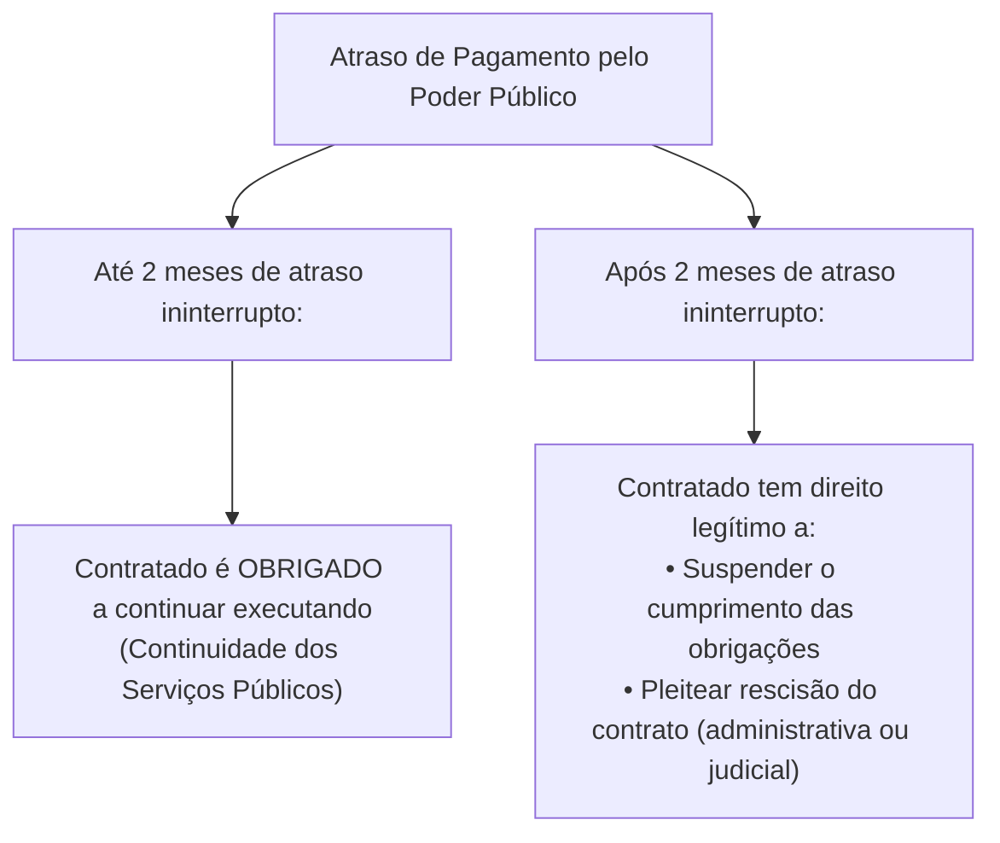
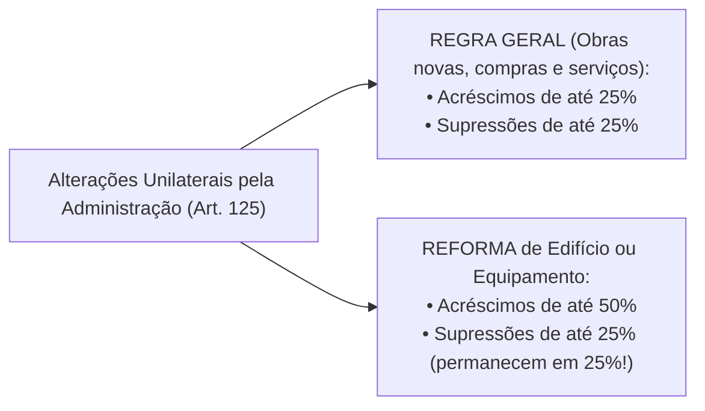

# 04 - Contratos Administrativos: Execução, Alterações, Equilíbrio e Sanções (Lei 14.133/2021)

> **Matéria:** Licitações e Contratos Administrativos  
> **Cargo:** A01 – Técnico de Controle Externo – Especialidade: Técnico Administrativo  
> **Arquivo:** `04_contratos_administrativos_fiscalizacao_alteracoes_e_sancoes.md`  
> **Status:** 🟢 Teoria Aprofundada + 5 Questões FCC Comentadas (A a E)

---

## 📌 Ementa Oficial do Edital
- Contratos administrativos: conceito, características, formalização e cláusulas exorbitantes.
- Garantias contratuais (caução, fiança bancária e seguro-garantia com cláusula de retomada / *step-in rights*).
- Duração dos contratos administrativos: prazos de vigência ordinários e contratações contínuas (até 5 anos, prorrogáveis até 10 anos).
- Gestão e fiscalização contratual: atribuições do gestor e fiscais (técnico, administrativo e setorial).
- Responsabilidade trabalhista da Administração Pública e Tema 246 do STF (ADC 16 - comprovação de culpa *in vigilando*).
- Recebimento provisório e definitivo do objeto.
- Alterações contratuais unilaterais e consensuais: limites de 25% e 50%.
- Equilíbrio econômico-financeiro: reajuste por índice, repactuação e revisão/reequilíbrio (*álea* extraordinária).
- Sanções administrativas: advertência, multa, impedimento de licitar e declaração de inidoneidade.
- Processo administrativo sancionador e reabilitação.

---

## 🧭 Sumário

1. [Conceito, Características e Cláusulas Exorbitantes dos Contratos Administrativos](#1-conceito-caracteristicas-e-clausulas-exorbitantes-dos-contratos-administrativos)
    1. [Características Fundamentais e Formalização](#11-caracteristicas-fundamentais-e-formalizacao)
    2. [Cláusulas Exorbitantes e Restrição à Exceção do Contrato Não Cumprido](#12-clausulas-exorbitantes-e-restricao-a-excecao-do-contrato-nao-cumprido)
    3. [Teste 099](#Teste-099)
2. [Garantias Contratuais e Seguro-Garantia com Cláusula de Retomada (Step-in Rights)](#2-garantias-contratuais-e-seguro-garantia-com-clausula-de-retomada-step-in-rights)
    1. [Teste 100](#Teste-100)
3. [Duração e Prorrogação dos Contratos Administrativos](#3-duracao-e-prorrogacao-dos-contratos-administrativos)
    1. [Serviços e Fornecimentos Contínuos (Regra 5 + 5 = Até 10 Anos)](#31-servicos-e-fornecimentos-continuos-regra-5-5-ate-10-anos)
    2. [Contratos por Escopo](#32-contratos-por-escopo)
    3. [Teste 101](#Teste-101)
4. [Gestão, Fiscalização e Responsabilidade Trabalhista do Estado](#4-gestao-fiscalizacao-e-responsabilidade-trabalhista-do-estado)
    1. [Estrutura de Gestão e Fiscalização Contratual](#41-estrutura-de-gestao-e-fiscalizacao-contratual)
    2. [Responsabilidade Trabalhista e Previdenciária: O Tema 246 do STF](#42-responsabilidade-trabalhista-e-previdenciaria-o-tema-246-do-stf)
    3. [Recebimento Provisório e Definitivo do Objeto](#43-recebimento-provisorio-e-definitivo-do-objeto)
    4. [Teste 102](#Teste-102)
    5. [Teste 103](#Teste-103)
5. [Alterações Contratuais e Manutenção do Equilíbrio Econômico-Financeiro](#5-alteracoes-contratuais-e-manutencao-do-equilibrio-economico-financeiro)
    1. [Alterações Unilaterais e Consensuais: Limites de 25% e 50%](#51-alteracoes-unilaterais-e-consensuais-limites-de-25-e-50)
    2. [Instrumentos de Recomposição: Reajuste, Repactuação e Revisão](#52-instrumentos-de-recomposicao-reajuste-repactuacao-e-revisao)
    3. [Teste 104](#Teste-104)
    4. [Teste 105](#Teste-105)
    5. [Teste 106](#Teste-106)
6. [Infrações, Sistema Sancionador e Processo de Reabilitação](#6-infracoes-sistema-sancionador-e-processo-de-reabilitacao)
    1. [Teste 107](#Teste-107)
    2. [Teste 108](#Teste-108)
    3. [Teste 109](#Teste-109)
7. [🌐 Fontes Recomendadas na Internet](#fontes-recomendadas-na-internet)

---

## 1. Conceito, Características e Cláusulas Exorbitantes dos Contratos Administrativos

O contrato administrativo é o ajuste bilateral de vontades celebrado entre a Administração Pública (atuando nessa qualidade revestida do regime de direito público) e o particular ou outra entidade pública, tendo por objetivo a consecução de uma utilidade de interesse público, sob condições reguladas pela legislação e pelo instrumento convocatório.

### 1.1 Características Fundamentais e Formalização
- **Consensual:** Aperfeiçoa-se com o consentimento mútuo manifestado na assinatura do ajuste, não dependendo da entrega física imediata da coisa para sua existência.
- **Formal:** A forma escrita é solene e obrigatória. O art. 95 da Lei nº 14.133/2021 estabelece que o instrumento de contrato é obrigatório, admitindo sua substituição por outros instrumentos hábeis (carta-contrato, nota de empenho de despesa, autorização de compra ou ordem de execução de serviço) apenas em dispensas de pequeno valor ou compras com entrega imediata e integral sem obrigações futuras. É nulo e de nenhum efeito o contrato verbal com a Administração, ressalvadas pequenas compras de pronto pagamento feitas em regime de adiantamento (suprimento de fundos) de valor irrisório.
- **Bilateral (ou Sinalagmático):** Gera direitos e obrigações recíprocas e interdependentes para ambas as partes.
- **Oneroso:** Impõe sacrifício patrimonial proporcional a ambas as partes contratantes.
- **Comutativo:** As prestações das partes são certas, conhecidas e tidas como equivalentes no momento da pactuação original.
- **Personalíssimo (*intuitu personae*):** Celebrado em função das qualidades subjetivas e habilitações demonstradas pelo licitante vencedor no certame, limitando-se a subcontratação às estritas balizas do edital e com prévia anuência da Administração.

### 1.2 Cláusulas Exorbitantes e Restrição à Exceção do Contrato Não Cumprido
As cláusulas exorbitantes (art. 104 da Lei nº 14.133/2021) conferem prerrogativas extraordinárias que extrapolam o direito privado comum, justificadas pela supremacia do interesse público sobre o privado:

1. **Modificação unilateral do contrato:** A Administração pode alterar qualitativa ou quantitativamente as cláusulas de serviço para melhor adequação técnica ao interesse público;
2. **Extinção unilateral do contrato:** Rescisão decorrente de inadimplemento do contratado ou por razões de interesse público de alta relevância;
3. **Fiscalização contínua da execução:** Acompanhamento técnico, administrativo e financeiro pelo Poder Público;
4. **Aplicação direta de sanções administrativas:** Imposição de sanções pelo próprio órgão contratante sem necessidade de intervenção prévia do Poder Judiciário;
5. **Ocupação provisória de bens e serviços:** Utilização de bens móveis, imóveis e pessoal do contratado necessários à continuidade de serviços públicos essenciais paralisados;
6. **Atenuação da *Exceptio Non Adimpleti Contractus* (Exceção do Contrato Não Cumprido):**
    - No direito civil comum, se um contratante deixa de pagar, o outro pode imediatamente paralisar suas atividades contratuais.
    - No regime jurídico-administrativo, em virtude do **princípio da continuidade do serviço público**, o contratado **não pode paralisar imediatamente** as obras ou serviços em caso de inadimplemento financeiro do Estado.
    - Pelo art. 137, § 2º, inciso IV, da Lei nº 14.133/2021, o particular é obrigado a continuar executando o contrato até o limite de **2 (dois) meses de atraso ininterrupto** nos pagamentos devidos pela Administração Pública. Somente após transcorridos 2 meses contínuos de inadimplemento é que assiste ao particular o direito de suspender a execução de suas obrigações ou requerer a extinção do contrato.

---

### Teste 099
**(FGV – TRF-1 – Analista Judiciário - Tecnologia da Informação – 2024)**  
As chamadas cláusulas exorbitantes correspondem às prerrogativas conferidas pelo ordenamento jurídico à Administração Pública na celebração e execução dos contratos administrativos (art. 104 da Lei nº 14.133/2021). A respeito dessas prerrogativas especiais, é correto afirmar que:

* **A)** A Administração pode rescindir unilateralmente o contrato em caso de inexecução culposa da contratada.
* **B)** A alteração unilateral das cláusulas contratuais pelo Estado autoriza a modificação substancial do objeto pactuado.
* **C)** A aplicação de sanções administrativas cominatórias prescinde de prévio processo administrativo com contraditório.
* **D)** A ocupação provisória de bens do contratado aplica-se unicamente aos contratos de locação imobiliária comum.
* **E)** As cláusulas exorbitantes conferem à Administração a faculdade de suspender indefinidamente pagamentos devidos.

---

> **Comentário Detalhado:**
>
> - **A)** **Correto**. O art. 104, II c/c art. 137 da Lei nº 14.133/2021 estabelece expressamente a prerrogativa exorbitante da Administração Pública de extinguir unilateralmente o contrato administrativo nos casos especificados em lei, notadamente pelo não cumprimento culposo de cláusulas contratuais, especificações, projetos ou prazos pelo contratado.
> - **B)** **Incorreto**. A alteração unilateral é restrita aos limites legais (art. 125) e jamais pode transfigurar a natureza do objeto licitado.
> - **C)** **Incorreto**. A aplicação de qualquer penalidade exige a observância do devido processo legal e ampla defesa (art. 156, § 1º).
> - **D)** **Incorreto**. A ocupação e utilização temporária de bens móveis, imóveis e pessoal do contratado destina-se a serviços essenciais para evitar a interrupção da atividade pública (art. 104, V).
> - **E)** **Incorreto**. O atraso injustificado no pagamento enseja direito do particular à suspensão ou extinção contratual (art. 137, § 2º, IV).
>
> **Gabarito: A**
## 2. Garantias Contratuais e Seguro-Garantia com Cláusula de Retomada (Step-in Rights)

A critério da autoridade competente, em cada contratação a Administração pode exigir do contratado a prestação de garantia (art. 96). Caberá ao **contratado optar** por uma das seguintes modalidades:

1. **Caução em dinheiro ou em títulos da dívida pública;**
2. **Fiança bancária** emitida por banco ou instituição financeira autorizada pelo Banco Central;
3. **Seguro-garantia** emitido por seguradora autorizada pela SUSEP.

**Limites Ordinários de Garantia:**

- **Regra Geral:** O percentual de garantia contratual será de até **5% (cinco por cento)** do valor inicial do contrato (art. 98).
- **Contratos de Alta Complexidade Técnica ou Riscos Elevados:** A garantia pode ser fixada em até **10% (dez por cento)** do valor do contrato, desde que expressamente motivada na fase preparatória (art. 98, § 1º).

#### Seguro-Garantia com Cláusula de Retomada (*Step-in Rights* - Art. 102)
Para combater o problema crônico nacional de paralisação e abandono de obras públicas, a Nova Lei de Licitações introduziu uma inovação profunda inspirada no modelo norte-americano (*performance bond*):

- Em contratações de obras e serviços de engenharia de **grande vulto** (valor superior a R$ 200 milhões na edição da lei, atualizado anualmente), o edital pode prever a obrigatoriedade de seguro-garantia com previsão expressa de **cláusula de retomada** (*step-in rights*).
- Nessa modalidade, o valor da garantia pode alcançar até **30% (trinta por cento)** do valor inicial do contrato.
- **Funcionamento:** Em caso de inadimplemento, atraso grave ou abandono por parte da construtora, a seguradora é notificada para intervir diretamente. A seguradora assume a administração do canteiro de obras e conclui a execução do objeto contratado, diretamente ou mediante subcontratação de terceiros idôneos aprovados pelo Poder Público.
- Concluída a obra pela seguradora, ela fica liberada da obrigação de pagar a indenização em dinheiro correspondente à apólice.

---

### Teste 100
**(FCC – TRT-1 – Analista Judiciario Tecnologia da Informacao – 2014)**
Alguns contratos firmados pela Administração pública possuem características próprias, que lhes predicam como administrativos. Sabendo-se que nem todo contrato firmado pela Administração pode assim ser qualificado, destaca-se como indicativo dessa condição, dentre outros aspectos, a

* **A)** mutabilidade intrínseca dos termos e condições pactuados, permitida unilateralmente à Administração e aos particulares contratados, desde que o objeto seja a prestação de serviços públicos.
* **B)** impossibilidade de prorrogação da avença, exigindose sempre a realização de licitação como forma de privilegiar o menor preço nas contratações da Administração.
* **C)** obrigação de manutenção do equilíbrio econômico-financeiro inicial da avença, diante de determinados fatores e condições, tais como a alteração unilateral do contrato.
* **D)** impossibilidade do contratado suspender a execução de suas obrigações, seja qual for o objeto contratado, diante de inadimplência prolongada da Administração pública.
* **E)** possibilidade de contratação sem que haja demonstração da existência de recursos para fazer frente às despesas, em face da supremacia do interesse público e da relevância do objeto a ser contratado.

---

> **Comentário Detalhado:**
>
> - **A)** **Incorreta.** A opção apresenta proposição em desacordo com os fundamentos teóricos e técnicos do tópico ao afirmar que "mutabilidade intrínseca dos termos e condições pactuados, permitida unilateralmente à Administração e aos...". De acordo com a teoria estudada em *1. Conceito, Características e Cláusulas Exorbitantes dos Contratos Administrativos*, o contrato administrativo é o ajuste bilateral de vontades celebrado entre a Administração Pública (atuando nessa qualidade revestida do regime de direito público) e o particular ou outra entidade pública, tendo por objetivo a consecução de uma utilidade de interesse público, sob condições reguladas pela legislação e pelo instrumento convocatório.
> - **B)** **Incorreta.** A opção promove generalização excessiva que desconsidera as condições técnicas e normativas ao afirmar que "impossibilidade de prorrogação da avença, exigindose sempre a realização de licitação como forma de privilegiar o...". De acordo com a teoria estudada em *3. Duração e Prorrogação dos Contratos Administrativos*, a regra orçamentária tradicional vinculava a vigência contratual aos créditos orçamentários do respectivo exercício financeiro (regra do ano civil). A Lei nº 14.133/2021 flexibilizou essa sistemática com regras modernas de planejamento (arts. 105 a 114).
> - **C)** **Correta.** Conforme fundamentado na seção *3.1 Serviços e Fornecimentos Contínuos (Regra 5 + 5 = Até 10 Anos)* deste guia, a Administração pode prorrogar sucessivamente a contratação até o limite máximo total de 10 (dez) anos, desde que comprovada documentalmente a vantajosidade econômica das condições e a manutenção da qualidade da execução. Dessa forma, está plenamente correta a assertiva da banca (FCC – TRT-1/2014) ao estabelecer que "obrigação de manutenção do equilíbrio econômico-financeiro inicial da avença, diante de determinados fatores e...".
> - **D)** **Incorreta.** A opção apresenta proposição em desacordo com os fundamentos teóricos e técnicos do tópico ao afirmar que "impossibilidade do contratado suspender a execução de suas obrigações, seja qual for o objeto contratado, diante...". De acordo com a teoria estudada em *1.2 Cláusulas Exorbitantes e Restrição à Exceção do Contrato Não Cumprido*, somente após transcorridos 2 meses contínuos de inadimplemento é que assiste ao particular o direito de suspender a execução de suas obrigações ou requerer a extinção do contrato.
> - **E)** **Incorreta.** A opção apresenta proposição em desacordo com os fundamentos teóricos e técnicos do tópico ao afirmar que "possibilidade de contratação sem que haja demonstração da existência de recursos para fazer frente às despesas, em...". De acordo com a teoria estudada em *1.2 Cláusulas Exorbitantes e Restrição à Exceção do Contrato Não Cumprido*, extinção unilateral do contrato: Rescisão decorrente de inadimplemento do contratado ou por razões de interesse público de alta relevância.
>
> **Gabarito: C**

---

## 3. Duração e Prorrogação dos Contratos Administrativos

A regra orçamentária tradicional vinculava a vigência contratual aos créditos orçamentários do respectivo exercício financeiro (regra do ano civil). A Lei nº 14.133/2021 flexibilizou essa sistemática com regras modernas de planejamento (arts. 105 a 114):

### 3.1 Serviços e Fornecimentos Contínuos (Regra 5 + 5 = Até 10 Anos)
O art. 106 da NLLC estabelece uma revolução para os contratos de serviços e fornecimentos contínuos (limpeza, vigilância, suporte de TI, manutenção predial, locação de equipamentos):

- Podem ser celebrados com prazo de vigência inicial de **até 5 (cinco) anos**.
- A Administração pode prorrogar sucessivamente a contratação até o limite máximo total de **10 (dez) anos**, desde que comprovada documentalmente a vantajosidade econômica das condições e a manutenção da qualidade da execução.
- Permite amortização mais eficiente de investimentos e redução substantiva dos custos de transação causados por licitações repetitivas anuais.

### 3.2 Contratos por Escopo
- Nos contratos cujo objeto é a entrega de um produto ou realização de obra certa e predeterminada (contratos por escopo predeterminado), o prazo de vigência original deve corresponder ao cronograma de execução física.
- Conforme o art. 111, o prazo de vigência será **automaticamente prorrogado** quando o seu objeto não for concluído no período inicialmente firmado por razões imputáveis à Administração ou por fatos supervenientes de caso fortuito/força maior, assegurando-se a conclusão da obra e a apuração de responsabilidades caso o atraso decorra de culpa exclusiva do contratado.

---

### Teste 101
**(FGV – TCE-PA – Auditor de Controle Externo Administrativa Gestao Governamental – 2024)**
Com relação aos pagamentos a serem realizados pela execução dos contratos administrativos, nos termos da Lei nº 14.133/2021, é correto afirmar que

* **A)** no dever de pagamento pela Administração Pública a ordem cronológica do adimplemento dos contratos não pode ser alterada em nenhuma hipótese.
* **B)** disposição expressa no edital ou no contrato poderá prever pagamento em conta vinculada ou pagamento pela efetiva comprovação do fato gerador.
* **C)** é admitido o pagamento antecipado, parcial ou total, relativo a parcelas contratuais vinculadas ao fornecimento de bens, à execução de obras ou à prestação de serviços.
* **D)** no caso de controvérsia sobre a execução do objeto, quanto a dimensão, qualidade e quantidade, a parcela incontroversa não poderá ser liberada no prazo previsto para pagamento.
* **E)** na contratação de obras, fornecimento e serviços é vedada a determinação de remuneração variável vinculada ao desempenho do contrato, com base em metas, padrões de qualidade ou qualquer outro critério.

---

> **Comentário Detalhado:**
>
> - **A)** **Incorreta.** A opção apresenta vedação ou negativa absoluta incompatível com a regra aplicável ao afirmar que "no dever de pagamento pela Administração Pública a ordem cronológica do adimplemento dos contratos não pode ser...". De acordo com a teoria estudada em *4.2 Responsabilidade Trabalhista e Previdenciária: O Tema 246 do STF*, a condenação subsidiária da Administração Pública só é admitida se restar cabalmente demonstrada nos autos processuais a sua culpa *in vigilando* — caracterizada pela omissão reiterada e culposa do dever legal de fiscalizar mensalmente o adimplemento dos salários, recolhimento de FGTS e verbas da folha pela contratada.
> - **B)** **Correta.** Conforme fundamentado na seção *Seguro-Garantia com Cláusula de Retomada (Step-in Rights - Art. 102)* deste guia, em contratações de obras e serviços de engenharia de grande vulto (valor superior a R$ 200 milhões na edição da lei, atualizado anualmente), o edital pode prever a obrigatoriedade de seguro-garantia com previsão expressa de cláusula de retomada (*step-in rights*). Dessa forma, está plenamente correta a assertiva da banca (FGV – TCE-PA/2024) ao estabelecer que "disposição expressa no edital ou no contrato poderá prever pagamento em conta vinculada ou pagamento pela efetiva...".
> - **C)** **Incorreta.** A opção apresenta proposição em desacordo com os fundamentos teóricos e técnicos do tópico ao afirmar que "é admitido o pagamento antecipado, parcial ou total, relativo a parcelas contratuais vinculadas ao fornecimento de...". De acordo com a teoria estudada em *6. Infrações, Sistema Sancionador e Processo de Reabilitação*, o cometimento de infrações administrativas elencadas no art. 155 da Lei nº 14.133/2021 (dar causa à inexecução parcial ou total, fraudar a licitação, praticar ato ilícito com vistas a frustrar os objetivos do certame, comportar-se de modo inidôneo) sujeita o licitante ou contratado a quatro sanções administrativas (art. 156).
> - **D)** **Incorreta.** A opção apresenta proposição em desacordo com os fundamentos teóricos e técnicos do tópico ao afirmar que "no caso de controvérsia sobre a execução do objeto, quanto a dimensão, qualidade e quantidade, a parcela...". De acordo com a teoria estudada em *3.2 Contratos por Escopo*, nos contratos cujo objeto é a entrega de um produto ou realização de obra certa e predeterminada (contratos por escopo predeterminado), o prazo de vigência original deve corresponder ao cronograma de execução física.
> - **E)** **Incorreta.** A opção promove generalização excessiva que desconsidera as condições técnicas e normativas ao afirmar que "na contratação de obras, fornecimento e serviços é vedada a determinação de remuneração variável vinculada ao...". De acordo com a teoria estudada em *3.1 Serviços e Fornecimentos Contínuos (Regra 5 + 5 = Até 10 Anos)*, a Administração pode prorrogar sucessivamente a contratação até o limite máximo total de 10 (dez) anos, desde que comprovada documentalmente a vantajosidade econômica das condições e a manutenção da qualidade da execução.
>
> **Gabarito: B**

---

## 4. Gestão, Fiscalização e Responsabilidade Trabalhista do Estado

### 4.1 Estrutura de Gestão e Fiscalização Contratual
A execução do contrato deve ser acompanhada e fiscalizada permanentemente por um ou mais fiscais do contrato, auxiliados por gestores, atendendo ao princípio da segregação de funções (art. 117):

- **Gestor do Contrato:** Servidor responsável pela coordenação global dos atos administrativos, prorrogações, reajustes e controle financeiro macro.
- **Fiscal Técnico:** Servidor responsável pelo acompanhamento prático, rotineiro e presencial da conformidade dos serviços e obras executados em relação às especificações do projeto.
- **Fiscal Administrativo:** Servidor responsável pela fiscalização da documentação fiscal, previdenciária e trabalhista da mão de obra terceirizada.
- **Fiscal Setorial / do Público Usuário:** Servidores designados em unidades descentralizadas ou comissões de usuários para atestar a efetiva entrega dos bens ou serviços.

### 4.2 Responsabilidade Trabalhista e Previdenciária: O Tema 246 do STF
A responsabilidade do Estado perante terceiros na terceirização de serviços é tema de alta incidência na jurisprudência e concursos:

- **Encargos Fiscais e Comerciais:** A inadimplência do contratado não transfere em hipótese alguma a responsabilidade ao Poder Público (art. 121, § 1º).
- **Encargos Previdenciários:** O Estado responde solidariamente pelos débitos previdenciários nos moldes do art. 31 da Lei nº 8.212/91 e art. 121, § 2º.
- **Encargos Trabalhistas e o Tema 246 do STF (ADC 16 e RE 760.931):**
    - O art. 121, § 1º, da NLLC reforça que o inadimplemento trabalhista da empresa terceirizada **não transfere automaticamente** a responsabilidade de pagamento ao Poder Público tomador de serviços.
    - O STF, ao julgar com repercussão geral o **Tema 246**, consolidou que o Estado **não possui responsabilidade objetiva** nem responde automaticamente.
    - A condenação subsidiária da Administração Pública só é admitida se restar cabalmente demonstrada nos autos processuais a sua **culpa *in vigilando*** — caracterizada pela omissão reiterada e culposa do dever legal de fiscalizar mensalmente o adimplemento dos salários, recolhimento de FGTS e verbas da folha pela contratada.
    - O encargo probatório dessa conduta omissiva recai sobre o trabalhador reclamante, sendo vedada presunção automática de culpa contra a Fazenda Pública.

### 4.3 Recebimento Provisório e Definitivo do Objeto
O art. 140 da NLLC disciplina as fases de entrega do objeto contratado:

- **Recebimento Provisório:** Realizado pelo **fiscal do contrato**, mediante termo circunstanciado, para efeito de posterior verificação da conformidade do material ou serviço com as especificações exigidas.
- **Recebimento Definitivo:** Realizado por **servidor ou comissão designada pela autoridade competente**, mediante termo circunstanciado que comprove a perfeita adequação do objeto aos termos contratuais e técnicos.
- O recebimento provisório ou definitivo não exclui a responsabilidade civil do contratado pela solidez e segurança da obra ou serviço durante o prazo legal de 5 anos (art. 618 do Código Civil), nem por vícios ocultos.

---

### Teste 102
**(FGV – TCE-PA – Auditor de Controle Externo Administrativa Direito – 2024)**
No exercício de suas atribuições relacionadas à gestão e fiscalização de um contrato atinente a uma obra de grande vulto, sob o regime da contratação integrada, as autoridades competentes verificaram a existência de uma nulidade na formalização da avença. Diante dessa situação hipotética, à luz do disposto na Lei nº 14.133/2021, é correto afirmar que

* **A)** caso o vício verificado não seja passível de saneamento, há de ser reconhecida a nulidade do contrato, independentemente da avaliação da despesa necessária à preservação das instalações e dos serviços já executados ou os custos inerentes à desmobilização e posterior retorno às atividades.
* **B)** caso a paralisação ou anulação não se revele medida de interesse público, o poder público deverá optar pela continuidade do contrato e pela solução da irregularidade por meio de indenização por perdas e danos, sem prejuízo da apuração de responsabilidade e da aplicação de penalidades cabíveis.
* **C)** caso verificado que a invalidação do contrato é medida de interesse público, há de ser declarada a sua anulação, que deverá ter efeitos retroativos, sendo vedado que a autoridade administrativa decida que ela só tenha eficácia em momento futuro, com vistas a dar continuidade à atividade administrativa.
* **D)** caso a nulidade do contrato seja dotada de gravidade suficiente para impor a sua invalidação, ainda que não seja imputável ao contratado, a Administração fica exonerada do dever de indenizá-lo pelo que houver executado até a data em que for declarada ou tornada eficaz.
* **E)** caso apurada a impossibilidade de saneamento do vício e verificado o interesse público na paralisação do objeto do contrato, havendo oposição do contratado com relação à extinção da avença, a declaração de nulidade somente pode ser realizada pelo Judiciário ou por arbitragem.

---

> **Comentário Detalhado:**
>
> - **A)** **Correta.** Conforme fundamentado na seção *1.1 Características Fundamentais e Formalização* deste guia, o art. 95 da Lei nº 14.133/2021 estabelece que o instrumento de contrato é obrigatório, admitindo sua substituição por outros instrumentos hábeis (carta-contrato, nota de empenho de despesa, autorização de compra ou ordem de execução de serviço) apenas em dispensas de pequeno valor ou compras com entrega imediata e integral sem obrigações futuras. Dessa forma, está plenamente correta a assertiva da banca (FGV – TCE-PA/2024) ao estabelecer que "caso o vício verificado não seja passível de saneamento, há de ser reconhecida a nulidade do contrato...".
> - **B)** **Incorreta.** A opção apresenta proposição em desacordo com os fundamentos teóricos e técnicos do tópico ao afirmar que "caso a paralisação ou anulação não se revele medida de interesse público, o poder público deverá optar pela...". De acordo com a teoria estudada em *1.2 Cláusulas Exorbitantes e Restrição à Exceção do Contrato Não Cumprido*, no regime jurídico-administrativo, em virtude do princípio da continuidade do serviço público, o contratado não pode paralisar imediatamente as obras ou serviços em caso de inadimplemento financeiro do Estado.
> - **C)** **Incorreta.** A opção apresenta proposição em desacordo com os fundamentos teóricos e técnicos do tópico ao afirmar que "caso verificado que a invalidação do contrato é medida de interesse público, há de ser declarada a sua anulação...". De acordo com a teoria estudada em *6. Infrações, Sistema Sancionador e Processo de Reabilitação*, o cometimento de infrações administrativas elencadas no art. 155 da Lei nº 14.133/2021 (dar causa à inexecução parcial ou total, fraudar a licitação, praticar ato ilícito com vistas a frustrar os objetivos do certame, comportar-se de modo inidôneo) sujeita o licitante ou contratado a quatro sanções administrativas (art. 156).
> - **D)** **Incorreta.** A opção apresenta proposição em desacordo com os fundamentos teóricos e técnicos do tópico ao afirmar que "caso a nulidade do contrato seja dotada de gravidade suficiente para impor a sua invalidação, ainda que não seja...". De acordo com a teoria estudada em *5.1 Alterações Unilaterais e Consensuais: Limites de 25% e 50%*, regra Geral (Compras, Serviços e Obras): O contratado fica obrigado a aceitar, nas mesmas condições contratuais, acréscimos ou supressões de até 25% (vinte e cinco por cento) do valor inicial atualizado do contrato.
> - **E)** **Incorreta.** A opção incorre em restrição indevida ao limitar o escopo conceitual ao afirmar que "caso apurada a impossibilidade de saneamento do vício e verificado o interesse público na paralisação do objeto do...". De acordo com a teoria estudada em *4.1 Estrutura de Gestão e Fiscalização Contratual*, fiscal Técnico: Servidor responsável pelo acompanhamento prático, rotineiro e presencial da conformidade dos serviços e obras executados em relação às especificações do projeto.
>
> **Gabarito: A**

---

### Teste 103
**(FGV – TRT-24 – Analista Judiciario Area Administrativa Sem Especialidade – 2025)**
A Lei n.° 14.133/2021, além de modernizar as licitações e contratos administrativos, reforça as atribuições do gestor e do fiscal de contratos, promovendo uma gestão mais eficiente e transparente por meio do acompanhamento rigoroso e da garantia do cumprimento dos termos contratuais. Assinale a opção que apresenta corretamente disposições sobre o acompanhamento e a fiscalização da execução contratual.

* **A)** A fiscalização contratual pode ser feita apenas por servidores ocupantes de cargos efetivos, sendo vedada a participação de terceiros no processo.
* **B)** O fiscal do contrato pode delegar integralmente suas funções a terceiros contratados, que passam a responder exclusivamente pela execução do contrato.
* **C)** O contrato será fiscalizado por um ou mais fiscais designados pela Administração, podendo contar com o auxílio de terceiros contratados, sem prejuízo das responsabilidades do fiscal.
* **D)** A contratação de terceiros para auxiliar na fiscalização dispensa a Administração da designação de fiscais próprios.
* **E)** O fiscal do contrato responde apenas por atos que extrapolem as informações prestadas por terceiros contratados para auxiliá-lo.

---

> **Comentário Detalhado:**
>
> - **A)** **Correta.** Conforme fundamentado na seção *4.1 Estrutura de Gestão e Fiscalização Contratual* deste guia, fiscal Setorial / do Público Usuário: Servidores designados em unidades descentralizadas ou comissões de usuários para atestar a efetiva entrega dos bens ou serviços. Dessa forma, está plenamente correta a assertiva da banca (FGV – TRT-24/2025) ao estabelecer que "A fiscalização contratual pode ser feita apenas por servidores ocupantes de cargos efetivos, sendo vedada a...".
> - **B)** **Incorreta.** A opção incorre em restrição indevida ao limitar o escopo conceitual ao afirmar que "O fiscal do contrato pode delegar integralmente suas funções a terceiros contratados, que passam a responder...". De acordo com a teoria estudada em *4.1 Estrutura de Gestão e Fiscalização Contratual*, a execução do contrato deve ser acompanhada e fiscalizada permanentemente por um ou mais fiscais do contrato, auxiliados por gestores, atendendo ao princípio da segregação de funções (art. 117).
> - **C)** **Incorreta.** A opção apresenta proposição em desacordo com os fundamentos teóricos e técnicos do tópico ao afirmar que "O contrato será fiscalizado por um ou mais fiscais designados pela Administração, podendo contar com o auxílio de...". De acordo com a teoria estudada em *4.1 Estrutura de Gestão e Fiscalização Contratual*, fiscal Técnico: Servidor responsável pelo acompanhamento prático, rotineiro e presencial da conformidade dos serviços e obras executados em relação às especificações do projeto.
> - **D)** **Incorreta.** A opção afasta requisito ou relação estrutural exigida pela matéria ao afirmar que "A contratação de terceiros para auxiliar na fiscalização dispensa a Administração da designação de fiscais próprios". De acordo com a teoria estudada em *4.1 Estrutura de Gestão e Fiscalização Contratual*, gestor do Contrato: Servidor responsável pela coordenação global dos atos administrativos, prorrogações, reajustes e controle financeiro macro.
> - **E)** **Incorreta.** A opção incorre em restrição indevida ao limitar o escopo conceitual ao afirmar que "O fiscal do contrato responde apenas por atos que extrapolem as informações prestadas por terceiros contratados...". De acordo com a teoria estudada em *4.1 Estrutura de Gestão e Fiscalização Contratual*, fiscal Administrativo: Servidor responsável pela fiscalização da documentação fiscal, previdenciária e trabalhista da mão de obra terceirizada.
>
> **Gabarito: A**

---

## 5. Alterações Contratuais e Manutenção do Equilíbrio Econômico-Financeiro

### 5.1 Alterações Unilaterais e Consensuais: Limites de 25% e 50%
Os contratos administrativos podem ser alterados unilateralmente pela Administração (quando houver modificação de projeto ou adequação quantitativa) ou consensualmente por acordo mútuo entre as partes (para substituição de garantia ou repactuação) — art. 124.

O art. 125 estipula os limites legais obrigatórios que o contratado é obrigado a aceitar nas alterações unilaterais:

- **Regra Geral (Compras, Serviços e Obras):** O contratado fica obrigado a aceitar, nas mesmas condições contratuais, acréscimos ou supressões de até **25% (vinte e cinco por cento)** do valor inicial atualizado do contrato.
- **Exceção Específica para REFORMAS de Edifícios ou Equipamentos:** O limite para **acréscimos será de até 50% (cinquenta por cento)** do valor inicial atualizado do contrato.

> 🚨 **ALERTA DE PROVA / PEGADINHA FCC:**  
>
> 1. O limite ampliado de **até 50% é exclusivo para acréscimos em reformas** de edifícios ou de equipamentos. Obras novas ou ampliações submetem-se ao teto de 25%.  
> 2. **Para supressões (reduções quantitativas), o limite legal é sempre de 25%**, inclusive em reformas de edifícios!  
> 3. É **terminantemente proibida a compensação matemática** entre acréscimos e supressões para efeito de cumprimento dos limites legais (ex.: acrescer 40% em um item e suprimir 40% em outro configura ilegalidade manifesta pelo "jogo de planilhas").

### 5.2 Instrumentos de Recomposição: Reajuste, Repactuação e Revisão
A garantia da equação econômico-financeira original é direito fundamental do contratado previsto no art. 37, XXI, da CF/88. A Lei nº 14.133/2021 distingue com clareza três institutos:

| Instituto Jurídico | Hipótese de Aplicação | Periodicidade Mínima | Base de Cálculo / Fundamento |
|---|---|:---:|---|
| **Reajuste em Sentido Estrito** | Variação inflacionária ordinária do custo dos insumos e produtos | **1 ano** (interregno mínimo) | Aplicação automática de índice oficial de correção de preços previsto no edital (ex.: IPCA, INCC, IGP-M). |
| **Repactuação** | Serviços contínuos com **dedicação exclusiva de mão de obra** | **1 ano** (interregno mínimo) | Demonstração analítica da variação de custos decorrente de nova **Convenção Coletiva de Trabalho (CCT)** ou Dissídio Coletivo. |
| **Revisão (Reequilíbrio em Sentido Estrito)** | Fatos imprevisíveis, caso fortuito, força maior, fato do príncipe ou fato da administração (**álea extraordinária**) | **A qualquer tempo** (não exige interregno anual) | Teoria da Imprevisão; recomposição integral da margem econômica desequilibrada por evento extraordinário e extracontratual. |

---

### Teste 104
**(FGV – TCE-PA – Auditor de Controle Externo Administrativa Administracao – 2024)**
A Lei nº 14.133/2021, conhecida como a Nova Lei de Licitações e Contratos Administrativos, estabelece normas rigorosas para a prevenção e combate à corrupção, impondo maior responsabilização aos gestores públicos e fornecedores. O superfaturamento ocorre quando há um dano provocado ao patrimônio da Administração. Com relação à caracterização do superfaturamento, avalie se as afirmativas a seguir são verdadeiras (V) ou falsas (F). ( ) Medição de quantidades superiores às efetivamente empenhadas. ( ) Alterações no orçamento de obras e de serviços de engenharia que causem desequilíbrio econômico-financeiro do contrato em favor do contratado. ( ) Outras alterações de cláusulas financeiras que gerem reajuste irregular de preços. As afirmativas são, respectivamente,

* **A)** F – V – F.
* **B)** F – V – V.
* **C)** V – F – F.
* **D)** V – V – F.
* **E)** V – F – V.

---

> **Comentário Detalhado:**
>
> - **A)** **Incorreta.** A opção apresenta proposição em desacordo com os fundamentos teóricos e técnicos do tópico ao afirmar que "F – V – F". De acordo com a teoria estudada em *3. Duração e Prorrogação dos Contratos Administrativos*, a regra orçamentária tradicional vinculava a vigência contratual aos créditos orçamentários do respectivo exercício financeiro (regra do ano civil). A Lei nº 14.133/2021 flexibilizou essa sistemática com regras modernas de planejamento (arts. 105 a 114).
> - **B)** **Correta.** Conforme fundamentado na seção *5.2 Instrumentos de Recomposição: Reajuste, Repactuação e Revisão* deste guia, a garantia da equação econômico-financeira original é direito fundamental do contratado previsto no art. 37, XXI, da CF/88. A Lei nº 14.133/2021 distingue com clareza três institutos. Dessa forma, está plenamente correta a assertiva da banca (FGV – TCE-PA/2024) ao estabelecer que "F – V – V".
> - **C)** **Incorreta.** A opção apresenta proposição em desacordo com os fundamentos teóricos e técnicos do tópico ao afirmar que "V – F – F". De acordo com a teoria estudada em *1.2 Cláusulas Exorbitantes e Restrição à Exceção do Contrato Não Cumprido*, no regime jurídico-administrativo, em virtude do princípio da continuidade do serviço público, o contratado não pode paralisar imediatamente as obras ou serviços em caso de inadimplemento financeiro do Estado.
> - **D)** **Incorreta.** A opção apresenta proposição em desacordo com os fundamentos teóricos e técnicos do tópico ao afirmar que "V – V – F". De acordo com a teoria estudada em *1.2 Cláusulas Exorbitantes e Restrição à Exceção do Contrato Não Cumprido*, pelo art. 137, § 2º, inciso IV, da Lei nº 14.133/2021, o particular é obrigado a continuar executando o contrato até o limite de 2 (dois) meses de atraso ininterrupto nos pagamentos devidos pela Administração Pública.
> - **E)** **Incorreta.** A opção apresenta proposição em desacordo com os fundamentos teóricos e técnicos do tópico ao afirmar que "V – F – V". De acordo com a teoria estudada em *1.1 Características Fundamentais e Formalização*, o art. 95 da Lei nº 14.133/2021 estabelece que o instrumento de contrato é obrigatório, admitindo sua substituição por outros instrumentos hábeis (carta-contrato, nota de empenho de despesa, autorização de compra ou ordem de execução de serviço) apenas em dispensas de pequeno valor ou compras com entrega imediata e integral sem obrigações futuras.
>
> **Gabarito: B**

---

### Teste 105
**(FGV – TCE-PA – Auditor de Controle Externo Administrativa Direito – 2024)**
João contratou o empreiteiro Carlos para construir uma casa no terreno que havia comprado, restando pactuado que Carlos, além do trabalho em si, forneceria os materiais para a obra; que o prazo para a construção era de um ano, contados da assinatura do contrato; e que o pagamento do valor acordado seria feito em parcela única ao final da obra. Tão logo iniciada a obra, toda a região sofreu danos inestimáveis em razão de fortes chuvas que alagaram várias cidades do estado que, inclusive, decretou estado de calamidade pública. Em razão das chuvas imprevisíveis em volume e quantidade, a morfologia do terreno em que a casa seria construída foi alterada, exigindo um acréscimo considerável de trabalho e materiais para a conclusão da obra. Além disso, em razão do alagamento de toda a região, várias estradas foram fechadas, assim como o aeroporto da cidade, impossibilitando a entrega de materiais. Diante das novas condições do terreno, do custo do material e da impossibilidade de cumprimento do prazo originalmente pactuado, Carlos procurou João, requerendo a revisão do contrato, o que foi prontamente negado. Diante dessa situação hipotética, assinale a afirmativa correta.

* **A)** Carlos arcará sozinho com o prejuízo decorrente das chuvas e do alagamento, independentemente de serem caracterizados como eventos extraordinários e imprevisíveis, pois incide o princípio da obrigatoriedade dos efeitos contratuais.
* **B)** Comprovada a onerosidade excessiva em razão das chuvas e alagamento, Carlos pode pedir judicialmente a resolução do contrato, sendo que os efeitos da sentença retroagirão à data da citação.
* **C)** Caso Carlos requeira a resolução do contrato, João não poderá evitá-la ainda que ofereça modificar equitativamente as condições do contrato em razão da natureza potestativa do direito de Carlos.
* **D)** Apesar de o princípio da obrigatoriedade dos efeitos contratuais não ser absoluto, Carlos não poderá pedir a resolução do contrato em razão de seu superveniente desequilíbrio, tendo em vista o princípio da conservação dos efeitos contratuais.
* **E)** Como Carlos assumiu a obrigação de fornecer os materiais, o contrato celebrado com João assume natureza aleatória, razão pela qual não incide a proteção contra a onerosidade excessiva.

---

> **Comentário Detalhado:**
>
> - **A)** **Incorreta.** A opção apresenta proposição em desacordo com os fundamentos teóricos e técnicos do tópico ao afirmar que "Carlos arcará sozinho com o prejuízo decorrente das chuvas e do alagamento, independentemente de serem...". De acordo com a teoria estudada em *5.2 Instrumentos de Recomposição: Reajuste, Repactuação e Revisão*, repactuação: Serviços contínuos com dedicação exclusiva de mão de obra — 1 ano (interregno mínimo) — Demonstração analítica da variação de custos decorrente de nova Convenção Coletiva de Trabalho (CCT) ou Dissídio Coletivo.
> - **B)** **Incorreta.** A opção apresenta proposição em desacordo com os fundamentos teóricos e técnicos do tópico ao afirmar que "Comprovada a onerosidade excessiva em razão das chuvas e alagamento, Carlos pode pedir judicialmente a resolução...". De acordo com a teoria estudada em *4.2 Responsabilidade Trabalhista e Previdenciária: O Tema 246 do STF*, o encargo probatório dessa conduta omissiva recai sobre o trabalhador reclamante, sendo vedada presunção automática de culpa contra a Fazenda Pública.
> - **C)** **Incorreta.** A opção apresenta proposição em desacordo com os fundamentos teóricos e técnicos do tópico ao afirmar que "Caso Carlos requeira a resolução do contrato, João não poderá evitá-la ainda que ofereça modificar equitativamente...". De acordo com a teoria estudada em *5.1 Alterações Unilaterais e Consensuais: Limites de 25% e 50%*, regra Geral (Compras, Serviços e Obras): O contratado fica obrigado a aceitar, nas mesmas condições contratuais, acréscimos ou supressões de até 25% (vinte e cinco por cento) do valor inicial atualizado do contrato.
> - **D)** **Incorreta.** A opção promove generalização excessiva que desconsidera as condições técnicas e normativas ao afirmar que "Apesar de o princípio da obrigatoriedade dos efeitos contratuais não ser absoluto, Carlos não poderá pedir a...". De acordo com a teoria estudada em *4.1 Estrutura de Gestão e Fiscalização Contratual*, a execução do contrato deve ser acompanhada e fiscalizada permanentemente por um ou mais fiscais do contrato, auxiliados por gestores, atendendo ao princípio da segregação de funções (art. 117).
> - **E)** **Correta.** Conforme fundamentado na seção *1. Conceito, Características e Cláusulas Exorbitantes dos Contratos Administrativos* deste guia, o contrato administrativo é o ajuste bilateral de vontades celebrado entre a Administração Pública (atuando nessa qualidade revestida do regime de direito público) e o particular ou outra entidade pública, tendo por objetivo a consecução de uma utilidade de interesse público, sob condições reguladas pela legislação e pelo instrumento convocatório. Dessa forma, está plenamente correta a assertiva da banca (FGV – TCE-PA/2024) ao estabelecer que "Como Carlos assumiu a obrigação de fornecer os materiais, o contrato celebrado com João assume natureza aleatória...".
>
> **Gabarito: E**

---

### Teste 106
**(FGV – TCE-PA – Auditor de Controle Externo Administrativa Administracao – 2024)**
Ao acompanhar a execução de determinado contrato administrativo, Alice verificou que a Administração Pública não efetuou o pagamento devido, com relação a determinado contrato de prestação de serviços com dedicação exclusiva de mão-de-obra, devidamente formalizado e regularmente cumprido pelo contratado, razão pela qual decidiu analisar os efeitos do inadimplemento pelo Poder Público, nos termos da Lei nº 14.133/2021. Diante dessa situação hipotética, à luz da legislação em comento, Alice verificou corretamente que o atraso superior a determinado período, contado da emissão da nota fiscal, confere ao contratado o direito à extinção do contrato, sendo correto afirmar que tal prazo é de

* **A)** 10 dias.
* **B)** 15 dias.
* **C)** 45 dias.
* **D)** 1 mês.
* **E)** 2 meses.

---

> **Comentário Detalhado:**
>
> - **A)** **Incorreta.** A opção apresenta proposição em desacordo com os fundamentos teóricos e técnicos do tópico ao afirmar que "10 dias". De acordo com a teoria estudada em *5.2 Instrumentos de Recomposição: Reajuste, Repactuação e Revisão*, repactuação: Serviços contínuos com dedicação exclusiva de mão de obra — 1 ano (interregno mínimo) — Demonstração analítica da variação de custos decorrente de nova Convenção Coletiva de Trabalho (CCT) ou Dissídio Coletivo.
> - **B)** **Incorreta.** A opção apresenta proposição em desacordo com os fundamentos teóricos e técnicos do tópico ao afirmar que "15 dias". De acordo com a teoria estudada em *1.2 Cláusulas Exorbitantes e Restrição à Exceção do Contrato Não Cumprido*, pelo art. 137, § 2º, inciso IV, da Lei nº 14.133/2021, o particular é obrigado a continuar executando o contrato até o limite de 2 (dois) meses de atraso ininterrupto nos pagamentos devidos pela Administração Pública.
> - **C)** **Incorreta.** A opção apresenta proposição em desacordo com os fundamentos teóricos e técnicos do tópico ao afirmar que "45 dias". De acordo com a teoria estudada em *1.1 Características Fundamentais e Formalização*, o art. 95 da Lei nº 14.133/2021 estabelece que o instrumento de contrato é obrigatório, admitindo sua substituição por outros instrumentos hábeis (carta-contrato, nota de empenho de despesa, autorização de compra ou ordem de execução de serviço) apenas em dispensas de pequeno valor ou compras com entrega imediata e integral sem obrigações futuras.
> - **D)** **Incorreta.** A opção apresenta proposição em desacordo com os fundamentos teóricos e técnicos do tópico ao afirmar que "1 mês". De acordo com a teoria estudada em *1.2 Cláusulas Exorbitantes e Restrição à Exceção do Contrato Não Cumprido*, somente após transcorridos 2 meses contínuos de inadimplemento é que assiste ao particular o direito de suspender a execução de suas obrigações ou requerer a extinção do contrato.
> - **E)** **Correta.** Conforme fundamentado na seção *3.2 Contratos por Escopo* deste guia, conforme o art. 111, o prazo de vigência será automaticamente prorrogado quando o seu objeto não for concluído no período inicialmente firmado por razões imputáveis à Administração ou por fatos supervenientes de caso fortuito/força maior, assegurando-se a conclusão da obra e a apuração de responsabilidades caso o atraso decorra de culpa exclusiva do contratado. Dessa forma, está plenamente correta a assertiva da banca (FGV – TCE-PA/2024) ao estabelecer que "2 meses".
>
> **Gabarito: E**

---

## 6. Infrações, Sistema Sancionador e Processo de Reabilitação

O cometimento de infrações administrativas elencadas no art. 155 da Lei nº 14.133/2021 (dar causa à inexecução parcial ou total, fraudar a licitação, praticar ato ilícito com vistas a frustrar os objetivos do certame, comportar-se de modo inidôneo) sujeita o licitante ou contratado a quatro sanções administrativas (art. 156):

| Sanção Administrativa | Prazo de Duração | Abrangência Territorial e Subjetiva | Autoridade Competente para Aplicação |
|---|:---:|---|---|
| **Advertência** | Aplicada imediatamente à falta leve | Restrita àquele contrato específico | Autoridade designada em regulamento |
| **Multa** | Cobrada de imediato (0,5% a 30% do valor do contrato) | Pecuniária; pode ser cumulada com outras sanções | Autoridade designada em regulamento |
| **Impedimento de Licitar e Contratar** | **Até 3 (três) anos** | No âmbito da Administração Pública direta e indireta do **ente federativo sancionador** (ex.: apenas no Estado de Goiás) | Autoridade competente do respectivo órgão |
| **Declaração de Inidoneidade** | **De 3 (três) a 6 (seis) anos** | **Toda a Administração Pública** direta e indireta de **todos os entes federativos** do país (União, Estados, DF e Municípios) | **Ministro de Estado**, **Secretário de Estado** ou **Secretário Municipal** |

> 🚨 **ALERTA DE PROVA / FCC:**  
> A declaração de inidoneidade da NLLC inovou ao fixar prazo mínimo de 3 anos e máximo de 6 anos, estabelecendo eficácia extensiva nacional compulsória. Sua aplicação é ato privativo da autoridade superior (Secretário ou Ministro), exigindo instrução técnica e parecer jurídico vinculante.

**Reabilitação do Sancionado (Art. 163):**
A reabilitação perante a Administração exige cumulativamente:

1. Reparação integral do dano causado ao erário;
2. Pagamento da multa aplicada;
3. Transcurso do prazo mínimo de **1 ano** da aplicação de impedimento de licitar ou **3 anos** da declaração de inidoneidade;
4. Cumprimento das condições de reabilitação e implantação ou aperfeiçoamento de **programa de integridade (*compliance*)**, exigido compulsoriamente nas sanções por atos de corrupção ou fraude da Lei Anticorrupção.

---

### Teste 107
**(FGV – TCE-PA – Auditor de Controle Externo Administrativa Direito – 2024)**
O Município de Belém, após o devido procedimento licitatório, celebrou contrato de seguro dos imóveis destinados a unidades de saúde. Recentemente, ainda na vigência do contrato, um grande incêndio destruiu um dos bens segurados. O incêndio gerou apenas danos materiais ao poder público, sem que houvesse qualquer vítima. Em que pese o risco estar coberto pela apólice, o Município foi surpreendido pela negativa de pagamento da indenização ao argumento da prescrição. Em razão disso, surgiu uma imensa discussão na Procuradoria a respeito da prescrição. Diante da situação hipotética, assinale a alternativa correta.

* **A)** Caso o Município de Belém requeira o pagamento, haverá a suspensão do prazo de prescrição até que tenha ciência da decisão.
* **B)** Por força da relativização da supremacia do interesse público, o prazo prescrição poderá ser alterado por cláusula contratual.
* **C)** O Código Civil adota a teoria da multiplicidade da interrupção, admitindo a paralisação por mais de uma vez do prazo prescricional.
* **D)** Por ser tratar de ato ilícito, prescreve em três anos o prazo para o Município exigir o pagamento do seguro pelos danos causados pelo incêndio.
* **E)** A incidência da prescrição intercorrente pressupõe a paralisação do processo por inércia do credor ou por determinação judicial.

---

> **Comentário Detalhado:**
>
> - **A)** **Incorreta.** A opção apresenta proposição em desacordo com os fundamentos teóricos e técnicos do tópico ao afirmar que "Caso o Município de Belém requeira o pagamento, haverá a suspensão do prazo de prescrição até que tenha ciência da...". De acordo com a teoria estudada em *3.2 Contratos por Escopo*, conforme o art. 111, o prazo de vigência será automaticamente prorrogado quando o seu objeto não for concluído no período inicialmente firmado por razões imputáveis à Administração ou por fatos supervenientes de caso fortuito/força maior, assegurando-se a conclusão da obra e a apuração de responsabilidades caso o atraso decorra de culpa exclusiva do contratado.
> - **B)** **Correta.** Conforme fundamentado na seção *1.2 Cláusulas Exorbitantes e Restrição à Exceção do Contrato Não Cumprido* deste guia, as cláusulas exorbitantes (art. 104 da Lei nº 14.133/2021) conferem prerrogativas extraordinárias que extrapolam o direito privado comum, justificadas pela supremacia do interesse público sobre o privado. Dessa forma, está plenamente correta a assertiva da banca (FGV – TCE-PA/2024) ao estabelecer que "Por força da relativização da supremacia do interesse público, o prazo prescrição poderá ser alterado por cláusula...".
> - **C)** **Incorreta.** A opção apresenta proposição em desacordo com os fundamentos teóricos e técnicos do tópico ao afirmar que "O Código Civil adota a teoria da multiplicidade da interrupção, admitindo a paralisação por mais de uma vez do...". De acordo com a teoria estudada em *4.3 Recebimento Provisório e Definitivo do Objeto*, o recebimento provisório ou definitivo não exclui a responsabilidade civil do contratado pela solidez e segurança da obra ou serviço durante o prazo legal de 5 anos (art. 618 do Código Civil), nem por vícios ocultos.
> - **D)** **Incorreta.** A opção apresenta proposição em desacordo com os fundamentos teóricos e técnicos do tópico ao afirmar que "Por ser tratar de ato ilícito, prescreve em três anos o prazo para o Município exigir o pagamento do seguro pelos...". De acordo com a teoria estudada em *2. Garantias Contratuais e Seguro-Garantia com Cláusula de Retomada (Step-in Rights)*, a critério da autoridade competente, em cada contratação a Administração pode exigir do contratado a prestação de garantia (art. 96). Caberá ao contratado optar por uma das seguintes modalidades.
> - **E)** **Incorreta.** A opção apresenta proposição em desacordo com os fundamentos teóricos e técnicos do tópico ao afirmar que "A incidência da prescrição intercorrente pressupõe a paralisação do processo por inércia do credor ou por...". De acordo com a teoria estudada em *Seguro-Garantia com Cláusula de Retomada (Step-in Rights - Art. 102)*, para combater o problema crônico nacional de paralisação e abandono de obras públicas, a Nova Lei de Licitações introduziu uma inovação profunda inspirada no modelo norte-americano (*performance bond*).
>
> **Gabarito: B**

---

### Teste 108
**(FGV – TCE-SC – Auditor Fiscal de Controle Externo Ciencias da Computacao Sistemas de Informacao – 2026)**
Em uma auditoria de um contrato de licenciamento de software por prazo determinado, o Auditor fiscaliza a aplicação de sanções devido ao descumprimento reiterado de Indicadores de Nível de Serviço (SLA). De acordo com a Nova Lei de Licitações (Lei nº 14.133/2021), a sanção que impede o contratado de licitar ou contratar no âmbito da Administração Pública direta e indireta de todos os entes federativos por até 5 anos é a(o)

* **A)** advertência escrita.
* **B)** multa moratória.
* **C)** impedimento de licitar e contratar.
* **D)** declaração de inidoneidade para licitar ou contratar.
* **E)** suspensão temporária de participação.

---

> **Comentário Detalhado:**
>
> - **A)** **Incorreta.** A opção apresenta proposição em desacordo com os fundamentos teóricos e técnicos do tópico ao afirmar que "advertência escrita". De acordo com a teoria estudada em *6. Infrações, Sistema Sancionador e Processo de Reabilitação*, transcurso do prazo mínimo de 1 ano da aplicação de impedimento de licitar ou 3 anos da declaração de inidoneidade.
> - **B)** **Incorreta.** A opção apresenta proposição em desacordo com os fundamentos teóricos e técnicos do tópico ao afirmar que "multa moratória". De acordo com a teoria estudada em *6. Infrações, Sistema Sancionador e Processo de Reabilitação*, declaração de Inidoneidade: De 3 (três) a 6 (seis) anos — Toda a Administração Pública direta e indireta de todos os entes federativos do país (União, Estados, DF e Municípios) — Ministro de Estado, Secretário de Estado ou Secretário Municipal.
> - **C)** **Correta.** Conforme fundamentado na seção *6. Infrações, Sistema Sancionador e Processo de Reabilitação* deste guia, impedimento de Licitar e Contratar: Até 3 (três) anos — No âmbito da Administração Pública direta e indireta do ente federativo sancionador (ex.: apenas no Estado de Goiás) — Autoridade competente do respectivo órgão. Dessa forma, está plenamente correta a assertiva da banca (FGV – TCE-SC/2026) ao estabelecer que "impedimento de licitar e contratar".
> - **D)** **Incorreta.** A opção apresenta proposição em desacordo com os fundamentos teóricos e técnicos do tópico ao afirmar que "declaração de inidoneidade para licitar ou contratar". De acordo com a teoria estudada em *6. Infrações, Sistema Sancionador e Processo de Reabilitação*, a declaração de inidoneidade da NLLC inovou ao fixar prazo mínimo de 3 anos e máximo de 6 anos, estabelecendo eficácia extensiva nacional compulsória.
> - **E)** **Incorreta.** A opção apresenta proposição em desacordo com os fundamentos teóricos e técnicos do tópico ao afirmar que "suspensão temporária de participação". De acordo com a teoria estudada em *6. Infrações, Sistema Sancionador e Processo de Reabilitação*, o cometimento de infrações administrativas elencadas no art. 155 da Lei nº 14.133/2021 (dar causa à inexecução parcial ou total, fraudar a licitação, praticar ato ilícito com vistas a frustrar os objetivos do certame, comportar-se de modo inidôneo) sujeita o licitante ou contratado a quatro sanções administrativas (art. 156).
>
> **Gabarito: C**

---

### Teste 109
**(FGV – TCE-SC – Auditor Fiscal de Controle Externo Direito – 2026)**
As autoridades públicas competentes no Estado de Santa Catarina foram instadas a analisar, de forma fundamentada, a regularidade do edital de licitação publicado pelo Município Alfa, visando à celebração de contrato administrativo de parceria público-privada. Nesse cenário, considerando as disposições da Lei nº 11.079/2004, a abertura do processo licitatório visando à celebração da citada parceria está condicionada à observância, dentre outros, dos seguintes requisitos, exceto um. Assinale-o.

* **A)** Submissão da minuta de edital e de contrato à consulta pública, mediante publicação na imprensa oficial ou por meio eletrônico, que deverá informar a justificativa para a contratação, o prazo de duração do contrato e seu valor estimado, fixando-se prazo mínimo de quinze dias para recebimento de sugestões.
* **B)** Declaração do ordenador da despesa de que as obrigações contraídas pela Administração Pública, no decorrer do contrato, são compatíveis com a lei de diretrizes orçamentárias e estão previstas na lei orçamentária anual.
* **C)** Estimativa do fluxo de recursos públicos suficientes para o cumprimento, durante a vigência do contrato e por exercício financeiro, das obrigações contraídas pela Administração Pública.
* **D)** Licença ambiental prévia ou expedição das diretrizes para o licenciamento ambiental do empreendimento, na forma do regulamento, sempre que o objeto do contrato exigir.
* **E)** Seu objeto estar previsto no plano plurianual em vigor no âmbito onde o contrato será celebrado.

---

> **Comentário Detalhado:**
>
> - **A)** **Correta.** Conforme fundamentado na seção *5.2 Instrumentos de Recomposição: Reajuste, Repactuação e Revisão* deste guia, reajuste em Sentido Estrito: Variação inflacionária ordinária do custo dos insumos e produtos — 1 ano (interregno mínimo) — Aplicação automática de índice oficial de correção de preços previsto no edital (ex.: IPCA, INCC, IGP-M). Dessa forma, está plenamente correta a assertiva da banca (FGV – TCE-SC/2026) ao estabelecer que "Submissão da minuta de edital e de contrato à consulta pública, mediante publicação na imprensa oficial ou por...".
> - **B)** **Incorreta.** A opção apresenta proposição em desacordo com os fundamentos teóricos e técnicos do tópico ao afirmar que "Declaração do ordenador da despesa de que as obrigações contraídas pela Administração Pública, no decorrer do...". De acordo com a teoria estudada em *1.1 Características Fundamentais e Formalização*, o art. 95 da Lei nº 14.133/2021 estabelece que o instrumento de contrato é obrigatório, admitindo sua substituição por outros instrumentos hábeis (carta-contrato, nota de empenho de despesa, autorização de compra ou ordem de execução de serviço) apenas em dispensas de pequeno valor ou compras com entrega imediata e integral sem obrigações futuras.
> - **C)** **Incorreta.** A opção apresenta proposição em desacordo com os fundamentos teóricos e técnicos do tópico ao afirmar que "Estimativa do fluxo de recursos públicos suficientes para o cumprimento, durante a vigência do contrato e por...". De acordo com a teoria estudada em *3. Duração e Prorrogação dos Contratos Administrativos*, a regra orçamentária tradicional vinculava a vigência contratual aos créditos orçamentários do respectivo exercício financeiro (regra do ano civil). A Lei nº 14.133/2021 flexibilizou essa sistemática com regras modernas de planejamento (arts. 105 a 114).
> - **D)** **Incorreta.** A opção promove generalização excessiva que desconsidera as condições técnicas e normativas ao afirmar que "Licença ambiental prévia ou expedição das diretrizes para o licenciamento ambiental do empreendimento, na forma do...". De acordo com a teoria estudada em *4.3 Recebimento Provisório e Definitivo do Objeto*, recebimento Provisório: Realizado pelo fiscal do contrato, mediante termo circunstanciado, para efeito de posterior verificação da conformidade do material ou serviço com as especificações exigidas.
> - **E)** **Incorreta.** A opção apresenta proposição em desacordo com os fundamentos teóricos e técnicos do tópico ao afirmar que "Seu objeto estar previsto no plano plurianual em vigor no âmbito onde o contrato será celebrado". De acordo com a teoria estudada em *4.3 Recebimento Provisório e Definitivo do Objeto*, recebimento Definitivo: Realizado por servidor ou comissão designada pela autoridade competente, mediante termo circunstanciado que comprove a perfeita adequação do objeto aos termos contratuais e técnicos.
>
> **Gabarito: A**

---

