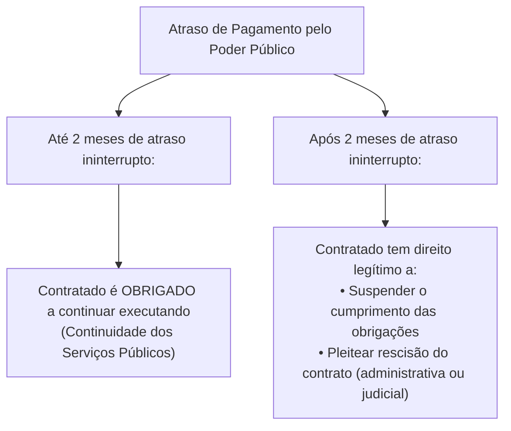
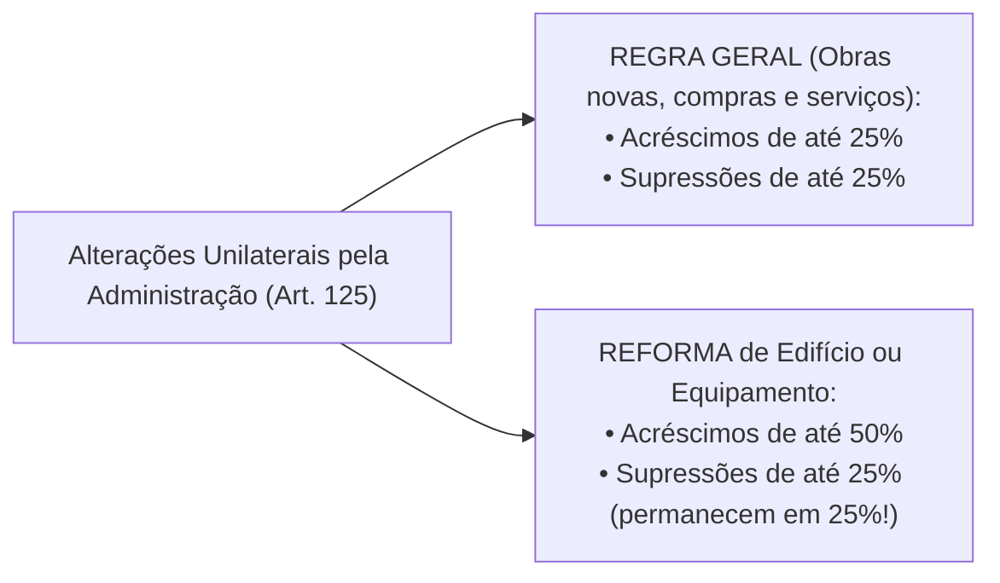

# 04 - Contratos Administrativos: Execução, Alterações, Equilíbrio e Sanções (Lei 14.133/2021)

> **Matéria:** Licitações e Contratos Administrativos  
> **Cargo:** A01 – Técnico de Controle Externo – Especialidade: Técnico Administrativo  
> **Arquivo:** `04_contratos_administrativos_fiscalizacao_alteracoes_e_sancoes.md`  
> **Status:** 🟢 Teoria Aprofundada + 5 Questões FCC Comentadas (A a E)

---

## 📌 Ementa Oficial do Edital
- Contratos administrativos: conceito, características, formalização e cláusulas exorbitantes.
- Garantias contratuais (caução, fiança bancária e seguro-garantia com cláusula de retomada / *step-in rights*).
- Duração dos contratos administrativos: prazos de vigência ordinários e contratações contínuas (até 5 anos, prorrogáveis até 10 anos).
- Gestão e fiscalização contratual: atribuições do gestor e fiscais (técnico, administrativo e setorial).
- Responsabilidade trabalhista da Administração Pública e Tema 246 do STF (ADC 16 - comprovação de culpa *in vigilando*).
- Recebimento provisório e definitivo do objeto.
- Alterações contratuais unilaterais e consensuais: limites de 25% e 50%.
- Equilíbrio econômico-financeiro: reajuste por índice, repactuação e revisão/reequilíbrio (*álea* extraordinária).
- Sanções administrativas: advertência, multa, impedimento de licitar e declaração de inidoneidade.
- Processo administrativo sancionador e reabilitação.

---

## 🧭 Sumário

1. [Conceito, Características e Cláusulas Exorbitantes dos Contratos Administrativos](#1-conceito-caracteristicas-e-clausulas-exorbitantes-dos-contratos-administrativos)
    1. [Características Fundamentais e Formalização](#11-caracteristicas-fundamentais-e-formalizacao)
    2. [Cláusulas Exorbitantes e Restrição à Exceção do Contrato Não Cumprido](#12-clausulas-exorbitantes-e-restricao-a-excecao-do-contrato-nao-cumprido)
    3. [Teste 099](#Teste-099)
2. [Garantias Contratuais e Seguro-Garantia com Cláusula de Retomada (Step-in Rights)](#2-garantias-contratuais-e-seguro-garantia-com-clausula-de-retomada-step-in-rights)
    1. [Teste 100](#Teste-100)
3. [Duração e Prorrogação dos Contratos Administrativos](#3-duracao-e-prorrogacao-dos-contratos-administrativos)
    1. [Serviços e Fornecimentos Contínuos (Regra 5 + 5 = Até 10 Anos)](#31-servicos-e-fornecimentos-continuos-regra-5-5-ate-10-anos)
    2. [Contratos por Escopo](#32-contratos-por-escopo)
    3. [Teste 101](#Teste-101)
4. [Gestão, Fiscalização e Responsabilidade Trabalhista do Estado](#4-gestao-fiscalizacao-e-responsabilidade-trabalhista-do-estado)
    1. [Estrutura de Gestão e Fiscalização Contratual](#41-estrutura-de-gestao-e-fiscalizacao-contratual)
    2. [Responsabilidade Trabalhista e Previdenciária: O Tema 246 do STF](#42-responsabilidade-trabalhista-e-previdenciaria-o-tema-246-do-stf)
    3. [Recebimento Provisório e Definitivo do Objeto](#43-recebimento-provisorio-e-definitivo-do-objeto)
    4. [Teste 102](#Teste-102)
    5. [Teste 103](#Teste-103)
5. [Alterações Contratuais e Manutenção do Equilíbrio Econômico-Financeiro](#5-alteracoes-contratuais-e-manutencao-do-equilibrio-economico-financeiro)
    1. [Alterações Unilaterais e Consensuais: Limites de 25% e 50%](#51-alteracoes-unilaterais-e-consensuais-limites-de-25-e-50)
    2. [Instrumentos de Recomposição: Reajuste, Repactuação e Revisão](#52-instrumentos-de-recomposicao-reajuste-repactuacao-e-revisao)
    3. [Teste 104](#Teste-104)
    4. [Teste 105](#Teste-105)
    5. [Teste 106](#Teste-106)
6. [Infrações, Sistema Sancionador e Processo de Reabilitação](#6-infracoes-sistema-sancionador-e-processo-de-reabilitacao)
    1. [Teste 107](#Teste-107)
    2. [Teste 108](#Teste-108)
    3. [Teste 109](#Teste-109)
7. [🌐 Fontes Recomendadas na Internet](#fontes-recomendadas-na-internet)

---

## 1. Conceito, Características e Cláusulas Exorbitantes dos Contratos Administrativos

O contrato administrativo é o ajuste bilateral de vontades celebrado entre a Administração Pública (atuando nessa qualidade revestida do regime de direito público) e o particular ou outra entidade pública, tendo por objetivo a consecução de uma utilidade de interesse público, sob condições reguladas pela legislação e pelo instrumento convocatório.

### 1.1 Características Fundamentais e Formalização
- **Consensual:** Aperfeiçoa-se com o consentimento mútuo manifestado na assinatura do ajuste, não dependendo da entrega física imediata da coisa para sua existência.
- **Formal:** A forma escrita é solene e obrigatória. O art. 95 da Lei nº 14.133/2021 estabelece que o instrumento de contrato é obrigatório, admitindo sua substituição por outros instrumentos hábeis (carta-contrato, nota de empenho de despesa, autorização de compra ou ordem de execução de serviço) apenas em dispensas de pequeno valor ou compras com entrega imediata e integral sem obrigações futuras. É nulo e de nenhum efeito o contrato verbal com a Administração, ressalvadas pequenas compras de pronto pagamento feitas em regime de adiantamento (suprimento de fundos) de valor irrisório.
- **Bilateral (ou Sinalagmático):** Gera direitos e obrigações recíprocas e interdependentes para ambas as partes.
- **Oneroso:** Impõe sacrifício patrimonial proporcional a ambas as partes contratantes.
- **Comutativo:** As prestações das partes são certas, conhecidas e tidas como equivalentes no momento da pactuação original.
- **Personalíssimo (*intuitu personae*):** Celebrado em função das qualidades subjetivas e habilitações demonstradas pelo licitante vencedor no certame, limitando-se a subcontratação às estritas balizas do edital e com prévia anuência da Administração.

### 1.2 Cláusulas Exorbitantes e Restrição à Exceção do Contrato Não Cumprido
As cláusulas exorbitantes (art. 104 da Lei nº 14.133/2021) conferem prerrogativas extraordinárias que extrapolam o direito privado comum, justificadas pela supremacia do interesse público sobre o privado:

1. **Modificação unilateral do contrato:** A Administração pode alterar qualitativa ou quantitativamente as cláusulas de serviço para melhor adequação técnica ao interesse público;
2. **Extinção unilateral do contrato:** Rescisão decorrente de inadimplemento do contratado ou por razões de interesse público de alta relevância;
3. **Fiscalização contínua da execução:** Acompanhamento técnico, administrativo e financeiro pelo Poder Público;
4. **Aplicação direta de sanções administrativas:** Imposição de sanções pelo próprio órgão contratante sem necessidade de intervenção prévia do Poder Judiciário;
5. **Ocupação provisória de bens e serviços:** Utilização de bens móveis, imóveis e pessoal do contratado necessários à continuidade de serviços públicos essenciais paralisados;
6. **Atenuação da *Exceptio Non Adimpleti Contractus* (Exceção do Contrato Não Cumprido):**
    - No direito civil comum, se um contratante deixa de pagar, o outro pode imediatamente paralisar suas atividades contratuais.
    - No regime jurídico-administrativo, em virtude do **princípio da continuidade do serviço público**, o contratado **não pode paralisar imediatamente** as obras ou serviços em caso de inadimplemento financeiro do Estado.
    - Pelo art. 137, § 2º, inciso IV, da Lei nº 14.133/2021, o particular é obrigado a continuar executando o contrato até o limite de **2 (dois) meses de atraso ininterrupto** nos pagamentos devidos pela Administração Pública. Somente após transcorridos 2 meses contínuos de inadimplemento é que assiste ao particular o direito de suspender a execução de suas obrigações ou requerer a extinção do contrato.

---

### Teste 001
**(FGV – TCE/GO – 2024 – Analista de Controle Externo - Ciências Contábeis)**
Marcela e Maíra estavam debatendo sobre o regime jurídico dos bens das autarquias e das sociedades de economia mista que atuam em regime de concorrência, distribuem lucro entre seus acionistas e não realizam serviços públicos, situação em que concluíram corretamente que

* **A)** os bens das autarquias podem ser usucapidos.
* **B)** os bens de ambas as mencionadas entidades administrativas são inalienáveis.
* **C)** os bens das referidas sociedades de economia mista são imprescritíveis.
* **D)** os bens dominicais das autarquias são passíveis de alienação, observadas as exigências legais.
* **E)** os bens das aludidas sociedades de economia mista são impenhoráveis.

---

> **Comentário Detalhado:**
>
> - **A)** **Incorreta.** A opção apresenta proposição em desacordo com os fundamentos teóricos e técnicos do tópico ao afirmar que "os bens das autarquias podem ser usucapidos". De acordo com a teoria estudada em *3.1 Serviços e Fornecimentos Contínuos (Regra 5 + 5 = Até 10 Anos)*, podem ser celebrados com prazo de vigência inicial de até 5 (cinco) anos.
> - **B)** **Incorreta.** A opção apresenta proposição em desacordo com os fundamentos teóricos e técnicos do tópico ao afirmar que "os bens de ambas as mencionadas entidades administrativas são inalienáveis". De acordo com a teoria estudada em *4.1 Estrutura de Gestão e Fiscalização Contratual*, fiscal Setorial / do Público Usuário: Servidores designados em unidades descentralizadas ou comissões de usuários para atestar a efetiva entrega dos bens ou serviços.
> - **C)** **Incorreta.** A opção apresenta proposição em desacordo com os fundamentos teóricos e técnicos do tópico ao afirmar que "os bens das referidas sociedades de economia mista são imprescritíveis". De acordo com a teoria estudada em *5.1 Alterações Unilaterais e Consensuais: Limites de 25% e 50%*, o art. 125 estipula os limites legais obrigatórios que o contratado é obrigado a aceitar nas alterações unilaterais.
> - **D)** **Correta.** Conforme fundamentado na seção *1.2 Cláusulas Exorbitantes e Restrição à Exceção do Contrato Não Cumprido* deste guia, ocupação provisória de bens e serviços: Utilização de bens móveis, imóveis e pessoal do contratado necessários à continuidade de serviços públicos essenciais paralisados. Dessa forma, está plenamente correta a assertiva da banca (FGV – TCE/GO/2024) ao estabelecer que "os bens dominicais das autarquias são passíveis de alienação, observadas as exigências legais".
> - **E)** **Incorreta.** A opção apresenta proposição em desacordo com os fundamentos teóricos e técnicos do tópico ao afirmar que "os bens das aludidas sociedades de economia mista são impenhoráveis". De acordo com a teoria estudada em *5.1 Alterações Unilaterais e Consensuais: Limites de 25% e 50%*, é terminantemente proibida a compensação matemática entre acréscimos e supressões para efeito de cumprimento dos limites legais (ex.: acrescer 40% em um item e suprimir 40% em outro configura ilegalidade manifesta pelo "jogo de planilhas").
>
> **Gabarito: D**

---

### Teste 002
**(FCC – TCE/GO – 2009 – Analista de Controle Externo - Gestão de Conhecimento)**
Aceitação formal das atribuições, deveres e responsabi- _________________________________________________________ lidades inerentes ao cargo público, com o compromisso de 59. Quanto à participação de empresas reunidas em con- bem servir, denomina-se sórcio no pregão, é correto afirmar que

* **A)** as empresas consorciadas não poderão participar,
* **B)** no consórcio de empresas brasileiras e estrangeiras,
* **C)** posse. na mesma licitação, de mais de um consórcio ou
* **D)** lotação. isoladamente.
* **E)** contratação. _________________________________________________________

---

> **Comentário Detalhado:**
>
> - **A)** **Incorreta.** A opção apresenta proposição em desacordo com os fundamentos teóricos e técnicos do tópico ao afirmar que "as empresas consorciadas não poderão participar,". De acordo com a teoria estudada em *3.1 Serviços e Fornecimentos Contínuos (Regra 5 + 5 = Até 10 Anos)*, permite amortização mais eficiente de investimentos e redução substantiva dos custos de transação causados por licitações repetitivas anuais.
> - **B)** **Incorreta.** A opção apresenta proposição em desacordo com os fundamentos teóricos e técnicos do tópico ao afirmar que "no consórcio de empresas brasileiras e estrangeiras,". De acordo com a teoria estudada em *4.1 Estrutura de Gestão e Fiscalização Contratual*, a execução do contrato deve ser acompanhada e fiscalizada permanentemente por um ou mais fiscais do contrato, auxiliados por gestores, atendendo ao princípio da segregação de funções (art. 117).
> - **C)** **Correta.** Conforme fundamentado na seção *6. Infrações, Sistema Sancionador e Processo de Reabilitação* deste guia, o cometimento de infrações administrativas elencadas no art. 155 da Lei nº 14.133/2021 (dar causa à inexecução parcial ou total, fraudar a licitação, praticar ato ilícito com vistas a frustrar os objetivos do certame, comportar se de modo inidôneo) sujeita o licitante ou contratado a quatro sanções administrativas (art. 156). Dessa forma, está plenamente correta a assertiva da banca (FCC – TCE/GO/2009) ao estabelecer que "posse. na mesma licitação, de mais de um consórcio ou".
> - **D)** **Incorreta.** A opção apresenta proposição em desacordo com os fundamentos teóricos e técnicos do tópico ao afirmar que "lotação. isoladamente". De acordo com a teoria estudada em *1.1 Características Fundamentais e Formalização*, formal: A forma escrita é solene e obrigatória. O art. 95 da Lei nº 14.133/2021 estabelece que o instrumento de contrato é obrigatório, admitindo sua substituição por outros instrumentos hábeis (carta contrato, nota de empenho de despesa, autorização de compra ou ordem de execução de serviço) apenas em dispensas de pequeno valor ou compras com entrega imediata e integral sem obrigações futuras. É nulo e de nenhum efeito o contrato verbal com a Administração, ressalvadas pequenas compras de pronto pagamento feitas em regime de adiantamento (suprimento de fundos) de valor irrisório.
> - **E)** **Incorreta.** A opção apresenta proposição em desacordo com os fundamentos teóricos e técnicos do tópico ao afirmar que "contratação". De acordo com a teoria estudada em *2. Garantias Contratuais e Seguro-Garantia com Cláusula de Retomada (Step-in Rights)*, a critério da autoridade competente, em cada contratação a Administração pode exigir do contratado a prestação de garantia (art. 96). Caberá ao contratado optar por uma das seguintes modalidades.
>
> **Gabarito: C**

---

### Teste 003
**(FGV – TRT da 24º Região – 2025 – Analista Judiciário - Área Administrativa - Contabilidade)**
De acordo com a Lei nº 14.133/2021, após o resultado do processo de licitação, será facultado à Administração, quando o convocado não assinar o termo de contrato ou não aceitar ou não retirar o instrumento equivalente no prazo e nas condições estabelecidas, convocar os licitantes remanescentes, na ordem de classificação, para a celebração do contrato nas condições propostas pelo licitante vencedor. Em relação à hipótese de nenhum dos licitantes aceitar a contratação nos termos propostos, analise o que se afirma a seguir. I. A Administração poderá convocar os licitantes remanescentes para negociação, na ordem de classificação, com vistas à obtenção de preço melhor, mesmo que acima do preço do adjudicatário. II. A Administração poderá adjudicar e celebrar o contrato nas condições ofertadas pelos licitantes remanescentes, atendida a ordem classificatória, quando frustrada a negociação de melhor condição. III. A Administração poderá anular o edital de licitação e suspender as suas intenções originais em relação ao objeto da licitação. Está correto o que se afirma em

* **A)** I, apenas.
* **B)** I e II, apenas.
* **C)** I e III, apenas.
* **D)** II e III, apenas.
* **E)** I, II e III. Questão Discursiva A Cia. Delta S.A. atua no setor de comércio varejista. Em 31/12/2024, a sociedade empresária apresentava os seguintes saldos em seu Balanço Patrimonial:  Disponibilidades: R$300.000.  Participação em empresa controlada: R$50.000.  Patrimônio Líquido: R$350.000. Em janeiro de 2025, a Cia. Delta concedeu os seguintes empréstimos:  para empresa controlada, com prazo de recebimento previsto para 90 dias: R$15.000.  para o diretor de marketing, com prazo de recebimento previsto para 120 dias: R$20.000.  para empregados administrativos, com prazo de recebimento previsto para 180 dias: R$25.000.  para acionistas, com prazo de recebimento previsto para 240 dias: R$30.000. Com base na Lei n.° 6.404/1976 e alterações, indique e explique o saldo e a composição dos seguintes grupos no Balanço Patrimonial em 31/01/2025: a) Ativo circulante. b) Ativo realizável a longo prazo. c) Investimentos.

---

> **Comentário Detalhado:**
>
> - **A)** **Incorreta.** A opção incorre em restrição indevida ao limitar o escopo conceitual ao afirmar que "I, apenas". De acordo com a teoria estudada em *6. Infrações, Sistema Sancionador e Processo de Reabilitação*, o cometimento de infrações administrativas elencadas no art. 155 da Lei nº 14.133/2021 (dar causa à inexecução parcial ou total, fraudar a licitação, praticar ato ilícito com vistas a frustrar os objetivos do certame, comportar se de modo inidôneo) sujeita o licitante ou contratado a quatro sanções administrativas (art. 156).
> - **B)** **Correta.** Conforme fundamentado na seção *1.1 Características Fundamentais e Formalização* deste guia, formal: A forma escrita é solene e obrigatória. O art. 95 da Lei nº 14.133/2021 estabelece que o instrumento de contrato é obrigatório, admitindo sua substituição por outros instrumentos hábeis (carta contrato, nota de empenho de despesa, autorização de compra ou ordem de execução de serviço) apenas em dispensas de pequeno valor ou compras com entrega imediata e integral sem obrigações futuras. É nulo e de nenhum efeito o contrato verbal com a Administração, ressalvadas pequenas compras de pronto pagamento feitas em regime de adiantamento (suprimento de fundos) de valor irrisório. Dessa forma, está plenamente correta a assertiva da banca (FGV – TRT da 24º Região/2025) ao estabelecer que "I e II, apenas".
> - **C)** **Incorreta.** A opção incorre em restrição indevida ao limitar o escopo conceitual ao afirmar que "I e III, apenas". De acordo com a teoria estudada em *1.2 Cláusulas Exorbitantes e Restrição à Exceção do Contrato Não Cumprido*, pelo art. 137, § 2º, inciso IV, da Lei nº 14.133/2021, o particular é obrigado a continuar executando o contrato até o limite de 2 (dois) meses de atraso ininterrupto nos pagamentos devidos pela Administração Pública. Somente após transcorridos 2 meses contínuos de inadimplemento é que assiste ao particular o direito de suspender a execução de suas obrigações ou requerer a extinção do contrato.
> - **D)** **Incorreta.** A opção incorre em restrição indevida ao limitar o escopo conceitual ao afirmar que "II e III, apenas". De acordo com a teoria estudada em *1.1 Características Fundamentais e Formalização*, personalíssimo ( intuitu personae ): Celebrado em função das qualidades subjetivas e habilitações demonstradas pelo licitante vencedor no certame, limitando se a subcontratação às estritas balizas do edital e com prévia anuência da Administração.
> - **E)** **Incorreta.** A opção apresenta proposição em desacordo com os fundamentos teóricos e técnicos do tópico ao afirmar que "I, II e III. Questão Discursiva A Cia. Delta S.A. atua no setor de comércio varejista. Em 31/12/2024, a sociedade...". De acordo com a teoria estudada em *5.2 Instrumentos de Recomposição: Reajuste, Repactuação e Revisão*, a garantia da equação econômico financeira original é direito fundamental do contratado previsto no art. 37, XXI, da CF/88. A Lei nº 14.133/2021 distingue com clareza três institutos.
>
> **Gabarito: B**

---

### Teste 004
**(FGV – TRF/1 – 2024 – Analista Judiciario Area Apoio Especializado Especialidade Suporte Em Tecnologia Da Informacao)**
As chamadas cláusulas exorbitantes correspondem às prerrogativas reconhecidas para a Administração Pública no âmbito dos contratos administrativos. Acerca do aludido tema, com base na Lei nº 14.133/2021, é correto afirmar que:

* **A)** a fiscalização do contrato não está expressamente consagrada no rol das cláusulas exorbitantes previstas no aludido diploma legal;
* **B)** o fato do príncipe e o fato da Administração estão expressamente consagrados no rol das cláusulas exorbitantes previstas no aludido diploma legal;
* **C)** a alteração unilateral do contrato não está expressamente consagrada no rol das cláusulas exorbitantes previstas no aludido diploma legal;
* **D)** a manutenção do equilíbrio econômico-financeiro do contrato está expressamente consagrada no rol das cláusulas exorbitantes previstas no aludido diploma legal;
* **E)** a viabilidade de ocupar provisoriamente bens móveis e imóveis e utilizar pessoal e serviços vinculados ao objeto do contrato está expressamente consagrada no rol das cláusulas exorbitantes previstas no aludido diploma legal.

---

> **Comentário Detalhado:**
>
> - **A)** **Incorreta.** A opção apresenta proposição em desacordo com os fundamentos teóricos e técnicos do tópico ao afirmar que "a fiscalização do contrato não está expressamente consagrada no rol das cláusulas exorbitantes previstas no...". De acordo com a teoria estudada em *1.2 Cláusulas Exorbitantes e Restrição à Exceção do Contrato Não Cumprido*, as cláusulas exorbitantes (art. 104 da Lei nº 14.133/2021) conferem prerrogativas extraordinárias que extrapolam o direito privado comum, justificadas pela supremacia do interesse público sobre o privado.
> - **B)** **Incorreta.** A opção apresenta proposição em desacordo com os fundamentos teóricos e técnicos do tópico ao afirmar que "o fato do príncipe e o fato da Administração estão expressamente consagrados no rol das cláusulas exorbitantes...". De acordo com a teoria estudada em *1.2 Cláusulas Exorbitantes e Restrição à Exceção do Contrato Não Cumprido*, pelo art. 137, § 2º, inciso IV, da Lei nº 14.133/2021, o particular é obrigado a continuar executando o contrato até o limite de 2 (dois) meses de atraso ininterrupto nos pagamentos devidos pela Administração Pública. Somente após transcorridos 2 meses contínuos de inadimplemento é que assiste ao particular o direito de suspender a execução de suas obrigações ou requerer a extinção do contrato.
> - **C)** **Incorreta.** A opção apresenta proposição em desacordo com os fundamentos teóricos e técnicos do tópico ao afirmar que "a alteração unilateral do contrato não está expressamente consagrada no rol das cláusulas exorbitantes previstas...". De acordo com a teoria estudada em *1.2 Cláusulas Exorbitantes e Restrição à Exceção do Contrato Não Cumprido*, modificação unilateral do contrato: A Administração pode alterar qualitativa ou quantitativamente as cláusulas de serviço para melhor adequação técnica ao interesse público.
> - **D)** **Incorreta.** A opção apresenta proposição em desacordo com os fundamentos teóricos e técnicos do tópico ao afirmar que "a manutenção do equilíbrio econômico financeiro do contrato está expressamente consagrada no rol das cláusulas...". De acordo com a teoria estudada em *1.2 Cláusulas Exorbitantes e Restrição à Exceção do Contrato Não Cumprido*, no regime jurídico administrativo, em virtude do princípio da continuidade do serviço público, o contratado não pode paralisar imediatamente as obras ou serviços em caso de inadimplemento financeiro do Estado.
> - **E)** **Correta.** Conforme fundamentado na seção *1.2 Cláusulas Exorbitantes e Restrição à Exceção do Contrato Não Cumprido* deste guia, ocupação provisória de bens e serviços: Utilização de bens móveis, imóveis e pessoal do contratado necessários à continuidade de serviços públicos essenciais paralisados. Dessa forma, está plenamente correta a assertiva da banca (FGV – TRF/1/2024) ao estabelecer que "a viabilidade de ocupar provisoriamente bens móveis e imóveis e utilizar pessoal e serviços vinculados ao objeto...".
>
> **Gabarito: E**

---

### Teste 005
**(FGV – TJ/RR – 2024 – Analista Judiciario Gestao E Governanca De Tecnologia Da Informacao)**
Considerando conceitos básicos de contratações de TI, analise as afirmativas. I. Em sequência, segundo a Lei nº 14.133/2021, o processo licitatório deverá seguir as seguintes fases: preparatória; de divulgação do edital de licitação; de cadastramento; de apresentação de propostas e lances, quando for o caso; de julgamento; recursal; de habilitação; e de homologação. II. Segundo a IN 67/2021 da SEGES/ME, no caso de procedimento de contratação restar fracassado, o órgão poderá, dentre outras ações, valer-se, para a contratação, de proposta obtida na pesquisa de preços que serviu de base ao procedimento, se houver, privilegiando-se os menores preços, sempre que possível, e desde que atendidas às condições de habilitação exigidas. III. Segundo a Lei nº 14.133/2021, o processo de padronização deverá conter: parecer técnico sobre o produto, considerados especificações técnicas e estéticas, desempenho, análise de contratações anteriores, custo e condições de manutenção e garantia; despacho motivado do responsável técnico pela contratação, com a adoção do padrão; e síntese da justificativa e descrição sucinta do padrão definido, divulgadas em sítio eletrônico oficial. Está correto o que se afirma em

* **A)** I, apenas.
* **B)** II, apenas.
* **C)** III, apenas.
* **D)** I e II, apenas.
* **E)** I e III, apenas.

---

> **Comentário Detalhado:**
>
> - **A)** **Incorreta.** A opção incorre em restrição indevida ao limitar o escopo conceitual ao afirmar que "I, apenas". De acordo com a teoria estudada em *3.1 Serviços e Fornecimentos Contínuos (Regra 5 + 5 = Até 10 Anos)*, a Administração pode prorrogar sucessivamente a contratação até o limite máximo total de 10 (dez) anos, desde que comprovada documentalmente a vantajosidade econômica das condições e a manutenção da qualidade da execução.
> - **B)** **Correta.** Conforme fundamentado na seção *5.2 Instrumentos de Recomposição: Reajuste, Repactuação e Revisão* deste guia, reajuste em Sentido Estrito: Variação inflacionária ordinária do custo dos insumos e produtos — 1 ano (interregno mínimo) — Aplicação automática de índice oficial de correção de preços previsto no edital (ex.: IPCA, INCC, IGP M). Dessa forma, está plenamente correta a assertiva da banca (FGV – TJ/RR/2024) ao estabelecer que "II, apenas".
> - **C)** **Incorreta.** A opção incorre em restrição indevida ao limitar o escopo conceitual ao afirmar que "III, apenas". De acordo com a teoria estudada em *6. Infrações, Sistema Sancionador e Processo de Reabilitação*, o cometimento de infrações administrativas elencadas no art. 155 da Lei nº 14.133/2021 (dar causa à inexecução parcial ou total, fraudar a licitação, praticar ato ilícito com vistas a frustrar os objetivos do certame, comportar se de modo inidôneo) sujeita o licitante ou contratado a quatro sanções administrativas (art. 156).
> - **D)** **Incorreta.** A opção incorre em restrição indevida ao limitar o escopo conceitual ao afirmar que "I e II, apenas". De acordo com a teoria estudada em *Seguro-Garantia com Cláusula de Retomada (Step-in Rights - Art. 102)*, em contratações de obras e serviços de engenharia de grande vulto (valor superior a R$ 200 milhões na edição da lei, atualizado anualmente), o edital pode prever a obrigatoriedade de seguro garantia com previsão expressa de cláusula de retomada ( step in rights ).
> - **E)** **Incorreta.** A opção incorre em restrição indevida ao limitar o escopo conceitual ao afirmar que "I e III, apenas". De acordo com a teoria estudada em *2. Garantias Contratuais e Seguro-Garantia com Cláusula de Retomada (Step-in Rights)*, contratos de Alta Complexidade Técnica ou Riscos Elevados: A garantia pode ser fixada em até 10% (dez por cento) do valor do contrato, desde que expressamente motivada na fase preparatória (art. 98, § 1º).
>
> **Gabarito: B**

---

### Teste 006
**(CEBRASPE – STJ – 2015 – Analista Judiciario Suporte Em Tecnologia Da Informacao)**
A nulidade de contrato administrativo por ausência prévia de licitação gera, para o contratado de boa-fé, direito a indenização pelos serviços por ele prestados.

* **C)** Certo
* **E)** Errado

---

> **Comentário Detalhado:**
>
> - **C)** **Incorreta.** A proposição apresenta proposição em desacordo com os fundamentos teóricos e técnicos do tópico ao afirmar que "A nulidade de contrato administrativo por ausência prévia de licitação gera, para o contratado de boa fé...". De acordo com a teoria em *1.2 Cláusulas Exorbitantes e Restrição à Exceção do Contrato Não Cumprido*, no regime jurídico administrativo, em virtude do princípio da continuidade do serviço público, o contratado não pode paralisar imediatamente as obras ou serviços em caso de inadimplemento financeiro do Estado.
> - **E)** **Correta.** O item está **Errado** (gabarito oficial: **E**), pois contraria a disciplina teórica aplicável.
>
> **Gabarito: E**

---

### Teste 007
**(CEBRASPE – TRT/10 – 2013 – Analista Judiciario Tecnologia Da Informacao)**
O protocolo de bloqueio é utilizado para resolver problemas relacionados à concorrência.

* **C)** Certo
* **E)** Errado

---

> **Comentário Detalhado:**
>
> - **C)** **Correta.** O item está **Certo**. Conforme fundamentado na seção *Fundamentos Teóricos*, status: 🟢 Teoria Aprofundada + 5 Questões FCC Comentadas (A a E). Dessa forma, está plenamente correta a assertiva da banca (CEBRASPE – TRT/10/2013) ao afirmar que "O protocolo de bloqueio é utilizado para resolver problemas relacionados à concorrência".
> - **E)** **Incorreta.** A assertiva não incorre em erro conceitual, guardando conformidade com a teoria estudada.
>
> **Gabarito: C**

---

### Teste 008
**(FCC – TRT 16ª – 2014 – Analista Judiciário - Tecnologia da Informação)**
A empresa “Zinco S.A.” atrasou injustificadamente a execução de contrato administrativo celebrado com o

* **A)** 36.
* **B)** 54.
* **C)** 58.
* **D)** 56.
* **E)** 48

---

> **Comentário Detalhado:**
>
> - **A)** **Incorreta.** A opção apresenta proposição em desacordo com os fundamentos teóricos e técnicos do tópico ao afirmar que "36". De acordo com a teoria estudada em *1.2 Cláusulas Exorbitantes e Restrição à Exceção do Contrato Não Cumprido*, fiscalização contínua da execução: Acompanhamento técnico, administrativo e financeiro pelo Poder Público.
> - **B)** **Incorreta.** A opção apresenta proposição em desacordo com os fundamentos teóricos e técnicos do tópico ao afirmar que "54". De acordo com a teoria estudada em *1.2 Cláusulas Exorbitantes e Restrição à Exceção do Contrato Não Cumprido*, no regime jurídico administrativo, em virtude do princípio da continuidade do serviço público, o contratado não pode paralisar imediatamente as obras ou serviços em caso de inadimplemento financeiro do Estado.
> - **C)** **Correta.** Conforme fundamentado na seção *1. Conceito, Características e Cláusulas Exorbitantes dos Contratos Administrativos* deste guia, o contrato administrativo é o ajuste bilateral de vontades celebrado entre a Administração Pública (atuando nessa qualidade revestida do regime de direito público) e o particular ou outra entidade pública, tendo por objetivo a consecução de uma utilidade de interesse público, sob condições reguladas pela legislação e pelo instrumento convocatório. Dessa forma, está plenamente correta a assertiva da banca (FCC – TRT 16ª/2014) ao estabelecer que "58".
> - **D)** **Incorreta.** A opção apresenta proposição em desacordo com os fundamentos teóricos e técnicos do tópico ao afirmar que "56". De acordo com a teoria estudada em *4.2 Responsabilidade Trabalhista e Previdenciária: O Tema 246 do STF*, o art. 121, § 1º, da NLLC reforça que o inadimplemento trabalhista da empresa terceirizada não transfere automaticamente a responsabilidade de pagamento ao Poder Público tomador de serviços.
> - **E)** **Incorreta.** A opção apresenta proposição em desacordo com os fundamentos teóricos e técnicos do tópico ao afirmar que "48". De acordo com a teoria estudada em *1.1 Características Fundamentais e Formalização*, formal: A forma escrita é solene e obrigatória. O art. 95 da Lei nº 14.133/2021 estabelece que o instrumento de contrato é obrigatório, admitindo sua substituição por outros instrumentos hábeis (carta contrato, nota de empenho de despesa, autorização de compra ou ordem de execução de serviço) apenas em dispensas de pequeno valor ou compras com entrega imediata e integral sem obrigações futuras. É nulo e de nenhum efeito o contrato verbal com a Administração, ressalvadas pequenas compras de pronto pagamento feitas em regime de adiantamento (suprimento de fundos) de valor irrisório.
>
> **Gabarito: C**

---

### Teste 009
**(FCC – TRT 24ª – 2017 – Analista Judiciário - Tecnologia da Informação)**
Em determinado pregão eletrônico, uma das empresas interessadas em participar do certame pretende impugnar o edital. Nos termos do Decreto no 5.450/2005, o prazo para apresentar a impugnação é de até

* **A)** 5 dias úteis antes da data fixada para abertura da sessão pública, e caberá ao pregoeiro, auxiliado pelo setor responsável pela elaboração do edital, decidir sobre a impugnação no prazo de até 24 horas.
* **B)** 2 dias úteis contados da data fixada para abertura da sessão pública, e caberá ao pregoeiro, auxiliado pelo setor responsável pela elaboração do edital, decidir sobre a impugnação no prazo de até 72 horas.
* **C)** 2 dias úteis antes da data fixada para abertura da sessão pública, e caberá ao pregoeiro, auxiliado pelo setor responsável pela elaboração do edital, decidir sobre a impugnação no prazo de até 24 horas.
* **D)** 5 dias úteis contados da data fixada para abertura da sessão pública, e caberá ao pregoeiro, auxiliado pelo setor responsável pela elaboração do edital, decidir sobre a impugnação no prazo de até 48 horas.
* **E)** 10 dias úteis antes da data fixada para abertura da sessão pública, e caberá ao pregoeiro, auxiliado pelo setor responsável pela elaboração do edital, decidir sobre a impugnação no prazo de até 24 horas.

---

> **Comentário Detalhado:**
>
> - **A)** **Incorreta.** A opção apresenta proposição em desacordo com os fundamentos teóricos e técnicos do tópico ao afirmar que "5 dias úteis antes da data fixada para abertura da sessão pública, e caberá ao pregoeiro, auxiliado pelo setor...". De acordo com a teoria estudada em *Seguro-Garantia com Cláusula de Retomada (Step-in Rights - Art. 102)*, em contratações de obras e serviços de engenharia de grande vulto (valor superior a R$ 200 milhões na edição da lei, atualizado anualmente), o edital pode prever a obrigatoriedade de seguro garantia com previsão expressa de cláusula de retomada ( step in rights ).
> - **B)** **Correta.** Conforme fundamentado na seção *1.1 Características Fundamentais e Formalização* deste guia, personalíssimo ( intuitu personae ): Celebrado em função das qualidades subjetivas e habilitações demonstradas pelo licitante vencedor no certame, limitando se a subcontratação às estritas balizas do edital e com prévia anuência da Administração. Dessa forma, está plenamente correta a assertiva da banca (FCC – TRT 24ª/2017) ao estabelecer que "2 dias úteis contados da data fixada para abertura da sessão pública, e caberá ao pregoeiro, auxiliado pelo setor...".
> - **C)** **Incorreta.** A opção apresenta proposição em desacordo com os fundamentos teóricos e técnicos do tópico ao afirmar que "2 dias úteis antes da data fixada para abertura da sessão pública, e caberá ao pregoeiro, auxiliado pelo setor...". De acordo com a teoria estudada em *5.2 Instrumentos de Recomposição: Reajuste, Repactuação e Revisão*, reajuste em Sentido Estrito: Variação inflacionária ordinária do custo dos insumos e produtos — 1 ano (interregno mínimo) — Aplicação automática de índice oficial de correção de preços previsto no edital (ex.: IPCA, INCC, IGP M).
> - **D)** **Incorreta.** A opção apresenta proposição em desacordo com os fundamentos teóricos e técnicos do tópico ao afirmar que "5 dias úteis contados da data fixada para abertura da sessão pública, e caberá ao pregoeiro, auxiliado pelo setor...". De acordo com a teoria estudada em *2. Garantias Contratuais e Seguro-Garantia com Cláusula de Retomada (Step-in Rights)*, a critério da autoridade competente, em cada contratação a Administração pode exigir do contratado a prestação de garantia (art. 96). Caberá ao contratado optar por uma das seguintes modalidades.
> - **E)** **Incorreta.** A opção apresenta proposição em desacordo com os fundamentos teóricos e técnicos do tópico ao afirmar que "10 dias úteis antes da data fixada para abertura da sessão pública, e caberá ao pregoeiro, auxiliado pelo setor...". De acordo com a teoria estudada em *2. Garantias Contratuais e Seguro-Garantia com Cláusula de Retomada (Step-in Rights)*, contratos de Alta Complexidade Técnica ou Riscos Elevados: A garantia pode ser fixada em até 10% (dez por cento) do valor do contrato, desde que expressamente motivada na fase preparatória (art. 98, § 1º).
>
> **Gabarito: B**

---

### Teste 010
**(FGV – TCE/PA – 2024 – Auditor de Controle Externo - Administrativa - Administração)**
Ao acompanhar a execução de determinado contrato administrativo, Alice verificou que a Administração Pública não efetuou o pagamento devido, com relação a determinado contrato de prestação de serviços com dedicação exclusiva de mão-de-obra, devidamente formalizado e regularmente cumprido pelo contratado, razão pela qual decidiu analisar os efeitos do inadimplemento pelo Poder Público, nos termos da Lei nº 14.133/2021. Diante dessa situação hipotética, à luz da legislação em comento, Alice verificou corretamente que o atraso superior a determinado período, contado da emissão da nota fiscal, confere ao contratado o direito à extinção do contrato, sendo correto afirmar que tal prazo é de

* **A)** 10 dias.
* **B)** 15 dias.
* **C)** 45 dias.
* **D)** 1 mês.
* **E)** 2 meses.

---

> **Comentário Detalhado:**
>
> - **A)** **Incorreta.** A opção apresenta proposição em desacordo com os fundamentos teóricos e técnicos do tópico ao afirmar que "10 dias". De acordo com a teoria estudada em *1.1 Características Fundamentais e Formalização*, formal: A forma escrita é solene e obrigatória. O art. 95 da Lei nº 14.133/2021 estabelece que o instrumento de contrato é obrigatório, admitindo sua substituição por outros instrumentos hábeis (carta contrato, nota de empenho de despesa, autorização de compra ou ordem de execução de serviço) apenas em dispensas de pequeno valor ou compras com entrega imediata e integral sem obrigações futuras. É nulo e de nenhum efeito o contrato verbal com a Administração, ressalvadas pequenas compras de pronto pagamento feitas em regime de adiantamento (suprimento de fundos) de valor irrisório.
> - **B)** **Incorreta.** A opção apresenta proposição em desacordo com os fundamentos teóricos e técnicos do tópico ao afirmar que "15 dias". De acordo com a teoria estudada em *3.2 Contratos por Escopo*, conforme o art. 111, o prazo de vigência será automaticamente prorrogado quando o seu objeto não for concluído no período inicialmente firmado por razões imputáveis à Administração ou por fatos supervenientes de caso fortuito/força maior, assegurando se a conclusão da obra e a apuração de responsabilidades caso o atraso decorra de culpa exclusiva do contratado.
> - **C)** **Incorreta.** A opção apresenta proposição em desacordo com os fundamentos teóricos e técnicos do tópico ao afirmar que "45 dias". De acordo com a teoria estudada em *5.2 Instrumentos de Recomposição: Reajuste, Repactuação e Revisão*, repactuação: Serviços contínuos com dedicação exclusiva de mão de obra — 1 ano (interregno mínimo) — Demonstração analítica da variação de custos decorrente de nova Convenção Coletiva de Trabalho (CCT) ou Dissídio Coletivo.
> - **D)** **Incorreta.** A opção apresenta proposição em desacordo com os fundamentos teóricos e técnicos do tópico ao afirmar que "1 mês". De acordo com a teoria estudada em *Seguro-Garantia com Cláusula de Retomada (Step-in Rights - Art. 102)*, funcionamento: Em caso de inadimplemento, atraso grave ou abandono por parte da construtora, a seguradora é notificada para intervir diretamente. A seguradora assume a administração do canteiro de obras e conclui a execução do objeto contratado, diretamente ou mediante subcontratação de terceiros idôneos aprovados pelo Poder Público.
> - **E)** **Correta.** Conforme fundamentado na seção *1.2 Cláusulas Exorbitantes e Restrição à Exceção do Contrato Não Cumprido* deste guia, pelo art. 137, § 2º, inciso IV, da Lei nº 14.133/2021, o particular é obrigado a continuar executando o contrato até o limite de 2 (dois) meses de atraso ininterrupto nos pagamentos devidos pela Administração Pública. Somente após transcorridos 2 meses contínuos de inadimplemento é que assiste ao particular o direito de suspender a execução de suas obrigações ou requerer a extinção do contrato. Dessa forma, está plenamente correta a assertiva da banca (FGV – TCE/PA/2024) ao estabelecer que "2 meses".
>
> **Gabarito: E**

---

### Teste 011
**(FGV – TCE/PA – 2024 – Auditor de Controle Externo - Administrativa - Administração)**
A Lei nº 14.133/2021, conhecida como a Nova Lei de Licitações e Contratos, atualiza significativamente a regulação dos processos licitatórios e contratações públicas no Brasil, substituindo a antiga Lei nº 8.666/1993. Assinale a opção que não se subordina ao regime da Lei nº 14.133/2021.

* **A)** Compra por encomenda.
* **B)** Contratação de agente financeiro.
* **C)** Prestação de serviços técnico-profissionais especializados.
* **D)** Concessão de direito real de uso de bens.
* **E)** Concessão e permissão de uso de bens públicos.

---

> **Comentário Detalhado:**
>
> - **A)** **Incorreta.** A opção apresenta proposição em desacordo com os fundamentos teóricos e técnicos do tópico ao afirmar que "Compra por encomenda". De acordo com a teoria estudada em *1.1 Características Fundamentais e Formalização*, formal: A forma escrita é solene e obrigatória. O art. 95 da Lei nº 14.133/2021 estabelece que o instrumento de contrato é obrigatório, admitindo sua substituição por outros instrumentos hábeis (carta contrato, nota de empenho de despesa, autorização de compra ou ordem de execução de serviço) apenas em dispensas de pequeno valor ou compras com entrega imediata e integral sem obrigações futuras. É nulo e de nenhum efeito o contrato verbal com a Administração, ressalvadas pequenas compras de pronto pagamento feitas em regime de adiantamento (suprimento de fundos) de valor irrisório.
> - **B)** **Correta.** Conforme fundamentado na seção *3. Duração e Prorrogação dos Contratos Administrativos* deste guia, a regra orçamentária tradicional vinculava a vigência contratual aos créditos orçamentários do respectivo exercício financeiro (regra do ano civil). A Lei nº 14.133/2021 flexibilizou essa sistemática com regras modernas de planejamento (arts. 105 a 114). Dessa forma, está plenamente correta a assertiva da banca (FGV – TCE/PA/2024) ao estabelecer que "Contratação de agente financeiro".
> - **C)** **Incorreta.** A opção apresenta proposição em desacordo com os fundamentos teóricos e técnicos do tópico ao afirmar que "Prestação de serviços técnico profissionais especializados". De acordo com a teoria estudada em *2. Garantias Contratuais e Seguro-Garantia com Cláusula de Retomada (Step-in Rights)*, a critério da autoridade competente, em cada contratação a Administração pode exigir do contratado a prestação de garantia (art. 96). Caberá ao contratado optar por uma das seguintes modalidades.
> - **D)** **Incorreta.** A opção apresenta proposição em desacordo com os fundamentos teóricos e técnicos do tópico ao afirmar que "Concessão de direito real de uso de bens". De acordo com a teoria estudada em *1.2 Cláusulas Exorbitantes e Restrição à Exceção do Contrato Não Cumprido*, as cláusulas exorbitantes (art. 104 da Lei nº 14.133/2021) conferem prerrogativas extraordinárias que extrapolam o direito privado comum, justificadas pela supremacia do interesse público sobre o privado.
> - **E)** **Incorreta.** A opção apresenta proposição em desacordo com os fundamentos teóricos e técnicos do tópico ao afirmar que "Concessão e permissão de uso de bens públicos". De acordo com a teoria estudada em *1.2 Cláusulas Exorbitantes e Restrição à Exceção do Contrato Não Cumprido*, ocupação provisória de bens e serviços: Utilização de bens móveis, imóveis e pessoal do contratado necessários à continuidade de serviços públicos essenciais paralisados.
>
> **Gabarito: B**

---

### Teste 012
**(FGV – TCE/PA – 2024 – Auditor de Controle Externo - Administrativa - Administração)**
A Lei nº 14.133/2021, conhecida como a Nova Lei de Licitações e Contratos Administrativos, estabelece normas rigorosas para a prevenção e combate à corrupção, impondo maior responsabilização aos gestores públicos e fornecedores. O superfaturamento ocorre quando há um dano provocado ao patrimônio da Administração. Com relação à caracterização do superfaturamento, avalie se as afirmativas a seguir são verdadeiras (V) ou falsas (F). ( ) Medição de quantidades superiores às efetivamente empenhadas. ( ) Alterações no orçamento de obras e de serviços de engenharia que causem desequilíbrio econômico-financeiro do contrato em favor do contratado. ( ) Outras alterações de cláusulas financeiras que gerem reajuste irregular de preços. As afirmativas são, respectivamente,

* **A)** F – V – F.
* **B)** F – V – V.
* **C)** V – F – F.
* **D)** V – V – F.
* **E)** V – F – V. Realização

---

> **Comentário Detalhado:**
>
> - **A)** **Incorreta.** A opção apresenta proposição em desacordo com os fundamentos teóricos e técnicos do tópico ao afirmar que "F – V – F". De acordo com a teoria estudada em *3. Duração e Prorrogação dos Contratos Administrativos*, a regra orçamentária tradicional vinculava a vigência contratual aos créditos orçamentários do respectivo exercício financeiro (regra do ano civil). A Lei nº 14.133/2021 flexibilizou essa sistemática com regras modernas de planejamento (arts. 105 a 114).
> - **B)** **Correta.** Conforme fundamentado na seção *5.2 Instrumentos de Recomposição: Reajuste, Repactuação e Revisão* deste guia, a garantia da equação econômico financeira original é direito fundamental do contratado previsto no art. 37, XXI, da CF/88. A Lei nº 14.133/2021 distingue com clareza três institutos. Dessa forma, está plenamente correta a assertiva da banca (FGV – TCE/PA/2024) ao estabelecer que "F – V – V".
> - **C)** **Incorreta.** A opção apresenta proposição em desacordo com os fundamentos teóricos e técnicos do tópico ao afirmar que "V – F – F". De acordo com a teoria estudada em *1.1 Características Fundamentais e Formalização*, formal: A forma escrita é solene e obrigatória. O art. 95 da Lei nº 14.133/2021 estabelece que o instrumento de contrato é obrigatório, admitindo sua substituição por outros instrumentos hábeis (carta contrato, nota de empenho de despesa, autorização de compra ou ordem de execução de serviço) apenas em dispensas de pequeno valor ou compras com entrega imediata e integral sem obrigações futuras. É nulo e de nenhum efeito o contrato verbal com a Administração, ressalvadas pequenas compras de pronto pagamento feitas em regime de adiantamento (suprimento de fundos) de valor irrisório.
> - **D)** **Incorreta.** A opção apresenta proposição em desacordo com os fundamentos teóricos e técnicos do tópico ao afirmar que "V – V – F". De acordo com a teoria estudada em *1.2 Cláusulas Exorbitantes e Restrição à Exceção do Contrato Não Cumprido*, pelo art. 137, § 2º, inciso IV, da Lei nº 14.133/2021, o particular é obrigado a continuar executando o contrato até o limite de 2 (dois) meses de atraso ininterrupto nos pagamentos devidos pela Administração Pública. Somente após transcorridos 2 meses contínuos de inadimplemento é que assiste ao particular o direito de suspender a execução de suas obrigações ou requerer a extinção do contrato.
> - **E)** **Incorreta.** A opção apresenta proposição em desacordo com os fundamentos teóricos e técnicos do tópico ao afirmar que "V – F – V. Realização". De acordo com a teoria estudada em *3.2 Contratos por Escopo*, nos contratos cujo objeto é a entrega de um produto ou realização de obra certa e predeterminada (contratos por escopo predeterminado), o prazo de vigência original deve corresponder ao cronograma de execução física.
>
> **Gabarito: B**

---

### Teste 013
**(FGV – TCE/PA – 2024 – Auditor de Controle Externo - Administrativa - Ciência de Dados)**
Considerando a legislação aplicável a contratos administrativos de bens e serviços de Tecnologia da Informação e Comunicação (TIC), analise as afirmativas a seguir. I. A fase de Gestão do Contrato se iniciará com a assinatura do contrato e com a nomeação do Gestor e da Equipe de Fiscalização do Contrato, composta por Fiscal Técnico, Fiscal Requisitante, Fiscal Administrativo e Fiscal Setorial, quando necessário. II. Em contratações de serviços de TIC, o encaminhamento formal de demandas, a cargo do Gestor do Contrato, deverá ocorrer por meio de Ordens de Serviço. III. No início do contrato administrativo, para soluções compostas exclusivamente de serviços de TIC, é facultado à contratada participar da reunião inicial convocada pelo Gestor do Contrato, apresentar seu preposto e entregar os Termos de Compromisso e de Ciência. Está correto o que se afirma em

* **A)** I, apenas.
* **B)** II, apenas.
* **C)** I e II, apenas.
* **D)** I e III, apenas.
* **E)** II e III, apenas.

---

> **Comentário Detalhado:**
>
> - **A)** **Incorreta.** A opção incorre em restrição indevida ao limitar o escopo conceitual ao afirmar que "I, apenas". De acordo com a teoria estudada em *1. Conceito, Características e Cláusulas Exorbitantes dos Contratos Administrativos*, o contrato administrativo é o ajuste bilateral de vontades celebrado entre a Administração Pública (atuando nessa qualidade revestida do regime de direito público) e o particular ou outra entidade pública, tendo por objetivo a consecução de uma utilidade de interesse público, sob condições reguladas pela legislação e pelo instrumento convocatório.
> - **B)** **Incorreta.** A opção incorre em restrição indevida ao limitar o escopo conceitual ao afirmar que "II, apenas". De acordo com a teoria estudada em *4.1 Estrutura de Gestão e Fiscalização Contratual*, gestor do Contrato: Servidor responsável pela coordenação global dos atos administrativos, prorrogações, reajustes e controle financeiro macro.
> - **C)** **Correta.** Conforme fundamentado na seção *4.1 Estrutura de Gestão e Fiscalização Contratual* deste guia, fiscal Setorial / do Público Usuário: Servidores designados em unidades descentralizadas ou comissões de usuários para atestar a efetiva entrega dos bens ou serviços. Dessa forma, está plenamente correta a assertiva da banca (FGV – TCE/PA/2024) ao estabelecer que "I e II, apenas".
> - **D)** **Incorreta.** A opção incorre em restrição indevida ao limitar o escopo conceitual ao afirmar que "I e III, apenas". De acordo com a teoria estudada em *4.1 Estrutura de Gestão e Fiscalização Contratual*, fiscal Administrativo: Servidor responsável pela fiscalização da documentação fiscal, previdenciária e trabalhista da mão de obra terceirizada.
> - **E)** **Incorreta.** A opção incorre em restrição indevida ao limitar o escopo conceitual ao afirmar que "II e III, apenas". De acordo com a teoria estudada em *4.1 Estrutura de Gestão e Fiscalização Contratual*, fiscal Técnico: Servidor responsável pelo acompanhamento prático, rotineiro e presencial da conformidade dos serviços e obras executados em relação às especificações do projeto.
>
> **Gabarito: C**

---

### Teste 014
**(FGV – TCE/PA – 2024 – Auditor de Controle Externo - Administrativa - Direito)**
No exercício de suas atribuições relacionadas à gestão e fiscalização de um contrato atinente a uma obra de grande vulto, sob o regime da contratação integrada, as autoridades competentes verificaram a existência de uma nulidade na formalização da avença. Diante dessa situação hipotética, à luz do disposto na Lei nº 14.133/2021, é correto afirmar que

* **A)** caso o vício verificado não seja passível de saneamento, há de ser reconhecida a nulidade do contrato, independentemente da avaliação da despesa necessária à preservação das instalações e dos serviços já executados ou os custos inerentes à desmobilização e posterior retorno às atividades.
* **B)** caso a paralisação ou anulação não se revele medida de interesse público, o poder público deverá optar pela continuidade do contrato e pela solução da irregularidade por meio de indenização por perdas e danos, sem prejuízo da apuração de responsabilidade e da aplicação de penalidades cabíveis.
* **C)** caso verificado que a invalidação do contrato é medida de interesse público, há de ser declarada a sua anulação, que deverá ter efeitos retroativos, sendo vedado que a autoridade administrativa decida que ela só tenha eficácia em momento futuro, com vistas a dar continuidade à atividade administrativa.
* **D)** caso a nulidade do contrato seja dotada de gravidade suficiente para impor a sua invalidação, ainda que não seja imputável ao contratado, a Administração fica exonerada do dever de indenizá-lo pelo que houver executado até a data em que for declarada ou tornada eficaz.
* **E)** caso apurada a impossibilidade de saneamento do vício e verificado o interesse público na paralisação do objeto do contrato, havendo oposição do contratado com relação à extinção da avença, a declaração de nulidade somente pode ser realizada pelo Judiciário ou por arbitragem.

---

> **Comentário Detalhado:**
>
> - **A)** **Incorreta.** A opção apresenta proposição em desacordo com os fundamentos teóricos e técnicos do tópico ao afirmar que "caso o vício verificado não seja passível de saneamento, há de ser reconhecida a nulidade do contrato...". De acordo com a teoria estudada em *1.1 Características Fundamentais e Formalização*, formal: A forma escrita é solene e obrigatória. O art. 95 da Lei nº 14.133/2021 estabelece que o instrumento de contrato é obrigatório, admitindo sua substituição por outros instrumentos hábeis (carta contrato, nota de empenho de despesa, autorização de compra ou ordem de execução de serviço) apenas em dispensas de pequeno valor ou compras com entrega imediata e integral sem obrigações futuras. É nulo e de nenhum efeito o contrato verbal com a Administração, ressalvadas pequenas compras de pronto pagamento feitas em regime de adiantamento (suprimento de fundos) de valor irrisório.
> - **B)** **Correta.** Conforme fundamentado na seção *1.2 Cláusulas Exorbitantes e Restrição à Exceção do Contrato Não Cumprido* deste guia, no regime jurídico administrativo, em virtude do princípio da continuidade do serviço público, o contratado não pode paralisar imediatamente as obras ou serviços em caso de inadimplemento financeiro do Estado. Dessa forma, está plenamente correta a assertiva da banca (FGV – TCE/PA/2024) ao estabelecer que "caso a paralisação ou anulação não se revele medida de interesse público, o poder público deverá optar pela...".
> - **C)** **Incorreta.** A opção apresenta proposição em desacordo com os fundamentos teóricos e técnicos do tópico ao afirmar que "caso verificado que a invalidação do contrato é medida de interesse público, há de ser declarada a sua anulação...". De acordo com a teoria estudada em *6. Infrações, Sistema Sancionador e Processo de Reabilitação*, o cometimento de infrações administrativas elencadas no art. 155 da Lei nº 14.133/2021 (dar causa à inexecução parcial ou total, fraudar a licitação, praticar ato ilícito com vistas a frustrar os objetivos do certame, comportar se de modo inidôneo) sujeita o licitante ou contratado a quatro sanções administrativas (art. 156).
> - **D)** **Incorreta.** A opção apresenta proposição em desacordo com os fundamentos teóricos e técnicos do tópico ao afirmar que "caso a nulidade do contrato seja dotada de gravidade suficiente para impor a sua invalidação, ainda que não seja...". De acordo com a teoria estudada em *3.2 Contratos por Escopo*, conforme o art. 111, o prazo de vigência será automaticamente prorrogado quando o seu objeto não for concluído no período inicialmente firmado por razões imputáveis à Administração ou por fatos supervenientes de caso fortuito/força maior, assegurando se a conclusão da obra e a apuração de responsabilidades caso o atraso decorra de culpa exclusiva do contratado.
> - **E)** **Incorreta.** A opção incorre em restrição indevida ao limitar o escopo conceitual ao afirmar que "caso apurada a impossibilidade de saneamento do vício e verificado o interesse público na paralisação do objeto do...". De acordo com a teoria estudada em *1.2 Cláusulas Exorbitantes e Restrição à Exceção do Contrato Não Cumprido*, extinção unilateral do contrato: Rescisão decorrente de inadimplemento do contratado ou por razões de interesse público de alta relevância.
>
> **Gabarito: B**

---

### Teste 015
**(FGV – TCE/PA – 2024 – Auditor de Controle Externo - Administrativa - Gestão Governamental)**
Com relação aos pagamentos a serem realizados pela execução dos contratos administrativos, nos termos da Lei nº 14.133/2021, é correto afirmar que

* **A)** no dever de pagamento pela Administração Pública a ordem cronológica do adimplemento dos contratos não pode ser alterada em nenhuma hipótese.
* **B)** disposição expressa no edital ou no contrato poderá prever pagamento em conta vinculada ou pagamento pela efetiva comprovação do fato gerador.
* **C)** é admitido o pagamento antecipado, parcial ou total, relativo a parcelas contratuais vinculadas ao fornecimento de bens, à execução de obras ou à prestação de serviços.
* **D)** no caso de controvérsia sobre a execução do objeto, quanto a dimensão, qualidade e quantidade, a parcela incontroversa não poderá ser liberada no prazo previsto para pagamento.
* **E)** na contratação de obras, fornecimento e serviços é vedada a determinação de remuneração variável vinculada ao desempenho do contrato, com base em metas, padrões de qualidade ou qualquer outro critério.

---

> **Comentário Detalhado:**
>
> - **A)** **Incorreta.** A opção apresenta vedação ou negativa absoluta incompatível com a regra aplicável ao afirmar que "no dever de pagamento pela Administração Pública a ordem cronológica do adimplemento dos contratos não pode ser...". De acordo com a teoria estudada em *1.1 Características Fundamentais e Formalização*, formal: A forma escrita é solene e obrigatória. O art. 95 da Lei nº 14.133/2021 estabelece que o instrumento de contrato é obrigatório, admitindo sua substituição por outros instrumentos hábeis (carta contrato, nota de empenho de despesa, autorização de compra ou ordem de execução de serviço) apenas em dispensas de pequeno valor ou compras com entrega imediata e integral sem obrigações futuras. É nulo e de nenhum efeito o contrato verbal com a Administração, ressalvadas pequenas compras de pronto pagamento feitas em regime de adiantamento (suprimento de fundos) de valor irrisório.
> - **B)** **Correta.** Conforme fundamentado na seção *Seguro-Garantia com Cláusula de Retomada (Step-in Rights - Art. 102)* deste guia, em contratações de obras e serviços de engenharia de grande vulto (valor superior a R$ 200 milhões na edição da lei, atualizado anualmente), o edital pode prever a obrigatoriedade de seguro garantia com previsão expressa de cláusula de retomada ( step in rights ). Dessa forma, está plenamente correta a assertiva da banca (FGV – TCE/PA/2024) ao estabelecer que "disposição expressa no edital ou no contrato poderá prever pagamento em conta vinculada ou pagamento pela efetiva...".
> - **C)** **Incorreta.** A opção apresenta proposição em desacordo com os fundamentos teóricos e técnicos do tópico ao afirmar que "é admitido o pagamento antecipado, parcial ou total, relativo a parcelas contratuais vinculadas ao fornecimento de...". De acordo com a teoria estudada em *6. Infrações, Sistema Sancionador e Processo de Reabilitação*, o cometimento de infrações administrativas elencadas no art. 155 da Lei nº 14.133/2021 (dar causa à inexecução parcial ou total, fraudar a licitação, praticar ato ilícito com vistas a frustrar os objetivos do certame, comportar se de modo inidôneo) sujeita o licitante ou contratado a quatro sanções administrativas (art. 156).
> - **D)** **Incorreta.** A opção apresenta proposição em desacordo com os fundamentos teóricos e técnicos do tópico ao afirmar que "no caso de controvérsia sobre a execução do objeto, quanto a dimensão, qualidade e quantidade, a parcela...". De acordo com a teoria estudada em *3.2 Contratos por Escopo*, nos contratos cujo objeto é a entrega de um produto ou realização de obra certa e predeterminada (contratos por escopo predeterminado), o prazo de vigência original deve corresponder ao cronograma de execução física.
> - **E)** **Incorreta.** A opção promove generalização excessiva que desconsidera as condições técnicas e normativas ao afirmar que "na contratação de obras, fornecimento e serviços é vedada a determinação de remuneração variável vinculada ao...". De acordo com a teoria estudada em *3.1 Serviços e Fornecimentos Contínuos (Regra 5 + 5 = Até 10 Anos)*, a Administração pode prorrogar sucessivamente a contratação até o limite máximo total de 10 (dez) anos, desde que comprovada documentalmente a vantajosidade econômica das condições e a manutenção da qualidade da execução.
>
> **Gabarito: B**

---

### Teste 016
**(FGV – TCE/SC – 2026 – Auditor Fiscal de Controle Externo - Administração)**
O Município Alfa, no Estado de Santa Catarina, publicou edital de licitação visando à celebração de vultoso contrato administrativo. As sociedades empresárias Beta, Charlie e Delta, interessadas em participar do certame público em consórcio, buscaram maiores informações sobre a temática. De acordo com a narrativa e considerando as disposições da Lei nº 14.133/2021, avalie as afirmativas a seguir. I. O edital deverá estabelecer para o consórcio acréscimo de dez por cento a trinta por cento sobre o valor exigido de licitante individual para a habilitação econômico-financeira, salvo justificação. II. O licitante vencedor é obrigado a promover, antes da celebração do contrato, a constituição e o registro do consórcio, nos termos da legislação de regência. III. É vedado a estipulação, no edital de licitação, de limite máximo para o número de empresas consorciadas. Nesse cenário, está correto o que se afirma em

* **A)** I, apenas.
* **B)** II, apenas.
* **C)** III, apenas.
* **D)** I e II, apenas.
* **E)** I, II e III.

---

> **Comentário Detalhado:**
>
> - **A)** **Incorreta.** A opção incorre em restrição indevida ao limitar o escopo conceitual ao afirmar que "I, apenas". De acordo com a teoria estudada em *5.2 Instrumentos de Recomposição: Reajuste, Repactuação e Revisão*, a garantia da equação econômico financeira original é direito fundamental do contratado previsto no art. 37, XXI, da CF/88. A Lei nº 14.133/2021 distingue com clareza três institutos.
> - **B)** **Incorreta.** A opção incorre em restrição indevida ao limitar o escopo conceitual ao afirmar que "II, apenas". De acordo com a teoria estudada em *1.1 Características Fundamentais e Formalização*, personalíssimo ( intuitu personae ): Celebrado em função das qualidades subjetivas e habilitações demonstradas pelo licitante vencedor no certame, limitando se a subcontratação às estritas balizas do edital e com prévia anuência da Administração.
> - **C)** **Incorreta.** A opção incorre em restrição indevida ao limitar o escopo conceitual ao afirmar que "III, apenas". De acordo com a teoria estudada em *1.2 Cláusulas Exorbitantes e Restrição à Exceção do Contrato Não Cumprido*, pelo art. 137, § 2º, inciso IV, da Lei nº 14.133/2021, o particular é obrigado a continuar executando o contrato até o limite de 2 (dois) meses de atraso ininterrupto nos pagamentos devidos pela Administração Pública. Somente após transcorridos 2 meses contínuos de inadimplemento é que assiste ao particular o direito de suspender a execução de suas obrigações ou requerer a extinção do contrato.
> - **D)** **Correta.** Conforme fundamentado na seção *6. Infrações, Sistema Sancionador e Processo de Reabilitação* deste guia, o cometimento de infrações administrativas elencadas no art. 155 da Lei nº 14.133/2021 (dar causa à inexecução parcial ou total, fraudar a licitação, praticar ato ilícito com vistas a frustrar os objetivos do certame, comportar se de modo inidôneo) sujeita o licitante ou contratado a quatro sanções administrativas (art. 156). Dessa forma, está plenamente correta a assertiva da banca (FGV – TCE/SC/2026) ao estabelecer que "I e II, apenas".
> - **E)** **Incorreta.** A opção apresenta proposição em desacordo com os fundamentos teóricos e técnicos do tópico ao afirmar que "I, II e III". De acordo com a teoria estudada em *1.1 Características Fundamentais e Formalização*, formal: A forma escrita é solene e obrigatória. O art. 95 da Lei nº 14.133/2021 estabelece que o instrumento de contrato é obrigatório, admitindo sua substituição por outros instrumentos hábeis (carta contrato, nota de empenho de despesa, autorização de compra ou ordem de execução de serviço) apenas em dispensas de pequeno valor ou compras com entrega imediata e integral sem obrigações futuras. É nulo e de nenhum efeito o contrato verbal com a Administração, ressalvadas pequenas compras de pronto pagamento feitas em regime de adiantamento (suprimento de fundos) de valor irrisório.
>
> **Gabarito: D**

---

### Teste 017
**(FGV – TCE/SC – 2026 – Auditor Fiscal de Controle Externo - Administração)**
As atividades de controle interno são desenvolvidas em níveis de governança e gestão, denominadas pela legislação brasileira como “linhas de defesa”. Acerca dessa temática, considere as seguintes atividades de controle: I. Aplicação de procedimentos de gestão relativos à pesquisa e à formação de preços em um processo de contratação. II. Análise e assessoramento jurídico na elaboração de um edital de concorrência pública. III. Instauração de procedimento, pela unidade de controle interno da própria unidade organizacional, para verificar a adequação dos controles internos implementados. Assinale a opção que apresenta apenas atividades típicas de segunda linha de defesa.

* **A)** I.
* **B)** II.
* **C)** I e III.
* **D)** II e III.
* **E)** I, II e III.

---

> **Comentário Detalhado:**
>
> - **A)** **Incorreta.** A opção apresenta proposição em desacordo com os fundamentos teóricos e técnicos do tópico ao afirmar que "I". De acordo com a teoria estudada em *6. Infrações, Sistema Sancionador e Processo de Reabilitação*, a declaração de inidoneidade da NLLC inovou ao fixar prazo mínimo de 3 anos e máximo de 6 anos, estabelecendo eficácia extensiva nacional compulsória. Sua aplicação é ato privativo da autoridade superior (Secretário ou Ministro), exigindo instrução técnica e parecer jurídico vinculante.
> - **B)** **Incorreta.** A opção apresenta proposição em desacordo com os fundamentos teóricos e técnicos do tópico ao afirmar que "II". De acordo com a teoria estudada em *5.2 Instrumentos de Recomposição: Reajuste, Repactuação e Revisão*, instituto Jurídico: Hipótese de Aplicação — Periodicidade Mínima — Base de Cálculo / Fundamento.
> - **C)** **Incorreta.** A opção apresenta proposição em desacordo com os fundamentos teóricos e técnicos do tópico ao afirmar que "I e III". De acordo com a teoria estudada em *6. Infrações, Sistema Sancionador e Processo de Reabilitação*, sanção Administrativa: Prazo de Duração — Abrangência Territorial e Subjetiva — Autoridade Competente para Aplicação.
> - **D)** **Correta.** Conforme fundamentado na seção *5.2 Instrumentos de Recomposição: Reajuste, Repactuação e Revisão* deste guia, reajuste em Sentido Estrito: Variação inflacionária ordinária do custo dos insumos e produtos — 1 ano (interregno mínimo) — Aplicação automática de índice oficial de correção de preços previsto no edital (ex.: IPCA, INCC, IGP M). Dessa forma, está plenamente correta a assertiva da banca (FGV – TCE/SC/2026) ao estabelecer que "II e III".
> - **E)** **Incorreta.** A opção apresenta proposição em desacordo com os fundamentos teóricos e técnicos do tópico ao afirmar que "I, II e III". De acordo com a teoria estudada em *6. Infrações, Sistema Sancionador e Processo de Reabilitação*, transcurso do prazo mínimo de 1 ano da aplicação de impedimento de licitar ou 3 anos da declaração de inidoneidade.
>
> **Gabarito: D**

---

### Teste 018
**(FGV – TCE/SC – 2026 – Auditor Fiscal de Controle Externo - Direito)**
As autoridades públicas competentes no Estado de Santa Catarina foram instadas a analisar, de forma fundamentada, a regularidade do edital de licitação publicado pelo Município Alfa, visando à celebração de contrato administrativo de parceria público-privada. Nesse cenário, considerando as disposições da Lei nº 11.079/2004, a abertura do processo licitatório visando à celebração da citada parceria está condicionada à observância, dentre outros, dos seguintes requisitos, exceto um. Assinale-o.

* **A)** Submissão da minuta de edital e de contrato à consulta pública, mediante publicação na imprensa oficial ou por meio eletrônico, que deverá informar a justificativa para a contratação, o prazo de duração do contrato e seu valor estimado, fixando-se prazo mínimo de quinze dias para recebimento de sugestões.
* **B)** Declaração do ordenador da despesa de que as obrigações contraídas pela Administração Pública, no decorrer do contrato, são compatíveis com a lei de diretrizes orçamentárias e estão previstas na lei orçamentária anual.
* **C)** Estimativa do fluxo de recursos públicos suficientes para o cumprimento, durante a vigência do contrato e por exercício financeiro, das obrigações contraídas pela Administração Pública.
* **D)** Licença ambiental prévia ou expedição das diretrizes para o licenciamento ambiental do empreendimento, na forma do regulamento, sempre que o objeto do contrato exigir.
* **E)** Seu objeto estar previsto no plano plurianual em vigor no âmbito onde o contrato será celebrado.

---

> **Comentário Detalhado:**
>
> - **A)** **Incorreta.** A opção apresenta proposição em desacordo com os fundamentos teóricos e técnicos do tópico ao afirmar que "Submissão da minuta de edital e de contrato à consulta pública, mediante publicação na imprensa oficial ou por...". De acordo com a teoria estudada em *5.2 Instrumentos de Recomposição: Reajuste, Repactuação e Revisão*, reajuste em Sentido Estrito: Variação inflacionária ordinária do custo dos insumos e produtos — 1 ano (interregno mínimo) — Aplicação automática de índice oficial de correção de preços previsto no edital (ex.: IPCA, INCC, IGP M).
> - **B)** **Incorreta.** A opção apresenta proposição em desacordo com os fundamentos teóricos e técnicos do tópico ao afirmar que "Declaração do ordenador da despesa de que as obrigações contraídas pela Administração Pública, no decorrer do...". De acordo com a teoria estudada em *1.2 Cláusulas Exorbitantes e Restrição à Exceção do Contrato Não Cumprido*, pelo art. 137, § 2º, inciso IV, da Lei nº 14.133/2021, o particular é obrigado a continuar executando o contrato até o limite de 2 (dois) meses de atraso ininterrupto nos pagamentos devidos pela Administração Pública. Somente após transcorridos 2 meses contínuos de inadimplemento é que assiste ao particular o direito de suspender a execução de suas obrigações ou requerer a extinção do contrato.
> - **C)** **Incorreta.** A opção apresenta proposição em desacordo com os fundamentos teóricos e técnicos do tópico ao afirmar que "Estimativa do fluxo de recursos públicos suficientes para o cumprimento, durante a vigência do contrato e por...". De acordo com a teoria estudada em *3. Duração e Prorrogação dos Contratos Administrativos*, a regra orçamentária tradicional vinculava a vigência contratual aos créditos orçamentários do respectivo exercício financeiro (regra do ano civil). A Lei nº 14.133/2021 flexibilizou essa sistemática com regras modernas de planejamento (arts. 105 a 114).
> - **D)** **Correta.** Conforme fundamentado na seção *1.1 Características Fundamentais e Formalização* deste guia, formal: A forma escrita é solene e obrigatória. O art. 95 da Lei nº 14.133/2021 estabelece que o instrumento de contrato é obrigatório, admitindo sua substituição por outros instrumentos hábeis (carta contrato, nota de empenho de despesa, autorização de compra ou ordem de execução de serviço) apenas em dispensas de pequeno valor ou compras com entrega imediata e integral sem obrigações futuras. É nulo e de nenhum efeito o contrato verbal com a Administração, ressalvadas pequenas compras de pronto pagamento feitas em regime de adiantamento (suprimento de fundos) de valor irrisório. Dessa forma, está plenamente correta a assertiva da banca (FGV – TCE/SC/2026) ao estabelecer que "Licença ambiental prévia ou expedição das diretrizes para o licenciamento ambiental do empreendimento, na forma do...".
> - **E)** **Incorreta.** A opção apresenta proposição em desacordo com os fundamentos teóricos e técnicos do tópico ao afirmar que "Seu objeto estar previsto no plano plurianual em vigor no âmbito onde o contrato será celebrado". De acordo com a teoria estudada em *1.1 Características Fundamentais e Formalização*, personalíssimo ( intuitu personae ): Celebrado em função das qualidades subjetivas e habilitações demonstradas pelo licitante vencedor no certame, limitando se a subcontratação às estritas balizas do edital e com prévia anuência da Administração.
>
> **Gabarito: D**

---

### Teste 019
**(FGV – TCE/SC – 2026 – Auditor Fiscal de Controle Externo - Direito)**
O Município Alfa celebrou contrato administrativo com a empresa Beta para exploração econômica de um imóvel urbano pertencente ao ente público, destinado à instalação de um centro cultural e comercial. O bem havia sido anteriormente usado como prédio administrativo, mas encontrava-se desativado há anos, sem destinação específica formalmente definida em lei. Durante a execução contratual, a empresa Beta ofereceu o imóvel em garantia hipotecária a uma instituição financeira e celebrou contratos de locação com terceiros. Posteriormente, o Município editou lei afetando formalmente o imóvel à prestação de serviço público cultural e os credores da empresa Beta tentaram penhorar o imóvel para satisfação de dívidas privadas. Diante da situação, à luz da disciplina dos bens públicos e sua circulação jurídica, assinale a afirmativa correta.

* **A)** O imóvel, por não estar afetado a finalidade pública no momento da contratação, era bem dominical e, portanto, plenamente alienável, penhorável e passível de hipoteca pela empresa concessionária.
* **B)** A ausência de afetação formal retira do bem sua natureza pública, permitindo sua livre circulação no comércio jurídico, inclusive por particulares.
* **C)** A posterior afetação do bem à finalidade pública não altera os atos jurídicos anteriormente praticados, tornando válida a hipoteca constituída pela empresa Beta.
* **D)** Ainda que dominical, o bem público permanece fora do comércio jurídico em sentido estrito, sendo insuscetível de penhora e de constituição de direitos reais por particulares sem autorização legal.
* **E)** A tentativa de penhora é válida, pois o bem estava sob posse da empresa privada, o que o equipara a bem particular para fins de responsabilidade patrimonial.

---

> **Comentário Detalhado:**
>
> - **A)** **Correta.** Conforme fundamentado na seção *3.1 Serviços e Fornecimentos Contínuos (Regra 5 + 5 = Até 10 Anos)* deste guia, a Administração pode prorrogar sucessivamente a contratação até o limite máximo total de 10 (dez) anos, desde que comprovada documentalmente a vantajosidade econômica das condições e a manutenção da qualidade da execução. Dessa forma, está plenamente correta a assertiva da banca (FGV – TCE/SC/2026) ao estabelecer que "O imóvel, por não estar afetado a finalidade pública no momento da contratação, era bem dominical e, portanto...".
> - **B)** **Incorreta.** A opção apresenta proposição em desacordo com os fundamentos teóricos e técnicos do tópico ao afirmar que "A ausência de afetação formal retira do bem sua natureza pública, permitindo sua livre circulação no comércio...". De acordo com a teoria estudada em *1.1 Características Fundamentais e Formalização*, formal: A forma escrita é solene e obrigatória. O art. 95 da Lei nº 14.133/2021 estabelece que o instrumento de contrato é obrigatório, admitindo sua substituição por outros instrumentos hábeis (carta contrato, nota de empenho de despesa, autorização de compra ou ordem de execução de serviço) apenas em dispensas de pequeno valor ou compras com entrega imediata e integral sem obrigações futuras. É nulo e de nenhum efeito o contrato verbal com a Administração, ressalvadas pequenas compras de pronto pagamento feitas em regime de adiantamento (suprimento de fundos) de valor irrisório.
> - **C)** **Incorreta.** A opção apresenta proposição em desacordo com os fundamentos teóricos e técnicos do tópico ao afirmar que "A posterior afetação do bem à finalidade pública não altera os atos jurídicos anteriormente praticados, tornando...". De acordo com a teoria estudada em *2. Garantias Contratuais e Seguro-Garantia com Cláusula de Retomada (Step-in Rights)*, a critério da autoridade competente, em cada contratação a Administração pode exigir do contratado a prestação de garantia (art. 96). Caberá ao contratado optar por uma das seguintes modalidades.
> - **D)** **Incorreta.** A opção apresenta proposição em desacordo com os fundamentos teóricos e técnicos do tópico ao afirmar que "Ainda que dominical, o bem público permanece fora do comércio jurídico em sentido estrito, sendo insuscetível de...". De acordo com a teoria estudada em *5.2 Instrumentos de Recomposição: Reajuste, Repactuação e Revisão*, revisão (Reequilíbrio em Sentido Estrito): Fatos imprevisíveis, caso fortuito, força maior, fato do príncipe ou fato da administração (álea extraordinária) — A qualquer tempo (não exige interregno anual) — Teoria da Imprevisão; recomposição integral da margem econômica desequilibrada por evento extraordinário e extracontratual.
> - **E)** **Incorreta.** A opção apresenta proposição em desacordo com os fundamentos teóricos e técnicos do tópico ao afirmar que "A tentativa de penhora é válida, pois o bem estava sob posse da empresa privada, o que o equipara a bem particular...". De acordo com a teoria estudada em *1. Conceito, Características e Cláusulas Exorbitantes dos Contratos Administrativos*, o contrato administrativo é o ajuste bilateral de vontades celebrado entre a Administração Pública (atuando nessa qualidade revestida do regime de direito público) e o particular ou outra entidade pública, tendo por objetivo a consecução de uma utilidade de interesse público, sob condições reguladas pela legislação e pelo instrumento convocatório.
>
> **Gabarito: A**

---

### Teste 020
**(FGV – TCE/SC – 2026 – Auditor Fiscal de Controle Externo - Engenharia Civil)**
Durante a execução de uma obra pública de ampliação de uma escola municipal, o fiscal do contrato verificou que a empresa contratada estava executando um serviço com especificações diferentes das previstas no projeto executivo e na planilha contratual. Além disso, parte dos serviços executados não havia sido registrada no diário de obras. Nesse contexto, a atuação mais adequada do fiscal da obra é

* **A)** autorizar verbalmente a alteração dos serviços, desde que não haja acréscimo financeiro ao contrato.
* **B)** suspender definitivamente o contrato administrativo, independentemente de manifestação da autoridade competente.
* **C)** permitir a continuidade dos serviços, desde que a empresa contratada apresente justificativa técnica ao final da execução da obra.
* **D)** registrar a ocorrência no diário de obras, notificar formalmente a contratada para correção das irregularidades e comunicar o fato à autoridade competente.
* **E)** aprovar os serviços executados em desacordo com o projeto, desde que a contratada se comprometa a corrigir eventuais falhas após o recebimento definitivo da obra.

---

> **Comentário Detalhado:**
>
> - **A)** **Incorreta.** A opção apresenta proposição em desacordo com os fundamentos teóricos e técnicos do tópico ao afirmar que "autorizar verbalmente a alteração dos serviços, desde que não haja acréscimo financeiro ao contrato". De acordo com a teoria estudada em *1.2 Cláusulas Exorbitantes e Restrição à Exceção do Contrato Não Cumprido*, no regime jurídico administrativo, em virtude do princípio da continuidade do serviço público, o contratado não pode paralisar imediatamente as obras ou serviços em caso de inadimplemento financeiro do Estado.
> - **B)** **Incorreta.** A opção apresenta proposição em desacordo com os fundamentos teóricos e técnicos do tópico ao afirmar que "suspender definitivamente o contrato administrativo, independentemente de manifestação da autoridade competente". De acordo com a teoria estudada em *1.2 Cláusulas Exorbitantes e Restrição à Exceção do Contrato Não Cumprido*, pelo art. 137, § 2º, inciso IV, da Lei nº 14.133/2021, o particular é obrigado a continuar executando o contrato até o limite de 2 (dois) meses de atraso ininterrupto nos pagamentos devidos pela Administração Pública. Somente após transcorridos 2 meses contínuos de inadimplemento é que assiste ao particular o direito de suspender a execução de suas obrigações ou requerer a extinção do contrato.
> - **C)** **Incorreta.** A opção apresenta proposição em desacordo com os fundamentos teóricos e técnicos do tópico ao afirmar que "permitir a continuidade dos serviços, desde que a empresa contratada apresente justificativa técnica ao final da...". De acordo com a teoria estudada em *3.1 Serviços e Fornecimentos Contínuos (Regra 5 + 5 = Até 10 Anos)*, a Administração pode prorrogar sucessivamente a contratação até o limite máximo total de 10 (dez) anos, desde que comprovada documentalmente a vantajosidade econômica das condições e a manutenção da qualidade da execução.
> - **D)** **Correta.** Conforme fundamentado na seção *4.1 Estrutura de Gestão e Fiscalização Contratual* deste guia, fiscal Técnico: Servidor responsável pelo acompanhamento prático, rotineiro e presencial da conformidade dos serviços e obras executados em relação às especificações do projeto. Dessa forma, está plenamente correta a assertiva da banca (FGV – TCE/SC/2026) ao estabelecer que "registrar a ocorrência no diário de obras, notificar formalmente a contratada para correção das irregularidades e...".
> - **E)** **Incorreta.** A opção apresenta proposição em desacordo com os fundamentos teóricos e técnicos do tópico ao afirmar que "aprovar os serviços executados em desacordo com o projeto, desde que a contratada se comprometa a corrigir...". De acordo com a teoria estudada em *4.3 Recebimento Provisório e Definitivo do Objeto*, o recebimento provisório ou definitivo não exclui a responsabilidade civil do contratado pela solidez e segurança da obra ou serviço durante o prazo legal de 5 anos (art. 618 do Código Civil), nem por vícios ocultos.
>
> **Gabarito: D**

---

## 2. Garantias Contratuais e Seguro-Garantia com Cláusula de Retomada (Step-in Rights)

A critério da autoridade competente, em cada contratação a Administração pode exigir do contratado a prestação de garantia (art. 96). Caberá ao **contratado optar** por uma das seguintes modalidades:

1. **Caução em dinheiro ou em títulos da dívida pública;**
2. **Fiança bancária** emitida por banco ou instituição financeira autorizada pelo Banco Central;
3. **Seguro-garantia** emitido por seguradora autorizada pela SUSEP.

**Limites Ordinários de Garantia:**

- **Regra Geral:** O percentual de garantia contratual será de até **5% (cinco por cento)** do valor inicial do contrato (art. 98).
- **Contratos de Alta Complexidade Técnica ou Riscos Elevados:** A garantia pode ser fixada em até **10% (dez por cento)** do valor do contrato, desde que expressamente motivada na fase preparatória (art. 98, § 1º).

#### Seguro-Garantia com Cláusula de Retomada (*Step-in Rights* - Art. 102)
Para combater o problema crônico nacional de paralisação e abandono de obras públicas, a Nova Lei de Licitações introduziu uma inovação profunda inspirada no modelo norte-americano (*performance bond*):

- Em contratações de obras e serviços de engenharia de **grande vulto** (valor superior a R$ 200 milhões na edição da lei, atualizado anualmente), o edital pode prever a obrigatoriedade de seguro-garantia com previsão expressa de **cláusula de retomada** (*step-in rights*).
- Nessa modalidade, o valor da garantia pode alcançar até **30% (trinta por cento)** do valor inicial do contrato.
- **Funcionamento:** Em caso de inadimplemento, atraso grave ou abandono por parte da construtora, a seguradora é notificada para intervir diretamente. A seguradora assume a administração do canteiro de obras e conclui a execução do objeto contratado, diretamente ou mediante subcontratação de terceiros idôneos aprovados pelo Poder Público.
- Concluída a obra pela seguradora, ela fica liberada da obrigação de pagar a indenização em dinheiro correspondente à apólice.

---

## 3. Duração e Prorrogação dos Contratos Administrativos

A regra orçamentária tradicional vinculava a vigência contratual aos créditos orçamentários do respectivo exercício financeiro (regra do ano civil). A Lei nº 14.133/2021 flexibilizou essa sistemática com regras modernas de planejamento (arts. 105 a 114):

### 3.1 Serviços e Fornecimentos Contínuos (Regra 5 + 5 = Até 10 Anos)
O art. 106 da NLLC estabelece uma revolução para os contratos de serviços e fornecimentos contínuos (limpeza, vigilância, suporte de TI, manutenção predial, locação de equipamentos):

- Podem ser celebrados com prazo de vigência inicial de **até 5 (cinco) anos**.
- A Administração pode prorrogar sucessivamente a contratação até o limite máximo total de **10 (dez) anos**, desde que comprovada documentalmente a vantajosidade econômica das condições e a manutenção da qualidade da execução.
- Permite amortização mais eficiente de investimentos e redução substantiva dos custos de transação causados por licitações repetitivas anuais.

### 3.2 Contratos por Escopo
- Nos contratos cujo objeto é a entrega de um produto ou realização de obra certa e predeterminada (contratos por escopo predeterminado), o prazo de vigência original deve corresponder ao cronograma de execução física.
- Conforme o art. 111, o prazo de vigência será **automaticamente prorrogado** quando o seu objeto não for concluído no período inicialmente firmado por razões imputáveis à Administração ou por fatos supervenientes de caso fortuito/força maior, assegurando-se a conclusão da obra e a apuração de responsabilidades caso o atraso decorra de culpa exclusiva do contratado.

---

## 4. Gestão, Fiscalização e Responsabilidade Trabalhista do Estado

### 4.1 Estrutura de Gestão e Fiscalização Contratual
A execução do contrato deve ser acompanhada e fiscalizada permanentemente por um ou mais fiscais do contrato, auxiliados por gestores, atendendo ao princípio da segregação de funções (art. 117):

- **Gestor do Contrato:** Servidor responsável pela coordenação global dos atos administrativos, prorrogações, reajustes e controle financeiro macro.
- **Fiscal Técnico:** Servidor responsável pelo acompanhamento prático, rotineiro e presencial da conformidade dos serviços e obras executados em relação às especificações do projeto.
- **Fiscal Administrativo:** Servidor responsável pela fiscalização da documentação fiscal, previdenciária e trabalhista da mão de obra terceirizada.
- **Fiscal Setorial / do Público Usuário:** Servidores designados em unidades descentralizadas ou comissões de usuários para atestar a efetiva entrega dos bens ou serviços.

### 4.2 Responsabilidade Trabalhista e Previdenciária: O Tema 246 do STF
A responsabilidade do Estado perante terceiros na terceirização de serviços é tema de alta incidência na jurisprudência e concursos:

- **Encargos Fiscais e Comerciais:** A inadimplência do contratado não transfere em hipótese alguma a responsabilidade ao Poder Público (art. 121, § 1º).
- **Encargos Previdenciários:** O Estado responde solidariamente pelos débitos previdenciários nos moldes do art. 31 da Lei nº 8.212/91 e art. 121, § 2º.
- **Encargos Trabalhistas e o Tema 246 do STF (ADC 16 e RE 760.931):**
    - O art. 121, § 1º, da NLLC reforça que o inadimplemento trabalhista da empresa terceirizada **não transfere automaticamente** a responsabilidade de pagamento ao Poder Público tomador de serviços.
    - O STF, ao julgar com repercussão geral o **Tema 246**, consolidou que o Estado **não possui responsabilidade objetiva** nem responde automaticamente.
    - A condenação subsidiária da Administração Pública só é admitida se restar cabalmente demonstrada nos autos processuais a sua **culpa *in vigilando*** — caracterizada pela omissão reiterada e culposa do dever legal de fiscalizar mensalmente o adimplemento dos salários, recolhimento de FGTS e verbas da folha pela contratada.
    - O encargo probatório dessa conduta omissiva recai sobre o trabalhador reclamante, sendo vedada presunção automática de culpa contra a Fazenda Pública.

### 4.3 Recebimento Provisório e Definitivo do Objeto
O art. 140 da NLLC disciplina as fases de entrega do objeto contratado:

- **Recebimento Provisório:** Realizado pelo **fiscal do contrato**, mediante termo circunstanciado, para efeito de posterior verificação da conformidade do material ou serviço com as especificações exigidas.
- **Recebimento Definitivo:** Realizado por **servidor ou comissão designada pela autoridade competente**, mediante termo circunstanciado que comprove a perfeita adequação do objeto aos termos contratuais e técnicos.
- O recebimento provisório ou definitivo não exclui a responsabilidade civil do contratado pela solidez e segurança da obra ou serviço durante o prazo legal de 5 anos (art. 618 do Código Civil), nem por vícios ocultos.

---

### Teste 021
**(FGV – TCE/SC – 2026 – Auditor Fiscal de Controle Externo - Economia)**
Em determinado mercado, há um número reduzido de empresas com participação relevante na oferta, existem barreiras significativas à entrada de novos concorrentes e cada firma, ao definir preço, produção ou investimento, leva em conta as possíveis reações das demais. A estrutura de mercado descrita é classificada como

* **A)** concorrência perfeita.
* **B)** monopólio.
* **C)** concorrência monopolística.
* **D)** oligopólio.
* **E)** monopsônio.

---

> **Comentário Detalhado:**
>
> - **A)** **Incorreta.** A opção apresenta proposição em desacordo com os fundamentos teóricos e técnicos do tópico ao afirmar que "concorrência perfeita". De acordo com a teoria estudada em *4.3 Recebimento Provisório e Definitivo do Objeto*, recebimento Definitivo: Realizado por servidor ou comissão designada pela autoridade competente, mediante termo circunstanciado que comprove a perfeita adequação do objeto aos termos contratuais e técnicos.
> - **B)** **Correta.** Conforme fundamentado na seção *4.1 Estrutura de Gestão e Fiscalização Contratual* deste guia, a execução do contrato deve ser acompanhada e fiscalizada permanentemente por um ou mais fiscais do contrato, auxiliados por gestores, atendendo ao princípio da segregação de funções (art. 117). Dessa forma, está plenamente correta a assertiva da banca (FGV – TCE/SC/2026) ao estabelecer que "monopólio".
> - **C)** **Incorreta.** A opção apresenta proposição em desacordo com os fundamentos teóricos e técnicos do tópico ao afirmar que "concorrência monopolística". De acordo com a teoria estudada em *4.1 Estrutura de Gestão e Fiscalização Contratual*, gestor do Contrato: Servidor responsável pela coordenação global dos atos administrativos, prorrogações, reajustes e controle financeiro macro.
> - **D)** **Incorreta.** A opção apresenta proposição em desacordo com os fundamentos teóricos e técnicos do tópico ao afirmar que "oligopólio". De acordo com a teoria estudada em *4.1 Estrutura de Gestão e Fiscalização Contratual*, fiscal Técnico: Servidor responsável pelo acompanhamento prático, rotineiro e presencial da conformidade dos serviços e obras executados em relação às especificações do projeto.
> - **E)** **Incorreta.** A opção apresenta proposição em desacordo com os fundamentos teóricos e técnicos do tópico ao afirmar que "monopsônio". De acordo com a teoria estudada em *4.1 Estrutura de Gestão e Fiscalização Contratual*, fiscal Administrativo: Servidor responsável pela fiscalização da documentação fiscal, previdenciária e trabalhista da mão de obra terceirizada.
>
> **Gabarito: B**

---

## 5. Alterações Contratuais e Manutenção do Equilíbrio Econômico-Financeiro

### 5.1 Alterações Unilaterais e Consensuais: Limites de 25% e 50%
Os contratos administrativos podem ser alterados unilateralmente pela Administração (quando houver modificação de projeto ou adequação quantitativa) ou consensualmente por acordo mútuo entre as partes (para substituição de garantia ou repactuação) — art. 124.

O art. 125 estipula os limites legais obrigatórios que o contratado é obrigado a aceitar nas alterações unilaterais:

- **Regra Geral (Compras, Serviços e Obras):** O contratado fica obrigado a aceitar, nas mesmas condições contratuais, acréscimos ou supressões de até **25% (vinte e cinco por cento)** do valor inicial atualizado do contrato.
- **Exceção Específica para REFORMAS de Edifícios ou Equipamentos:** O limite para **acréscimos será de até 50% (cinquenta por cento)** do valor inicial atualizado do contrato.

> 🚨 **ALERTA DE PROVA / PEGADINHA FCC:**  
>
> 1. O limite ampliado de **até 50% é exclusivo para acréscimos em reformas** de edifícios ou de equipamentos. Obras novas ou ampliações submetem-se ao teto de 25%.  
> 2. **Para supressões (reduções quantitativas), o limite legal é sempre de 25%**, inclusive em reformas de edifícios!  
> 3. É **terminantemente proibida a compensação matemática** entre acréscimos e supressões para efeito de cumprimento dos limites legais (ex.: acrescer 40% em um item e suprimir 40% em outro configura ilegalidade manifesta pelo "jogo de planilhas").

### 5.2 Instrumentos de Recomposição: Reajuste, Repactuação e Revisão
A garantia da equação econômico-financeira original é direito fundamental do contratado previsto no art. 37, XXI, da CF/88. A Lei nº 14.133/2021 distingue com clareza três institutos:

| Instituto Jurídico | Hipótese de Aplicação | Periodicidade Mínima | Base de Cálculo / Fundamento |
|---|---|:---:|---|
| **Reajuste em Sentido Estrito** | Variação inflacionária ordinária do custo dos insumos e produtos | **1 ano** (interregno mínimo) | Aplicação automática de índice oficial de correção de preços previsto no edital (ex.: IPCA, INCC, IGP-M). |
| **Repactuação** | Serviços contínuos com **dedicação exclusiva de mão de obra** | **1 ano** (interregno mínimo) | Demonstração analítica da variação de custos decorrente de nova **Convenção Coletiva de Trabalho (CCT)** ou Dissídio Coletivo. |
| **Revisão (Reequilíbrio em Sentido Estrito)** | Fatos imprevisíveis, caso fortuito, força maior, fato do príncipe ou fato da administração (**álea extraordinária**) | **A qualquer tempo** (não exige interregno anual) | Teoria da Imprevisão; recomposição integral da margem econômica desequilibrada por evento extraordinário e extracontratual. |

---

## 6. Infrações, Sistema Sancionador e Processo de Reabilitação

O cometimento de infrações administrativas elencadas no art. 155 da Lei nº 14.133/2021 (dar causa à inexecução parcial ou total, fraudar a licitação, praticar ato ilícito com vistas a frustrar os objetivos do certame, comportar-se de modo inidôneo) sujeita o licitante ou contratado a quatro sanções administrativas (art. 156):

| Sanção Administrativa | Prazo de Duração | Abrangência Territorial e Subjetiva | Autoridade Competente para Aplicação |
|---|:---:|---|---|
| **Advertência** | Aplicada imediatamente à falta leve | Restrita àquele contrato específico | Autoridade designada em regulamento |
| **Multa** | Cobrada de imediato (0,5% a 30% do valor do contrato) | Pecuniária; pode ser cumulada com outras sanções | Autoridade designada em regulamento |
| **Impedimento de Licitar e Contratar** | **Até 3 (três) anos** | No âmbito da Administração Pública direta e indireta do **ente federativo sancionador** (ex.: apenas no Estado de Goiás) | Autoridade competente do respectivo órgão |
| **Declaração de Inidoneidade** | **De 3 (três) a 6 (seis) anos** | **Toda a Administração Pública** direta e indireta de **todos os entes federativos** do país (União, Estados, DF e Municípios) | **Ministro de Estado**, **Secretário de Estado** ou **Secretário Municipal** |

> 🚨 **ALERTA DE PROVA / FCC:**  
> A declaração de inidoneidade da NLLC inovou ao fixar prazo mínimo de 3 anos e máximo de 6 anos, estabelecendo eficácia extensiva nacional compulsória. Sua aplicação é ato privativo da autoridade superior (Secretário ou Ministro), exigindo instrução técnica e parecer jurídico vinculante.

**Reabilitação do Sancionado (Art. 163):**
A reabilitação perante a Administração exige cumulativamente:

1. Reparação integral do dano causado ao erário;
2. Pagamento da multa aplicada;
3. Transcurso do prazo mínimo de **1 ano** da aplicação de impedimento de licitar ou **3 anos** da declaração de inidoneidade;
4. Cumprimento das condições de reabilitação e implantação ou aperfeiçoamento de **programa de integridade (*compliance*)**, exigido compulsoriamente nas sanções por atos de corrupção ou fraude da Lei Anticorrupção.

---

### Teste 022
**(FGV – TCE/GO – 2024 – Analista de Controle Externo - Controle Externo)**
Dos atos da Administração decorrentes da aplicação da Lei nº 14.133/2021 é cabível a manifestação de irresignação do interessado na esfera administrativa, na forma e prazos estabelecidos na mencionada norma, sendo correto afirmar que o pedido de reconsideração é pertinente na hipótese de

* **A)** julgamento das propostas.
* **B)** anulação ou revogação da licitação.
* **C)** ato de habilitação ou inabilitação de licitante.
* **D)** extinção do contrato, quando determinada por ato unilateral da Administração.
* **E)** aplicação da penalidade de declaração de inidoneidade para licitar ou contratar com a Administração Pública.

---

> **Comentário Detalhado:**
>
> - **A)** **Incorreta.** A opção apresenta proposição em desacordo com os fundamentos teóricos e técnicos do tópico ao afirmar que "julgamento das propostas". De acordo com a teoria estudada em *1.1 Características Fundamentais e Formalização*, formal: A forma escrita é solene e obrigatória. O art. 95 da Lei nº 14.133/2021 estabelece que o instrumento de contrato é obrigatório, admitindo sua substituição por outros instrumentos hábeis (carta contrato, nota de empenho de despesa, autorização de compra ou ordem de execução de serviço) apenas em dispensas de pequeno valor ou compras com entrega imediata e integral sem obrigações futuras. É nulo e de nenhum efeito o contrato verbal com a Administração, ressalvadas pequenas compras de pronto pagamento feitas em regime de adiantamento (suprimento de fundos) de valor irrisório.
> - **B)** **Incorreta.** A opção apresenta proposição em desacordo com os fundamentos teóricos e técnicos do tópico ao afirmar que "anulação ou revogação da licitação". De acordo com a teoria estudada em *6. Infrações, Sistema Sancionador e Processo de Reabilitação*, a declaração de inidoneidade da NLLC inovou ao fixar prazo mínimo de 3 anos e máximo de 6 anos, estabelecendo eficácia extensiva nacional compulsória. Sua aplicação é ato privativo da autoridade superior (Secretário ou Ministro), exigindo instrução técnica e parecer jurídico vinculante.
> - **C)** **Correta.** Conforme fundamentado na seção *6. Infrações, Sistema Sancionador e Processo de Reabilitação* deste guia, o cometimento de infrações administrativas elencadas no art. 155 da Lei nº 14.133/2021 (dar causa à inexecução parcial ou total, fraudar a licitação, praticar ato ilícito com vistas a frustrar os objetivos do certame, comportar se de modo inidôneo) sujeita o licitante ou contratado a quatro sanções administrativas (art. 156). Dessa forma, está plenamente correta a assertiva da banca (FGV – TCE/GO/2024) ao estabelecer que "ato de habilitação ou inabilitação de licitante".
> - **D)** **Incorreta.** A opção apresenta proposição em desacordo com os fundamentos teóricos e técnicos do tópico ao afirmar que "extinção do contrato, quando determinada por ato unilateral da Administração". De acordo com a teoria estudada em *1.2 Cláusulas Exorbitantes e Restrição à Exceção do Contrato Não Cumprido*, pelo art. 137, § 2º, inciso IV, da Lei nº 14.133/2021, o particular é obrigado a continuar executando o contrato até o limite de 2 (dois) meses de atraso ininterrupto nos pagamentos devidos pela Administração Pública. Somente após transcorridos 2 meses contínuos de inadimplemento é que assiste ao particular o direito de suspender a execução de suas obrigações ou requerer a extinção do contrato.
> - **E)** **Incorreta.** A opção apresenta proposição em desacordo com os fundamentos teóricos e técnicos do tópico ao afirmar que "aplicação da penalidade de declaração de inidoneidade para licitar ou contratar com a Administração Pública". De acordo com a teoria estudada em *6. Infrações, Sistema Sancionador e Processo de Reabilitação*, transcurso do prazo mínimo de 1 ano da aplicação de impedimento de licitar ou 3 anos da declaração de inidoneidade.
>
> **Gabarito: C**

---

### Teste 023
**(FGV – TCE/PA – 2024 – Auditor de Controle Externo - Administrativa - Administração)**
Caso determinado contratado cometa infração punível com a penalidade de impedimento de licitar e contratar com a Administração, a aplicação de tal sanção requer a instauração de processo de responsabilização delimitado pela Lei nº 14.133/2021. Nesse contexto, é correto afirmar que

* **A)** tal processo será conduzido por comissão composta por, no mínimo, 3 (três) servidores estáveis.
* **B)** não haverá oportunidade para o licitante ou contratado apresentar alegações finais no mencionado processo, ainda que haja o deferimento de produção de novas provas.
* **C)** se o órgão ou entidade não tiver servidores estatutários em seu quadro funcional, a Comissão responsável pela condução do mencionado processo deverá ser composta por ocupantes de cargo em comissão.
* **D)** serão indeferidas pela comissão, mediante decisão fundamentada, provas ilícitas, impertinentes, desnecessárias, protelatórias ou intempestivas, com relação ao processo em análise.
* **E)** o contratado terá o prazo máximo de 10 (dez) dias úteis, contados da data da intimação, para apresentar defesa técnica e especificar as provas que pretenda produzir, no processo em questão.

---

> **Comentário Detalhado:**
>
> - **A)** **Incorreta.** A opção apresenta proposição em desacordo com os fundamentos teóricos e técnicos do tópico ao afirmar que "tal processo será conduzido por comissão composta por, no mínimo, 3 (três) servidores estáveis". De acordo com a teoria estudada em *6. Infrações, Sistema Sancionador e Processo de Reabilitação*, impedimento de Licitar e Contratar: Até 3 (três) anos — No âmbito da Administração Pública direta e indireta do ente federativo sancionador (ex.: apenas no Estado de Goiás) — Autoridade competente do respectivo órgão.
> - **B)** **Incorreta.** A opção apresenta proposição em desacordo com os fundamentos teóricos e técnicos do tópico ao afirmar que "não haverá oportunidade para o licitante ou contratado apresentar alegações finais no mencionado processo, ainda...". De acordo com a teoria estudada em *6. Infrações, Sistema Sancionador e Processo de Reabilitação*, o cometimento de infrações administrativas elencadas no art. 155 da Lei nº 14.133/2021 (dar causa à inexecução parcial ou total, fraudar a licitação, praticar ato ilícito com vistas a frustrar os objetivos do certame, comportar se de modo inidôneo) sujeita o licitante ou contratado a quatro sanções administrativas (art. 156).
> - **C)** **Incorreta.** A opção apresenta proposição em desacordo com os fundamentos teóricos e técnicos do tópico ao afirmar que "se o órgão ou entidade não tiver servidores estatutários em seu quadro funcional, a Comissão responsável pela...". De acordo com a teoria estudada em *4.1 Estrutura de Gestão e Fiscalização Contratual*, fiscal Técnico: Servidor responsável pelo acompanhamento prático, rotineiro e presencial da conformidade dos serviços e obras executados em relação às especificações do projeto.
> - **D)** **Correta.** Conforme fundamentado na seção *4.3 Recebimento Provisório e Definitivo do Objeto* deste guia, recebimento Definitivo: Realizado por servidor ou comissão designada pela autoridade competente, mediante termo circunstanciado que comprove a perfeita adequação do objeto aos termos contratuais e técnicos. Dessa forma, está plenamente correta a assertiva da banca (FGV – TCE/PA/2024) ao estabelecer que "serão indeferidas pela comissão, mediante decisão fundamentada, provas ilícitas, impertinentes, desnecessárias...".
> - **E)** **Incorreta.** A opção apresenta proposição em desacordo com os fundamentos teóricos e técnicos do tópico ao afirmar que "o contratado terá o prazo máximo de 10 (dez) dias úteis, contados da data da intimação, para apresentar defesa...". De acordo com a teoria estudada em *6. Infrações, Sistema Sancionador e Processo de Reabilitação*, a declaração de inidoneidade da NLLC inovou ao fixar prazo mínimo de 3 anos e máximo de 6 anos, estabelecendo eficácia extensiva nacional compulsória. Sua aplicação é ato privativo da autoridade superior (Secretário ou Ministro), exigindo instrução técnica e parecer jurídico vinculante.
>
> **Gabarito: D**

---

### Teste 024
**(FGV – TCE/PA – 2024 – Auditor de Controle Externo - Administrativa - Gestão Governamental)**
A autoridade competente, após o devido processo administrativo, estava em vias de aplicar à sociedade Gafanhoto a sanção de declaração de inidoneidade para licitar ou contratar com a Administração Pública, razão pela qual questionou as peculiaridades de tal penalidade, à luz do disposto na Lei nº 14.133/2021, sendo correto responder a tal indagação que

* **A)** trata-se de penalidade que não é passível de reabilitação.
* **B)** o prazo máximo da penalidade é de 6 (seis) anos.
* **C)** a irresignação pertinente para impugnar a imposição de tal penalidade na via administrativa é o recurso hierárquico.
* **D)** sua aplicação impede o responsável de licitar ou contratar apenas no âmbito da Administração Pública direta e indireta do ente federativo que tiver aplicado a sanção.
* **E)** não é cabível a sua aplicação nas hipóteses em que o contratado comete a infração de não manter a proposta, salvo em decorrência de fato superveniente devidamente justificado.

---

> **Comentário Detalhado:**
>
> - **A)** **Incorreta.** A opção apresenta proposição em desacordo com os fundamentos teóricos e técnicos do tópico ao afirmar que "trata se de penalidade que não é passível de reabilitação". De acordo com a teoria estudada em *6. Infrações, Sistema Sancionador e Processo de Reabilitação*, declaração de Inidoneidade: De 3 (três) a 6 (seis) anos — Toda a Administração Pública direta e indireta de todos os entes federativos do país (União, Estados, DF e Municípios) — Ministro de Estado, Secretário de Estado ou Secretário Municipal.
> - **B)** **Correta.** Conforme fundamentado na seção *6. Infrações, Sistema Sancionador e Processo de Reabilitação* deste guia, a declaração de inidoneidade da NLLC inovou ao fixar prazo mínimo de 3 anos e máximo de 6 anos, estabelecendo eficácia extensiva nacional compulsória. Sua aplicação é ato privativo da autoridade superior (Secretário ou Ministro), exigindo instrução técnica e parecer jurídico vinculante. Dessa forma, está plenamente correta a assertiva da banca (FGV – TCE/PA/2024) ao estabelecer que "o prazo máximo da penalidade é de 6 (seis) anos".
> - **C)** **Incorreta.** A opção apresenta proposição em desacordo com os fundamentos teóricos e técnicos do tópico ao afirmar que "a irresignação pertinente para impugnar a imposição de tal penalidade na via administrativa é o recurso hierárquico". De acordo com a teoria estudada em *6. Infrações, Sistema Sancionador e Processo de Reabilitação*, sanção Administrativa: Prazo de Duração — Abrangência Territorial e Subjetiva — Autoridade Competente para Aplicação.
> - **D)** **Incorreta.** A opção incorre em restrição indevida ao limitar o escopo conceitual ao afirmar que "sua aplicação impede o responsável de licitar ou contratar apenas no âmbito da Administração Pública direta e...". De acordo com a teoria estudada em *6. Infrações, Sistema Sancionador e Processo de Reabilitação*, impedimento de Licitar e Contratar: Até 3 (três) anos — No âmbito da Administração Pública direta e indireta do ente federativo sancionador (ex.: apenas no Estado de Goiás) — Autoridade competente do respectivo órgão.
> - **E)** **Incorreta.** A opção apresenta proposição em desacordo com os fundamentos teóricos e técnicos do tópico ao afirmar que "não é cabível a sua aplicação nas hipóteses em que o contratado comete a infração de não manter a proposta, salvo...". De acordo com a teoria estudada em *6. Infrações, Sistema Sancionador e Processo de Reabilitação*, transcurso do prazo mínimo de 1 ano da aplicação de impedimento de licitar ou 3 anos da declaração de inidoneidade.
>
> **Gabarito: B**

---

