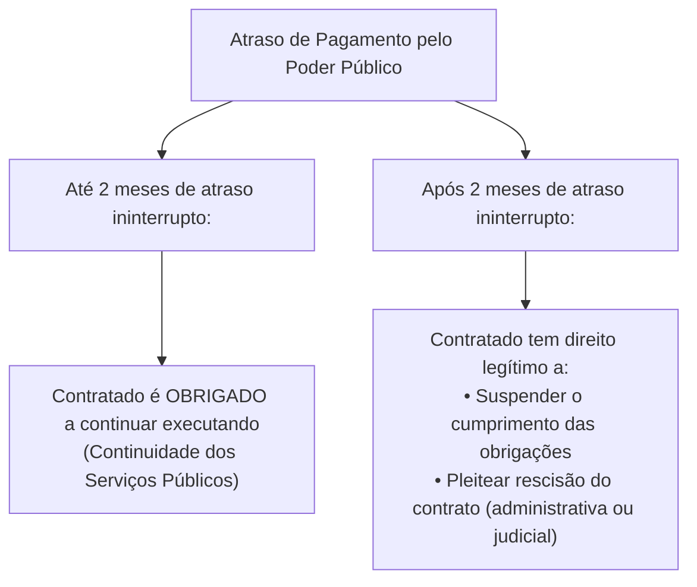
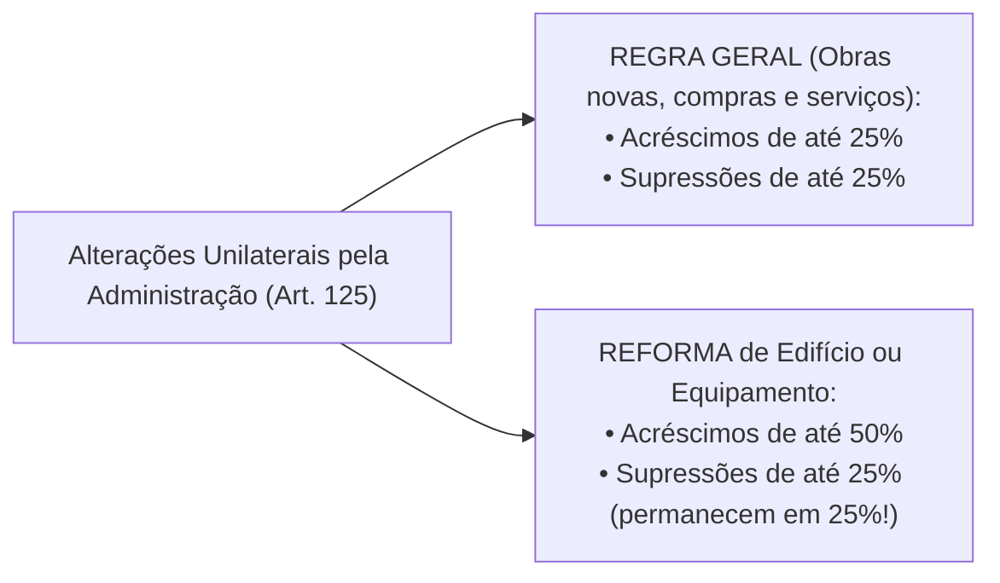

# 04 - Contratos Administrativos: Execução, Alterações, Equilíbrio e Sanções (Lei 14.133/2021)

> **Matéria:** Licitações e Contratos Administrativos  
> **Cargo:** A01 – Técnico de Controle Externo – Especialidade: Técnico Administrativo  
> **Arquivo:** `04_contratos_administrativos_fiscalizacao_alteracoes_e_sancoes.md`  
> **Status:** 🟢 Teoria Aprofundada + 5 Questões FCC Comentadas (A a E)

---

## 📌 Ementa Oficial do Edital
- Contratos administrativos: conceito, características, formalização e cláusulas exorbitantes.
- Garantias contratuais (caução, fiança bancária e seguro-garantia com cláusula de retomada / *step-in rights*).
- Duração dos contratos administrativos: prazos de vigência ordinários e contratações contínuas (até 5 anos, prorrogáveis até 10 anos).
- Gestão e fiscalização contratual: atribuições do gestor e fiscais (técnico, administrativo e setorial).
- Responsabilidade trabalhista da Administração Pública e Tema 246 do STF (ADC 16 - comprovação de culpa *in vigilando*).
- Recebimento provisório e definitivo do objeto.
- Alterações contratuais unilaterais e consensuais: limites de 25% e 50%.
- Equilíbrio econômico-financeiro: reajuste por índice, repactuação e revisão/reequilíbrio (*álea* extraordinária).
- Sanções administrativas: advertência, multa, impedimento de licitar e declaração de inidoneidade.
- Processo administrativo sancionador e reabilitação.

---

## 🧭 Sumário

1. [Conceito, Características e Cláusulas Exorbitantes dos Contratos Administrativos](#1-conceito-caracteristicas-e-clausulas-exorbitantes-dos-contratos-administrativos)
    1. [Características Fundamentais e Formalização](#11-caracteristicas-fundamentais-e-formalizacao)
    2. [Cláusulas Exorbitantes e Restrição à Exceção do Contrato Não Cumprido](#12-clausulas-exorbitantes-e-restricao-a-excecao-do-contrato-nao-cumprido)
    3. [Teste 099](#Teste-099)
2. [Garantias Contratuais e Seguro-Garantia com Cláusula de Retomada (Step-in Rights)](#2-garantias-contratuais-e-seguro-garantia-com-clausula-de-retomada-step-in-rights)
    1. [Teste 100](#Teste-100)
3. [Duração e Prorrogação dos Contratos Administrativos](#3-duracao-e-prorrogacao-dos-contratos-administrativos)
    1. [Serviços e Fornecimentos Contínuos (Regra 5 + 5 = Até 10 Anos)](#31-servicos-e-fornecimentos-continuos-regra-5-5-ate-10-anos)
    2. [Contratos por Escopo](#32-contratos-por-escopo)
    3. [Teste 101](#Teste-101)
4. [Gestão, Fiscalização e Responsabilidade Trabalhista do Estado](#4-gestao-fiscalizacao-e-responsabilidade-trabalhista-do-estado)
    1. [Estrutura de Gestão e Fiscalização Contratual](#41-estrutura-de-gestao-e-fiscalizacao-contratual)
    2. [Responsabilidade Trabalhista e Previdenciária: O Tema 246 do STF](#42-responsabilidade-trabalhista-e-previdenciaria-o-tema-246-do-stf)
    3. [Recebimento Provisório e Definitivo do Objeto](#43-recebimento-provisorio-e-definitivo-do-objeto)
    4. [Teste 102](#Teste-102)
    5. [Teste 103](#Teste-103)
5. [Alterações Contratuais e Manutenção do Equilíbrio Econômico-Financeiro](#5-alteracoes-contratuais-e-manutencao-do-equilibrio-economico-financeiro)
    1. [Alterações Unilaterais e Consensuais: Limites de 25% e 50%](#51-alteracoes-unilaterais-e-consensuais-limites-de-25-e-50)
    2. [Instrumentos de Recomposição: Reajuste, Repactuação e Revisão](#52-instrumentos-de-recomposicao-reajuste-repactuacao-e-revisao)
    3. [Teste 104](#Teste-104)
    4. [Teste 105](#Teste-105)
    5. [Teste 106](#Teste-106)
6. [Infrações, Sistema Sancionador e Processo de Reabilitação](#6-infracoes-sistema-sancionador-e-processo-de-reabilitacao)
    1. [Teste 107](#Teste-107)
    2. [Teste 108](#Teste-108)
    3. [Teste 109](#Teste-109)
7. [🌐 Fontes Recomendadas na Internet](#fontes-recomendadas-na-internet)

---

## 1. Conceito, Características e Cláusulas Exorbitantes dos Contratos Administrativos

O contrato administrativo é o ajuste bilateral de vontades celebrado entre a Administração Pública (atuando nessa qualidade revestida do regime de direito público) e o particular ou outra entidade pública, tendo por objetivo a consecução de uma utilidade de interesse público, sob condições reguladas pela legislação e pelo instrumento convocatório.

### 1.1 Características Fundamentais e Formalização
- **Consensual:** Aperfeiçoa-se com o consentimento mútuo manifestado na assinatura do ajuste, não dependendo da entrega física imediata da coisa para sua existência.
- **Formal:** A forma escrita é solene e obrigatória. O art. 95 da Lei nº 14.133/2021 estabelece que o instrumento de contrato é obrigatório, admitindo sua substituição por outros instrumentos hábeis (carta-contrato, nota de empenho de despesa, autorização de compra ou ordem de execução de serviço) apenas em dispensas de pequeno valor ou compras com entrega imediata e integral sem obrigações futuras. É nulo e de nenhum efeito o contrato verbal com a Administração, ressalvadas pequenas compras de pronto pagamento feitas em regime de adiantamento (suprimento de fundos) de valor irrisório.
- **Bilateral (ou Sinalagmático):** Gera direitos e obrigações recíprocas e interdependentes para ambas as partes.
- **Oneroso:** Impõe sacrifício patrimonial proporcional a ambas as partes contratantes.
- **Comutativo:** As prestações das partes são certas, conhecidas e tidas como equivalentes no momento da pactuação original.
- **Personalíssimo (*intuitu personae*):** Celebrado em função das qualidades subjetivas e habilitações demonstradas pelo licitante vencedor no certame, limitando-se a subcontratação às estritas balizas do edital e com prévia anuência da Administração.

### 1.2 Cláusulas Exorbitantes e Restrição à Exceção do Contrato Não Cumprido
As cláusulas exorbitantes (art. 104 da Lei nº 14.133/2021) conferem prerrogativas extraordinárias que extrapolam o direito privado comum, justificadas pela supremacia do interesse público sobre o privado:

1. **Modificação unilateral do contrato:** A Administração pode alterar qualitativa ou quantitativamente as cláusulas de serviço para melhor adequação técnica ao interesse público;
2. **Extinção unilateral do contrato:** Rescisão decorrente de inadimplemento do contratado ou por razões de interesse público de alta relevância;
3. **Fiscalização contínua da execução:** Acompanhamento técnico, administrativo e financeiro pelo Poder Público;
4. **Aplicação direta de sanções administrativas:** Imposição de sanções pelo próprio órgão contratante sem necessidade de intervenção prévia do Poder Judiciário;
5. **Ocupação provisória de bens e serviços:** Utilização de bens móveis, imóveis e pessoal do contratado necessários à continuidade de serviços públicos essenciais paralisados;
6. **Atenuação da *Exceptio Non Adimpleti Contractus* (Exceção do Contrato Não Cumprido):**
    - No direito civil comum, se um contratante deixa de pagar, o outro pode imediatamente paralisar suas atividades contratuais.
    - No regime jurídico-administrativo, em virtude do **princípio da continuidade do serviço público**, o contratado **não pode paralisar imediatamente** as obras ou serviços em caso de inadimplemento financeiro do Estado.
    - Pelo art. 137, § 2º, inciso IV, da Lei nº 14.133/2021, o particular é obrigado a continuar executando o contrato até o limite de **2 (dois) meses de atraso ininterrupto** nos pagamentos devidos pela Administração Pública. Somente após transcorridos 2 meses contínuos de inadimplemento é que assiste ao particular o direito de suspender a execução de suas obrigações ou requerer a extinção do contrato.

---

## 2. Garantias Contratuais e Seguro-Garantia com Cláusula de Retomada (Step-in Rights)

A critério da autoridade competente, em cada contratação a Administração pode exigir do contratado a prestação de garantia (art. 96). Caberá ao **contratado optar** por uma das seguintes modalidades:

1. **Caução em dinheiro ou em títulos da dívida pública;**
2. **Fiança bancária** emitida por banco ou instituição financeira autorizada pelo Banco Central;
3. **Seguro-garantia** emitido por seguradora autorizada pela SUSEP.

**Limites Ordinários de Garantia:**

- **Regra Geral:** O percentual de garantia contratual será de até **5% (cinco por cento)** do valor inicial do contrato (art. 98).
- **Contratos de Alta Complexidade Técnica ou Riscos Elevados:** A garantia pode ser fixada em até **10% (dez por cento)** do valor do contrato, desde que expressamente motivada na fase preparatória (art. 98, § 1º).

#### Seguro-Garantia com Cláusula de Retomada (*Step-in Rights* - Art. 102)
Para combater o problema crônico nacional de paralisação e abandono de obras públicas, a Nova Lei de Licitações introduziu uma inovação profunda inspirada no modelo norte-americano (*performance bond*):

- Em contratações de obras e serviços de engenharia de **grande vulto** (valor superior a R$ 200 milhões na edição da lei, atualizado anualmente), o edital pode prever a obrigatoriedade de seguro-garantia com previsão expressa de **cláusula de retomada** (*step-in rights*).
- Nessa modalidade, o valor da garantia pode alcançar até **30% (trinta por cento)** do valor inicial do contrato.
- **Funcionamento:** Em caso de inadimplemento, atraso grave ou abandono por parte da construtora, a seguradora é notificada para intervir diretamente. A seguradora assume a administração do canteiro de obras e conclui a execução do objeto contratado, diretamente ou mediante subcontratação de terceiros idôneos aprovados pelo Poder Público.
- Concluída a obra pela seguradora, ela fica liberada da obrigação de pagar a indenização em dinheiro correspondente à apólice.

---

## 3. Duração e Prorrogação dos Contratos Administrativos

A regra orçamentária tradicional vinculava a vigência contratual aos créditos orçamentários do respectivo exercício financeiro (regra do ano civil). A Lei nº 14.133/2021 flexibilizou essa sistemática com regras modernas de planejamento (arts. 105 a 114):

### 3.1 Serviços e Fornecimentos Contínuos (Regra 5 + 5 = Até 10 Anos)
O art. 106 da NLLC estabelece uma revolução para os contratos de serviços e fornecimentos contínuos (limpeza, vigilância, suporte de TI, manutenção predial, locação de equipamentos):

- Podem ser celebrados com prazo de vigência inicial de **até 5 (cinco) anos**.
- A Administração pode prorrogar sucessivamente a contratação até o limite máximo total de **10 (dez) anos**, desde que comprovada documentalmente a vantajosidade econômica das condições e a manutenção da qualidade da execução.
- Permite amortização mais eficiente de investimentos e redução substantiva dos custos de transação causados por licitações repetitivas anuais.

### 3.2 Contratos por Escopo
- Nos contratos cujo objeto é a entrega de um produto ou realização de obra certa e predeterminada (contratos por escopo predeterminado), o prazo de vigência original deve corresponder ao cronograma de execução física.
- Conforme o art. 111, o prazo de vigência será **automaticamente prorrogado** quando o seu objeto não for concluído no período inicialmente firmado por razões imputáveis à Administração ou por fatos supervenientes de caso fortuito/força maior, assegurando-se a conclusão da obra e a apuração de responsabilidades caso o atraso decorra de culpa exclusiva do contratado.

---

### Teste 001
**(FGV – TCE/GO – 2024 – Analista de Controle Externo - Controle Externo)**
Dos atos da Administração decorrentes da aplicação da Lei nº 14.133/2021 é cabível a manifestação de irresignação do interessado na esfera administrativa, na forma e prazos estabelecidos na mencionada norma, sendo correto afirmar que o pedido de reconsideração é pertinente na hipótese de

* **A)** julgamento das propostas.
* **B)** anulação ou revogação da licitação.
* **C)** ato de habilitação ou inabilitação de licitante.
* **D)** extinção do contrato, quando determinada por ato unilateral da Administração.
* **E)** aplicação da penalidade de declaração de inidoneidade para licitar ou contratar com a Administração Pública.

---

> **Comentário Detalhado:**
>
> - **A)** **Incorreta.** A opção apresenta proposição em desacordo com os fundamentos teóricos e técnicos do tópico ao afirmar que "julgamento das propostas". De acordo com a teoria estudada em *1.1 Características Fundamentais e Formalização*, formal: A forma escrita é solene e obrigatória. O art. 95 da Lei nº 14.133/2021 estabelece que o instrumento de contrato é obrigatório, admitindo sua substituição por outros instrumentos hábeis (carta contrato, nota de empenho de despesa, autorização de compra ou ordem de execução de serviço) apenas em dispensas de pequeno valor ou compras com entrega imediata e integral sem obrigações futuras. É nulo e de nenhum efeito o contrato verbal com a Administração, ressalvadas pequenas compras de pronto pagamento feitas em regime de adiantamento (suprimento de fundos) de valor irrisório.
> - **B)** **Incorreta.** A opção apresenta proposição em desacordo com os fundamentos teóricos e técnicos do tópico ao afirmar que "anulação ou revogação da licitação". De acordo com a teoria estudada em *6. Infrações, Sistema Sancionador e Processo de Reabilitação*, a declaração de inidoneidade da NLLC inovou ao fixar prazo mínimo de 3 anos e máximo de 6 anos, estabelecendo eficácia extensiva nacional compulsória. Sua aplicação é ato privativo da autoridade superior (Secretário ou Ministro), exigindo instrução técnica e parecer jurídico vinculante.
> - **C)** **Correta.** Conforme fundamentado na seção *6. Infrações, Sistema Sancionador e Processo de Reabilitação* deste guia, o cometimento de infrações administrativas elencadas no art. 155 da Lei nº 14.133/2021 (dar causa à inexecução parcial ou total, fraudar a licitação, praticar ato ilícito com vistas a frustrar os objetivos do certame, comportar se de modo inidôneo) sujeita o licitante ou contratado a quatro sanções administrativas (art. 156). Dessa forma, está plenamente correta a assertiva da banca (FGV – TCE/GO/2024) ao estabelecer que "ato de habilitação ou inabilitação de licitante".
> - **D)** **Incorreta.** A opção apresenta proposição em desacordo com os fundamentos teóricos e técnicos do tópico ao afirmar que "extinção do contrato, quando determinada por ato unilateral da Administração". De acordo com a teoria estudada em *1.2 Cláusulas Exorbitantes e Restrição à Exceção do Contrato Não Cumprido*, pelo art. 137, § 2º, inciso IV, da Lei nº 14.133/2021, o particular é obrigado a continuar executando o contrato até o limite de 2 (dois) meses de atraso ininterrupto nos pagamentos devidos pela Administração Pública. Somente após transcorridos 2 meses contínuos de inadimplemento é que assiste ao particular o direito de suspender a execução de suas obrigações ou requerer a extinção do contrato.
> - **E)** **Incorreta.** A opção apresenta proposição em desacordo com os fundamentos teóricos e técnicos do tópico ao afirmar que "aplicação da penalidade de declaração de inidoneidade para licitar ou contratar com a Administração Pública". De acordo com a teoria estudada em *6. Infrações, Sistema Sancionador e Processo de Reabilitação*, transcurso do prazo mínimo de 1 ano da aplicação de impedimento de licitar ou 3 anos da declaração de inidoneidade.
>
> **Gabarito: C**

---

### Teste 002
**(FGV – TCE/GO – 2024 – Analista de Controle Externo - Jurídica)**
A jurisdição é a atividade estatal de solução de conflitos de interesse e tutela de direitos. Ao lado da ação e do processo, a jurisdição constitui o tripé fundamental da teoria geral do processo. Sobre os princípios aplicáveis à jurisdição, assinale a afirmativa correta.

* **A)** O princípio da inevitabilidade aduz que ao juiz não é dado deixar de julgar, ainda que haja lacuna ou obscuridade no ordenamento jurídico.
* **B)** A improrrogabilidade é absolutamente incompatível com a prorrogação da competência, ainda que se trate de competência relativa.
* **C)** A indelegabilidade veda peremptoriamente a delegação de atos de instrução a outros juízes, como é o caso das cartas de ordem e precatórias instrutórias, as quais são inadmissíveis.
* **D)** A investidura dispõe que o juiz deva ser aprovado em concurso público de provas e títulos, motivo pelo qual os membros de tribunais indicados pelo quinto constitucional não possuem investidura.
* **E)** O princípio do juiz natural assevera que as regras de competência devem ser prévia e abstratamente definidas, vedando-se a designação de juízos ad hoc. Direito Previdenciário

---

> **Comentário Detalhado:**
>
> - **A)** **Incorreta.** A opção apresenta proposição em desacordo com os fundamentos teóricos e técnicos do tópico ao afirmar que "O princípio da inevitabilidade aduz que ao juiz não é dado deixar de julgar, ainda que haja lacuna ou obscuridade...". De acordo com a teoria estudada em *1.2 Cláusulas Exorbitantes e Restrição à Exceção do Contrato Não Cumprido*, no regime jurídico administrativo, em virtude do princípio da continuidade do serviço público, o contratado não pode paralisar imediatamente as obras ou serviços em caso de inadimplemento financeiro do Estado.
> - **B)** **Incorreta.** A opção apresenta proposição em desacordo com os fundamentos teóricos e técnicos do tópico ao afirmar que "A improrrogabilidade é absolutamente incompatível com a prorrogação da competência, ainda que se trate de...". De acordo com a teoria estudada em *3. Duração e Prorrogação dos Contratos Administrativos*, a regra orçamentária tradicional vinculava a vigência contratual aos créditos orçamentários do respectivo exercício financeiro (regra do ano civil). A Lei nº 14.133/2021 flexibilizou essa sistemática com regras modernas de planejamento (arts. 105 a 114).
> - **C)** **Incorreta.** A opção apresenta vedação ou negativa absoluta incompatível com a regra aplicável ao afirmar que "A indelegabilidade veda peremptoriamente a delegação de atos de instrução a outros juízes, como é o caso das...". De acordo com a teoria estudada em *1.1 Características Fundamentais e Formalização*, formal: A forma escrita é solene e obrigatória. O art. 95 da Lei nº 14.133/2021 estabelece que o instrumento de contrato é obrigatório, admitindo sua substituição por outros instrumentos hábeis (carta contrato, nota de empenho de despesa, autorização de compra ou ordem de execução de serviço) apenas em dispensas de pequeno valor ou compras com entrega imediata e integral sem obrigações futuras. É nulo e de nenhum efeito o contrato verbal com a Administração, ressalvadas pequenas compras de pronto pagamento feitas em regime de adiantamento (suprimento de fundos) de valor irrisório.
> - **D)** **Incorreta.** A opção apresenta proposição em desacordo com os fundamentos teóricos e técnicos do tópico ao afirmar que "A investidura dispõe que o juiz deva ser aprovado em concurso público de provas e títulos, motivo pelo qual os...". De acordo com a teoria estudada em *2. Garantias Contratuais e Seguro-Garantia com Cláusula de Retomada (Step-in Rights)*, caução em dinheiro ou em títulos da dívida pública.
> - **E)** **Correta.** Conforme fundamentado na seção *4.1 Estrutura de Gestão e Fiscalização Contratual* deste guia, a execução do contrato deve ser acompanhada e fiscalizada permanentemente por um ou mais fiscais do contrato, auxiliados por gestores, atendendo ao princípio da segregação de funções (art. 117). Dessa forma, está plenamente correta a assertiva da banca (FGV – TCE/GO/2024) ao estabelecer que "O princípio do juiz natural assevera que as regras de competência devem ser prévia e abstratamente definidas...".
>
> **Gabarito: E**

---

### Teste 003
**(CEBRASPE – STJ – 2015 – Analista Judiciario Suporte Em Tecnologia Da Informacao)**
A nulidade de contrato administrativo por ausência prévia de licitação gera, para o contratado de boa-fé, direito a indenização pelos serviços por ele prestados.

* **C)** Certo
* **E)** Errado

---

> **Comentário Detalhado:**
>
> - **C)** **Incorreta.** A proposição apresenta proposição em desacordo com os fundamentos teóricos e técnicos do tópico ao afirmar que "A nulidade de contrato administrativo por ausência prévia de licitação gera, para o contratado de boa fé...". De acordo com a teoria em *1.2 Cláusulas Exorbitantes e Restrição à Exceção do Contrato Não Cumprido*, no regime jurídico administrativo, em virtude do princípio da continuidade do serviço público, o contratado não pode paralisar imediatamente as obras ou serviços em caso de inadimplemento financeiro do Estado.
> - **E)** **Correta.** O item está **Errado** (gabarito oficial: **E**), pois contraria a disciplina teórica aplicável.
>
> **Gabarito: E**

---

### Teste 004
**(FCC – TRT 16ª – 2014 – Analista Judiciário - Tecnologia da Informação)**
A empresa “Zinco S.A.” atrasou injustificadamente a execução de contrato administrativo celebrado com o

* **A)** 36.
* **B)** 54.
* **C)** 58.
* **D)** 56.
* **E)** 48

---

> **Comentário Detalhado:**
>
> - **A)** **Incorreta.** A opção apresenta proposição em desacordo com os fundamentos teóricos e técnicos do tópico ao afirmar que "36". De acordo com a teoria estudada em *1.2 Cláusulas Exorbitantes e Restrição à Exceção do Contrato Não Cumprido*, fiscalização contínua da execução: Acompanhamento técnico, administrativo e financeiro pelo Poder Público.
> - **B)** **Incorreta.** A opção apresenta proposição em desacordo com os fundamentos teóricos e técnicos do tópico ao afirmar que "54". De acordo com a teoria estudada em *1.2 Cláusulas Exorbitantes e Restrição à Exceção do Contrato Não Cumprido*, no regime jurídico administrativo, em virtude do princípio da continuidade do serviço público, o contratado não pode paralisar imediatamente as obras ou serviços em caso de inadimplemento financeiro do Estado.
> - **C)** **Correta.** Conforme fundamentado na seção *1. Conceito, Características e Cláusulas Exorbitantes dos Contratos Administrativos* deste guia, o contrato administrativo é o ajuste bilateral de vontades celebrado entre a Administração Pública (atuando nessa qualidade revestida do regime de direito público) e o particular ou outra entidade pública, tendo por objetivo a consecução de uma utilidade de interesse público, sob condições reguladas pela legislação e pelo instrumento convocatório. Dessa forma, está plenamente correta a assertiva da banca (FCC – TRT 16ª/2014) ao estabelecer que "58".
> - **D)** **Incorreta.** A opção apresenta proposição em desacordo com os fundamentos teóricos e técnicos do tópico ao afirmar que "56". De acordo com a teoria estudada em *3.1 Serviços e Fornecimentos Contínuos (Regra 5 + 5 = Até 10 Anos)*, a Administração pode prorrogar sucessivamente a contratação até o limite máximo total de 10 (dez) anos, desde que comprovada documentalmente a vantajosidade econômica das condições e a manutenção da qualidade da execução.
> - **E)** **Incorreta.** A opção apresenta proposição em desacordo com os fundamentos teóricos e técnicos do tópico ao afirmar que "48". De acordo com a teoria estudada em *3.2 Contratos por Escopo*, nos contratos cujo objeto é a entrega de um produto ou realização de obra certa e predeterminada (contratos por escopo predeterminado), o prazo de vigência original deve corresponder ao cronograma de execução física.
>
> **Gabarito: C**

---

### Teste 005
**(FCC – TRT 3ª – 2015 – Analista Judiciário - Tecnologia da Informação)**
É competente para uniformizar a jurisprudência do Tribunal e para fixar a data da abertura de concurso para provimento de Cargos de Juiz do Trabalho Substituto o

* **A)** Tribunal Pleno e o Presidente do Tribunal, respectivamente.
* **B)** Presidente do Tribunal e o Vice-Presidente do Tribunal, respectivamente.
* **C)** Tribunal Pleno.
* **D)** Presidente do Tribunal.
* **E)** Vice-Presidente do Tribunal.

---

> **Comentário Detalhado:**
>
> - **A)** **Incorreta.** A opção apresenta proposição em desacordo com os fundamentos teóricos e técnicos do tópico ao afirmar que "Tribunal Pleno e o Presidente do Tribunal, respectivamente". De acordo com a teoria estudada em *5.2 Instrumentos de Recomposição: Reajuste, Repactuação e Revisão*, repactuação: Serviços contínuos com dedicação exclusiva de mão de obra — 1 ano (interregno mínimo) — Demonstração analítica da variação de custos decorrente de nova Convenção Coletiva de Trabalho (CCT) ou Dissídio Coletivo.
> - **B)** **Incorreta.** A opção apresenta proposição em desacordo com os fundamentos teóricos e técnicos do tópico ao afirmar que "Presidente do Tribunal e o Vice Presidente do Tribunal, respectivamente". De acordo com a teoria estudada em *6. Infrações, Sistema Sancionador e Processo de Reabilitação*, a declaração de inidoneidade da NLLC inovou ao fixar prazo mínimo de 3 anos e máximo de 6 anos, estabelecendo eficácia extensiva nacional compulsória. Sua aplicação é ato privativo da autoridade superior (Secretário ou Ministro), exigindo instrução técnica e parecer jurídico vinculante.
> - **C)** **Correta.** Conforme fundamentado na seção *4.2 Responsabilidade Trabalhista e Previdenciária: O Tema 246 do STF* deste guia, a responsabilidade do Estado perante terceiros na terceirização de serviços é tema de alta incidência na jurisprudência e concursos. Dessa forma, está plenamente correta a assertiva da banca (FCC – TRT 3ª/2015) ao estabelecer que "Tribunal Pleno".
> - **D)** **Incorreta.** A opção apresenta proposição em desacordo com os fundamentos teóricos e técnicos do tópico ao afirmar que "Presidente do Tribunal". De acordo com a teoria estudada em *2. Garantias Contratuais e Seguro-Garantia com Cláusula de Retomada (Step-in Rights)*, a critério da autoridade competente, em cada contratação a Administração pode exigir do contratado a prestação de garantia (art. 96). Caberá ao contratado optar por uma das seguintes modalidades.
> - **E)** **Incorreta.** A opção apresenta proposição em desacordo com os fundamentos teóricos e técnicos do tópico ao afirmar que "Vice Presidente do Tribunal". De acordo com a teoria estudada em *4.3 Recebimento Provisório e Definitivo do Objeto*, recebimento Definitivo: Realizado por servidor ou comissão designada pela autoridade competente, mediante termo circunstanciado que comprove a perfeita adequação do objeto aos termos contratuais e técnicos.
>
> **Gabarito: C**

---

### Teste 006
**(FGV – TCE/PA – 2024 – Auditor de Controle Externo - Administrativa - Administração)**
A Lei nº 14.133/2021, conhecida como a Nova Lei de Licitações e Contratos, atualiza significativamente a regulação dos processos licitatórios e contratações públicas no Brasil, substituindo a antiga Lei nº 8.666/1993. Assinale a opção que não se subordina ao regime da Lei nº 14.133/2021.

* **A)** Compra por encomenda.
* **B)** Contratação de agente financeiro.
* **C)** Prestação de serviços técnico-profissionais especializados.
* **D)** Concessão de direito real de uso de bens.
* **E)** Concessão e permissão de uso de bens públicos.

---

> **Comentário Detalhado:**
>
> - **A)** **Incorreta.** A opção apresenta proposição em desacordo com os fundamentos teóricos e técnicos do tópico ao afirmar que "Compra por encomenda". De acordo com a teoria estudada em *1.1 Características Fundamentais e Formalização*, formal: A forma escrita é solene e obrigatória. O art. 95 da Lei nº 14.133/2021 estabelece que o instrumento de contrato é obrigatório, admitindo sua substituição por outros instrumentos hábeis (carta contrato, nota de empenho de despesa, autorização de compra ou ordem de execução de serviço) apenas em dispensas de pequeno valor ou compras com entrega imediata e integral sem obrigações futuras. É nulo e de nenhum efeito o contrato verbal com a Administração, ressalvadas pequenas compras de pronto pagamento feitas em regime de adiantamento (suprimento de fundos) de valor irrisório.
> - **B)** **Correta.** Conforme fundamentado na seção *3. Duração e Prorrogação dos Contratos Administrativos* deste guia, a regra orçamentária tradicional vinculava a vigência contratual aos créditos orçamentários do respectivo exercício financeiro (regra do ano civil). A Lei nº 14.133/2021 flexibilizou essa sistemática com regras modernas de planejamento (arts. 105 a 114). Dessa forma, está plenamente correta a assertiva da banca (FGV – TCE/PA/2024) ao estabelecer que "Contratação de agente financeiro".
> - **C)** **Incorreta.** A opção apresenta proposição em desacordo com os fundamentos teóricos e técnicos do tópico ao afirmar que "Prestação de serviços técnico profissionais especializados". De acordo com a teoria estudada em *2. Garantias Contratuais e Seguro-Garantia com Cláusula de Retomada (Step-in Rights)*, a critério da autoridade competente, em cada contratação a Administração pode exigir do contratado a prestação de garantia (art. 96). Caberá ao contratado optar por uma das seguintes modalidades.
> - **D)** **Incorreta.** A opção apresenta proposição em desacordo com os fundamentos teóricos e técnicos do tópico ao afirmar que "Concessão de direito real de uso de bens". De acordo com a teoria estudada em *1.2 Cláusulas Exorbitantes e Restrição à Exceção do Contrato Não Cumprido*, as cláusulas exorbitantes (art. 104 da Lei nº 14.133/2021) conferem prerrogativas extraordinárias que extrapolam o direito privado comum, justificadas pela supremacia do interesse público sobre o privado.
> - **E)** **Incorreta.** A opção apresenta proposição em desacordo com os fundamentos teóricos e técnicos do tópico ao afirmar que "Concessão e permissão de uso de bens públicos". De acordo com a teoria estudada em *1.2 Cláusulas Exorbitantes e Restrição à Exceção do Contrato Não Cumprido*, ocupação provisória de bens e serviços: Utilização de bens móveis, imóveis e pessoal do contratado necessários à continuidade de serviços públicos essenciais paralisados.
>
> **Gabarito: B**

---

### Teste 007
**(FGV – TCE/PA – 2024 – Auditor de Controle Externo - Administrativa - Administração)**
A Lei nº 14.133/2021, conhecida como a Nova Lei de Licitações e Contratos Administrativos, estabelece normas rigorosas para a prevenção e combate à corrupção, impondo maior responsabilização aos gestores públicos e fornecedores. O superfaturamento ocorre quando há um dano provocado ao patrimônio da Administração. Com relação à caracterização do superfaturamento, avalie se as afirmativas a seguir são verdadeiras (V) ou falsas (F). ( ) Medição de quantidades superiores às efetivamente empenhadas. ( ) Alterações no orçamento de obras e de serviços de engenharia que causem desequilíbrio econômico-financeiro do contrato em favor do contratado. ( ) Outras alterações de cláusulas financeiras que gerem reajuste irregular de preços. As afirmativas são, respectivamente,

* **A)** F – V – F.
* **B)** F – V – V.
* **C)** V – F – F.
* **D)** V – V – F.
* **E)** V – F – V. Realização

---

> **Comentário Detalhado:**
>
> - **A)** **Incorreta.** A opção apresenta proposição em desacordo com os fundamentos teóricos e técnicos do tópico ao afirmar que "F – V – F". De acordo com a teoria estudada em *5.2 Instrumentos de Recomposição: Reajuste, Repactuação e Revisão*, a garantia da equação econômico financeira original é direito fundamental do contratado previsto no art. 37, XXI, da CF/88. A Lei nº 14.133/2021 distingue com clareza três institutos.
> - **B)** **Correta.** Conforme fundamentado na seção *3. Duração e Prorrogação dos Contratos Administrativos* deste guia, a regra orçamentária tradicional vinculava a vigência contratual aos créditos orçamentários do respectivo exercício financeiro (regra do ano civil). A Lei nº 14.133/2021 flexibilizou essa sistemática com regras modernas de planejamento (arts. 105 a 114). Dessa forma, está plenamente correta a assertiva da banca (FGV – TCE/PA/2024) ao estabelecer que "F – V – V".
> - **C)** **Incorreta.** A opção apresenta proposição em desacordo com os fundamentos teóricos e técnicos do tópico ao afirmar que "V – F – F". De acordo com a teoria estudada em *1.1 Características Fundamentais e Formalização*, formal: A forma escrita é solene e obrigatória. O art. 95 da Lei nº 14.133/2021 estabelece que o instrumento de contrato é obrigatório, admitindo sua substituição por outros instrumentos hábeis (carta contrato, nota de empenho de despesa, autorização de compra ou ordem de execução de serviço) apenas em dispensas de pequeno valor ou compras com entrega imediata e integral sem obrigações futuras. É nulo e de nenhum efeito o contrato verbal com a Administração, ressalvadas pequenas compras de pronto pagamento feitas em regime de adiantamento (suprimento de fundos) de valor irrisório.
> - **D)** **Incorreta.** A opção apresenta proposição em desacordo com os fundamentos teóricos e técnicos do tópico ao afirmar que "V – V – F". De acordo com a teoria estudada em *1.2 Cláusulas Exorbitantes e Restrição à Exceção do Contrato Não Cumprido*, pelo art. 137, § 2º, inciso IV, da Lei nº 14.133/2021, o particular é obrigado a continuar executando o contrato até o limite de 2 (dois) meses de atraso ininterrupto nos pagamentos devidos pela Administração Pública. Somente após transcorridos 2 meses contínuos de inadimplemento é que assiste ao particular o direito de suspender a execução de suas obrigações ou requerer a extinção do contrato.
> - **E)** **Incorreta.** A opção apresenta proposição em desacordo com os fundamentos teóricos e técnicos do tópico ao afirmar que "V – F – V. Realização". De acordo com a teoria estudada em *3.2 Contratos por Escopo*, nos contratos cujo objeto é a entrega de um produto ou realização de obra certa e predeterminada (contratos por escopo predeterminado), o prazo de vigência original deve corresponder ao cronograma de execução física.
>
> **Gabarito: B**

---

### Teste 008
**(FGV – TCE/PA – 2024 – Auditor de Controle Externo - Administrativa - Ciência de Dados)**
Os candidatos de um concurso público realizaram um teste de redação que vale até 1000 pontos. 5000 candidatos realizaram o teste, o que gerou uma distribuição das notas cuja média foi de 600 pontos e cujo desvio padrão foi de 90 pontos. Dessa distribuição são retiradas 40 novas amostras, com 100 notas em cada amostra, sem reposição. 100 Dados: √4999=70,7; =0,99 101 O desvio-padrão da distribuição das 40 médias obtidas a partir das novas amostras (de 100 notas) retiradas é igual a

* **A)** 8,91.
* **B)** 9.
* **C)** 60.
* **D)** 89,1.
* **E)** 90.

---

> **Comentário Detalhado:**
>
> - **A)** **Correta.** Conforme fundamentado na seção *3.2 Contratos por Escopo* deste guia, nos contratos cujo objeto é a entrega de um produto ou realização de obra certa e predeterminada (contratos por escopo predeterminado), o prazo de vigência original deve corresponder ao cronograma de execução física. Dessa forma, está plenamente correta a assertiva da banca (FGV – TCE/PA/2024) ao estabelecer que "8,91".
> - **B)** **Incorreta.** A opção apresenta proposição em desacordo com os fundamentos teóricos e técnicos do tópico ao afirmar que "9". De acordo com a teoria estudada em *4.2 Responsabilidade Trabalhista e Previdenciária: O Tema 246 do STF*, o encargo probatório dessa conduta omissiva recai sobre o trabalhador reclamante, sendo vedada presunção automática de culpa contra a Fazenda Pública.
> - **C)** **Incorreta.** A opção apresenta proposição em desacordo com os fundamentos teóricos e técnicos do tópico ao afirmar que "60". De acordo com a teoria estudada em *5.1 Alterações Unilaterais e Consensuais: Limites de 25% e 50%*, aLT["Alterações Unilaterais pela Administração (Art. 125)"] REG["REGRA GERAL (Obras novas, compras e serviços):<br/ • Acréscimos de até 25%<br/ • Supressões de até 25%"].
> - **D)** **Incorreta.** A opção apresenta proposição em desacordo com os fundamentos teóricos e técnicos do tópico ao afirmar que "89,1". De acordo com a teoria estudada em *5.1 Alterações Unilaterais e Consensuais: Limites de 25% e 50%*, o limite ampliado de até 50% é exclusivo para acréscimos em reformas de edifícios ou de equipamentos. Obras novas ou ampliações submetem se ao teto de 25%.
> - **E)** **Incorreta.** A opção apresenta proposição em desacordo com os fundamentos teóricos e técnicos do tópico ao afirmar que "90". De acordo com a teoria estudada em *3. Duração e Prorrogação dos Contratos Administrativos*, a regra orçamentária tradicional vinculava a vigência contratual aos créditos orçamentários do respectivo exercício financeiro (regra do ano civil). A Lei nº 14.133/2021 flexibilizou essa sistemática com regras modernas de planejamento (arts. 105 a 114).
>
> **Gabarito: A**

---

### Teste 009
**(FGV – TCE/SC – 2026 – Auditor Fiscal de Controle Externo - Ciências Contábeis)**
De acordo com a Lei de Responsabilidade Fiscal, existem instrumentos de transparência da gestão fiscal, aos quais é dada ampla divulgação. A transparência é assegurada, também, mediante incentivo à participação popular e à realização de audiências públicas, durante os processos de elaboração e discussão de

* **A)** controle da inflação e desenvolvimento da política monetária nacional.
* **B)** critérios e determinações para provimento de vagas em concursos públicos.
* **C)** nomeações de gestores públicos.
* **D)** incidência tributária e isenções sobre diferentes setores.
* **E)** planos, lei de diretrizes orçamentárias e orçamentos.

---

> **Comentário Detalhado:**
>
> - **A)** **Incorreta.** A opção apresenta proposição em desacordo com os fundamentos teóricos e técnicos do tópico ao afirmar que "controle da inflação e desenvolvimento da política monetária nacional". De acordo com a teoria estudada em *1.1 Características Fundamentais e Formalização*, formal: A forma escrita é solene e obrigatória. O art. 95 da Lei nº 14.133/2021 estabelece que o instrumento de contrato é obrigatório, admitindo sua substituição por outros instrumentos hábeis (carta contrato, nota de empenho de despesa, autorização de compra ou ordem de execução de serviço) apenas em dispensas de pequeno valor ou compras com entrega imediata e integral sem obrigações futuras. É nulo e de nenhum efeito o contrato verbal com a Administração, ressalvadas pequenas compras de pronto pagamento feitas em regime de adiantamento (suprimento de fundos) de valor irrisório.
> - **B)** **Incorreta.** A opção apresenta proposição em desacordo com os fundamentos teóricos e técnicos do tópico ao afirmar que "critérios e determinações para provimento de vagas em concursos públicos". De acordo com a teoria estudada em *4.2 Responsabilidade Trabalhista e Previdenciária: O Tema 246 do STF*, a responsabilidade do Estado perante terceiros na terceirização de serviços é tema de alta incidência na jurisprudência e concursos.
> - **C)** **Incorreta.** A opção apresenta proposição em desacordo com os fundamentos teóricos e técnicos do tópico ao afirmar que "nomeações de gestores públicos". De acordo com a teoria estudada em *4.1 Estrutura de Gestão e Fiscalização Contratual*, a execução do contrato deve ser acompanhada e fiscalizada permanentemente por um ou mais fiscais do contrato, auxiliados por gestores, atendendo ao princípio da segregação de funções (art. 117).
> - **D)** **Incorreta.** A opção apresenta proposição em desacordo com os fundamentos teóricos e técnicos do tópico ao afirmar que "incidência tributária e isenções sobre diferentes setores". De acordo com a teoria estudada em *5.2 Instrumentos de Recomposição: Reajuste, Repactuação e Revisão*, a garantia da equação econômico financeira original é direito fundamental do contratado previsto no art. 37, XXI, da CF/88. A Lei nº 14.133/2021 distingue com clareza três institutos.
> - **E)** **Correta.** Conforme fundamentado na seção *Seguro-Garantia com Cláusula de Retomada (Step-in Rights - Art. 102)* deste guia, para combater o problema crônico nacional de paralisação e abandono de obras públicas, a Nova Lei de Licitações introduziu uma inovação profunda inspirada no modelo norte americano ( performance bond ). Dessa forma, está plenamente correta a assertiva da banca (FGV – TCE/SC/2026) ao estabelecer que "planos, lei de diretrizes orçamentárias e orçamentos".
>
> **Gabarito: E**

---

### Teste 010
**(FGV – TRT/DA – 2025 – Tecnico Judiciario Area Administrativa Agente Da Policia Judicial)**
João, servidor público federal estável, foi aprovado em concurso público de provas e títulos para outro cargo público da Administração Pública direta da União. Após ser exonerado do primeiro cargo, tomou posse do segundo. No entanto, foi considerado inabilitado no estágio probatório relativo a este último cargo. Na situação descrita, é correto afirmar que João deve ser

* **A)** reconduzido ao cargo de origem, mas, caso esteja provido, ter- se-á o seu aproveitamento em cargo diverso.
* **B)** reintegrado ao cargo de origem, ou posto em disponibilidade, caso o cargo esteja provido.
* **C)** posto em disponibilidade até integralizar o tempo necessário para a aposentadoria.
* **D)** revertido para o cargo de origem, quer esteja vago, quer esteja provido.
* **E)** exonerado.

---

> **Comentário Detalhado:**
>
> - **A)** **Correta.** Conforme fundamentado na seção *3.2 Contratos por Escopo* deste guia, conforme o art. 111, o prazo de vigência será automaticamente prorrogado quando o seu objeto não for concluído no período inicialmente firmado por razões imputáveis à Administração ou por fatos supervenientes de caso fortuito/força maior, assegurando se a conclusão da obra e a apuração de responsabilidades caso o atraso decorra de culpa exclusiva do contratado. Dessa forma, está plenamente correta a assertiva da banca (FGV – TRT/DA/2025) ao estabelecer que "reconduzido ao cargo de origem, mas, caso esteja provido, ter se á o seu aproveitamento em cargo diverso".
> - **B)** **Incorreta.** A opção apresenta proposição em desacordo com os fundamentos teóricos e técnicos do tópico ao afirmar que "reintegrado ao cargo de origem, ou posto em disponibilidade, caso o cargo esteja provido". De acordo com a teoria estudada em *Seguro-Garantia com Cláusula de Retomada (Step-in Rights - Art. 102)*, funcionamento: Em caso de inadimplemento, atraso grave ou abandono por parte da construtora, a seguradora é notificada para intervir diretamente. A seguradora assume a administração do canteiro de obras e conclui a execução do objeto contratado, diretamente ou mediante subcontratação de terceiros idôneos aprovados pelo Poder Público.
> - **C)** **Incorreta.** A opção apresenta proposição em desacordo com os fundamentos teóricos e técnicos do tópico ao afirmar que "posto em disponibilidade até integralizar o tempo necessário para a aposentadoria". De acordo com a teoria estudada em *5.2 Instrumentos de Recomposição: Reajuste, Repactuação e Revisão*, revisão (Reequilíbrio em Sentido Estrito): Fatos imprevisíveis, caso fortuito, força maior, fato do príncipe ou fato da administração (álea extraordinária) — A qualquer tempo (não exige interregno anual) — Teoria da Imprevisão; recomposição integral da margem econômica desequilibrada por evento extraordinário e extracontratual.
> - **D)** **Incorreta.** A opção apresenta proposição em desacordo com os fundamentos teóricos e técnicos do tópico ao afirmar que "revertido para o cargo de origem, quer esteja vago, quer esteja provido". De acordo com a teoria estudada em *6. Infrações, Sistema Sancionador e Processo de Reabilitação*, declaração de Inidoneidade: De 3 (três) a 6 (seis) anos — Toda a Administração Pública direta e indireta de todos os entes federativos do país (União, Estados, DF e Municípios) — Ministro de Estado, Secretário de Estado ou Secretário Municipal.
> - **E)** **Incorreta.** A opção apresenta proposição em desacordo com os fundamentos teóricos e técnicos do tópico ao afirmar que "exonerado". De acordo com a teoria estudada em *1.2 Cláusulas Exorbitantes e Restrição à Exceção do Contrato Não Cumprido*, no regime jurídico administrativo, em virtude do princípio da continuidade do serviço público, o contratado não pode paralisar imediatamente as obras ou serviços em caso de inadimplemento financeiro do Estado.
>
> **Gabarito: A**

---

## 4. Gestão, Fiscalização e Responsabilidade Trabalhista do Estado

### 4.1 Estrutura de Gestão e Fiscalização Contratual
A execução do contrato deve ser acompanhada e fiscalizada permanentemente por um ou mais fiscais do contrato, auxiliados por gestores, atendendo ao princípio da segregação de funções (art. 117):

- **Gestor do Contrato:** Servidor responsável pela coordenação global dos atos administrativos, prorrogações, reajustes e controle financeiro macro.
- **Fiscal Técnico:** Servidor responsável pelo acompanhamento prático, rotineiro e presencial da conformidade dos serviços e obras executados em relação às especificações do projeto.
- **Fiscal Administrativo:** Servidor responsável pela fiscalização da documentação fiscal, previdenciária e trabalhista da mão de obra terceirizada.
- **Fiscal Setorial / do Público Usuário:** Servidores designados em unidades descentralizadas ou comissões de usuários para atestar a efetiva entrega dos bens ou serviços.

### 4.2 Responsabilidade Trabalhista e Previdenciária: O Tema 246 do STF
A responsabilidade do Estado perante terceiros na terceirização de serviços é tema de alta incidência na jurisprudência e concursos:

- **Encargos Fiscais e Comerciais:** A inadimplência do contratado não transfere em hipótese alguma a responsabilidade ao Poder Público (art. 121, § 1º).
- **Encargos Previdenciários:** O Estado responde solidariamente pelos débitos previdenciários nos moldes do art. 31 da Lei nº 8.212/91 e art. 121, § 2º.
- **Encargos Trabalhistas e o Tema 246 do STF (ADC 16 e RE 760.931):**
    - O art. 121, § 1º, da NLLC reforça que o inadimplemento trabalhista da empresa terceirizada **não transfere automaticamente** a responsabilidade de pagamento ao Poder Público tomador de serviços.
    - O STF, ao julgar com repercussão geral o **Tema 246**, consolidou que o Estado **não possui responsabilidade objetiva** nem responde automaticamente.
    - A condenação subsidiária da Administração Pública só é admitida se restar cabalmente demonstrada nos autos processuais a sua **culpa *in vigilando*** — caracterizada pela omissão reiterada e culposa do dever legal de fiscalizar mensalmente o adimplemento dos salários, recolhimento de FGTS e verbas da folha pela contratada.
    - O encargo probatório dessa conduta omissiva recai sobre o trabalhador reclamante, sendo vedada presunção automática de culpa contra a Fazenda Pública.

### 4.3 Recebimento Provisório e Definitivo do Objeto
O art. 140 da NLLC disciplina as fases de entrega do objeto contratado:

- **Recebimento Provisório:** Realizado pelo **fiscal do contrato**, mediante termo circunstanciado, para efeito de posterior verificação da conformidade do material ou serviço com as especificações exigidas.
- **Recebimento Definitivo:** Realizado por **servidor ou comissão designada pela autoridade competente**, mediante termo circunstanciado que comprove a perfeita adequação do objeto aos termos contratuais e técnicos.
- O recebimento provisório ou definitivo não exclui a responsabilidade civil do contratado pela solidez e segurança da obra ou serviço durante o prazo legal de 5 anos (art. 618 do Código Civil), nem por vícios ocultos.

---

## 5. Alterações Contratuais e Manutenção do Equilíbrio Econômico-Financeiro

### 5.1 Alterações Unilaterais e Consensuais: Limites de 25% e 50%
Os contratos administrativos podem ser alterados unilateralmente pela Administração (quando houver modificação de projeto ou adequação quantitativa) ou consensualmente por acordo mútuo entre as partes (para substituição de garantia ou repactuação) — art. 124.

O art. 125 estipula os limites legais obrigatórios que o contratado é obrigado a aceitar nas alterações unilaterais:

- **Regra Geral (Compras, Serviços e Obras):** O contratado fica obrigado a aceitar, nas mesmas condições contratuais, acréscimos ou supressões de até **25% (vinte e cinco por cento)** do valor inicial atualizado do contrato.
- **Exceção Específica para REFORMAS de Edifícios ou Equipamentos:** O limite para **acréscimos será de até 50% (cinquenta por cento)** do valor inicial atualizado do contrato.

> 🚨 **ALERTA DE PROVA / PEGADINHA FCC:**  
>
> 1. O limite ampliado de **até 50% é exclusivo para acréscimos em reformas** de edifícios ou de equipamentos. Obras novas ou ampliações submetem-se ao teto de 25%.  
> 2. **Para supressões (reduções quantitativas), o limite legal é sempre de 25%**, inclusive em reformas de edifícios!  
> 3. É **terminantemente proibida a compensação matemática** entre acréscimos e supressões para efeito de cumprimento dos limites legais (ex.: acrescer 40% em um item e suprimir 40% em outro configura ilegalidade manifesta pelo "jogo de planilhas").

### 5.2 Instrumentos de Recomposição: Reajuste, Repactuação e Revisão
A garantia da equação econômico-financeira original é direito fundamental do contratado previsto no art. 37, XXI, da CF/88. A Lei nº 14.133/2021 distingue com clareza três institutos:

| Instituto Jurídico | Hipótese de Aplicação | Periodicidade Mínima | Base de Cálculo / Fundamento |
|---|---|:---:|---|
| **Reajuste em Sentido Estrito** | Variação inflacionária ordinária do custo dos insumos e produtos | **1 ano** (interregno mínimo) | Aplicação automática de índice oficial de correção de preços previsto no edital (ex.: IPCA, INCC, IGP-M). |
| **Repactuação** | Serviços contínuos com **dedicação exclusiva de mão de obra** | **1 ano** (interregno mínimo) | Demonstração analítica da variação de custos decorrente de nova **Convenção Coletiva de Trabalho (CCT)** ou Dissídio Coletivo. |
| **Revisão (Reequilíbrio em Sentido Estrito)** | Fatos imprevisíveis, caso fortuito, força maior, fato do príncipe ou fato da administração (**álea extraordinária**) | **A qualquer tempo** (não exige interregno anual) | Teoria da Imprevisão; recomposição integral da margem econômica desequilibrada por evento extraordinário e extracontratual. |

---

## 6. Infrações, Sistema Sancionador e Processo de Reabilitação

O cometimento de infrações administrativas elencadas no art. 155 da Lei nº 14.133/2021 (dar causa à inexecução parcial ou total, fraudar a licitação, praticar ato ilícito com vistas a frustrar os objetivos do certame, comportar-se de modo inidôneo) sujeita o licitante ou contratado a quatro sanções administrativas (art. 156):

| Sanção Administrativa | Prazo de Duração | Abrangência Territorial e Subjetiva | Autoridade Competente para Aplicação |
|---|:---:|---|---|
| **Advertência** | Aplicada imediatamente à falta leve | Restrita àquele contrato específico | Autoridade designada em regulamento |
| **Multa** | Cobrada de imediato (0,5% a 30% do valor do contrato) | Pecuniária; pode ser cumulada com outras sanções | Autoridade designada em regulamento |
| **Impedimento de Licitar e Contratar** | **Até 3 (três) anos** | No âmbito da Administração Pública direta e indireta do **ente federativo sancionador** (ex.: apenas no Estado de Goiás) | Autoridade competente do respectivo órgão |
| **Declaração de Inidoneidade** | **De 3 (três) a 6 (seis) anos** | **Toda a Administração Pública** direta e indireta de **todos os entes federativos** do país (União, Estados, DF e Municípios) | **Ministro de Estado**, **Secretário de Estado** ou **Secretário Municipal** |

> 🚨 **ALERTA DE PROVA / FCC:**  
> A declaração de inidoneidade da NLLC inovou ao fixar prazo mínimo de 3 anos e máximo de 6 anos, estabelecendo eficácia extensiva nacional compulsória. Sua aplicação é ato privativo da autoridade superior (Secretário ou Ministro), exigindo instrução técnica e parecer jurídico vinculante.

**Reabilitação do Sancionado (Art. 163):**
A reabilitação perante a Administração exige cumulativamente:

1. Reparação integral do dano causado ao erário;
2. Pagamento da multa aplicada;
3. Transcurso do prazo mínimo de **1 ano** da aplicação de impedimento de licitar ou **3 anos** da declaração de inidoneidade;
4. Cumprimento das condições de reabilitação e implantação ou aperfeiçoamento de **programa de integridade (*compliance*)**, exigido compulsoriamente nas sanções por atos de corrupção ou fraude da Lei Anticorrupção.

---

