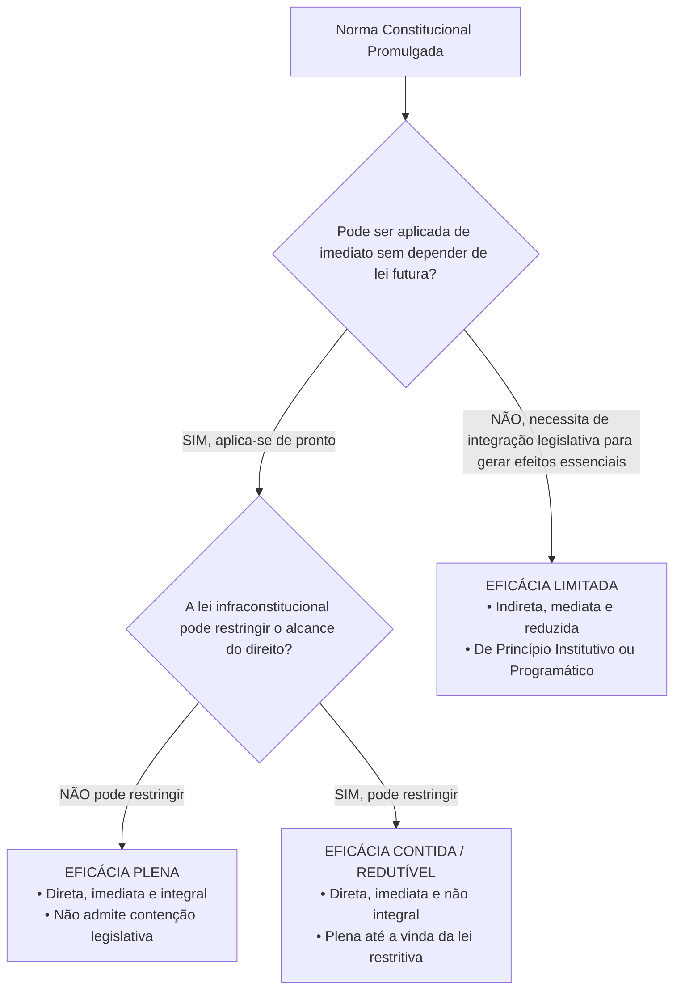
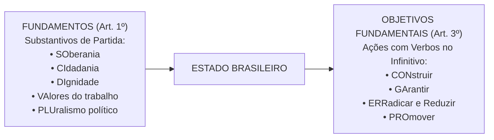

# 01 - Aplicabilidade das Normas Constitucionais e Princípios Fundamentais

> **Matéria:** Noções de Direito Constitucional  
> **Cargo:** A01 – Técnico de Controle Externo – Especialidade: Técnico Administrativo  
> **Arquivo:** `01_aplicabilidade_das_normas_e_principios_fundamentais.md`  
> **Status:** 🟢 Teoria Aprofundada + 5 Questões FCC Comentadas (A a E)

---

## 📌 Ementa Oficial do Edital
- Da aplicabilidade das normas constitucionais (Classificação de José Afonso da Silva).
- Normas constitucionais de eficácia plena, contida e limitada.
- Normas constitucionais programáticas e princípio da reserva do possível vs. mínimo existencial.
- Princípios Fundamentais da Constituição da República Federativa do Brasil de 1988 (Artigos 1º a 4º).
- Fundamentos da República Federativa do Brasil (Artigo 1º).
- Teoria da Separação dos Poderes e o sistema de freios e contrapesos (*Checks and Balances* - Artigo 2º).
- Objetivos fundamentais da República Federativa do Brasil (Artigo 3º).
- Princípios que regem a República Federativa do Brasil em suas relações internacionais (Artigo 4º).

---

## 🧭 Sumário

1. [Eficácia e Aplicabilidade das Normas Constitucionais](#1-eficacia-e-aplicabilidade-das-normas-constitucionais)
    1. [Classificação Tripartite de José Afonso da Silva](#11-classificacao-tripartite-de-jose-afonso-da-silva)
    2. [Eficácia Mínima das Normas Limitadas e Remédios contra Omissão](#12-eficacia-minima-das-normas-limitadas-e-remedios-contra-omissao)
    3. [Reserva do Possível versus Mínimo Existencial](#13-reserva-do-possivel-versus-minimo-existencial)
    4. [Teste 110](#Teste-110)
    5. [Teste 111](#Teste-111)
    6. [Teste 112](#Teste-112)
    7. [Teste 113](#Teste-113)
2. [Princípios Fundamentais da CF/88 (Título I - Arts. 1º a 4º)](#2-principios-fundamentais-da-cf88-titulo-i-arts-1o-a-4o)
    1. [Forma de Estado, Forma de Governo e Regime Político](#21-forma-de-estado-forma-de-governo-e-regime-politico)
    2. [Fundamentos da República Federativa do Brasil (Art. 1º)](#22-fundamentos-da-republica-federativa-do-brasil-art-1o)
    3. [Separação dos Poderes e o Sistema de Freios e Contrapesos (Art. 2º)](#23-separacao-dos-poderes-e-o-sistema-de-freios-e-contrapesos-art-2o)
    4. [Objetivos Fundamentais da República (Art. 3º)](#24-objetivos-fundamentais-da-republica-art-3o)
    5. [Princípios nas Relações Internacionais e Integração Latino-Americana (Art. 4º)](#25-principios-nas-relacoes-internacionais-e-integracao-latino-americana-art-4o)
    6. [Teste 114](#Teste-114)
    7. [Teste 115](#Teste-115)
    8. [Teste 116](#Teste-116)
    9. [Teste 117](#Teste-117)
    10. [Teste 118](#Teste-118)
    11. [Teste 119](#Teste-119)
    12. [Teste 120](#Teste-120)
6. [Fontes Recomendadas na Internet](#6-fontes-recomendadas-na-internet)

---

## 1. Eficácia e Aplicabilidade das Normas Constitucionais

O estudo da aplicabilidade das normas constitucionais investiga o grau de aptidão que cada preceito da Lei Fundamental possui para produzir efeitos jurídicos no mundo dos fatos desde a sua promulgação. No direito público brasileiro, a doutrina amplamente majoritária e a jurisprudência pacífica do Supremo Tribunal Federal (STF) consagram a classificação tripartite formulada pelo professor José Afonso da Silva.

### 1.1 Classificação Tripartite de José Afonso da Silva

| Classificação da Norma | Aplicabilidade | Depende de Lei Infraconstitucional? | Pode Ser Restringida por Lei? | Exemplos Canônicos na CF/88 |
|---|:---:|:---:|:---:|---|
| **Eficácia Plena** | **Direta, Imediata e Integral** | **NÃO** | **NÃO** | Art. 2º (Separação dos Poderes); Art. 5º, III (Vedação da tortura); Art. 5º, LVI (Inadmissibilidade de provas ilícitas). |
| **Eficácia Contida (ou Redutível)** | **Direta, Imediata e NÃO Integral** | **NÃO** (produz efeitos plenos desde a promulgação) | **SIM** (a lei infraconstitucional pode restringir seu alcance) | Art. 5º, XIII (Liberdade de exercício profissional atendidas qualificações da lei); Art. 5º, XII (Inviolabilidade de sigilo telefônico salvo ordem judicial). |
| **Eficácia Limitada** | **Indireta, Mediata e Reduzida** | **SIM** (depende de atuação integradora do legislador ordinário) | Não se aplica (o direito nasce contido e depende de ampliação legal) | Art. 37, VII (Direito de greve dos servidores públicos civis); Art. 196 (Direito à saúde como dever do Estado mediante políticas públicas). |

- **Normas de Eficácia Plena:** São aquelas que desde a promulgação da Constituição receberam do constituinte uma normatividade suficiente para serem aplicadas de pronto a situações concretas. Não dependem de qualquer regulamentação legal ulterior para produzirem todos os seus efeitos e não podem ser restringidas pelo legislador ordinário.
- **Normas de Eficácia Contida (ou Redutível / Prospectiva):** São normas que também produzem efeitos plenos e imediatos a partir da promulgação, mas nas quais o constituinte deixou expressa ou implicitamente uma cláusula de contenção (*"na forma da lei"*, *"atendidas as qualificações que a lei estabelecer"*, *"salvo disposição em contrário"*). Enquanto o legislador ordinário não editar a norma restritiva, o exercício do direito é pleno e irrestrito.
- **Normas de Eficácia Limitada:** Não produzem seus efeitos fundamentais de imediato, dependendo da interferência do legislador infraconstitucional para conferir densidade e viabilizar o exercício prático da prerrogativa. Subdividem-se em:
    1. *Normas de Princípio Institutivo (ou Organizatório):* Aquelas pelas quais o constituinte traça o esquema geral de criação e organização de órgãos, entidades ou instituições do Estado (ex.: art. 88 da CF/88, que dispõe que a lei disporá sobre a criação e extinção de Ministérios);
    2. *Normas de Princípio Programático:* Aquelas que estabelecem metas, programas sociais, diretrizes socioeconômicas e fins de interesse público a serem alcançados pelos poderes públicos (ex.: saúde, erradicação do analfabetismo, proteção ao meio ambiente).

### 1.2 Eficácia Mínima das Normas Limitadas e Remédios contra Omissão
Embora as normas de eficácia limitada não confiram exigibilidade imediata da prestação originária sem integração legislativa, é incorreto afirmar que elas são desprovidas de valor jurídico. A doutrina e a jurisprudência reconhecem a **eficácia jurídica mínima** dessas normas:

- **Eficácia Revogatória (ou Negativa):** Revogam automaticamente toda a legislação anterior que com elas seja materialmente incompatível (não recepção).
- **Eficácia Impeditiva:** Impedem a edição de leis futuras que contrariem seus vetores teleológicos, sob pena de inconstitucionalidade direta.
- **Eficácia Hermenêutica / Interpretativa:** Servem de vetor interpretativo obrigatório para juízes e administradores públicos.
- **Remédios Constitucionais contra a Omissão Inconstitucional:** Para combater a mora legislativa que inviabiliza o exercício de direitos previstos em normas de eficácia limitada, a Constituição consagrou o **Mandado de Injunção** (art. 5º, LXXI, e Lei nº 13.300/2016) e a **Ação Direta de Inconstitucionalidade por Omissão (ADO)** (art. 103, § 2º).

### 1.3 Reserva do Possível versus Mínimo Existencial
No controle judicial de políticas públicas decorrentes de normas programáticas (saúde, fornecimento de medicamentos de alto custo, vagas em creches):

- **Reserva do Possível (*Vorbehalt des Möglichen*):** Tese frequentemente invocada pela Fazenda Pública segundo a qual a efetivação dos direitos sociais condiciona-se à existência de capacidade orçamentária e financeira do Estado, bem como à discricionariedade do administrador na alocação de recursos escassos.
- **Mínimo Existencial:** Entendimento consolidado pelo STF no sentido de que a reserva do possível encontra limite intransponível no **núcleo essencial dos direitos fundamentais indispensáveis a uma vida digna** (mínimo existencial). Quando estiver em jogo a própria sobrevivência ou a integridade biológica do indivíduo, a alegação de insuficiência de recursos orçamentários torna-se inoponível ao cidadão.

---

### Teste 110
**(FGV – TRT-1 – Analista Judiciario Area Administrativa – 2024)**
O presidente da República ajuizou ação direta de inconstitucionalidade, junto ao Supremo Tribunal Federal (STF), impugnando uma lei que dispunha sobre a cobrança de taxas em concurso público na Administração Pública federal direta e indireta. Pelo diploma legislativo, a inscrição para concurso público destinado ao provimento de cargos em órgão da Administração Pública federal direta e indireta não terá custo superior a 20% do salário mínimo e será gratuita para quem estiver desempregado ou não possuir renda familiar superior a dois salários mínimos. À luz da Agenda 2030 da Organização das Nações Unidas (ONU) e do pensamento do STF, é correto afirmar que:

* **A)** a referida lei é exemplo do objetivo de garantir a igualdade de oportunidades e reduzir as desigualdades de resultados, por meio da promoção de legislação, políticas e ações adequadas a esse respeito;
* **B)** o objetivo de reduzir a desigualdade dentro dos países e entre eles não compõe a agenda 2030 da ONU, já que, com o tempo, a organização adotou uma postura cada vez mais liberal;
* **C)** o objetivo de desenvolvimento sustentável concernente a instituições eficazes leva à inconstitucionalidade da medida, ante a desqualificação de pessoal, consequência da limitação ou isenção da taxa de inscrição;
* **D)** a isenção não pode ser concedida por ser o tema do enunciado, matéria que repercute na relação entre a Administração Pública e os seus agentes, independentemente de eventual busca contra a desigualdade;
* **E)** a utilização do salário mínimo como critério de aferição do nível de pobreza atenta contra a Constituição de 1988, não podendo este ser empregado como referência paradigmática para limitar ou isentar taxa de inscrição em concurso.

---

> **Comentário Detalhado:**
>
> - **A)** **Incorreta.** A opção apresenta proposição em desacordo com os fundamentos teóricos e técnicos do tópico ao afirmar que "a referida lei é exemplo do objetivo de garantir a igualdade de oportunidades e reduzir as desigualdades de...". De acordo com a teoria estudada em *2.4 Objetivos Fundamentais da República (Art. 3º)*, eRRAdicar a pobreza e a marginalização e reduzir as desigualdades sociais e regionais.
> - **B)** **Correta.** Conforme fundamentado na seção *1.1 Classificação Tripartite de José Afonso da Silva* deste guia, *Normas de Princípio Institutivo (ou Organizatório):* Aquelas pelas quais o constituinte traça o esquema geral de criação e organização de órgãos, entidades ou instituições do Estado (ex.: art. 88 da CF/88, que dispõe que a lei disporá sobre a criação e extinção de Ministérios). Dessa forma, está plenamente correta a assertiva da banca (FGV – TRT-1/2024) ao estabelecer que "o objetivo de reduzir a desigualdade dentro dos países e entre eles não compõe a agenda 2030 da ONU, já que, com o...".
> - **C)** **Incorreta.** A opção apresenta proposição em desacordo com os fundamentos teóricos e técnicos do tópico ao afirmar que "o objetivo de desenvolvimento sustentável concernente a instituições eficazes leva à inconstitucionalidade da...". De acordo com a teoria estudada em *1.2 Eficácia Mínima das Normas Limitadas e Remédios contra Omissão*, remédios Constitucionais contra a Omissão Inconstitucional: Para combater a mora legislativa que inviabiliza o exercício de direitos previstos em normas de eficácia limitada, a Constituição consagrou o Mandado de Injunção (art. 5º, LXXI, e Lei nº 13.300/2016) e a Ação Direta de Inconstitucionalidade por Omissão (ADO) (art. 103, § 2º).
> - **D)** **Incorreta.** A opção apresenta proposição em desacordo com os fundamentos teóricos e técnicos do tópico ao afirmar que "a isenção não pode ser concedida por ser o tema do enunciado, matéria que repercute na relação entre a...". De acordo com a teoria estudada em *1.1 Classificação Tripartite de José Afonso da Silva*, classificação da Norma: Aplicabilidade — Depende de Lei Infraconstitucional? — Pode Ser Restringida por Lei? — Exemplos Canônicos na CF/88.
> - **E)** **Incorreta.** A opção apresenta proposição em desacordo com os fundamentos teóricos e técnicos do tópico ao afirmar que "a utilização do salário mínimo como critério de aferição do nível de pobreza atenta contra a Constituição de 1988...". De acordo com a teoria estudada em *6. Fontes Recomendadas na Internet*, constituição do Estado de Goiás - Título I e Título II - Princípios fundamentais e organização do Estado no âmbito goiano.
>
> **Gabarito: B**

---

### Teste 111
**(CEBRASPE – TRT-8 – Analista Judiciario Apoio Especializado Tecnologia da Informacao – 2016)**
Conforme o inciso VII do artigo 5.º da CF, “é assegurada, nos termos da lei, a prestação de assistência religiosa nas entidades civis e militares de internação coletiva”. Considerando-se a aplicabilidade das normas constitucionais e os critérios doutrinários de classificação, é correto afirmar que o referido dispositivo constitui norma

* **A)** de aplicabilidade imediata.
* **B)** de eficácia plena programática.
* **C)** de eficácia plena.
* **D)** de eficácia limitada de princípio institutivo.
* **E)** de eficácia limitada programática.

---

> **Comentário Detalhado:**
>
> - **A)** **Correta.** Conforme fundamentado na seção *1.2 Eficácia Mínima das Normas Limitadas e Remédios contra Omissão* deste guia, embora as normas de eficácia limitada não confiram exigibilidade imediata da prestação originária sem integração legislativa, é incorreto afirmar que elas são desprovidas de valor jurídico. Dessa forma, está plenamente correta a assertiva da banca (CEBRASPE – TRT-8/2016) ao estabelecer que "de aplicabilidade imediata".
> - **B)** **Incorreta.** A opção apresenta proposição em desacordo com os fundamentos teóricos e técnicos do tópico ao afirmar que "de eficácia plena programática". De acordo com a teoria estudada em *6. Fontes Recomendadas na Internet*, sILVA, José Afonso da. Aplicabilidade das Normas Constitucionais. 8. ed. São Paulo: Malheiros, 2012. (Cap. III - Normas Constitucionais de Eficácia Plena, Contida e Limitada).
> - **C)** **Incorreta.** A opção apresenta proposição em desacordo com os fundamentos teóricos e técnicos do tópico ao afirmar que "de eficácia plena". De acordo com a teoria estudada em *1.1 Classificação Tripartite de José Afonso da Silva*, eficácia Plena: Direta, Imediata e Integral — NÃO — NÃO — Art. 2º (Separação dos Poderes); Art. 5º, III (Vedação da tortura); Art. 5º, LVI (Inadmissibilidade de provas ilícitas).
> - **D)** **Incorreta.** A opção apresenta proposição em desacordo com os fundamentos teóricos e técnicos do tópico ao afirmar que "de eficácia limitada de princípio institutivo". De acordo com a teoria estudada em *1.1 Classificação Tripartite de José Afonso da Silva*, *Normas de Princípio Institutivo (ou Organizatório):* Aquelas pelas quais o constituinte traça o esquema geral de criação e organização de órgãos, entidades ou instituições do Estado (ex.: art. 88 da CF/88, que dispõe que a lei disporá sobre a criação e extinção de Ministérios).
> - **E)** **Incorreta.** A opção apresenta proposição em desacordo com os fundamentos teóricos e técnicos do tópico ao afirmar que "de eficácia limitada programática". De acordo com a teoria estudada em *1.1 Classificação Tripartite de José Afonso da Silva*, eficácia Limitada: Indireta, Mediata e Reduzida — SIM (depende de atuação integradora do legislador ordinário) — Não se aplica (o direito nasce contido e depende de ampliação legal) — Art. 37, VII (Direito de greve dos servidores públicos civis).
>
> **Gabarito: A**

---

### Teste 112
**(FGV – TCE-SC – Auditor Fiscal de Controle Externo Administracao – 2026)**
A Emenda Constitucional nº X (ECX) alterou o Art. W da Constituição da República, que veicula comando afeto ao direito constitucional financeiro, direcionado ao ciclo orçamentário, em norma de aplicabilidade imediata e eficácia contida. Em razão da natureza dessa norma, surgiram dúvidas, no âmbito do controle externo de determinado Tribunal de Contas, em relação à necessidade, ou não, de ser observada. A dúvida decorria do fato de existir lei estadual preexistente, a LY, dispondo em sentido contrário, e de ainda não ter sido editada lei posterior à ECX sobre a temática, federal ou estadual. Na situação descrita, é correto afirmar que a ECX

* **A)** suspendeu a eficácia da LY, o que irá perdurar até a sua regulamentação.
* **B)** revogou a LY, produzindo efeitos independentemente de qualquer regulamentação.
* **C)** somente produzirá efeitos após a edição de lei federal que veiculará as normas gerais.
* **D)** somente produzirá efeitos após a sua regulamentação, com a edição de lei federal ou estadual.
* **E)** somente terá a sua eficácia integrada após a sua regulamentação, mas isso não obsta a produção de alguns efeitos, como a revogação da LY.

---

> **Comentário Detalhado:**
>
> - **A)** **Incorreta.** A opção apresenta proposição em desacordo com os fundamentos teóricos e técnicos do tópico ao afirmar que "suspendeu a eficácia da LY, o que irá perdurar até a sua regulamentação". De acordo com a teoria estudada em *1.1 Classificação Tripartite de José Afonso da Silva*, eficácia Contida (ou Redutível): Direta, Imediata e NÃO Integral — NÃO (produz efeitos plenos desde a promulgação) — SIM (a lei infraconstitucional pode restringir seu alcance) — Art. 5º, XIII (Liberdade de exercício profissional atendidas qualificações da lei).
> - **B)** **Incorreta.** A opção promove generalização excessiva que desconsidera as condições técnicas e normativas ao afirmar que "revogou a LY, produzindo efeitos independentemente de qualquer regulamentação". De acordo com a teoria estudada em *1.1 Classificação Tripartite de José Afonso da Silva*, não dependem de qualquer regulamentação legal ulterior para produzirem todos os seus efeitos e não podem ser restringidas pelo legislador ordinário.
> - **C)** **Correta.** Conforme fundamentado na seção *1.1 Classificação Tripartite de José Afonso da Silva* deste guia, normas de Eficácia Contida (ou Redutível / Prospectiva): São normas que também produzem efeitos plenos e imediatos a partir da promulgação, mas nas quais o constituinte deixou expressa ou implicitamente uma cláusula de contenção (*"na forma da lei"*, *"atendidas as qualificações que a lei estabelecer"*, *"salvo disposição em contrário"*). Dessa forma, está plenamente correta a assertiva da banca (FGV – TCE-SC/2026) ao estabelecer que "somente produzirá efeitos após a edição de lei federal que veiculará as normas gerais".
> - **D)** **Incorreta.** A opção incorre em restrição indevida ao limitar o escopo conceitual ao afirmar que "somente produzirá efeitos após a sua regulamentação, com a edição de lei federal ou estadual". De acordo com a teoria estudada em *1. Eficácia e Aplicabilidade das Normas Constitucionais*, o estudo da aplicabilidade das normas constitucionais investiga o grau de aptidão que cada preceito da Lei Fundamental possui para produzir efeitos jurídicos no mundo dos fatos desde a sua promulgação.
> - **E)** **Incorreta.** A opção incorre em restrição indevida ao limitar o escopo conceitual ao afirmar que "somente terá a sua eficácia integrada após a sua regulamentação, mas isso não obsta a produção de alguns efeitos...". De acordo com a teoria estudada em *2.3 Separação dos Poderes e o Sistema de Freios e Contrapesos (Art. 2º)*, poder Legislativo: Funções típicas: legislar (elaborar normas gerais e abstratas) e fiscalizar (controle financeiro e contábil externo com auxílio dos Tribunais de Contas).
>
> **Gabarito: C**

---

### Teste 113
**(FGV – TRF-1 – Analista Judiciario Area Apoio Especializado Especialidade Suporte Em Tecnologia da Informacao – 2024)**
O Art. 2º da Emenda Constitucional nº X, com o objetivo de aperfeiçoar o controle da qualidade dos direitos prestacionais oferecidos à coletividade, determinou a criação, por lei complementar, de um conselho nacional de natureza interfederativa, que seria responsável pelo referido controle. Extrai-se do Art. 2º da Emenda Constitucional nº X uma norma de eficácia:

* **A)** plena;
* **B)** contida;
* **C)** limitada, de princípio institutivo;
* **D)** limitada, de natureza programática;
* **E)** restringível, mas de exigência imediata.

---

> **Comentário Detalhado:**
>
> - **A)** **Incorreta.** A opção apresenta proposição em desacordo com os fundamentos teóricos e técnicos do tópico ao afirmar que "plena". De acordo com a teoria estudada em *6. Fontes Recomendadas na Internet*, sILVA, José Afonso da. Aplicabilidade das Normas Constitucionais. 8. ed. São Paulo: Malheiros, 2012. (Cap. III - Normas Constitucionais de Eficácia Plena, Contida e Limitada).
> - **B)** **Incorreta.** A opção apresenta proposição em desacordo com os fundamentos teóricos e técnicos do tópico ao afirmar que "contida". De acordo com a teoria estudada em *1.2 Eficácia Mínima das Normas Limitadas e Remédios contra Omissão*, remédios Constitucionais contra a Omissão Inconstitucional: Para combater a mora legislativa que inviabiliza o exercício de direitos previstos em normas de eficácia limitada, a Constituição consagrou o Mandado de Injunção (art. 5º, LXXI, e Lei nº 13.300/2016) e a Ação Direta de Inconstitucionalidade por Omissão (ADO) (art. 103, § 2º).
> - **C)** **Correta.** Conforme fundamentado na seção *1.1 Classificação Tripartite de José Afonso da Silva* deste guia, *Normas de Princípio Institutivo (ou Organizatório):* Aquelas pelas quais o constituinte traça o esquema geral de criação e organização de órgãos, entidades ou instituições do Estado (ex.: art. 88 da CF/88, que dispõe que a lei disporá sobre a criação e extinção de Ministérios). Dessa forma, está plenamente correta a assertiva da banca (FGV – TRF-1/2024) ao estabelecer que "limitada, de princípio institutivo".
> - **D)** **Incorreta.** A opção apresenta proposição em desacordo com os fundamentos teóricos e técnicos do tópico ao afirmar que "limitada, de natureza programática". De acordo com a teoria estudada em *1.1 Classificação Tripartite de José Afonso da Silva*, eficácia Limitada: Indireta, Mediata e Reduzida — SIM (depende de atuação integradora do legislador ordinário) — Não se aplica (o direito nasce contido e depende de ampliação legal) — Art. 37, VII (Direito de greve dos servidores públicos civis).
> - **E)** **Incorreta.** A opção apresenta proposição em desacordo com os fundamentos teóricos e técnicos do tópico ao afirmar que "restringível, mas de exigência imediata". De acordo com a teoria estudada em *1.2 Eficácia Mínima das Normas Limitadas e Remédios contra Omissão*, embora as normas de eficácia limitada não confiram exigibilidade imediata da prestação originária sem integração legislativa, é incorreto afirmar que elas são desprovidas de valor jurídico.
>
> **Gabarito: C**

---

## 2. Princípios Fundamentais da CF/88 (Título I - Arts. 1º a 4º)

O Título I da Constituição Federal delimita as decisões políticas estruturantes do Estado brasileiro.

### 2.1 Forma de Estado, Forma de Governo e Regime Político
- **Forma de Estado: Federação.** Caracteriza-se pela descentralização política, coexistência de esferas federativas autônomas (União, Estados, Distrito Federal e Municípios), vedação ao direito de secessão e proteção sob cláusula pétrea explícita (art. 60, § 4º, I).
- **Forma de Governo: República.** Caracteriza-se pela eletividade e temporariedade dos mandatos dos governantes, pela responsabilidade política e jurídica dos agentes públicos e pelo dever republicano de prestar contas perante a sociedade e as Cortes de Contas.
- **Regime Político: Democracia Semidireta (ou Participativa).** Conforme o art. 1º, parágrafo único: *"Todo o poder emana do povo, que o exerce por meio de representantes eleitos ou diretamente, nos termos desta Constituição."* O exercício direto manifesta-se por meio do **plebiscito**, do **referendo** e da **iniciativa popular** de leis (art. 14, I, II e III).

### 2.2 Fundamentos da República Federativa do Brasil (Art. 1º)
Os fundamentos consubstanciam as bases estruturais sobre as quais se erige o Estado brasileiro. São expressos por substantivos e memorizados pelo consagrado mnemônico **SO-CI-DI-VA-PLU**:

1. **SOberania:** Poder supremo no plano interno e independente na ordem internacional;
2. **CIdadania:** Prerrogativa de participação ativa na vida política do país e na formação das decisões estatais;
3. **DIgnidade da Pessoa Humana:** Matriz axiológica de todo o ordenamento jurídico, que coloca o ser humano como fim primordial do Estado, e não mero instrumento;
4. **VAlores Sociais do Trabalho e da Livre Iniciativa:** Reconhecimento concomitante do trabalho como fonte de emancipação social e da liberdade econômica de mercado como motor da produção de riquezas;
5. **PLUralismo Político:** Abertura para a livre manifestação e convivência harmoniosa de diferentes correntes ideológicas, filosóficas e políticas.

> 🚨 **ALERTA DE PROVA / PEGADINHA FCC:**  
> A banca FCC frequentemente tenta confundir o candidato trocando **pluralismo político** por **pluripartidarismo**. O pluripartidarismo (liberdade de criação de partidos políticos) é apenas uma das dimensões instrumentais do pluralismo político, que é um conceito infinitamente mais amplo de liberdade de pensamento e de cosmovisão.

### 2.3 Separação dos Poderes e o Sistema de Freios e Contrapesos (Art. 2º)
O art. 2º da Carta Magna estabelece: *"São Poderes da União, independentes e harmônicos entre si, o Legislativo, o Executivo e o Judiciário."*

No modelo do constitucionalismo contemporâneo:

- **Não há separação estanque ou absoluta:** Cada Poder desempenha uma **função típica preponderante** e **funções atípicas secundárias** expressamente delimitadas pela Constituição:
    - **Poder Executivo:** Função típica: governar e administrar a coisa pública; Funções atípicas: legislar (ao editar medidas provisórias e leis delegadas) e julgar (ao decidir processos administrativos e disciplinares).
    - **Poder Legislativo:** Funções típicas: legislar (elaborar normas gerais e abstratas) e fiscalizar (controle financeiro e contábil externo com auxílio dos Tribunais de Contas); Funções atípicas: administrar (gerir seu quadro funcional e contratos) e julgar (o Senado julga o Presidente da República e Ministros do STF em crimes de responsabilidade).
    - **Poder Judiciário:** Função típica: jurisdicional (dizer o direito no caso concreto com definitividade); Funções atípicas: administrar (realizar licitações e prover cargos) e legislar (elaborar os regimentos internos de seus tribunais).
- **Sistema de Freios e Contrapesos (*Checks and Balances*):** Mecanismo de controle recíproco em que um Poder limita e fiscaliza a atuação do outro, prevenindo abusos e garantindo a harmonia institucional (ex.: veto do Presidente a projetos de lei; sabatina e aprovação de ministros pelo Senado; controle de constitucionalidade de leis e atos do Executivo exercido pelo Judiciário).

### 2.4 Objetivos Fundamentais da República (Art. 3º)
Os objetivos fundamentais consubstanciam as metas de chegada e as finalidades que o Estado brasileiro deve perseguir. Diferenciam-se dos fundamentos porque começam invariavelmente por **VERBOS NO INFINITIVO** (Mnemônico **CON-GA-ERRA-PRO**):

1. **CON**struir uma sociedade livre, justa e solidária;
2. **GA**rantir o desenvolvimento nacional;
3. **ERRA**dicar a pobreza e a marginalização e **reduzir as desigualdades sociais e regionais**;
4. **PRO**mover o bem de todos, sem preconceitos de origem, raça, sexo, cor, idade e quaisquer outras formas de discriminação.

### 2.5 Princípios nas Relações Internacionais e Integração Latino-Americana (Art. 4º)
A República Federativa do Brasil rege-se em suas relações internacionais pelos seguintes princípios:

1. Independência nacional;
2. Prevalência dos direitos humanos;
3. Autodeterminação dos povos;
4. Não intervenção;
5. Igualdade entre os Estados;
6. Defesa da paz;
7. Solução pacífica dos conflitos;
8. Repúdio ao terrorismo e ao racismo;
9. Cooperação entre os povos para o progresso da humanidade;
10. Concessão de asilo político.

- **Parágrafo Único do Art. 4º:** Estabelece expressamente que o Brasil buscará a **integração econômica, política, social e cultural dos povos da América Latina**, visando à formação de uma **comunidade latino-americana de nações**.

> 🚨 **ALERTA DE PROVA / PEGADINHA FCC:**  
> A banca examinadora costuma substituir ardilosamente a expressão constitucional **América Latina** por "América do Sul", "Mercosul" ou "países lusófonos". Atenção máxima: a redação do parágrafo único do art. 4º consagra expressamente a **América Latina**!

---

### Teste 114
**(FGV – TCE-GO – Analista de Controle Externo Juridica – 2024)**
O processo estrutural tem atraído maior atenção da doutrina e jurisprudência pátrias. Aponta-se, como alguns fatores para tanto, o protagonismo do Poder Judiciário no combate às inações das políticas públicas, bem como a necessidade de tratamento macro de falhas na promoção de direitos fundamentais e sociais. Sobre o assunto, assinale a alternativa correta.

* **A)** O processo estrutural tem como principal característica a sua similitude com o processo coletivo, razão pela qual sua disciplina é inteiramente dada pela Lei da Ação Civil Pública (Lei nº 7.347/1985).
* **B)** A complexidade e a multipolaridade dos processos estruturais impedem a cumulação de pedidos em face do réu, somente admitindo pretensões de índole condenatória.
* **C)** Por se tratar de espécie de processo destinada exclusivamente à efetivação de políticas públicas, o processo estrutural é incompatível com a pretensão de mudar o comportamento de estruturas privadas de interesse público.
* **D)** A rigidez do procedimento faz com que os litígios estruturais não admitam a flexibilização de técnicas processuais em prol da eficiência da decisão judicial, tampouco a adoção de regimes de transição.
* **E)** Um exemplo de processo estrutural colhido da jurisprudência é o julgamento no qual o Supremo Tribunal Federal reconheceu o estado de coisas inconstitucional no sistema carcerário brasileiro.

---

> **Comentário Detalhado:**
>
> - **A)** **Incorreta.** A opção apresenta proposição em desacordo com os fundamentos teóricos e técnicos do tópico ao afirmar que "O processo estrutural tem como principal característica a sua similitude com o processo coletivo, razão pela qual...". De acordo com a teoria estudada em *1.3 Reserva do Possível versus Mínimo Existencial*, no controle judicial de políticas públicas decorrentes de normas programáticas (saúde, fornecimento de medicamentos de alto custo, vagas em creches).
> - **B)** **Incorreta.** A opção incorre em restrição indevida ao limitar o escopo conceitual ao afirmar que "A complexidade e a multipolaridade dos processos estruturais impedem a cumulação de pedidos em face do réu...". De acordo com a teoria estudada em *1.3 Reserva do Possível versus Mínimo Existencial*, reserva do Possível (*Vorbehalt des Möglichen*): Tese frequentemente invocada pela Fazenda Pública segundo a qual a efetivação dos direitos sociais condiciona-se à existência de capacidade orçamentária e financeira do Estado, bem como à discricionariedade do administrador na alocação de recursos escassos.
> - **C)** **Correta.** Conforme fundamentado na seção *1.1 Classificação Tripartite de José Afonso da Silva* deste guia, art. 196 (Direito à saúde como dever do Estado mediante políticas públicas). Dessa forma, está plenamente correta a assertiva da banca (FGV – TCE-GO/2024) ao estabelecer que "Por se tratar de espécie de processo destinada exclusivamente à efetivação de políticas públicas, o processo...".
> - **D)** **Incorreta.** A opção apresenta proposição em desacordo com os fundamentos teóricos e técnicos do tópico ao afirmar que "A rigidez do procedimento faz com que os litígios estruturais não admitam a flexibilização de técnicas processuais...". De acordo com a teoria estudada em *2. Princípios Fundamentais da CF/88 (Título I - Arts. 1º a 4º)*, o Título I da Constituição Federal delimita as decisões políticas estruturantes do Estado brasileiro.
> - **E)** **Incorreta.** A opção apresenta proposição em desacordo com os fundamentos teóricos e técnicos do tópico ao afirmar que "Um exemplo de processo estrutural colhido da jurisprudência é o julgamento no qual o Supremo Tribunal Federal...". De acordo com a teoria estudada em *1. Eficácia e Aplicabilidade das Normas Constitucionais*, no direito público brasileiro, a doutrina amplamente majoritária e a jurisprudência pacífica do Supremo Tribunal Federal (STF) consagram a classificação tripartite formulada pelo professor José Afonso da Silva.
>
> **Gabarito: C**

---

### Teste 115
**(FGV – TRT-1 – Analista Judiciario Area Administrativa – 2024)**
A Declaração Universal dos Direitos Humanos foi adotada pela Assembleia Geral das Nações Unidas por meio da Resolução 217 A III, em dezembro de 1948. Umas de suas motivações é a proteção dos direitos humanos pelo império da lei. Não é possível negar que uma das suas inspirações foram as atrocidades praticadas por regimes totalitários. Hoje, no entanto, tem-se enfatizado a crise por que passa a democracia a partir das fragilidades próprias desse regime. Quanto à Declaração Universal dos Direitos Humanos de 1948, é correto afirmar que:

* **A)** a previsão do direito humano à liberdade de expressão, instrumento colocado para promover a democracia, não encontra limitação expressa, a significar que qualquer discurso é legítimo;
* **B)** a disposição afirmando o direito a participar do governo do próprio país diretamente inexiste, muito embora haja previsão dessa participação por meio de representantes livremente eleitos;
* **C)** o direito humano de liberdade de associação, próprio dos regimes democráticos, conquanto previsto e condicionado ao caráter pacífico, não vem acompanhado da inerente liberdade de não se associar;
* **D)** a vontade do povo como sendo a base da autoridade de um governo é reconhecida como direito humano, mas isso abre espaço para o problema da tirania da maioria, não resolvido pelo texto;
* **E)** o governo, apoiado na vontade do povo, reclama sua manifestação através de eleições periódicas e legítimas, sufrágio universal e voto secreto ou processo equivalente, assegurada a liberdade de voto.

---

> **Comentário Detalhado:**
>
> - **A)** **Incorreta.** A opção promove generalização excessiva que desconsidera as condições técnicas e normativas ao afirmar que "a previsão do direito humano à liberdade de expressão, instrumento colocado para promover a democracia, não...". De acordo com a teoria estudada em *2.2 Fundamentos da República Federativa do Brasil (Art. 1º)*, dIgnidade da Pessoa Humana: Matriz axiológica de todo o ordenamento jurídico, que coloca o ser humano como fim primordial do Estado, e não mero instrumento.
> - **B)** **Incorreta.** A opção apresenta proposição em desacordo com os fundamentos teóricos e técnicos do tópico ao afirmar que "a disposição afirmando o direito a participar do governo do próprio país diretamente inexiste, muito embora haja...". De acordo com a teoria estudada em *2.1 Forma de Estado, Forma de Governo e Regime Político*, conforme o art. 1º, parágrafo único: *"Todo o poder emana do povo, que o exerce por meio de representantes eleitos ou diretamente, nos termos desta Constituição."* O exercício direto manifesta-se por meio do plebiscito, do referendo e da iniciativa popular de leis (art. 14, I, II e III).
> - **C)** **Correta.** Conforme fundamentado na seção *2.1 Forma de Estado, Forma de Governo e Regime Político* deste guia, caracteriza-se pela descentralização política, coexistência de esferas federativas autônomas (União, Estados, Distrito Federal e Municípios), vedação ao direito de secessão e proteção sob cláusula pétrea explícita (art. 60, § 4º, I). Dessa forma, está plenamente correta a assertiva da banca (FGV – TRT-1/2024) ao estabelecer que "o direito humano de liberdade de associação, próprio dos regimes democráticos, conquanto previsto e condicionado...".
> - **D)** **Incorreta.** A opção apresenta proposição em desacordo com os fundamentos teóricos e técnicos do tópico ao afirmar que "a vontade do povo como sendo a base da autoridade de um governo é reconhecida como direito humano, mas isso abre...". De acordo com a teoria estudada em *2.1 Forma de Estado, Forma de Governo e Regime Político*, regime Político: Democracia Semidireta (ou Participativa).
> - **E)** **Incorreta.** A opção apresenta proposição em desacordo com os fundamentos teóricos e técnicos do tópico ao afirmar que "o governo, apoiado na vontade do povo, reclama sua manifestação através de eleições periódicas e legítimas...". De acordo com a teoria estudada em *2.2 Fundamentos da República Federativa do Brasil (Art. 1º)*, pLUralismo Político: Abertura para a livre manifestação e convivência harmoniosa de diferentes correntes ideológicas, filosóficas e políticas.
>
> **Gabarito: C**

---

### Teste 116
**(FGV – TCE-PI – Auditor de Controle Externo Controle Externo Especifica de Area Comum – 2025)**
O Art. 92-B, §2º, do Ato das Disposições Constitucionais Transitórias da Constituição da República, acrescido pela Emenda Constitucional nº 132/2023, tem a seguinte redação: Lei complementar instituirá Fundo de Sustentabilidade e Diversificação Econômica do Estado do Amazonas, que será constituído com recursos da União e por ela gerido, com a efetiva participação do Estado do Amazonas na definição das políticas, com o objetivo de fomentar o desenvolvimento e a diversificação das atividades econômicas no Estado. A interpretação desse comando normativo permite concluir que se está perante norma de

* **A)** eficácia contida.
* **B)** aplicabilidade imediata.
* **C)** aplicabilidade direta, mas não integral.
* **D)** eficácia limitada e de princípio institutivo.
* **E)** eficácia limitada e de princípio programático.

---

> **Comentário Detalhado:**
>
> - **A)** **Incorreta.** A opção apresenta proposição em desacordo com os fundamentos teóricos e técnicos do tópico ao afirmar que "eficácia contida". De acordo com a teoria estudada em *1.1 Classificação Tripartite de José Afonso da Silva*, eficácia Contida (ou Redutível): Direta, Imediata e NÃO Integral — NÃO (produz efeitos plenos desde a promulgação) — SIM (a lei infraconstitucional pode restringir seu alcance) — Art. 5º, XIII (Liberdade de exercício profissional atendidas qualificações da lei).
> - **B)** **Correta.** Conforme fundamentado na seção *6. Fontes Recomendadas na Internet* deste guia, mENDES, Gilmar Ferreira; BRANCO, Paulo Gustavo Gonet. Curso de Direito Constitucional. 19. ed. São Paulo: SaraivaJur, 2024. (Cap. 1 - Teoria da Constituição; Cap. 2 - Aplicabilidade e Eficácia das Normas Constitucionais). Dessa forma, está plenamente correta a assertiva da banca (FGV – TCE-PI/2025) ao estabelecer que "aplicabilidade imediata".
> - **C)** **Incorreta.** A opção apresenta proposição em desacordo com os fundamentos teóricos e técnicos do tópico ao afirmar que "aplicabilidade direta, mas não integral". De acordo com a teoria estudada em *1.1 Classificação Tripartite de José Afonso da Silva*, eficácia Plena: Direta, Imediata e Integral — NÃO — NÃO — Art. 2º (Separação dos Poderes); Art. 5º, III (Vedação da tortura); Art. 5º, LVI (Inadmissibilidade de provas ilícitas).
> - **D)** **Incorreta.** A opção apresenta proposição em desacordo com os fundamentos teóricos e técnicos do tópico ao afirmar que "eficácia limitada e de princípio institutivo". De acordo com a teoria estudada em *1.1 Classificação Tripartite de José Afonso da Silva*, *Normas de Princípio Institutivo (ou Organizatório):* Aquelas pelas quais o constituinte traça o esquema geral de criação e organização de órgãos, entidades ou instituições do Estado (ex.: art. 88 da CF/88, que dispõe que a lei disporá sobre a criação e extinção de Ministérios).
> - **E)** **Incorreta.** A opção apresenta proposição em desacordo com os fundamentos teóricos e técnicos do tópico ao afirmar que "eficácia limitada e de princípio programático". De acordo com a teoria estudada em *6. Fontes Recomendadas na Internet*, sILVA, José Afonso da. Aplicabilidade das Normas Constitucionais. 8. ed. São Paulo: Malheiros, 2012. (Cap. III - Normas Constitucionais de Eficácia Plena, Contida e Limitada).
>
> **Gabarito: B**

---

### Teste 117
**(FGV – TJ-RR – Analista Judiciário - Suporte e Infraestrutura de TI – 2024)**  
A República Federativa do Brasil rege-se, em suas relações internacionais, por princípios fundamentais expressamente previstos no art. 4º da Constituição Federal de 1988. Assinale a opção que indica princípio que rege o Brasil nas suas relações internacionais:

* **A)** Pluralismo político e soberania popular.
* **B)** Independência nacional e não intervenção.
* **C)** Dignidade da pessoa humana e cidadania.
* **D)** Erradicação da pobreza e redução das desigualdades.
* **E)** Construção de sociedade livre, justa e solidária.

---

> **Comentário Detalhado:**
>
> - **A)** **Incorreto**. Pluralismo político é fundamento do art. 1º, V da CF.
> - **B)** **Correto**. O art. 4º da CF/88 estabelece os princípios reitores das relações internacionais: I - independência nacional; II - prevalência dos direitos humanos; III - autodeterminação dos povos; IV - não-intervenção; V - igualdade entre os Estados; VI - defesa da paz; VII - solução pacífica dos conflitos; VIII - repúdio ao terrorismo e ao racismo; IX - cooperação entre os povos para o progresso da humanidade; X - concessão de asilo político.
> - **C)** **Incorreto**. Dignidade da pessoa humana e cidadania são fundamentos da República (art. 1º, II e III).
> - **D)** **Incorreto**. Erradicação da pobreza é objetivo fundamental (art. 3º, III).
> - **E)** **Incorreto**. Construção de sociedade livre, justa e solidária é objetivo fundamental (art. 3º, I).
>
> **Gabarito: B**
### Teste 118
**(FGV – TJ-SC – Analista Administrativo – 2026)**
No ordenamento jurídico brasileiro, a proteção dos direitos fundamentais decorre tanto das normas constitucionais quanto dos tratados internacionais de direitos humanos ratificados pelo Brasil. Além disso, os direitos e as garantias fundamentais possuem aplicação imediata, nos termos da Constituição Federal, independentemente de regulamentação para produzirem efeitos. Considerando as disposições da Constituição Federal e dos tratados internacionais de direitos humanos incorporados ao ordenamento jurídico brasileiro, assinale a afirmativa correta.

* **A)** Os tratados de direitos humanos ratificados após a Emenda Constitucional nº 45/2004 com quórum qualificado (dois quintos, dois turnos, duas casas) equivalem a emendas constitucionais.
* **B)** O Supremo Tribunal Federal não admite a utilização do Pacto de São José da Costa Rica para servir de fundamentos a determinadas decisões, como no caso da prisão civil do depositário infiel.
* **C)** Os tratados de direitos humanos ratificados pelo rito comum, por maioria absoluta, possuem hierarquia superior à das leis ordinárias e inferior à da Constituição Federal.
* **D)** Os juízes brasileiros devem verificar se as leis internas estão em conformidade com os tratados internacionais de direitos humanos, priorizando a norma mais favorável.
* **E)** Ainda que haja inércia de autoridades estaduais, não é permitido à Justiça Federal assumir a competência para processar e julgar casos de graves violações de direitos humanos.

---

> **Comentário Detalhado:**
>
> - **A)** **Incorreta.** A opção apresenta proposição em desacordo com os fundamentos teóricos e técnicos do tópico ao afirmar que "Os tratados de direitos humanos ratificados após a Emenda Constitucional nº 45/2004 com quórum qualificado (dois...". De acordo com a teoria estudada em *6. Fontes Recomendadas na Internet*, mENDES, Gilmar Ferreira; BRANCO, Paulo Gustavo Gonet. Curso de Direito Constitucional. 19. ed. São Paulo: SaraivaJur, 2024. (Cap. 1 - Teoria da Constituição; Cap. 2 - Aplicabilidade e Eficácia das Normas Constitucionais).
> - **B)** **Incorreta.** A opção apresenta proposição em desacordo com os fundamentos teóricos e técnicos do tópico ao afirmar que "O Supremo Tribunal Federal não admite a utilização do Pacto de São José da Costa Rica para servir de fundamentos a...". De acordo com a teoria estudada em *2. Princípios Fundamentais da CF/88 (Título I - Arts. 1º a 4º)*, o Título I da Constituição Federal delimita as decisões políticas estruturantes do Estado brasileiro.
> - **C)** **Correta.** Conforme fundamentado na seção *1.2 Eficácia Mínima das Normas Limitadas e Remédios contra Omissão* deste guia, remédios Constitucionais contra a Omissão Inconstitucional: Para combater a mora legislativa que inviabiliza o exercício de direitos previstos em normas de eficácia limitada, a Constituição consagrou o Mandado de Injunção (art. 5º, LXXI, e Lei nº 13.300/2016) e a Ação Direta de Inconstitucionalidade por Omissão (ADO) (art. 103, § 2º). Dessa forma, está plenamente correta a assertiva da banca (FGV – TJ-SC/2026) ao estabelecer que "Os tratados de direitos humanos ratificados pelo rito comum, por maioria absoluta, possuem hierarquia superior à...".
> - **D)** **Incorreta.** A opção apresenta proposição em desacordo com os fundamentos teóricos e técnicos do tópico ao afirmar que "Os juízes brasileiros devem verificar se as leis internas estão em conformidade com os tratados internacionais de...". De acordo com a teoria estudada em *2.1 Forma de Estado, Forma de Governo e Regime Político*, conforme o art. 1º, parágrafo único: *"Todo o poder emana do povo, que o exerce por meio de representantes eleitos ou diretamente, nos termos desta Constituição."* O exercício direto manifesta-se por meio do plebiscito, do referendo e da iniciativa popular de leis (art. 14, I, II e III).
> - **E)** **Incorreta.** A opção apresenta proposição em desacordo com os fundamentos teóricos e técnicos do tópico ao afirmar que "Ainda que haja inércia de autoridades estaduais, não é permitido à Justiça Federal assumir a competência para...". De acordo com a teoria estudada em *2.3 Separação dos Poderes e o Sistema de Freios e Contrapesos (Art. 2º)*, não há separação estanque ou absoluta: Cada Poder desempenha uma função típica preponderante e funções atípicas secundárias expressamente delimitadas pela Constituição.
>
> **Gabarito: C**

---

### Teste 119
**(FGV – TRT-1 – Analista Judiciario Area Administrativa – 2024)**
Em um processo judicial, foi debatido um dispositivo legal. Por ele, foi estipulado que o período de licença-gestante a uma servidora pública que teve seu filho deveria ser computado para fins do estágio probatório a que se refere o Art. 41 da Constituição da República Federativa do Brasil de 1988, conquanto este reclame efetivo exercício para aquisição da estabilidade. Os autos foram enviados ao gabinete do magistrado, que pediu para sua equipe analisar a solução à luz da Agenda 2030 da Organização das Nações Unidas (ONU) e do entendimento do Supremo Tribunal Federal (STF). Considerando os dados apresentados, é correto afirmar que:

* **A)** a Agenda 2030 da ONU possui quinze objetivos de desenvolvimento sustentável, mas nenhum deles trata mais diretamente do tema do enunciado, o que permite dizer que o assunto não é relevante para a organização;
* **B)** o STF respeita a imposição positivada no aludido dispositivo constitucional, significando isso que aquela, no gozo da aludida licença-gestante, por conta dessa condição de não trabalhar, não conta tempo para aquisição de estabilidade;
* **C)** a licença-gestante não possui estatura constitucional, podendo, pela via legal que densifique o citado Art. 41, ser limitado o direito à proteção da maternidade e, por consequência, excluída a contagem do período de estabilidade;
* **D)** a Agenda 2030 da ONU possui o objetivo de desenvolvimento sustentável afeto à educação de qualidade, único com intimidade ao assunto, podendo-se concluir que, mais instruída, a mulher só se tornará gestante após adquirida a estabilidade;
* **E)** a abolição de todas as formas de discriminação contra as mulheres constitui objetivo de desenvolvimento sustentável, presente da Agenda 2030 da ONU, a impor que seja aceito o período de licença no tempo de estágio, sob pena de discriminação.

---

> **Comentário Detalhado:**
>
> - **A)** **Incorreta.** A opção apresenta proposição em desacordo com os fundamentos teóricos e técnicos do tópico ao afirmar que "a Agenda 2030 da ONU possui quinze objetivos de desenvolvimento sustentável, mas nenhum deles trata mais...". De acordo com a teoria estudada em *2.4 Objetivos Fundamentais da República (Art. 3º)*, pROmover o bem de todos, sem preconceitos de origem, raça, sexo, cor, idade e quaisquer outras formas de discriminação.
> - **B)** **Incorreta.** A opção apresenta proposição em desacordo com os fundamentos teóricos e técnicos do tópico ao afirmar que "o STF respeita a imposição positivada no aludido dispositivo constitucional, significando isso que aquela, no gozo...". De acordo com a teoria estudada em *1.3 Reserva do Possível versus Mínimo Existencial*, mínimo Existencial: Entendimento consolidado pelo STF no sentido de que a reserva do possível encontra limite intransponível no núcleo essencial dos direitos fundamentais indispensáveis a uma vida digna (mínimo existencial).
> - **C)** **Incorreta.** A opção apresenta proposição em desacordo com os fundamentos teóricos e técnicos do tópico ao afirmar que "a licença-gestante não possui estatura constitucional, podendo, pela via legal que densifique o citado Art. 41...". De acordo com a teoria estudada em *2.1 Forma de Estado, Forma de Governo e Regime Político*, caracteriza-se pela descentralização política, coexistência de esferas federativas autônomas (União, Estados, Distrito Federal e Municípios), vedação ao direito de secessão e proteção sob cláusula pétrea explícita (art. 60, § 4º, I).
> - **D)** **Incorreta.** A opção apresenta proposição em desacordo com os fundamentos teóricos e técnicos do tópico ao afirmar que "a Agenda 2030 da ONU possui o objetivo de desenvolvimento sustentável afeto à educação de qualidade, único com...". De acordo com a teoria estudada em *2.2 Fundamentos da República Federativa do Brasil (Art. 1º)*, o pluripartidarismo (liberdade de criação de partidos políticos) é apenas uma das dimensões instrumentais do pluralismo político, que é um conceito infinitamente mais amplo de liberdade de pensamento e de cosmovisão.
> - **E)** **Correta.** Conforme fundamentado na seção *1.2 Eficácia Mínima das Normas Limitadas e Remédios contra Omissão* deste guia, eficácia Impeditiva: Impedem a edição de leis futuras que contrariem seus vetores teleológicos, sob pena de inconstitucionalidade direta. Dessa forma, está plenamente correta a assertiva da banca (FGV – TRT-1/2024) ao estabelecer que "a abolição de todas as formas de discriminação contra as mulheres constitui objetivo de desenvolvimento...".
>
> **Gabarito: E**

---

### Teste 120
**(FGV – TCE-PI – Auditor de Controle Externo Controle Externo Especifica de Area Comum – 2025)**
A Lei estadual nº X instituiu a Taxa de Serviços Diversos (TSD), dispondo que o seu fato gerador decorreria do exercício do poder de polícia ou pela utilização, efetiva ou potencial, de serviços públicos específicos e divisíveis, prestados ao contribuinte ou postos à sua disposição pela Secretaria Estadual de Desenvolvimento Econômico. Logo após a edição da Lei estadual nº X e a realização dos primeiros lançamentos tributários, diversos contribuintes insurgiram-se contra a cobrança desse tributo, argumentando com a sua inconstitucionalidade. Sobre a TSD, considerando a sistemática constitucional vigente, assinale a afirmativa correta.

* **A)** É inconstitucional, pois somente a União poderia instituir tributo dessa natureza.
* **B)** É inconstitucional, por não definir a atuação estatal que seria o fato gerador do tributo.
* **C)** É constitucional, considerando que a descrição do fato gerador se ajusta ao permissivo constitucional.
* **D)** É inconstitucional, pois tributo dessa natureza deveria ser criado por meio de lei complementar estadual.
* **E)** É constitucional, pois cabe ao regulamento detalhar o fato gerador do tributo, a partir da enunciação geral da lei.

---

> **Comentário Detalhado:**
>
> - **A)** **Incorreta.** A opção incorre em restrição indevida ao limitar o escopo conceitual ao afirmar que "É inconstitucional, pois somente a União poderia instituir tributo dessa natureza". De acordo com a teoria estudada em *1.2 Eficácia Mínima das Normas Limitadas e Remédios contra Omissão*, remédios Constitucionais contra a Omissão Inconstitucional: Para combater a mora legislativa que inviabiliza o exercício de direitos previstos em normas de eficácia limitada, a Constituição consagrou o Mandado de Injunção (art. 5º, LXXI, e Lei nº 13.300/2016) e a Ação Direta de Inconstitucionalidade por Omissão (ADO) (art. 103, § 2º).
> - **B)** **Incorreta.** A opção apresenta proposição em desacordo com os fundamentos teóricos e técnicos do tópico ao afirmar que "É inconstitucional, por não definir a atuação estatal que seria o fato gerador do tributo". De acordo com a teoria estudada em *2.3 Separação dos Poderes e o Sistema de Freios e Contrapesos (Art. 2º)*, sistema de Freios e Contrapesos (*Checks and Balances*): Mecanismo de controle recíproco em que um Poder limita e fiscaliza a atuação do outro, prevenindo abusos e garantindo a harmonia institucional (ex.: veto do Presidente a projetos de lei; sabatina e aprovação de ministros pelo Senado; controle de constitucionalidade de leis e atos do Executivo exercido pelo Judiciário).
> - **C)** **Incorreta.** A opção apresenta proposição em desacordo com os fundamentos teóricos e técnicos do tópico ao afirmar que "É constitucional, considerando que a descrição do fato gerador se ajusta ao permissivo constitucional". De acordo com a teoria estudada em *1.1 Classificação Tripartite de José Afonso da Silva*, *Normas de Princípio Institutivo (ou Organizatório):* Aquelas pelas quais o constituinte traça o esquema geral de criação e organização de órgãos, entidades ou instituições do Estado (ex.: art. 88 da CF/88, que dispõe que a lei disporá sobre a criação e extinção de Ministérios).
> - **D)** **Incorreta.** A opção apresenta proposição em desacordo com os fundamentos teóricos e técnicos do tópico ao afirmar que "É inconstitucional, pois tributo dessa natureza deveria ser criado por meio de lei complementar estadual". De acordo com a teoria estudada em *1.1 Classificação Tripartite de José Afonso da Silva*, classificação da Norma: Aplicabilidade — Depende de Lei Infraconstitucional? — Pode Ser Restringida por Lei? — Exemplos Canônicos na CF/88.
> - **E)** **Correta.** Conforme fundamentado na seção *1.1 Classificação Tripartite de José Afonso da Silva* deste guia, normas de Eficácia Contida (ou Redutível / Prospectiva): São normas que também produzem efeitos plenos e imediatos a partir da promulgação, mas nas quais o constituinte deixou expressa ou implicitamente uma cláusula de contenção (*"na forma da lei"*, *"atendidas as qualificações que a lei estabelecer"*, *"salvo disposição em contrário"*). Dessa forma, está plenamente correta a assertiva da banca (FGV – TCE-PI/2025) ao estabelecer que "É constitucional, pois cabe ao regulamento detalhar o fato gerador do tributo, a partir da enunciação geral da lei".
>
> **Gabarito: E**

---

## 6. Fontes Recomendadas na Internet

* [Constituição Federal de 1988 - Arts. 1º a 4º (Princípios Fundamentais)](https://www.planalto.gov.br/ccivil_03/constituicao/constituicao.htm#art1) - Texto oficial que consagra os fundamentos da República Federativa do Brasil, a separação dos poderes e os objetivos fundamentais.
* [Constituição do Estado de Goiás - Título I e Título II](https://legisla.casacivil.go.gov.br/constituicao-estadual) - Princípios fundamentais e organização do Estado no âmbito goiano.
* [STF Súmula Vinculante 13 (Vedação ao Nepotismo)](https://portal.stf.jus.br/jurisprudencia/sumarios/sumulavinculante.asp?seq=13) - Enunciado vinculante do STF sobre aplicação direta dos princípios da moralidade e impessoalidade na nomeação de cargos em comissão.
* [STF Súmula 473 (Princípio da Autotutela Administrativa)](https://portal.stf.jus.br/jurisprudencia/sumarios/sumula.asp?seq=473) - Jurisprudência histórica que garante à Administração o poder-dever de anular seus próprios atos ilegais e revogar os inconvenientes.
* [Decreto-Lei nº 4.657/1942 - LINDB Compilada](https://www.planalto.gov.br/ccivil_03/decreto-lei/del4657compilado.htm) - Lei de Introdução às Normas do Direito Brasileiro, com as alterações da Lei nº 13.655/2018 sobre segurança jurídica e interpretação de normas públicas.
* MENDES, Gilmar Ferreira; BRANCO, Paulo Gustavo Gonet. **Curso de Direito Constitucional**. 19. ed. São Paulo: SaraivaJur, 2024. (Cap. 1 - Teoria da Constituição; Cap. 2 - Aplicabilidade e Eficácia das Normas Constitucionais).
* MORAES, Alexandre de. **Direito Constitucional**. 40. ed. São Paulo: Atlas, 2024. (Cap. 1 - Princípios Fundamentais da Constituição Federal).
* SILVA, José Afonso da. **Aplicabilidade das Normas Constitucionais**. 8. ed. São Paulo: Malheiros, 2012. (Cap. III - Normas Constitucionais de Eficácia Plena, Contida e Limitada).
