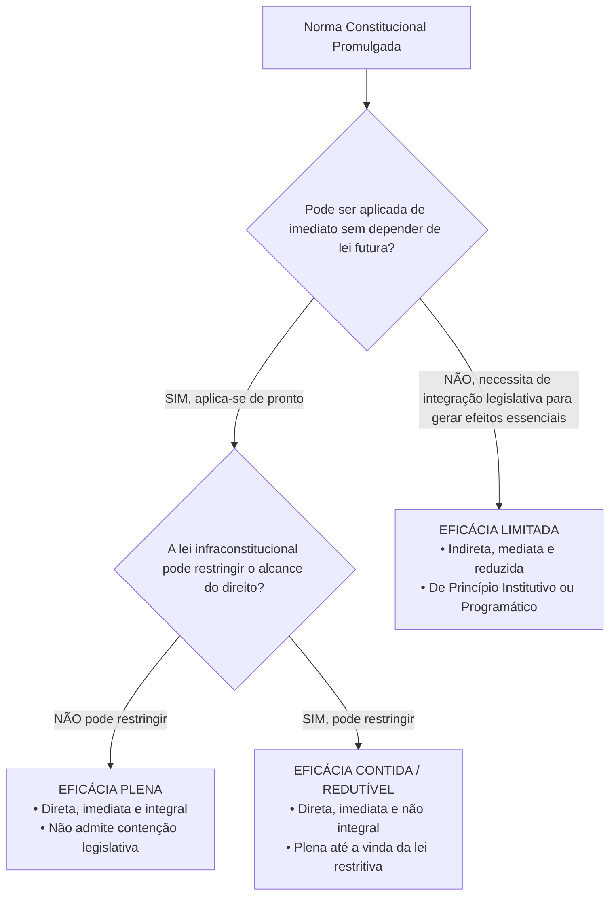
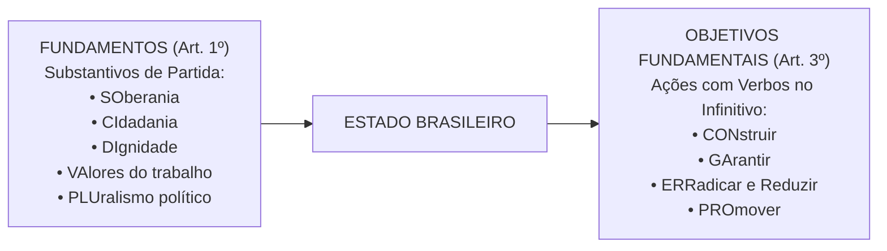

# 01 - Aplicabilidade das Normas Constitucionais e Princípios Fundamentais

> **Matéria:** Noções de Direito Constitucional  
> **Cargo:** A01 – Técnico de Controle Externo – Especialidade: Técnico Administrativo  
> **Arquivo:** `01_aplicabilidade_das_normas_e_principios_fundamentais.md`  
> **Status:** 🟢 Teoria Aprofundada + 5 Questões FCC Comentadas (A a E)

---

## 📌 Ementa Oficial do Edital
- Da aplicabilidade das normas constitucionais (Classificação de José Afonso da Silva).
- Normas constitucionais de eficácia plena, contida e limitada.
- Normas constitucionais programáticas e princípio da reserva do possível vs. mínimo existencial.
- Princípios Fundamentais da Constituição da República Federativa do Brasil de 1988 (Artigos 1º a 4º).
- Fundamentos da República Federativa do Brasil (Artigo 1º).
- Teoria da Separação dos Poderes e o sistema de freios e contrapesos (*Checks and Balances* - Artigo 2º).
- Objetivos fundamentais da República Federativa do Brasil (Artigo 3º).
- Princípios que regem a República Federativa do Brasil em suas relações internacionais (Artigo 4º).

---

## 🧭 Sumário

1. [Eficácia e Aplicabilidade das Normas Constitucionais](#1-eficacia-e-aplicabilidade-das-normas-constitucionais)
    1. [Classificação Tripartite de José Afonso da Silva](#11-classificacao-tripartite-de-jose-afonso-da-silva)
    2. [Eficácia Mínima das Normas Limitadas e Remédios contra Omissão](#12-eficacia-minima-das-normas-limitadas-e-remedios-contra-omissao)
    3. [Reserva do Possível versus Mínimo Existencial](#13-reserva-do-possivel-versus-minimo-existencial)
    4. [Teste 110](#Teste-110)
    5. [Teste 111](#Teste-111)
    6. [Teste 112](#Teste-112)
    7. [Teste 113](#Teste-113)
2. [Princípios Fundamentais da CF/88 (Título I - Arts. 1º a 4º)](#2-principios-fundamentais-da-cf88-titulo-i-arts-1o-a-4o)
    1. [Forma de Estado, Forma de Governo e Regime Político](#21-forma-de-estado-forma-de-governo-e-regime-politico)
    2. [Fundamentos da República Federativa do Brasil (Art. 1º)](#22-fundamentos-da-republica-federativa-do-brasil-art-1o)
    3. [Separação dos Poderes e o Sistema de Freios e Contrapesos (Art. 2º)](#23-separacao-dos-poderes-e-o-sistema-de-freios-e-contrapesos-art-2o)
    4. [Objetivos Fundamentais da República (Art. 3º)](#24-objetivos-fundamentais-da-republica-art-3o)
    5. [Princípios nas Relações Internacionais e Integração Latino-Americana (Art. 4º)](#25-principios-nas-relacoes-internacionais-e-integracao-latino-americana-art-4o)
    6. [Teste 114](#Teste-114)
    7. [Teste 115](#Teste-115)
    8. [Teste 116](#Teste-116)
    9. [Teste 117](#Teste-117)
    10. [Teste 118](#Teste-118)
    11. [Teste 119](#Teste-119)
    12. [Teste 120](#Teste-120)
6. [Fontes Recomendadas na Internet](#6-fontes-recomendadas-na-internet)

---

## 1. Eficácia e Aplicabilidade das Normas Constitucionais

O estudo da aplicabilidade das normas constitucionais investiga o grau de aptidão que cada preceito da Lei Fundamental possui para produzir efeitos jurídicos no mundo dos fatos desde a sua promulgação. No direito público brasileiro, a doutrina amplamente majoritária e a jurisprudência pacífica do Supremo Tribunal Federal (STF) consagram a classificação tripartite formulada pelo professor José Afonso da Silva.

### 1.1 Classificação Tripartite de José Afonso da Silva

| Classificação da Norma | Aplicabilidade | Depende de Lei Infraconstitucional? | Pode Ser Restringida por Lei? | Exemplos Canônicos na CF/88 |
|---|:---:|:---:|:---:|---|
| **Eficácia Plena** | **Direta, Imediata e Integral** | **NÃO** | **NÃO** | Art. 2º (Separação dos Poderes); Art. 5º, III (Vedação da tortura); Art. 5º, LVI (Inadmissibilidade de provas ilícitas). |
| **Eficácia Contida (ou Redutível)** | **Direta, Imediata e NÃO Integral** | **NÃO** (produz efeitos plenos desde a promulgação) | **SIM** (a lei infraconstitucional pode restringir seu alcance) | Art. 5º, XIII (Liberdade de exercício profissional atendidas qualificações da lei); Art. 5º, XII (Inviolabilidade de sigilo telefônico salvo ordem judicial). |
| **Eficácia Limitada** | **Indireta, Mediata e Reduzida** | **SIM** (depende de atuação integradora do legislador ordinário) | Não se aplica (o direito nasce contido e depende de ampliação legal) | Art. 37, VII (Direito de greve dos servidores públicos civis); Art. 196 (Direito à saúde como dever do Estado mediante políticas públicas). |

- **Normas de Eficácia Plena:** São aquelas que desde a promulgação da Constituição receberam do constituinte uma normatividade suficiente para serem aplicadas de pronto a situações concretas. Não dependem de qualquer regulamentação legal ulterior para produzirem todos os seus efeitos e não podem ser restringidas pelo legislador ordinário.
- **Normas de Eficácia Contida (ou Redutível / Prospectiva):** São normas que também produzem efeitos plenos e imediatos a partir da promulgação, mas nas quais o constituinte deixou expressa ou implicitamente uma cláusula de contenção (*"na forma da lei"*, *"atendidas as qualificações que a lei estabelecer"*, *"salvo disposição em contrário"*). Enquanto o legislador ordinário não editar a norma restritiva, o exercício do direito é pleno e irrestrito.
- **Normas de Eficácia Limitada:** Não produzem seus efeitos fundamentais de imediato, dependendo da interferência do legislador infraconstitucional para conferir densidade e viabilizar o exercício prático da prerrogativa. Subdividem-se em:
    1. *Normas de Princípio Institutivo (ou Organizatório):* Aquelas pelas quais o constituinte traça o esquema geral de criação e organização de órgãos, entidades ou instituições do Estado (ex.: art. 88 da CF/88, que dispõe que a lei disporá sobre a criação e extinção de Ministérios);
    2. *Normas de Princípio Programático:* Aquelas que estabelecem metas, programas sociais, diretrizes socioeconômicas e fins de interesse público a serem alcançados pelos poderes públicos (ex.: saúde, erradicação do analfabetismo, proteção ao meio ambiente).

### 1.2 Eficácia Mínima das Normas Limitadas e Remédios contra Omissão
Embora as normas de eficácia limitada não confiram exigibilidade imediata da prestação originária sem integração legislativa, é incorreto afirmar que elas são desprovidas de valor jurídico. A doutrina e a jurisprudência reconhecem a **eficácia jurídica mínima** dessas normas:

- **Eficácia Revogatória (ou Negativa):** Revogam automaticamente toda a legislação anterior que com elas seja materialmente incompatível (não recepção).
- **Eficácia Impeditiva:** Impedem a edição de leis futuras que contrariem seus vetores teleológicos, sob pena de inconstitucionalidade direta.
- **Eficácia Hermenêutica / Interpretativa:** Servem de vetor interpretativo obrigatório para juízes e administradores públicos.
- **Remédios Constitucionais contra a Omissão Inconstitucional:** Para combater a mora legislativa que inviabiliza o exercício de direitos previstos em normas de eficácia limitada, a Constituição consagrou o **Mandado de Injunção** (art. 5º, LXXI, e Lei nº 13.300/2016) e a **Ação Direta de Inconstitucionalidade por Omissão (ADO)** (art. 103, § 2º).

### 1.3 Reserva do Possível versus Mínimo Existencial
No controle judicial de políticas públicas decorrentes de normas programáticas (saúde, fornecimento de medicamentos de alto custo, vagas em creches):

- **Reserva do Possível (*Vorbehalt des Möglichen*):** Tese frequentemente invocada pela Fazenda Pública segundo a qual a efetivação dos direitos sociais condiciona-se à existência de capacidade orçamentária e financeira do Estado, bem como à discricionariedade do administrador na alocação de recursos escassos.
- **Mínimo Existencial:** Entendimento consolidado pelo STF no sentido de que a reserva do possível encontra limite intransponível no **núcleo essencial dos direitos fundamentais indispensáveis a uma vida digna** (mínimo existencial). Quando estiver em jogo a própria sobrevivência ou a integridade biológica do indivíduo, a alegação de insuficiência de recursos orçamentários torna-se inoponível ao cidadão.

---

### Teste 110
**(FGV – TRF/1 – 2024 – Analista Judiciario Area Apoio Especializado Especialidade Suporte Em Tecnologia Da Informacao)**
O Art. 2º da Emenda Constitucional nº X, com o objetivo de aperfeiçoar o controle da qualidade dos direitos prestacionais oferecidos à coletividade, determinou a criação, por lei complementar, de um conselho nacional de natureza interfederativa, que seria responsável pelo referido controle. Extrai-se do Art. 2º da Emenda Constitucional nº X uma norma de eficácia:

* **A)** plena;
* **B)** contida;
* **C)** limitada, de princípio institutivo;
* **D)** limitada, de natureza programática;
* **E)** restringível, mas de exigência imediata.

---

> **Comentário Detalhado:**
>
> - **A)** **Incorreta.** A opção apresenta proposição em desacordo com os fundamentos teóricos e técnicos do tópico ao afirmar que "plena". De acordo com a teoria estudada em *1.2 Eficácia Mínima das Normas Limitadas e Remédios contra Omissão*, remédios Constitucionais contra a Omissão Inconstitucional: Para combater a mora legislativa que inviabiliza o exercício de direitos previstos em normas de eficácia limitada, a Constituição consagrou o Mandado de Injunção (art. 5º, LXXI, e Lei nº 13.300/2016) e a Ação Direta de Inconstitucionalidade por Omissão (ADO) (art. 103, § 2º).
> - **B)** **Incorreta.** A opção apresenta proposição em desacordo com os fundamentos teóricos e técnicos do tópico ao afirmar que "contida". De acordo com a teoria estudada em *1.1 Classificação Tripartite de José Afonso da Silva*, eficácia Contida (ou Redutível): Direta, Imediata e NÃO Integral — NÃO (produz efeitos plenos desde a promulgação) — SIM (a lei infraconstitucional pode restringir seu alcance) — Art. 5º, XIII (Liberdade de exercício profissional atendidas qualificações da lei).
> - **C)** **Correta.** Conforme fundamentado na seção *1.1 Classificação Tripartite de José Afonso da Silva* deste guia, *Normas de Princípio Institutivo (ou Organizatório):* Aquelas pelas quais o constituinte traça o esquema geral de criação e organização de órgãos, entidades ou instituições do Estado (ex.: art. 88 da CF/88, que dispõe que a lei disporá sobre a criação e extinção de Ministérios). Dessa forma, está plenamente correta a assertiva da banca (FGV – TRF/1/2024) ao estabelecer que "limitada, de princípio institutivo".
> - **D)** **Incorreta.** A opção apresenta proposição em desacordo com os fundamentos teóricos e técnicos do tópico ao afirmar que "limitada, de natureza programática". De acordo com a teoria estudada em *1.1 Classificação Tripartite de José Afonso da Silva*, eficácia Limitada: Indireta, Mediata e Reduzida — SIM (depende de atuação integradora do legislador ordinário) — Não se aplica (o direito nasce contido e depende de ampliação legal) — Art. 37, VII (Direito de greve dos servidores públicos civis).
> - **E)** **Incorreta.** A opção apresenta proposição em desacordo com os fundamentos teóricos e técnicos do tópico ao afirmar que "restringível, mas de exigência imediata". De acordo com a teoria estudada em *1.2 Eficácia Mínima das Normas Limitadas e Remédios contra Omissão*, embora as normas de eficácia limitada não confiram exigibilidade imediata da prestação originária sem integração legislativa, é incorreto afirmar que elas são desprovidas de valor jurídico.
>
> **Gabarito: C**

---

### Teste 111
**(FGV – TCE/PI – 2025 – Auditor de Controle Externo - Controle Externo - Específica de Área Comum)**
O Art. 92-B, §2º, do Ato das Disposições Constitucionais Transitórias da Constituição da República, acrescido pela Emenda Constitucional nº 132/2023, tem a seguinte redação: Lei complementar instituirá Fundo de Sustentabilidade e Diversificação Econômica do Estado do Amazonas, que será constituído com recursos da União e por ela gerido, com a efetiva participação do Estado do Amazonas na definição das políticas, com o objetivo de fomentar o desenvolvimento e a diversificação das atividades econômicas no Estado. A interpretação desse comando normativo permite concluir que se está perante norma de

* **A)** eficácia contida.
* **B)** aplicabilidade imediata.
* **C)** aplicabilidade direta, mas não integral.
* **D)** eficácia limitada e de princípio institutivo.
* **E)** eficácia limitada e de princípio programático.

---

> **Comentário Detalhado:**
>
> - **A)** **Incorreta.** A opção apresenta proposição em desacordo com os fundamentos teóricos e técnicos do tópico ao afirmar que "eficácia contida". De acordo com a teoria estudada em *1.2 Eficácia Mínima das Normas Limitadas e Remédios contra Omissão*, remédios Constitucionais contra a Omissão Inconstitucional: Para combater a mora legislativa que inviabiliza o exercício de direitos previstos em normas de eficácia limitada, a Constituição consagrou o Mandado de Injunção (art. 5º, LXXI, e Lei nº 13.300/2016) e a Ação Direta de Inconstitucionalidade por Omissão (ADO) (art. 103, § 2º).
> - **B)** **Incorreta.** A opção apresenta proposição em desacordo com os fundamentos teóricos e técnicos do tópico ao afirmar que "aplicabilidade imediata". De acordo com a teoria estudada em *1.2 Eficácia Mínima das Normas Limitadas e Remédios contra Omissão*, embora as normas de eficácia limitada não confiram exigibilidade imediata da prestação originária sem integração legislativa, é incorreto afirmar que elas são desprovidas de valor jurídico.
> - **C)** **Incorreta.** A opção apresenta proposição em desacordo com os fundamentos teóricos e técnicos do tópico ao afirmar que "aplicabilidade direta, mas não integral". De acordo com a teoria estudada em *1.1 Classificação Tripartite de José Afonso da Silva*, eficácia Contida (ou Redutível): Direta, Imediata e NÃO Integral — NÃO (produz efeitos plenos desde a promulgação) — SIM (a lei infraconstitucional pode restringir seu alcance) — Art. 5º, XIII (Liberdade de exercício profissional atendidas qualificações da lei).
> - **D)** **Correta.** Conforme fundamentado na seção *1.1 Classificação Tripartite de José Afonso da Silva* deste guia, *Normas de Princípio Institutivo (ou Organizatório):* Aquelas pelas quais o constituinte traça o esquema geral de criação e organização de órgãos, entidades ou instituições do Estado (ex.: art. 88 da CF/88, que dispõe que a lei disporá sobre a criação e extinção de Ministérios). Dessa forma, está plenamente correta a assertiva da banca (FGV – TCE/PI/2025) ao estabelecer que "eficácia limitada e de princípio institutivo".
> - **E)** **Incorreta.** A opção apresenta proposição em desacordo com os fundamentos teóricos e técnicos do tópico ao afirmar que "eficácia limitada e de princípio programático". De acordo com a teoria estudada em *1.1 Classificação Tripartite de José Afonso da Silva*, *Normas de Princípio Programático:* Aquelas que estabelecem metas, programas sociais, diretrizes socioeconômicas e fins de interesse público a serem alcançados pelos poderes públicos (ex.: saúde, erradicação do analfabetismo, proteção ao meio ambiente).
>
> **Gabarito: D**

---

### Teste 112
**(FGV – TCE/SC – 2026 – Auditor Fiscal de Controle Externo - Administração)**
A Emenda Constitucional nº X (ECX) alterou o Art. W da Constituição da República, que veicula comando afeto ao direito constitucional financeiro, direcionado ao ciclo orçamentário, em norma de aplicabilidade imediata e eficácia contida. Em razão da natureza dessa norma, surgiram dúvidas, no âmbito do controle externo de determinado Tribunal de Contas, em relação à necessidade, ou não, de ser observada. A dúvida decorria do fato de existir lei estadual preexistente, a LY, dispondo em sentido contrário, e de ainda não ter sido editada lei posterior à ECX sobre a temática, federal ou estadual. Na situação descrita, é correto afirmar que a ECX

* **A)** suspendeu a eficácia da LY, o que irá perdurar até a sua regulamentação.
* **B)** revogou a LY, produzindo efeitos independentemente de qualquer regulamentação.
* **C)** somente produzirá efeitos após a edição de lei federal que veiculará as normas gerais.
* **D)** somente produzirá efeitos após a sua regulamentação, com a edição de lei federal ou estadual.
* **E)** somente terá a sua eficácia integrada após a sua regulamentação, mas isso não obsta a produção de alguns efeitos, como a revogação da LY.

---

> **Comentário Detalhado:**
>
> - **A)** **Incorreta.** A opção apresenta proposição em desacordo com os fundamentos teóricos e técnicos do tópico ao afirmar que "suspendeu a eficácia da LY, o que irá perdurar até a sua regulamentação". De acordo com a teoria estudada em *1.1 Classificação Tripartite de José Afonso da Silva*, normas de Eficácia Contida (ou Redutível / Prospectiva): São normas que também produzem efeitos plenos e imediatos a partir da promulgação, mas nas quais o constituinte deixou expressa ou implicitamente uma cláusula de contenção (*"na forma da lei"*, *"atendidas as qualificações que a lei estabelecer"*, *"salvo disposição em contrário"*).
> - **B)** **Correta.** Conforme fundamentado na seção *1.1 Classificação Tripartite de José Afonso da Silva* deste guia, não dependem de qualquer regulamentação legal ulterior para produzirem todos os seus efeitos e não podem ser restringidas pelo legislador ordinário. Dessa forma, está plenamente correta a assertiva da banca (FGV – TCE/SC/2026) ao estabelecer que "revogou a LY, produzindo efeitos independentemente de qualquer regulamentação".
> - **C)** **Incorreta.** A opção incorre em restrição indevida ao limitar o escopo conceitual ao afirmar que "somente produzirá efeitos após a edição de lei federal que veiculará as normas gerais". De acordo com a teoria estudada em *1. Eficácia e Aplicabilidade das Normas Constitucionais*, o estudo da aplicabilidade das normas constitucionais investiga o grau de aptidão que cada preceito da Lei Fundamental possui para produzir efeitos jurídicos no mundo dos fatos desde a sua promulgação.
> - **D)** **Incorreta.** A opção incorre em restrição indevida ao limitar o escopo conceitual ao afirmar que "somente produzirá efeitos após a sua regulamentação, com a edição de lei federal ou estadual". De acordo com a teoria estudada em *1.1 Classificação Tripartite de José Afonso da Silva*, eficácia Contida (ou Redutível): Direta, Imediata e NÃO Integral — NÃO (produz efeitos plenos desde a promulgação) — SIM (a lei infraconstitucional pode restringir seu alcance) — Art. 5º, XIII (Liberdade de exercício profissional atendidas qualificações da lei).
> - **E)** **Incorreta.** A opção incorre em restrição indevida ao limitar o escopo conceitual ao afirmar que "somente terá a sua eficácia integrada após a sua regulamentação, mas isso não obsta a produção de alguns efeitos...". De acordo com a teoria estudada em *1.1 Classificação Tripartite de José Afonso da Silva*, normas de Eficácia Limitada: Não produzem seus efeitos fundamentais de imediato, dependendo da interferência do legislador infraconstitucional para conferir densidade e viabilizar o exercício prático da prerrogativa. Subdividem-se em.
>
> **Gabarito: B**

---

### Teste 113
**(FGV – TCE/GO – 2024 – Analista de Controle Externo - Ciências Contábeis)**
O Estado Alfa editou a Lei nº X, em matéria de competência legislativa concorrente com a União, em momento no qual este ente federativo ainda não tinha editado nenhuma norma a respeito da temática. Apesar desse diploma normativo ter sido enaltecido pela coletividade, muitos argumentavam com a sua inconstitucionalidade. À luz da sistemática constitucional vigente, é correto afirmar que o Estado Alfa

* **A)** não poderia ter editado a Lei nº X enquanto a União não legislasse sobre a temática.
* **B)** somente poderia legislar sobre a temática se houvesse lei complementar autorizando-o.
* **C)** editou corretamente a Lei nº X, e, caso colida com norma geral que venha a ser editada pela União, continuará válida, mas se tornará ineficaz.
* **D)** tinha competência legislativa plena para legislar sobre a temática, sendo que a Lei nº X será tida como revogada quando sobrevier a lei da União.
* **E)** pode legislar sobre a temática, sendo que a Lei nº X tem preeminência, no âmbito do seu território, em relação às normas gerais que venham a ser editadas pela União.

---

> **Comentário Detalhado:**
>
> - **A)** **Incorreta.** A opção apresenta proposição em desacordo com os fundamentos teóricos e técnicos do tópico ao afirmar que "não poderia ter editado a Lei nº X enquanto a União não legislasse sobre a temática". De acordo com a teoria estudada em *1.1 Classificação Tripartite de José Afonso da Silva*, enquanto o legislador ordinário não editar a norma restritiva, o exercício do direito é pleno e irrestrito.
> - **B)** **Incorreta.** A opção incorre em restrição indevida ao limitar o escopo conceitual ao afirmar que "somente poderia legislar sobre a temática se houvesse lei complementar autorizando-o". De acordo com a teoria estudada em *1.1 Classificação Tripartite de José Afonso da Silva*, *Normas de Princípio Institutivo (ou Organizatório):* Aquelas pelas quais o constituinte traça o esquema geral de criação e organização de órgãos, entidades ou instituições do Estado (ex.: art. 88 da CF/88, que dispõe que a lei disporá sobre a criação e extinção de Ministérios).
> - **C)** **Correta.** Conforme fundamentado na seção *1.1 Classificação Tripartite de José Afonso da Silva* deste guia, classificação da Norma: Aplicabilidade — Depende de Lei Infraconstitucional? — Pode Ser Restringida por Lei? — Exemplos Canônicos na CF/88. Dessa forma, está plenamente correta a assertiva da banca (FGV – TCE/GO/2024) ao estabelecer que "editou corretamente a Lei nº X, e, caso colida com norma geral que venha a ser editada pela União, continuará...".
> - **D)** **Incorreta.** A opção apresenta proposição em desacordo com os fundamentos teóricos e técnicos do tópico ao afirmar que "tinha competência legislativa plena para legislar sobre a temática, sendo que a Lei nº X será tida como revogada...". De acordo com a teoria estudada em *1.2 Eficácia Mínima das Normas Limitadas e Remédios contra Omissão*, remédios Constitucionais contra a Omissão Inconstitucional: Para combater a mora legislativa que inviabiliza o exercício de direitos previstos em normas de eficácia limitada, a Constituição consagrou o Mandado de Injunção (art. 5º, LXXI, e Lei nº 13.300/2016) e a Ação Direta de Inconstitucionalidade por Omissão (ADO) (art. 103, § 2º).
> - **E)** **Incorreta.** A opção apresenta proposição em desacordo com os fundamentos teóricos e técnicos do tópico ao afirmar que "pode legislar sobre a temática, sendo que a Lei nº X tem preeminência, no âmbito do seu território, em relação às...". De acordo com a teoria estudada em *2.3 Separação dos Poderes e o Sistema de Freios e Contrapesos (Art. 2º)*, poder Legislativo: Funções típicas: legislar (elaborar normas gerais e abstratas) e fiscalizar (controle financeiro e contábil externo com auxílio dos Tribunais de Contas).
>
> **Gabarito: C**

---

## 2. Princípios Fundamentais da CF/88 (Título I - Arts. 1º a 4º)

O Título I da Constituição Federal delimita as decisões políticas estruturantes do Estado brasileiro.

### 2.1 Forma de Estado, Forma de Governo e Regime Político
- **Forma de Estado: Federação.** Caracteriza-se pela descentralização política, coexistência de esferas federativas autônomas (União, Estados, Distrito Federal e Municípios), vedação ao direito de secessão e proteção sob cláusula pétrea explícita (art. 60, § 4º, I).
- **Forma de Governo: República.** Caracteriza-se pela eletividade e temporariedade dos mandatos dos governantes, pela responsabilidade política e jurídica dos agentes públicos e pelo dever republicano de prestar contas perante a sociedade e as Cortes de Contas.
- **Regime Político: Democracia Semidireta (ou Participativa).** Conforme o art. 1º, parágrafo único: *"Todo o poder emana do povo, que o exerce por meio de representantes eleitos ou diretamente, nos termos desta Constituição."* O exercício direto manifesta-se por meio do **plebiscito**, do **referendo** e da **iniciativa popular** de leis (art. 14, I, II e III).

### 2.2 Fundamentos da República Federativa do Brasil (Art. 1º)
Os fundamentos consubstanciam as bases estruturais sobre as quais se erige o Estado brasileiro. São expressos por substantivos e memorizados pelo consagrado mnemônico **SO-CI-DI-VA-PLU**:

1. **SOberania:** Poder supremo no plano interno e independente na ordem internacional;
2. **CIdadania:** Prerrogativa de participação ativa na vida política do país e na formação das decisões estatais;
3. **DIgnidade da Pessoa Humana:** Matriz axiológica de todo o ordenamento jurídico, que coloca o ser humano como fim primordial do Estado, e não mero instrumento;
4. **VAlores Sociais do Trabalho e da Livre Iniciativa:** Reconhecimento concomitante do trabalho como fonte de emancipação social e da liberdade econômica de mercado como motor da produção de riquezas;
5. **PLUralismo Político:** Abertura para a livre manifestação e convivência harmoniosa de diferentes correntes ideológicas, filosóficas e políticas.

> 🚨 **ALERTA DE PROVA / PEGADINHA FCC:**  
> A banca FCC frequentemente tenta confundir o candidato trocando **pluralismo político** por **pluripartidarismo**. O pluripartidarismo (liberdade de criação de partidos políticos) é apenas uma das dimensões instrumentais do pluralismo político, que é um conceito infinitamente mais amplo de liberdade de pensamento e de cosmovisão.

### 2.3 Separação dos Poderes e o Sistema de Freios e Contrapesos (Art. 2º)
O art. 2º da Carta Magna estabelece: *"São Poderes da União, independentes e harmônicos entre si, o Legislativo, o Executivo e o Judiciário."*

No modelo do constitucionalismo contemporâneo:

- **Não há separação estanque ou absoluta:** Cada Poder desempenha uma **função típica preponderante** e **funções atípicas secundárias** expressamente delimitadas pela Constituição:
    - **Poder Executivo:** Função típica: governar e administrar a coisa pública; Funções atípicas: legislar (ao editar medidas provisórias e leis delegadas) e julgar (ao decidir processos administrativos e disciplinares).
    - **Poder Legislativo:** Funções típicas: legislar (elaborar normas gerais e abstratas) e fiscalizar (controle financeiro e contábil externo com auxílio dos Tribunais de Contas); Funções atípicas: administrar (gerir seu quadro funcional e contratos) e julgar (o Senado julga o Presidente da República e Ministros do STF em crimes de responsabilidade).
    - **Poder Judiciário:** Função típica: jurisdicional (dizer o direito no caso concreto com definitividade); Funções atípicas: administrar (realizar licitações e prover cargos) e legislar (elaborar os regimentos internos de seus tribunais).
- **Sistema de Freios e Contrapesos (*Checks and Balances*):** Mecanismo de controle recíproco em que um Poder limita e fiscaliza a atuação do outro, prevenindo abusos e garantindo a harmonia institucional (ex.: veto do Presidente a projetos de lei; sabatina e aprovação de ministros pelo Senado; controle de constitucionalidade de leis e atos do Executivo exercido pelo Judiciário).

### 2.4 Objetivos Fundamentais da República (Art. 3º)
Os objetivos fundamentais consubstanciam as metas de chegada e as finalidades que o Estado brasileiro deve perseguir. Diferenciam-se dos fundamentos porque começam invariavelmente por **VERBOS NO INFINITIVO** (Mnemônico **CON-GA-ERRA-PRO**):

1. **CON**struir uma sociedade livre, justa e solidária;
2. **GA**rantir o desenvolvimento nacional;
3. **ERRA**dicar a pobreza e a marginalização e **reduzir as desigualdades sociais e regionais**;
4. **PRO**mover o bem de todos, sem preconceitos de origem, raça, sexo, cor, idade e quaisquer outras formas de discriminação.

### 2.5 Princípios nas Relações Internacionais e Integração Latino-Americana (Art. 4º)
A República Federativa do Brasil rege-se em suas relações internacionais pelos seguintes princípios:

1. Independência nacional;
2. Prevalência dos direitos humanos;
3. Autodeterminação dos povos;
4. Não intervenção;
5. Igualdade entre os Estados;
6. Defesa da paz;
7. Solução pacífica dos conflitos;
8. Repúdio ao terrorismo e ao racismo;
9. Cooperação entre os povos para o progresso da humanidade;
10. Concessão de asilo político.

- **Parágrafo Único do Art. 4º:** Estabelece expressamente que o Brasil buscará a **integração econômica, política, social e cultural dos povos da América Latina**, visando à formação de uma **comunidade latino-americana de nações**.

> 🚨 **ALERTA DE PROVA / PEGADINHA FCC:**  
> A banca examinadora costuma substituir ardilosamente a expressão constitucional **América Latina** por "América do Sul", "Mercosul" ou "países lusófonos". Atenção máxima: a redação do parágrafo único do art. 4º consagra expressamente a **América Latina**!

---

### Teste 114
**(FGV – TCE/SC – 2026 – Auditor Fiscal de Controle Externo - Administração)**
O Tribunal de Contas da União (TCU) é órgão de controle externo responsável pelo controle da Administração Pública no âmbito federal. Considerando as disposições acerca do tema na Constituição Federal de 1988, é correto afirmar que o TCU

* **A)** em nenhuma hipótese poderá fiscalizar a atuação de órgãos e entidades estaduais e municipais, sendo tal competência exclusiva dos respectivos Tribunais de Contas.
* **B)** poderá fiscalizar a atuação de órgãos e entidades estaduais e municipais no que diz respeito aos recursos repassados a esses pela União mediante convênio, acordo, ajuste ou outros instrumentos congêneres.
* **C)** poderá sustar ato ou contrato do órgão Estadual quando não atendida a determinação exarada pelo Tribunal de Contas Estadual respectivo, observados os princípios da accountability e responsabilidade fiscal.
* **D)** é a entidade Superior Fiscalizadora do Estado Brasileiro, tendo competência para reformar, em sede recursal, as decisões exaradas pelos Tribunais de Contas dos Estados.
* **E)** poderá, de ofício ou por provocação, mediante decisão de dois terços dos seus membros, após reiteradas decisões sobre matéria de controle, aprovar súmula que, a partir de sua publicação na imprensa oficial, terá efeito vinculante em relação aos Tribunais de Contas dos Estados e Municípios.

---

> **Comentário Detalhado:**
>
> - **A)** **Incorreta.** A opção apresenta vedação ou negativa absoluta incompatível com a regra aplicável ao afirmar que "em nenhuma hipótese poderá fiscalizar a atuação de órgãos e entidades estaduais e municipais, sendo tal...". De acordo com a teoria estudada em *2.3 Separação dos Poderes e o Sistema de Freios e Contrapesos (Art. 2º)*, poder Legislativo: Funções típicas: legislar (elaborar normas gerais e abstratas) e fiscalizar (controle financeiro e contábil externo com auxílio dos Tribunais de Contas).
> - **B)** **Correta.** Conforme fundamentado na seção *1.1 Classificação Tripartite de José Afonso da Silva* deste guia, *Normas de Princípio Institutivo (ou Organizatório):* Aquelas pelas quais o constituinte traça o esquema geral de criação e organização de órgãos, entidades ou instituições do Estado (ex.: art. 88 da CF/88, que dispõe que a lei disporá sobre a criação e extinção de Ministérios). Dessa forma, está plenamente correta a assertiva da banca (FGV – TCE/SC/2026) ao estabelecer que "poderá fiscalizar a atuação de órgãos e entidades estaduais e municipais no que diz respeito aos recursos...".
> - **C)** **Incorreta.** A opção apresenta proposição em desacordo com os fundamentos teóricos e técnicos do tópico ao afirmar que "poderá sustar ato ou contrato do órgão Estadual quando não atendida a determinação exarada pelo Tribunal de Contas...". De acordo com a teoria estudada em *2.1 Forma de Estado, Forma de Governo e Regime Político*, forma de Governo: República. Caracteriza-se pela eletividade e temporariedade dos mandatos dos governantes, pela responsabilidade política e jurídica dos agentes públicos e pelo dever republicano de prestar contas perante a sociedade e as Cortes de Contas.
> - **D)** **Incorreta.** A opção apresenta proposição em desacordo com os fundamentos teóricos e técnicos do tópico ao afirmar que "é a entidade Superior Fiscalizadora do Estado Brasileiro, tendo competência para reformar, em sede recursal, as...". De acordo com a teoria estudada em *2.1 Forma de Estado, Forma de Governo e Regime Político*, caracteriza-se pela descentralização política, coexistência de esferas federativas autônomas (União, Estados, Distrito Federal e Municípios), vedação ao direito de secessão e proteção sob cláusula pétrea explícita (art. 60, § 4º, I).
> - **E)** **Incorreta.** A opção apresenta proposição em desacordo com os fundamentos teóricos e técnicos do tópico ao afirmar que "poderá, de ofício ou por provocação, mediante decisão de dois terços dos seus membros, após reiteradas decisões...". De acordo com a teoria estudada em *2.3 Separação dos Poderes e o Sistema de Freios e Contrapesos (Art. 2º)*, o art. 2º da Carta Magna estabelece: *"São Poderes da União, independentes e harmônicos entre si, o Legislativo, o Executivo e o Judiciário."*.
>
> **Gabarito: B**

---

### Teste 115
**(CEBRASPE – TJ/DFT – 2015 – Analista Judiciario Suporte Em Tecnologia Da Informacao)**
O COBIT 5 descreve um modelo único e integrado de princípios que permite governar e gerir a TI de forma holística para toda a organização, o que abrange todas as áreas responsáveis pelas funções de TI e considera tanto os interesses internos quanto os interesses externos relacionados à TI.

* **C)** Certo
* **E)** Errado

---

> **Comentário Detalhado:**
>
> - **C)** **Correta.** O item está **Certo**. Conforme fundamentado na seção *2.3 Separação dos Poderes e o Sistema de Freios e Contrapesos (Art. 2º)* deste guia, poder Executivo: Função típica: governar e administrar a coisa pública; Funções atípicas: legislar (ao editar medidas provisórias e leis delegadas) e julgar (ao decidir processos administrativos e disciplinares). Dessa forma, está plenamente correta a proposição da banca (CEBRASPE – TJ/DFT/2015) ao afirmar que "O COBIT 5 descreve um modelo único e integrado de princípios que permite governar e gerir a TI de forma...".
> - **E)** **Incorreta.** A marcação como **Errado** não procede, visto que a assertiva guarda integral conformidade com a teoria estudada em *2.3 Separação dos Poderes e o Sistema de Freios e Contrapesos (Art. 2º)*, segundo a qual funções atípicas: administrar (gerir seu quadro funcional e contratos) e julgar (o Senado julga o Presidente da República e Ministros do STF em crimes de responsabilidade).
>
> **Gabarito: C**

---

### Teste 116
**(FGV – TCE/SC – 2026 – Auditor Fiscal de Controle Externo - Direito)**
Leia o segmento textual a seguir. A fundamentar o entendimento de que o Tribunal de Contas exerce função jurisdicional está o argumento de que a competência de “julgar”, constante da letra do Art. 71, II, indica que o Tribunal de Contas foi investido, ainda que parcialmente, de jurisdição específica de julgar as contas dos responsáveis por dinheiros e outros bens públicos. E se assim não se considerasse, de modo a permitir que após a decisão definitiva da Corte de Cortas pudesse ser revista, em seu mérito, em regra, pelo Poder Judiciário, tratar-se-ia de um órgão inócuo. O segmento deve ser classificado, em seu modo de organização discursiva e em sua tipologia, como

* **A)** texto narrativo histórico, que tem por objeto sucessivas decisões de Tribunais.
* **B)** texto dissertativo expositivo de caráter didático.
* **C)** texto descritivo de caráter jurídico, destacando-se marcas típicas dos processos judiciais corretamente conduzidos.
* **D)** texto dissertativo de caráter argumentativo, com a defesa de uma ideia.
* **E)** texto dissertativo de tipo informativo, atualizando os leitores no conhecimento jurídico.

---

> **Comentário Detalhado:**
>
> - **A)** **Correta.** Conforme fundamentado na seção *2.3 Separação dos Poderes e o Sistema de Freios e Contrapesos (Art. 2º)* deste guia, poder Judiciário: Função típica: jurisdicional (dizer o direito no caso concreto com definitividade); Funções atípicas: administrar (realizar licitações e prover cargos) e legislar (elaborar os regimentos internos de seus tribunais). Dessa forma, está plenamente correta a assertiva da banca (FGV – TCE/SC/2026) ao estabelecer que "texto narrativo histórico, que tem por objeto sucessivas decisões de Tribunais".
> - **B)** **Incorreta.** A opção apresenta proposição em desacordo com os fundamentos teóricos e técnicos do tópico ao afirmar que "texto dissertativo expositivo de caráter didático". De acordo com a teoria estudada em *2.3 Separação dos Poderes e o Sistema de Freios e Contrapesos (Art. 2º)*, poder Legislativo: Funções típicas: legislar (elaborar normas gerais e abstratas) e fiscalizar (controle financeiro e contábil externo com auxílio dos Tribunais de Contas).
> - **C)** **Incorreta.** A opção apresenta proposição em desacordo com os fundamentos teóricos e técnicos do tópico ao afirmar que "texto descritivo de caráter jurídico, destacando-se marcas típicas dos processos judiciais corretamente conduzidos". De acordo com a teoria estudada em *2.3 Separação dos Poderes e o Sistema de Freios e Contrapesos (Art. 2º)*, poder Executivo: Função típica: governar e administrar a coisa pública; Funções atípicas: legislar (ao editar medidas provisórias e leis delegadas) e julgar (ao decidir processos administrativos e disciplinares).
> - **D)** **Incorreta.** A opção apresenta proposição em desacordo com os fundamentos teóricos e técnicos do tópico ao afirmar que "texto dissertativo de caráter argumentativo, com a defesa de uma ideia". De acordo com a teoria estudada em *2.2 Fundamentos da República Federativa do Brasil (Art. 1º)*, cIdadania: Prerrogativa de participação ativa na vida política do país e na formação das decisões estatais.
> - **E)** **Incorreta.** A opção apresenta proposição em desacordo com os fundamentos teóricos e técnicos do tópico ao afirmar que "texto dissertativo de tipo informativo, atualizando os leitores no conhecimento jurídico". De acordo com a teoria estudada em *2.2 Fundamentos da República Federativa do Brasil (Art. 1º)*, dIgnidade da Pessoa Humana: Matriz axiológica de todo o ordenamento jurídico, que coloca o ser humano como fim primordial do Estado, e não mero instrumento.
>
> **Gabarito: A**

---

### Teste 117
**(FGV – TCE/PA – 2024 – Auditor de Controle Externo - Administrativa - Administração)**
Os princípios orçamentários são diretrizes fundamentais que orientam a elaboração, execução e controle dos orçamentos públicos e privados, assegurando transparência, responsabilidade e eficiência na gestão dos recursos financeiros. Assinale a opção que indica o princípio orçamentário que evita múltiplos orçamentos paralelos dentro da mesma pessoa política.

* **A)** Totalidade.
* **B)** Orçamento bruto.
* **C)** Legalidade.
* **D)** Isonomia.
* **E)** Controle.

---

> **Comentário Detalhado:**
>
> - **A)** **Correta.** Conforme fundamentado na seção *2.1 Forma de Estado, Forma de Governo e Regime Político* deste guia, forma de Governo: República. Caracteriza-se pela eletividade e temporariedade dos mandatos dos governantes, pela responsabilidade política e jurídica dos agentes públicos e pelo dever republicano de prestar contas perante a sociedade e as Cortes de Contas. Dessa forma, está plenamente correta a assertiva da banca (FGV – TCE/PA/2024) ao estabelecer que "Totalidade".
> - **B)** **Incorreta.** A opção apresenta proposição em desacordo com os fundamentos teóricos e técnicos do tópico ao afirmar que "Orçamento bruto". De acordo com a teoria estudada em *1.1 Classificação Tripartite de José Afonso da Silva*, *Normas de Princípio Programático:* Aquelas que estabelecem metas, programas sociais, diretrizes socioeconômicas e fins de interesse público a serem alcançados pelos poderes públicos (ex.: saúde, erradicação do analfabetismo, proteção ao meio ambiente).
> - **C)** **Incorreta.** A opção apresenta proposição em desacordo com os fundamentos teóricos e técnicos do tópico ao afirmar que "Legalidade". De acordo com a teoria estudada em *1.3 Reserva do Possível versus Mínimo Existencial*, quando estiver em jogo a própria sobrevivência ou a integridade biológica do indivíduo, a alegação de insuficiência de recursos orçamentários torna-se inoponível ao cidadão.
> - **D)** **Incorreta.** A opção apresenta proposição em desacordo com os fundamentos teóricos e técnicos do tópico ao afirmar que "Isonomia". De acordo com a teoria estudada em *2.5 Princípios nas Relações Internacionais e Integração Latino-Americana (Art. 4º)*, parágrafo Único do Art. 4º: Estabelece expressamente que o Brasil buscará a integração econômica, política, social e cultural dos povos da América Latina, visando à formação de uma comunidade latino-americana de nações.
> - **E)** **Incorreta.** A opção apresenta proposição em desacordo com os fundamentos teóricos e técnicos do tópico ao afirmar que "Controle". De acordo com a teoria estudada em *2. Princípios Fundamentais da CF/88 (Título I - Arts. 1º a 4º)*, o Título I da Constituição Federal delimita as decisões políticas estruturantes do Estado brasileiro.
>
> **Gabarito: A**

---

### Teste 118
**(CEBRASPE – TRT/10 – 2013 – Analista Judiciario Tecnologia Da Informacao)**
Infere-se da leitura do texto que a eliminação de todas as formas de discriminação, que abrange a promoção da igualdade de oportunidades, constitui o fundamento da Declaração dos Direitos e Princípios Fundamentais do Trabalho e da Agenda do Trabalho Decente da OIT. com o código E, caso julgue o item ERRADO. A ausência de seja, não receberão pontuação negativa. Para as devidas marcações, suas provas objetivas. BÁSICOS

* **C)** Certo
* **E)** Errado

---

> **Comentário Detalhado:**
>
> - **C)** **Incorreta.** A marcação como **Certo** não procede, pois o enunciado apresenta proposição em desacordo com os fundamentos teóricos e técnicos do tópico ao afirmar que "Infere-se da leitura do texto que a eliminação de todas as formas de discriminação, que abrange a promoção da...". De acordo com a teoria estudada em *1.3 Reserva do Possível versus Mínimo Existencial*, mínimo Existencial: Entendimento consolidado pelo STF no sentido de que a reserva do possível encontra limite intransponível no núcleo essencial dos direitos fundamentais indispensáveis a uma vida digna (mínimo existencial).
> - **E)** **Correta.** O item está **Errado** (gabarito oficial: **E**). Conforme fundamentado na seção *2.4 Objetivos Fundamentais da República (Art. 3º)* deste guia, pROmover o bem de todos, sem preconceitos de origem, raça, sexo, cor, idade e quaisquer outras formas de discriminação. Portanto, a assertiva examinada pela banca (CEBRASPE – TRT/10/2013) viola os preceitos técnicos do tópico.
>
> **Gabarito: E**

---

### Teste 119
**(FGV – TCE/PA – 2024 – Auditor de Controle Externo - Administrativa - Gestão Governamental)**
Analise as afirmativas a seguir. I. A prevenção do juízo é definida pelo registro ou a distribuição da petição inicial. II. A competência determinada em razão da pessoa é derrogável por convenção das partes. III. É competente o foro do lugar onde está a sede, para a ação em que for ré pessoa jurídica. IV. Para as ações fundadas em direito real sobre imóveis é competente o foro de situação da coisa. Está correto o que se afirma em

* **A)** I e II, apenas.
* **B)** I, III e IV, apenas.
* **C)** II e III, apenas.
* **D)** I, II e IV, apenas.
* **E)** I e III, apenas.

---

> **Comentário Detalhado:**
>
> - **A)** **Incorreta.** A opção incorre em restrição indevida ao limitar o escopo conceitual ao afirmar que "I e II, apenas". De acordo com a teoria estudada em *1.1 Classificação Tripartite de José Afonso da Silva*, eficácia Plena: Direta, Imediata e Integral — NÃO — NÃO — Art. 2º (Separação dos Poderes); Art. 5º, III (Vedação da tortura); Art. 5º, LVI (Inadmissibilidade de provas ilícitas).
> - **B)** **Correta.** Conforme fundamentado na seção *2.1 Forma de Estado, Forma de Governo e Regime Político* deste guia, conforme o art. 1º, parágrafo único: *"Todo o poder emana do povo, que o exerce por meio de representantes eleitos ou diretamente, nos termos desta Constituição."* O exercício direto manifesta-se por meio do plebiscito, do referendo e da iniciativa popular de leis (art. 14, I, II e III). Dessa forma, está plenamente correta a assertiva da banca (FGV – TCE/PA/2024) ao estabelecer que "I, III e IV, apenas".
> - **C)** **Incorreta.** A opção incorre em restrição indevida ao limitar o escopo conceitual ao afirmar que "II e III, apenas". De acordo com a teoria estudada em *2.2 Fundamentos da República Federativa do Brasil (Art. 1º)*, dIgnidade da Pessoa Humana: Matriz axiológica de todo o ordenamento jurídico, que coloca o ser humano como fim primordial do Estado, e não mero instrumento.
> - **D)** **Incorreta.** A opção incorre em restrição indevida ao limitar o escopo conceitual ao afirmar que "I, II e IV, apenas". De acordo com a teoria estudada em *2.3 Separação dos Poderes e o Sistema de Freios e Contrapesos (Art. 2º)*, poder Executivo: Função típica: governar e administrar a coisa pública; Funções atípicas: legislar (ao editar medidas provisórias e leis delegadas) e julgar (ao decidir processos administrativos e disciplinares).
> - **E)** **Incorreta.** A opção incorre em restrição indevida ao limitar o escopo conceitual ao afirmar que "I e III, apenas". De acordo com a teoria estudada em *2.1 Forma de Estado, Forma de Governo e Regime Político*, forma de Governo: República. Caracteriza-se pela eletividade e temporariedade dos mandatos dos governantes, pela responsabilidade política e jurídica dos agentes públicos e pelo dever republicano de prestar contas perante a sociedade e as Cortes de Contas.
>
> **Gabarito: B**

---

### Teste 120
**(FGV – TCE/PI – 2025 – Auditor de Controle Externo - Controle Externo - Específica de Área Comum)**
Sobre a organização, os papéis e as funções constitucionais e jurisprudenciais atribuídas aos Tribunais de Contas, avalie as afirmativas a seguir. I. Na ausência do Ministério Público Especial, de atuação específica no Tribunal de Contas Estadual, é constitucional o dispositivo da Lei Orgânica dessa Corte que possibilita a atuação de promotores de justiça para suprirem a inexistência de procuradores de contas. II. Tendo em vista o princípio da simetria, que orienta a organização e a estruturação dos Tribunais de Contas, é constitucional a atribuição às Cortes de Contas estaduais de competência para homologação dos cálculos das cotas do ICMS devidas aos Municípios. III. É possível a aprovação de Emenda à Constituição estadual, de iniciativa parlamentar, que tenha por finalidade a extinção de Tribunal de Contas responsável pela fiscalização dos Municípios. Está correto o que se afirma em

* **A)** I, apenas.
* **B)** II, apenas.
* **C)** III, apenas.
* **D)** I e II, apenas.
* **E)** I e III, apenas.

---

> **Comentário Detalhado:**
>
> - **A)** **Incorreta.** A opção incorre em restrição indevida ao limitar o escopo conceitual ao afirmar que "I, apenas". De acordo com a teoria estudada em *1.1 Classificação Tripartite de José Afonso da Silva*, *Normas de Princípio Institutivo (ou Organizatório):* Aquelas pelas quais o constituinte traça o esquema geral de criação e organização de órgãos, entidades ou instituições do Estado (ex.: art. 88 da CF/88, que dispõe que a lei disporá sobre a criação e extinção de Ministérios).
> - **B)** **Incorreta.** A opção incorre em restrição indevida ao limitar o escopo conceitual ao afirmar que "II, apenas". De acordo com a teoria estudada em *1.1 Classificação Tripartite de José Afonso da Silva*, eficácia Plena: Direta, Imediata e Integral — NÃO — NÃO — Art. 2º (Separação dos Poderes); Art. 5º, III (Vedação da tortura); Art. 5º, LVI (Inadmissibilidade de provas ilícitas).
> - **C)** **Correta.** Conforme fundamentado na seção *2.1 Forma de Estado, Forma de Governo e Regime Político* deste guia, conforme o art. 1º, parágrafo único: *"Todo o poder emana do povo, que o exerce por meio de representantes eleitos ou diretamente, nos termos desta Constituição."* O exercício direto manifesta-se por meio do plebiscito, do referendo e da iniciativa popular de leis (art. 14, I, II e III). Dessa forma, está plenamente correta a assertiva da banca (FGV – TCE/PI/2025) ao estabelecer que "III, apenas".
> - **D)** **Incorreta.** A opção incorre em restrição indevida ao limitar o escopo conceitual ao afirmar que "I e II, apenas". De acordo com a teoria estudada em *2.3 Separação dos Poderes e o Sistema de Freios e Contrapesos (Art. 2º)*, sistema de Freios e Contrapesos (*Checks and Balances*): Mecanismo de controle recíproco em que um Poder limita e fiscaliza a atuação do outro, prevenindo abusos e garantindo a harmonia institucional (ex.: veto do Presidente a projetos de lei; sabatina e aprovação de ministros pelo Senado; controle de constitucionalidade de leis e atos do Executivo exercido pelo Judiciário).
> - **E)** **Incorreta.** A opção incorre em restrição indevida ao limitar o escopo conceitual ao afirmar que "I e III, apenas". De acordo com a teoria estudada em *2.3 Separação dos Poderes e o Sistema de Freios e Contrapesos (Art. 2º)*, poder Legislativo: Funções típicas: legislar (elaborar normas gerais e abstratas) e fiscalizar (controle financeiro e contábil externo com auxílio dos Tribunais de Contas).
>
> **Gabarito: C**

---

## 6. Fontes Recomendadas na Internet

* [Constituição Federal de 1988 - Arts. 1º a 4º (Princípios Fundamentais)](https://www.planalto.gov.br/ccivil_03/constituicao/constituicao.htm#art1) - Texto oficial que consagra os fundamentos da República Federativa do Brasil, a separação dos poderes e os objetivos fundamentais.
* [Constituição do Estado de Goiás - Título I e Título II](https://legisla.casacivil.go.gov.br/constituicao-estadual) - Princípios fundamentais e organização do Estado no âmbito goiano.
* [STF Súmula Vinculante 13 (Vedação ao Nepotismo)](https://portal.stf.jus.br/jurisprudencia/sumarios/sumulavinculante.asp?seq=13) - Enunciado vinculante do STF sobre aplicação direta dos princípios da moralidade e impessoalidade na nomeação de cargos em comissão.
* [STF Súmula 473 (Princípio da Autotutela Administrativa)](https://portal.stf.jus.br/jurisprudencia/sumarios/sumula.asp?seq=473) - Jurisprudência histórica que garante à Administração o poder-dever de anular seus próprios atos ilegais e revogar os inconvenientes.
* [Decreto-Lei nº 4.657/1942 - LINDB Compilada](https://www.planalto.gov.br/ccivil_03/decreto-lei/del4657compilado.htm) - Lei de Introdução às Normas do Direito Brasileiro, com as alterações da Lei nº 13.655/2018 sobre segurança jurídica e interpretação de normas públicas.
* MENDES, Gilmar Ferreira; BRANCO, Paulo Gustavo Gonet. **Curso de Direito Constitucional**. 19. ed. São Paulo: SaraivaJur, 2024. (Cap. 1 - Teoria da Constituição; Cap. 2 - Aplicabilidade e Eficácia das Normas Constitucionais).
* MORAES, Alexandre de. **Direito Constitucional**. 40. ed. São Paulo: Atlas, 2024. (Cap. 1 - Princípios Fundamentais da Constituição Federal).
* SILVA, José Afonso da. **Aplicabilidade das Normas Constitucionais**. 8. ed. São Paulo: Malheiros, 2012. (Cap. III - Normas Constitucionais de Eficácia Plena, Contida e Limitada).
