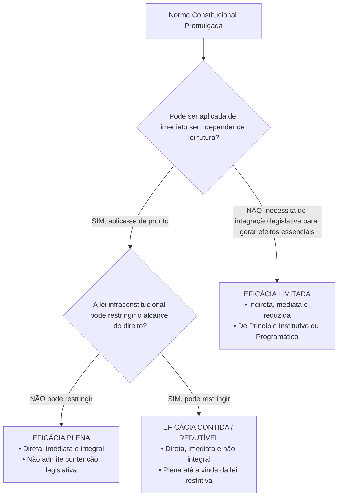
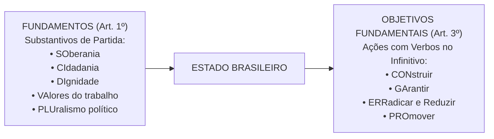

# 01 - Aplicabilidade das Normas Constitucionais e Princípios Fundamentais

> **Matéria:** Noções de Direito Constitucional  
> **Cargo:** A01 – Técnico de Controle Externo – Especialidade: Técnico Administrativo  
> **Arquivo:** `01_aplicabilidade_das_normas_e_principios_fundamentais.md`  
> **Status:** 🟢 Teoria Aprofundada + 5 Questões FCC Comentadas (A a E)

---

## 📌 Ementa Oficial do Edital
- Da aplicabilidade das normas constitucionais (Classificação de José Afonso da Silva).
- Normas constitucionais de eficácia plena, contida e limitada.
- Normas constitucionais programáticas e princípio da reserva do possível vs. mínimo existencial.
- Princípios Fundamentais da Constituição da República Federativa do Brasil de 1988 (Artigos 1º a 4º).
- Fundamentos da República Federativa do Brasil (Artigo 1º).
- Teoria da Separação dos Poderes e o sistema de freios e contrapesos (*Checks and Balances* - Artigo 2º).
- Objetivos fundamentais da República Federativa do Brasil (Artigo 3º).
- Princípios que regem a República Federativa do Brasil em suas relações internacionais (Artigo 4º).

---

## 🧭 Sumário

1. [Eficácia e Aplicabilidade das Normas Constitucionais](#1-eficacia-e-aplicabilidade-das-normas-constitucionais)
    1. [Classificação Tripartite de José Afonso da Silva](#11-classificacao-tripartite-de-jose-afonso-da-silva)
    2. [Eficácia Mínima das Normas Limitadas e Remédios contra Omissão](#12-eficacia-minima-das-normas-limitadas-e-remedios-contra-omissao)
    3. [Reserva do Possível versus Mínimo Existencial](#13-reserva-do-possivel-versus-minimo-existencial)
    4. [Teste 110](#Teste-110)
    5. [Teste 111](#Teste-111)
    6. [Teste 112](#Teste-112)
    7. [Teste 113](#Teste-113)
2. [Princípios Fundamentais da CF/88 (Título I - Arts. 1º a 4º)](#2-principios-fundamentais-da-cf88-titulo-i-arts-1o-a-4o)
    1. [Forma de Estado, Forma de Governo e Regime Político](#21-forma-de-estado-forma-de-governo-e-regime-politico)
    2. [Fundamentos da República Federativa do Brasil (Art. 1º)](#22-fundamentos-da-republica-federativa-do-brasil-art-1o)
    3. [Separação dos Poderes e o Sistema de Freios e Contrapesos (Art. 2º)](#23-separacao-dos-poderes-e-o-sistema-de-freios-e-contrapesos-art-2o)
    4. [Objetivos Fundamentais da República (Art. 3º)](#24-objetivos-fundamentais-da-republica-art-3o)
    5. [Princípios nas Relações Internacionais e Integração Latino-Americana (Art. 4º)](#25-principios-nas-relacoes-internacionais-e-integracao-latino-americana-art-4o)
    6. [Teste 114](#Teste-114)
    7. [Teste 115](#Teste-115)
    8. [Teste 116](#Teste-116)
    9. [Teste 117](#Teste-117)
    10. [Teste 118](#Teste-118)
    11. [Teste 119](#Teste-119)
    12. [Teste 120](#Teste-120)
6. [Fontes Recomendadas na Internet](#6-fontes-recomendadas-na-internet)

---

## 1. Eficácia e Aplicabilidade das Normas Constitucionais

O estudo da aplicabilidade das normas constitucionais investiga o grau de aptidão que cada preceito da Lei Fundamental possui para produzir efeitos jurídicos no mundo dos fatos desde a sua promulgação. No direito público brasileiro, a doutrina amplamente majoritária e a jurisprudência pacífica do Supremo Tribunal Federal (STF) consagram a classificação tripartite formulada pelo professor José Afonso da Silva.

### 1.1 Classificação Tripartite de José Afonso da Silva

| Classificação da Norma | Aplicabilidade | Depende de Lei Infraconstitucional? | Pode Ser Restringida por Lei? | Exemplos Canônicos na CF/88 |
|---|:---:|:---:|:---:|---|
| **Eficácia Plena** | **Direta, Imediata e Integral** | **NÃO** | **NÃO** | Art. 2º (Separação dos Poderes); Art. 5º, III (Vedação da tortura); Art. 5º, LVI (Inadmissibilidade de provas ilícitas). |
| **Eficácia Contida (ou Redutível)** | **Direta, Imediata e NÃO Integral** | **NÃO** (produz efeitos plenos desde a promulgação) | **SIM** (a lei infraconstitucional pode restringir seu alcance) | Art. 5º, XIII (Liberdade de exercício profissional atendidas qualificações da lei); Art. 5º, XII (Inviolabilidade de sigilo telefônico salvo ordem judicial). |
| **Eficácia Limitada** | **Indireta, Mediata e Reduzida** | **SIM** (depende de atuação integradora do legislador ordinário) | Não se aplica (o direito nasce contido e depende de ampliação legal) | Art. 37, VII (Direito de greve dos servidores públicos civis); Art. 196 (Direito à saúde como dever do Estado mediante políticas públicas). |

- **Normas de Eficácia Plena:** São aquelas que desde a promulgação da Constituição receberam do constituinte uma normatividade suficiente para serem aplicadas de pronto a situações concretas. Não dependem de qualquer regulamentação legal ulterior para produzirem todos os seus efeitos e não podem ser restringidas pelo legislador ordinário.
- **Normas de Eficácia Contida (ou Redutível / Prospectiva):** São normas que também produzem efeitos plenos e imediatos a partir da promulgação, mas nas quais o constituinte deixou expressa ou implicitamente uma cláusula de contenção (*"na forma da lei"*, *"atendidas as qualificações que a lei estabelecer"*, *"salvo disposição em contrário"*). Enquanto o legislador ordinário não editar a norma restritiva, o exercício do direito é pleno e irrestrito.
- **Normas de Eficácia Limitada:** Não produzem seus efeitos fundamentais de imediato, dependendo da interferência do legislador infraconstitucional para conferir densidade e viabilizar o exercício prático da prerrogativa. Subdividem-se em:
    1. *Normas de Princípio Institutivo (ou Organizatório):* Aquelas pelas quais o constituinte traça o esquema geral de criação e organização de órgãos, entidades ou instituições do Estado (ex.: art. 88 da CF/88, que dispõe que a lei disporá sobre a criação e extinção de Ministérios);
    2. *Normas de Princípio Programático:* Aquelas que estabelecem metas, programas sociais, diretrizes socioeconômicas e fins de interesse público a serem alcançados pelos poderes públicos (ex.: saúde, erradicação do analfabetismo, proteção ao meio ambiente).

### 1.2 Eficácia Mínima das Normas Limitadas e Remédios contra Omissão
Embora as normas de eficácia limitada não confiram exigibilidade imediata da prestação originária sem integração legislativa, é incorreto afirmar que elas são desprovidas de valor jurídico. A doutrina e a jurisprudência reconhecem a **eficácia jurídica mínima** dessas normas:

- **Eficácia Revogatória (ou Negativa):** Revogam automaticamente toda a legislação anterior que com elas seja materialmente incompatível (não recepção).
- **Eficácia Impeditiva:** Impedem a edição de leis futuras que contrariem seus vetores teleológicos, sob pena de inconstitucionalidade direta.
- **Eficácia Hermenêutica / Interpretativa:** Servem de vetor interpretativo obrigatório para juízes e administradores públicos.
- **Remédios Constitucionais contra a Omissão Inconstitucional:** Para combater a mora legislativa que inviabiliza o exercício de direitos previstos em normas de eficácia limitada, a Constituição consagrou o **Mandado de Injunção** (art. 5º, LXXI, e Lei nº 13.300/2016) e a **Ação Direta de Inconstitucionalidade por Omissão (ADO)** (art. 103, § 2º).

### 1.3 Reserva do Possível versus Mínimo Existencial
No controle judicial de políticas públicas decorrentes de normas programáticas (saúde, fornecimento de medicamentos de alto custo, vagas em creches):

- **Reserva do Possível (*Vorbehalt des Möglichen*):** Tese frequentemente invocada pela Fazenda Pública segundo a qual a efetivação dos direitos sociais condiciona-se à existência de capacidade orçamentária e financeira do Estado, bem como à discricionariedade do administrador na alocação de recursos escassos.
- **Mínimo Existencial:** Entendimento consolidado pelo STF no sentido de que a reserva do possível encontra limite intransponível no **núcleo essencial dos direitos fundamentais indispensáveis a uma vida digna** (mínimo existencial). Quando estiver em jogo a própria sobrevivência ou a integridade biológica do indivíduo, a alegação de insuficiência de recursos orçamentários torna-se inoponível ao cidadão.

---

### Teste 001
**(FGV – TCE/PI – 2025 – Auditor de Controle Externo - Controle Externo - Específica de Área Comum)**
O Art. 92-B, §2º, do Ato das Disposições Constitucionais Transitórias da Constituição da República, acrescido pela Emenda Constitucional nº 132/2023, tem a seguinte redação: Lei complementar instituirá Fundo de Sustentabilidade e Diversificação Econômica do Estado do Amazonas, que será constituído com recursos da União e por ela gerido, com a efetiva participação do Estado do Amazonas na definição das políticas, com o objetivo de fomentar o desenvolvimento e a diversificação das atividades econômicas no Estado. A interpretação desse comando normativo permite concluir que se está perante norma de

* **A)** eficácia contida.
* **B)** aplicabilidade imediata.
* **C)** aplicabilidade direta, mas não integral.
* **D)** eficácia limitada e de princípio institutivo.
* **E)** eficácia limitada e de princípio programático.

---

> **Comentário Detalhado:**
>
> - **A)** **Incorreta.** A opção apresenta proposição em desacordo com os fundamentos teóricos e técnicos do tópico ao afirmar que "eficácia contida". De acordo com a teoria estudada em *1.1 Classificação Tripartite de José Afonso da Silva*, normas de Princípio Institutivo (ou Organizatório): Aquelas pelas quais o constituinte traça o esquema geral de criação e organização de órgãos, entidades ou instituições do Estado (ex.: art. 88 da CF/88, que dispõe que a lei disporá sobre a criação e extinção de Ministérios).
> - **B)** **Incorreta.** A opção apresenta proposição em desacordo com os fundamentos teóricos e técnicos do tópico ao afirmar que "aplicabilidade imediata". De acordo com a teoria estudada em *6. Fontes Recomendadas na Internet*, sILVA, José Afonso da. Aplicabilidade das Normas Constitucionais. 8. ed. São Paulo: Malheiros, 2012. (Cap. III Normas Constitucionais de Eficácia Plena, Contida e Limitada).
> - **C)** **Incorreta.** A opção apresenta proposição em desacordo com os fundamentos teóricos e técnicos do tópico ao afirmar que "aplicabilidade direta, mas não integral". De acordo com a teoria estudada em *1.2 Eficácia Mínima das Normas Limitadas e Remédios contra Omissão*, remédios Constitucionais contra a Omissão Inconstitucional: Para combater a mora legislativa que inviabiliza o exercício de direitos previstos em normas de eficácia limitada, a Constituição consagrou o Mandado de Injunção (art. 5º, LXXI, e Lei nº 13.300/2016) e a Ação Direta de Inconstitucionalidade por Omissão (ADO) (art. 103, § 2º).
> - **D)** **Correta.** Conforme fundamentado na seção *1.1 Classificação Tripartite de José Afonso da Silva* deste guia, dEC |"NÃO, necessita de integração legislativa para gerar efeitos essenciais"| LIMIT["EFICÁCIA LIMITADA<br/ • Indireta, mediata e reduzida<br/ • De Princípio Institutivo ou Programático"]. Dessa forma, está plenamente correta a assertiva da banca (FGV – TCE/PI/2025) ao estabelecer que "eficácia limitada e de princípio institutivo".
> - **E)** **Incorreta.** A opção apresenta proposição em desacordo com os fundamentos teóricos e técnicos do tópico ao afirmar que "eficácia limitada e de princípio programático". De acordo com a teoria estudada em *1.1 Classificação Tripartite de José Afonso da Silva*, normas de Princípio Programático: Aquelas que estabelecem metas, programas sociais, diretrizes socioeconômicas e fins de interesse público a serem alcançados pelos poderes públicos (ex.: saúde, erradicação do analfabetismo, proteção ao meio ambiente).
>
> **Gabarito: D**

---

## 2. Princípios Fundamentais da CF/88 (Título I - Arts. 1º a 4º)

O Título I da Constituição Federal delimita as decisões políticas estruturantes do Estado brasileiro.

### 2.1 Forma de Estado, Forma de Governo e Regime Político
- **Forma de Estado: Federação.** Caracteriza-se pela descentralização política, coexistência de esferas federativas autônomas (União, Estados, Distrito Federal e Municípios), vedação ao direito de secessão e proteção sob cláusula pétrea explícita (art. 60, § 4º, I).
- **Forma de Governo: República.** Caracteriza-se pela eletividade e temporariedade dos mandatos dos governantes, pela responsabilidade política e jurídica dos agentes públicos e pelo dever republicano de prestar contas perante a sociedade e as Cortes de Contas.
- **Regime Político: Democracia Semidireta (ou Participativa).** Conforme o art. 1º, parágrafo único: *"Todo o poder emana do povo, que o exerce por meio de representantes eleitos ou diretamente, nos termos desta Constituição."* O exercício direto manifesta-se por meio do **plebiscito**, do **referendo** e da **iniciativa popular** de leis (art. 14, I, II e III).

### 2.2 Fundamentos da República Federativa do Brasil (Art. 1º)
Os fundamentos consubstanciam as bases estruturais sobre as quais se erige o Estado brasileiro. São expressos por substantivos e memorizados pelo consagrado mnemônico **SO-CI-DI-VA-PLU**:

1. **SOberania:** Poder supremo no plano interno e independente na ordem internacional;
2. **CIdadania:** Prerrogativa de participação ativa na vida política do país e na formação das decisões estatais;
3. **DIgnidade da Pessoa Humana:** Matriz axiológica de todo o ordenamento jurídico, que coloca o ser humano como fim primordial do Estado, e não mero instrumento;
4. **VAlores Sociais do Trabalho e da Livre Iniciativa:** Reconhecimento concomitante do trabalho como fonte de emancipação social e da liberdade econômica de mercado como motor da produção de riquezas;
5. **PLUralismo Político:** Abertura para a livre manifestação e convivência harmoniosa de diferentes correntes ideológicas, filosóficas e políticas.

> 🚨 **ALERTA DE PROVA / PEGADINHA FCC:**  
> A banca FCC frequentemente tenta confundir o candidato trocando **pluralismo político** por **pluripartidarismo**. O pluripartidarismo (liberdade de criação de partidos políticos) é apenas uma das dimensões instrumentais do pluralismo político, que é um conceito infinitamente mais amplo de liberdade de pensamento e de cosmovisão.

### 2.3 Separação dos Poderes e o Sistema de Freios e Contrapesos (Art. 2º)
O art. 2º da Carta Magna estabelece: *"São Poderes da União, independentes e harmônicos entre si, o Legislativo, o Executivo e o Judiciário."*

No modelo do constitucionalismo contemporâneo:

- **Não há separação estanque ou absoluta:** Cada Poder desempenha uma **função típica preponderante** e **funções atípicas secundárias** expressamente delimitadas pela Constituição:
    - **Poder Executivo:** Função típica: governar e administrar a coisa pública; Funções atípicas: legislar (ao editar medidas provisórias e leis delegadas) e julgar (ao decidir processos administrativos e disciplinares).
    - **Poder Legislativo:** Funções típicas: legislar (elaborar normas gerais e abstratas) e fiscalizar (controle financeiro e contábil externo com auxílio dos Tribunais de Contas); Funções atípicas: administrar (gerir seu quadro funcional e contratos) e julgar (o Senado julga o Presidente da República e Ministros do STF em crimes de responsabilidade).
    - **Poder Judiciário:** Função típica: jurisdicional (dizer o direito no caso concreto com definitividade); Funções atípicas: administrar (realizar licitações e prover cargos) e legislar (elaborar os regimentos internos de seus tribunais).
- **Sistema de Freios e Contrapesos (*Checks and Balances*):** Mecanismo de controle recíproco em que um Poder limita e fiscaliza a atuação do outro, prevenindo abusos e garantindo a harmonia institucional (ex.: veto do Presidente a projetos de lei; sabatina e aprovação de ministros pelo Senado; controle de constitucionalidade de leis e atos do Executivo exercido pelo Judiciário).

### 2.4 Objetivos Fundamentais da República (Art. 3º)
Os objetivos fundamentais consubstanciam as metas de chegada e as finalidades que o Estado brasileiro deve perseguir. Diferenciam-se dos fundamentos porque começam invariavelmente por **VERBOS NO INFINITIVO** (Mnemônico **CON-GA-ERRA-PRO**):

1. **CON**struir uma sociedade livre, justa e solidária;
2. **GA**rantir o desenvolvimento nacional;
3. **ERRA**dicar a pobreza e a marginalização e **reduzir as desigualdades sociais e regionais**;
4. **PRO**mover o bem de todos, sem preconceitos de origem, raça, sexo, cor, idade e quaisquer outras formas de discriminação.

### 2.5 Princípios nas Relações Internacionais e Integração Latino-Americana (Art. 4º)
A República Federativa do Brasil rege-se em suas relações internacionais pelos seguintes princípios:

1. Independência nacional;
2. Prevalência dos direitos humanos;
3. Autodeterminação dos povos;
4. Não intervenção;
5. Igualdade entre os Estados;
6. Defesa da paz;
7. Solução pacífica dos conflitos;
8. Repúdio ao terrorismo e ao racismo;
9. Cooperação entre os povos para o progresso da humanidade;
10. Concessão de asilo político.

- **Parágrafo Único do Art. 4º:** Estabelece expressamente que o Brasil buscará a **integração econômica, política, social e cultural dos povos da América Latina**, visando à formação de uma **comunidade latino-americana de nações**.

> 🚨 **ALERTA DE PROVA / PEGADINHA FCC:**  
> A banca examinadora costuma substituir ardilosamente a expressão constitucional **América Latina** por "América do Sul", "Mercosul" ou "países lusófonos". Atenção máxima: a redação do parágrafo único do art. 4º consagra expressamente a **América Latina**!

---

### Teste 002
**(FGV – TJ/SC – 2026 – Analista Administrativo)**
Em determinado Estado, a Lei de Diretrizes Orçamentárias previu a concessão de revisão geral anual da remuneração dos servidores públicos. No entanto, a Lei Orçamentária Anual correspondente não incluiu dotação específica para esse fim. Diante da ausência de revisão remuneratória no curso do ano, servidores pleitearam judicialmente a implementação da revisão. À luz da Constituição Federal e da jurisprudência do Supremo Tribunal Federal, é correto afirmar que a revisão remuneratória

* **A)** é devida, pois a previsão na LDO é suficiente para autorizar o reajuste remuneratório.
* **B)** é devida, pois decorre diretamente do princípio da irredutibilidade remuneratória.
* **C)** é possível, desde que haja disponibilidade financeira, ainda que sem previsão orçamentária específica.
* **D)** é automática, pois constitui direito subjetivo assegurado constitucionalmente aos servidores públicos.
* **E)** não é devida, pois depende cumulativamente de previsão na LDO e de dotação na LOA.

---

> **Comentário Detalhado:**
>
> - **A)** **Incorreta.** A opção apresenta proposição em desacordo com os fundamentos teóricos e técnicos do tópico ao afirmar que "é devida, pois a previsão na LDO é suficiente para autorizar o reajuste remuneratório". De acordo com a teoria estudada em *1.1 Classificação Tripartite de José Afonso da Silva*, normas de Eficácia Plena: São aquelas que desde a promulgação da Constituição receberam do constituinte uma normatividade suficiente para serem aplicadas de pronto a situações concretas. Não dependem de qualquer regulamentação legal ulterior para produzirem todos os seus efeitos e não podem ser restringidas pelo legislador ordinário.
> - **B)** **Incorreta.** A opção apresenta proposição em desacordo com os fundamentos teóricos e técnicos do tópico ao afirmar que "é devida, pois decorre diretamente do princípio da irredutibilidade remuneratória". De acordo com a teoria estudada em *2.1 Forma de Estado, Forma de Governo e Regime Político*, regime Político: Democracia Semidireta (ou Participativa). Conforme o art. 1º, parágrafo único: "Todo o poder emana do povo, que o exerce por meio de representantes eleitos ou diretamente, nos termos desta Constituição." O exercício direto manifesta se por meio do plebiscito, do referendo e da iniciativa popular de leis (art. 14, I, II e III).
> - **C)** **Incorreta.** A opção apresenta proposição em desacordo com os fundamentos teóricos e técnicos do tópico ao afirmar que "é possível, desde que haja disponibilidade financeira, ainda que sem previsão orçamentária específica". De acordo com a teoria estudada em *1.3 Reserva do Possível versus Mínimo Existencial*, reserva do Possível ( Vorbehalt des Möglichen ): Tese frequentemente invocada pela Fazenda Pública segundo a qual a efetivação dos direitos sociais condiciona se à existência de capacidade orçamentária e financeira do Estado, bem como à discricionariedade do administrador na alocação de recursos escassos.
> - **D)** **Incorreta.** A opção apresenta proposição em desacordo com os fundamentos teóricos e técnicos do tópico ao afirmar que "é automática, pois constitui direito subjetivo assegurado constitucionalmente aos servidores públicos". De acordo com a teoria estudada em *1.1 Classificação Tripartite de José Afonso da Silva*, normas de Princípio Programático: Aquelas que estabelecem metas, programas sociais, diretrizes socioeconômicas e fins de interesse público a serem alcançados pelos poderes públicos (ex.: saúde, erradicação do analfabetismo, proteção ao meio ambiente).
> - **E)** **Correta.** Conforme fundamentado na seção *1.1 Classificação Tripartite de José Afonso da Silva* deste guia, eficácia Limitada: Indireta, Mediata e Reduzida — SIM (depende de atuação integradora do legislador ordinário) — Não se aplica (o direito nasce contido e depende de ampliação legal) — Art. 37, VII (Direito de greve dos servidores públicos civis); Art. 196 (Direito à saúde como dever do Estado mediante políticas públicas). Dessa forma, está plenamente correta a assertiva da banca (FGV – TJ/SC/2026) ao estabelecer que "não é devida, pois depende cumulativamente de previsão na LDO e de dotação na LOA".
>
> **Gabarito: E**

---

### Teste 003
**(FGV – TCE/GO – 2024 – Analista de Controle Externo - Jurídica)**
Diante das orientações consolidadas pelo Supremo Tribunal Federal acerca da temática da improbidade administrativa, notadamente após as alterações promovidas 14.230/2021 na Lei nº 8.429/92, é correto afirmar que

* **A)** o novo regime prevê a responsabilização objetiva pela prática de atos de improbidade administrativa.
* **B)** são prescritíveis as ações de ressarcimento ao erário decorrentes de atos de improbidade dolosos que ocasionam lesão aos cofres públicos.
* **C)** a revogação da modalidade culposa deve retroagir para beneficiar os agentes públicos condenados pela prática do ato de improbidade.
* **D)** o regime prescricional previsto no novel diploma é irretroativo, aplicando-se os novos marcos temporais a partir da publicação da lei.
* **E)** os entes federativos não têm legitimidade para ajuizar ação de improbidade administrativa nas situações em que sejam lesados, diante da exclusividade conferida ao Ministério Público para tanto.

---

> **Comentário Detalhado:**
>
> - **A)** **Incorreta.** A opção apresenta proposição em desacordo com os fundamentos teóricos e técnicos do tópico ao afirmar que "o novo regime prevê a responsabilização objetiva pela prática de atos de improbidade administrativa". De acordo com a teoria estudada em *6. Fontes Recomendadas na Internet*, sTF Súmula 473 (Princípio da Autotutela Administrativa) Jurisprudência histórica que garante à Administração o poder dever de anular seus próprios atos ilegais e revogar os inconvenientes.
> - **B)** **Incorreta.** A opção apresenta proposição em desacordo com os fundamentos teóricos e técnicos do tópico ao afirmar que "são prescritíveis as ações de ressarcimento ao erário decorrentes de atos de improbidade dolosos que ocasionam...". De acordo com a teoria estudada em *2.1 Forma de Estado, Forma de Governo e Regime Político*, forma de Governo: República. Caracteriza se pela eletividade e temporariedade dos mandatos dos governantes, pela responsabilidade política e jurídica dos agentes públicos e pelo dever republicano de prestar contas perante a sociedade e as Cortes de Contas.
> - **C)** **Incorreta.** A opção apresenta proposição em desacordo com os fundamentos teóricos e técnicos do tópico ao afirmar que "a revogação da modalidade culposa deve retroagir para beneficiar os agentes públicos condenados pela prática do...". De acordo com a teoria estudada em *2.4 Objetivos Fundamentais da República (Art. 3º)*, os objetivos fundamentais consubstanciam as metas de chegada e as finalidades que o Estado brasileiro deve perseguir. Diferenciam se dos fundamentos porque começam invariavelmente por VERBOS NO INFINITIVO (Mnemônico CON GA ERRA PRO).
> - **D)** **Correta.** Conforme fundamentado na seção *1.1 Classificação Tripartite de José Afonso da Silva* deste guia, normas de Eficácia Contida (ou Redutível / Prospectiva): São normas que também produzem efeitos plenos e imediatos a partir da promulgação, mas nas quais o constituinte deixou expressa ou implicitamente uma cláusula de contenção ( "na forma da lei" , "atendidas as qualificações que a lei estabelecer" , "salvo disposição em contrário" ). Enquanto o legislador ordinário não editar a norma restritiva, o exercício do direito é pleno e irrestrito. Dessa forma, está plenamente correta a assertiva da banca (FGV – TCE/GO/2024) ao estabelecer que "o regime prescricional previsto no novel diploma é irretroativo, aplicando se os novos marcos temporais a partir...".
> - **E)** **Incorreta.** A opção apresenta proposição em desacordo com os fundamentos teóricos e técnicos do tópico ao afirmar que "os entes federativos não têm legitimidade para ajuizar ação de improbidade administrativa nas situações em que...". De acordo com a teoria estudada em *1.2 Eficácia Mínima das Normas Limitadas e Remédios contra Omissão*, remédios Constitucionais contra a Omissão Inconstitucional: Para combater a mora legislativa que inviabiliza o exercício de direitos previstos em normas de eficácia limitada, a Constituição consagrou o Mandado de Injunção (art. 5º, LXXI, e Lei nº 13.300/2016) e a Ação Direta de Inconstitucionalidade por Omissão (ADO) (art. 103, § 2º).
>
> **Gabarito: D**

---

### Teste 004
**(FCC – TRT 9ª – 2015 – Analista Judiciário - Apoio Especializado - Tecnologia da Informação)**
A Constituição Federal emprega os termos cargo, emprego e função pública em dispositivos diversos, referindo-se a vínculos mantidos com a Administração pública, sujeitos a regimes jurídicos distintos. Por sua vez, a Lei no 8.112/1990 dispõe sobre o regime jurídico dos servidores públicos civis da União, autarquias e fundações públicas federais. Para efeitos dessa Lei, são servidores públicos os ocupantes de cargo

* **A)** e emprego público e os que exercem função pública, investidos por meio de concurso público de provas ou de provas e títulos, distinguindo-se uns dos outros pela natureza do vínculo mantido com a Administração pública federal.
* **B)** e emprego público, investidos por meio de concurso público, excluindo-se os que exercem função pública, porquanto estes últimos não ingressam no serviço público por meio de prévia habilitação em regular concurso público.
* **C)** e emprego público, investidos por meio de regular concurso público e os contratados temporariamente, com base no artigo 37, IX, da CF, para qual não se exige, necessariamente, concurso público.
* **D)** público, investidos por meio de regular concurso público e os nomeados para cargo em comissão, de livre nomeação e exoneração.
* **E)** público, investidos por meio de regular concurso público, excluindo-se os nomeados para cargo em comissão, de livre nomeação e exoneração.

---

> **Comentário Detalhado:**
>
> - **A)** **Incorreta.** A opção apresenta proposição em desacordo com os fundamentos teóricos e técnicos do tópico ao afirmar que "e emprego público e os que exercem função pública, investidos por meio de concurso público de provas ou de provas...". De acordo com a teoria estudada em *2.1 Forma de Estado, Forma de Governo e Regime Político*, regime Político: Democracia Semidireta (ou Participativa). Conforme o art. 1º, parágrafo único: "Todo o poder emana do povo, que o exerce por meio de representantes eleitos ou diretamente, nos termos desta Constituição." O exercício direto manifesta se por meio do plebiscito, do referendo e da iniciativa popular de leis (art. 14, I, II e III).
> - **B)** **Incorreta.** A opção apresenta proposição em desacordo com os fundamentos teóricos e técnicos do tópico ao afirmar que "e emprego público, investidos por meio de concurso público, excluindo se os que exercem função pública, porquanto...". De acordo com a teoria estudada em *2.3 Separação dos Poderes e o Sistema de Freios e Contrapesos (Art. 2º)*, não há separação estanque ou absoluta: Cada Poder desempenha uma função típica preponderante e funções atípicas secundárias expressamente delimitadas pela Constituição.
> - **C)** **Incorreta.** A opção apresenta proposição em desacordo com os fundamentos teóricos e técnicos do tópico ao afirmar que "e emprego público, investidos por meio de regular concurso público e os contratados temporariamente, com base no...". De acordo com a teoria estudada em *1.1 Classificação Tripartite de José Afonso da Silva*, eficácia Limitada: Indireta, Mediata e Reduzida — SIM (depende de atuação integradora do legislador ordinário) — Não se aplica (o direito nasce contido e depende de ampliação legal) — Art. 37, VII (Direito de greve dos servidores públicos civis); Art. 196 (Direito à saúde como dever do Estado mediante políticas públicas).
> - **D)** **Correta.** Conforme fundamentado na seção *6. Fontes Recomendadas na Internet* deste guia, sTF Súmula Vinculante 13 (Vedação ao Nepotismo) Enunciado vinculante do STF sobre aplicação direta dos princípios da moralidade e impessoalidade na nomeação de cargos em comissão. Dessa forma, está plenamente correta a assertiva da banca (FCC – TRT 9ª/2015) ao estabelecer que "público, investidos por meio de regular concurso público e os nomeados para cargo em comissão, de livre nomeação e...".
> - **E)** **Incorreta.** A opção apresenta proposição em desacordo com os fundamentos teóricos e técnicos do tópico ao afirmar que "público, investidos por meio de regular concurso público, excluindo se os nomeados para cargo em comissão, de...". De acordo com a teoria estudada em *1.1 Classificação Tripartite de José Afonso da Silva*, normas de Princípio Programático: Aquelas que estabelecem metas, programas sociais, diretrizes socioeconômicas e fins de interesse público a serem alcançados pelos poderes públicos (ex.: saúde, erradicação do analfabetismo, proteção ao meio ambiente).
>
> **Gabarito: D**

---

### Teste 005
**(FGV – TJ/RR – 2024 – Analista Judiciario Gestao E Governanca De Tecnologia Da Informacao)**
O Conselho Nacional de Justiça compõe-se de 15 (quinze) membros com mandato de 2 (dois) anos, admitida 1 (uma) recondução. As opções a seguir apresentam membros que participam desse Conselho, à exceção de uma. Assinale-a.

* **A)** Um juiz de Tribunal Regional Federal, indicado pelo Superior Tribunal de Justiça.
* **B)** Um juiz de Tribunal Regional do Trabalho, indicado pelo Tribunal Superior do Trabalho.
* **C)** Dois cidadãos, de notável saber jurídico e reputação ilibada, indicados um pela Câmara dos Deputados e outro pelo Senado Federal.
* **D)** Um juiz do Tribunal Regional Eleitoral, indicado pelo Supremo Tribunal Federal.
* **E)** Um membro do Ministério Público estadual, escolhido pelo Procurador-Geral da República dentre os nomes indicados pelo órgão competente de cada instituição estadual.

---

> **Comentário Detalhado:**
>
> - **A)** **Incorreta.** A opção apresenta proposição em desacordo com os fundamentos teóricos e técnicos do tópico ao afirmar que "Um juiz de Tribunal Regional Federal, indicado pelo Superior Tribunal de Justiça". De acordo com a teoria estudada em *1. Eficácia e Aplicabilidade das Normas Constitucionais*, o estudo da aplicabilidade das normas constitucionais investiga o grau de aptidão que cada preceito da Lei Fundamental possui para produzir efeitos jurídicos no mundo dos fatos desde a sua promulgação. No direito público brasileiro, a doutrina amplamente majoritária e a jurisprudência pacífica do Supremo Tribunal Federal (STF) consagram a classificação tripartite formulada pelo professor José Afonso da Silva.
> - **B)** **Incorreta.** A opção apresenta proposição em desacordo com os fundamentos teóricos e técnicos do tópico ao afirmar que "Um juiz de Tribunal Regional do Trabalho, indicado pelo Tribunal Superior do Trabalho". De acordo com a teoria estudada em *2.2 Fundamentos da República Federativa do Brasil (Art. 1º)*, vAlores Sociais do Trabalho e da Livre Iniciativa: Reconhecimento concomitante do trabalho como fonte de emancipação social e da liberdade econômica de mercado como motor da produção de riquezas.
> - **C)** **Incorreta.** A opção apresenta proposição em desacordo com os fundamentos teóricos e técnicos do tópico ao afirmar que "Dois cidadãos, de notável saber jurídico e reputação ilibada, indicados um pela Câmara dos Deputados e outro pelo...". De acordo com a teoria estudada em *2.3 Separação dos Poderes e o Sistema de Freios e Contrapesos (Art. 2º)*, sistema de Freios e Contrapesos ( Checks and Balances ): Mecanismo de controle recíproco em que um Poder limita e fiscaliza a atuação do outro, prevenindo abusos e garantindo a harmonia institucional (ex.: veto do Presidente a projetos de lei; sabatina e aprovação de ministros pelo Senado; controle de constitucionalidade de leis e atos do Executivo exercido pelo Judiciário).
> - **D)** **Correta.** Conforme fundamentado na seção *2.2 Fundamentos da República Federativa do Brasil (Art. 1º)* deste guia, sOberania: Poder supremo no plano interno e independente na ordem internacional. Dessa forma, está plenamente correta a assertiva da banca (FGV – TJ/RR/2024) ao estabelecer que "Um juiz do Tribunal Regional Eleitoral, indicado pelo Supremo Tribunal Federal".
> - **E)** **Incorreta.** A opção apresenta proposição em desacordo com os fundamentos teóricos e técnicos do tópico ao afirmar que "Um membro do Ministério Público estadual, escolhido pelo Procurador Geral da República dentre os nomes indicados...". De acordo com a teoria estudada em *1.1 Classificação Tripartite de José Afonso da Silva*, normas de Princípio Institutivo (ou Organizatório): Aquelas pelas quais o constituinte traça o esquema geral de criação e organização de órgãos, entidades ou instituições do Estado (ex.: art. 88 da CF/88, que dispõe que a lei disporá sobre a criação e extinção de Ministérios).
>
> **Gabarito: D**

---

### Teste 006
**(CEBRASPE – TJ/DFT – 2015 – Analista Judiciario Suporte Em Tecnologia Da Informacao)**
Um quinto dos cargos de desembargador devem ser preenchidos por membros do Ministério Público do Distrito Federal e Territórios e por advogados em efetivo exercício da profissão.

* **C)** Certo
* **E)** Errado

---

> **Comentário Detalhado:**
>
> - **C)** **Correta.** O item está **Certo**. Conforme fundamentado na seção *2.1 Forma de Estado, Forma de Governo e Regime Político*, forma de Estado: Federação. Caracteriza se pela descentralização política, coexistência de esferas federativas autônomas (União, Estados, Distrito Federal e Municípios), vedação ao direito de secessão e proteção sob cláusula pétrea explícita (art. 60, § 4º, I). Dessa forma, está plenamente correta a assertiva da banca (CEBRASPE – TJ/DFT/2015) ao afirmar que "Um quinto dos cargos de desembargador devem ser preenchidos por membros do Ministério Público do Distrito...".
> - **E)** **Incorreta.** A assertiva não incorre em erro conceitual, guardando conformidade com a teoria estudada.
>
> **Gabarito: C**

---

### Teste 007
**(FGV – TJ/BA – 2015 – Analista Judiciario Tecnologia Da Informacao)**
Determinado Juiz de Direito do Tribunal de Justiça da Bahia foi denunciado criminalmente pelo Ministério Público Estadual, que lhe imputa a prática de crime comum. De acordo com o egimento nterno do Tribunal de ustiça do stado da ahia, é competente para processá-lo e julgá-lo originariamente:

* **A)** o Tribunal Pleno;
* **B)** a Turma Criminal, escolhida por livre distribuição;
* **C)** a Seção Criminal;
* **D)** a Câmara Criminal, escolhida por livre distribuição;
* **E)** o Juízo Criminal de primeiro grau do local do fato, escolhido por livre distribuição.

---

> **Comentário Detalhado:**
>
> - **A)** **Correta.** Conforme fundamentado na seção *1.1 Classificação Tripartite de José Afonso da Silva* deste guia, normas de Eficácia Contida (ou Redutível / Prospectiva): São normas que também produzem efeitos plenos e imediatos a partir da promulgação, mas nas quais o constituinte deixou expressa ou implicitamente uma cláusula de contenção ( "na forma da lei" , "atendidas as qualificações que a lei estabelecer" , "salvo disposição em contrário" ). Enquanto o legislador ordinário não editar a norma restritiva, o exercício do direito é pleno e irrestrito. Dessa forma, está plenamente correta a assertiva da banca (FGV – TJ/BA/2015) ao estabelecer que "o Tribunal Pleno".
> - **B)** **Incorreta.** A opção apresenta proposição em desacordo com os fundamentos teóricos e técnicos do tópico ao afirmar que "a Turma Criminal, escolhida por livre distribuição". De acordo com a teoria estudada em *2.2 Fundamentos da República Federativa do Brasil (Art. 1º)*, vAlores Sociais do Trabalho e da Livre Iniciativa: Reconhecimento concomitante do trabalho como fonte de emancipação social e da liberdade econômica de mercado como motor da produção de riquezas.
> - **C)** **Incorreta.** A opção apresenta proposição em desacordo com os fundamentos teóricos e técnicos do tópico ao afirmar que "a Seção Criminal". De acordo com a teoria estudada em *2.3 Separação dos Poderes e o Sistema de Freios e Contrapesos (Art. 2º)*, poder Legislativo: Funções típicas: legislar (elaborar normas gerais e abstratas) e fiscalizar (controle financeiro e contábil externo com auxílio dos Tribunais de Contas); Funções atípicas: administrar (gerir seu quadro funcional e contratos) e julgar (o Senado julga o Presidente da República e Ministros do STF em crimes de responsabilidade).
> - **D)** **Incorreta.** A opção apresenta proposição em desacordo com os fundamentos teóricos e técnicos do tópico ao afirmar que "a Câmara Criminal, escolhida por livre distribuição". De acordo com a teoria estudada em *2.2 Fundamentos da República Federativa do Brasil (Art. 1º)*, pLUralismo Político: Abertura para a livre manifestação e convivência harmoniosa de diferentes correntes ideológicas, filosóficas e políticas.
> - **E)** **Incorreta.** A opção apresenta proposição em desacordo com os fundamentos teóricos e técnicos do tópico ao afirmar que "o Juízo Criminal de primeiro grau do local do fato, escolhido por livre distribuição". De acordo com a teoria estudada em *1. Eficácia e Aplicabilidade das Normas Constitucionais*, o estudo da aplicabilidade das normas constitucionais investiga o grau de aptidão que cada preceito da Lei Fundamental possui para produzir efeitos jurídicos no mundo dos fatos desde a sua promulgação. No direito público brasileiro, a doutrina amplamente majoritária e a jurisprudência pacífica do Supremo Tribunal Federal (STF) consagram a classificação tripartite formulada pelo professor José Afonso da Silva.
>
> **Gabarito: A**

---

### Teste 008
**(FCC – TRT 24ª – 2017 – Analista Judiciário - Tecnologia da Informação)**
De acordo com a Constituição Federal, lei complementar, de iniciativa do Supremo Tribunal Federal, disporá sobre o Estatuto da Magistratura, observados, dentre outros princípios,

* **A)** a promoção de entrância para entrância por antiguidade de três em três anos e merecimento de ano em ano.
* **B)** a promoção de entrância para entrância, alternadamente, por antiguidade e merecimento, atendida às normas constitu- cionais.
* **C)** o ingresso na carreira, cujo cargo inicial será o de juiz de entrância intermediária, mediante concurso público de provas e títulos, sem a participação da Ordem dos Advogados do Brasil, exigindo-se do bacharel em direito, no mínimo, cinco anos de atividade jurídica.
* **D)** o ingresso na carreira, cujo cargo inicial será o de juiz substituto, mediante concurso público de provas e títulos, sem a participação da Ordem dos Advogados do Brasil, exigindo-se do bacharel em direito, no mínimo, dois anos de atividade jurídica.
* **E)** o ingresso na carreira, cujo cargo inicial será o de juiz substituto, mediante concurso público de provas e títulos, com a participação da Ordem dos Advogados do Brasil, exigindo-se do bacharel em direito, no mínimo, cinco anos de atividade jurídica.

---

> **Comentário Detalhado:**
>
> - **A)** **Correta.** Conforme fundamentado na seção *2.1 Forma de Estado, Forma de Governo e Regime Político* deste guia, regime Político: Democracia Semidireta (ou Participativa). Conforme o art. 1º, parágrafo único: "Todo o poder emana do povo, que o exerce por meio de representantes eleitos ou diretamente, nos termos desta Constituição." O exercício direto manifesta se por meio do plebiscito, do referendo e da iniciativa popular de leis (art. 14, I, II e III). Dessa forma, está plenamente correta a assertiva da banca (FCC – TRT 24ª/2017) ao estabelecer que "a promoção de entrância para entrância por antiguidade de três em três anos e merecimento de ano em ano".
> - **B)** **Incorreta.** A opção apresenta proposição em desacordo com os fundamentos teóricos e técnicos do tópico ao afirmar que "a promoção de entrância para entrância, alternadamente, por antiguidade e merecimento, atendida às normas constitu...". De acordo com a teoria estudada em *1.1 Classificação Tripartite de José Afonso da Silva*, normas de Princípio Institutivo (ou Organizatório): Aquelas pelas quais o constituinte traça o esquema geral de criação e organização de órgãos, entidades ou instituições do Estado (ex.: art. 88 da CF/88, que dispõe que a lei disporá sobre a criação e extinção de Ministérios).
> - **C)** **Incorreta.** A opção apresenta proposição em desacordo com os fundamentos teóricos e técnicos do tópico ao afirmar que "o ingresso na carreira, cujo cargo inicial será o de juiz de entrância intermediária, mediante concurso público de...". De acordo com a teoria estudada em *2.2 Fundamentos da República Federativa do Brasil (Art. 1º)*, sOberania: Poder supremo no plano interno e independente na ordem internacional.
> - **D)** **Incorreta.** A opção apresenta proposição em desacordo com os fundamentos teóricos e técnicos do tópico ao afirmar que "o ingresso na carreira, cujo cargo inicial será o de juiz substituto, mediante concurso público de provas e...". De acordo com a teoria estudada em *2.2 Fundamentos da República Federativa do Brasil (Art. 1º)*, cIdadania: Prerrogativa de participação ativa na vida política do país e na formação das decisões estatais.
> - **E)** **Incorreta.** A opção apresenta proposição em desacordo com os fundamentos teóricos e técnicos do tópico ao afirmar que "o ingresso na carreira, cujo cargo inicial será o de juiz substituto, mediante concurso público de provas e...". De acordo com a teoria estudada em *1.1 Classificação Tripartite de José Afonso da Silva*, eficácia Limitada: Indireta, Mediata e Reduzida — SIM (depende de atuação integradora do legislador ordinário) — Não se aplica (o direito nasce contido e depende de ampliação legal) — Art. 37, VII (Direito de greve dos servidores públicos civis); Art. 196 (Direito à saúde como dever do Estado mediante políticas públicas).
>
> **Gabarito: A**

---

### Teste 009
**(FCC – TRT 24ª – 2017 – Analista Judiciário - Tecnologia da Informação)**
Considere a seguinte situação hipotética: Margarida é Presidente do Supremo Tribunal Federal; Joana é Vice-Presidente do Supremo Tribunal Federal; Carla é Presidente do Superior Tribunal de Justiça; Camila é Vice-Presidente do Superior Tribunal de Justiça e Carlos é Membro do Ministério Público da União. De acordo com a Constituição Federal, o Conselho Nacional de Justiça é presidido por

* **A)** Margarida e nas suas ausências e impedimentos por Carla.
* **B)** Carla e nas suas ausências e impedimentos por Camila.
* **C)** Margarida e nas suas ausências e impedimentos por Joana.
* **D)** Carlos e nas suas ausências e impedimentos por Margarida.
* **E)** Margarida e nas suas ausências e impedimentos por Carlos.

---

> **Comentário Detalhado:**
>
> - **A)** **Incorreta.** A opção apresenta proposição em desacordo com os fundamentos teóricos e técnicos do tópico ao afirmar que "Margarida e nas suas ausências e impedimentos por Carla". De acordo com a teoria estudada em *2.1 Forma de Estado, Forma de Governo e Regime Político*, forma de Estado: Federação. Caracteriza se pela descentralização política, coexistência de esferas federativas autônomas (União, Estados, Distrito Federal e Municípios), vedação ao direito de secessão e proteção sob cláusula pétrea explícita (art. 60, § 4º, I).
> - **B)** **Incorreta.** A opção apresenta proposição em desacordo com os fundamentos teóricos e técnicos do tópico ao afirmar que "Carla e nas suas ausências e impedimentos por Camila". De acordo com a teoria estudada em *2.2 Fundamentos da República Federativa do Brasil (Art. 1º)*, sOberania: Poder supremo no plano interno e independente na ordem internacional.
> - **C)** **Incorreta.** A opção apresenta proposição em desacordo com os fundamentos teóricos e técnicos do tópico ao afirmar que "Margarida e nas suas ausências e impedimentos por Joana". De acordo com a teoria estudada em *2.3 Separação dos Poderes e o Sistema de Freios e Contrapesos (Art. 2º)*, o art. 2º da Carta Magna estabelece: "São Poderes da União, independentes e harmônicos entre si, o Legislativo, o Executivo e o Judiciário.".
> - **D)** **Correta.** Conforme fundamentado na seção *2.4 Objetivos Fundamentais da República (Art. 3º)* deste guia, gArantir o desenvolvimento nacional. Dessa forma, está plenamente correta a assertiva da banca (FCC – TRT 24ª/2017) ao estabelecer que "Carlos e nas suas ausências e impedimentos por Margarida".
> - **E)** **Incorreta.** A opção apresenta proposição em desacordo com os fundamentos teóricos e técnicos do tópico ao afirmar que "Margarida e nas suas ausências e impedimentos por Carlos". De acordo com a teoria estudada em *2.3 Separação dos Poderes e o Sistema de Freios e Contrapesos (Art. 2º)*, poder Legislativo: Funções típicas: legislar (elaborar normas gerais e abstratas) e fiscalizar (controle financeiro e contábil externo com auxílio dos Tribunais de Contas); Funções atípicas: administrar (gerir seu quadro funcional e contratos) e julgar (o Senado julga o Presidente da República e Ministros do STF em crimes de responsabilidade).
>
> **Gabarito: D**

---

### Teste 010
**(FGV – TCE/PA – 2024 – Auditor de Controle Externo - Administrativa - Administração)**
A finalidade dos processos de contas é a de possibilitar a verificação regular da aplicação dos recursos, à luz dos princípios da legalidade, legitimidade e economicidade. (LIMA, Luiz Henrique. Controle Externo. Ed. Elsevier, 2013, p. 259) Em benefício dos referidos princípios, os processos de Contas no TCE-PA possuem regramento específico quanto ao seu encaminhamento, formação, instrução e julgamento. Considerando as disposições do RITCE-PA quanto a essa temática, analise as afirmativas a seguir: I. Os processos de prestação de contas serão instruídos preliminarmente com o Parecer do Ministério Público de Contas. II. O prazo para instrução processual das prestações de contas é de 180 (cento e oitenta) dias, contados da data da distribuição. III. Após a instrução preliminar dos processos de prestação de contas com o relatório do Departamento de Controle Externo, admite-se o recebimento de novos documentos apresentados por ocasião da sustentação oral. IV. As diligências serão determinadas pelo Relator ou pelo Diretor do Departamento de Controle Externo, conforme o caso. Estão corretos os procedimentos indicados nos itens:

* **A)** I, II, e IV, apenas.
* **B)** I, II e III, apenas.
* **C)** II e III, apenas.
* **D)** I, II, III e IV.
* **E)** II, III e IV, apenas.

---

> **Comentário Detalhado:**
>
> - **A)** **Incorreta.** A opção incorre em restrição indevida ao limitar o escopo conceitual ao afirmar que "I, II, e IV, apenas". De acordo com a teoria estudada em *1.1 Classificação Tripartite de José Afonso da Silva*, eficácia Plena: Direta, Imediata e Integral — NÃO — NÃO — Art. 2º (Separação dos Poderes); Art. 5º, III (Vedação da tortura); Art. 5º, LVI (Inadmissibilidade de provas ilícitas).
> - **B)** **Incorreta.** A opção incorre em restrição indevida ao limitar o escopo conceitual ao afirmar que "I, II e III, apenas". De acordo com a teoria estudada em *6. Fontes Recomendadas na Internet*, sILVA, José Afonso da. Aplicabilidade das Normas Constitucionais. 8. ed. São Paulo: Malheiros, 2012. (Cap. III Normas Constitucionais de Eficácia Plena, Contida e Limitada).
> - **C)** **Correta.** Conforme fundamentado na seção *2.1 Forma de Estado, Forma de Governo e Regime Político* deste guia, regime Político: Democracia Semidireta (ou Participativa). Conforme o art. 1º, parágrafo único: "Todo o poder emana do povo, que o exerce por meio de representantes eleitos ou diretamente, nos termos desta Constituição." O exercício direto manifesta se por meio do plebiscito, do referendo e da iniciativa popular de leis (art. 14, I, II e III). Dessa forma, está plenamente correta a assertiva da banca (FGV – TCE/PA/2024) ao estabelecer que "II e III, apenas".
> - **D)** **Incorreta.** A opção apresenta proposição em desacordo com os fundamentos teóricos e técnicos do tópico ao afirmar que "I, II, III e IV". De acordo com a teoria estudada em *2.5 Princípios nas Relações Internacionais e Integração Latino-Americana (Art. 4º)*, parágrafo Único do Art. 4º: Estabelece expressamente que o Brasil buscará a integração econômica, política, social e cultural dos povos da América Latina, visando à formação de uma comunidade latino americana de nações.
> - **E)** **Incorreta.** A opção incorre em restrição indevida ao limitar o escopo conceitual ao afirmar que "II, III e IV, apenas". De acordo com a teoria estudada em *2.3 Separação dos Poderes e o Sistema de Freios e Contrapesos (Art. 2º)*, poder Executivo: Função típica: governar e administrar a coisa pública; Funções atípicas: legislar (ao editar medidas provisórias e leis delegadas) e julgar (ao decidir processos administrativos e disciplinares).
>
> **Gabarito: C**

---

### Teste 011
**(FGV – TCE/PA – 2024 – Auditor de Controle Externo - Administrativa - Administração)**
O órgão de auditoria interna da Secretaria de Estado de Saúde do Pará identificou desfalques na gestão de medicamentos que resultaram em danos da ordem de R$80.000,00 ao erário. Imediatamente, a auditoria interna oficiou a autoridade administrativa competente, que instaurou sindicância para apurar os fatos e, após quarenta dias, confirmou que: a) O dano apurado fora de R$84.000,00. b) Os atos danosos não decorreram de conduta dolosa dos servidores envolvidos. No mesmo prazo, a autoridade administrativa obteve o ressarcimento integral do dano. Considerando as normas do RITCE-PA aplicáveis à situação hipotética, assinale a opção que apresenta a medida a ser adotada pela autoridade administrativa da Secretaria de Saúde.

* **A)** Instaurar tomada de contas especial e encaminhar o processo ao TCE-PA no prazo de 120 dias.
* **B)** Anular o processo de sindicância em razão de inobservância do prazo de 30 (trinta) dias para sua conclusão e determinar a instauração de tomada de contas especial.
* **C)** Converter o processo de sindicância em tomada de contas especial e, independentemente dos valores envolvidos, encaminhar o resultado da apuração ao TCE-PA para julgamento.
* **D)** Arquivar o processo, pois não há mais necessidade de instauração de tomada de contas e nem de seu encaminhamento ao TCE-PA.
* **E)** Encaminhar os autos ao Ministério Público de Contas junto ao TCE-PA para adoção das medidas necessárias à ação de improbidade administrativa a ser processada pela Corte de Contas.

---

> **Comentário Detalhado:**
>
> - **A)** **Incorreta.** A opção apresenta proposição em desacordo com os fundamentos teóricos e técnicos do tópico ao afirmar que "Instaurar tomada de contas especial e encaminhar o processo ao TCE PA no prazo de 120 dias". De acordo com a teoria estudada em *2.3 Separação dos Poderes e o Sistema de Freios e Contrapesos (Art. 2º)*, poder Legislativo: Funções típicas: legislar (elaborar normas gerais e abstratas) e fiscalizar (controle financeiro e contábil externo com auxílio dos Tribunais de Contas); Funções atípicas: administrar (gerir seu quadro funcional e contratos) e julgar (o Senado julga o Presidente da República e Ministros do STF em crimes de responsabilidade).
> - **B)** **Incorreta.** A opção apresenta proposição em desacordo com os fundamentos teóricos e técnicos do tópico ao afirmar que "Anular o processo de sindicância em razão de inobservância do prazo de 30 (trinta) dias para sua conclusão e...". De acordo com a teoria estudada em *6. Fontes Recomendadas na Internet*, sTF Súmula 473 (Princípio da Autotutela Administrativa) Jurisprudência histórica que garante à Administração o poder dever de anular seus próprios atos ilegais e revogar os inconvenientes.
> - **C)** **Incorreta.** A opção apresenta proposição em desacordo com os fundamentos teóricos e técnicos do tópico ao afirmar que "Converter o processo de sindicância em tomada de contas especial e, independentemente dos valores envolvidos...". De acordo com a teoria estudada em *2.1 Forma de Estado, Forma de Governo e Regime Político*, forma de Governo: República. Caracteriza se pela eletividade e temporariedade dos mandatos dos governantes, pela responsabilidade política e jurídica dos agentes públicos e pelo dever republicano de prestar contas perante a sociedade e as Cortes de Contas.
> - **D)** **Correta.** Conforme fundamentado na seção *2.2 Fundamentos da República Federativa do Brasil (Art. 1º)* deste guia, a banca FCC frequentemente tenta confundir o candidato trocando pluralismo político por pluripartidarismo. O pluripartidarismo (liberdade de criação de partidos políticos) é apenas uma das dimensões instrumentais do pluralismo político, que é um conceito infinitamente mais amplo de liberdade de pensamento e de cosmovisão. Dessa forma, está plenamente correta a assertiva da banca (FGV – TCE/PA/2024) ao estabelecer que "Arquivar o processo, pois não há mais necessidade de instauração de tomada de contas e nem de seu encaminhamento...".
> - **E)** **Incorreta.** A opção apresenta proposição em desacordo com os fundamentos teóricos e técnicos do tópico ao afirmar que "Encaminhar os autos ao Ministério Público de Contas junto ao TCE PA para adoção das medidas necessárias à ação de...". De acordo com a teoria estudada em *2.3 Separação dos Poderes e o Sistema de Freios e Contrapesos (Art. 2º)*, poder Executivo: Função típica: governar e administrar a coisa pública; Funções atípicas: legislar (ao editar medidas provisórias e leis delegadas) e julgar (ao decidir processos administrativos e disciplinares).
>
> **Gabarito: D**

---

### Teste 012
**(FGV – TCE/PA – 2024 – Auditor de Controle Externo - Administrativa - Gestão Governamental)**
Em processo de representação apresentado por Membro do Ministério Público de Contas junto ao TCE-PA, o Relator deferiu pedido de medida cautelar em que determinou ao gestor do órgão jurisdicionado que não realizasse os pagamentos decorrentes do contrato impugnado na referida representação até que houvesse decisão definitiva pelo Tribunal. Em face da decisão do Relator cabe recurso de

* **A)** agravo regimental, sem efeito suspensivo, no prazo de 5 (cinco) dias.
* **B)** reconsideração, sem efeito suspensivo, no prazo de 10 (dez) dias.
* **C)** reexame, no prazo de 5 (cinco) anos.
* **D)** embago de declaração, com efeito suspensivo.
* **E)** incidente de constitucionalidade.

---

> **Comentário Detalhado:**
>
> - **A)** **Correta.** Conforme fundamentado na seção *2.1 Forma de Estado, Forma de Governo e Regime Político* deste guia, forma de Governo: República. Caracteriza se pela eletividade e temporariedade dos mandatos dos governantes, pela responsabilidade política e jurídica dos agentes públicos e pelo dever republicano de prestar contas perante a sociedade e as Cortes de Contas. Dessa forma, está plenamente correta a assertiva da banca (FGV – TCE/PA/2024) ao estabelecer que "agravo regimental, sem efeito suspensivo, no prazo de 5 (cinco) dias".
> - **B)** **Incorreta.** A opção apresenta proposição em desacordo com os fundamentos teóricos e técnicos do tópico ao afirmar que "reconsideração, sem efeito suspensivo, no prazo de 10 (dez) dias". De acordo com a teoria estudada em *2.3 Separação dos Poderes e o Sistema de Freios e Contrapesos (Art. 2º)*, poder Legislativo: Funções típicas: legislar (elaborar normas gerais e abstratas) e fiscalizar (controle financeiro e contábil externo com auxílio dos Tribunais de Contas); Funções atípicas: administrar (gerir seu quadro funcional e contratos) e julgar (o Senado julga o Presidente da República e Ministros do STF em crimes de responsabilidade).
> - **C)** **Incorreta.** A opção apresenta proposição em desacordo com os fundamentos teóricos e técnicos do tópico ao afirmar que "reexame, no prazo de 5 (cinco) anos". De acordo com a teoria estudada em *1.3 Reserva do Possível versus Mínimo Existencial*, no controle judicial de políticas públicas decorrentes de normas programáticas (saúde, fornecimento de medicamentos de alto custo, vagas em creches).
> - **D)** **Incorreta.** A opção apresenta proposição em desacordo com os fundamentos teóricos e técnicos do tópico ao afirmar que "embago de declaração, com efeito suspensivo". De acordo com a teoria estudada em *2. Princípios Fundamentais da CF/88 (Título I - Arts. 1º a 4º)*, o Título I da Constituição Federal delimita as decisões políticas estruturantes do Estado brasileiro.
> - **E)** **Incorreta.** A opção apresenta proposição em desacordo com os fundamentos teóricos e técnicos do tópico ao afirmar que "incidente de constitucionalidade". De acordo com a teoria estudada em *2.3 Separação dos Poderes e o Sistema de Freios e Contrapesos (Art. 2º)*, sistema de Freios e Contrapesos ( Checks and Balances ): Mecanismo de controle recíproco em que um Poder limita e fiscaliza a atuação do outro, prevenindo abusos e garantindo a harmonia institucional (ex.: veto do Presidente a projetos de lei; sabatina e aprovação de ministros pelo Senado; controle de constitucionalidade de leis e atos do Executivo exercido pelo Judiciário).
>
> **Gabarito: A**

---

### Teste 013
**(FGV – TCE/PI – 2025 – Auditor de Controle Externo - Controle Externo - Específica de Área Comum)**
Avalie as seguintes situações: I. João é prefeito do Município Beta e ordenador de despesas da respectiva Secretaria de Saúde. II. José é Secretário de Educação do Município Alfa. III. Manoel é Presidente de uma autarquia do Município Ômega. Todos os gestores elaboraram suas prestações de contas e as encaminharam ao órgão competente, não havendo quaisquer indícios de dano ou de irregularidades. Sobre as contas anuais (ou de gestão) prestadas pelos referidos gestores, assinale a afirmativa correta.

* **A)** As contas do Prefeito do Município Beta serão julgadas pelo Tribunal de Contas.
* **B)** As contas da Secretaria de Saúde do Município Beta serão julgadas pelo Tribunal de Contas.
* **C)** As contas da Autarquia do Município Ômega serão julgadas pelo Ministério Público de Contas.
* **D)** As contas da Secretaria de Saúde do Município Beta serão julgadas pela respectiva Câmara Municipal.
* **E)** As contas da Secretaria de Educação do Município Alfa são de responsabilidade da respectiva Auditoria Interna. Noções de Direito Administrativo

---

> **Comentário Detalhado:**
>
> - **A)** **Incorreta.** A opção apresenta proposição em desacordo com os fundamentos teóricos e técnicos do tópico ao afirmar que "As contas do Prefeito do Município Beta serão julgadas pelo Tribunal de Contas". De acordo com a teoria estudada em *2.1 Forma de Estado, Forma de Governo e Regime Político*, forma de Governo: República. Caracteriza se pela eletividade e temporariedade dos mandatos dos governantes, pela responsabilidade política e jurídica dos agentes públicos e pelo dever republicano de prestar contas perante a sociedade e as Cortes de Contas.
> - **B)** **Incorreta.** A opção apresenta proposição em desacordo com os fundamentos teóricos e técnicos do tópico ao afirmar que "As contas da Secretaria de Saúde do Município Beta serão julgadas pelo Tribunal de Contas". De acordo com a teoria estudada em *1.1 Classificação Tripartite de José Afonso da Silva*, eficácia Limitada: Indireta, Mediata e Reduzida — SIM (depende de atuação integradora do legislador ordinário) — Não se aplica (o direito nasce contido e depende de ampliação legal) — Art. 37, VII (Direito de greve dos servidores públicos civis); Art. 196 (Direito à saúde como dever do Estado mediante políticas públicas).
> - **C)** **Incorreta.** A opção apresenta proposição em desacordo com os fundamentos teóricos e técnicos do tópico ao afirmar que "As contas da Autarquia do Município Ômega serão julgadas pelo Ministério Público de Contas". De acordo com a teoria estudada em *1.1 Classificação Tripartite de José Afonso da Silva*, normas de Princípio Programático: Aquelas que estabelecem metas, programas sociais, diretrizes socioeconômicas e fins de interesse público a serem alcançados pelos poderes públicos (ex.: saúde, erradicação do analfabetismo, proteção ao meio ambiente).
> - **D)** **Correta.** Conforme fundamentado na seção *2.3 Separação dos Poderes e o Sistema de Freios e Contrapesos (Art. 2º)* deste guia, poder Legislativo: Funções típicas: legislar (elaborar normas gerais e abstratas) e fiscalizar (controle financeiro e contábil externo com auxílio dos Tribunais de Contas); Funções atípicas: administrar (gerir seu quadro funcional e contratos) e julgar (o Senado julga o Presidente da República e Ministros do STF em crimes de responsabilidade). Dessa forma, está plenamente correta a assertiva da banca (FGV – TCE/PI/2025) ao estabelecer que "As contas da Secretaria de Saúde do Município Beta serão julgadas pela respectiva Câmara Municipal".
> - **E)** **Incorreta.** A opção apresenta proposição em desacordo com os fundamentos teóricos e técnicos do tópico ao afirmar que "As contas da Secretaria de Educação do Município Alfa são de responsabilidade da respectiva Auditoria Interna...". De acordo com a teoria estudada em *1.3 Reserva do Possível versus Mínimo Existencial*, no controle judicial de políticas públicas decorrentes de normas programáticas (saúde, fornecimento de medicamentos de alto custo, vagas em creches).
>
> **Gabarito: D**

---

### Teste 014
**(FGV – TRT/DA – 2025 – Tecnico Judiciario Area Administrativa Sem Especialidade)**
As emendas parlamentares são instrumentos previstos na Constituição Federal que permitem aos deputados e senadores propor alterações no Orçamento Público, direcionando recursos para atender demandas específicas de suas bases eleitorais. Questionando a transparência e a legalidade desses instrumentos, recentemente, a Procuradoria-Geral da República (PGR) denunciou deputados federais por suposta comercialização de emendas parlamentares. Neste tema, considere as afirmativas a seguir. I. As Emendas Individuais têm valor limitado de acordo com a Receita Corrente Líquida do setor público, sendo esta aferida no exercício anterior ao do encaminhamento do projeto de Lei Orçamentária. II. Metade do valor aprovado para Emendas Individuais será destinado a ações e serviços públicos de saúde. III. Não existe valor mínimo ou área específica que vincule qualquer valor das Emendas Individuais ao Orçamento. Elas são definidas conforme os interesses dos parlamentares, definidos por suas bases. Está correto o que se afirma em

* **A)** I, apenas.
* **B)** II, apenas.
* **C)** III, apenas.
* **D)** I e II, apenas.
* **E)** I e III, apenas. Realização

---

> **Comentário Detalhado:**
>
> - **A)** **Incorreta.** A opção incorre em restrição indevida ao limitar o escopo conceitual ao afirmar que "I, apenas". De acordo com a teoria estudada em *1.2 Eficácia Mínima das Normas Limitadas e Remédios contra Omissão*, remédios Constitucionais contra a Omissão Inconstitucional: Para combater a mora legislativa que inviabiliza o exercício de direitos previstos em normas de eficácia limitada, a Constituição consagrou o Mandado de Injunção (art. 5º, LXXI, e Lei nº 13.300/2016) e a Ação Direta de Inconstitucionalidade por Omissão (ADO) (art. 103, § 2º).
> - **B)** **Incorreta.** A opção incorre em restrição indevida ao limitar o escopo conceitual ao afirmar que "II, apenas". De acordo com a teoria estudada em *2.1 Forma de Estado, Forma de Governo e Regime Político*, regime Político: Democracia Semidireta (ou Participativa). Conforme o art. 1º, parágrafo único: "Todo o poder emana do povo, que o exerce por meio de representantes eleitos ou diretamente, nos termos desta Constituição." O exercício direto manifesta se por meio do plebiscito, do referendo e da iniciativa popular de leis (art. 14, I, II e III).
> - **C)** **Incorreta.** A opção incorre em restrição indevida ao limitar o escopo conceitual ao afirmar que "III, apenas". De acordo com a teoria estudada em *1.1 Classificação Tripartite de José Afonso da Silva*, eficácia Plena: Direta, Imediata e Integral — NÃO — NÃO — Art. 2º (Separação dos Poderes); Art. 5º, III (Vedação da tortura); Art. 5º, LVI (Inadmissibilidade de provas ilícitas).
> - **D)** **Correta.** Conforme fundamentado na seção *1.3 Reserva do Possível versus Mínimo Existencial* deste guia, reserva do Possível ( Vorbehalt des Möglichen ): Tese frequentemente invocada pela Fazenda Pública segundo a qual a efetivação dos direitos sociais condiciona se à existência de capacidade orçamentária e financeira do Estado, bem como à discricionariedade do administrador na alocação de recursos escassos. Dessa forma, está plenamente correta a assertiva da banca (FGV – TRT/DA/2025) ao estabelecer que "I e II, apenas".
> - **E)** **Incorreta.** A opção incorre em restrição indevida ao limitar o escopo conceitual ao afirmar que "I e III, apenas. Realização". De acordo com a teoria estudada em *6. Fontes Recomendadas na Internet*, sILVA, José Afonso da. Aplicabilidade das Normas Constitucionais. 8. ed. São Paulo: Malheiros, 2012. (Cap. III Normas Constitucionais de Eficácia Plena, Contida e Limitada).
>
> **Gabarito: D**

---

## 6. Fontes Recomendadas na Internet

* [Constituição Federal de 1988 - Arts. 1º a 4º (Princípios Fundamentais)](https://www.planalto.gov.br/ccivil_03/constituicao/constituicao.htm#art1) - Texto oficial que consagra os fundamentos da República Federativa do Brasil, a separação dos poderes e os objetivos fundamentais.
* [Constituição do Estado de Goiás - Título I e Título II](https://legisla.casacivil.go.gov.br/constituicao-estadual) - Princípios fundamentais e organização do Estado no âmbito goiano.
* [STF Súmula Vinculante 13 (Vedação ao Nepotismo)](https://portal.stf.jus.br/jurisprudencia/sumarios/sumulavinculante.asp?seq=13) - Enunciado vinculante do STF sobre aplicação direta dos princípios da moralidade e impessoalidade na nomeação de cargos em comissão.
* [STF Súmula 473 (Princípio da Autotutela Administrativa)](https://portal.stf.jus.br/jurisprudencia/sumarios/sumula.asp?seq=473) - Jurisprudência histórica que garante à Administração o poder-dever de anular seus próprios atos ilegais e revogar os inconvenientes.
* [Decreto-Lei nº 4.657/1942 - LINDB Compilada](https://www.planalto.gov.br/ccivil_03/decreto-lei/del4657compilado.htm) - Lei de Introdução às Normas do Direito Brasileiro, com as alterações da Lei nº 13.655/2018 sobre segurança jurídica e interpretação de normas públicas.
* MENDES, Gilmar Ferreira; BRANCO, Paulo Gustavo Gonet. **Curso de Direito Constitucional**. 19. ed. São Paulo: SaraivaJur, 2024. (Cap. 1 - Teoria da Constituição; Cap. 2 - Aplicabilidade e Eficácia das Normas Constitucionais).
* MORAES, Alexandre de. **Direito Constitucional**. 40. ed. São Paulo: Atlas, 2024. (Cap. 1 - Princípios Fundamentais da Constituição Federal).
* SILVA, José Afonso da. **Aplicabilidade das Normas Constitucionais**. 8. ed. São Paulo: Malheiros, 2012. (Cap. III - Normas Constitucionais de Eficácia Plena, Contida e Limitada).
