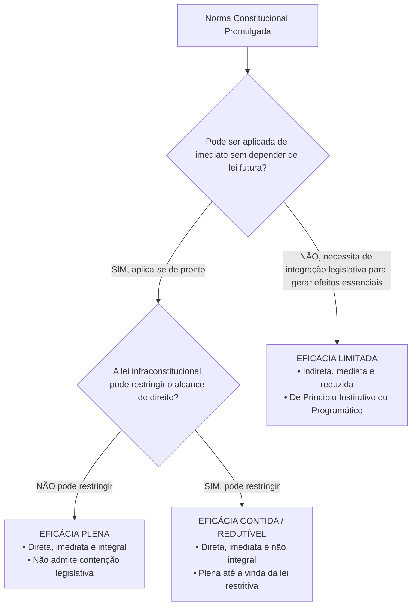
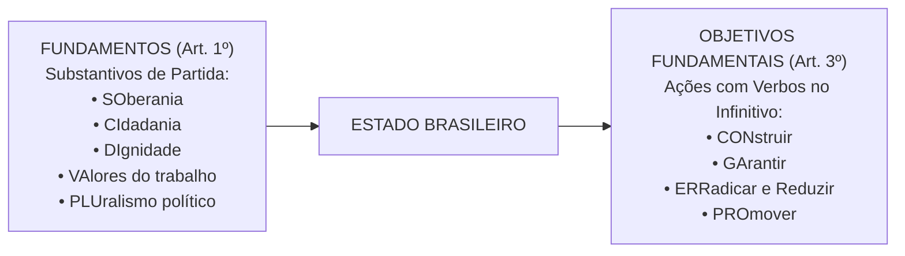

# 01 - Aplicabilidade das Normas Constitucionais e Princípios Fundamentais

> **Matéria:** Noções de Direito Constitucional  
> **Cargo:** A01 – Técnico de Controle Externo – Especialidade: Técnico Administrativo  
> **Arquivo:** `01_aplicabilidade_das_normas_e_principios_fundamentais.md`  
> **Status:** 🟢 Teoria Aprofundada + 5 Questões FCC Comentadas (A a E)

---

## 📌 Ementa Oficial do Edital
- Da aplicabilidade das normas constitucionais (Classificação de José Afonso da Silva).
- Normas constitucionais de eficácia plena, contida e limitada.
- Normas constitucionais programáticas e princípio da reserva do possível vs. mínimo existencial.
- Princípios Fundamentais da Constituição da República Federativa do Brasil de 1988 (Artigos 1º a 4º).
- Fundamentos da República Federativa do Brasil (Artigo 1º).
- Teoria da Separação dos Poderes e o sistema de freios e contrapesos (*Checks and Balances* - Artigo 2º).
- Objetivos fundamentais da República Federativa do Brasil (Artigo 3º).
- Princípios que regem a República Federativa do Brasil em suas relações internacionais (Artigo 4º).

---

## 🧭 Sumário

1. [Eficácia e Aplicabilidade das Normas Constitucionais](#1-eficacia-e-aplicabilidade-das-normas-constitucionais)
    1. [Classificação Tripartite de José Afonso da Silva](#11-classificacao-tripartite-de-jose-afonso-da-silva)
    2. [Eficácia Mínima das Normas Limitadas e Remédios contra Omissão](#12-eficacia-minima-das-normas-limitadas-e-remedios-contra-omissao)
    3. [Reserva do Possível versus Mínimo Existencial](#13-reserva-do-possivel-versus-minimo-existencial)
    4. [Teste 110](#Teste-110)
    5. [Teste 111](#Teste-111)
    6. [Teste 112](#Teste-112)
    7. [Teste 113](#Teste-113)
2. [Princípios Fundamentais da CF/88 (Título I - Arts. 1º a 4º)](#2-principios-fundamentais-da-cf88-titulo-i-arts-1o-a-4o)
    1. [Forma de Estado, Forma de Governo e Regime Político](#21-forma-de-estado-forma-de-governo-e-regime-politico)
    2. [Fundamentos da República Federativa do Brasil (Art. 1º)](#22-fundamentos-da-republica-federativa-do-brasil-art-1o)
    3. [Separação dos Poderes e o Sistema de Freios e Contrapesos (Art. 2º)](#23-separacao-dos-poderes-e-o-sistema-de-freios-e-contrapesos-art-2o)
    4. [Objetivos Fundamentais da República (Art. 3º)](#24-objetivos-fundamentais-da-republica-art-3o)
    5. [Princípios nas Relações Internacionais e Integração Latino-Americana (Art. 4º)](#25-principios-nas-relacoes-internacionais-e-integracao-latino-americana-art-4o)
    6. [Teste 114](#Teste-114)
    7. [Teste 115](#Teste-115)
    8. [Teste 116](#Teste-116)
    9. [Teste 117](#Teste-117)
    10. [Teste 118](#Teste-118)
    11. [Teste 119](#Teste-119)
    12. [Teste 120](#Teste-120)
6. [Fontes Recomendadas na Internet](#6-fontes-recomendadas-na-internet)

---

## 1. Eficácia e Aplicabilidade das Normas Constitucionais

O estudo da aplicabilidade das normas constitucionais investiga o grau de aptidão que cada preceito da Lei Fundamental possui para produzir efeitos jurídicos no mundo dos fatos desde a sua promulgação. No direito público brasileiro, a doutrina amplamente majoritária e a jurisprudência pacífica do Supremo Tribunal Federal (STF) consagram a classificação tripartite formulada pelo professor José Afonso da Silva.

### 1.1 Classificação Tripartite de José Afonso da Silva

| Classificação da Norma | Aplicabilidade | Depende de Lei Infraconstitucional? | Pode Ser Restringida por Lei? | Exemplos Canônicos na CF/88 |
|---|:---:|:---:|:---:|---|
| **Eficácia Plena** | **Direta, Imediata e Integral** | **NÃO** | **NÃO** | Art. 2º (Separação dos Poderes); Art. 5º, III (Vedação da tortura); Art. 5º, LVI (Inadmissibilidade de provas ilícitas). |
| **Eficácia Contida (ou Redutível)** | **Direta, Imediata e NÃO Integral** | **NÃO** (produz efeitos plenos desde a promulgação) | **SIM** (a lei infraconstitucional pode restringir seu alcance) | Art. 5º, XIII (Liberdade de exercício profissional atendidas qualificações da lei); Art. 5º, XII (Inviolabilidade de sigilo telefônico salvo ordem judicial). |
| **Eficácia Limitada** | **Indireta, Mediata e Reduzida** | **SIM** (depende de atuação integradora do legislador ordinário) | Não se aplica (o direito nasce contido e depende de ampliação legal) | Art. 37, VII (Direito de greve dos servidores públicos civis); Art. 196 (Direito à saúde como dever do Estado mediante políticas públicas). |

- **Normas de Eficácia Plena:** São aquelas que desde a promulgação da Constituição receberam do constituinte uma normatividade suficiente para serem aplicadas de pronto a situações concretas. Não dependem de qualquer regulamentação legal ulterior para produzirem todos os seus efeitos e não podem ser restringidas pelo legislador ordinário.
- **Normas de Eficácia Contida (ou Redutível / Prospectiva):** São normas que também produzem efeitos plenos e imediatos a partir da promulgação, mas nas quais o constituinte deixou expressa ou implicitamente uma cláusula de contenção (*"na forma da lei"*, *"atendidas as qualificações que a lei estabelecer"*, *"salvo disposição em contrário"*). Enquanto o legislador ordinário não editar a norma restritiva, o exercício do direito é pleno e irrestrito.
- **Normas de Eficácia Limitada:** Não produzem seus efeitos fundamentais de imediato, dependendo da interferência do legislador infraconstitucional para conferir densidade e viabilizar o exercício prático da prerrogativa. Subdividem-se em:
    1. *Normas de Princípio Institutivo (ou Organizatório):* Aquelas pelas quais o constituinte traça o esquema geral de criação e organização de órgãos, entidades ou instituições do Estado (ex.: art. 88 da CF/88, que dispõe que a lei disporá sobre a criação e extinção de Ministérios);
    2. *Normas de Princípio Programático:* Aquelas que estabelecem metas, programas sociais, diretrizes socioeconômicas e fins de interesse público a serem alcançados pelos poderes públicos (ex.: saúde, erradicação do analfabetismo, proteção ao meio ambiente).

### 1.2 Eficácia Mínima das Normas Limitadas e Remédios contra Omissão
Embora as normas de eficácia limitada não confiram exigibilidade imediata da prestação originária sem integração legislativa, é incorreto afirmar que elas são desprovidas de valor jurídico. A doutrina e a jurisprudência reconhecem a **eficácia jurídica mínima** dessas normas:

- **Eficácia Revogatória (ou Negativa):** Revogam automaticamente toda a legislação anterior que com elas seja materialmente incompatível (não recepção).
- **Eficácia Impeditiva:** Impedem a edição de leis futuras que contrariem seus vetores teleológicos, sob pena de inconstitucionalidade direta.
- **Eficácia Hermenêutica / Interpretativa:** Servem de vetor interpretativo obrigatório para juízes e administradores públicos.
- **Remédios Constitucionais contra a Omissão Inconstitucional:** Para combater a mora legislativa que inviabiliza o exercício de direitos previstos em normas de eficácia limitada, a Constituição consagrou o **Mandado de Injunção** (art. 5º, LXXI, e Lei nº 13.300/2016) e a **Ação Direta de Inconstitucionalidade por Omissão (ADO)** (art. 103, § 2º).

### 1.3 Reserva do Possível versus Mínimo Existencial
No controle judicial de políticas públicas decorrentes de normas programáticas (saúde, fornecimento de medicamentos de alto custo, vagas em creches):

- **Reserva do Possível (*Vorbehalt des Möglichen*):** Tese frequentemente invocada pela Fazenda Pública segundo a qual a efetivação dos direitos sociais condiciona-se à existência de capacidade orçamentária e financeira do Estado, bem como à discricionariedade do administrador na alocação de recursos escassos.
- **Mínimo Existencial:** Entendimento consolidado pelo STF no sentido de que a reserva do possível encontra limite intransponível no **núcleo essencial dos direitos fundamentais indispensáveis a uma vida digna** (mínimo existencial). Quando estiver em jogo a própria sobrevivência ou a integridade biológica do indivíduo, a alegação de insuficiência de recursos orçamentários torna-se inoponível ao cidadão.

---

## 2. Princípios Fundamentais da CF/88 (Título I - Arts. 1º a 4º)

O Título I da Constituição Federal delimita as decisões políticas estruturantes do Estado brasileiro.

### 2.1 Forma de Estado, Forma de Governo e Regime Político
- **Forma de Estado: Federação.** Caracteriza-se pela descentralização política, coexistência de esferas federativas autônomas (União, Estados, Distrito Federal e Municípios), vedação ao direito de secessão e proteção sob cláusula pétrea explícita (art. 60, § 4º, I).
- **Forma de Governo: República.** Caracteriza-se pela eletividade e temporariedade dos mandatos dos governantes, pela responsabilidade política e jurídica dos agentes públicos e pelo dever republicano de prestar contas perante a sociedade e as Cortes de Contas.
- **Regime Político: Democracia Semidireta (ou Participativa).** Conforme o art. 1º, parágrafo único: *"Todo o poder emana do povo, que o exerce por meio de representantes eleitos ou diretamente, nos termos desta Constituição."* O exercício direto manifesta-se por meio do **plebiscito**, do **referendo** e da **iniciativa popular** de leis (art. 14, I, II e III).

### 2.2 Fundamentos da República Federativa do Brasil (Art. 1º)
Os fundamentos consubstanciam as bases estruturais sobre as quais se erige o Estado brasileiro. São expressos por substantivos e memorizados pelo consagrado mnemônico **SO-CI-DI-VA-PLU**:

1. **SOberania:** Poder supremo no plano interno e independente na ordem internacional;
2. **CIdadania:** Prerrogativa de participação ativa na vida política do país e na formação das decisões estatais;
3. **DIgnidade da Pessoa Humana:** Matriz axiológica de todo o ordenamento jurídico, que coloca o ser humano como fim primordial do Estado, e não mero instrumento;
4. **VAlores Sociais do Trabalho e da Livre Iniciativa:** Reconhecimento concomitante do trabalho como fonte de emancipação social e da liberdade econômica de mercado como motor da produção de riquezas;
5. **PLUralismo Político:** Abertura para a livre manifestação e convivência harmoniosa de diferentes correntes ideológicas, filosóficas e políticas.

> 🚨 **ALERTA DE PROVA / PEGADINHA FCC:**  
> A banca FCC frequentemente tenta confundir o candidato trocando **pluralismo político** por **pluripartidarismo**. O pluripartidarismo (liberdade de criação de partidos políticos) é apenas uma das dimensões instrumentais do pluralismo político, que é um conceito infinitamente mais amplo de liberdade de pensamento e de cosmovisão.

### 2.3 Separação dos Poderes e o Sistema de Freios e Contrapesos (Art. 2º)
O art. 2º da Carta Magna estabelece: *"São Poderes da União, independentes e harmônicos entre si, o Legislativo, o Executivo e o Judiciário."*

No modelo do constitucionalismo contemporâneo:

- **Não há separação estanque ou absoluta:** Cada Poder desempenha uma **função típica preponderante** e **funções atípicas secundárias** expressamente delimitadas pela Constituição:
    - **Poder Executivo:** Função típica: governar e administrar a coisa pública; Funções atípicas: legislar (ao editar medidas provisórias e leis delegadas) e julgar (ao decidir processos administrativos e disciplinares).
    - **Poder Legislativo:** Funções típicas: legislar (elaborar normas gerais e abstratas) e fiscalizar (controle financeiro e contábil externo com auxílio dos Tribunais de Contas); Funções atípicas: administrar (gerir seu quadro funcional e contratos) e julgar (o Senado julga o Presidente da República e Ministros do STF em crimes de responsabilidade).
    - **Poder Judiciário:** Função típica: jurisdicional (dizer o direito no caso concreto com definitividade); Funções atípicas: administrar (realizar licitações e prover cargos) e legislar (elaborar os regimentos internos de seus tribunais).
- **Sistema de Freios e Contrapesos (*Checks and Balances*):** Mecanismo de controle recíproco em que um Poder limita e fiscaliza a atuação do outro, prevenindo abusos e garantindo a harmonia institucional (ex.: veto do Presidente a projetos de lei; sabatina e aprovação de ministros pelo Senado; controle de constitucionalidade de leis e atos do Executivo exercido pelo Judiciário).

### 2.4 Objetivos Fundamentais da República (Art. 3º)
Os objetivos fundamentais consubstanciam as metas de chegada e as finalidades que o Estado brasileiro deve perseguir. Diferenciam-se dos fundamentos porque começam invariavelmente por **VERBOS NO INFINITIVO** (Mnemônico **CON-GA-ERRA-PRO**):

1. **CON**struir uma sociedade livre, justa e solidária;
2. **GA**rantir o desenvolvimento nacional;
3. **ERRA**dicar a pobreza e a marginalização e **reduzir as desigualdades sociais e regionais**;
4. **PRO**mover o bem de todos, sem preconceitos de origem, raça, sexo, cor, idade e quaisquer outras formas de discriminação.

### 2.5 Princípios nas Relações Internacionais e Integração Latino-Americana (Art. 4º)
A República Federativa do Brasil rege-se em suas relações internacionais pelos seguintes princípios:

1. Independência nacional;
2. Prevalência dos direitos humanos;
3. Autodeterminação dos povos;
4. Não intervenção;
5. Igualdade entre os Estados;
6. Defesa da paz;
7. Solução pacífica dos conflitos;
8. Repúdio ao terrorismo e ao racismo;
9. Cooperação entre os povos para o progresso da humanidade;
10. Concessão de asilo político.

- **Parágrafo Único do Art. 4º:** Estabelece expressamente que o Brasil buscará a **integração econômica, política, social e cultural dos povos da América Latina**, visando à formação de uma **comunidade latino-americana de nações**.

> 🚨 **ALERTA DE PROVA / PEGADINHA FCC:**  
> A banca examinadora costuma substituir ardilosamente a expressão constitucional **América Latina** por "América do Sul", "Mercosul" ou "países lusófonos". Atenção máxima: a redação do parágrafo único do art. 4º consagra expressamente a **América Latina**!

---

## 6. Fontes Recomendadas na Internet

* [Constituição Federal de 1988 - Arts. 1º a 4º (Princípios Fundamentais)](https://www.planalto.gov.br/ccivil_03/constituicao/constituicao.htm#art1) - Texto oficial que consagra os fundamentos da República Federativa do Brasil, a separação dos poderes e os objetivos fundamentais.
* [Constituição do Estado de Goiás - Título I e Título II](https://legisla.casacivil.go.gov.br/constituicao-estadual) - Princípios fundamentais e organização do Estado no âmbito goiano.
* [STF Súmula Vinculante 13 (Vedação ao Nepotismo)](https://portal.stf.jus.br/jurisprudencia/sumarios/sumulavinculante.asp?seq=13) - Enunciado vinculante do STF sobre aplicação direta dos princípios da moralidade e impessoalidade na nomeação de cargos em comissão.
* [STF Súmula 473 (Princípio da Autotutela Administrativa)](https://portal.stf.jus.br/jurisprudencia/sumarios/sumula.asp?seq=473) - Jurisprudência histórica que garante à Administração o poder-dever de anular seus próprios atos ilegais e revogar os inconvenientes.
* [Decreto-Lei nº 4.657/1942 - LINDB Compilada](https://www.planalto.gov.br/ccivil_03/decreto-lei/del4657compilado.htm) - Lei de Introdução às Normas do Direito Brasileiro, com as alterações da Lei nº 13.655/2018 sobre segurança jurídica e interpretação de normas públicas.
* MENDES, Gilmar Ferreira; BRANCO, Paulo Gustavo Gonet. **Curso de Direito Constitucional**. 19. ed. São Paulo: SaraivaJur, 2024. (Cap. 1 - Teoria da Constituição; Cap. 2 - Aplicabilidade e Eficácia das Normas Constitucionais).
* MORAES, Alexandre de. **Direito Constitucional**. 40. ed. São Paulo: Atlas, 2024. (Cap. 1 - Princípios Fundamentais da Constituição Federal).
* SILVA, José Afonso da. **Aplicabilidade das Normas Constitucionais**. 8. ed. São Paulo: Malheiros, 2012. (Cap. III - Normas Constitucionais de Eficácia Plena, Contida e Limitada).
