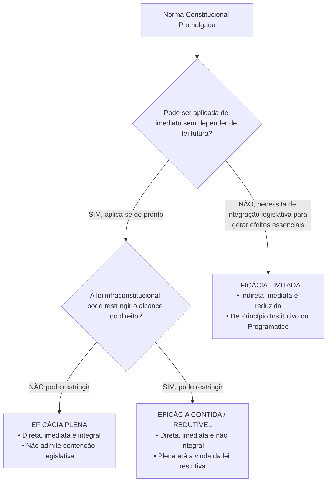
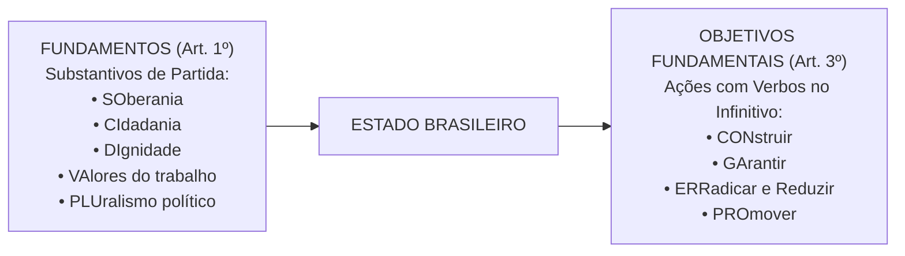

# 01 - Aplicabilidade das Normas Constitucionais e Princípios Fundamentais

> **Matéria:** Noções de Direito Constitucional  
> **Cargo:** A01 – Técnico de Controle Externo – Especialidade: Técnico Administrativo  
> **Arquivo:** `01_aplicabilidade_das_normas_e_principios_fundamentais.md`  
> **Status:** 🟢 Teoria Aprofundada + 5 Questões FCC Comentadas (A a E)

---

## 📌 Ementa Oficial do Edital
- Da aplicabilidade das normas constitucionais (Classificação de José Afonso da Silva).
- Normas constitucionais de eficácia plena, contida e limitada.
- Normas constitucionais programáticas e princípio da reserva do possível vs. mínimo existencial.
- Princípios Fundamentais da Constituição da República Federativa do Brasil de 1988 (Artigos 1º a 4º).
- Fundamentos da República Federativa do Brasil (Artigo 1º).
- Teoria da Separação dos Poderes e o sistema de freios e contrapesos (*Checks and Balances* - Artigo 2º).
- Objetivos fundamentais da República Federativa do Brasil (Artigo 3º).
- Princípios que regem a República Federativa do Brasil em suas relações internacionais (Artigo 4º).

---

## 🧭 Sumário

1. [Eficácia e Aplicabilidade das Normas Constitucionais](#1-eficacia-e-aplicabilidade-das-normas-constitucionais)
    1. [Classificação Tripartite de José Afonso da Silva](#11-classificacao-tripartite-de-jose-afonso-da-silva)
    2. [Eficácia Mínima das Normas Limitadas e Remédios contra Omissão](#12-eficacia-minima-das-normas-limitadas-e-remedios-contra-omissao)
    3. [Reserva do Possível versus Mínimo Existencial](#13-reserva-do-possivel-versus-minimo-existencial)
    4. [Teste 110](#Teste-110)
    5. [Teste 111](#Teste-111)
    6. [Teste 112](#Teste-112)
    7. [Teste 113](#Teste-113)
2. [Princípios Fundamentais da CF/88 (Título I - Arts. 1º a 4º)](#2-principios-fundamentais-da-cf88-titulo-i-arts-1o-a-4o)
    1. [Forma de Estado, Forma de Governo e Regime Político](#21-forma-de-estado-forma-de-governo-e-regime-politico)
    2. [Fundamentos da República Federativa do Brasil (Art. 1º)](#22-fundamentos-da-republica-federativa-do-brasil-art-1o)
    3. [Separação dos Poderes e o Sistema de Freios e Contrapesos (Art. 2º)](#23-separacao-dos-poderes-e-o-sistema-de-freios-e-contrapesos-art-2o)
    4. [Objetivos Fundamentais da República (Art. 3º)](#24-objetivos-fundamentais-da-republica-art-3o)
    5. [Princípios nas Relações Internacionais e Integração Latino-Americana (Art. 4º)](#25-principios-nas-relacoes-internacionais-e-integracao-latino-americana-art-4o)
    6. [Teste 114](#Teste-114)
    7. [Teste 115](#Teste-115)
    8. [Teste 116](#Teste-116)
    9. [Teste 117](#Teste-117)
    10. [Teste 118](#Teste-118)
    11. [Teste 119](#Teste-119)
    12. [Teste 120](#Teste-120)
6. [Fontes Recomendadas na Internet](#6-fontes-recomendadas-na-internet)

---

## 1. Eficácia e Aplicabilidade das Normas Constitucionais

O estudo da aplicabilidade das normas constitucionais investiga o grau de aptidão que cada preceito da Lei Fundamental possui para produzir efeitos jurídicos no mundo dos fatos desde a sua promulgação. No direito público brasileiro, a doutrina amplamente majoritária e a jurisprudência pacífica do Supremo Tribunal Federal (STF) consagram a classificação tripartite formulada pelo professor José Afonso da Silva.

### 1.1 Classificação Tripartite de José Afonso da Silva

| Classificação da Norma | Aplicabilidade | Depende de Lei Infraconstitucional? | Pode Ser Restringida por Lei? | Exemplos Canônicos na CF/88 |
|---|:---:|:---:|:---:|---|
| **Eficácia Plena** | **Direta, Imediata e Integral** | **NÃO** | **NÃO** | Art. 2º (Separação dos Poderes); Art. 5º, III (Vedação da tortura); Art. 5º, LVI (Inadmissibilidade de provas ilícitas). |
| **Eficácia Contida (ou Redutível)** | **Direta, Imediata e NÃO Integral** | **NÃO** (produz efeitos plenos desde a promulgação) | **SIM** (a lei infraconstitucional pode restringir seu alcance) | Art. 5º, XIII (Liberdade de exercício profissional atendidas qualificações da lei); Art. 5º, XII (Inviolabilidade de sigilo telefônico salvo ordem judicial). |
| **Eficácia Limitada** | **Indireta, Mediata e Reduzida** | **SIM** (depende de atuação integradora do legislador ordinário) | Não se aplica (o direito nasce contido e depende de ampliação legal) | Art. 37, VII (Direito de greve dos servidores públicos civis); Art. 196 (Direito à saúde como dever do Estado mediante políticas públicas). |

- **Normas de Eficácia Plena:** São aquelas que desde a promulgação da Constituição receberam do constituinte uma normatividade suficiente para serem aplicadas de pronto a situações concretas. Não dependem de qualquer regulamentação legal ulterior para produzirem todos os seus efeitos e não podem ser restringidas pelo legislador ordinário.
- **Normas de Eficácia Contida (ou Redutível / Prospectiva):** São normas que também produzem efeitos plenos e imediatos a partir da promulgação, mas nas quais o constituinte deixou expressa ou implicitamente uma cláusula de contenção (*"na forma da lei"*, *"atendidas as qualificações que a lei estabelecer"*, *"salvo disposição em contrário"*). Enquanto o legislador ordinário não editar a norma restritiva, o exercício do direito é pleno e irrestrito.
- **Normas de Eficácia Limitada:** Não produzem seus efeitos fundamentais de imediato, dependendo da interferência do legislador infraconstitucional para conferir densidade e viabilizar o exercício prático da prerrogativa. Subdividem-se em:
    1. *Normas de Princípio Institutivo (ou Organizatório):* Aquelas pelas quais o constituinte traça o esquema geral de criação e organização de órgãos, entidades ou instituições do Estado (ex.: art. 88 da CF/88, que dispõe que a lei disporá sobre a criação e extinção de Ministérios);
    2. *Normas de Princípio Programático:* Aquelas que estabelecem metas, programas sociais, diretrizes socioeconômicas e fins de interesse público a serem alcançados pelos poderes públicos (ex.: saúde, erradicação do analfabetismo, proteção ao meio ambiente).

### 1.2 Eficácia Mínima das Normas Limitadas e Remédios contra Omissão
Embora as normas de eficácia limitada não confiram exigibilidade imediata da prestação originária sem integração legislativa, é incorreto afirmar que elas são desprovidas de valor jurídico. A doutrina e a jurisprudência reconhecem a **eficácia jurídica mínima** dessas normas:

- **Eficácia Revogatória (ou Negativa):** Revogam automaticamente toda a legislação anterior que com elas seja materialmente incompatível (não recepção).
- **Eficácia Impeditiva:** Impedem a edição de leis futuras que contrariem seus vetores teleológicos, sob pena de inconstitucionalidade direta.
- **Eficácia Hermenêutica / Interpretativa:** Servem de vetor interpretativo obrigatório para juízes e administradores públicos.
- **Remédios Constitucionais contra a Omissão Inconstitucional:** Para combater a mora legislativa que inviabiliza o exercício de direitos previstos em normas de eficácia limitada, a Constituição consagrou o **Mandado de Injunção** (art. 5º, LXXI, e Lei nº 13.300/2016) e a **Ação Direta de Inconstitucionalidade por Omissão (ADO)** (art. 103, § 2º).

### 1.3 Reserva do Possível versus Mínimo Existencial
No controle judicial de políticas públicas decorrentes de normas programáticas (saúde, fornecimento de medicamentos de alto custo, vagas em creches):

- **Reserva do Possível (*Vorbehalt des Möglichen*):** Tese frequentemente invocada pela Fazenda Pública segundo a qual a efetivação dos direitos sociais condiciona-se à existência de capacidade orçamentária e financeira do Estado, bem como à discricionariedade do administrador na alocação de recursos escassos.
- **Mínimo Existencial:** Entendimento consolidado pelo STF no sentido de que a reserva do possível encontra limite intransponível no **núcleo essencial dos direitos fundamentais indispensáveis a uma vida digna** (mínimo existencial). Quando estiver em jogo a própria sobrevivência ou a integridade biológica do indivíduo, a alegação de insuficiência de recursos orçamentários torna-se inoponível ao cidadão.

---

### Teste 001
**(FGV – TCE/PI – 2025 – Auditor de Controle Externo - Controle Externo - Específica de Área Comum)**
O Art. 92-B, §2º, do Ato das Disposições Constitucionais Transitórias da Constituição da República, acrescido pela Emenda Constitucional nº 132/2023, tem a seguinte redação: Lei complementar instituirá Fundo de Sustentabilidade e Diversificação Econômica do Estado do Amazonas, que será constituído com recursos da União e por ela gerido, com a efetiva participação do Estado do Amazonas na definição das políticas, com o objetivo de fomentar o desenvolvimento e a diversificação das atividades econômicas no Estado. A interpretação desse comando normativo permite concluir que se está perante norma de

* **A)** eficácia contida.
* **B)** aplicabilidade imediata.
* **C)** aplicabilidade direta, mas não integral.
* **D)** eficácia limitada e de princípio institutivo.
* **E)** eficácia limitada e de princípio programático.

---

> **Comentário Detalhado:**
>
> - **A)** **Incorreta.** A opção apresenta proposição em desacordo com os fundamentos teóricos e técnicos do tópico ao afirmar que "eficácia contida". De acordo com a teoria estudada em *6. Fontes Recomendadas na Internet*, sILVA, José Afonso da. Aplicabilidade das Normas Constitucionais. 8. ed. São Paulo: Malheiros, 2012. (Cap. III Normas Constitucionais de Eficácia Plena, Contida e Limitada).
> - **B)** **Incorreta.** A opção apresenta proposição em desacordo com os fundamentos teóricos e técnicos do tópico ao afirmar que "aplicabilidade imediata". De acordo com a teoria estudada em *1.1 Classificação Tripartite de José Afonso da Silva*, normas de Princípio Institutivo (ou Organizatório): Aquelas pelas quais o constituinte traça o esquema geral de criação e organização de órgãos, entidades ou instituições do Estado (ex.: art. 88 da CF/88, que dispõe que a lei disporá sobre a criação e extinção de Ministérios).
> - **C)** **Incorreta.** A opção apresenta proposição em desacordo com os fundamentos teóricos e técnicos do tópico ao afirmar que "aplicabilidade direta, mas não integral". De acordo com a teoria estudada em *1.2 Eficácia Mínima das Normas Limitadas e Remédios contra Omissão*, remédios Constitucionais contra a Omissão Inconstitucional: Para combater a mora legislativa que inviabiliza o exercício de direitos previstos em normas de eficácia limitada, a Constituição consagrou o Mandado de Injunção (art. 5º, LXXI, e Lei nº 13.300/2016) e a Ação Direta de Inconstitucionalidade por Omissão (ADO) (art. 103, § 2º).
> - **D)** **Correta.** Conforme fundamentado na seção *1.1 Classificação Tripartite de José Afonso da Silva* deste guia, dEC |"NÃO, necessita de integração legislativa para gerar efeitos essenciais"| LIMIT["EFICÁCIA LIMITADA<br/ • Indireta, mediata e reduzida<br/ • De Princípio Institutivo ou Programático"]. Dessa forma, está plenamente correta a assertiva da banca (FGV – TCE/PI/2025) ao estabelecer que "eficácia limitada e de princípio institutivo".
> - **E)** **Incorreta.** A opção apresenta proposição em desacordo com os fundamentos teóricos e técnicos do tópico ao afirmar que "eficácia limitada e de princípio programático". De acordo com a teoria estudada em *1.1 Classificação Tripartite de José Afonso da Silva*, normas de Princípio Programático: Aquelas que estabelecem metas, programas sociais, diretrizes socioeconômicas e fins de interesse público a serem alcançados pelos poderes públicos (ex.: saúde, erradicação do analfabetismo, proteção ao meio ambiente).
>
> **Gabarito: D**

---

### Teste 002
**(FGV – TCE/SC – 2026 – Auditor Fiscal de Controle Externo - Direito)**
Em uma inspeção, agentes do controle externo do Tribunal de Contas do Estado Sigma constataram que a remuneração básica de diversos servidores do pequeno Município Delta, com apenas vinte mil habitantes, era inferior ao salário mínimo, o que gerou dúvidas iniciais em relação à conformidade constitucional desse estado de coisas. Ao fim da análise realizada, os agentes concluíram corretamente que, consoante súmula vinculante do Supremo Tribunal Federal,

* **A)** a garantia de remuneração não inferior ao salário mínimo não é aplicável aos servidores públicos.
* **B)** o cálculo de gratificações e outras vantagens do servidor público incide sobre o abono utilizado para atingir o salário mínimo.
* **C)** a garantia de remuneração não inferior ao salário mínimo deve ser analisada na perspectiva do total da remuneração percebida pelo servidor público.
* **D)** a remuneração básica do servidor público não pode ser inferior ao salário mínimo, não devendo ser consideradas outras parcelas remuneratórias, com fatos geradores próprios que não o mero vínculo funcional.
* **E)** a garantia de remuneração não inferior ao salário mínimo deve estar prevista no regime jurídico dos servidores públicos, não decorrendo da norma constitucional de eficácia limitada que dispõe sobre a temática.

---

> **Comentário Detalhado:**
>
> - **A)** **Incorreta.** A opção apresenta proposição em desacordo com os fundamentos teóricos e técnicos do tópico ao afirmar que "a garantia de remuneração não inferior ao salário mínimo não é aplicável aos servidores públicos". De acordo com a teoria estudada em *1.1 Classificação Tripartite de José Afonso da Silva*, eficácia Limitada: Indireta, Mediata e Reduzida — SIM (depende de atuação integradora do legislador ordinário) — Não se aplica (o direito nasce contido e depende de ampliação legal) — Art. 37, VII (Direito de greve dos servidores públicos civis); Art. 196 (Direito à saúde como dever do Estado mediante políticas públicas).
> - **B)** **Incorreta.** A opção apresenta proposição em desacordo com os fundamentos teóricos e técnicos do tópico ao afirmar que "o cálculo de gratificações e outras vantagens do servidor público incide sobre o abono utilizado para atingir o...". De acordo com a teoria estudada em *1.1 Classificação Tripartite de José Afonso da Silva*, n["Norma Constitucional Promulgada"] DEC{"Pode ser aplicada de imediato sem depender de lei futura?"}.
> - **C)** **Incorreta.** A opção apresenta proposição em desacordo com os fundamentos teóricos e técnicos do tópico ao afirmar que "a garantia de remuneração não inferior ao salário mínimo deve ser analisada na perspectiva do total da remuneração...". De acordo com a teoria estudada em *1.1 Classificação Tripartite de José Afonso da Silva*, classificação da Norma: Aplicabilidade — Depende de Lei Infraconstitucional? — Pode Ser Restringida por Lei? — Exemplos Canônicos na CF/88.
> - **D)** **Correta.** Conforme fundamentado na seção *2.2 Fundamentos da República Federativa do Brasil (Art. 1º)* deste guia, dIgnidade da Pessoa Humana: Matriz axiológica de todo o ordenamento jurídico, que coloca o ser humano como fim primordial do Estado, e não mero instrumento. Dessa forma, está plenamente correta a assertiva da banca (FGV – TCE/SC/2026) ao estabelecer que "a remuneração básica do servidor público não pode ser inferior ao salário mínimo, não devendo ser consideradas...".
> - **E)** **Incorreta.** A opção apresenta proposição em desacordo com os fundamentos teóricos e técnicos do tópico ao afirmar que "a garantia de remuneração não inferior ao salário mínimo deve estar prevista no regime jurídico dos servidores...". De acordo com a teoria estudada em *2.1 Forma de Estado, Forma de Governo e Regime Político*, forma de Governo: República. Caracteriza se pela eletividade e temporariedade dos mandatos dos governantes, pela responsabilidade política e jurídica dos agentes públicos e pelo dever republicano de prestar contas perante a sociedade e as Cortes de Contas.
>
> **Gabarito: D**

---

## 2. Princípios Fundamentais da CF/88 (Título I - Arts. 1º a 4º)

O Título I da Constituição Federal delimita as decisões políticas estruturantes do Estado brasileiro.

### 2.1 Forma de Estado, Forma de Governo e Regime Político
- **Forma de Estado: Federação.** Caracteriza-se pela descentralização política, coexistência de esferas federativas autônomas (União, Estados, Distrito Federal e Municípios), vedação ao direito de secessão e proteção sob cláusula pétrea explícita (art. 60, § 4º, I).
- **Forma de Governo: República.** Caracteriza-se pela eletividade e temporariedade dos mandatos dos governantes, pela responsabilidade política e jurídica dos agentes públicos e pelo dever republicano de prestar contas perante a sociedade e as Cortes de Contas.
- **Regime Político: Democracia Semidireta (ou Participativa).** Conforme o art. 1º, parágrafo único: *"Todo o poder emana do povo, que o exerce por meio de representantes eleitos ou diretamente, nos termos desta Constituição."* O exercício direto manifesta-se por meio do **plebiscito**, do **referendo** e da **iniciativa popular** de leis (art. 14, I, II e III).

### 2.2 Fundamentos da República Federativa do Brasil (Art. 1º)
Os fundamentos consubstanciam as bases estruturais sobre as quais se erige o Estado brasileiro. São expressos por substantivos e memorizados pelo consagrado mnemônico **SO-CI-DI-VA-PLU**:

1. **SOberania:** Poder supremo no plano interno e independente na ordem internacional;
2. **CIdadania:** Prerrogativa de participação ativa na vida política do país e na formação das decisões estatais;
3. **DIgnidade da Pessoa Humana:** Matriz axiológica de todo o ordenamento jurídico, que coloca o ser humano como fim primordial do Estado, e não mero instrumento;
4. **VAlores Sociais do Trabalho e da Livre Iniciativa:** Reconhecimento concomitante do trabalho como fonte de emancipação social e da liberdade econômica de mercado como motor da produção de riquezas;
5. **PLUralismo Político:** Abertura para a livre manifestação e convivência harmoniosa de diferentes correntes ideológicas, filosóficas e políticas.

> 🚨 **ALERTA DE PROVA / PEGADINHA FCC:**  
> A banca FCC frequentemente tenta confundir o candidato trocando **pluralismo político** por **pluripartidarismo**. O pluripartidarismo (liberdade de criação de partidos políticos) é apenas uma das dimensões instrumentais do pluralismo político, que é um conceito infinitamente mais amplo de liberdade de pensamento e de cosmovisão.

### 2.3 Separação dos Poderes e o Sistema de Freios e Contrapesos (Art. 2º)
O art. 2º da Carta Magna estabelece: *"São Poderes da União, independentes e harmônicos entre si, o Legislativo, o Executivo e o Judiciário."*

No modelo do constitucionalismo contemporâneo:

- **Não há separação estanque ou absoluta:** Cada Poder desempenha uma **função típica preponderante** e **funções atípicas secundárias** expressamente delimitadas pela Constituição:
    - **Poder Executivo:** Função típica: governar e administrar a coisa pública; Funções atípicas: legislar (ao editar medidas provisórias e leis delegadas) e julgar (ao decidir processos administrativos e disciplinares).
    - **Poder Legislativo:** Funções típicas: legislar (elaborar normas gerais e abstratas) e fiscalizar (controle financeiro e contábil externo com auxílio dos Tribunais de Contas); Funções atípicas: administrar (gerir seu quadro funcional e contratos) e julgar (o Senado julga o Presidente da República e Ministros do STF em crimes de responsabilidade).
    - **Poder Judiciário:** Função típica: jurisdicional (dizer o direito no caso concreto com definitividade); Funções atípicas: administrar (realizar licitações e prover cargos) e legislar (elaborar os regimentos internos de seus tribunais).
- **Sistema de Freios e Contrapesos (*Checks and Balances*):** Mecanismo de controle recíproco em que um Poder limita e fiscaliza a atuação do outro, prevenindo abusos e garantindo a harmonia institucional (ex.: veto do Presidente a projetos de lei; sabatina e aprovação de ministros pelo Senado; controle de constitucionalidade de leis e atos do Executivo exercido pelo Judiciário).

### 2.4 Objetivos Fundamentais da República (Art. 3º)
Os objetivos fundamentais consubstanciam as metas de chegada e as finalidades que o Estado brasileiro deve perseguir. Diferenciam-se dos fundamentos porque começam invariavelmente por **VERBOS NO INFINITIVO** (Mnemônico **CON-GA-ERRA-PRO**):

1. **CON**struir uma sociedade livre, justa e solidária;
2. **GA**rantir o desenvolvimento nacional;
3. **ERRA**dicar a pobreza e a marginalização e **reduzir as desigualdades sociais e regionais**;
4. **PRO**mover o bem de todos, sem preconceitos de origem, raça, sexo, cor, idade e quaisquer outras formas de discriminação.

### 2.5 Princípios nas Relações Internacionais e Integração Latino-Americana (Art. 4º)
A República Federativa do Brasil rege-se em suas relações internacionais pelos seguintes princípios:

1. Independência nacional;
2. Prevalência dos direitos humanos;
3. Autodeterminação dos povos;
4. Não intervenção;
5. Igualdade entre os Estados;
6. Defesa da paz;
7. Solução pacífica dos conflitos;
8. Repúdio ao terrorismo e ao racismo;
9. Cooperação entre os povos para o progresso da humanidade;
10. Concessão de asilo político.

- **Parágrafo Único do Art. 4º:** Estabelece expressamente que o Brasil buscará a **integração econômica, política, social e cultural dos povos da América Latina**, visando à formação de uma **comunidade latino-americana de nações**.

> 🚨 **ALERTA DE PROVA / PEGADINHA FCC:**  
> A banca examinadora costuma substituir ardilosamente a expressão constitucional **América Latina** por "América do Sul", "Mercosul" ou "países lusófonos". Atenção máxima: a redação do parágrafo único do art. 4º consagra expressamente a **América Latina**!

---

### Teste 003
**(FGV – TJ/SC – 2026 – Analista Administrativo)**
Os direitos humanos foram consolidados no Brasil mediante a Constituição Federal de 1988, que adotou a dignidade da pessoa humana (Art. 1º, III) como fundamento da República e garantiu a igualdade (Art. 5º) sem distinções. Esses princípios norteiam o Estado Democrático de Direito, assegurando proteção contra arbítrios, além de direitos fundamentais, sociais e mecanismos de inclusão. Considerando as disposições constitucionais relativas aos direitos e garantias individuais, assinale a afirmativa correta.

* **A)** A liberdade de consciência e de crença é inviolável, assegurado o livre exercício dos cultos religiosos, não sendo garantida a prestação de assistência religiosa nas entidades civis e militares de internação coletiva.
* **B)** A casa é asilo inviolável do indivíduo, ninguém nela podendo adentrar sem consentimento do morador, salvo em caso de flagrante delito ou desastre, ou para prestar socorro, ou, durante o dia ou noite, por determinação judicial.
* **C)** O sigilo da correspondência é inviolável, salvo, no último caso, por ordem judicial, nas hipóteses e na forma que a lei estabelecer para fins de investigação criminal ou instrução processual penal.
* **D)** Todos podem reunir-se pacificamente, ainda que armados, em locais abertos ao público, independentemente de autorização, desde que não frustrem outra reunião anteriormente convocada para o mesmo local.
* **E)** É livre a locomoção no território nacional em tempo de paz ou de guerra, podendo qualquer pessoa, nos termos da lei, nele entrar, permanecer ou dele sair com seus bens.

---

> **Comentário Detalhado:**
>
> - **A)** **Incorreta.** A opção apresenta proposição em desacordo com os fundamentos teóricos e técnicos do tópico ao afirmar que "A liberdade de consciência e de crença é inviolável, assegurado o livre exercício dos cultos religiosos, não sendo...". De acordo com a teoria estudada em *1.1 Classificação Tripartite de José Afonso da Silva*, normas de Eficácia Contida (ou Redutível / Prospectiva): São normas que também produzem efeitos plenos e imediatos a partir da promulgação, mas nas quais o constituinte deixou expressa ou implicitamente uma cláusula de contenção ( "na forma da lei" , "atendidas as qualificações que a lei estabelecer" , "salvo disposição em contrário" ). Enquanto o legislador ordinário não editar a norma restritiva, o exercício do direito é pleno e irrestrito.
> - **B)** **Incorreta.** A opção apresenta proposição em desacordo com os fundamentos teóricos e técnicos do tópico ao afirmar que "A casa é asilo inviolável do indivíduo, ninguém nela podendo adentrar sem consentimento do morador, salvo em caso...". De acordo com a teoria estudada em *2.1 Forma de Estado, Forma de Governo e Regime Político*, forma de Governo: República. Caracteriza se pela eletividade e temporariedade dos mandatos dos governantes, pela responsabilidade política e jurídica dos agentes públicos e pelo dever republicano de prestar contas perante a sociedade e as Cortes de Contas.
> - **C)** **Correta.** Conforme fundamentado na seção *1.1 Classificação Tripartite de José Afonso da Silva* deste guia, eficácia Contida (ou Redutível): Direta, Imediata e NÃO Integral — NÃO (produz efeitos plenos desde a promulgação) — SIM (a lei infraconstitucional pode restringir seu alcance) — Art. 5º, XIII (Liberdade de exercício profissional atendidas qualificações da lei); Art. 5º, XII (Inviolabilidade de sigilo telefônico salvo ordem judicial). Dessa forma, está plenamente correta a assertiva da banca (FGV – TJ/SC/2026) ao estabelecer que "O sigilo da correspondência é inviolável, salvo, no último caso, por ordem judicial, nas hipóteses e na forma que...".
> - **D)** **Incorreta.** A opção apresenta proposição em desacordo com os fundamentos teóricos e técnicos do tópico ao afirmar que "Todos podem reunir se pacificamente, ainda que armados, em locais abertos ao público, independentemente de...". De acordo com a teoria estudada em *1.1 Classificação Tripartite de José Afonso da Silva*, normas de Eficácia Plena: São aquelas que desde a promulgação da Constituição receberam do constituinte uma normatividade suficiente para serem aplicadas de pronto a situações concretas. Não dependem de qualquer regulamentação legal ulterior para produzirem todos os seus efeitos e não podem ser restringidas pelo legislador ordinário.
> - **E)** **Incorreta.** A opção promove generalização excessiva que desconsidera as condições técnicas e normativas ao afirmar que "É livre a locomoção no território nacional em tempo de paz ou de guerra, podendo qualquer pessoa, nos termos da...". De acordo com a teoria estudada em *2.2 Fundamentos da República Federativa do Brasil (Art. 1º)*, dIgnidade da Pessoa Humana: Matriz axiológica de todo o ordenamento jurídico, que coloca o ser humano como fim primordial do Estado, e não mero instrumento.
>
> **Gabarito: C**

---

### Teste 004
**(FGV – TJ/SC – 2026 – Analista Administrativo)**
O acesso à justiça é direito fundamental, preceituado no artigo 5º, XXXV, da Constituição Federal de 1988, que garante a inafastabilidade da jurisdição. Trata-se de garantia sustentada pelos princípios do contraditório e da ampla defesa, assegurando o devido processo legal. Considerando a legislação em vigor, é correto afirmar que

* **A)** é assegurado a todos, desde que haja o pagamento de taxas, o direito de petição aos Poderes Públicos em defesa de direitos ou contra ilegalidade ou abuso de poder.
* **B)** a Constituição Federal veda que haja juízo ou tribunal de exceção, salvo em época de guerra ou estado de sítio decretado.
* **C)** ninguém será considerado culpado até a publicação da sentença penal condenatória em Diário Oficial, lançado o nome no rol dos culpados.
* **D)** a lei não prejudicará o ato jurídico perfeito e a coisa julgada, sendo possível que direito adquirido seja alterado por regra resultante de Emenda Constitucional, posterior.
* **E)** é a todos assegurada a obtenção de certidões em repartições públicas, para defesa de direitos e esclarecimento de situações de interesse pessoal.

---

> **Comentário Detalhado:**
>
> - **A)** **Incorreta.** A opção apresenta proposição em desacordo com os fundamentos teóricos e técnicos do tópico ao afirmar que "é assegurado a todos, desde que haja o pagamento de taxas, o direito de petição aos Poderes Públicos em defesa de...". De acordo com a teoria estudada em *1.1 Classificação Tripartite de José Afonso da Silva*, eficácia Limitada: Indireta, Mediata e Reduzida — SIM (depende de atuação integradora do legislador ordinário) — Não se aplica (o direito nasce contido e depende de ampliação legal) — Art. 37, VII (Direito de greve dos servidores públicos civis); Art. 196 (Direito à saúde como dever do Estado mediante políticas públicas).
> - **B)** **Incorreta.** A opção apresenta vedação ou negativa absoluta incompatível com a regra aplicável ao afirmar que "a Constituição Federal veda que haja juízo ou tribunal de exceção, salvo em época de guerra ou estado de sítio...". De acordo com a teoria estudada em *1.2 Eficácia Mínima das Normas Limitadas e Remédios contra Omissão*, remédios Constitucionais contra a Omissão Inconstitucional: Para combater a mora legislativa que inviabiliza o exercício de direitos previstos em normas de eficácia limitada, a Constituição consagrou o Mandado de Injunção (art. 5º, LXXI, e Lei nº 13.300/2016) e a Ação Direta de Inconstitucionalidade por Omissão (ADO) (art. 103, § 2º).
> - **C)** **Incorreta.** A opção apresenta proposição em desacordo com os fundamentos teóricos e técnicos do tópico ao afirmar que "ninguém será considerado culpado até a publicação da sentença penal condenatória em Diário Oficial, lançado o nome...". De acordo com a teoria estudada em *6. Fontes Recomendadas na Internet*, constituição Federal de 1988 Arts. 1º a 4º (Princípios Fundamentais) Texto oficial que consagra os fundamentos da República Federativa do Brasil, a separação dos poderes e os objetivos fundamentais.
> - **D)** **Incorreta.** A opção apresenta proposição em desacordo com os fundamentos teóricos e técnicos do tópico ao afirmar que "a lei não prejudicará o ato jurídico perfeito e a coisa julgada, sendo possível que direito adquirido seja...". De acordo com a teoria estudada em *6. Fontes Recomendadas na Internet*, decreto Lei nº 4.657/1942 LINDB Compilada Lei de Introdução às Normas do Direito Brasileiro, com as alterações da Lei nº 13.655/2018 sobre segurança jurídica e interpretação de normas públicas.
> - **E)** **Correta.** Conforme fundamentado na seção *1.1 Classificação Tripartite de José Afonso da Silva* deste guia, normas de Eficácia Plena: São aquelas que desde a promulgação da Constituição receberam do constituinte uma normatividade suficiente para serem aplicadas de pronto a situações concretas. Não dependem de qualquer regulamentação legal ulterior para produzirem todos os seus efeitos e não podem ser restringidas pelo legislador ordinário. Dessa forma, está plenamente correta a assertiva da banca (FGV – TJ/SC/2026) ao estabelecer que "é a todos assegurada a obtenção de certidões em repartições públicas, para defesa de direitos e esclarecimento de...".
>
> **Gabarito: E**

---

### Teste 005
**(FCC – TCE/GO – 2009 – Analista de Controle Externo - Gestão de Conhecimento)**
De acordo com o art. 71 da Constituição Federal de 1988, compete ao Tribunal de Contas da União, no exercício do controle externo, realizar inspeções e auditorias de diversas naturezas. Supondo que o Tribunal de Contas realize auditoria em uma entidade pública com a finalidade de confirmar os valores apresentados nas demonstrações financeiras, ele está realizando uma auditoria

* **A)** avaliar o cumprimento das metas previstas no plano plurianual, a execução dos programas de governo e dos orçamentos da União.
* **B)** comprovar a legalidade e avaliar os resultados, quanto à eficácia e eficiência, da gestão orçamen- tária, financeira e patrimonial nos órgãos e entidades da administração federal.
* **C)** exercer o controle das operações de crédito, avais e garantias, bem como dos direitos e haveres da União.
* **D)** apoiar o controle externo no exercício de sua missão institucional.
* **E)** aplicar aos responsáveis, em caso de ilegalidade de despesa ou irregularidade de contas, as sanções previstas em lei.

---

> **Comentário Detalhado:**
>
> - **A)** **Correta.** Conforme fundamentado na seção *2.1 Forma de Estado, Forma de Governo e Regime Político* deste guia, forma de Estado: Federação. Caracteriza se pela descentralização política, coexistência de esferas federativas autônomas (União, Estados, Distrito Federal e Municípios), vedação ao direito de secessão e proteção sob cláusula pétrea explícita (art. 60, § 4º, I). Dessa forma, está plenamente correta a assertiva da banca (FCC – TCE/GO/2009) ao estabelecer que "avaliar o cumprimento das metas previstas no plano plurianual, a execução dos programas de governo e dos...".
> - **B)** **Incorreta.** A opção apresenta proposição em desacordo com os fundamentos teóricos e técnicos do tópico ao afirmar que "comprovar a legalidade e avaliar os resultados, quanto à eficácia e eficiência, da gestão orçamen tária...". De acordo com a teoria estudada em *1.1 Classificação Tripartite de José Afonso da Silva*, normas de Princípio Institutivo (ou Organizatório): Aquelas pelas quais o constituinte traça o esquema geral de criação e organização de órgãos, entidades ou instituições do Estado (ex.: art. 88 da CF/88, que dispõe que a lei disporá sobre a criação e extinção de Ministérios).
> - **C)** **Incorreta.** A opção apresenta proposição em desacordo com os fundamentos teóricos e técnicos do tópico ao afirmar que "exercer o controle das operações de crédito, avais e garantias, bem como dos direitos e haveres da União". De acordo com a teoria estudada em *1.1 Classificação Tripartite de José Afonso da Silva*, normas de Princípio Programático: Aquelas que estabelecem metas, programas sociais, diretrizes socioeconômicas e fins de interesse público a serem alcançados pelos poderes públicos (ex.: saúde, erradicação do analfabetismo, proteção ao meio ambiente).
> - **D)** **Incorreta.** A opção apresenta proposição em desacordo com os fundamentos teóricos e técnicos do tópico ao afirmar que "apoiar o controle externo no exercício de sua missão institucional". De acordo com a teoria estudada em *2.1 Forma de Estado, Forma de Governo e Regime Político*, regime Político: Democracia Semidireta (ou Participativa). Conforme o art. 1º, parágrafo único: "Todo o poder emana do povo, que o exerce por meio de representantes eleitos ou diretamente, nos termos desta Constituição." O exercício direto manifesta se por meio do plebiscito, do referendo e da iniciativa popular de leis (art. 14, I, II e III).
> - **E)** **Incorreta.** A opção apresenta proposição em desacordo com os fundamentos teóricos e técnicos do tópico ao afirmar que "aplicar aos responsáveis, em caso de ilegalidade de despesa ou irregularidade de contas, as sanções previstas em...". De acordo com a teoria estudada em *2.1 Forma de Estado, Forma de Governo e Regime Político*, forma de Governo: República. Caracteriza se pela eletividade e temporariedade dos mandatos dos governantes, pela responsabilidade política e jurídica dos agentes públicos e pelo dever republicano de prestar contas perante a sociedade e as Cortes de Contas.
>
> **Gabarito: A**

---

### Teste 006
**(FCC – TRT 9ª – 2015 – Analista Judiciário - Apoio Especializado - Tecnologia da Informação)**
Considere os itens abaixo: I. Promover o bem de todos, sem preconceito de origem, raça, sexo, cor, idade e quaisquer outras formas de discriminação. II. Fornecer saúde e educação à população. III. Garantir a segurança pública. IV. Garantir o desenvolvimento nacional. Nos termos da Constituição Federal, constituem objetivos fundamentais da República Federativa do Brasil o constante APENAS em

* **A)** I, II, III e IV.
* **B)** II, III e IV, apenas. assegurada ao proprietário indenização ulterior, se
* **C)** I e II, apenas. houver dano.
* **D)** III e IV, apenas.
* **E)** São asseguradas, nos termos da lei, a proteção às _________________________________________________________ participações individuais em obras coletivas e à re- produção da imagem e voz humanas, exceto nas ati- 24. Julgar os juízes estaduais, bem como os membros do Mi- vidades desportivas. nistério Público, nos crimes comuns e de responsabilida- _________________________________________________________ de, ressalvada a competência da Justiça Eleitoral, compete

---

> **Comentário Detalhado:**
>
> - **A)** **Correta.** Conforme fundamentado na seção *2.4 Objetivos Fundamentais da República (Art. 3º)* deste guia, pROmover o bem de todos, sem preconceitos de origem, raça, sexo, cor, idade e quaisquer outras formas de discriminação. Dessa forma, está plenamente correta a assertiva da banca (FCC – TRT 9ª/2015) ao estabelecer que "I, II, III e IV".
> - **B)** **Incorreta.** A opção incorre em restrição indevida ao limitar o escopo conceitual ao afirmar que "II, III e IV, apenas. assegurada ao proprietário indenização ulterior, se". De acordo com a teoria estudada em *2.1 Forma de Estado, Forma de Governo e Regime Político*, regime Político: Democracia Semidireta (ou Participativa). Conforme o art. 1º, parágrafo único: "Todo o poder emana do povo, que o exerce por meio de representantes eleitos ou diretamente, nos termos desta Constituição." O exercício direto manifesta se por meio do plebiscito, do referendo e da iniciativa popular de leis (art. 14, I, II e III).
> - **C)** **Incorreta.** A opção incorre em restrição indevida ao limitar o escopo conceitual ao afirmar que "I e II, apenas. houver dano". De acordo com a teoria estudada em *2.4 Objetivos Fundamentais da República (Art. 3º)*, gArantir o desenvolvimento nacional.
> - **D)** **Incorreta.** A opção incorre em restrição indevida ao limitar o escopo conceitual ao afirmar que "III e IV, apenas". De acordo com a teoria estudada em *1.1 Classificação Tripartite de José Afonso da Silva*, eficácia Plena: Direta, Imediata e Integral — NÃO — NÃO — Art. 2º (Separação dos Poderes); Art. 5º, III (Vedação da tortura); Art. 5º, LVI (Inadmissibilidade de provas ilícitas).
> - **E)** **Incorreta.** A opção apresenta proposição em desacordo com os fundamentos teóricos e técnicos do tópico ao afirmar que "São asseguradas, nos termos da lei, a proteção às participações individuais em obras coletivas e à re produção da...". De acordo com a teoria estudada em *2.3 Separação dos Poderes e o Sistema de Freios e Contrapesos (Art. 2º)*, poder Legislativo: Funções típicas: legislar (elaborar normas gerais e abstratas) e fiscalizar (controle financeiro e contábil externo com auxílio dos Tribunais de Contas); Funções atípicas: administrar (gerir seu quadro funcional e contratos) e julgar (o Senado julga o Presidente da República e Ministros do STF em crimes de responsabilidade).
>
> **Gabarito: A**

---

### Teste 007
**(FCC – TRT 9ª – 2015 – Analista Judiciário - Apoio Especializado - Tecnologia da Informação)**
Nos termos da Constituição Federal, é direito social a

* **A)** despoluição dos rios.
* **B)** proteção à maternidade.
* **C)** ao Superior Tribunal de Justiça, privativamente.
* **D)** ao Superior Tribunal de Justiça e aos Tribunais de
* **E)** aos Tribunais de Justiça, privativamente.

---

> **Comentário Detalhado:**
>
> - **A)** **Incorreta.** A opção apresenta proposição em desacordo com os fundamentos teóricos e técnicos do tópico ao afirmar que "despoluição dos rios". De acordo com a teoria estudada em *1.1 Classificação Tripartite de José Afonso da Silva*, normas de Princípio Programático: Aquelas que estabelecem metas, programas sociais, diretrizes socioeconômicas e fins de interesse público a serem alcançados pelos poderes públicos (ex.: saúde, erradicação do analfabetismo, proteção ao meio ambiente).
> - **B)** **Correta.** Conforme fundamentado na seção *2.1 Forma de Estado, Forma de Governo e Regime Político* deste guia, forma de Estado: Federação. Caracteriza se pela descentralização política, coexistência de esferas federativas autônomas (União, Estados, Distrito Federal e Municípios), vedação ao direito de secessão e proteção sob cláusula pétrea explícita (art. 60, § 4º, I). Dessa forma, está plenamente correta a assertiva da banca (FCC – TRT 9ª/2015) ao estabelecer que "proteção à maternidade".
> - **C)** **Incorreta.** A opção apresenta proposição em desacordo com os fundamentos teóricos e técnicos do tópico ao afirmar que "ao Superior Tribunal de Justiça, privativamente". De acordo com a teoria estudada em *2.1 Forma de Estado, Forma de Governo e Regime Político*, regime Político: Democracia Semidireta (ou Participativa). Conforme o art. 1º, parágrafo único: "Todo o poder emana do povo, que o exerce por meio de representantes eleitos ou diretamente, nos termos desta Constituição." O exercício direto manifesta se por meio do plebiscito, do referendo e da iniciativa popular de leis (art. 14, I, II e III).
> - **D)** **Incorreta.** A opção apresenta proposição em desacordo com os fundamentos teóricos e técnicos do tópico ao afirmar que "ao Superior Tribunal de Justiça e aos Tribunais de". De acordo com a teoria estudada em *2.3 Separação dos Poderes e o Sistema de Freios e Contrapesos (Art. 2º)*, poder Judiciário: Função típica: jurisdicional (dizer o direito no caso concreto com definitividade); Funções atípicas: administrar (realizar licitações e prover cargos) e legislar (elaborar os regimentos internos de seus tribunais).
> - **E)** **Incorreta.** A opção apresenta proposição em desacordo com os fundamentos teóricos e técnicos do tópico ao afirmar que "aos Tribunais de Justiça, privativamente". De acordo com a teoria estudada em *2.3 Separação dos Poderes e o Sistema de Freios e Contrapesos (Art. 2º)*, poder Legislativo: Funções típicas: legislar (elaborar normas gerais e abstratas) e fiscalizar (controle financeiro e contábil externo com auxílio dos Tribunais de Contas); Funções atípicas: administrar (gerir seu quadro funcional e contratos) e julgar (o Senado julga o Presidente da República e Ministros do STF em crimes de responsabilidade).
>
> **Gabarito: B**

---

### Teste 008
**(FGV – TRT 1ª – 2024 – Analista Judiciário - Área Administrativa)**
Tramita em um órgão jurisdicional de primeira instância do Tribunal Regional Federal da 1ª Região um processo judicial que discute uma norma infralegal, que busca densificar uma lei. Por aquela norma, ficou estabelecida a vedação, com a utilização de carros de som ou assemelhados, da realização de qualquer manifestação pública, em locais abertos ao público pertencentes à União Federal. Os autos foram ao gabinete da magistrada, que, por sua vez, pediu uma pesquisa à sua equipe. Quanto ao tema do enunciado, com relação aos direitos fundamentais e à Declaração Universal dos Direitos Humanos de 1948, é correto afirmar que:

* **A)** as restrições a direitos fundamentais podem ser levadas a efeito, ainda que não se enxergue a tutela de bem jurídico específico, posto que um direito deve ser sempre concebido em si, independentemente de outros direitos, o que confere legitimidade à norma infralegal;
* **B)** a liberdade de reunião tem caráter instrumental, com duplo alcance, por assegurar a expressão de uma das mais importantes liberdades individuais e garantir a espontaneidade à atuação de distintos grupos sociais, o que deve ser incorporado na pesquisa;
* **C)** o caso abrange o direito fundamental de reunião, categorizado como clássico direito social, consagrado na Constituição Brasileira de 1988, mas sem previsão na Declaração Universal dos Direitos Humanos, o que diminui o raio de pesquisa da citada equipe;
* **D)** a liberdade de reunião, positivada no texto constitucional como direito fundamental, não encontra condicionamento para o seu exercício, de modo que o ato infralegal não a respeita, devendo essa consideração ser incluída na pesquisa solicitada pela magistrada;
* **E)** a vedação à utilização de carros de som ou assemelhados, quando da realização da citada manifestação pública, não deve ser encarada como restrição a direito fundamental, visto permanecer possível seu exercício sem o emprego da ampliação do som, sendo legítima a norma infralegal.

---

> **Comentário Detalhado:**
>
> - **A)** **Incorreta.** A opção promove generalização excessiva que desconsidera as condições técnicas e normativas ao afirmar que "as restrições a direitos fundamentais podem ser levadas a efeito, ainda que não se enxergue a tutela de bem...". De acordo com a teoria estudada em *1.3 Reserva do Possível versus Mínimo Existencial*, reserva do Possível ( Vorbehalt des Möglichen ): Tese frequentemente invocada pela Fazenda Pública segundo a qual a efetivação dos direitos sociais condiciona se à existência de capacidade orçamentária e financeira do Estado, bem como à discricionariedade do administrador na alocação de recursos escassos.
> - **B)** **Correta.** Conforme fundamentado na seção *1.1 Classificação Tripartite de José Afonso da Silva* deste guia, eficácia Contida (ou Redutível): Direta, Imediata e NÃO Integral — NÃO (produz efeitos plenos desde a promulgação) — SIM (a lei infraconstitucional pode restringir seu alcance) — Art. 5º, XIII (Liberdade de exercício profissional atendidas qualificações da lei); Art. 5º, XII (Inviolabilidade de sigilo telefônico salvo ordem judicial). Dessa forma, está plenamente correta a assertiva da banca (FGV – TRT 1ª/2024) ao estabelecer que "a liberdade de reunião tem caráter instrumental, com duplo alcance, por assegurar a expressão de uma das mais...".
> - **C)** **Incorreta.** A opção apresenta proposição em desacordo com os fundamentos teóricos e técnicos do tópico ao afirmar que "o caso abrange o direito fundamental de reunião, categorizado como clássico direito social, consagrado na...". De acordo com a teoria estudada em *2.2 Fundamentos da República Federativa do Brasil (Art. 1º)*, vAlores Sociais do Trabalho e da Livre Iniciativa: Reconhecimento concomitante do trabalho como fonte de emancipação social e da liberdade econômica de mercado como motor da produção de riquezas.
> - **D)** **Incorreta.** A opção apresenta proposição em desacordo com os fundamentos teóricos e técnicos do tópico ao afirmar que "a liberdade de reunião, positivada no texto constitucional como direito fundamental, não encontra condicionamento...". De acordo com a teoria estudada em *1.1 Classificação Tripartite de José Afonso da Silva*, n["Norma Constitucional Promulgada"] DEC{"Pode ser aplicada de imediato sem depender de lei futura?"}.
> - **E)** **Incorreta.** A opção apresenta proposição em desacordo com os fundamentos teóricos e técnicos do tópico ao afirmar que "a vedação à utilização de carros de som ou assemelhados, quando da realização da citada manifestação pública, não...". De acordo com a teoria estudada em *1.1 Classificação Tripartite de José Afonso da Silva*, eficácia Limitada: Indireta, Mediata e Reduzida — SIM (depende de atuação integradora do legislador ordinário) — Não se aplica (o direito nasce contido e depende de ampliação legal) — Art. 37, VII (Direito de greve dos servidores públicos civis); Art. 196 (Direito à saúde como dever do Estado mediante políticas públicas).
>
> **Gabarito: B**

---

### Teste 009
**(CEBRASPE – STJ – 2015 – Analista Judiciario Suporte Em Tecnologia Da Informacao)**
A estrutura do documento apresentado é adequada à composição de um ofício. No que concerne aos princípios fundamentais da República Federativa do Brasil e aos direitos fundamentais, julgue os próximos itens.

* **C)** Certo
* **E)** Errado

---

> **Comentário Detalhado:**
>
> - **C)** **Correta.** O item está **Certo**. Conforme fundamentado na seção *6. Fontes Recomendadas na Internet*, constituição Federal de 1988 Arts. 1º a 4º (Princípios Fundamentais) Texto oficial que consagra os fundamentos da República Federativa do Brasil, a separação dos poderes e os objetivos fundamentais. Dessa forma, está plenamente correta a assertiva da banca (CEBRASPE – STJ/2015) ao afirmar que "A estrutura do documento apresentado é adequada à composição de um ofício. No que concerne aos princípios...".
> - **E)** **Incorreta.** A assertiva não incorre em erro conceitual, guardando conformidade com a teoria estudada.
>
> **Gabarito: C**

---

### Teste 010
**(FCC – TRT 2ª – 2014 – Analista Judiciário - Tecnologia da Informação)**
No próximo ano, uma enfermeira deverá estar de plantão 22. É competência privativa da União legislar sobre as maté- em 210 dos 365 dias do ano. No hospital em que ela tra- rias de direito balha, só se permite que uma enfermeira fique de plantão

* **A)** 78. tográfico.
* **B)** 85.
* **C)** 87.
* **D)** 90. _________________________________________________________
* **E)** agrário, direito penitenciário, metalurgia e sistema cartográfico.

---

> **Comentário Detalhado:**
>
> - **A)** **Incorreta.** A opção apresenta proposição em desacordo com os fundamentos teóricos e técnicos do tópico ao afirmar que "78. tográfico". De acordo com a teoria estudada em *2.3 Separação dos Poderes e o Sistema de Freios e Contrapesos (Art. 2º)*, poder Judiciário: Função típica: jurisdicional (dizer o direito no caso concreto com definitividade); Funções atípicas: administrar (realizar licitações e prover cargos) e legislar (elaborar os regimentos internos de seus tribunais).
> - **B)** **Incorreta.** A opção apresenta proposição em desacordo com os fundamentos teóricos e técnicos do tópico ao afirmar que "85". De acordo com a teoria estudada em *2.3 Separação dos Poderes e o Sistema de Freios e Contrapesos (Art. 2º)*, o art. 2º da Carta Magna estabelece: "São Poderes da União, independentes e harmônicos entre si, o Legislativo, o Executivo e o Judiciário.".
> - **C)** **Correta.** Conforme fundamentado na seção *2.1 Forma de Estado, Forma de Governo e Regime Político* deste guia, forma de Estado: Federação. Caracteriza se pela descentralização política, coexistência de esferas federativas autônomas (União, Estados, Distrito Federal e Municípios), vedação ao direito de secessão e proteção sob cláusula pétrea explícita (art. 60, § 4º, I). Dessa forma, está plenamente correta a assertiva da banca (FCC – TRT 2ª/2014) ao estabelecer que "87".
> - **D)** **Incorreta.** A opção apresenta proposição em desacordo com os fundamentos teóricos e técnicos do tópico ao afirmar que "90". De acordo com a teoria estudada em *2.3 Separação dos Poderes e o Sistema de Freios e Contrapesos (Art. 2º)*, poder Executivo: Função típica: governar e administrar a coisa pública; Funções atípicas: legislar (ao editar medidas provisórias e leis delegadas) e julgar (ao decidir processos administrativos e disciplinares).
> - **E)** **Incorreta.** A opção apresenta proposição em desacordo com os fundamentos teóricos e técnicos do tópico ao afirmar que "agrário, direito penitenciário, metalurgia e sistema cartográfico". De acordo com a teoria estudada em *2.3 Separação dos Poderes e o Sistema de Freios e Contrapesos (Art. 2º)*, poder Legislativo: Funções típicas: legislar (elaborar normas gerais e abstratas) e fiscalizar (controle financeiro e contábil externo com auxílio dos Tribunais de Contas); Funções atípicas: administrar (gerir seu quadro funcional e contratos) e julgar (o Senado julga o Presidente da República e Ministros do STF em crimes de responsabilidade).
>
> **Gabarito: C**

---

### Teste 011
**(FGV – TCE/PA – 2024 – Auditor de Controle Externo - Administrativa - Direito)**
Um dos princípios constitucionais que regula a Seguridade Social é a seletividade e distributividade, ou seja, em algumas hipóteses a Lei restringirá o recebimento de benefícios previdenciários às pessoas de baixa renda, assim definidas em Lei. Das opções abaixo indicadas, marque aquela que, de acordo com a Constituição Federal, contempla dois benefícios previdenciários que observam esse princípio.

* **A)** Aposentadoria especial e Auxílio-reclusão.
* **B)** Auxílio-acidente e Salário-família.
* **C)** Salário maternidade e Pensão por morte.
* **D)** Auxílio-acidente e Aposentadoria especial.
* **E)** Salário-família e Auxílio-reclusão.

---

> **Comentário Detalhado:**
>
> - **A)** **Incorreta.** A opção apresenta proposição em desacordo com os fundamentos teóricos e técnicos do tópico ao afirmar que "Aposentadoria especial e Auxílio reclusão". De acordo com a teoria estudada em *1.2 Eficácia Mínima das Normas Limitadas e Remédios contra Omissão*, remédios Constitucionais contra a Omissão Inconstitucional: Para combater a mora legislativa que inviabiliza o exercício de direitos previstos em normas de eficácia limitada, a Constituição consagrou o Mandado de Injunção (art. 5º, LXXI, e Lei nº 13.300/2016) e a Ação Direta de Inconstitucionalidade por Omissão (ADO) (art. 103, § 2º).
> - **B)** **Incorreta.** A opção apresenta proposição em desacordo com os fundamentos teóricos e técnicos do tópico ao afirmar que "Auxílio acidente e Salário família". De acordo com a teoria estudada em *2.5 Princípios nas Relações Internacionais e Integração Latino-Americana (Art. 4º)*, parágrafo Único do Art. 4º: Estabelece expressamente que o Brasil buscará a integração econômica, política, social e cultural dos povos da América Latina, visando à formação de uma comunidade latino americana de nações.
> - **C)** **Incorreta.** A opção apresenta proposição em desacordo com os fundamentos teóricos e técnicos do tópico ao afirmar que "Salário maternidade e Pensão por morte". De acordo com a teoria estudada em *6. Fontes Recomendadas na Internet*, mENDES, Gilmar Ferreira; BRANCO, Paulo Gustavo Gonet. Curso de Direito Constitucional. 19. ed. São Paulo: SaraivaJur, 2024. (Cap. 1 Teoria da Constituição; Cap. 2 Aplicabilidade e Eficácia das Normas Constitucionais).
> - **D)** **Incorreta.** A opção apresenta proposição em desacordo com os fundamentos teóricos e técnicos do tópico ao afirmar que "Auxílio acidente e Aposentadoria especial". De acordo com a teoria estudada em *1. Eficácia e Aplicabilidade das Normas Constitucionais*, o estudo da aplicabilidade das normas constitucionais investiga o grau de aptidão que cada preceito da Lei Fundamental possui para produzir efeitos jurídicos no mundo dos fatos desde a sua promulgação. No direito público brasileiro, a doutrina amplamente majoritária e a jurisprudência pacífica do Supremo Tribunal Federal (STF) consagram a classificação tripartite formulada pelo professor José Afonso da Silva.
> - **E)** **Correta.** Conforme fundamentado na seção *2.3 Separação dos Poderes e o Sistema de Freios e Contrapesos (Art. 2º)* deste guia, poder Legislativo: Funções típicas: legislar (elaborar normas gerais e abstratas) e fiscalizar (controle financeiro e contábil externo com auxílio dos Tribunais de Contas); Funções atípicas: administrar (gerir seu quadro funcional e contratos) e julgar (o Senado julga o Presidente da República e Ministros do STF em crimes de responsabilidade). Dessa forma, está plenamente correta a assertiva da banca (FGV – TCE/PA/2024) ao estabelecer que "Salário família e Auxílio reclusão".
>
> **Gabarito: E**

---

### Teste 012
**(FGV – TCE/PA – 2024 – Auditor de Controle Externo - Administrativa - Gestão Governamental)**
Assinale a opção que contém, respectivamente, uma espécie de pena permitida e uma espécie de pena proibida, de forma expressa, pela Constituição Federal de 1988:

* **A)** Privação de liberdade e de trabalhos forçados.
* **B)** Multa e degredo.
* **C)** Reparação do dano e banimento.
* **D)** Trabalhos forçados e suspensão de direitos.
* **E)** Prestação de contas e de caráter perpétuo.

---

> **Comentário Detalhado:**
>
> - **A)** **Correta.** Conforme fundamentado na seção *1.1 Classificação Tripartite de José Afonso da Silva* deste guia, eficácia Contida (ou Redutível): Direta, Imediata e NÃO Integral — NÃO (produz efeitos plenos desde a promulgação) — SIM (a lei infraconstitucional pode restringir seu alcance) — Art. 5º, XIII (Liberdade de exercício profissional atendidas qualificações da lei); Art. 5º, XII (Inviolabilidade de sigilo telefônico salvo ordem judicial). Dessa forma, está plenamente correta a assertiva da banca (FGV – TCE/PA/2024) ao estabelecer que "Privação de liberdade e de trabalhos forçados".
> - **B)** **Incorreta.** A opção apresenta proposição em desacordo com os fundamentos teóricos e técnicos do tópico ao afirmar que "Multa e degredo". De acordo com a teoria estudada em *2.2 Fundamentos da República Federativa do Brasil (Art. 1º)*, vAlores Sociais do Trabalho e da Livre Iniciativa: Reconhecimento concomitante do trabalho como fonte de emancipação social e da liberdade econômica de mercado como motor da produção de riquezas.
> - **C)** **Incorreta.** A opção apresenta proposição em desacordo com os fundamentos teóricos e técnicos do tópico ao afirmar que "Reparação do dano e banimento". De acordo com a teoria estudada em *2.2 Fundamentos da República Federativa do Brasil (Art. 1º)*, a banca FCC frequentemente tenta confundir o candidato trocando pluralismo político por pluripartidarismo. O pluripartidarismo (liberdade de criação de partidos políticos) é apenas uma das dimensões instrumentais do pluralismo político, que é um conceito infinitamente mais amplo de liberdade de pensamento e de cosmovisão.
> - **D)** **Incorreta.** A opção apresenta proposição em desacordo com os fundamentos teóricos e técnicos do tópico ao afirmar que "Trabalhos forçados e suspensão de direitos". De acordo com a teoria estudada em *1.2 Eficácia Mínima das Normas Limitadas e Remédios contra Omissão*, remédios Constitucionais contra a Omissão Inconstitucional: Para combater a mora legislativa que inviabiliza o exercício de direitos previstos em normas de eficácia limitada, a Constituição consagrou o Mandado de Injunção (art. 5º, LXXI, e Lei nº 13.300/2016) e a Ação Direta de Inconstitucionalidade por Omissão (ADO) (art. 103, § 2º).
> - **E)** **Incorreta.** A opção apresenta proposição em desacordo com os fundamentos teóricos e técnicos do tópico ao afirmar que "Prestação de contas e de caráter perpétuo". De acordo com a teoria estudada em *2.1 Forma de Estado, Forma de Governo e Regime Político*, forma de Governo: República. Caracteriza se pela eletividade e temporariedade dos mandatos dos governantes, pela responsabilidade política e jurídica dos agentes públicos e pelo dever republicano de prestar contas perante a sociedade e as Cortes de Contas.
>
> **Gabarito: A**

---

### Teste 013
**(FGV – TCE/PA – 2024 – Auditor de Controle Externo - Administrativa - Gestão Governamental)**
Em 2021, visando enfrentar as consequências sociais e econômicas da pandemia da Covid-19, a Constituição Federal de 1988 foi alterada. Além de regras transitórias sobre redução de benefícios tributários, foi promovida a desvinculação parcial do superávit financeiro de fundos públicos, bem como suspensas condicionalidades para realização de despesas com concessão de auxílio emergencial residual. No contexto do dispositivo que promoveu tais alterações, destaca-se os a seguir elencados, à exceção de um. Assinale-o.

* **A)** A inclusão da obrigatoriedade aos entes públicos para disponibilizar suas informações e dados contábeis, orçamentários e fiscais, conforme periodicidade, formato e sistema estabelecidos pelo órgão central de contabilidade da União, de forma a garantir a rastreabilidade, a comparabilidade e a publicidade dos dados coletados.
* **B)** A disposição, em Lei Complementar, de indicadores para apuração da dívida pública, visando a aferição de sua sustentabilidade.
* **C)** A compatibilização dos resultados fiscais com a trajetória da dívida pública.
* **D)** A preocupação com a sustentabilidade fiscal do setor público, impondo uma trajetória de convergência do montante da dívida com os limites definidos em legislação.
* **E)** A possibilidade de planejamento de alienação de ativos com vistas à redução do montante da dívida pública.

---

> **Comentário Detalhado:**
>
> - **A)** **Correta.** Conforme fundamentado na seção *2.1 Forma de Estado, Forma de Governo e Regime Político* deste guia, forma de Governo: República. Caracteriza se pela eletividade e temporariedade dos mandatos dos governantes, pela responsabilidade política e jurídica dos agentes públicos e pelo dever republicano de prestar contas perante a sociedade e as Cortes de Contas. Dessa forma, está plenamente correta a assertiva da banca (FGV – TCE/PA/2024) ao estabelecer que "A inclusão da obrigatoriedade aos entes públicos para disponibilizar suas informações e dados contábeis...".
> - **B)** **Incorreta.** A opção apresenta proposição em desacordo com os fundamentos teóricos e técnicos do tópico ao afirmar que "A disposição, em Lei Complementar, de indicadores para apuração da dívida pública, visando a aferição de sua...". De acordo com a teoria estudada em *1.1 Classificação Tripartite de José Afonso da Silva*, normas de Eficácia Contida (ou Redutível / Prospectiva): São normas que também produzem efeitos plenos e imediatos a partir da promulgação, mas nas quais o constituinte deixou expressa ou implicitamente uma cláusula de contenção ( "na forma da lei" , "atendidas as qualificações que a lei estabelecer" , "salvo disposição em contrário" ). Enquanto o legislador ordinário não editar a norma restritiva, o exercício do direito é pleno e irrestrito.
> - **C)** **Incorreta.** A opção apresenta proposição em desacordo com os fundamentos teóricos e técnicos do tópico ao afirmar que "A compatibilização dos resultados fiscais com a trajetória da dívida pública". De acordo com a teoria estudada em *2.1 Forma de Estado, Forma de Governo e Regime Político*, forma de Estado: Federação. Caracteriza se pela descentralização política, coexistência de esferas federativas autônomas (União, Estados, Distrito Federal e Municípios), vedação ao direito de secessão e proteção sob cláusula pétrea explícita (art. 60, § 4º, I).
> - **D)** **Incorreta.** A opção apresenta proposição em desacordo com os fundamentos teóricos e técnicos do tópico ao afirmar que "A preocupação com a sustentabilidade fiscal do setor público, impondo uma trajetória de convergência do montante...". De acordo com a teoria estudada em *2.3 Separação dos Poderes e o Sistema de Freios e Contrapesos (Art. 2º)*, o art. 2º da Carta Magna estabelece: "São Poderes da União, independentes e harmônicos entre si, o Legislativo, o Executivo e o Judiciário.".
> - **E)** **Incorreta.** A opção apresenta proposição em desacordo com os fundamentos teóricos e técnicos do tópico ao afirmar que "A possibilidade de planejamento de alienação de ativos com vistas à redução do montante da dívida pública". De acordo com a teoria estudada em *2.3 Separação dos Poderes e o Sistema de Freios e Contrapesos (Art. 2º)*, poder Legislativo: Funções típicas: legislar (elaborar normas gerais e abstratas) e fiscalizar (controle financeiro e contábil externo com auxílio dos Tribunais de Contas); Funções atípicas: administrar (gerir seu quadro funcional e contratos) e julgar (o Senado julga o Presidente da República e Ministros do STF em crimes de responsabilidade).
>
> **Gabarito: A**

---

### Teste 014
**(FGV – TCE/PA – 2024 – Auditor de Controle Externo - Administrativa - Gestão Governamental)**
Benjamin Zimler registra que o controle interno se caracteriza como gênero do qual se constituem espécies o controle administrativo e o sistema de controle interno estatuído no art. 74 da Constituição Federal. (ZIMLER, Benjamin. Direito Administrativo e Controle. Ed. Fórum, 2015, p. 165) O dispositivo constitucional citado pelo autor atribui ao sistema de controle interno a função de

* **A)** fiscalizar as contas nacionais das empresas supranacionais de cujo capital social a União participe, de forma direta ou indireta, nos termos do tratado constitutivo.
* **B)** fiscalizar a aplicação de quaisquer recursos repassados pela União mediante convênio, acordo, ajuste ou outros instrumentos congêneres, a Estado, ao Distrito Federal ou a Município.
* **C)** julgar as contas dos administradores e demais responsáveis por dinheiros, bens e valores públicos da administração direta e indireta.
* **D)** exercer o controle das operações de crédito, avais e garantias, bem como dos direitos e haveres da União.
* **E)** comprovar somente a legalidade da gestão orçamentária, financeira e patrimonial nos órgãos e entidades da administração federal.

---

> **Comentário Detalhado:**
>
> - **A)** **Incorreta.** A opção apresenta proposição em desacordo com os fundamentos teóricos e técnicos do tópico ao afirmar que "fiscalizar as contas nacionais das empresas supranacionais de cujo capital social a União participe, de forma...". De acordo com a teoria estudada em *2.3 Separação dos Poderes e o Sistema de Freios e Contrapesos (Art. 2º)*, poder Legislativo: Funções típicas: legislar (elaborar normas gerais e abstratas) e fiscalizar (controle financeiro e contábil externo com auxílio dos Tribunais de Contas); Funções atípicas: administrar (gerir seu quadro funcional e contratos) e julgar (o Senado julga o Presidente da República e Ministros do STF em crimes de responsabilidade).
> - **B)** **Incorreta.** A opção apresenta proposição em desacordo com os fundamentos teóricos e técnicos do tópico ao afirmar que "fiscalizar a aplicação de quaisquer recursos repassados pela União mediante convênio, acordo, ajuste ou outros...". De acordo com a teoria estudada em *2.1 Forma de Estado, Forma de Governo e Regime Político*, forma de Estado: Federação. Caracteriza se pela descentralização política, coexistência de esferas federativas autônomas (União, Estados, Distrito Federal e Municípios), vedação ao direito de secessão e proteção sob cláusula pétrea explícita (art. 60, § 4º, I).
> - **C)** **Incorreta.** A opção apresenta proposição em desacordo com os fundamentos teóricos e técnicos do tópico ao afirmar que "julgar as contas dos administradores e demais responsáveis por dinheiros, bens e valores públicos da administração...". De acordo com a teoria estudada em *2.1 Forma de Estado, Forma de Governo e Regime Político*, forma de Governo: República. Caracteriza se pela eletividade e temporariedade dos mandatos dos governantes, pela responsabilidade política e jurídica dos agentes públicos e pelo dever republicano de prestar contas perante a sociedade e as Cortes de Contas.
> - **D)** **Correta.** Conforme fundamentado na seção *1.3 Reserva do Possível versus Mínimo Existencial* deste guia, reserva do Possível ( Vorbehalt des Möglichen ): Tese frequentemente invocada pela Fazenda Pública segundo a qual a efetivação dos direitos sociais condiciona se à existência de capacidade orçamentária e financeira do Estado, bem como à discricionariedade do administrador na alocação de recursos escassos. Dessa forma, está plenamente correta a assertiva da banca (FGV – TCE/PA/2024) ao estabelecer que "exercer o controle das operações de crédito, avais e garantias, bem como dos direitos e haveres da União".
> - **E)** **Incorreta.** A opção incorre em restrição indevida ao limitar o escopo conceitual ao afirmar que "comprovar somente a legalidade da gestão orçamentária, financeira e patrimonial nos órgãos e entidades da...". De acordo com a teoria estudada em *1.1 Classificação Tripartite de José Afonso da Silva*, normas de Princípio Institutivo (ou Organizatório): Aquelas pelas quais o constituinte traça o esquema geral de criação e organização de órgãos, entidades ou instituições do Estado (ex.: art. 88 da CF/88, que dispõe que a lei disporá sobre a criação e extinção de Ministérios).
>
> **Gabarito: D**

---

### Teste 015
**(FGV – TCE/PI – 2025 – Auditor de Controle Externo - Controle Externo - Específica de Área Comum)**
A CRFB/88 estabelece: “Art. 167. São vedados: [...] IV. A vinculação de receita de impostos a órgão, fundo ou despesa, ressalvadas a repartição do produto da arrecadação dos impostos a que se referem os Arts. 158 e 159, a destinação de recursos para as ações e serviços públicos de saúde, para manutenção e desenvolvimento do ensino e para realização de atividades da administração tributária [...]” Com relação aos impostos e às vinculações, o princípio da Constituição Federal que o texto acima consagra é o

* **A)** do Equilíbrio.
* **B)** da Exclusividade.
* **C)** da Uniformidade.
* **D)** do Orçamento Bruto.
* **E)** da Não-Afetação das Receitas.

---

> **Comentário Detalhado:**
>
> - **A)** **Incorreta.** A opção apresenta proposição em desacordo com os fundamentos teóricos e técnicos do tópico ao afirmar que "do Equilíbrio". De acordo com a teoria estudada em *1.1 Classificação Tripartite de José Afonso da Silva*, normas de Princípio Programático: Aquelas que estabelecem metas, programas sociais, diretrizes socioeconômicas e fins de interesse público a serem alcançados pelos poderes públicos (ex.: saúde, erradicação do analfabetismo, proteção ao meio ambiente).
> - **B)** **Incorreta.** A opção apresenta proposição em desacordo com os fundamentos teóricos e técnicos do tópico ao afirmar que "da Exclusividade". De acordo com a teoria estudada em *6. Fontes Recomendadas na Internet*, sTF Súmula 473 (Princípio da Autotutela Administrativa) Jurisprudência histórica que garante à Administração o poder dever de anular seus próprios atos ilegais e revogar os inconvenientes.
> - **C)** **Incorreta.** A opção apresenta proposição em desacordo com os fundamentos teóricos e técnicos do tópico ao afirmar que "da Uniformidade". De acordo com a teoria estudada em *1.1 Classificação Tripartite de José Afonso da Silva*, eficácia Limitada: Indireta, Mediata e Reduzida — SIM (depende de atuação integradora do legislador ordinário) — Não se aplica (o direito nasce contido e depende de ampliação legal) — Art. 37, VII (Direito de greve dos servidores públicos civis); Art. 196 (Direito à saúde como dever do Estado mediante políticas públicas).
> - **D)** **Incorreta.** A opção apresenta proposição em desacordo com os fundamentos teóricos e técnicos do tópico ao afirmar que "do Orçamento Bruto". De acordo com a teoria estudada em *2. Princípios Fundamentais da CF/88 (Título I - Arts. 1º a 4º)*, o Título I da Constituição Federal delimita as decisões políticas estruturantes do Estado brasileiro.
> - **E)** **Correta.** Conforme fundamentado na seção *6. Fontes Recomendadas na Internet* deste guia, constituição Federal de 1988 Arts. 1º a 4º (Princípios Fundamentais) Texto oficial que consagra os fundamentos da República Federativa do Brasil, a separação dos poderes e os objetivos fundamentais. Dessa forma, está plenamente correta a assertiva da banca (FGV – TCE/PI/2025) ao estabelecer que "da Não Afetação das Receitas".
>
> **Gabarito: E**

---

### Teste 016
**(FGV – TCE/PA – 2024 – Auditor de Controle Externo - Fiscalização - Ciências Atuariais)**
Em relação às Emendas Constitucionais que reformaram os regimes geral e próprios de previdência social, é incorreto afirmar que

* **A)** apenas com a Emenda Constitucional nº 20, de 15/12/1998, a Constituição Federal de 1988 passou a adotar o princípio do equilíbrio financeiro e atuarial, também posteriormente adotado com o artigo 69 da Lei de Responsabilidade Fiscal (Lei Complementar nº 101, de 04/05/2000).
* **B)** a Emenda Constitucional nº 41, de 19/12/2003 criou o princípio da solidariedade contributiva, o que permitiu a cobrança de contribuição de inativos e pensionistas.
* **C)** a Emenda Constitucional nº 47, de 05/07/2005 restabeleceu critérios condicionantes de paridade e integralidade na aposentadoria, anteriormente retirados pela Emenda Constitucional nº 41, de 19/12/2003.
* **D)** a Emenda Constitucional nº 70, de 29/03/2012 estabeleceu novos critérios para o cálculo da aposentadoria por invalidez se o servidor ingressou no serviço público antes da Emenda Constitucional nº 41, de 19/12/2003.
* **E)** a Emenda Constitucional nº 103, de 12/11/2019 instituiu a idade mínima para aposentadoria de 60 anos para mulheres e 65 anos para homens, tanto para o Regime Geral de Previdência Social (RGPS) quanto para o Regime Próprio de Previdência Social (RPPS).

---

> **Comentário Detalhado:**
>
> - **A)** **Incorreta.** A opção incorre em restrição indevida ao limitar o escopo conceitual ao afirmar que "apenas com a Emenda Constitucional nº 20, de 15/12/1998, a Constituição Federal de 1988 passou a adotar o...". De acordo com a teoria estudada em *1.1 Classificação Tripartite de José Afonso da Silva*, normas de Princípio Institutivo (ou Organizatório): Aquelas pelas quais o constituinte traça o esquema geral de criação e organização de órgãos, entidades ou instituições do Estado (ex.: art. 88 da CF/88, que dispõe que a lei disporá sobre a criação e extinção de Ministérios).
> - **B)** **Incorreta.** A opção apresenta proposição em desacordo com os fundamentos teóricos e técnicos do tópico ao afirmar que "a Emenda Constitucional nº 41, de 19/12/2003 criou o princípio da solidariedade contributiva, o que permitiu a...". De acordo com a teoria estudada em *1.2 Eficácia Mínima das Normas Limitadas e Remédios contra Omissão*, embora as normas de eficácia limitada não confiram exigibilidade imediata da prestação originária sem integração legislativa, é incorreto afirmar que elas são desprovidas de valor jurídico. A doutrina e a jurisprudência reconhecem a eficácia jurídica mínima dessas normas.
> - **C)** **Incorreta.** A opção apresenta proposição em desacordo com os fundamentos teóricos e técnicos do tópico ao afirmar que "a Emenda Constitucional nº 47, de 05/07/2005 restabeleceu critérios condicionantes de paridade e integralidade na...". De acordo com a teoria estudada em *2.2 Fundamentos da República Federativa do Brasil (Art. 1º)*, vAlores Sociais do Trabalho e da Livre Iniciativa: Reconhecimento concomitante do trabalho como fonte de emancipação social e da liberdade econômica de mercado como motor da produção de riquezas.
> - **D)** **Incorreta.** A opção apresenta proposição em desacordo com os fundamentos teóricos e técnicos do tópico ao afirmar que "a Emenda Constitucional nº 70, de 29/03/2012 estabeleceu novos critérios para o cálculo da aposentadoria por...". De acordo com a teoria estudada em *6. Fontes Recomendadas na Internet*, sILVA, José Afonso da. Aplicabilidade das Normas Constitucionais. 8. ed. São Paulo: Malheiros, 2012. (Cap. III Normas Constitucionais de Eficácia Plena, Contida e Limitada).
> - **E)** **Correta.** Conforme fundamentado na seção *1.2 Eficácia Mínima das Normas Limitadas e Remédios contra Omissão* deste guia, remédios Constitucionais contra a Omissão Inconstitucional: Para combater a mora legislativa que inviabiliza o exercício de direitos previstos em normas de eficácia limitada, a Constituição consagrou o Mandado de Injunção (art. 5º, LXXI, e Lei nº 13.300/2016) e a Ação Direta de Inconstitucionalidade por Omissão (ADO) (art. 103, § 2º). Dessa forma, está plenamente correta a assertiva da banca (FGV – TCE/PA/2024) ao estabelecer que "a Emenda Constitucional nº 103, de 12/11/2019 instituiu a idade mínima para aposentadoria de 60 anos para mulheres...".
>
> **Gabarito: E**

---

### Teste 017
**(FGV – TCE/SC – 2026 – Auditor Fiscal de Controle Externo - Administração)**
Observe a introdução de um artigo jurídico: O artigo analisa a evolução das funções dos Tribunais de Contas (TCs) no contexto das exigências contemporâneas de governança pública. Tradicionalmente voltados à fiscalização contábil e orçamentária, os TCs expandiram suas atribuições para abarcar novas funções como educadora, indutora e articuladora, respondendo às mudanças normativas e sociais. As novas funções encontram embasamento nos compromissos constitucionais de maximizar os direitos fundamentais e os objetivos da República, como a promoção da transparência e a eficácia da gestão pública. Além disso, a inclusão do monitoramento e avaliação de políticas públicas nas leis orçamentárias reforça a necessidade de um controle externo mais proativo e integrado. Segundo esse segmento introdutório, o interesse maior do artigo é

* **A)** analisar as funções tradicionais dos TCs.
* **B)** anunciar futuras funções dos TCs.
* **C)** indicar mudanças sociais que vão provocar alterações nos TCs.
* **D)** mostrar e justificar a evolução das funções dos TCs.
* **E)** denunciar modificações indevidas nos TCs. ATENÇÃO: use o texto a seguir para responder às duas próximas questões.

---

> **Comentário Detalhado:**
>
> - **A)** **Incorreta.** A opção apresenta proposição em desacordo com os fundamentos teóricos e técnicos do tópico ao afirmar que "analisar as funções tradicionais dos TCs". De acordo com a teoria estudada em *2.3 Separação dos Poderes e o Sistema de Freios e Contrapesos (Art. 2º)*, poder Judiciário: Função típica: jurisdicional (dizer o direito no caso concreto com definitividade); Funções atípicas: administrar (realizar licitações e prover cargos) e legislar (elaborar os regimentos internos de seus tribunais).
> - **B)** **Incorreta.** A opção apresenta proposição em desacordo com os fundamentos teóricos e técnicos do tópico ao afirmar que "anunciar futuras funções dos TCs". De acordo com a teoria estudada em *1.2 Eficácia Mínima das Normas Limitadas e Remédios contra Omissão*, eficácia Impeditiva: Impedem a edição de leis futuras que contrariem seus vetores teleológicos, sob pena de inconstitucionalidade direta.
> - **C)** **Incorreta.** A opção apresenta proposição em desacordo com os fundamentos teóricos e técnicos do tópico ao afirmar que "indicar mudanças sociais que vão provocar alterações nos TCs". De acordo com a teoria estudada em *6. Fontes Recomendadas na Internet*, decreto Lei nº 4.657/1942 LINDB Compilada Lei de Introdução às Normas do Direito Brasileiro, com as alterações da Lei nº 13.655/2018 sobre segurança jurídica e interpretação de normas públicas.
> - **D)** **Correta.** Conforme fundamentado na seção *2.3 Separação dos Poderes e o Sistema de Freios e Contrapesos (Art. 2º)* deste guia, poder Legislativo: Funções típicas: legislar (elaborar normas gerais e abstratas) e fiscalizar (controle financeiro e contábil externo com auxílio dos Tribunais de Contas); Funções atípicas: administrar (gerir seu quadro funcional e contratos) e julgar (o Senado julga o Presidente da República e Ministros do STF em crimes de responsabilidade). Dessa forma, está plenamente correta a assertiva da banca (FGV – TCE/SC/2026) ao estabelecer que "mostrar e justificar a evolução das funções dos TCs".
> - **E)** **Incorreta.** A opção apresenta proposição em desacordo com os fundamentos teóricos e técnicos do tópico ao afirmar que "denunciar modificações indevidas nos TCs. ATENÇÃO: use o texto a seguir para responder às duas próximas questões". De acordo com a teoria estudada em *6. Fontes Recomendadas na Internet*, constituição Federal de 1988 Arts. 1º a 4º (Princípios Fundamentais) Texto oficial que consagra os fundamentos da República Federativa do Brasil, a separação dos poderes e os objetivos fundamentais.
>
> **Gabarito: D**

---

### Teste 018
**(FGV – TCE/SC – 2026 – Auditor Fiscal de Controle Externo - Administração)**
O ordenador de despesas de um órgão federal verificou, no segundo semestre do exercício financeiro, que os créditos orçamentários originalmente aprovados na Lei Orçamentária Anual (LOA) seriam insuficientes para cobrir despesas essenciais previstas em programa prioritário do Plano Plurianual. Diante disso, o gestor cogitou adotar medidas para adequar a execução orçamentária à nova realidade, observando os limites e procedimentos estabelecidos pela Constituição Federal de 1988 e pela Lei nº 4.320/1964. Considerando os instrumentos de planejamento e gestão orçamentária e os procedimentos de controle financeiro aplicáveis à situação, assinale a afirmativa correta.

* **A)** O instrumento adequado para reforçar dotação orçamentária já existente é o crédito especial, aberto por lei específica e destinado a despesas para as quais não haja dotação orçamentária específica na LOA vigente.
* **B)** O instrumento adequado é o crédito extraordinário, que pode ser aberto por medida provisória no âmbito federal e independe de indicação de fonte de recursos, sendo aplicável a qualquer situação de insuficiência orçamentária verificada durante o exercício.
* **C)** O instrumento adequado é o crédito suplementar, destinado a reforçar dotação orçamentária já existente na LOA, cuja abertura depende de autorização legislativa e de indicação de fonte de recursos, nos termos do Art. 43 da Lei nº 4.320/1964.
* **D)** A insuficiência de créditos orçamentários deve ser suprida por remanejamento direto entre dotações de quaisquer órgãos, por ato do ordenador de despesas, independentemente de autorização legislativa, desde que o valor total da LOA não seja alterado.
* **E)** A situação descrita pode ser resolvida pela revisão do Plano Plurianual (PPA) durante o exercício financeiro, pois a alteração do PPA implica automaticamente a ampliação dos créditos orçamentários correspondentes na LOA vigente, dispensando a abertura de créditos adicionais.

---

> **Comentário Detalhado:**
>
> - **A)** **Incorreta.** A opção apresenta proposição em desacordo com os fundamentos teóricos e técnicos do tópico ao afirmar que "O instrumento adequado para reforçar dotação orçamentária já existente é o crédito especial, aberto por lei...". De acordo com a teoria estudada em *1.2 Eficácia Mínima das Normas Limitadas e Remédios contra Omissão*, remédios Constitucionais contra a Omissão Inconstitucional: Para combater a mora legislativa que inviabiliza o exercício de direitos previstos em normas de eficácia limitada, a Constituição consagrou o Mandado de Injunção (art. 5º, LXXI, e Lei nº 13.300/2016) e a Ação Direta de Inconstitucionalidade por Omissão (ADO) (art. 103, § 2º).
> - **B)** **Incorreta.** A opção promove generalização excessiva que desconsidera as condições técnicas e normativas ao afirmar que "O instrumento adequado é o crédito extraordinário, que pode ser aberto por medida provisória no âmbito federal e...". De acordo com a teoria estudada em *1.1 Classificação Tripartite de José Afonso da Silva*, classificação da Norma: Aplicabilidade — Depende de Lei Infraconstitucional? — Pode Ser Restringida por Lei? — Exemplos Canônicos na CF/88.
> - **C)** **Correta.** Conforme fundamentado na seção *1.3 Reserva do Possível versus Mínimo Existencial* deste guia, reserva do Possível ( Vorbehalt des Möglichen ): Tese frequentemente invocada pela Fazenda Pública segundo a qual a efetivação dos direitos sociais condiciona se à existência de capacidade orçamentária e financeira do Estado, bem como à discricionariedade do administrador na alocação de recursos escassos. Dessa forma, está plenamente correta a assertiva da banca (FGV – TCE/SC/2026) ao estabelecer que "O instrumento adequado é o crédito suplementar, destinado a reforçar dotação orçamentária já existente na LOA...".
> - **D)** **Incorreta.** A opção apresenta proposição em desacordo com os fundamentos teóricos e técnicos do tópico ao afirmar que "A insuficiência de créditos orçamentários deve ser suprida por remanejamento direto entre dotações de quaisquer...". De acordo com a teoria estudada em *1.3 Reserva do Possível versus Mínimo Existencial*, mínimo Existencial: Entendimento consolidado pelo STF no sentido de que a reserva do possível encontra limite intransponível no núcleo essencial dos direitos fundamentais indispensáveis a uma vida digna (mínimo existencial). Quando estiver em jogo a própria sobrevivência ou a integridade biológica do indivíduo, a alegação de insuficiência de recursos orçamentários torna se inoponível ao cidadão.
> - **E)** **Incorreta.** A opção apresenta proposição em desacordo com os fundamentos teóricos e técnicos do tópico ao afirmar que "A situação descrita pode ser resolvida pela revisão do Plano Plurianual (PPA) durante o exercício financeiro, pois...". De acordo com a teoria estudada em *1.1 Classificação Tripartite de José Afonso da Silva*, eficácia Contida (ou Redutível): Direta, Imediata e NÃO Integral — NÃO (produz efeitos plenos desde a promulgação) — SIM (a lei infraconstitucional pode restringir seu alcance) — Art. 5º, XIII (Liberdade de exercício profissional atendidas qualificações da lei); Art. 5º, XII (Inviolabilidade de sigilo telefônico salvo ordem judicial).
>
> **Gabarito: C**

---

### Teste 019
**(FGV – TCE/SC – 2026 – Auditor Fiscal de Controle Externo - Direito)**
Jorge Ferraz, servidor público do Estado de Santa Catarina, dotado de cargo público de provimento efetivo, é regulamente filiado ao Regime de Previdência Estadual, vertendo suas contribuições normalmente. Jorge, todavia, decide realizar contribuição adicional ao Regime Geral de Previdência Social (RGPS), de forma a acumular aposentadorias de ambos os regimes. Diante da situação hipotética, é correto afirmar que a estratégia de Jorge é

* **A)** válida, desde que requeira inscrição previdenciária no RGPS como facultativo.
* **B)** inválida, pois não é possível a acumulação de aposentadorias após a EC nº 103/19.
* **C)** válida, desde que Jorge tenha outra atividade remunerada lícita que o vincule ao RGPS.
* **D)** inválida, pois a CF/88 impede a vinculação simultânea a dois ou mais regimes previdenciários.
* **E)** válida, desde que Jorge venha a aderir, também, ao regime de previdência complementar estadual. Realização

---

> **Comentário Detalhado:**
>
> - **A)** **Incorreta.** A opção afasta requisito ou relação estrutural exigida pela matéria ao afirmar que "válida, desde que requeira inscrição previdenciária no RGPS como facultativo". De acordo com a teoria estudada em *1.1 Classificação Tripartite de José Afonso da Silva*, eficácia Contida (ou Redutível): Direta, Imediata e NÃO Integral — NÃO (produz efeitos plenos desde a promulgação) — SIM (a lei infraconstitucional pode restringir seu alcance) — Art. 5º, XIII (Liberdade de exercício profissional atendidas qualificações da lei); Art. 5º, XII (Inviolabilidade de sigilo telefônico salvo ordem judicial).
> - **B)** **Incorreta.** A opção apresenta proposição em desacordo com os fundamentos teóricos e técnicos do tópico ao afirmar que "inválida, pois não é possível a acumulação de aposentadorias após a EC nº 103/19". De acordo com a teoria estudada em *1.2 Eficácia Mínima das Normas Limitadas e Remédios contra Omissão*, remédios Constitucionais contra a Omissão Inconstitucional: Para combater a mora legislativa que inviabiliza o exercício de direitos previstos em normas de eficácia limitada, a Constituição consagrou o Mandado de Injunção (art. 5º, LXXI, e Lei nº 13.300/2016) e a Ação Direta de Inconstitucionalidade por Omissão (ADO) (art. 103, § 2º).
> - **C)** **Correta.** Conforme fundamentado na seção *1. Eficácia e Aplicabilidade das Normas Constitucionais* deste guia, o estudo da aplicabilidade das normas constitucionais investiga o grau de aptidão que cada preceito da Lei Fundamental possui para produzir efeitos jurídicos no mundo dos fatos desde a sua promulgação. No direito público brasileiro, a doutrina amplamente majoritária e a jurisprudência pacífica do Supremo Tribunal Federal (STF) consagram a classificação tripartite formulada pelo professor José Afonso da Silva. Dessa forma, está plenamente correta a assertiva da banca (FGV – TCE/SC/2026) ao estabelecer que "válida, desde que Jorge tenha outra atividade remunerada lícita que o vincule ao RGPS".
> - **D)** **Incorreta.** A opção apresenta proposição em desacordo com os fundamentos teóricos e técnicos do tópico ao afirmar que "inválida, pois a CF/88 impede a vinculação simultânea a dois ou mais regimes previdenciários". De acordo com a teoria estudada em *2.2 Fundamentos da República Federativa do Brasil (Art. 1º)*, a banca FCC frequentemente tenta confundir o candidato trocando pluralismo político por pluripartidarismo. O pluripartidarismo (liberdade de criação de partidos políticos) é apenas uma das dimensões instrumentais do pluralismo político, que é um conceito infinitamente mais amplo de liberdade de pensamento e de cosmovisão.
> - **E)** **Incorreta.** A opção apresenta proposição em desacordo com os fundamentos teóricos e técnicos do tópico ao afirmar que "válida, desde que Jorge venha a aderir, também, ao regime de previdência complementar estadual. Realização". De acordo com a teoria estudada em *2.1 Forma de Estado, Forma de Governo e Regime Político*, forma de Estado: Federação. Caracteriza se pela descentralização política, coexistência de esferas federativas autônomas (União, Estados, Distrito Federal e Municípios), vedação ao direito de secessão e proteção sob cláusula pétrea explícita (art. 60, § 4º, I).
>
> **Gabarito: C**

---

### Teste 020
**(FGV – TRT/DA – 2025 – Tecnico Judiciario Area Administrativa Sem Especialidade)**
As emendas parlamentares são instrumentos previstos na Constituição Federal que permitem aos deputados e senadores propor alterações no Orçamento Público, direcionando recursos para atender demandas específicas de suas bases eleitorais. Questionando a transparência e a legalidade desses instrumentos, recentemente, a Procuradoria-Geral da República (PGR) denunciou deputados federais por suposta comercialização de emendas parlamentares. Neste tema, considere as afirmativas a seguir. I. As Emendas Individuais têm valor limitado de acordo com a Receita Corrente Líquida do setor público, sendo esta aferida no exercício anterior ao do encaminhamento do projeto de Lei Orçamentária. II. Metade do valor aprovado para Emendas Individuais será destinado a ações e serviços públicos de saúde. III. Não existe valor mínimo ou área específica que vincule qualquer valor das Emendas Individuais ao Orçamento. Elas são definidas conforme os interesses dos parlamentares, definidos por suas bases. Está correto o que se afirma em

* **A)** I, apenas.
* **B)** II, apenas.
* **C)** III, apenas.
* **D)** I e II, apenas.
* **E)** I e III, apenas. Realização

---

> **Comentário Detalhado:**
>
> - **A)** **Incorreta.** A opção incorre em restrição indevida ao limitar o escopo conceitual ao afirmar que "I, apenas". De acordo com a teoria estudada em *1.2 Eficácia Mínima das Normas Limitadas e Remédios contra Omissão*, remédios Constitucionais contra a Omissão Inconstitucional: Para combater a mora legislativa que inviabiliza o exercício de direitos previstos em normas de eficácia limitada, a Constituição consagrou o Mandado de Injunção (art. 5º, LXXI, e Lei nº 13.300/2016) e a Ação Direta de Inconstitucionalidade por Omissão (ADO) (art. 103, § 2º).
> - **B)** **Incorreta.** A opção incorre em restrição indevida ao limitar o escopo conceitual ao afirmar que "II, apenas". De acordo com a teoria estudada em *2.1 Forma de Estado, Forma de Governo e Regime Político*, regime Político: Democracia Semidireta (ou Participativa). Conforme o art. 1º, parágrafo único: "Todo o poder emana do povo, que o exerce por meio de representantes eleitos ou diretamente, nos termos desta Constituição." O exercício direto manifesta se por meio do plebiscito, do referendo e da iniciativa popular de leis (art. 14, I, II e III).
> - **C)** **Incorreta.** A opção incorre em restrição indevida ao limitar o escopo conceitual ao afirmar que "III, apenas". De acordo com a teoria estudada em *1.1 Classificação Tripartite de José Afonso da Silva*, eficácia Plena: Direta, Imediata e Integral — NÃO — NÃO — Art. 2º (Separação dos Poderes); Art. 5º, III (Vedação da tortura); Art. 5º, LVI (Inadmissibilidade de provas ilícitas).
> - **D)** **Correta.** Conforme fundamentado na seção *1.3 Reserva do Possível versus Mínimo Existencial* deste guia, reserva do Possível ( Vorbehalt des Möglichen ): Tese frequentemente invocada pela Fazenda Pública segundo a qual a efetivação dos direitos sociais condiciona se à existência de capacidade orçamentária e financeira do Estado, bem como à discricionariedade do administrador na alocação de recursos escassos. Dessa forma, está plenamente correta a assertiva da banca (FGV – TRT/DA/2025) ao estabelecer que "I e II, apenas".
> - **E)** **Incorreta.** A opção incorre em restrição indevida ao limitar o escopo conceitual ao afirmar que "I e III, apenas. Realização". De acordo com a teoria estudada em *6. Fontes Recomendadas na Internet*, sILVA, José Afonso da. Aplicabilidade das Normas Constitucionais. 8. ed. São Paulo: Malheiros, 2012. (Cap. III Normas Constitucionais de Eficácia Plena, Contida e Limitada).
>
> **Gabarito: D**

---

## 6. Fontes Recomendadas na Internet

* [Constituição Federal de 1988 - Arts. 1º a 4º (Princípios Fundamentais)](https://www.planalto.gov.br/ccivil_03/constituicao/constituicao.htm#art1) - Texto oficial que consagra os fundamentos da República Federativa do Brasil, a separação dos poderes e os objetivos fundamentais.
* [Constituição do Estado de Goiás - Título I e Título II](https://legisla.casacivil.go.gov.br/constituicao-estadual) - Princípios fundamentais e organização do Estado no âmbito goiano.
* [STF Súmula Vinculante 13 (Vedação ao Nepotismo)](https://portal.stf.jus.br/jurisprudencia/sumarios/sumulavinculante.asp?seq=13) - Enunciado vinculante do STF sobre aplicação direta dos princípios da moralidade e impessoalidade na nomeação de cargos em comissão.
* [STF Súmula 473 (Princípio da Autotutela Administrativa)](https://portal.stf.jus.br/jurisprudencia/sumarios/sumula.asp?seq=473) - Jurisprudência histórica que garante à Administração o poder-dever de anular seus próprios atos ilegais e revogar os inconvenientes.
* [Decreto-Lei nº 4.657/1942 - LINDB Compilada](https://www.planalto.gov.br/ccivil_03/decreto-lei/del4657compilado.htm) - Lei de Introdução às Normas do Direito Brasileiro, com as alterações da Lei nº 13.655/2018 sobre segurança jurídica e interpretação de normas públicas.
* MENDES, Gilmar Ferreira; BRANCO, Paulo Gustavo Gonet. **Curso de Direito Constitucional**. 19. ed. São Paulo: SaraivaJur, 2024. (Cap. 1 - Teoria da Constituição; Cap. 2 - Aplicabilidade e Eficácia das Normas Constitucionais).
* MORAES, Alexandre de. **Direito Constitucional**. 40. ed. São Paulo: Atlas, 2024. (Cap. 1 - Princípios Fundamentais da Constituição Federal).
* SILVA, José Afonso da. **Aplicabilidade das Normas Constitucionais**. 8. ed. São Paulo: Malheiros, 2012. (Cap. III - Normas Constitucionais de Eficácia Plena, Contida e Limitada).
