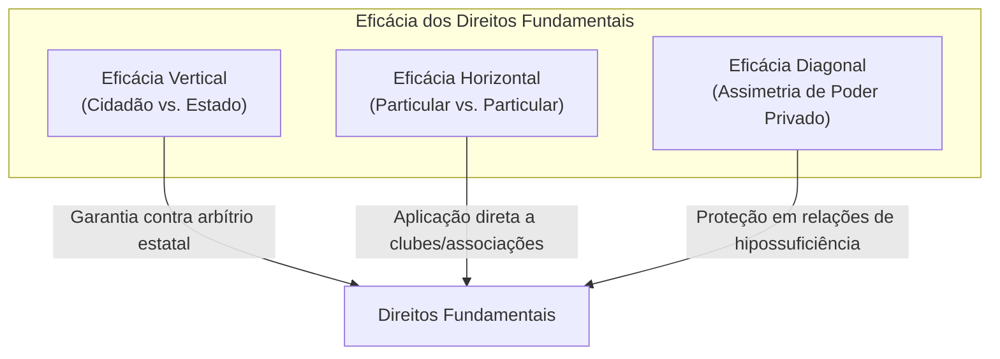
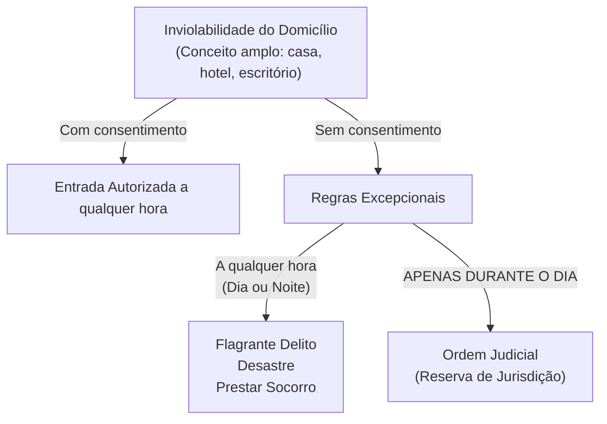
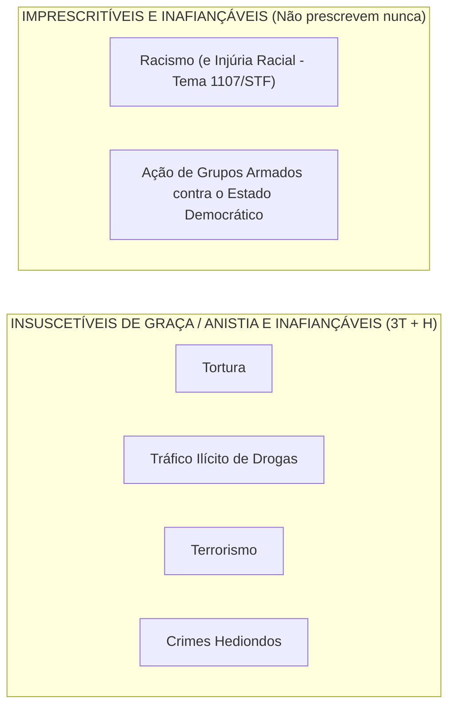

# 02 - Direitos Fundamentais, Remédios Constitucionais, Nacionalidade e Direitos Políticos

> **Matéria:** Noções de Direito Constitucional  
> **Cargo:** A01 – Técnico de Controle Externo – Especialidade: Técnico Administrativo  
> **Arquivo:** `02_direitos_e_garantias_fundamentais_e_politicos.md`  
> **Status:** 🟢 Teoria Aprofundada + 5 Questões FCC Comentadas (A a E)

---

## 📌 Ementa / Itens do Edital

- Dos direitos e deveres individuais e coletivos (Artigo 5º da CF/88): princípios reitores, direitos em espécie, garantias processuais e penais.
- Remédios constitucionais (*Writs*): *Habeas Corpus*, *Habeas Data*, Mandado de Segurança individual e coletivo, Mandado de Injunção e Ação Popular.
- Dos direitos sociais (Artigos 6º a 11 da CF/88): rol dos direitos fundamentais sociais, direitos dos trabalhadores urbanos e rurais, direito de greve e liberdade sindical.
- Da nacionalidade (Artigos 12 e 13 da CF/88): critérios originários e derivados, quase-nacionalidade, cargos privativos de brasileiro nato (art. 12, § 3º) e o novo regime de perda e readquisição da nacionalidade (Emenda Constitucional nº 131/2023).
- Dos direitos políticos (Artigos 14 a 16 da CF/88): instrumentos de soberania popular, alistabilidade eleitoral, condições de elegibilidade e idades mínimas, inelegibilidades absolutas e relativas (inelegibilidade reflexa e Súmula Vinculante 18).
- Perda e suspensão dos direitos políticos (Artigo 15 da CF/88): vedação absoluta de cassação e hipóteses constitucionais taxativas.
- Dos partidos políticos (Artigo 17 da CF/88): preceitos constitucionais, cláusula de barreira, financiamento e autonomia partidária.

---

## 🧭 Sumário

1. [Teoria Geral e Direitos Individuais e Coletivos (Art. 5º da CF/88)](#1-teoria-geral-e-direitos-individuais-e-coletivos-art-5o-da-cf88)
    1. [Características Fundamentais e Dimensões de Eficácia](#11-caracteristicas-fundamentais-e-dimensoes-de-eficacia)
    2. [Inviolabilidade do Domicílio (Art. 5º, XI)](#12-inviolabilidade-do-domicilio-art-5o-xi)
    3. [Inviolabilidade das Comunicações e Reserva de Jurisdição (Art. 5º, XII)](#13-inviolabilidade-das-comunicacoes-e-reserva-de-jurisdicao-art-5o-xii)
    4. [Liberdade de Associação e Limites Estatais (Art. 5º, XVII a XXI)](#14-liberdade-de-associacao-e-limites-estatais-art-5o-xvii-a-xxi)
    5. [Tratamento Constitucional dos Crimes: O Quarteto Penal da FCC](#15-tratamento-constitucional-dos-crimes-o-quarteto-penal-da-fcc)
    6. [Teste 121](#Teste-121)
    7. [Teste 122](#Teste-122)
    8. [Teste 123](#Teste-123)
2. [Remédios Constitucionais (*Writs* de Garantia)](#2-remedios-constitucionais-writs-de-garantia)
    1. [Análise Comparativa dos Remédios Constitucionais](#21-analise-comparativa-dos-remedios-constitucionais)
    2. [Teste 124](#Teste-124)
    3. [Teste 125](#Teste-125)
3. [Direitos Sociais (Arts. 6º a 11)](#3-direitos-sociais-arts-6o-a-11)
    1. [Teste 126](#Teste-126)
4. [Teoria da Nacionalidade e a Nova Disciplina da Perda (Arts. 12 e 13)](#4-teoria-da-nacionalidade-e-a-nova-disciplina-da-perda-arts-12-e-13)
    1. [Espécies de Nacionalidade Originária (Brasileiro Nato)](#41-especies-de-nacionalidade-originaria-brasileiro-nato)
    2. [Brasileiro Naturalizado](#42-brasileiro-naturalizado)
    3. [Cargos Privativos de Brasileiro Nato (Art. 12, § 3º - MP3.COM)](#43-cargos-privativos-de-brasileiro-nato-art-12-3o-mp3com)
    4. [Perda da Nacionalidade: O Novo Regime da EC nº 131/2023](#44-perda-da-nacionalidade-o-novo-regime-da-ec-no-1312023)
    5. [Teste 127](#Teste-127)
    6. [Teste 128](#Teste-128)
    7. [Teste 129](#Teste-129)
5. [Direitos Políticos e Sistema Partidário (Arts. 14 a 17)](#5-direitos-politicos-e-sistema-partidario-arts-14-a-17)
    1. [Alistamento Eleitoral e Voto](#51-alistamento-eleitoral-e-voto)
    2. [Idades Mínimas de Elegibilidade (Capacidade Eleitoral Passiva)](#52-idades-minimas-de-elegibilidade-capacidade-eleitoral-passiva)
    3. [Inelegibilidade Reflexa (Art. 14, § 7º) e Súmula Vinculante 18](#53-inelegibilidade-reflexa-art-14-7o-e-sumula-vinculante-18)
    4. [Perda e Suspensão dos Direitos Políticos (Art. 15 da CF/88)](#54-perda-e-suspensao-dos-direitos-politicos-art-15-da-cf88)
    5. [Teste 130](#Teste-130)
    6. [Teste 131](#Teste-131)
6. [🌐 Fontes Oficiais & Doutrinárias Recomendadas](#fontes-oficiais-doutrinarias-recomendadas)

---

## 1. Teoria Geral e Direitos Individuais e Coletivos (Art. 5º da CF/88)

### 1.1 Características Fundamentais e Dimensões de Eficácia
- **Inexistência de Direitos Absolutos (Relatividade):** Nenhum direito fundamental possui caráter absoluto. Todos encontram limites na coexistência harmoniosa com outros direitos fundamentais protegidos pela ordem constitucional. Nem mesmo o direito à vida é absoluto, haja vista a admissibilidade constitucional da pena de morte em caso de guerra declarada (art. 5º, XLVII, "a").
- **Eficácia Vertical vs. Eficácia Horizontal (*Drittwirkung*):**
    - *Eficácia Vertical:* Relação tradicional entre o indivíduo e o Estado, funcionando como escudo protetor contra o arbítrio estatal.
    - *Eficácia Horizontal:* Incidência direta e imediata dos direitos fundamentais nas relações jurídicas entre particulares (ex.: respeito à ampla defesa e ao contraditório para expulsão de sócio de clube ou cooperativa privada - STF).
    - *Eficácia Diagonal:* Relação entre particulares caracterizada por flagrante assimetria fática e jurídica (ex.: relações de trabalho e contratos de consumo).

### 1.2 Inviolabilidade do Domicílio (Art. 5º, XI)
> *"A casa é asilo inviolável do indivíduo, ninguém nela podendo penetrar sem consentimento do morador, salvo em caso de flagrante delito ou desastre, ou para prestar socorro, ou, durante o dia, por determinação judicial."*

> 🚨 **ALERTA DE PROVA / PEGADINHA FCC:**  
>
> 1. **Conceito de Domicílio:** O STF adota interpretação abrangente de "casa", incluindo escritórios profissionais, consultórios médicos, trailers habitados e quartos de hotel ocupados. Áreas abertas ao público (como o salão de um restaurante) não configuram domicílio protegido durante o horário comercial.  
> 2. **Determinação Judicial:** O cumprimento de mandado de busca e apreensão domiciliar **só pode ocorrer durante o dia**. Não existe hipótese de ingresso com ordem judicial durante a noite sem o consentimento do morador! O critério consagrado pela Lei de Abuso de Autoridade (Lei nº 13.869/2019) veda o cumprimento de mandado domiciliar entre 21h e 5h.  
> 3. **Flagrante Delito em Tráfico Ilícito de Drogas (Tema 280/STF):** O ingresso forçado em domicílio sem mandado judicial, mesmo em caso de crime permanente como o tráfico de drogas, exige fundadas razões (justa causa) devidamente justificadas *a posteriori*, sob pena de nulidade absoluta das provas.

### 1.3 Inviolabilidade das Comunicações e Reserva de Jurisdição (Art. 5º, XII)
> *"É inviolável o sigilo da correspondência e das comunicações telegráficas, de dados e das comunicações telefônicas, salvo, no último caso, por ordem judicial, nas hipóteses e na forma que a lei estabelecer para fins de investigação criminal ou instrução processual penal."*

- **Interceptação Telefônica:** Exige cláusula de **reserva de jurisdição estrita** (apenas o juiz competente pode determinar). É vedada em processos cíveis ou administrativos disciplinares (PAD). Contudo, a prova obtida licitamente no juízo criminal pode ser compartilhada como prova emprestada no PAD disciplinar (STJ/STF).
- **Sigilo Fiscal e Bancário:** Pode ser quebrado por determinação judicial e também diretamente por Comissões Parlamentares de Inquérito (CPIs federais e estaduais), com base nos poderes de investigação próprios das autoridades judiciais (art. 58, § 3º). O Fisco pode requisitar dados cadastrais e movimentações bancárias diretamente sem prévia autorização judicial (STF, ADI 2.390 e LC 105/2001).

### 1.4 Liberdade de Associação e Limites Estatais (Art. 5º, XVII a XXI)
| Aspecto Constitucional | Regra / Limite | Exigência Processual |
| :--- | :--- | :--- |
| **Criação da Associação** | Plena liberdade para fins lícitos | **Independe de autorização** estatal; vedada interferência na administração |
| **Atividades Paramilitares** | **Vedação absoluta** | Proibição categórica |
| **Suspensão das Atividades** | Interrupção provisória | Exige **decisão judicial** (mesmo cautelar/liminar) |
| **Dissolução Compulsória** | Extinção definitiva da pessoa jurídica | Exige **decisão judicial transitada em julgado** |
| **Representação Processual** | Defesa dos filiados em juízo | Exige **autorização expressa** (individual ou assemblear - Tema 82/STF) |

> ⭐ **IMPORTANTE:**  
> A FCC adora trocar as exigências para suspensão e dissolução compulsória. Memorize: para **suspender**, basta mera **decisão judicial**; para **dissolver compulsoriamente**, exige-se **trânsito em julgado**. Nenhuma autoridade administrativa tem competência para ordenar a paralisação ou encerramento de associação!

### 1.5 Tratamento Constitucional dos Crimes: O Quarteto Penal da FCC
Para gabaritar qualquer prova da Fundação Carlos Chagas, a tabela a seguir é de memorização compulsória:

| Categoria do Crime | Tipos Penais Abrangidos | Fiança? | Prescrição? | Graça / Anistia / Indulto? |
| :--- | :--- | :--- | :--- | :--- |
| **Racismo & Injúria Racial** | Prática de racismo (Lei 7.716/89) e Injúria racial (STF HC 154.248 e Lei 14.532/23) | **Inafiançável** | **Imprescritível** | Admite |
| **Ação de Grupos Armados** | Civis ou militares contra a ordem constitucional e o Estado Democrático | **Inafiançável** | **Imprescritível** | Admite |
| **3T + Hediondos** | **T**ortura, **T**ráfico ilícito de drogas, **T**errorismo e Crimes **H**ediondos | **Inafiançável** | Prescritível | **Insuscetíveis de graça ou anistia** |

---
