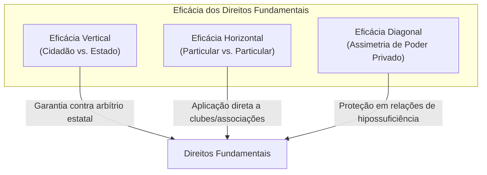
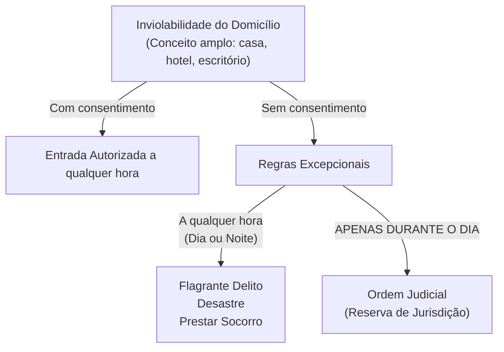
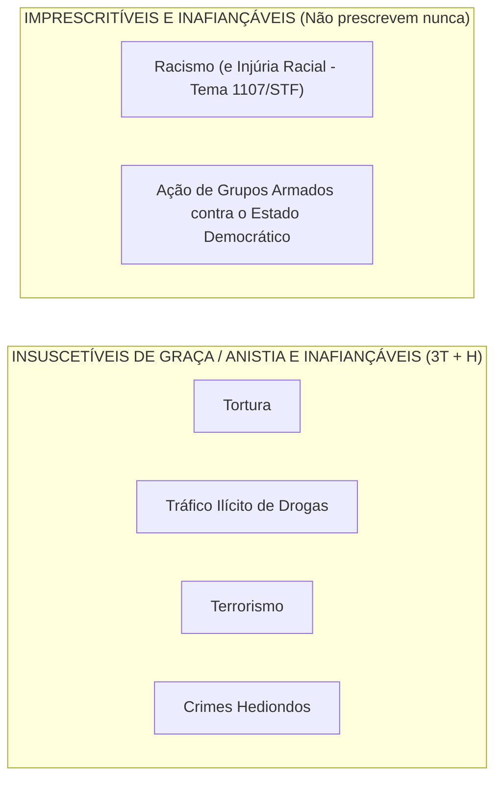

# 02 - Direitos Fundamentais, Remédios Constitucionais, Nacionalidade e Direitos Políticos

> **Matéria:** Noções de Direito Constitucional  
> **Cargo:** A01 – Técnico de Controle Externo – Especialidade: Técnico Administrativo  
> **Arquivo:** `02_direitos_e_garantias_fundamentais_e_politicos.md`  
> **Status:** 🟢 Teoria Aprofundada + 5 Questões FCC Comentadas (A a E)

---

## 📌 Ementa / Itens do Edital

- Dos direitos e deveres individuais e coletivos (Artigo 5º da CF/88): princípios reitores, direitos em espécie, garantias processuais e penais.
- Remédios constitucionais (*Writs*): *Habeas Corpus*, *Habeas Data*, Mandado de Segurança individual e coletivo, Mandado de Injunção e Ação Popular.
- Dos direitos sociais (Artigos 6º a 11 da CF/88): rol dos direitos fundamentais sociais, direitos dos trabalhadores urbanos e rurais, direito de greve e liberdade sindical.
- Da nacionalidade (Artigos 12 e 13 da CF/88): critérios originários e derivados, quase-nacionalidade, cargos privativos de brasileiro nato (art. 12, § 3º) e o novo regime de perda e readquisição da nacionalidade (Emenda Constitucional nº 131/2023).
- Dos direitos políticos (Artigos 14 a 16 da CF/88): instrumentos de soberania popular, alistabilidade eleitoral, condições de elegibilidade e idades mínimas, inelegibilidades absolutas e relativas (inelegibilidade reflexa e Súmula Vinculante 18).
- Perda e suspensão dos direitos políticos (Artigo 15 da CF/88): vedação absoluta de cassação e hipóteses constitucionais taxativas.
- Dos partidos políticos (Artigo 17 da CF/88): preceitos constitucionais, cláusula de barreira, financiamento e autonomia partidária.

---

## 🧭 Sumário

1. [Teoria Geral e Direitos Individuais e Coletivos (Art. 5º da CF/88)](#1-teoria-geral-e-direitos-individuais-e-coletivos-art-5o-da-cf88)
    1. [Características Fundamentais e Dimensões de Eficácia](#11-caracteristicas-fundamentais-e-dimensoes-de-eficacia)
    2. [Inviolabilidade do Domicílio (Art. 5º, XI)](#12-inviolabilidade-do-domicilio-art-5o-xi)
    3. [Inviolabilidade das Comunicações e Reserva de Jurisdição (Art. 5º, XII)](#13-inviolabilidade-das-comunicacoes-e-reserva-de-jurisdicao-art-5o-xii)
    4. [Liberdade de Associação e Limites Estatais (Art. 5º, XVII a XXI)](#14-liberdade-de-associacao-e-limites-estatais-art-5o-xvii-a-xxi)
    5. [Tratamento Constitucional dos Crimes: O Quarteto Penal da FCC](#15-tratamento-constitucional-dos-crimes-o-quarteto-penal-da-fcc)
    6. [Teste 121](#Teste-121)
    7. [Teste 122](#Teste-122)
    8. [Teste 123](#Teste-123)
2. [Remédios Constitucionais (*Writs* de Garantia)](#2-remedios-constitucionais-writs-de-garantia)
    1. [Análise Comparativa dos Remédios Constitucionais](#21-analise-comparativa-dos-remedios-constitucionais)
    2. [Teste 124](#Teste-124)
    3. [Teste 125](#Teste-125)
3. [Direitos Sociais (Arts. 6º a 11)](#3-direitos-sociais-arts-6o-a-11)
    1. [Teste 126](#Teste-126)
4. [Teoria da Nacionalidade e a Nova Disciplina da Perda (Arts. 12 e 13)](#4-teoria-da-nacionalidade-e-a-nova-disciplina-da-perda-arts-12-e-13)
    1. [Espécies de Nacionalidade Originária (Brasileiro Nato)](#41-especies-de-nacionalidade-originaria-brasileiro-nato)
    2. [Brasileiro Naturalizado](#42-brasileiro-naturalizado)
    3. [Cargos Privativos de Brasileiro Nato (Art. 12, § 3º - MP3.COM)](#43-cargos-privativos-de-brasileiro-nato-art-12-3o-mp3com)
    4. [Perda da Nacionalidade: O Novo Regime da EC nº 131/2023](#44-perda-da-nacionalidade-o-novo-regime-da-ec-no-1312023)
    5. [Teste 127](#Teste-127)
    6. [Teste 128](#Teste-128)
    7. [Teste 129](#Teste-129)
5. [Direitos Políticos e Sistema Partidário (Arts. 14 a 17)](#5-direitos-politicos-e-sistema-partidario-arts-14-a-17)
    1. [Alistamento Eleitoral e Voto](#51-alistamento-eleitoral-e-voto)
    2. [Idades Mínimas de Elegibilidade (Capacidade Eleitoral Passiva)](#52-idades-minimas-de-elegibilidade-capacidade-eleitoral-passiva)
    3. [Inelegibilidade Reflexa (Art. 14, § 7º) e Súmula Vinculante 18](#53-inelegibilidade-reflexa-art-14-7o-e-sumula-vinculante-18)
    4. [Perda e Suspensão dos Direitos Políticos (Art. 15 da CF/88)](#54-perda-e-suspensao-dos-direitos-politicos-art-15-da-cf88)
    5. [Teste 130](#Teste-130)
    6. [Teste 131](#Teste-131)
6. [🌐 Fontes Oficiais & Doutrinárias Recomendadas](#fontes-oficiais-doutrinarias-recomendadas)

---

## 1. Teoria Geral e Direitos Individuais e Coletivos (Art. 5º da CF/88)

### 1.1 Características Fundamentais e Dimensões de Eficácia
- **Inexistência de Direitos Absolutos (Relatividade):** Nenhum direito fundamental possui caráter absoluto. Todos encontram limites na coexistência harmoniosa com outros direitos fundamentais protegidos pela ordem constitucional. Nem mesmo o direito à vida é absoluto, haja vista a admissibilidade constitucional da pena de morte em caso de guerra declarada (art. 5º, XLVII, "a").
- **Eficácia Vertical vs. Eficácia Horizontal (*Drittwirkung*):**
    - *Eficácia Vertical:* Relação tradicional entre o indivíduo e o Estado, funcionando como escudo protetor contra o arbítrio estatal.
    - *Eficácia Horizontal:* Incidência direta e imediata dos direitos fundamentais nas relações jurídicas entre particulares (ex.: respeito à ampla defesa e ao contraditório para expulsão de sócio de clube ou cooperativa privada - STF).
    - *Eficácia Diagonal:* Relação entre particulares caracterizada por flagrante assimetria fática e jurídica (ex.: relações de trabalho e contratos de consumo).

### 1.2 Inviolabilidade do Domicílio (Art. 5º, XI)
> *"A casa é asilo inviolável do indivíduo, ninguém nela podendo penetrar sem consentimento do morador, salvo em caso de flagrante delito ou desastre, ou para prestar socorro, ou, durante o dia, por determinação judicial."*

> 🚨 **ALERTA DE PROVA / PEGADINHA FCC:**  
>
> 1. **Conceito de Domicílio:** O STF adota interpretação abrangente de "casa", incluindo escritórios profissionais, consultórios médicos, trailers habitados e quartos de hotel ocupados. Áreas abertas ao público (como o salão de um restaurante) não configuram domicílio protegido durante o horário comercial.  
> 2. **Determinação Judicial:** O cumprimento de mandado de busca e apreensão domiciliar **só pode ocorrer durante o dia**. Não existe hipótese de ingresso com ordem judicial durante a noite sem o consentimento do morador! O critério consagrado pela Lei de Abuso de Autoridade (Lei nº 13.869/2019) veda o cumprimento de mandado domiciliar entre 21h e 5h.  
> 3. **Flagrante Delito em Tráfico Ilícito de Drogas (Tema 280/STF):** O ingresso forçado em domicílio sem mandado judicial, mesmo em caso de crime permanente como o tráfico de drogas, exige fundadas razões (justa causa) devidamente justificadas *a posteriori*, sob pena de nulidade absoluta das provas.

### 1.3 Inviolabilidade das Comunicações e Reserva de Jurisdição (Art. 5º, XII)
> *"É inviolável o sigilo da correspondência e das comunicações telegráficas, de dados e das comunicações telefônicas, salvo, no último caso, por ordem judicial, nas hipóteses e na forma que a lei estabelecer para fins de investigação criminal ou instrução processual penal."*

- **Interceptação Telefônica:** Exige cláusula de **reserva de jurisdição estrita** (apenas o juiz competente pode determinar). É vedada em processos cíveis ou administrativos disciplinares (PAD). Contudo, a prova obtida licitamente no juízo criminal pode ser compartilhada como prova emprestada no PAD disciplinar (STJ/STF).
- **Sigilo Fiscal e Bancário:** Pode ser quebrado por determinação judicial e também diretamente por Comissões Parlamentares de Inquérito (CPIs federais e estaduais), com base nos poderes de investigação próprios das autoridades judiciais (art. 58, § 3º). O Fisco pode requisitar dados cadastrais e movimentações bancárias diretamente sem prévia autorização judicial (STF, ADI 2.390 e LC 105/2001).

### 1.4 Liberdade de Associação e Limites Estatais (Art. 5º, XVII a XXI)
| Aspecto Constitucional | Regra / Limite | Exigência Processual |
| :--- | :--- | :--- |
| **Criação da Associação** | Plena liberdade para fins lícitos | **Independe de autorização** estatal; vedada interferência na administração |
| **Atividades Paramilitares** | **Vedação absoluta** | Proibição categórica |
| **Suspensão das Atividades** | Interrupção provisória | Exige **decisão judicial** (mesmo cautelar/liminar) |
| **Dissolução Compulsória** | Extinção definitiva da pessoa jurídica | Exige **decisão judicial transitada em julgado** |
| **Representação Processual** | Defesa dos filiados em juízo | Exige **autorização expressa** (individual ou assemblear - Tema 82/STF) |

> ⭐ **IMPORTANTE:**  
> A FCC adora trocar as exigências para suspensão e dissolução compulsória. Memorize: para **suspender**, basta mera **decisão judicial**; para **dissolver compulsoriamente**, exige-se **trânsito em julgado**. Nenhuma autoridade administrativa tem competência para ordenar a paralisação ou encerramento de associação!

### 1.5 Tratamento Constitucional dos Crimes: O Quarteto Penal da FCC
Para gabaritar qualquer prova da Fundação Carlos Chagas, a tabela a seguir é de memorização compulsória:

| Categoria do Crime | Tipos Penais Abrangidos | Fiança? | Prescrição? | Graça / Anistia / Indulto? |
| :--- | :--- | :--- | :--- | :--- |
| **Racismo & Injúria Racial** | Prática de racismo (Lei 7.716/89) e Injúria racial (STF HC 154.248 e Lei 14.532/23) | **Inafiançável** | **Imprescritível** | Admite |
| **Ação de Grupos Armados** | Civis ou militares contra a ordem constitucional e o Estado Democrático | **Inafiançável** | **Imprescritível** | Admite |
| **3T + Hediondos** | **T**ortura, **T**ráfico ilícito de drogas, **T**errorismo e Crimes **H**ediondos | **Inafiançável** | Prescritível | **Insuscetíveis de graça ou anistia** |

---

### Teste 121
**(FGV – TJ/DFT – 2022 – Analista Judiciario Suporte Em Tecnologia Da Informacao)**
A Lei federal nº XX impôs a todos os cidadãos determinada obrigação de caráter cívico, a ser cumprida em certos períodos por aqueles que fossem sorteados. João, em razão de suas convicções políticas, decidiu que não iria cumprir a obrigação. À luz da sistemática constitucional, João:

* **A)** não poderá sofrer consequência desfavorável, por ter exercido plenamente a sua liberdade de consciência, que não pode ser afrontada pelo poder público, sob pena de violação à dignidade da pessoa humana;
* **B)** preservará o direito de votar, mas ficará inelegível, consequência que será afastada caso cumpra a prestação alternativa fixada em lei;
* **C)** deverá cumprir a prestação alternativa fixada em lei e, caso se recuse, terá a cidadania suspensa em suas acepções ativa e passiva;
* **D)** terá os direitos políticos suspensos, os quais serão restabelecidos caso cumpra a prestação alternativa fixada em lei;
* **E)** deverá cumprir a prestação alternativa fixada em lei e, caso se recuse, ficará inelegível.

---

> **Comentário Detalhado:**
>
> - **A)** **Incorreta.** A opção apresenta proposição em desacordo com os fundamentos teóricos e técnicos do tópico ao afirmar que "não poderá sofrer consequência desfavorável, por ter exercido plenamente a sua liberdade de consciência, que não...". De acordo com a teoria estudada em *1.2 Inviolabilidade do Domicílio (Art. 5º, XI)*, flagrante Delito em Tráfico Ilícito de Drogas (Tema 280/STF): O ingresso forçado em domicílio sem mandado judicial, mesmo em caso de crime permanente como o tráfico de drogas, exige fundadas razões (justa causa) devidamente justificadas *a posteriori*, sob pena de nulidade absoluta das provas.
> - **B)** **Incorreta.** A opção apresenta proposição em desacordo com os fundamentos teóricos e técnicos do tópico ao afirmar que "preservará o direito de votar, mas ficará inelegível, consequência que será afastada caso cumpra a prestação...". De acordo com a teoria estudada em *1.1 Características Fundamentais e Dimensões de Eficácia*, nem mesmo o direito à vida é absoluto, haja vista a admissibilidade constitucional da pena de morte em caso de guerra declarada (art. 5º, XLVII, "a").
> - **C)** **Correta.** Conforme fundamentado na seção *1.3 Inviolabilidade das Comunicações e Reserva de Jurisdição (Art. 5º, XII)* deste guia, *"É inviolável o sigilo da correspondência e das comunicações telegráficas, de dados e das comunicações telefônicas, salvo, no último caso, por ordem judicial, nas hipóteses e na forma que a lei estabelecer para fins de investigação criminal ou instrução processual penal."*. Dessa forma, está plenamente correta a assertiva da banca (FGV – TJ/DFT/2022) ao estabelecer que "deverá cumprir a prestação alternativa fixada em lei e, caso se recuse, terá a cidadania suspensa em suas acepções...".
> - **D)** **Incorreta.** A opção apresenta proposição em desacordo com os fundamentos teóricos e técnicos do tópico ao afirmar que "terá os direitos políticos suspensos, os quais serão restabelecidos caso cumpra a prestação alternativa fixada em...". De acordo com a teoria estudada em *1.1 Características Fundamentais e Dimensões de Eficácia*, inexistência de Direitos Absolutos (Relatividade): Nenhum direito fundamental possui caráter absoluto. Todos encontram limites na coexistência harmoniosa com outros direitos fundamentais protegidos pela ordem constitucional.
> - **E)** **Incorreta.** A opção apresenta proposição em desacordo com os fundamentos teóricos e técnicos do tópico ao afirmar que "deverá cumprir a prestação alternativa fixada em lei e, caso se recuse, ficará inelegível". De acordo com a teoria estudada em *1.5 Tratamento Constitucional dos Crimes: O Quarteto Penal da FCC*, racismo & Injúria Racial: Prática de racismo (Lei 7.716/89) e Injúria racial (STF HC 154.248 e Lei 14.532/23) — Inafiançável — Imprescritível — Admite.
>
> **Gabarito: C**

---

### Teste 122
**(FGV – TCE/SC – 2026 – Auditor Fiscal de Controle Externo - Administração)**
Considerando a temática atinente à ética, à democracia e ao exercício da cidadania, avalie as assertivas a seguir. I. No âmbito de uma sociedade democrática é legítimo conflito de ideias. II. A cidadania restringe-se ao exercício de direitos políticos, notadamente o direito de votar e ser votado. III. Agir eticamente é submeter as ações apenas ao crivo da lei, independentemente da reflexão crítica sobre as próprias escolhas. Está correto o que se afirma em

* **A)** I, apenas.
* **B)** III, apenas.
* **C)** I e II, apenas.
* **D)** I e III, apenas.
* **E)** I, II e III.

---

> **Comentário Detalhado:**
>
> - **A)** **Correta.** Conforme fundamentado na seção *1.1 Características Fundamentais e Dimensões de Eficácia* deste guia, inexistência de Direitos Absolutos (Relatividade): Nenhum direito fundamental possui caráter absoluto. Todos encontram limites na coexistência harmoniosa com outros direitos fundamentais protegidos pela ordem constitucional. Dessa forma, está plenamente correta a assertiva da banca (FGV – TCE/SC/2026) ao estabelecer que "I, apenas".
> - **B)** **Incorreta.** A opção incorre em restrição indevida ao limitar o escopo conceitual ao afirmar que "III, apenas". De acordo com a teoria estudada em *1.1 Características Fundamentais e Dimensões de Eficácia*, nem mesmo o direito à vida é absoluto, haja vista a admissibilidade constitucional da pena de morte em caso de guerra declarada (art. 5º, XLVII, "a").
> - **C)** **Incorreta.** A opção incorre em restrição indevida ao limitar o escopo conceitual ao afirmar que "I e II, apenas". De acordo com a teoria estudada em *1.1 Características Fundamentais e Dimensões de Eficácia*, *Eficácia Horizontal:* Incidência direta e imediata dos direitos fundamentais nas relações jurídicas entre particulares (ex.: respeito à ampla defesa e ao contraditório para expulsão de sócio de clube ou cooperativa privada - STF).
> - **D)** **Incorreta.** A opção incorre em restrição indevida ao limitar o escopo conceitual ao afirmar que "I e III, apenas". De acordo com a teoria estudada em *1.3 Inviolabilidade das Comunicações e Reserva de Jurisdição (Art. 5º, XII)*, contudo, a prova obtida licitamente no juízo criminal pode ser compartilhada como prova emprestada no PAD disciplinar (STJ/STF).
> - **E)** **Incorreta.** A opção apresenta proposição em desacordo com os fundamentos teóricos e técnicos do tópico ao afirmar que "I, II e III". De acordo com a teoria estudada em *1.3 Inviolabilidade das Comunicações e Reserva de Jurisdição (Art. 5º, XII)*, sigilo Fiscal e Bancário: Pode ser quebrado por determinação judicial e também diretamente por Comissões Parlamentares de Inquérito (CPIs federais e estaduais), com base nos poderes de investigação próprios das autoridades judiciais (art. 58, § 3º).
>
> **Gabarito: A**

---

### Teste 123
**(FGV – TJ/SC – 2026 – Analista Administrativo)**
Os direitos humanos foram consolidados no Brasil mediante a Constituição Federal de 1988, que adotou a dignidade da pessoa humana (Art. 1º, III) como fundamento da República e garantiu a igualdade (Art. 5º) sem distinções. Esses princípios norteiam o Estado Democrático de Direito, assegurando proteção contra arbítrios, além de direitos fundamentais, sociais e mecanismos de inclusão. Considerando as disposições constitucionais relativas aos direitos e garantias individuais, assinale a afirmativa correta.

* **A)** A liberdade de consciência e de crença é inviolável, assegurado o livre exercício dos cultos religiosos, não sendo garantida a prestação de assistência religiosa nas entidades civis e militares de internação coletiva.
* **B)** A casa é asilo inviolável do indivíduo, ninguém nela podendo adentrar sem consentimento do morador, salvo em caso de flagrante delito ou desastre, ou para prestar socorro, ou, durante o dia ou noite, por determinação judicial.
* **C)** O sigilo da correspondência é inviolável, salvo, no último caso, por ordem judicial, nas hipóteses e na forma que a lei estabelecer para fins de investigação criminal ou instrução processual penal.
* **D)** Todos podem reunir-se pacificamente, ainda que armados, em locais abertos ao público, independentemente de autorização, desde que não frustrem outra reunião anteriormente convocada para o mesmo local.
* **E)** É livre a locomoção no território nacional em tempo de paz ou de guerra, podendo qualquer pessoa, nos termos da lei, nele entrar, permanecer ou dele sair com seus bens.

---

> **Comentário Detalhado:**
>
> - **A)** **Incorreta.** A opção apresenta proposição em desacordo com os fundamentos teóricos e técnicos do tópico ao afirmar que "A liberdade de consciência e de crença é inviolável, assegurado o livre exercício dos cultos religiosos, não sendo...". De acordo com a teoria estudada em *1.5 Tratamento Constitucional dos Crimes: O Quarteto Penal da FCC*, ação de Grupos Armados: Civis ou militares contra a ordem constitucional e o Estado Democrático — Inafiançável — Imprescritível — Admite.
> - **B)** **Incorreta.** A opção apresenta proposição em desacordo com os fundamentos teóricos e técnicos do tópico ao afirmar que "A casa é asilo inviolável do indivíduo, ninguém nela podendo adentrar sem consentimento do morador, salvo em caso...". De acordo com a teoria estudada em *1.2 Inviolabilidade do Domicílio (Art. 5º, XI)*, *"A casa é asilo inviolável do indivíduo, ninguém nela podendo penetrar sem consentimento do morador, salvo em caso de flagrante delito ou desastre, ou para prestar socorro, ou, durante o dia, por determinação judicial."*.
> - **C)** **Correta.** Conforme fundamentado na seção *1.3 Inviolabilidade das Comunicações e Reserva de Jurisdição (Art. 5º, XII)* deste guia, *"É inviolável o sigilo da correspondência e das comunicações telegráficas, de dados e das comunicações telefônicas, salvo, no último caso, por ordem judicial, nas hipóteses e na forma que a lei estabelecer para fins de investigação criminal ou instrução processual penal."*. Dessa forma, está plenamente correta a assertiva da banca (FGV – TJ/SC/2026) ao estabelecer que "O sigilo da correspondência é inviolável, salvo, no último caso, por ordem judicial, nas hipóteses e na forma que...".
> - **D)** **Incorreta.** A opção apresenta proposição em desacordo com os fundamentos teóricos e técnicos do tópico ao afirmar que "Todos podem reunir-se pacificamente, ainda que armados, em locais abertos ao público, independentemente de...". De acordo com a teoria estudada em *1.3 Inviolabilidade das Comunicações e Reserva de Jurisdição (Art. 5º, XII)*, sigilo Fiscal e Bancário: Pode ser quebrado por determinação judicial e também diretamente por Comissões Parlamentares de Inquérito (CPIs federais e estaduais), com base nos poderes de investigação próprios das autoridades judiciais (art. 58, § 3º).
> - **E)** **Incorreta.** A opção promove generalização excessiva que desconsidera as condições técnicas e normativas ao afirmar que "É livre a locomoção no território nacional em tempo de paz ou de guerra, podendo qualquer pessoa, nos termos da...". De acordo com a teoria estudada em *1.1 Características Fundamentais e Dimensões de Eficácia*, nem mesmo o direito à vida é absoluto, haja vista a admissibilidade constitucional da pena de morte em caso de guerra declarada (art. 5º, XLVII, "a").
>
> **Gabarito: C**

---

### Teste 124
**(FGV – TJ/MT – 2024 – Analista Judiciario Tecnologia Da Informacao)**
Acerca dos direitos e deveres individuais e coletivos, analise as afirmativas a seguir: I. É inviolável o sigilo da correspondência e das comunicações telegráficas, de dados e das comunicações telefônicas, salvo, no último caso, por ordem judicial, nas hipóteses e na forma que a lei estabelecer para fins de investigação criminal ou instrução processual penal. II. Todos podem reunir-se pacificamente, sem armas, em locais abertos ao público, independentemente de autorização, desde que não frustrem outra reunião anteriormente convocada para o mesmo local, sendo apenas exigido prévio aviso à autoridade competente. III. É assegurado a todos o acesso à informação e resguardado o sigilo da fonte, quando necessário ao exercício profissional. Nesse cenário, considerando as disposições da Constituição Federal de 1988, está correto o que se afirma em

* **A)** I, apenas.
* **B)** II, apenas.
* **C)** III, apenas.
* **D)** I e II, apenas.
* **E)** I, II e III.

---

> **Comentário Detalhado:**
>
> - **A)** **Incorreta.** A opção incorre em restrição indevida ao limitar o escopo conceitual ao afirmar que "I, apenas". De acordo com a teoria estudada em *1.2 Inviolabilidade do Domicílio (Art. 5º, XI)*, *"A casa é asilo inviolável do indivíduo, ninguém nela podendo penetrar sem consentimento do morador, salvo em caso de flagrante delito ou desastre, ou para prestar socorro, ou, durante o dia, por determinação judicial."*.
> - **B)** **Incorreta.** A opção incorre em restrição indevida ao limitar o escopo conceitual ao afirmar que "II, apenas". De acordo com a teoria estudada em *1.3 Inviolabilidade das Comunicações e Reserva de Jurisdição (Art. 5º, XII)*, sigilo Fiscal e Bancário: Pode ser quebrado por determinação judicial e também diretamente por Comissões Parlamentares de Inquérito (CPIs federais e estaduais), com base nos poderes de investigação próprios das autoridades judiciais (art. 58, § 3º).
> - **C)** **Incorreta.** A opção incorre em restrição indevida ao limitar o escopo conceitual ao afirmar que "III, apenas". De acordo com a teoria estudada em *1.2 Inviolabilidade do Domicílio (Art. 5º, XI)*, não existe hipótese de ingresso com ordem judicial durante a noite sem o consentimento do morador! O critério consagrado pela Lei de Abuso de Autoridade (Lei nº 13.869/2019) veda o cumprimento de mandado domiciliar entre 21h e 5h.
> - **D)** **Incorreta.** A opção incorre em restrição indevida ao limitar o escopo conceitual ao afirmar que "I e II, apenas". De acordo com a teoria estudada em *1.3 Inviolabilidade das Comunicações e Reserva de Jurisdição (Art. 5º, XII)*, o Fisco pode requisitar dados cadastrais e movimentações bancárias diretamente sem prévia autorização judicial (STF, ADI 2.390 e LC 105/2001).
> - **E)** **Correta.** Conforme fundamentado na seção *1.3 Inviolabilidade das Comunicações e Reserva de Jurisdição (Art. 5º, XII)* deste guia, *"É inviolável o sigilo da correspondência e das comunicações telegráficas, de dados e das comunicações telefônicas, salvo, no último caso, por ordem judicial, nas hipóteses e na forma que a lei estabelecer para fins de investigação criminal ou instrução processual penal."*. Dessa forma, está plenamente correta a assertiva da banca (FGV – TJ/MT/2024) ao estabelecer que "I, II e III".
>
> **Gabarito: E**

---

### Teste 125
**(FGV – TCE/GO – 2024 – Analista de Controle Externo - Jurídica)**
A jurisdição é a atividade estatal de solução de conflitos de interesse e tutela de direitos. Ao lado da ação e do processo, a jurisdição constitui o tripé fundamental da teoria geral do processo. Sobre os princípios aplicáveis à jurisdição, assinale a afirmativa correta.

* **A)** O princípio da inevitabilidade aduz que ao juiz não é dado deixar de julgar, ainda que haja lacuna ou obscuridade no ordenamento jurídico.
* **B)** A improrrogabilidade é absolutamente incompatível com a prorrogação da competência, ainda que se trate de competência relativa.
* **C)** A indelegabilidade veda peremptoriamente a delegação de atos de instrução a outros juízes, como é o caso das cartas de ordem e precatórias instrutórias, as quais são inadmissíveis.
* **D)** A investidura dispõe que o juiz deva ser aprovado em concurso público de provas e títulos, motivo pelo qual os membros de tribunais indicados pelo quinto constitucional não possuem investidura.
* **E)** O princípio do juiz natural assevera que as regras de competência devem ser prévia e abstratamente definidas, vedando-se a designação de juízos ad hoc. Direito Previdenciário

---

> **Comentário Detalhado:**
>
> - **A)** **Incorreta.** A opção apresenta proposição em desacordo com os fundamentos teóricos e técnicos do tópico ao afirmar que "O princípio da inevitabilidade aduz que ao juiz não é dado deixar de julgar, ainda que haja lacuna ou obscuridade...". De acordo com a teoria estudada em *1.1 Características Fundamentais e Dimensões de Eficácia*, nem mesmo o direito à vida é absoluto, haja vista a admissibilidade constitucional da pena de morte em caso de guerra declarada (art. 5º, XLVII, "a").
> - **B)** **Incorreta.** A opção apresenta proposição em desacordo com os fundamentos teóricos e técnicos do tópico ao afirmar que "A improrrogabilidade é absolutamente incompatível com a prorrogação da competência, ainda que se trate de...". De acordo com a teoria estudada em *1.3 Inviolabilidade das Comunicações e Reserva de Jurisdição (Art. 5º, XII)*, interceptação Telefônica: Exige cláusula de reserva de jurisdição estrita (apenas o juiz competente pode determinar). É vedada em processos cíveis ou administrativos disciplinares (PAD).
> - **C)** **Incorreta.** A opção apresenta vedação ou negativa absoluta incompatível com a regra aplicável ao afirmar que "A indelegabilidade veda peremptoriamente a delegação de atos de instrução a outros juízes, como é o caso das...". De acordo com a teoria estudada em *1.3 Inviolabilidade das Comunicações e Reserva de Jurisdição (Art. 5º, XII)*, *"É inviolável o sigilo da correspondência e das comunicações telegráficas, de dados e das comunicações telefônicas, salvo, no último caso, por ordem judicial, nas hipóteses e na forma que a lei estabelecer para fins de investigação criminal ou instrução processual penal."*.
> - **D)** **Incorreta.** A opção apresenta proposição em desacordo com os fundamentos teóricos e técnicos do tópico ao afirmar que "A investidura dispõe que o juiz deva ser aprovado em concurso público de provas e títulos, motivo pelo qual os...". De acordo com a teoria estudada em *1.3 Inviolabilidade das Comunicações e Reserva de Jurisdição (Art. 5º, XII)*, o Fisco pode requisitar dados cadastrais e movimentações bancárias diretamente sem prévia autorização judicial (STF, ADI 2.390 e LC 105/2001).
> - **E)** **Correta.** Conforme fundamentado na seção *1.1 Características Fundamentais e Dimensões de Eficácia* deste guia, inexistência de Direitos Absolutos (Relatividade): Nenhum direito fundamental possui caráter absoluto. Todos encontram limites na coexistência harmoniosa com outros direitos fundamentais protegidos pela ordem constitucional. Dessa forma, está plenamente correta a assertiva da banca (FGV – TCE/GO/2024) ao estabelecer que "O princípio do juiz natural assevera que as regras de competência devem ser prévia e abstratamente definidas...".
>
> **Gabarito: E**

---

### Teste 126
**(FCC – TRT 4ª – 2015 – Analista Judiciário - Tecnologia Da Informação)**
Nos termos regulados pela Lei no 8.429/92, a pena de perda dos bens ou valores acrescidos ilicitamente ao patrimônio, res- sarcimento integral do dano, quando houver, perda da função pública, suspensão dos direitos políticos de oito a dez anos, paga- mento de multa civil de até três vezes o valor do acréscimo patrimonial e proibição de contratar com o Poder Público ou receber benefícios ou incentivos fiscais ou creditícios, direta ou indiretamente, ainda que por intermédio de pessoa jurídica da qual seja sócio majoritário, pelo prazo de dez anos, pode ser aplicada quando caracterizado o ato de improbidade administrativa por

* **A)** receber vantagem econômica de qualquer natureza, direta ou indiretamente, para omitir ato de ofício, providência ou declaração a que esteja obrigado.
* **B)** permitir ou facilitar a aquisição, permuta ou locação de bem ou serviço por preço superior ao de mercado.
* **C)** ordenar ou permitir a realização de despesas não autorizadas em lei ou regulamento.
* **D)** negar publicidade aos atos oficiais.
* **E)** retardar ou deixar de praticar, indevidamente, ato de ofício.

---

> **Comentário Detalhado:**
>
> - **A)** **Correta.** Conforme fundamentado na seção *1.1 Características Fundamentais e Dimensões de Eficácia* deste guia, *Eficácia Horizontal:* Incidência direta e imediata dos direitos fundamentais nas relações jurídicas entre particulares (ex.: respeito à ampla defesa e ao contraditório para expulsão de sócio de clube ou cooperativa privada - STF). Dessa forma, está plenamente correta a assertiva da banca (FCC – TRT 4ª/2015) ao estabelecer que "receber vantagem econômica de qualquer natureza, direta ou indiretamente, para omitir ato de ofício, providência...".
> - **B)** **Incorreta.** A opção apresenta proposição em desacordo com os fundamentos teóricos e técnicos do tópico ao afirmar que "permitir ou facilitar a aquisição, permuta ou locação de bem ou serviço por preço superior ao de mercado". De acordo com a teoria estudada em *1.5 Tratamento Constitucional dos Crimes: O Quarteto Penal da FCC*, para gabaritar qualquer prova da Fundação Carlos Chagas, a tabela a seguir é de memorização compulsória.
> - **C)** **Incorreta.** A opção apresenta proposição em desacordo com os fundamentos teóricos e técnicos do tópico ao afirmar que "ordenar ou permitir a realização de despesas não autorizadas em lei ou regulamento". De acordo com a teoria estudada em *1.4 Liberdade de Associação e Limites Estatais (Art. 5º, XVII a XXI)*, nenhuma autoridade administrativa tem competência para ordenar a paralisação ou encerramento de associação!.
> - **D)** **Incorreta.** A opção apresenta proposição em desacordo com os fundamentos teóricos e técnicos do tópico ao afirmar que "negar publicidade aos atos oficiais". De acordo com a teoria estudada em *1.4 Liberdade de Associação e Limites Estatais (Art. 5º, XVII a XXI)*, dissolução Compulsória: Extinção definitiva da pessoa jurídica — Exige decisão judicial transitada em julgado.
> - **E)** **Incorreta.** A opção apresenta proposição em desacordo com os fundamentos teóricos e técnicos do tópico ao afirmar que "retardar ou deixar de praticar, indevidamente, ato de ofício". De acordo com a teoria estudada em *1.3 Inviolabilidade das Comunicações e Reserva de Jurisdição (Art. 5º, XII)*, contudo, a prova obtida licitamente no juízo criminal pode ser compartilhada como prova emprestada no PAD disciplinar (STJ/STF).
>
> **Gabarito: A**

---

### Teste 127
**(FGV – TRT 1ª – 2024 – Analista Judiciário - Área Administrativa)**
Um decreto federal assegurou à pessoa com deficiência tratamento prioritário. Dispôs ele que: 1) ficaria assegurada à pessoa com deficiência física, mental ou sensorial a prioridade de vaga em escola pública que estivesse localizada mais próxima de sua residência; 2) seriam consideradas deficiências todas aquelas que necessitassem de assistência especial, decorrentes de problemas visuais, auditivos, mentais, motores, ou má- formação congênita; 3) as deficiências dos estudantes beneficiados seriam comprovadas por meio de laudo médico fornecido por instituições médico-hospitalares públicas e competentes para prestar tal comprovação; e, 4) ficariam excluídos da prioridade do item 1 os estabelecimentos de ensino que não possuíssem as condições necessárias para educação de portadores de deficiência mental e sensorial. Levando em conta a Agenda 2030 da Organização das Nações Unidas (ONU), os direitos humanos e fundamentais da pessoa com deficiência e a Lei nº 13.146/2015, é correto afirmar que:

* **A)** o referido decreto acerta ao dispor de todos os problemas (visuais, auditivos, mentais, motores, ou má formação congênita) para fins de consideração da pessoa com deficiência, adotando-se o conceito amplo proposto pela Lei nº 13.146/2015;
* **B)** a exigência de que as deficiências dos estudantes beneficiados sejam comprovadas por meio de laudo médico fornecido por instituições médico-hospitalares públicas e competentes para prestar tal comprovação atende ao que reclama a Lei nº 13.146/2015;
* **C)** o item 4 se choca com a imposição de assegurar um sistema educacional inclusivo, estabelecido no sistema constitucional e na Lei nº 13.146/2015, e com o amparo no objetivo de desenvolvimento sustentável referente à educação da Agenda 2030 da ONU;
* **D)** a Agenda 2030 da ONU não trata do tema educação em relação a pessoas com deficiência, de modo que o único objetivo de desenvolvimento sustentável apto a conferir um olhar mais específico à questão é o referente a instituições eficazes;
* **E)** a exclusão relacionada aos estabelecimentos de ensino estaria corretamente justificada na liberdade de conformação legislativa e na discricionariedade administrativa quando da concretização da política pública.

---

> **Comentário Detalhado:**
>
> - **A)** **Incorreta.** A opção apresenta proposição em desacordo com os fundamentos teóricos e técnicos do tópico ao afirmar que "o referido decreto acerta ao dispor de todos os problemas (visuais, auditivos, mentais, motores, ou má formação...". De acordo com a teoria estudada em *1.3 Inviolabilidade das Comunicações e Reserva de Jurisdição (Art. 5º, XII)*, *"É inviolável o sigilo da correspondência e das comunicações telegráficas, de dados e das comunicações telefônicas, salvo, no último caso, por ordem judicial, nas hipóteses e na forma que a lei estabelecer para fins de investigação criminal ou instrução processual penal."*.
> - **B)** **Incorreta.** A opção apresenta proposição em desacordo com os fundamentos teóricos e técnicos do tópico ao afirmar que "a exigência de que as deficiências dos estudantes beneficiados sejam comprovadas por meio de laudo médico...". De acordo com a teoria estudada em *1.2 Inviolabilidade do Domicílio (Art. 5º, XI)*, *"A casa é asilo inviolável do indivíduo, ninguém nela podendo penetrar sem consentimento do morador, salvo em caso de flagrante delito ou desastre, ou para prestar socorro, ou, durante o dia, por determinação judicial."*.
> - **C)** **Correta.** Conforme fundamentado na seção *1.5 Tratamento Constitucional dos Crimes: O Quarteto Penal da FCC* deste guia, racismo & Injúria Racial: Prática de racismo (Lei 7.716/89) e Injúria racial (STF HC 154.248 e Lei 14.532/23) — Inafiançável — Imprescritível — Admite. Dessa forma, está plenamente correta a assertiva da banca (FGV – TRT 1ª/2024) ao estabelecer que "o item 4 se choca com a imposição de assegurar um sistema educacional inclusivo, estabelecido no sistema...".
> - **D)** **Incorreta.** A opção apresenta proposição em desacordo com os fundamentos teóricos e técnicos do tópico ao afirmar que "a Agenda 2030 da ONU não trata do tema educação em relação a pessoas com deficiência, de modo que o único objetivo...". De acordo com a teoria estudada em *1.1 Características Fundamentais e Dimensões de Eficácia*, *Eficácia Vertical:* Relação tradicional entre o indivíduo e o Estado, funcionando como escudo protetor contra o arbítrio estatal.
> - **E)** **Incorreta.** A opção apresenta proposição em desacordo com os fundamentos teóricos e técnicos do tópico ao afirmar que "a exclusão relacionada aos estabelecimentos de ensino estaria corretamente justificada na liberdade de conformação...". De acordo com a teoria estudada em *1.4 Liberdade de Associação e Limites Estatais (Art. 5º, XVII a XXI)*, nenhuma autoridade administrativa tem competência para ordenar a paralisação ou encerramento de associação!.
>
> **Gabarito: C**

---

### Teste 128
**(FGV – TJ/SC – 2026 – Analista Administrativo)**
No ordenamento jurídico brasileiro, a proteção dos direitos fundamentais decorre tanto das normas constitucionais quanto dos tratados internacionais de direitos humanos ratificados pelo Brasil. Além disso, os direitos e as garantias fundamentais possuem aplicação imediata, nos termos da Constituição Federal, independentemente de regulamentação para produzirem efeitos. Considerando as disposições da Constituição Federal e dos tratados internacionais de direitos humanos incorporados ao ordenamento jurídico brasileiro, assinale a afirmativa correta.

* **A)** Os tratados de direitos humanos ratificados após a Emenda Constitucional nº 45/2004 com quórum qualificado (dois quintos, dois turnos, duas casas) equivalem a emendas constitucionais.
* **B)** O Supremo Tribunal Federal não admite a utilização do Pacto de São José da Costa Rica para servir de fundamentos a determinadas decisões, como no caso da prisão civil do depositário infiel.
* **C)** Os tratados de direitos humanos ratificados pelo rito comum, por maioria absoluta, possuem hierarquia superior à das leis ordinárias e inferior à da Constituição Federal.
* **D)** Os juízes brasileiros devem verificar se as leis internas estão em conformidade com os tratados internacionais de direitos humanos, priorizando a norma mais favorável.
* **E)** Ainda que haja inércia de autoridades estaduais, não é permitido à Justiça Federal assumir a competência para processar e julgar casos de graves violações de direitos humanos.

---

> **Comentário Detalhado:**
>
> - **A)** **Incorreta.** A opção apresenta proposição em desacordo com os fundamentos teóricos e técnicos do tópico ao afirmar que "Os tratados de direitos humanos ratificados após a Emenda Constitucional nº 45/2004 com quórum qualificado (dois...". De acordo com a teoria estudada em *1.1 Características Fundamentais e Dimensões de Eficácia*, inexistência de Direitos Absolutos (Relatividade): Nenhum direito fundamental possui caráter absoluto. Todos encontram limites na coexistência harmoniosa com outros direitos fundamentais protegidos pela ordem constitucional.
> - **B)** **Incorreta.** A opção apresenta proposição em desacordo com os fundamentos teóricos e técnicos do tópico ao afirmar que "O Supremo Tribunal Federal não admite a utilização do Pacto de São José da Costa Rica para servir de fundamentos a...". De acordo com a teoria estudada em *1.5 Tratamento Constitucional dos Crimes: O Quarteto Penal da FCC*, racismo & Injúria Racial: Prática de racismo (Lei 7.716/89) e Injúria racial (STF HC 154.248 e Lei 14.532/23) — Inafiançável — Imprescritível — Admite.
> - **C)** **Incorreta.** A opção apresenta proposição em desacordo com os fundamentos teóricos e técnicos do tópico ao afirmar que "Os tratados de direitos humanos ratificados pelo rito comum, por maioria absoluta, possuem hierarquia superior à...". De acordo com a teoria estudada em *1.2 Inviolabilidade do Domicílio (Art. 5º, XI)*, flagrante Delito em Tráfico Ilícito de Drogas (Tema 280/STF): O ingresso forçado em domicílio sem mandado judicial, mesmo em caso de crime permanente como o tráfico de drogas, exige fundadas razões (justa causa) devidamente justificadas *a posteriori*, sob pena de nulidade absoluta das provas.
> - **D)** **Correta.** Conforme fundamentado na seção *1.1 Características Fundamentais e Dimensões de Eficácia* deste guia, *Eficácia Horizontal:* Incidência direta e imediata dos direitos fundamentais nas relações jurídicas entre particulares (ex.: respeito à ampla defesa e ao contraditório para expulsão de sócio de clube ou cooperativa privada - STF). Dessa forma, está plenamente correta a assertiva da banca (FGV – TJ/SC/2026) ao estabelecer que "Os juízes brasileiros devem verificar se as leis internas estão em conformidade com os tratados internacionais de...".
> - **E)** **Incorreta.** A opção apresenta proposição em desacordo com os fundamentos teóricos e técnicos do tópico ao afirmar que "Ainda que haja inércia de autoridades estaduais, não é permitido à Justiça Federal assumir a competência para...". De acordo com a teoria estudada em *1.3 Inviolabilidade das Comunicações e Reserva de Jurisdição (Art. 5º, XII)*, sigilo Fiscal e Bancário: Pode ser quebrado por determinação judicial e também diretamente por Comissões Parlamentares de Inquérito (CPIs federais e estaduais), com base nos poderes de investigação próprios das autoridades judiciais (art. 58, § 3º).
>
> **Gabarito: D**

---

### Teste 129
**(FGV – TRT 1ª – 2024 – Analista Judiciário - Área Administrativa)**
Maria nasceu no território brasileiro quando seus pais, Juan e Ane, de cidadania espanhola, ali se encontravam a serviço da embaixada espanhola. Após ter vivido por cinco anos no Brasil, mudou-se para a Austrália juntamente com seus pais, que passaram a atuar na iniciativa privada. Logo após atingir a maioridade, o que ocorreu em território australiano, foi condenada pela prática do crime de tráfico ilícito de substâncias entorpecentes, tendo fugido para o Brasil. Essa conduta redundou na formulação do seu pedido de extradição pelo governo australiano. À luz da sistemática constitucional, é correto afirmar que Maria é:

* **A)** estrangeira, sendo possível o deferimento da extradição;
* **B)** brasileira nata, o que obsta o deferimento da extradição;
* **C)** estrangeira, mas, caso se naturalize brasileira, não será possível a extradição;
* **D)** brasileira nata, mas a natureza do crime pelo qual foi condenada permite a sua extradição;
* **E)** estrangeira, salvo se optar pela nacionalidade brasileira, o que impedirá a extradição.

---

> **Comentário Detalhado:**
>
> - **A)** **Correta.** Conforme fundamentado na seção *1.2 Inviolabilidade do Domicílio (Art. 5º, XI)* deste guia, flagrante Delito em Tráfico Ilícito de Drogas (Tema 280/STF): O ingresso forçado em domicílio sem mandado judicial, mesmo em caso de crime permanente como o tráfico de drogas, exige fundadas razões (justa causa) devidamente justificadas *a posteriori*, sob pena de nulidade absoluta das provas. Dessa forma, está plenamente correta a assertiva da banca (FGV – TRT 1ª/2024) ao estabelecer que "estrangeira, sendo possível o deferimento da extradição".
> - **B)** **Incorreta.** A opção apresenta proposição em desacordo com os fundamentos teóricos e técnicos do tópico ao afirmar que "brasileira nata, o que obsta o deferimento da extradição". De acordo com a teoria estudada em *1.5 Tratamento Constitucional dos Crimes: O Quarteto Penal da FCC*, 3T + Hediondos: Tortura, Tráfico ilícito de drogas, Terrorismo e Crimes Hediondos — Inafiançável — Prescritível — Insuscetíveis de graça ou anistia.
> - **C)** **Incorreta.** A opção apresenta proposição em desacordo com os fundamentos teóricos e técnicos do tópico ao afirmar que "estrangeira, mas, caso se naturalize brasileira, não será possível a extradição". De acordo com a teoria estudada em *1.1 Características Fundamentais e Dimensões de Eficácia*, nem mesmo o direito à vida é absoluto, haja vista a admissibilidade constitucional da pena de morte em caso de guerra declarada (art. 5º, XLVII, "a").
> - **D)** **Incorreta.** A opção apresenta proposição em desacordo com os fundamentos teóricos e técnicos do tópico ao afirmar que "brasileira nata, mas a natureza do crime pelo qual foi condenada permite a sua extradição". De acordo com a teoria estudada em *1.5 Tratamento Constitucional dos Crimes: O Quarteto Penal da FCC*, categoria do Crime: Tipos Penais Abrangidos — Fiança? — Prescrição? — Graça / Anistia / Indulto?.
> - **E)** **Incorreta.** A opção apresenta proposição em desacordo com os fundamentos teóricos e técnicos do tópico ao afirmar que "estrangeira, salvo se optar pela nacionalidade brasileira, o que impedirá a extradição". De acordo com a teoria estudada em *1.2 Inviolabilidade do Domicílio (Art. 5º, XI)*, *"A casa é asilo inviolável do indivíduo, ninguém nela podendo penetrar sem consentimento do morador, salvo em caso de flagrante delito ou desastre, ou para prestar socorro, ou, durante o dia, por determinação judicial."*.
>
> **Gabarito: A**

---

### Teste 130
**(FGV – TCE/GO – 2024 – Analista de Controle Externo - Ciências Contábeis)**
Mara, de nacionalidade brasileira, casou com Stevenson, de nacionalidade holandesa, e passou a viver na Áustria. Com o objetivo de facilitar sua integração no país em que residia, não como requisito para a fruição de direitos civis, Mara decidiu se naturalizar austríaca. Após alguns anos, Mara consultou a legislação vigente com o objetivo de verificar a possibilidade de vir a perder à nacionalidade brasileira, tendo concluído corretamente que

* **A)** ao casar com Stevenson, em razão do jus nuptias, ela adquiriu a nacionalidade holandesa, perdendo a brasileira;
* **B)** ao se naturalizar austríaca, nas circunstâncias indicadas, ela perdeu a nacionalidade brasileira;
* **C)** não será possível a realização do desiderato de Mara, pois se tornará apátrida, o que é vedado;
* **D)** a nacionalidade, por estar integrada aos direitos da personalidade, é irrenunciável;
* **E)** ela terá que fazer pedido expresso à autoridade brasileira.

---

> **Comentário Detalhado:**
>
> - **A)** **Incorreta.** A opção apresenta proposição em desacordo com os fundamentos teóricos e técnicos do tópico ao afirmar que "ao casar com Stevenson, em razão do jus nuptias, ela adquiriu a nacionalidade holandesa, perdendo a brasileira". De acordo com a teoria estudada em *1.4 Liberdade de Associação e Limites Estatais (Art. 5º, XVII a XXI)*, nenhuma autoridade administrativa tem competência para ordenar a paralisação ou encerramento de associação!.
> - **B)** **Incorreta.** A opção apresenta proposição em desacordo com os fundamentos teóricos e técnicos do tópico ao afirmar que "ao se naturalizar austríaca, nas circunstâncias indicadas, ela perdeu a nacionalidade brasileira". De acordo com a teoria estudada em *1.5 Tratamento Constitucional dos Crimes: O Quarteto Penal da FCC*, ação de Grupos Armados: Civis ou militares contra a ordem constitucional e o Estado Democrático — Inafiançável — Imprescritível — Admite.
> - **C)** **Incorreta.** A opção apresenta proposição em desacordo com os fundamentos teóricos e técnicos do tópico ao afirmar que "não será possível a realização do desiderato de Mara, pois se tornará apátrida, o que é vedado". De acordo com a teoria estudada em *1.1 Características Fundamentais e Dimensões de Eficácia*, inexistência de Direitos Absolutos (Relatividade): Nenhum direito fundamental possui caráter absoluto. Todos encontram limites na coexistência harmoniosa com outros direitos fundamentais protegidos pela ordem constitucional.
> - **D)** **Incorreta.** A opção apresenta proposição em desacordo com os fundamentos teóricos e técnicos do tópico ao afirmar que "a nacionalidade, por estar integrada aos direitos da personalidade, é irrenunciável". De acordo com a teoria estudada em *1.1 Características Fundamentais e Dimensões de Eficácia*, *Eficácia Horizontal:* Incidência direta e imediata dos direitos fundamentais nas relações jurídicas entre particulares (ex.: respeito à ampla defesa e ao contraditório para expulsão de sócio de clube ou cooperativa privada - STF).
> - **E)** **Correta.** Conforme fundamentado na seção *1.2 Inviolabilidade do Domicílio (Art. 5º, XI)* deste guia, não existe hipótese de ingresso com ordem judicial durante a noite sem o consentimento do morador! O critério consagrado pela Lei de Abuso de Autoridade (Lei nº 13.869/2019) veda o cumprimento de mandado domiciliar entre 21h e 5h. Dessa forma, está plenamente correta a assertiva da banca (FGV – TCE/GO/2024) ao estabelecer que "ela terá que fazer pedido expresso à autoridade brasileira".
>
> **Gabarito: E**

---

### Teste 131
**(FGV – TCE/GO – 2024 – Analista de Controle Externo - Ciências Contábeis)**
Maria, Joana e Antônio, respectivamente, brasileira nata, brasileira naturalizada e ugandense residente no território brasileiro, consultaram um especialista em relação à existência, ou não, de distinção em relação à situação jurídica de cada qual considerando os direitos fundamentais e os direitos políticos. O especialista respondeu corretamente que, à luz dos balizamentos estabelecidos pela Constituição da República,

* **A)** os três possuem os mesmos direitos fundamentais, mas, atendidos os requisitos exigidos, não há identidade em relação aos direitos políticos.
* **B)** Maria e Joana possuem os mesmos direitos políticos, apesar de a naturalização desta última poder ser cassada.
* **C)** diversamente de Maria e Joana, Antônio não possui direitos fundamentais e, por via reflexa, não possui direitos políticos.
* **D)** somente possuem direitos políticos aqueles que possuem direitos fundamentais, logo, os três os possuem.
* **E)** Maria e Joana não possuem os mesmos direitos fundamentais, e Antônio não pode usufruir de direitos políticos.

---

> **Comentário Detalhado:**
>
> - **A)** **Incorreta.** A opção apresenta proposição em desacordo com os fundamentos teóricos e técnicos do tópico ao afirmar que "os três possuem os mesmos direitos fundamentais, mas, atendidos os requisitos exigidos, não há identidade em...". De acordo com a teoria estudada em *1.1 Características Fundamentais e Dimensões de Eficácia*, *Eficácia Diagonal:* Relação entre particulares caracterizada por flagrante assimetria fática e jurídica (ex.: relações de trabalho e contratos de consumo).
> - **B)** **Incorreta.** A opção apresenta proposição em desacordo com os fundamentos teóricos e técnicos do tópico ao afirmar que "Maria e Joana possuem os mesmos direitos políticos, apesar de a naturalização desta última poder ser cassada". De acordo com a teoria estudada em *1.1 Características Fundamentais e Dimensões de Eficácia*, *Eficácia Horizontal:* Incidência direta e imediata dos direitos fundamentais nas relações jurídicas entre particulares (ex.: respeito à ampla defesa e ao contraditório para expulsão de sócio de clube ou cooperativa privada - STF).
> - **C)** **Incorreta.** A opção apresenta proposição em desacordo com os fundamentos teóricos e técnicos do tópico ao afirmar que "diversamente de Maria e Joana, Antônio não possui direitos fundamentais e, por via reflexa, não possui direitos...". De acordo com a teoria estudada em *1.1 Características Fundamentais e Dimensões de Eficácia*, *Eficácia Vertical:* Relação tradicional entre o indivíduo e o Estado, funcionando como escudo protetor contra o arbítrio estatal.
> - **D)** **Incorreta.** A opção incorre em restrição indevida ao limitar o escopo conceitual ao afirmar que "somente possuem direitos políticos aqueles que possuem direitos fundamentais, logo, os três os possuem". De acordo com a teoria estudada em *1.1 Características Fundamentais e Dimensões de Eficácia*, nem mesmo o direito à vida é absoluto, haja vista a admissibilidade constitucional da pena de morte em caso de guerra declarada (art. 5º, XLVII, "a").
> - **E)** **Correta.** Conforme fundamentado na seção *1.1 Características Fundamentais e Dimensões de Eficácia* deste guia, inexistência de Direitos Absolutos (Relatividade): Nenhum direito fundamental possui caráter absoluto. Todos encontram limites na coexistência harmoniosa com outros direitos fundamentais protegidos pela ordem constitucional. Dessa forma, está plenamente correta a assertiva da banca (FGV – TCE/GO/2024) ao estabelecer que "Maria e Joana não possuem os mesmos direitos fundamentais, e Antônio não pode usufruir de direitos políticos".
>
> **Gabarito: E**

---

