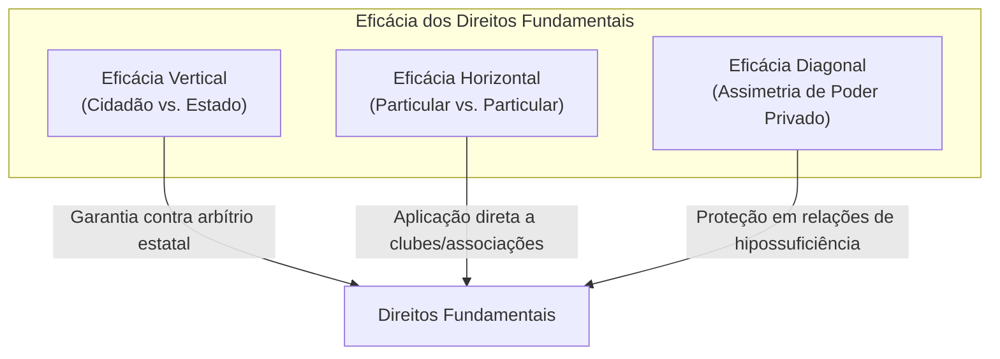
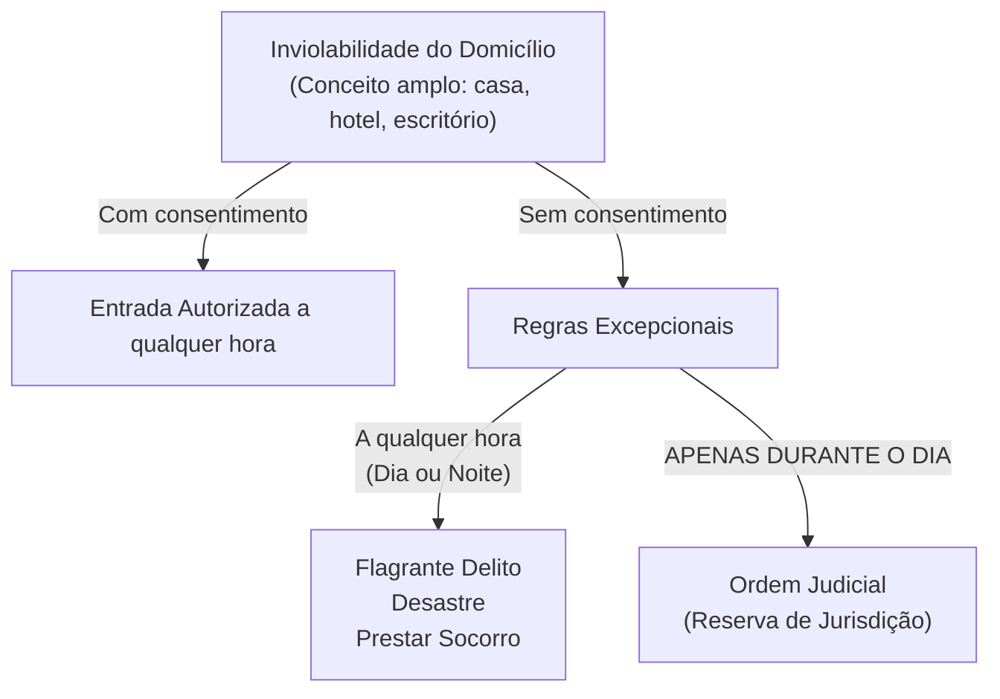
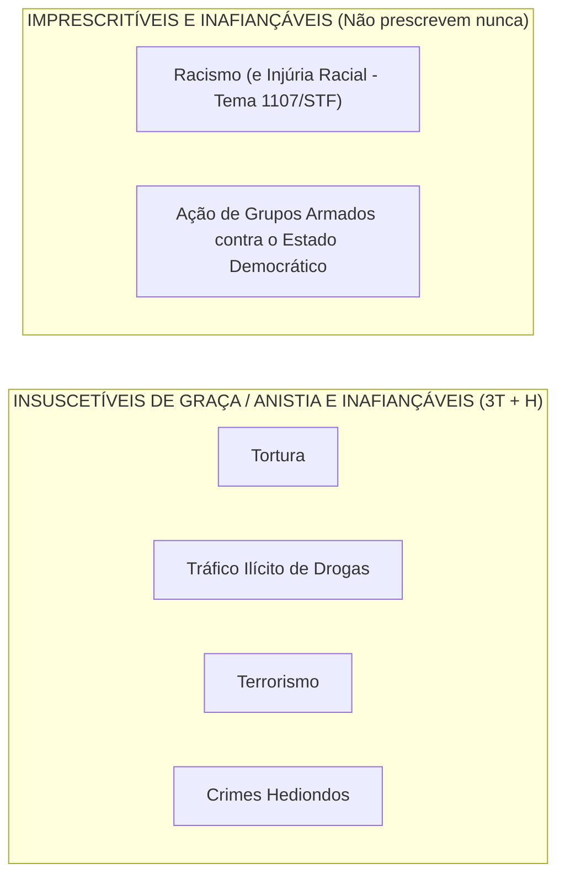

# 02 - Direitos Fundamentais, Remédios Constitucionais, Nacionalidade e Direitos Políticos

> **Matéria:** Noções de Direito Constitucional  
> **Cargo:** A01 – Técnico de Controle Externo – Especialidade: Técnico Administrativo  
> **Arquivo:** `02_direitos_e_garantias_fundamentais_e_politicos.md`  
> **Status:** 🟢 Teoria Aprofundada + 5 Questões FCC Comentadas (A a E)

---

## 📌 Ementa / Itens do Edital

- Dos direitos e deveres individuais e coletivos (Artigo 5º da CF/88): princípios reitores, direitos em espécie, garantias processuais e penais.
- Remédios constitucionais (*Writs*): *Habeas Corpus*, *Habeas Data*, Mandado de Segurança individual e coletivo, Mandado de Injunção e Ação Popular.
- Dos direitos sociais (Artigos 6º a 11 da CF/88): rol dos direitos fundamentais sociais, direitos dos trabalhadores urbanos e rurais, direito de greve e liberdade sindical.
- Da nacionalidade (Artigos 12 e 13 da CF/88): critérios originários e derivados, quase-nacionalidade, cargos privativos de brasileiro nato (art. 12, § 3º) e o novo regime de perda e readquisição da nacionalidade (Emenda Constitucional nº 131/2023).
- Dos direitos políticos (Artigos 14 a 16 da CF/88): instrumentos de soberania popular, alistabilidade eleitoral, condições de elegibilidade e idades mínimas, inelegibilidades absolutas e relativas (inelegibilidade reflexa e Súmula Vinculante 18).
- Perda e suspensão dos direitos políticos (Artigo 15 da CF/88): vedação absoluta de cassação e hipóteses constitucionais taxativas.
- Dos partidos políticos (Artigo 17 da CF/88): preceitos constitucionais, cláusula de barreira, financiamento e autonomia partidária.

---

## 🧭 Sumário

1. [Teoria Geral e Direitos Individuais e Coletivos (Art. 5º da CF/88)](#1-teoria-geral-e-direitos-individuais-e-coletivos-art-5o-da-cf88)
    1. [Características Fundamentais e Dimensões de Eficácia](#11-caracteristicas-fundamentais-e-dimensoes-de-eficacia)
    2. [Inviolabilidade do Domicílio (Art. 5º, XI)](#12-inviolabilidade-do-domicilio-art-5o-xi)
    3. [Inviolabilidade das Comunicações e Reserva de Jurisdição (Art. 5º, XII)](#13-inviolabilidade-das-comunicacoes-e-reserva-de-jurisdicao-art-5o-xii)
    4. [Liberdade de Associação e Limites Estatais (Art. 5º, XVII a XXI)](#14-liberdade-de-associacao-e-limites-estatais-art-5o-xvii-a-xxi)
    5. [Tratamento Constitucional dos Crimes: O Quarteto Penal da FCC](#15-tratamento-constitucional-dos-crimes-o-quarteto-penal-da-fcc)
    6. [Teste 121](#Teste-121)
    7. [Teste 122](#Teste-122)
    8. [Teste 123](#Teste-123)
2. [Remédios Constitucionais (*Writs* de Garantia)](#2-remedios-constitucionais-writs-de-garantia)
    1. [Análise Comparativa dos Remédios Constitucionais](#21-analise-comparativa-dos-remedios-constitucionais)
    2. [Teste 124](#Teste-124)
    3. [Teste 125](#Teste-125)
3. [Direitos Sociais (Arts. 6º a 11)](#3-direitos-sociais-arts-6o-a-11)
    1. [Teste 126](#Teste-126)
4. [Teoria da Nacionalidade e a Nova Disciplina da Perda (Arts. 12 e 13)](#4-teoria-da-nacionalidade-e-a-nova-disciplina-da-perda-arts-12-e-13)
    1. [Espécies de Nacionalidade Originária (Brasileiro Nato)](#41-especies-de-nacionalidade-originaria-brasileiro-nato)
    2. [Brasileiro Naturalizado](#42-brasileiro-naturalizado)
    3. [Cargos Privativos de Brasileiro Nato (Art. 12, § 3º - MP3.COM)](#43-cargos-privativos-de-brasileiro-nato-art-12-3o-mp3com)
    4. [Perda da Nacionalidade: O Novo Regime da EC nº 131/2023](#44-perda-da-nacionalidade-o-novo-regime-da-ec-no-1312023)
    5. [Teste 127](#Teste-127)
    6. [Teste 128](#Teste-128)
    7. [Teste 129](#Teste-129)
5. [Direitos Políticos e Sistema Partidário (Arts. 14 a 17)](#5-direitos-politicos-e-sistema-partidario-arts-14-a-17)
    1. [Alistamento Eleitoral e Voto](#51-alistamento-eleitoral-e-voto)
    2. [Idades Mínimas de Elegibilidade (Capacidade Eleitoral Passiva)](#52-idades-minimas-de-elegibilidade-capacidade-eleitoral-passiva)
    3. [Inelegibilidade Reflexa (Art. 14, § 7º) e Súmula Vinculante 18](#53-inelegibilidade-reflexa-art-14-7o-e-sumula-vinculante-18)
    4. [Perda e Suspensão dos Direitos Políticos (Art. 15 da CF/88)](#54-perda-e-suspensao-dos-direitos-politicos-art-15-da-cf88)
    5. [Teste 130](#Teste-130)
    6. [Teste 131](#Teste-131)
6. [🌐 Fontes Oficiais & Doutrinárias Recomendadas](#fontes-oficiais-doutrinarias-recomendadas)

---

## 1. Teoria Geral e Direitos Individuais e Coletivos (Art. 5º da CF/88)

### 1.1 Características Fundamentais e Dimensões de Eficácia
- **Inexistência de Direitos Absolutos (Relatividade):** Nenhum direito fundamental possui caráter absoluto. Todos encontram limites na coexistência harmoniosa com outros direitos fundamentais protegidos pela ordem constitucional. Nem mesmo o direito à vida é absoluto, haja vista a admissibilidade constitucional da pena de morte em caso de guerra declarada (art. 5º, XLVII, "a").
- **Eficácia Vertical vs. Eficácia Horizontal (*Drittwirkung*):**
    - *Eficácia Vertical:* Relação tradicional entre o indivíduo e o Estado, funcionando como escudo protetor contra o arbítrio estatal.
    - *Eficácia Horizontal:* Incidência direta e imediata dos direitos fundamentais nas relações jurídicas entre particulares (ex.: respeito à ampla defesa e ao contraditório para expulsão de sócio de clube ou cooperativa privada - STF).
    - *Eficácia Diagonal:* Relação entre particulares caracterizada por flagrante assimetria fática e jurídica (ex.: relações de trabalho e contratos de consumo).

### 1.2 Inviolabilidade do Domicílio (Art. 5º, XI)
> *"A casa é asilo inviolável do indivíduo, ninguém nela podendo penetrar sem consentimento do morador, salvo em caso de flagrante delito ou desastre, ou para prestar socorro, ou, durante o dia, por determinação judicial."*

> 🚨 **ALERTA DE PROVA / PEGADINHA FCC:**  
>
> 1. **Conceito de Domicílio:** O STF adota interpretação abrangente de "casa", incluindo escritórios profissionais, consultórios médicos, trailers habitados e quartos de hotel ocupados. Áreas abertas ao público (como o salão de um restaurante) não configuram domicílio protegido durante o horário comercial.  
> 2. **Determinação Judicial:** O cumprimento de mandado de busca e apreensão domiciliar **só pode ocorrer durante o dia**. Não existe hipótese de ingresso com ordem judicial durante a noite sem o consentimento do morador! O critério consagrado pela Lei de Abuso de Autoridade (Lei nº 13.869/2019) veda o cumprimento de mandado domiciliar entre 21h e 5h.  
> 3. **Flagrante Delito em Tráfico Ilícito de Drogas (Tema 280/STF):** O ingresso forçado em domicílio sem mandado judicial, mesmo em caso de crime permanente como o tráfico de drogas, exige fundadas razões (justa causa) devidamente justificadas *a posteriori*, sob pena de nulidade absoluta das provas.

### 1.3 Inviolabilidade das Comunicações e Reserva de Jurisdição (Art. 5º, XII)
> *"É inviolável o sigilo da correspondência e das comunicações telegráficas, de dados e das comunicações telefônicas, salvo, no último caso, por ordem judicial, nas hipóteses e na forma que a lei estabelecer para fins de investigação criminal ou instrução processual penal."*

- **Interceptação Telefônica:** Exige cláusula de **reserva de jurisdição estrita** (apenas o juiz competente pode determinar). É vedada em processos cíveis ou administrativos disciplinares (PAD). Contudo, a prova obtida licitamente no juízo criminal pode ser compartilhada como prova emprestada no PAD disciplinar (STJ/STF).
- **Sigilo Fiscal e Bancário:** Pode ser quebrado por determinação judicial e também diretamente por Comissões Parlamentares de Inquérito (CPIs federais e estaduais), com base nos poderes de investigação próprios das autoridades judiciais (art. 58, § 3º). O Fisco pode requisitar dados cadastrais e movimentações bancárias diretamente sem prévia autorização judicial (STF, ADI 2.390 e LC 105/2001).

### 1.4 Liberdade de Associação e Limites Estatais (Art. 5º, XVII a XXI)
| Aspecto Constitucional | Regra / Limite | Exigência Processual |
| :--- | :--- | :--- |
| **Criação da Associação** | Plena liberdade para fins lícitos | **Independe de autorização** estatal; vedada interferência na administração |
| **Atividades Paramilitares** | **Vedação absoluta** | Proibição categórica |
| **Suspensão das Atividades** | Interrupção provisória | Exige **decisão judicial** (mesmo cautelar/liminar) |
| **Dissolução Compulsória** | Extinção definitiva da pessoa jurídica | Exige **decisão judicial transitada em julgado** |
| **Representação Processual** | Defesa dos filiados em juízo | Exige **autorização expressa** (individual ou assemblear - Tema 82/STF) |

> ⭐ **IMPORTANTE:**  
> A FCC adora trocar as exigências para suspensão e dissolução compulsória. Memorize: para **suspender**, basta mera **decisão judicial**; para **dissolver compulsoriamente**, exige-se **trânsito em julgado**. Nenhuma autoridade administrativa tem competência para ordenar a paralisação ou encerramento de associação!

### 1.5 Tratamento Constitucional dos Crimes: O Quarteto Penal da FCC
Para gabaritar qualquer prova da Fundação Carlos Chagas, a tabela a seguir é de memorização compulsória:

| Categoria do Crime | Tipos Penais Abrangidos | Fiança? | Prescrição? | Graça / Anistia / Indulto? |
| :--- | :--- | :--- | :--- | :--- |
| **Racismo & Injúria Racial** | Prática de racismo (Lei 7.716/89) e Injúria racial (STF HC 154.248 e Lei 14.532/23) | **Inafiançável** | **Imprescritível** | Admite |
| **Ação de Grupos Armados** | Civis ou militares contra a ordem constitucional e o Estado Democrático | **Inafiançável** | **Imprescritível** | Admite |
| **3T + Hediondos** | **T**ortura, **T**ráfico ilícito de drogas, **T**errorismo e Crimes **H**ediondos | **Inafiançável** | Prescritível | **Insuscetíveis de graça ou anistia** |

---

### Teste 001
**(FGV – TJ/SC – 2026 – Analista Administrativo)**
João e Maria, servidores públicos ocupantes de cargos de provimento efetivo no Estado Sigma, que não se conhecem e jamais praticaram qualquer ato em comunhão de ações e desígnios, respondem a ações de improbidade administrativa com base na Lei nº 8.429/1992, cada qual pela prática dos próprios atos. João desviou recursos públicos enquanto atuava como ordenador de despesas. Maria, por sua vez, revelou fato de que tinha ciência em razão de suas atribuições e que deveria permanecer em segredo, colocando em risco a segurança do Estado. À luz da sistemática vigente, é correto afirmar que

* **A)** as condutas de João e Maria podem acarretar a aplicação da sanção de perda da função pública.
* **B)** as condutas de João e Maria foram enquadradas em uma tipologia legal de caráter exemplificativo, não taxativo.
* **C)** a conduta de João pode acarretar a aplicação da sanção de suspensão dos direitos políticos por até 14 (quatorze) anos.
* **D)** a conduta de Maria pode acarretar a aplicação da sanção de vedação ao recebimento de incentivos fiscais por até 12 (doze) anos.
* **E)** as ações ajuizadas em face de João e Maria são de autoria do Ministério Público, considerando sua legitimidade privativa nessa seara.

---

> **Comentário Detalhado:**
>
> - **A)** **Incorreta.** A opção apresenta proposição em desacordo com os fundamentos teóricos e técnicos do tópico ao afirmar que "as condutas de João e Maria podem acarretar a aplicação da sanção de perda da função pública". De acordo com a teoria estudada em *1.4 Liberdade de Associação e Limites Estatais (Art. 5º, XVII a XXI)*, a FCC adora trocar as exigências para suspensão e dissolução compulsória. Memorize: para suspender, basta mera decisão judicial; para dissolver compulsoriamente, exige se trânsito em julgado. Nenhuma autoridade administrativa tem competência para ordenar a paralisação ou encerramento de associação!.
> - **B)** **Incorreta.** A opção apresenta proposição em desacordo com os fundamentos teóricos e técnicos do tópico ao afirmar que "as condutas de João e Maria foram enquadradas em uma tipologia legal de caráter exemplificativo, não taxativo". De acordo com a teoria estudada em *1.1 Características Fundamentais e Dimensões de Eficácia*, inexistência de Direitos Absolutos (Relatividade): Nenhum direito fundamental possui caráter absoluto. Todos encontram limites na coexistência harmoniosa com outros direitos fundamentais protegidos pela ordem constitucional. Nem mesmo o direito à vida é absoluto, haja vista a admissibilidade constitucional da pena de morte em caso de guerra declarada (art. 5º, XLVII, "a").
> - **C)** **Correta.** Conforme fundamentado na seção *1.3 Inviolabilidade das Comunicações e Reserva de Jurisdição (Art. 5º, XII)* deste guia, sigilo Fiscal e Bancário: Pode ser quebrado por determinação judicial e também diretamente por Comissões Parlamentares de Inquérito (CPIs federais e estaduais), com base nos poderes de investigação próprios das autoridades judiciais (art. 58, § 3º). O Fisco pode requisitar dados cadastrais e movimentações bancárias diretamente sem prévia autorização judicial (STF, ADI 2.390 e LC 105/2001). Dessa forma, está plenamente correta a assertiva da banca (FGV – TJ/SC/2026) ao estabelecer que "a conduta de João pode acarretar a aplicação da sanção de suspensão dos direitos políticos por até 14 (quatorze)...".
> - **D)** **Incorreta.** A opção apresenta proposição em desacordo com os fundamentos teóricos e técnicos do tópico ao afirmar que "a conduta de Maria pode acarretar a aplicação da sanção de vedação ao recebimento de incentivos fiscais por até 12...". De acordo com a teoria estudada em *1.2 Inviolabilidade do Domicílio (Art. 5º, XI)*, determinação Judicial: O cumprimento de mandado de busca e apreensão domiciliar só pode ocorrer durante o dia. Não existe hipótese de ingresso com ordem judicial durante a noite sem o consentimento do morador! O critério consagrado pela Lei de Abuso de Autoridade (Lei nº 13.869/2019) veda o cumprimento de mandado domiciliar entre 21h e 5h.
> - **E)** **Incorreta.** A opção apresenta proposição em desacordo com os fundamentos teóricos e técnicos do tópico ao afirmar que "as ações ajuizadas em face de João e Maria são de autoria do Ministério Público, considerando sua legitimidade...". De acordo com a teoria estudada em *1.1 Características Fundamentais e Dimensões de Eficácia*, eH |"Aplicação direta a clubes/associações"| DF.
>
> **Gabarito: C**

---

### Teste 002
**(FGV – TCE/GO – 2024 – Analista de Controle Externo - Ciências Contábeis)**
Maria, Joana e Antônio, respectivamente, brasileira nata, brasileira naturalizada e ugandense residente no território brasileiro, consultaram um especialista em relação à existência, ou não, de distinção em relação à situação jurídica de cada qual considerando os direitos fundamentais e os direitos políticos. O especialista respondeu corretamente que, à luz dos balizamentos estabelecidos pela Constituição da República,

* **A)** os três possuem os mesmos direitos fundamentais, mas, atendidos os requisitos exigidos, não há identidade em relação aos direitos políticos.
* **B)** Maria e Joana possuem os mesmos direitos políticos, apesar de a naturalização desta última poder ser cassada.
* **C)** diversamente de Maria e Joana, Antônio não possui direitos fundamentais e, por via reflexa, não possui direitos políticos.
* **D)** somente possuem direitos políticos aqueles que possuem direitos fundamentais, logo, os três os possuem.
* **E)** Maria e Joana não possuem os mesmos direitos fundamentais, e Antônio não pode usufruir de direitos políticos.

---

> **Comentário Detalhado:**
>
> - **A)** **Incorreta.** A opção apresenta proposição em desacordo com os fundamentos teóricos e técnicos do tópico ao afirmar que "os três possuem os mesmos direitos fundamentais, mas, atendidos os requisitos exigidos, não há identidade em...". De acordo com a teoria estudada em *1.1 Características Fundamentais e Dimensões de Eficácia*, eficácia Diagonal: Relação entre particulares caracterizada por flagrante assimetria fática e jurídica (ex.: relações de trabalho e contratos de consumo).
> - **B)** **Incorreta.** A opção apresenta proposição em desacordo com os fundamentos teóricos e técnicos do tópico ao afirmar que "Maria e Joana possuem os mesmos direitos políticos, apesar de a naturalização desta última poder ser cassada". De acordo com a teoria estudada em *1.3 Inviolabilidade das Comunicações e Reserva de Jurisdição (Art. 5º, XII)*, interceptação Telefônica: Exige cláusula de reserva de jurisdição estrita (apenas o juiz competente pode determinar). É vedada em processos cíveis ou administrativos disciplinares (PAD). Contudo, a prova obtida licitamente no juízo criminal pode ser compartilhada como prova emprestada no PAD disciplinar (STJ/STF).
> - **C)** **Incorreta.** A opção apresenta proposição em desacordo com os fundamentos teóricos e técnicos do tópico ao afirmar que "diversamente de Maria e Joana, Antônio não possui direitos fundamentais e, por via reflexa, não possui direitos...". De acordo com a teoria estudada em *1.1 Características Fundamentais e Dimensões de Eficácia*, eficácia Horizontal: Incidência direta e imediata dos direitos fundamentais nas relações jurídicas entre particulares (ex.: respeito à ampla defesa e ao contraditório para expulsão de sócio de clube ou cooperativa privada STF).
> - **D)** **Incorreta.** A opção incorre em restrição indevida ao limitar o escopo conceitual ao afirmar que "somente possuem direitos políticos aqueles que possuem direitos fundamentais, logo, os três os possuem". De acordo com a teoria estudada em *1.1 Características Fundamentais e Dimensões de Eficácia*, subgraph Eficacia["Eficácia dos Direitos Fundamentais"].
> - **E)** **Correta.** Conforme fundamentado na seção *1.1 Características Fundamentais e Dimensões de Eficácia* deste guia, inexistência de Direitos Absolutos (Relatividade): Nenhum direito fundamental possui caráter absoluto. Todos encontram limites na coexistência harmoniosa com outros direitos fundamentais protegidos pela ordem constitucional. Nem mesmo o direito à vida é absoluto, haja vista a admissibilidade constitucional da pena de morte em caso de guerra declarada (art. 5º, XLVII, "a"). Dessa forma, está plenamente correta a assertiva da banca (FGV – TCE/GO/2024) ao estabelecer que "Maria e Joana não possuem os mesmos direitos fundamentais, e Antônio não pode usufruir de direitos políticos".
>
> **Gabarito: E**

---

### Teste 003
**(FGV – TCE/GO – 2024 – Analista de Controle Externo - Ciências Contábeis)**
Mara, de nacionalidade brasileira, casou com Stevenson, de nacionalidade holandesa, e passou a viver na Áustria. Com o objetivo de facilitar sua integração no país em que residia, não como requisito para a fruição de direitos civis, Mara decidiu se naturalizar austríaca. Após alguns anos, Mara consultou a legislação vigente com o objetivo de verificar a possibilidade de vir a perder à nacionalidade brasileira, tendo concluído corretamente que

* **A)** ao casar com Stevenson, em razão do jus nuptias, ela adquiriu a nacionalidade holandesa, perdendo a brasileira;
* **B)** ao se naturalizar austríaca, nas circunstâncias indicadas, ela perdeu a nacionalidade brasileira;
* **C)** não será possível a realização do desiderato de Mara, pois se tornará apátrida, o que é vedado;
* **D)** a nacionalidade, por estar integrada aos direitos da personalidade, é irrenunciável;
* **E)** ela terá que fazer pedido expresso à autoridade brasileira.

---

> **Comentário Detalhado:**
>
> - **A)** **Incorreta.** A opção apresenta proposição em desacordo com os fundamentos teóricos e técnicos do tópico ao afirmar que "ao casar com Stevenson, em razão do jus nuptias, ela adquiriu a nacionalidade holandesa, perdendo a brasileira". De acordo com a teoria estudada em *1.4 Liberdade de Associação e Limites Estatais (Art. 5º, XVII a XXI)*, a FCC adora trocar as exigências para suspensão e dissolução compulsória. Memorize: para suspender, basta mera decisão judicial; para dissolver compulsoriamente, exige se trânsito em julgado. Nenhuma autoridade administrativa tem competência para ordenar a paralisação ou encerramento de associação!.
> - **B)** **Incorreta.** A opção apresenta proposição em desacordo com os fundamentos teóricos e técnicos do tópico ao afirmar que "ao se naturalizar austríaca, nas circunstâncias indicadas, ela perdeu a nacionalidade brasileira". De acordo com a teoria estudada em *1.5 Tratamento Constitucional dos Crimes: O Quarteto Penal da FCC*, ação de Grupos Armados: Civis ou militares contra a ordem constitucional e o Estado Democrático — Inafiançável — Imprescritível — Admite.
> - **C)** **Incorreta.** A opção apresenta proposição em desacordo com os fundamentos teóricos e técnicos do tópico ao afirmar que "não será possível a realização do desiderato de Mara, pois se tornará apátrida, o que é vedado". De acordo com a teoria estudada em *1.1 Características Fundamentais e Dimensões de Eficácia*, inexistência de Direitos Absolutos (Relatividade): Nenhum direito fundamental possui caráter absoluto. Todos encontram limites na coexistência harmoniosa com outros direitos fundamentais protegidos pela ordem constitucional. Nem mesmo o direito à vida é absoluto, haja vista a admissibilidade constitucional da pena de morte em caso de guerra declarada (art. 5º, XLVII, "a").
> - **D)** **Incorreta.** A opção apresenta proposição em desacordo com os fundamentos teóricos e técnicos do tópico ao afirmar que "a nacionalidade, por estar integrada aos direitos da personalidade, é irrenunciável". De acordo com a teoria estudada em *1.1 Características Fundamentais e Dimensões de Eficácia*, eficácia Horizontal: Incidência direta e imediata dos direitos fundamentais nas relações jurídicas entre particulares (ex.: respeito à ampla defesa e ao contraditório para expulsão de sócio de clube ou cooperativa privada STF).
> - **E)** **Correta.** Conforme fundamentado na seção *1.2 Inviolabilidade do Domicílio (Art. 5º, XI)* deste guia, determinação Judicial: O cumprimento de mandado de busca e apreensão domiciliar só pode ocorrer durante o dia. Não existe hipótese de ingresso com ordem judicial durante a noite sem o consentimento do morador! O critério consagrado pela Lei de Abuso de Autoridade (Lei nº 13.869/2019) veda o cumprimento de mandado domiciliar entre 21h e 5h. Dessa forma, está plenamente correta a assertiva da banca (FGV – TCE/GO/2024) ao estabelecer que "ela terá que fazer pedido expresso à autoridade brasileira".
>
> **Gabarito: E**

---

### Teste 004
**(FGV – TJ/AP – 2023 – Analista Judiciario Apoio Especializado Tecnologia Da Informacao Banco De Dados)**
João foi condenado em sentença transitada em julgado pela prática de uma infração penal. Poucos meses após o cumprimento da pena, decidiu que iria concorrer a um cargo eletivo nas próximas eleições. Ao analisar exclusivamente a Constituição da República, não a legislação infraconstitucional, com o objetivo de verificar se a condenação anterior constituiria óbice à realização do seu objetivo, João concluiu, corretamente, que:

* **A)** está inelegível;
* **B)** está com os direitos políticos suspensos;
* **C)** pode ser considerado inelegível por lei complementar;
* **D)** está inabilitado para o exercício de outra função pública;
* **E)** perdeu os direitos políticos, mas pode readquiri-los com a reabilitação.

---

> **Comentário Detalhado:**
>
> - **A)** **Incorreta.** A opção apresenta proposição em desacordo com os fundamentos teóricos e técnicos do tópico ao afirmar que "está inelegível". De acordo com a teoria estudada em *1.3 Inviolabilidade das Comunicações e Reserva de Jurisdição (Art. 5º, XII)*, interceptação Telefônica: Exige cláusula de reserva de jurisdição estrita (apenas o juiz competente pode determinar). É vedada em processos cíveis ou administrativos disciplinares (PAD). Contudo, a prova obtida licitamente no juízo criminal pode ser compartilhada como prova emprestada no PAD disciplinar (STJ/STF).
> - **B)** **Incorreta.** A opção apresenta proposição em desacordo com os fundamentos teóricos e técnicos do tópico ao afirmar que "está com os direitos políticos suspensos". De acordo com a teoria estudada em *1.3 Inviolabilidade das Comunicações e Reserva de Jurisdição (Art. 5º, XII)*, sigilo Fiscal e Bancário: Pode ser quebrado por determinação judicial e também diretamente por Comissões Parlamentares de Inquérito (CPIs federais e estaduais), com base nos poderes de investigação próprios das autoridades judiciais (art. 58, § 3º). O Fisco pode requisitar dados cadastrais e movimentações bancárias diretamente sem prévia autorização judicial (STF, ADI 2.390 e LC 105/2001).
> - **C)** **Correta.** Conforme fundamentado na seção *1.2 Inviolabilidade do Domicílio (Art. 5º, XI)* deste guia, determinação Judicial: O cumprimento de mandado de busca e apreensão domiciliar só pode ocorrer durante o dia. Não existe hipótese de ingresso com ordem judicial durante a noite sem o consentimento do morador! O critério consagrado pela Lei de Abuso de Autoridade (Lei nº 13.869/2019) veda o cumprimento de mandado domiciliar entre 21h e 5h. Dessa forma, está plenamente correta a assertiva da banca (FGV – TJ/AP/2023) ao estabelecer que "pode ser considerado inelegível por lei complementar".
> - **D)** **Incorreta.** A opção apresenta proposição em desacordo com os fundamentos teóricos e técnicos do tópico ao afirmar que "está inabilitado para o exercício de outra função pública". De acordo com a teoria estudada em *1.5 Tratamento Constitucional dos Crimes: O Quarteto Penal da FCC*, racismo & Injúria Racial: Prática de racismo (Lei 7.716/89) e Injúria racial (STF HC 154.248 e Lei 14.532/23) — Inafiançável — Imprescritível — Admite.
> - **E)** **Incorreta.** A opção apresenta proposição em desacordo com os fundamentos teóricos e técnicos do tópico ao afirmar que "perdeu os direitos políticos, mas pode readquiri los com a reabilitação". De acordo com a teoria estudada em *1.1 Características Fundamentais e Dimensões de Eficácia*, inexistência de Direitos Absolutos (Relatividade): Nenhum direito fundamental possui caráter absoluto. Todos encontram limites na coexistência harmoniosa com outros direitos fundamentais protegidos pela ordem constitucional. Nem mesmo o direito à vida é absoluto, haja vista a admissibilidade constitucional da pena de morte em caso de guerra declarada (art. 5º, XLVII, "a").
>
> **Gabarito: C**

---

### Teste 005
**(FGV – TJ/DFT – 2022 – Analista Judiciario Suporte Em Tecnologia Da Informacao)**
A Lei federal nº XX impôs a todos os cidadãos determinada obrigação de caráter cívico, a ser cumprida em certos períodos por aqueles que fossem sorteados. João, em razão de suas convicções políticas, decidiu que não iria cumprir a obrigação. À luz da sistemática constitucional, João:

* **A)** não poderá sofrer consequência desfavorável, por ter exercido plenamente a sua liberdade de consciência, que não pode ser afrontada pelo poder público, sob pena de violação à dignidade da pessoa humana;
* **B)** preservará o direito de votar, mas ficará inelegível, consequência que será afastada caso cumpra a prestação alternativa fixada em lei;
* **C)** deverá cumprir a prestação alternativa fixada em lei e, caso se recuse, terá a cidadania suspensa em suas acepções ativa e passiva;
* **D)** terá os direitos políticos suspensos, os quais serão restabelecidos caso cumpra a prestação alternativa fixada em lei;
* **E)** deverá cumprir a prestação alternativa fixada em lei e, caso se recuse, ficará inelegível.

---

> **Comentário Detalhado:**
>
> - **A)** **Incorreta.** A opção apresenta proposição em desacordo com os fundamentos teóricos e técnicos do tópico ao afirmar que "não poderá sofrer consequência desfavorável, por ter exercido plenamente a sua liberdade de consciência, que não...". De acordo com a teoria estudada em *1.2 Inviolabilidade do Domicílio (Art. 5º, XI)*, flagrante Delito em Tráfico Ilícito de Drogas (Tema 280/STF): O ingresso forçado em domicílio sem mandado judicial, mesmo em caso de crime permanente como o tráfico de drogas, exige fundadas razões (justa causa) devidamente justificadas a posteriori , sob pena de nulidade absoluta das provas.
> - **B)** **Incorreta.** A opção apresenta proposição em desacordo com os fundamentos teóricos e técnicos do tópico ao afirmar que "preservará o direito de votar, mas ficará inelegível, consequência que será afastada caso cumpra a prestação...". De acordo com a teoria estudada em *1.1 Características Fundamentais e Dimensões de Eficácia*, inexistência de Direitos Absolutos (Relatividade): Nenhum direito fundamental possui caráter absoluto. Todos encontram limites na coexistência harmoniosa com outros direitos fundamentais protegidos pela ordem constitucional. Nem mesmo o direito à vida é absoluto, haja vista a admissibilidade constitucional da pena de morte em caso de guerra declarada (art. 5º, XLVII, "a").
> - **C)** **Correta.** Conforme fundamentado na seção *1.3 Inviolabilidade das Comunicações e Reserva de Jurisdição (Art. 5º, XII)* deste guia, "É inviolável o sigilo da correspondência e das comunicações telegráficas, de dados e das comunicações telefônicas, salvo, no último caso, por ordem judicial, nas hipóteses e na forma que a lei estabelecer para fins de investigação criminal ou instrução processual penal.". Dessa forma, está plenamente correta a assertiva da banca (FGV – TJ/DFT/2022) ao estabelecer que "deverá cumprir a prestação alternativa fixada em lei e, caso se recuse, terá a cidadania suspensa em suas acepções...".
> - **D)** **Incorreta.** A opção apresenta proposição em desacordo com os fundamentos teóricos e técnicos do tópico ao afirmar que "terá os direitos políticos suspensos, os quais serão restabelecidos caso cumpra a prestação alternativa fixada em...". De acordo com a teoria estudada em *1.5 Tratamento Constitucional dos Crimes: O Quarteto Penal da FCC*, racismo & Injúria Racial: Prática de racismo (Lei 7.716/89) e Injúria racial (STF HC 154.248 e Lei 14.532/23) — Inafiançável — Imprescritível — Admite.
> - **E)** **Incorreta.** A opção apresenta proposição em desacordo com os fundamentos teóricos e técnicos do tópico ao afirmar que "deverá cumprir a prestação alternativa fixada em lei e, caso se recuse, ficará inelegível". De acordo com a teoria estudada em *1.2 Inviolabilidade do Domicílio (Art. 5º, XI)*, determinação Judicial: O cumprimento de mandado de busca e apreensão domiciliar só pode ocorrer durante o dia. Não existe hipótese de ingresso com ordem judicial durante a noite sem o consentimento do morador! O critério consagrado pela Lei de Abuso de Autoridade (Lei nº 13.869/2019) veda o cumprimento de mandado domiciliar entre 21h e 5h.
>
> **Gabarito: C**

---

### Teste 006
**(FGV – TJ/MT – 2024 – Analista Judiciario Tecnologia Da Informacao)**
Acerca dos direitos e deveres individuais e coletivos, analise as afirmativas a seguir: I. É inviolável o sigilo da correspondência e das comunicações telegráficas, de dados e das comunicações telefônicas, salvo, no último caso, por ordem judicial, nas hipóteses e na forma que a lei estabelecer para fins de investigação criminal ou instrução processual penal. II. Todos podem reunir-se pacificamente, sem armas, em locais abertos ao público, independentemente de autorização, desde que não frustrem outra reunião anteriormente convocada para o mesmo local, sendo apenas exigido prévio aviso à autoridade competente. III. É assegurado a todos o acesso à informação e resguardado o sigilo da fonte, quando necessário ao exercício profissional. Nesse cenário, considerando as disposições da Constituição Federal de 1988, está correto o que se afirma em

* **A)** I, apenas.
* **B)** II, apenas.
* **C)** III, apenas.
* **D)** I e II, apenas.
* **E)** I, II e III.

---

> **Comentário Detalhado:**
>
> - **A)** **Incorreta.** A opção incorre em restrição indevida ao limitar o escopo conceitual ao afirmar que "I, apenas". De acordo com a teoria estudada em *1.3 Inviolabilidade das Comunicações e Reserva de Jurisdição (Art. 5º, XII)*, sigilo Fiscal e Bancário: Pode ser quebrado por determinação judicial e também diretamente por Comissões Parlamentares de Inquérito (CPIs federais e estaduais), com base nos poderes de investigação próprios das autoridades judiciais (art. 58, § 3º). O Fisco pode requisitar dados cadastrais e movimentações bancárias diretamente sem prévia autorização judicial (STF, ADI 2.390 e LC 105/2001).
> - **B)** **Incorreta.** A opção incorre em restrição indevida ao limitar o escopo conceitual ao afirmar que "II, apenas". De acordo com a teoria estudada em *1.2 Inviolabilidade do Domicílio (Art. 5º, XI)*, "A casa é asilo inviolável do indivíduo, ninguém nela podendo penetrar sem consentimento do morador, salvo em caso de flagrante delito ou desastre, ou para prestar socorro, ou, durante o dia, por determinação judicial.".
> - **C)** **Incorreta.** A opção incorre em restrição indevida ao limitar o escopo conceitual ao afirmar que "III, apenas". De acordo com a teoria estudada em *1.2 Inviolabilidade do Domicílio (Art. 5º, XI)*, determinação Judicial: O cumprimento de mandado de busca e apreensão domiciliar só pode ocorrer durante o dia. Não existe hipótese de ingresso com ordem judicial durante a noite sem o consentimento do morador! O critério consagrado pela Lei de Abuso de Autoridade (Lei nº 13.869/2019) veda o cumprimento de mandado domiciliar entre 21h e 5h.
> - **D)** **Incorreta.** A opção incorre em restrição indevida ao limitar o escopo conceitual ao afirmar que "I e II, apenas". De acordo com a teoria estudada em *1.3 Inviolabilidade das Comunicações e Reserva de Jurisdição (Art. 5º, XII)*, interceptação Telefônica: Exige cláusula de reserva de jurisdição estrita (apenas o juiz competente pode determinar). É vedada em processos cíveis ou administrativos disciplinares (PAD). Contudo, a prova obtida licitamente no juízo criminal pode ser compartilhada como prova emprestada no PAD disciplinar (STJ/STF).
> - **E)** **Correta.** Conforme fundamentado na seção *1.3 Inviolabilidade das Comunicações e Reserva de Jurisdição (Art. 5º, XII)* deste guia, "É inviolável o sigilo da correspondência e das comunicações telegráficas, de dados e das comunicações telefônicas, salvo, no último caso, por ordem judicial, nas hipóteses e na forma que a lei estabelecer para fins de investigação criminal ou instrução processual penal.". Dessa forma, está plenamente correta a assertiva da banca (FGV – TJ/MT/2024) ao estabelecer que "I, II e III".
>
> **Gabarito: E**

---

### Teste 007
**(FCC – TRT 1ª – 2014 – Analista Judiciário - Tecnologia da Informação)**
As normas de concordância verbal estão plenamente deral, ou entre as deste e da União. observadas na frase:

* **A)** poderá ser brasileira naturalizada, jamais nata.
* **B)** somente poderia adquirir a nacionalidade brasileira se sua mãe estivesse a serviço do Brasil, na época do seu nascimento.
* **C)** poderá optar pela nacionalidade brasileira, em qual- quer tempo, depois de atingida a maioridade, se vier a residir no Brasil.
* **D)** jamais poderá adquirir a nacionalidade brasileira.
* **E)** adquirirá a nacionalidade brasileira desde que venha a residir no Brasil antes de completar 18 anos. _________________________________________________________

---

> **Comentário Detalhado:**
>
> - **A)** **Incorreta.** A opção apresenta vedação ou negativa absoluta incompatível com a regra aplicável ao afirmar que "poderá ser brasileira naturalizada, jamais nata". De acordo com a teoria estudada em *1.3 Inviolabilidade das Comunicações e Reserva de Jurisdição (Art. 5º, XII)*, interceptação Telefônica: Exige cláusula de reserva de jurisdição estrita (apenas o juiz competente pode determinar). É vedada em processos cíveis ou administrativos disciplinares (PAD). Contudo, a prova obtida licitamente no juízo criminal pode ser compartilhada como prova emprestada no PAD disciplinar (STJ/STF).
> - **B)** **Correta.** Conforme fundamentado na seção *Fundamentos Teóricos* deste guia, status: 🟢 Teoria Aprofundada + 5 Questões FCC Comentadas (A a E). Dessa forma, está plenamente correta a assertiva da banca (FCC – TRT 1ª/2014) ao estabelecer que "somente poderia adquirir a nacionalidade brasileira se sua mãe estivesse a serviço do Brasil, na época do seu...".
> - **C)** **Incorreta.** A opção apresenta proposição em desacordo com os fundamentos teóricos e técnicos do tópico ao afirmar que "poderá optar pela nacionalidade brasileira, em qual quer tempo, depois de atingida a maioridade, se vier a residir...". De acordo com a teoria estudada em *1.1 Características Fundamentais e Dimensões de Eficácia*, inexistência de Direitos Absolutos (Relatividade): Nenhum direito fundamental possui caráter absoluto. Todos encontram limites na coexistência harmoniosa com outros direitos fundamentais protegidos pela ordem constitucional. Nem mesmo o direito à vida é absoluto, haja vista a admissibilidade constitucional da pena de morte em caso de guerra declarada (art. 5º, XLVII, "a").
> - **D)** **Incorreta.** A opção apresenta vedação ou negativa absoluta incompatível com a regra aplicável ao afirmar que "jamais poderá adquirir a nacionalidade brasileira". De acordo com a teoria estudada em *1.1 Características Fundamentais e Dimensões de Eficácia*, eficácia Vertical vs. Eficácia Horizontal ( Drittwirkung ).
> - **E)** **Incorreta.** A opção apresenta proposição em desacordo com os fundamentos teóricos e técnicos do tópico ao afirmar que "adquirirá a nacionalidade brasileira desde que venha a residir no Brasil antes de completar 18 anos". De acordo com a teoria estudada em *1.1 Características Fundamentais e Dimensões de Eficácia*, eficácia Vertical: Relação tradicional entre o indivíduo e o Estado, funcionando como escudo protetor contra o arbítrio estatal.
>
> **Gabarito: B**

---

### Teste 008
**(FCC – TRT 4ª – 2015 – Analista Judiciário - Tecnologia Da Informação)**
Nos termos regulados pela Lei no 8.429/92, a pena de perda dos bens ou valores acrescidos ilicitamente ao patrimônio, res- sarcimento integral do dano, quando houver, perda da função pública, suspensão dos direitos políticos de oito a dez anos, paga- mento de multa civil de até três vezes o valor do acréscimo patrimonial e proibição de contratar com o Poder Público ou receber benefícios ou incentivos fiscais ou creditícios, direta ou indiretamente, ainda que por intermédio de pessoa jurídica da qual seja sócio majoritário, pelo prazo de dez anos, pode ser aplicada quando caracterizado o ato de improbidade administrativa por

* **A)** receber vantagem econômica de qualquer natureza, direta ou indiretamente, para omitir ato de ofício, providência ou declaração a que esteja obrigado.
* **B)** permitir ou facilitar a aquisição, permuta ou locação de bem ou serviço por preço superior ao de mercado.
* **C)** ordenar ou permitir a realização de despesas não autorizadas em lei ou regulamento.
* **D)** negar publicidade aos atos oficiais.
* **E)** retardar ou deixar de praticar, indevidamente, ato de ofício.

---

> **Comentário Detalhado:**
>
> - **A)** **Correta.** Conforme fundamentado na seção *1.1 Características Fundamentais e Dimensões de Eficácia* deste guia, eficácia Horizontal: Incidência direta e imediata dos direitos fundamentais nas relações jurídicas entre particulares (ex.: respeito à ampla defesa e ao contraditório para expulsão de sócio de clube ou cooperativa privada STF). Dessa forma, está plenamente correta a assertiva da banca (FCC – TRT 4ª/2015) ao estabelecer que "receber vantagem econômica de qualquer natureza, direta ou indiretamente, para omitir ato de ofício, providência...".
> - **B)** **Incorreta.** A opção apresenta proposição em desacordo com os fundamentos teóricos e técnicos do tópico ao afirmar que "permitir ou facilitar a aquisição, permuta ou locação de bem ou serviço por preço superior ao de mercado". De acordo com a teoria estudada em *1.1 Características Fundamentais e Dimensões de Eficácia*, eH |"Aplicação direta a clubes/associações"| DF.
> - **C)** **Incorreta.** A opção apresenta proposição em desacordo com os fundamentos teóricos e técnicos do tópico ao afirmar que "ordenar ou permitir a realização de despesas não autorizadas em lei ou regulamento". De acordo com a teoria estudada em *1.4 Liberdade de Associação e Limites Estatais (Art. 5º, XVII a XXI)*, a FCC adora trocar as exigências para suspensão e dissolução compulsória. Memorize: para suspender, basta mera decisão judicial; para dissolver compulsoriamente, exige se trânsito em julgado. Nenhuma autoridade administrativa tem competência para ordenar a paralisação ou encerramento de associação!.
> - **D)** **Incorreta.** A opção apresenta proposição em desacordo com os fundamentos teóricos e técnicos do tópico ao afirmar que "negar publicidade aos atos oficiais". De acordo com a teoria estudada em *1.2 Inviolabilidade do Domicílio (Art. 5º, XI)*, casa |"Com consentimento"| OK["Entrada Autorizada a qualquer hora"].
> - **E)** **Incorreta.** A opção apresenta proposição em desacordo com os fundamentos teóricos e técnicos do tópico ao afirmar que "retardar ou deixar de praticar, indevidamente, ato de ofício". De acordo com a teoria estudada em *1.2 Inviolabilidade do Domicílio (Art. 5º, XI)*, regras |"A qualquer hora<br/ (Dia ou Noite)"| Emerg["Flagrante Delito<br/ Desastre<br/ Prestar Socorro"].
>
> **Gabarito: A**

---

### Teste 009
**(FGV – TCE/PA – 2024 – Auditor de Controle Externo - Administrativa - Direito)**
Após o devido processo legal, em decorrência da prática de ato de improbidade administrativa, foi aplicada a Samuel, que era prefeito do Município Alfa, entre outras penalidades, a de suspensão de direitos políticos pelo prazo de 13 (treze) anos, em decorrência da gravidade de sua conduta. Considerando as disposições constantes da Lei nº 8.429/92, com a redação conferida pela Lei nº 14.230/2021, é correto afirmar que a penalidade de suspensão de direitos políticos na extensão imposta

* **A)** apenas está prevista para os atos de improbidade que importam em enriquecimento ilícito.
* **B)** pode ser aplicada para qualquer dos atos de improbidade tipificados na norma em comento.
* **C)** somente seria cabível para os atos de improbidade que causam lesão ao erário.
* **D)** restringe-se aos atos de improbidade que atentam contra os princípios da Administração Pública.
* **E)** extrapola os limites previstos na norma em apreço para qualquer dos atos de improbidade.

---

> **Comentário Detalhado:**
>
> - **A)** **Correta.** Conforme fundamentado na seção *1.2 Inviolabilidade do Domicílio (Art. 5º, XI)* deste guia, flagrante Delito em Tráfico Ilícito de Drogas (Tema 280/STF): O ingresso forçado em domicílio sem mandado judicial, mesmo em caso de crime permanente como o tráfico de drogas, exige fundadas razões (justa causa) devidamente justificadas a posteriori , sob pena de nulidade absoluta das provas. Dessa forma, está plenamente correta a assertiva da banca (FGV – TCE/PA/2024) ao estabelecer que "apenas está prevista para os atos de improbidade que importam em enriquecimento ilícito".
> - **B)** **Incorreta.** A opção promove generalização excessiva que desconsidera as condições técnicas e normativas ao afirmar que "pode ser aplicada para qualquer dos atos de improbidade tipificados na norma em comento". De acordo com a teoria estudada em *1.3 Inviolabilidade das Comunicações e Reserva de Jurisdição (Art. 5º, XII)*, interceptação Telefônica: Exige cláusula de reserva de jurisdição estrita (apenas o juiz competente pode determinar). É vedada em processos cíveis ou administrativos disciplinares (PAD). Contudo, a prova obtida licitamente no juízo criminal pode ser compartilhada como prova emprestada no PAD disciplinar (STJ/STF).
> - **C)** **Incorreta.** A opção incorre em restrição indevida ao limitar o escopo conceitual ao afirmar que "somente seria cabível para os atos de improbidade que causam lesão ao erário". De acordo com a teoria estudada em *1.5 Tratamento Constitucional dos Crimes: O Quarteto Penal da FCC*, 3T + Hediondos: Tortura, Tráfico ilícito de drogas, Terrorismo e Crimes Hediondos — Inafiançável — Prescritível — Insuscetíveis de graça ou anistia.
> - **D)** **Incorreta.** A opção apresenta proposição em desacordo com os fundamentos teóricos e técnicos do tópico ao afirmar que "restringe se aos atos de improbidade que atentam contra os princípios da Administração Pública". De acordo com a teoria estudada em *1.4 Liberdade de Associação e Limites Estatais (Art. 5º, XVII a XXI)*, criação da Associação: Plena liberdade para fins lícitos — Independe de autorização estatal; vedada interferência na administração.
> - **E)** **Incorreta.** A opção promove generalização excessiva que desconsidera as condições técnicas e normativas ao afirmar que "extrapola os limites previstos na norma em apreço para qualquer dos atos de improbidade". De acordo com a teoria estudada em *1.4 Liberdade de Associação e Limites Estatais (Art. 5º, XVII a XXI)*, a FCC adora trocar as exigências para suspensão e dissolução compulsória. Memorize: para suspender, basta mera decisão judicial; para dissolver compulsoriamente, exige se trânsito em julgado. Nenhuma autoridade administrativa tem competência para ordenar a paralisação ou encerramento de associação!.
>
> **Gabarito: A**

---

### Teste 010
**(FGV – TCE/PA – 2024 – Auditor de Controle Externo - Administrativa - Gestão Governamental)**
A base constitucional para o sigilo fiscal está na preservação da intimidade e da vida privada e inviolabilidade da correspondência. Assinale a situação em que o legislador ou a jurisprudência dos Tribunais Superiores entende que há violação ao sigilo fiscal.

* **A)** Translado do dever de sigilo da esfera bancária para a fiscal, previsto em lei, sem a necessidade de decisão judicial.
* **B)** Inclusão de dados das pessoas físicas e jurídicas responsáveis pelos créditos inadimplidos no Cadastro Informativo dos Créditos não Quitados de Órgão e Entidades Federais - CADIN.
* **C)** Divulgação, pela fazenda pública, de informações obtidas em razão de ofício sobre a situação financeira do sujeito passivo e sobre a natureza e o estado de seus negócios.
* **D)** Divulgação de informações relativas a representações fiscais para fins penais.
* **E)** Divulgação de informações relativas a inscrições na Dívida Ativa da Fazenda Pública.

---

> **Comentário Detalhado:**
>
> - **A)** **Incorreta.** A opção apresenta proposição em desacordo com os fundamentos teóricos e técnicos do tópico ao afirmar que "Translado do dever de sigilo da esfera bancária para a fiscal, previsto em lei, sem a necessidade de decisão...". De acordo com a teoria estudada em *1.3 Inviolabilidade das Comunicações e Reserva de Jurisdição (Art. 5º, XII)*, "É inviolável o sigilo da correspondência e das comunicações telegráficas, de dados e das comunicações telefônicas, salvo, no último caso, por ordem judicial, nas hipóteses e na forma que a lei estabelecer para fins de investigação criminal ou instrução processual penal.".
> - **B)** **Incorreta.** A opção apresenta proposição em desacordo com os fundamentos teóricos e técnicos do tópico ao afirmar que "Inclusão de dados das pessoas físicas e jurídicas responsáveis pelos créditos inadimplidos no Cadastro Informativo...". De acordo com a teoria estudada em *1.1 Características Fundamentais e Dimensões de Eficácia*, eficácia Horizontal: Incidência direta e imediata dos direitos fundamentais nas relações jurídicas entre particulares (ex.: respeito à ampla defesa e ao contraditório para expulsão de sócio de clube ou cooperativa privada STF).
> - **C)** **Correta.** Conforme fundamentado na seção *1.3 Inviolabilidade das Comunicações e Reserva de Jurisdição (Art. 5º, XII)* deste guia, sigilo Fiscal e Bancário: Pode ser quebrado por determinação judicial e também diretamente por Comissões Parlamentares de Inquérito (CPIs federais e estaduais), com base nos poderes de investigação próprios das autoridades judiciais (art. 58, § 3º). O Fisco pode requisitar dados cadastrais e movimentações bancárias diretamente sem prévia autorização judicial (STF, ADI 2.390 e LC 105/2001). Dessa forma, está plenamente correta a assertiva da banca (FGV – TCE/PA/2024) ao estabelecer que "Divulgação, pela fazenda pública, de informações obtidas em razão de ofício sobre a situação financeira do sujeito...".
> - **D)** **Incorreta.** A opção apresenta proposição em desacordo com os fundamentos teóricos e técnicos do tópico ao afirmar que "Divulgação de informações relativas a representações fiscais para fins penais". De acordo com a teoria estudada em *1.5 Tratamento Constitucional dos Crimes: O Quarteto Penal da FCC*, categoria do Crime: Tipos Penais Abrangidos — Fiança? — Prescrição? — Graça / Anistia / Indulto?.
> - **E)** **Incorreta.** A opção apresenta proposição em desacordo com os fundamentos teóricos e técnicos do tópico ao afirmar que "Divulgação de informações relativas a inscrições na Dívida Ativa da Fazenda Pública". De acordo com a teoria estudada em *1.1 Características Fundamentais e Dimensões de Eficácia*, inexistência de Direitos Absolutos (Relatividade): Nenhum direito fundamental possui caráter absoluto. Todos encontram limites na coexistência harmoniosa com outros direitos fundamentais protegidos pela ordem constitucional. Nem mesmo o direito à vida é absoluto, haja vista a admissibilidade constitucional da pena de morte em caso de guerra declarada (art. 5º, XLVII, "a").
>
> **Gabarito: C**

---

### Teste 011
**(FGV – TCE/PA – 2024 – Auditor de Controle Externo - Administrativa - Gestão Governamental)**
João foi condenado, em primeira e em segunda instâncias da Justiça Estadual, pela prática de ato doloso de improbidade administrativa que importou em lesão ao patrimônio público e em enriquecimento ilícito. Na ocasião, foi condenado às sanções de multa, suspensão dos direitos políticos, por oito anos, e multa. Contra a decisão condenatória proferida em segunda instância, foram interpostos recursos especial e extraordinário, os quais estão em tramitação. Nesse caso, é correto afirmar que, nesse momento, João está

* **A)** inelegível por oito anos.
* **B)** inelegível por quatro anos.
* **C)** com os direitos políticos suspensos.
* **D)** com sua capacidade eleitora passiva preservada.
* **E)** inelegível de maneira provisória, o que perdurará até o trânsito em julgado da condenação. Realização

---

> **Comentário Detalhado:**
>
> - **A)** **Incorreta.** A opção apresenta proposição em desacordo com os fundamentos teóricos e técnicos do tópico ao afirmar que "inelegível por oito anos". De acordo com a teoria estudada em *1.4 Liberdade de Associação e Limites Estatais (Art. 5º, XVII a XXI)*, suspensão das Atividades: Interrupção provisória — Exige decisão judicial (mesmo cautelar/liminar).
> - **B)** **Incorreta.** A opção apresenta proposição em desacordo com os fundamentos teóricos e técnicos do tópico ao afirmar que "inelegível por quatro anos". De acordo com a teoria estudada em *1.4 Liberdade de Associação e Limites Estatais (Art. 5º, XVII a XXI)*, dissolução Compulsória: Extinção definitiva da pessoa jurídica — Exige decisão judicial transitada em julgado.
> - **C)** **Incorreta.** A opção apresenta proposição em desacordo com os fundamentos teóricos e técnicos do tópico ao afirmar que "com os direitos políticos suspensos". De acordo com a teoria estudada em *1.1 Características Fundamentais e Dimensões de Eficácia*, inexistência de Direitos Absolutos (Relatividade): Nenhum direito fundamental possui caráter absoluto. Todos encontram limites na coexistência harmoniosa com outros direitos fundamentais protegidos pela ordem constitucional. Nem mesmo o direito à vida é absoluto, haja vista a admissibilidade constitucional da pena de morte em caso de guerra declarada (art. 5º, XLVII, "a").
> - **D)** **Incorreta.** A opção apresenta proposição em desacordo com os fundamentos teóricos e técnicos do tópico ao afirmar que "com sua capacidade eleitora passiva preservada". De acordo com a teoria estudada em *1.2 Inviolabilidade do Domicílio (Art. 5º, XI)*, flagrante Delito em Tráfico Ilícito de Drogas (Tema 280/STF): O ingresso forçado em domicílio sem mandado judicial, mesmo em caso de crime permanente como o tráfico de drogas, exige fundadas razões (justa causa) devidamente justificadas a posteriori , sob pena de nulidade absoluta das provas.
> - **E)** **Correta.** Conforme fundamentado na seção *1.4 Liberdade de Associação e Limites Estatais (Art. 5º, XVII a XXI)* deste guia, a FCC adora trocar as exigências para suspensão e dissolução compulsória. Memorize: para suspender, basta mera decisão judicial; para dissolver compulsoriamente, exige se trânsito em julgado. Nenhuma autoridade administrativa tem competência para ordenar a paralisação ou encerramento de associação!. Dessa forma, está plenamente correta a assertiva da banca (FGV – TCE/PA/2024) ao estabelecer que "inelegível de maneira provisória, o que perdurará até o trânsito em julgado da condenação. Realização".
>
> **Gabarito: E**

---

### Teste 012
**(FGV – TCE/SC – 2026 – Auditor Fiscal de Controle Externo - Administração)**
No que se refere às competências próprias e privativas do Tribunal de Contas do Estado do Santa Catarina, delineadas na Constituição de respectivo Estado, é correto afirmar que cabe a esse órgão

* **A)** apreciar, em sede de parecer prévio, as contas dos administradores e demais responsáveis por dinheiros, bens e valores da administração direta e indireta, incluídas as sociedades instituídas e mantidas pelo Poder Público estadual, e as contas daqueles que derem causa a perda, extravio ou outra irregularidade de que resulte prejuízo ao erário.
* **B)** apreciar, para fins de registro, a legalidade dos atos de admissão de pessoal, a qualquer título, na administração direta e indireta, incluídas as fundações instituídas e mantidas pelo Poder Público, incluídas as nomeações para cargo de provimento em comissão, bem como a das concessões de aposentadorias, reformas e pensões, inclusive as melhorias posteriores que não alterem o fundamento legal do ato concessório.
* **C)** fiscalizar a aplicação de quaisquer recursos repassados pela União ao Estado, mediante convênio, acordo, ajuste ou qualquer outro instrumento congênere, e das subvenções a qualquer entidade de direito privado.
* **D)** aplicar aos responsáveis, em caso de ilegalidade de despesa ou irregularidade de contas, as sanções previstas em lei, que estabelecerá, entre outras cominações, a perda do cargo público, a perda dos direitos políticos e multa proporcional ao dano causado ao erário.
* **E)** apreciar as contas prestadas anualmente pelo Governador, as quais serão anexadas às dos Poderes Legislativo e Judiciário, do Ministério Público, da Defensoria Pública e do Tribunal de Contas, mediante parecer prévio que levará em consideração as contas dos três últimos exercícios financeiros e que deverá ser elaborado em sessenta dias a contar de seu recebimento.

---

> **Comentário Detalhado:**
>
> - **A)** **Incorreta.** A opção apresenta proposição em desacordo com os fundamentos teóricos e técnicos do tópico ao afirmar que "apreciar, em sede de parecer prévio, as contas dos administradores e demais responsáveis por dinheiros, bens e...". De acordo com a teoria estudada em *1.1 Características Fundamentais e Dimensões de Eficácia*, eD["Eficácia Diagonal<br/ (Assimetria de Poder Privado)"].
> - **B)** **Incorreta.** A opção promove generalização excessiva que desconsidera as condições técnicas e normativas ao afirmar que "apreciar, para fins de registro, a legalidade dos atos de admissão de pessoal, a qualquer título, na administração...". De acordo com a teoria estudada em *1.4 Liberdade de Associação e Limites Estatais (Art. 5º, XVII a XXI)*, criação da Associação: Plena liberdade para fins lícitos — Independe de autorização estatal; vedada interferência na administração.
> - **C)** **Incorreta.** A opção promove generalização excessiva que desconsidera as condições técnicas e normativas ao afirmar que "fiscalizar a aplicação de quaisquer recursos repassados pela União ao Estado, mediante convênio, acordo, ajuste ou...". De acordo com a teoria estudada em *1.1 Características Fundamentais e Dimensões de Eficácia*, inexistência de Direitos Absolutos (Relatividade): Nenhum direito fundamental possui caráter absoluto. Todos encontram limites na coexistência harmoniosa com outros direitos fundamentais protegidos pela ordem constitucional. Nem mesmo o direito à vida é absoluto, haja vista a admissibilidade constitucional da pena de morte em caso de guerra declarada (art. 5º, XLVII, "a").
> - **D)** **Incorreta.** A opção apresenta proposição em desacordo com os fundamentos teóricos e técnicos do tópico ao afirmar que "aplicar aos responsáveis, em caso de ilegalidade de despesa ou irregularidade de contas, as sanções previstas em...". De acordo com a teoria estudada em *1.3 Inviolabilidade das Comunicações e Reserva de Jurisdição (Art. 5º, XII)*, "É inviolável o sigilo da correspondência e das comunicações telegráficas, de dados e das comunicações telefônicas, salvo, no último caso, por ordem judicial, nas hipóteses e na forma que a lei estabelecer para fins de investigação criminal ou instrução processual penal.".
> - **E)** **Correta.** Conforme fundamentado na seção *1.3 Inviolabilidade das Comunicações e Reserva de Jurisdição (Art. 5º, XII)* deste guia, sigilo Fiscal e Bancário: Pode ser quebrado por determinação judicial e também diretamente por Comissões Parlamentares de Inquérito (CPIs federais e estaduais), com base nos poderes de investigação próprios das autoridades judiciais (art. 58, § 3º). O Fisco pode requisitar dados cadastrais e movimentações bancárias diretamente sem prévia autorização judicial (STF, ADI 2.390 e LC 105/2001). Dessa forma, está plenamente correta a assertiva da banca (FGV – TCE/SC/2026) ao estabelecer que "apreciar as contas prestadas anualmente pelo Governador, as quais serão anexadas às dos Poderes Legislativo e...".
>
> **Gabarito: E**

---

### Teste 013
**(FGV – TCE/SC – 2026 – Auditor Fiscal de Controle Externo - Ciências da Computação, Sistemas de Informação...)**
João e Pedro almejavam concorrer ao cargo eletivo de Deputado Estadual, na eleição a ser realizada no ano subsequente. Ao consultarem um especialista na matéria, considerando suas relações pessoais e histórico profissional, foi-lhe informado o seguinte: I. João está inabilitado para o exercício de outra função pública. II. Pedro é alcançado por uma causa de inelegibilidade, insuscetível de ser afastada pelo instituto da desincompatibilização. Considerando o teor dessas informações, é correto afirmar que

* **A)** João e Pedro tiveram os direitos políticos suspensos.
* **B)** João e Pedro sofreram restrições em sua cidadania ativa.
* **C)** João, diversamente de Pedro, não teve os direitos políticos afetados.
* **D)** João é alcançado por restrições mais amplas do que as que recaem sobre Pedro.
* **E)** Pedro sofreu uma restrição em sua cidadania passiva, decorrente da ocupação de cargo público.

---

> **Comentário Detalhado:**
>
> - **A)** **Incorreta.** A opção apresenta proposição em desacordo com os fundamentos teóricos e técnicos do tópico ao afirmar que "João e Pedro tiveram os direitos políticos suspensos". De acordo com a teoria estudada em *1.1 Características Fundamentais e Dimensões de Eficácia*, eficácia Horizontal: Incidência direta e imediata dos direitos fundamentais nas relações jurídicas entre particulares (ex.: respeito à ampla defesa e ao contraditório para expulsão de sócio de clube ou cooperativa privada STF).
> - **B)** **Incorreta.** A opção apresenta proposição em desacordo com os fundamentos teóricos e técnicos do tópico ao afirmar que "João e Pedro sofreram restrições em sua cidadania ativa". De acordo com a teoria estudada em *1.3 Inviolabilidade das Comunicações e Reserva de Jurisdição (Art. 5º, XII)*, interceptação Telefônica: Exige cláusula de reserva de jurisdição estrita (apenas o juiz competente pode determinar). É vedada em processos cíveis ou administrativos disciplinares (PAD). Contudo, a prova obtida licitamente no juízo criminal pode ser compartilhada como prova emprestada no PAD disciplinar (STJ/STF).
> - **C)** **Incorreta.** A opção apresenta proposição em desacordo com os fundamentos teóricos e técnicos do tópico ao afirmar que "João, diversamente de Pedro, não teve os direitos políticos afetados". De acordo com a teoria estudada em *1.1 Características Fundamentais e Dimensões de Eficácia*, inexistência de Direitos Absolutos (Relatividade): Nenhum direito fundamental possui caráter absoluto. Todos encontram limites na coexistência harmoniosa com outros direitos fundamentais protegidos pela ordem constitucional. Nem mesmo o direito à vida é absoluto, haja vista a admissibilidade constitucional da pena de morte em caso de guerra declarada (art. 5º, XLVII, "a").
> - **D)** **Correta.** Conforme fundamentado na seção *1.2 Inviolabilidade do Domicílio (Art. 5º, XI)* deste guia, flagrante Delito em Tráfico Ilícito de Drogas (Tema 280/STF): O ingresso forçado em domicílio sem mandado judicial, mesmo em caso de crime permanente como o tráfico de drogas, exige fundadas razões (justa causa) devidamente justificadas a posteriori , sob pena de nulidade absoluta das provas. Dessa forma, está plenamente correta a assertiva da banca (FGV – TCE/SC/2026) ao estabelecer que "João é alcançado por restrições mais amplas do que as que recaem sobre Pedro".
> - **E)** **Incorreta.** A opção apresenta proposição em desacordo com os fundamentos teóricos e técnicos do tópico ao afirmar que "Pedro sofreu uma restrição em sua cidadania passiva, decorrente da ocupação de cargo público". De acordo com a teoria estudada em *1.3 Inviolabilidade das Comunicações e Reserva de Jurisdição (Art. 5º, XII)*, sigilo Fiscal e Bancário: Pode ser quebrado por determinação judicial e também diretamente por Comissões Parlamentares de Inquérito (CPIs federais e estaduais), com base nos poderes de investigação próprios das autoridades judiciais (art. 58, § 3º). O Fisco pode requisitar dados cadastrais e movimentações bancárias diretamente sem prévia autorização judicial (STF, ADI 2.390 e LC 105/2001).
>
> **Gabarito: D**

---

