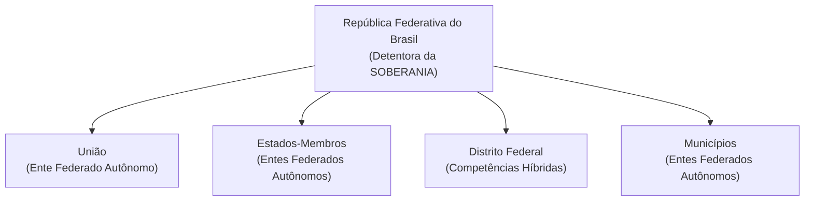

# 03 - Organização do Estado, Repartição de Competências e Servidores Públicos

> **Matéria:** Noções de Direito Constitucional  
> **Cargo:** A01 – Técnico de Controle Externo – Especialidade: Técnico Administrativo  
> **Arquivo:** `03_organizacao_do_estado_e_reparticao_de_competencias.md`  
> **Status:** 🟢 Teoria Aprofundada + 5 Questões FCC Comentadas (A a E)

---

## 📌 Ementa / Itens do Edital

- Da organização político-administrativa do Estado brasileiro (Artigos 18 e 19 da CF/88): forma federativa, autonomia dos entes e vedações federativas.
- Da União, dos Estados Federados, do Distrito Federal e dos Municípios: bens públicos, criação e desmembramento de entes, e competências materiais e legislativas.
- Repartição constitucional de competências:
    - Competências materiais exclusivas da União (Art. 21) e comuns de todos os entes (Art. 23);
    - Competências legislativas privativas da União (Art. 22) e concorrentes entre União, Estados e DF (Art. 24);
    - Competências remanescentes/residuais dos Estados (Art. 25) e competências de interesse local dos Municípios (Art. 30).
- Intervenção Federal e Estadual (Artigos 34 a 36 da CF/88): hipóteses, princípios sensíveis e procedimento.
- Regime constitucional da Administração Pública (Artigo 37 da CF/88): princípios fundamentais, concurso público, cargos em comissão e funções de confiança, teto remuneratório e regras de acumulação de cargos.
- Servidores públicos civis (Artigos 38 a 41 da CF/88): exercício de mandato eletivo, estágio probatório, estabilidade aos 3 anos, avaliação especial de desempenho e hipóteses constitucionais taxativas de perda do cargo público estável.

---

## 🧭 Sumário

1. [Forma Federativa e Organização Político-Administrativa](#1-forma-federativa-e-organizacao-politico-administrativa)
    1. [Características da Federação Brasileira e Autonomia dos Entes](#11-caracteristicas-da-federacao-brasileira-e-autonomia-dos-entes)
    2. [Vedações Constitucionais Federativas (Art. 19)](#12-vedacoes-constitucionais-federativas-art-19)
    3. [Bens Públicos Constitucionais e Criação de Novos Entes](#13-bens-publicos-constitucionais-e-criacao-de-novos-entes)
    4. [Teste 132](#Teste-132)
2. [O Modelo Constitucional de Repartição de Competências](#2-o-modelo-constitucional-de-reparticao-de-competencias)
    1. [Competências Legislativas: Privativa da União versus Concorrente](#21-competencias-legislativas-privativa-da-uniao-versus-concorrente)
    2. [Competências Administrativas: Exclusivas e Comuns](#22-competencias-administrativas-exclusivas-e-comuns)
    3. [Competências dos Estados e Municípios](#23-competencias-dos-estados-e-municipios)
    4. [Teste 133](#Teste-133)
    5. [Teste 134](#Teste-134)
    6. [Teste 135](#Teste-135)
    7. [Teste 136](#Teste-136)
3. [Mecanismos Excepcionais de Equilíbrio: Intervenção Federal e Estadual](#3-mecanismos-excepcionais-de-equilibrio-intervencao-federal-e-estadual)
    1. [Teste 137](#Teste-137)
4. [Regime Constitucional da Administração Pública e Servidores (Arts. 37 a 41)](#4-regime-constitucional-da-administracao-publica-e-servidores-arts-37-a-41)
    1. [Concurso Público, Funções de Confiança e Cargos em Comissão](#41-concurso-publico-funcoes-de-confianca-e-cargos-em-comissao)
    2. [Regra Constitucional da Não-Acumulação e Exceções (Art. 37, XVI)](#42-regra-constitucional-da-nao-acumulacao-e-excecoes-art-37-xvi)
    3. [Exercício de Mandato Eletivo pelo Servidor Público (Art. 38)](#43-exercicio-de-mandato-eletivo-pelo-servidor-publico-art-38)
    4. [Estabilidade e Perda do Cargo do Servidor Estável (Art. 41)](#44-estabilidade-e-perda-do-cargo-do-servidor-estavel-art-41)
    5. [Teste 138](#Teste-138)
    6. [Teste 139](#Teste-139)
    7. [Teste 140](#Teste-140)
    8. [Teste 141](#Teste-141)
    9. [Teste 142](#Teste-142)
5. [🌐 Fontes Oficiais & Doutrinárias Recomendadas](#fontes-oficiais-doutrinarias-recomendadas)

---

## 1. Forma Federativa e Organização Político-Administrativa

### 1.1 Características da Federação Brasileira e Autonomia dos Entes
A República Federativa do Brasil é formada pela união indissolúvel dos Estados e Municípios e do Distrito Federal (Art. 18, *caput*).

- **Origem Histórica:** Formou-se por **desagregação** (ou segregação), decorrente de um movimento **centrífugo** (o Estado unitário imperial descentralizou poderes políticos para as províncias que se transformaram em Estados-membros).
- **Indissolubilidade do Vínculo Federativo:** Não existe o direito de secessão (nenhum Estado ou Município pode se separar do Brasil). A tentativa de desmembramento justifica a intervenção federal imediata (art. 34, I) e constitui crime inafiançável e imprescritível (art. 5º, XLIV).
- **Soberania vs. Autonomia:**
    - A **Soberania** é atributo exclusivo da **República Federativa do Brasil** no plano internacional.
    - A **Autonomia** é outorgada aos entes federados (União, Estados, DF e Municípios), manifestando-se pela tríplice capacidade de auto-organização (Constituições e Leis Orgânicas), autogoverno (eleição de chefes dos poderes) e autoadministração (gestão e tributação próprias).

### 1.2 Vedações Constitucionais Federativas (Art. 19)
O art. 19 da Carta da República veda à União, aos Estados, ao Distrito Federal e aos Municípios:

1. **Estabelecer cultos religiosos ou igrejas, subvencioná-los, embaraçar-lhes o funcionamento ou manter com eles ou seus representantes relações de dependência ou aliança**, ressalvada, na forma da lei, a colaboração de interesse público *(Princípio da Laicidade Estatal)*.
2. **Recusar fé aos documentos públicos** *(Eficácia probatória nacional dos documentos emitidos por órgãos oficiais)*.
3. **Criar distinções entre brasileiros ou preferências entre si** *(Proibição de discriminação tributária, previdenciária ou funcional com base na origem regional)*.

### 1.3 Bens Públicos Constitucionais e Criação de Novos Entes
- **Bens da União (Art. 20):** Terras devolutas indispensáveis à defesa das fronteiras, recursos minerais (inclusive do subsolo), potenciais de energia hidráulica, mar territorial, terrenos de marinha e terras tradicionalmente ocupadas pelos índios.
- **Bens dos Estados (Art. 26):** Águas superficiais ou subterrâneas fluentes nos seus territórios, ilhas fluviais e lacustres não pertencentes à União e terras devolutas não compreendidas entre as da União.
- **Criação de Estados (Art. 18, § 3º):** Exige aprovação da população diretamente interessada por meio de **plebiscito** e edição de **Lei Complementar Federal** pelo Congresso Nacional.
- **Criação de Municípios (Art. 18, § 4º):** Depende de **Lei Complementar Federal** (definindo o período temporal), divulgação prévia dos Estudos de Viabilidade Municipal, consulta prévia por **plebiscito** às populações dos municípios envolvidos e promulgação de **Lei Ordinária Estadual**.

---

### Teste 001
**(FGV – TCE/GO – 2024 – Analista de Controle Externo - Ciências Contábeis)**
A Constituição Federal do Brasil, em seu artigo 71, estabelece que o controle externo das contas públicas será realizado pelo Congresso Nacional, com o auxílio do Tribunal de Contas da União (TCU). Assinale a opção que indica uma competência do TCU.

* **A)** avaliar a execução dos programas de governo.
* **B)** apreciar as contas prestadas anualmente pelo Governador.
* **C)** exercer o controle das operações de crédito, avais e garantias.
* **D)** fiscalizar a aplicação de quaisquer recursos repassados pela União mediante convênio a Estado.
* **E)** avaliar o cumprimento das metas previstas no plano plurianual.

---

> **Comentário Detalhado:**
>
> - **A)** **Incorreta.** A opção apresenta proposição em desacordo com os fundamentos teóricos e técnicos do tópico ao afirmar que "avaliar a execução dos programas de governo". De acordo com a teoria estudada em *1.1 Características da Federação Brasileira e Autonomia dos Entes*, a República Federativa do Brasil é formada pela união indissolúvel dos Estados e Municípios e do Distrito Federal (Art. 18, caput ).
> - **B)** **Incorreta.** A opção apresenta proposição em desacordo com os fundamentos teóricos e técnicos do tópico ao afirmar que "apreciar as contas prestadas anualmente pelo Governador". De acordo com a teoria estudada em *1.3 Bens Públicos Constitucionais e Criação de Novos Entes*, criação de Estados (Art. 18, § 3º): Exige aprovação da população diretamente interessada por meio de plebiscito e edição de Lei Complementar Federal pelo Congresso Nacional.
> - **C)** **Incorreta.** A opção apresenta proposição em desacordo com os fundamentos teóricos e técnicos do tópico ao afirmar que "exercer o controle das operações de crédito, avais e garantias". De acordo com a teoria estudada em *1.1 Características da Federação Brasileira e Autonomia dos Entes*, a Autonomia é outorgada aos entes federados (União, Estados, DF e Municípios), manifestando se pela tríplice capacidade de auto organização (Constituições e Leis Orgânicas), autogoverno (eleição de chefes dos poderes) e autoadministração (gestão e tributação próprias).
> - **D)** **Correta.** Conforme fundamentado na seção *1.3 Bens Públicos Constitucionais e Criação de Novos Entes* deste guia, bens da União (Art. 20): Terras devolutas indispensáveis à defesa das fronteiras, recursos minerais (inclusive do subsolo), potenciais de energia hidráulica, mar territorial, terrenos de marinha e terras tradicionalmente ocupadas pelos índios. Dessa forma, está plenamente correta a assertiva da banca (FGV – TCE/GO/2024) ao estabelecer que "fiscalizar a aplicação de quaisquer recursos repassados pela União mediante convênio a Estado".
> - **E)** **Incorreta.** A opção apresenta proposição em desacordo com os fundamentos teóricos e técnicos do tópico ao afirmar que "avaliar o cumprimento das metas previstas no plano plurianual". De acordo com a teoria estudada em *1.1 Características da Federação Brasileira e Autonomia dos Entes*, a Soberania é atributo exclusivo da República Federativa do Brasil no plano internacional.
>
> **Gabarito: D**

---

### Teste 002
**(FCC – TRT 9ª – 2015 – Analista Judiciário - Apoio Especializado - Tecnologia da Informação)**
Considere os itens abaixo: I. Promover o bem de todos, sem preconceito de origem, raça, sexo, cor, idade e quaisquer outras formas de discriminação. II. Fornecer saúde e educação à população. III. Garantir a segurança pública. IV. Garantir o desenvolvimento nacional. Nos termos da Constituição Federal, constituem objetivos fundamentais da República Federativa do Brasil o constante APENAS em

* **A)** I, II, III e IV.
* **B)** II, III e IV, apenas. assegurada ao proprietário indenização ulterior, se
* **C)** I e II, apenas. houver dano.
* **D)** III e IV, apenas.
* **E)** São asseguradas, nos termos da lei, a proteção às _________________________________________________________ participações individuais em obras coletivas e à re- produção da imagem e voz humanas, exceto nas ati- 24. Julgar os juízes estaduais, bem como os membros do Mi- vidades desportivas. nistério Público, nos crimes comuns e de responsabilida- _________________________________________________________ de, ressalvada a competência da Justiça Eleitoral, compete

---

> **Comentário Detalhado:**
>
> - **A)** **Correta.** Conforme fundamentado na seção *1.1 Características da Federação Brasileira e Autonomia dos Entes* deste guia, a República Federativa do Brasil é formada pela união indissolúvel dos Estados e Municípios e do Distrito Federal (Art. 18, caput ). Dessa forma, está plenamente correta a assertiva da banca (FCC – TRT 9ª/2015) ao estabelecer que "I, II, III e IV".
> - **B)** **Incorreta.** A opção incorre em restrição indevida ao limitar o escopo conceitual ao afirmar que "II, III e IV, apenas. assegurada ao proprietário indenização ulterior, se". De acordo com a teoria estudada em *1.1 Características da Federação Brasileira e Autonomia dos Entes*, a Soberania é atributo exclusivo da República Federativa do Brasil no plano internacional.
> - **C)** **Incorreta.** A opção incorre em restrição indevida ao limitar o escopo conceitual ao afirmar que "I e II, apenas. houver dano". De acordo com a teoria estudada em *1.1 Características da Federação Brasileira e Autonomia dos Entes*, rFB["República Federativa do Brasil<br/ (Detentora da SOBERANIA)"].
> - **D)** **Incorreta.** A opção incorre em restrição indevida ao limitar o escopo conceitual ao afirmar que "III e IV, apenas". De acordo com a teoria estudada em *1.2 Vedações Constitucionais Federativas (Art. 19)*, criar distinções entre brasileiros ou preferências entre si (Proibição de discriminação tributária, previdenciária ou funcional com base na origem regional).
> - **E)** **Incorreta.** A opção apresenta proposição em desacordo com os fundamentos teóricos e técnicos do tópico ao afirmar que "São asseguradas, nos termos da lei, a proteção às participações individuais em obras coletivas e à re produção da...". De acordo com a teoria estudada em *1.2 Vedações Constitucionais Federativas (Art. 19)*, estabelecer cultos religiosos ou igrejas, subvencioná los, embaraçar lhes o funcionamento ou manter com eles ou seus representantes relações de dependência ou aliança, ressalvada, na forma da lei, a colaboração de interesse público (Princípio da Laicidade Estatal).
>
> **Gabarito: A**

---

### Teste 003
**(FGV – TRT da 24º Região – 2025 – Analista Judiciário - Área Administrativa - Contabilidade)**
Ao apreciar recurso interposto contra o juízo monocrático de primeira instância, o relator, no âmbito da Turma competente do Tribunal Regional do Trabalho da 24ª Região (TRT-24), a partir de requerimento do Ministério Público, entendeu que se tratava de hipótese de assunção de competência. Nessa situação, à luz do Regimento Interno do TRT-24, assinale a afirmativa correta.

* **A)** A análise do recurso deve ser suspensa até que o Tribunal Pleno aprecie a matéria de direito.
* **B)** O Tribunal Pleno, preenchidos os requisitos exigidos, irá julgar o recurso interposto.
* **C)** O entendimento da Turma dará origem à instauração de requerimento de edição de súmula pelo Tribunal Pleno.
* **D)** Os demais processos sobre a mesma matéria em tramitação, na área de jurisdição do TRT-24, devem ser suspensos.
* **E)** O entendimento da Turma, sobre a questão de direito, deve ser aplicado aos demais processos que tenham por objeto a mesma questão de direito.

---

> **Comentário Detalhado:**
>
> - **A)** **Incorreta.** A opção apresenta proposição em desacordo com os fundamentos teóricos e técnicos do tópico ao afirmar que "A análise do recurso deve ser suspensa até que o Tribunal Pleno aprecie a matéria de direito". De acordo com a teoria estudada em *1.1 Características da Federação Brasileira e Autonomia dos Entes*, indissolubilidade do Vínculo Federativo: Não existe o direito de secessão (nenhum Estado ou Município pode se separar do Brasil). A tentativa de desmembramento justifica a intervenção federal imediata (art. 34, I) e constitui crime inafiançável e imprescritível (art. 5º, XLIV).
> - **B)** **Correta.** Conforme fundamentado na seção *1.2 Vedações Constitucionais Federativas (Art. 19)* deste guia, criar distinções entre brasileiros ou preferências entre si (Proibição de discriminação tributária, previdenciária ou funcional com base na origem regional). Dessa forma, está plenamente correta a assertiva da banca (FGV – TRT da 24º Região/2025) ao estabelecer que "O Tribunal Pleno, preenchidos os requisitos exigidos, irá julgar o recurso interposto".
> - **C)** **Incorreta.** A opção apresenta proposição em desacordo com os fundamentos teóricos e técnicos do tópico ao afirmar que "O entendimento da Turma dará origem à instauração de requerimento de edição de súmula pelo Tribunal Pleno". De acordo com a teoria estudada em *1.3 Bens Públicos Constitucionais e Criação de Novos Entes*, criação de Estados (Art. 18, § 3º): Exige aprovação da população diretamente interessada por meio de plebiscito e edição de Lei Complementar Federal pelo Congresso Nacional.
> - **D)** **Incorreta.** A opção apresenta proposição em desacordo com os fundamentos teóricos e técnicos do tópico ao afirmar que "Os demais processos sobre a mesma matéria em tramitação, na área de jurisdição do TRT 24, devem ser suspensos". De acordo com a teoria estudada em *1.1 Características da Federação Brasileira e Autonomia dos Entes*, a República Federativa do Brasil é formada pela união indissolúvel dos Estados e Municípios e do Distrito Federal (Art. 18, caput ).
> - **E)** **Incorreta.** A opção apresenta proposição em desacordo com os fundamentos teóricos e técnicos do tópico ao afirmar que "O entendimento da Turma, sobre a questão de direito, deve ser aplicado aos demais processos que tenham por objeto...". De acordo com a teoria estudada em *1.1 Características da Federação Brasileira e Autonomia dos Entes*, origem Histórica: Formou se por desagregação (ou segregação), decorrente de um movimento centrífugo (o Estado unitário imperial descentralizou poderes políticos para as províncias que se transformaram em Estados membros).
>
> **Gabarito: B**

---

### Teste 004
**(FGV – TCE/PA – 2024 – Auditor de Controle Externo - Administrativa - Gestão Governamental)**
De acordo com a Constituição Federal de 1988 (CRFB/88), pertencem aos Municípios

* **A)** cinquenta por cento do produto da arrecadação do imposto da União sobre renda e proventos de qualquer natureza, incidente na fonte sobre rendimentos pagos, a qualquer título, por eles, suas autarquias e pelas fundações que instituírem e mantiverem.
* **B)** cinquenta por cento do produto da arrecadação do imposto do Estado sobre a propriedade de veículos automotores licenciados em seus territórios.
* **C)** cem por cento do produto da arrecadação do imposto da União sobre a propriedade territorial rural, relativamente aos imóveis neles situados.
* **D)** vinte por cento do produto da arrecadação do imposto que a União instituir no exercício da competência que lhe é atribuída pelo Art. 154, I, CRFB/88 (impostos não-cumulativos e que não tenham fato gerador ou base de cálculo próprios dos discriminados na Constituição).
* **E)** cem por cento do produto da arrecadação de empréstimos compulsórios instituídos para atender despesas extraordinárias, decorrentes de calamidade pública ocorridas em seus territórios.

---

> **Comentário Detalhado:**
>
> - **A)** **Incorreta.** A opção promove generalização excessiva que desconsidera as condições técnicas e normativas ao afirmar que "cinquenta por cento do produto da arrecadação do imposto da União sobre renda e proventos de qualquer natureza...". De acordo com a teoria estudada em *1.1 Características da Federação Brasileira e Autonomia dos Entes*, a República Federativa do Brasil é formada pela união indissolúvel dos Estados e Municípios e do Distrito Federal (Art. 18, caput ).
> - **B)** **Correta.** Conforme fundamentado na seção *1.3 Bens Públicos Constitucionais e Criação de Novos Entes* deste guia, bens dos Estados (Art. 26): Águas superficiais ou subterrâneas fluentes nos seus territórios, ilhas fluviais e lacustres não pertencentes à União e terras devolutas não compreendidas entre as da União. Dessa forma, está plenamente correta a assertiva da banca (FGV – TCE/PA/2024) ao estabelecer que "cinquenta por cento do produto da arrecadação do imposto do Estado sobre a propriedade de veículos automotores...".
> - **C)** **Incorreta.** A opção apresenta proposição em desacordo com os fundamentos teóricos e técnicos do tópico ao afirmar que "cem por cento do produto da arrecadação do imposto da União sobre a propriedade territorial rural, relativamente...". De acordo com a teoria estudada em *1.3 Bens Públicos Constitucionais e Criação de Novos Entes*, bens da União (Art. 20): Terras devolutas indispensáveis à defesa das fronteiras, recursos minerais (inclusive do subsolo), potenciais de energia hidráulica, mar territorial, terrenos de marinha e terras tradicionalmente ocupadas pelos índios.
> - **D)** **Incorreta.** A opção apresenta proposição em desacordo com os fundamentos teóricos e técnicos do tópico ao afirmar que "vinte por cento do produto da arrecadação do imposto que a União instituir no exercício da competência que lhe é...". De acordo com a teoria estudada em *1.2 Vedações Constitucionais Federativas (Art. 19)*, criar distinções entre brasileiros ou preferências entre si (Proibição de discriminação tributária, previdenciária ou funcional com base na origem regional).
> - **E)** **Incorreta.** A opção apresenta proposição em desacordo com os fundamentos teóricos e técnicos do tópico ao afirmar que "cem por cento do produto da arrecadação de empréstimos compulsórios instituídos para atender despesas...". De acordo com a teoria estudada em *1.1 Características da Federação Brasileira e Autonomia dos Entes*, a Autonomia é outorgada aos entes federados (União, Estados, DF e Municípios), manifestando se pela tríplice capacidade de auto organização (Constituições e Leis Orgânicas), autogoverno (eleição de chefes dos poderes) e autoadministração (gestão e tributação próprias).
>
> **Gabarito: B**

---

### Teste 005
**(FGV – TCE/PI – 2025 – Auditor de Controle Externo - Controle Externo - Específica de Área Comum)**
A CRFB/88 estabelece: “Art. 167. São vedados: [...] IV. A vinculação de receita de impostos a órgão, fundo ou despesa, ressalvadas a repartição do produto da arrecadação dos impostos a que se referem os Arts. 158 e 159, a destinação de recursos para as ações e serviços públicos de saúde, para manutenção e desenvolvimento do ensino e para realização de atividades da administração tributária [...]” Com relação aos impostos e às vinculações, o princípio da Constituição Federal que o texto acima consagra é o

* **A)** do Equilíbrio.
* **B)** da Exclusividade.
* **C)** da Uniformidade.
* **D)** do Orçamento Bruto.
* **E)** da Não-Afetação das Receitas.

---

> **Comentário Detalhado:**
>
> - **A)** **Incorreta.** A opção apresenta proposição em desacordo com os fundamentos teóricos e técnicos do tópico ao afirmar que "do Equilíbrio". De acordo com a teoria estudada em *1.2 Vedações Constitucionais Federativas (Art. 19)*, estabelecer cultos religiosos ou igrejas, subvencioná los, embaraçar lhes o funcionamento ou manter com eles ou seus representantes relações de dependência ou aliança, ressalvada, na forma da lei, a colaboração de interesse público (Princípio da Laicidade Estatal).
> - **B)** **Incorreta.** A opção apresenta proposição em desacordo com os fundamentos teóricos e técnicos do tópico ao afirmar que "da Exclusividade". De acordo com a teoria estudada em *1.2 Vedações Constitucionais Federativas (Art. 19)*, criar distinções entre brasileiros ou preferências entre si (Proibição de discriminação tributária, previdenciária ou funcional com base na origem regional).
> - **C)** **Incorreta.** A opção apresenta proposição em desacordo com os fundamentos teóricos e técnicos do tópico ao afirmar que "da Uniformidade". De acordo com a teoria estudada em *1.2 Vedações Constitucionais Federativas (Art. 19)*, recusar fé aos documentos públicos (Eficácia probatória nacional dos documentos emitidos por órgãos oficiais).
> - **D)** **Incorreta.** A opção apresenta proposição em desacordo com os fundamentos teóricos e técnicos do tópico ao afirmar que "do Orçamento Bruto". De acordo com a teoria estudada em *1.3 Bens Públicos Constitucionais e Criação de Novos Entes*, bens dos Estados (Art. 26): Águas superficiais ou subterrâneas fluentes nos seus territórios, ilhas fluviais e lacustres não pertencentes à União e terras devolutas não compreendidas entre as da União.
> - **E)** **Correta.** Conforme fundamentado na seção *1.3 Bens Públicos Constitucionais e Criação de Novos Entes* deste guia, bens da União (Art. 20): Terras devolutas indispensáveis à defesa das fronteiras, recursos minerais (inclusive do subsolo), potenciais de energia hidráulica, mar territorial, terrenos de marinha e terras tradicionalmente ocupadas pelos índios. Dessa forma, está plenamente correta a assertiva da banca (FGV – TCE/PI/2025) ao estabelecer que "da Não Afetação das Receitas".
>
> **Gabarito: E**

---

### Teste 006
**(FGV – TCE/PI – 2025 – Auditor de Controle Externo - Controle Externo - Específica de Área Comum)**
Considere os atores do Estado do Piauí listados a seguir. I. Fundação Pública Estadual de direito privado Alfa. II. Ministério Público do Estado do Piauí. III. Empresa Pública Federal Beta, sediada em Teresina/PI. IV. João, Secretário de Estado do Piauí, ordenador de despesas. V. Ordem dos Advogados do Brasil, seccional Piauí. Acerca da competência das Cortes de Contas, os atores que estão sujeitos ao controle externo exercido pelo Tribunal de Contas do Estado do Piauí são

* **A)** III e IV, apenas.
* **B)** III e V, apenas.
* **C)** I, II e IV, apenas.
* **D)** I, II e III, apenas.
* **E)** I, II, III e V, apenas.

---

> **Comentário Detalhado:**
>
> - **A)** **Incorreta.** A opção incorre em restrição indevida ao limitar o escopo conceitual ao afirmar que "III e IV, apenas". De acordo com a teoria estudada em *1.3 Bens Públicos Constitucionais e Criação de Novos Entes*, criação de Municípios (Art. 18, § 4º): Depende de Lei Complementar Federal (definindo o período temporal), divulgação prévia dos Estudos de Viabilidade Municipal, consulta prévia por plebiscito às populações dos municípios envolvidos e promulgação de Lei Ordinária Estadual.
> - **B)** **Incorreta.** A opção incorre em restrição indevida ao limitar o escopo conceitual ao afirmar que "III e V, apenas". De acordo com a teoria estudada em *1.1 Características da Federação Brasileira e Autonomia dos Entes*, a República Federativa do Brasil é formada pela união indissolúvel dos Estados e Municípios e do Distrito Federal (Art. 18, caput ).
> - **C)** **Correta.** Conforme fundamentado na seção *1.1 Características da Federação Brasileira e Autonomia dos Entes* deste guia, indissolubilidade do Vínculo Federativo: Não existe o direito de secessão (nenhum Estado ou Município pode se separar do Brasil). A tentativa de desmembramento justifica a intervenção federal imediata (art. 34, I) e constitui crime inafiançável e imprescritível (art. 5º, XLIV). Dessa forma, está plenamente correta a assertiva da banca (FGV – TCE/PI/2025) ao estabelecer que "I, II e IV, apenas".
> - **D)** **Incorreta.** A opção incorre em restrição indevida ao limitar o escopo conceitual ao afirmar que "I, II e III, apenas". De acordo com a teoria estudada em *1.1 Características da Federação Brasileira e Autonomia dos Entes*, a Soberania é atributo exclusivo da República Federativa do Brasil no plano internacional.
> - **E)** **Incorreta.** A opção incorre em restrição indevida ao limitar o escopo conceitual ao afirmar que "I, II, III e V, apenas". De acordo com a teoria estudada em *1.1 Características da Federação Brasileira e Autonomia dos Entes*, rFB["República Federativa do Brasil<br/ (Detentora da SOBERANIA)"].
>
> **Gabarito: C**

---

### Teste 007
**(FGV – TCE/SC – 2026 – Auditor Fiscal de Controle Externo - Direito)**
Nos termos do texto constitucional, lei complementar instituirá o imposto sobre bens e serviços de competência compartilhada entre Estados, Distrito Federal e Municípios, o qual será informado pelo princípio da neutralidade. A respeito do tema, considerando as disposições da Constituição Federal, avalie as afirmativas a seguir. I. Incidirá sobre a importação de bens materiais ou imateriais, inclusive direitos, ou de serviços, realizada por pessoa física ou jurídica, ainda que não seja sujeito passivo habitual do imposto, qualquer que seja a sua finalidade. II. Será não cumulativo, compensando o imposto devido pelo contribuinte com o montante cobrado sobre todas as operações nas quais seja adquirente de bem material ou imaterial, inclusive direito, ou de serviço, excetuadas exclusivamente as consideradas de uso ou consumo pessoal, especificadas em lei complementar e as hipóteses previstas na Constituição. III. Será cobrado pelo somatório das alíquotas do Estado e do Município de destino da operação. Nesse cenário, considerando as disposições da Constituição Federal, o referido imposto atenderá ao que se afirma em

* **A)** I, apenas.
* **B)** II, apenas.
* **C)** III, apenas.
* **D)** I e III, apenas.
* **E)** I, II e III.

---

> **Comentário Detalhado:**
>
> - **A)** **Incorreta.** A opção incorre em restrição indevida ao limitar o escopo conceitual ao afirmar que "I, apenas". De acordo com a teoria estudada em *1.3 Bens Públicos Constitucionais e Criação de Novos Entes*, criação de Estados (Art. 18, § 3º): Exige aprovação da população diretamente interessada por meio de plebiscito e edição de Lei Complementar Federal pelo Congresso Nacional.
> - **B)** **Correta.** Conforme fundamentado na seção *1.3 Bens Públicos Constitucionais e Criação de Novos Entes* deste guia, criação de Municípios (Art. 18, § 4º): Depende de Lei Complementar Federal (definindo o período temporal), divulgação prévia dos Estudos de Viabilidade Municipal, consulta prévia por plebiscito às populações dos municípios envolvidos e promulgação de Lei Ordinária Estadual. Dessa forma, está plenamente correta a assertiva da banca (FGV – TCE/SC/2026) ao estabelecer que "II, apenas".
> - **C)** **Incorreta.** A opção incorre em restrição indevida ao limitar o escopo conceitual ao afirmar que "III, apenas". De acordo com a teoria estudada em *1.1 Características da Federação Brasileira e Autonomia dos Entes*, indissolubilidade do Vínculo Federativo: Não existe o direito de secessão (nenhum Estado ou Município pode se separar do Brasil). A tentativa de desmembramento justifica a intervenção federal imediata (art. 34, I) e constitui crime inafiançável e imprescritível (art. 5º, XLIV).
> - **D)** **Incorreta.** A opção incorre em restrição indevida ao limitar o escopo conceitual ao afirmar que "I e III, apenas". De acordo com a teoria estudada em *1.2 Vedações Constitucionais Federativas (Art. 19)*, estabelecer cultos religiosos ou igrejas, subvencioná los, embaraçar lhes o funcionamento ou manter com eles ou seus representantes relações de dependência ou aliança, ressalvada, na forma da lei, a colaboração de interesse público (Princípio da Laicidade Estatal).
> - **E)** **Incorreta.** A opção apresenta proposição em desacordo com os fundamentos teóricos e técnicos do tópico ao afirmar que "I, II e III". De acordo com a teoria estudada em *1.3 Bens Públicos Constitucionais e Criação de Novos Entes*, bens da União (Art. 20): Terras devolutas indispensáveis à defesa das fronteiras, recursos minerais (inclusive do subsolo), potenciais de energia hidráulica, mar territorial, terrenos de marinha e terras tradicionalmente ocupadas pelos índios.
>
> **Gabarito: B**

---

