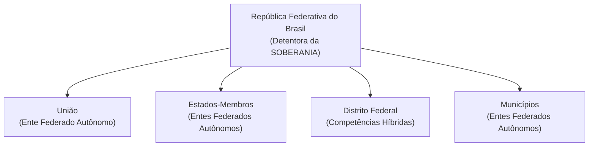

# 03 - Organização do Estado, Repartição de Competências e Servidores Públicos

> **Matéria:** Noções de Direito Constitucional  
> **Cargo:** A01 – Técnico de Controle Externo – Especialidade: Técnico Administrativo  
> **Arquivo:** `03_organizacao_do_estado_e_reparticao_de_competencias.md`  
> **Status:** 🟢 Teoria Aprofundada + 5 Questões FCC Comentadas (A a E)

---

## 📌 Ementa / Itens do Edital

- Da organização político-administrativa do Estado brasileiro (Artigos 18 e 19 da CF/88): forma federativa, autonomia dos entes e vedações federativas.
- Da União, dos Estados Federados, do Distrito Federal e dos Municípios: bens públicos, criação e desmembramento de entes, e competências materiais e legislativas.
- Repartição constitucional de competências:
    - Competências materiais exclusivas da União (Art. 21) e comuns de todos os entes (Art. 23);
    - Competências legislativas privativas da União (Art. 22) e concorrentes entre União, Estados e DF (Art. 24);
    - Competências remanescentes/residuais dos Estados (Art. 25) e competências de interesse local dos Municípios (Art. 30).
- Intervenção Federal e Estadual (Artigos 34 a 36 da CF/88): hipóteses, princípios sensíveis e procedimento.
- Regime constitucional da Administração Pública (Artigo 37 da CF/88): princípios fundamentais, concurso público, cargos em comissão e funções de confiança, teto remuneratório e regras de acumulação de cargos.
- Servidores públicos civis (Artigos 38 a 41 da CF/88): exercício de mandato eletivo, estágio probatório, estabilidade aos 3 anos, avaliação especial de desempenho e hipóteses constitucionais taxativas de perda do cargo público estável.

---

## 🧭 Sumário

1. [Forma Federativa e Organização Político-Administrativa](#1-forma-federativa-e-organizacao-politico-administrativa)
    1. [Características da Federação Brasileira e Autonomia dos Entes](#11-caracteristicas-da-federacao-brasileira-e-autonomia-dos-entes)
    2. [Vedações Constitucionais Federativas (Art. 19)](#12-vedacoes-constitucionais-federativas-art-19)
    3. [Bens Públicos Constitucionais e Criação de Novos Entes](#13-bens-publicos-constitucionais-e-criacao-de-novos-entes)
    4. [Teste 132](#Teste-132)
2. [O Modelo Constitucional de Repartição de Competências](#2-o-modelo-constitucional-de-reparticao-de-competencias)
    1. [Competências Legislativas: Privativa da União versus Concorrente](#21-competencias-legislativas-privativa-da-uniao-versus-concorrente)
    2. [Competências Administrativas: Exclusivas e Comuns](#22-competencias-administrativas-exclusivas-e-comuns)
    3. [Competências dos Estados e Municípios](#23-competencias-dos-estados-e-municipios)
    4. [Teste 133](#Teste-133)
    5. [Teste 134](#Teste-134)
    6. [Teste 135](#Teste-135)
    7. [Teste 136](#Teste-136)
3. [Mecanismos Excepcionais de Equilíbrio: Intervenção Federal e Estadual](#3-mecanismos-excepcionais-de-equilibrio-intervencao-federal-e-estadual)
    1. [Teste 137](#Teste-137)
4. [Regime Constitucional da Administração Pública e Servidores (Arts. 37 a 41)](#4-regime-constitucional-da-administracao-publica-e-servidores-arts-37-a-41)
    1. [Concurso Público, Funções de Confiança e Cargos em Comissão](#41-concurso-publico-funcoes-de-confianca-e-cargos-em-comissao)
    2. [Regra Constitucional da Não-Acumulação e Exceções (Art. 37, XVI)](#42-regra-constitucional-da-nao-acumulacao-e-excecoes-art-37-xvi)
    3. [Exercício de Mandato Eletivo pelo Servidor Público (Art. 38)](#43-exercicio-de-mandato-eletivo-pelo-servidor-publico-art-38)
    4. [Estabilidade e Perda do Cargo do Servidor Estável (Art. 41)](#44-estabilidade-e-perda-do-cargo-do-servidor-estavel-art-41)
    5. [Teste 138](#Teste-138)
    6. [Teste 139](#Teste-139)
    7. [Teste 140](#Teste-140)
    8. [Teste 141](#Teste-141)
    9. [Teste 142](#Teste-142)
5. [🌐 Fontes Oficiais & Doutrinárias Recomendadas](#fontes-oficiais-doutrinarias-recomendadas)

---

## 1. Forma Federativa e Organização Político-Administrativa

### 1.1 Características da Federação Brasileira e Autonomia dos Entes
A República Federativa do Brasil é formada pela união indissolúvel dos Estados e Municípios e do Distrito Federal (Art. 18, *caput*).

- **Origem Histórica:** Formou-se por **desagregação** (ou segregação), decorrente de um movimento **centrífugo** (o Estado unitário imperial descentralizou poderes políticos para as províncias que se transformaram em Estados-membros).
- **Indissolubilidade do Vínculo Federativo:** Não existe o direito de secessão (nenhum Estado ou Município pode se separar do Brasil). A tentativa de desmembramento justifica a intervenção federal imediata (art. 34, I) e constitui crime inafiançável e imprescritível (art. 5º, XLIV).
- **Soberania vs. Autonomia:**
    - A **Soberania** é atributo exclusivo da **República Federativa do Brasil** no plano internacional.
    - A **Autonomia** é outorgada aos entes federados (União, Estados, DF e Municípios), manifestando-se pela tríplice capacidade de auto-organização (Constituições e Leis Orgânicas), autogoverno (eleição de chefes dos poderes) e autoadministração (gestão e tributação próprias).

### 1.2 Vedações Constitucionais Federativas (Art. 19)
O art. 19 da Carta da República veda à União, aos Estados, ao Distrito Federal e aos Municípios:

1. **Estabelecer cultos religiosos ou igrejas, subvencioná-los, embaraçar-lhes o funcionamento ou manter com eles ou seus representantes relações de dependência ou aliança**, ressalvada, na forma da lei, a colaboração de interesse público *(Princípio da Laicidade Estatal)*.
2. **Recusar fé aos documentos públicos** *(Eficácia probatória nacional dos documentos emitidos por órgãos oficiais)*.
3. **Criar distinções entre brasileiros ou preferências entre si** *(Proibição de discriminação tributária, previdenciária ou funcional com base na origem regional)*.

### 1.3 Bens Públicos Constitucionais e Criação de Novos Entes
- **Bens da União (Art. 20):** Terras devolutas indispensáveis à defesa das fronteiras, recursos minerais (inclusive do subsolo), potenciais de energia hidráulica, mar territorial, terrenos de marinha e terras tradicionalmente ocupadas pelos índios.
- **Bens dos Estados (Art. 26):** Águas superficiais ou subterrâneas fluentes nos seus territórios, ilhas fluviais e lacustres não pertencentes à União e terras devolutas não compreendidas entre as da União.
- **Criação de Estados (Art. 18, § 3º):** Exige aprovação da população diretamente interessada por meio de **plebiscito** e edição de **Lei Complementar Federal** pelo Congresso Nacional.
- **Criação de Municípios (Art. 18, § 4º):** Depende de **Lei Complementar Federal** (definindo o período temporal), divulgação prévia dos Estudos de Viabilidade Municipal, consulta prévia por **plebiscito** às populações dos municípios envolvidos e promulgação de **Lei Ordinária Estadual**.

---

### Teste 001
**(FGV – TJ/SC – 2026 – Analista Administrativo)**
Na empresa ABC, a área de Gestão de Pessoas consolidou os resultados do ciclo anual de avaliação de desempenho. Após a etapa de consolidação, o gestor de uma equipe é convocado pelo especialista da área para receber subsídios estruturados sobre cada um de seus liderados, de modo a conduzir, ao longo do próximo ciclo, sessões individuais de orientação profissional, com utilização de técnicas de coaching e mentoring adaptadas a cada perfil identificado. Considerando as razões pelas quais as organizações avaliam o desempenho de seus talentos, a finalidade da avaliação a que essa entrega de subsídios está diretamente associada é denominada

* **A)** recompensa.
* **B)** retroação.
* **C)** aconselhamento.
* **D)** percepção.
* **E)** potencial de desenvolvimento.

---

> **Comentário Detalhado:**
>
> - **A)** **Incorreta.** A opção apresenta proposição em desacordo com os fundamentos teóricos e técnicos do tópico ao afirmar que "recompensa". De acordo com a teoria estudada em *1.3 Bens Públicos Constitucionais e Criação de Novos Entes*, criação de Estados (Art. 18, § 3º): Exige aprovação da população diretamente interessada por meio de plebiscito e edição de Lei Complementar Federal pelo Congresso Nacional.
> - **B)** **Incorreta.** A opção apresenta proposição em desacordo com os fundamentos teóricos e técnicos do tópico ao afirmar que "retroação". De acordo com a teoria estudada em *Fundamentos Teóricos*, status: 🟢 Teoria Aprofundada + 5 Questões FCC Comentadas (A a E).
> - **C)** **Correta.** Conforme fundamentado na seção *1.1 Características da Federação Brasileira e Autonomia dos Entes* deste guia, a Autonomia é outorgada aos entes federados (União, Estados, DF e Municípios), manifestando se pela tríplice capacidade de auto organização (Constituições e Leis Orgânicas), autogoverno (eleição de chefes dos poderes) e autoadministração (gestão e tributação próprias). Dessa forma, está plenamente correta a assertiva da banca (FGV – TJ/SC/2026) ao estabelecer que "aconselhamento".
> - **D)** **Incorreta.** A opção apresenta proposição em desacordo com os fundamentos teóricos e técnicos do tópico ao afirmar que "percepção". De acordo com a teoria estudada em *1.1 Características da Federação Brasileira e Autonomia dos Entes*, a República Federativa do Brasil é formada pela união indissolúvel dos Estados e Municípios e do Distrito Federal (Art. 18, caput ).
> - **E)** **Incorreta.** A opção apresenta proposição em desacordo com os fundamentos teóricos e técnicos do tópico ao afirmar que "potencial de desenvolvimento". De acordo com a teoria estudada em *1.1 Características da Federação Brasileira e Autonomia dos Entes*, origem Histórica: Formou se por desagregação (ou segregação), decorrente de um movimento centrífugo (o Estado unitário imperial descentralizou poderes políticos para as províncias que se transformaram em Estados membros).
>
> **Gabarito: C**

---

### Teste 002
**(FGV – TJ/SC – 2026 – Analista Administrativo)**
O Tribunal de Contas de determinado Estado, em resposta à consulta, emitiu parecer recomendando a exclusão do imposto de renda retido na fonte (IRRF) incidente sobre a folha de pagamento dos servidores públicos, do cálculo da receita corrente líquida e do limite de despesa com pessoal. À luz da Constituição Federal, da Lei de Responsabilidade Fiscal e da jurisprudência, é correto afirmar que o IRRF

* **A)** não compõe a receita corrente líquida, nem integra o limite de despesa com pessoal.
* **B)** compõe a receita corrente líquida, mas não integra o limite de despesa com pessoal.
* **C)** não compõe a receita corrente líquida, mas integra o limite de despesa com pessoal.
* **D)** compõe a receita corrente líquida e integra o limite de despesa com pessoal.
* **E)** pode ser excluído desses cálculos por ato normativo estadual, desde que haja previsão em lei local.

---

> **Comentário Detalhado:**
>
> - **A)** **Incorreta.** A opção apresenta proposição em desacordo com os fundamentos teóricos e técnicos do tópico ao afirmar que "não compõe a receita corrente líquida, nem integra o limite de despesa com pessoal". De acordo com a teoria estudada em *1.3 Bens Públicos Constitucionais e Criação de Novos Entes*, criação de Estados (Art. 18, § 3º): Exige aprovação da população diretamente interessada por meio de plebiscito e edição de Lei Complementar Federal pelo Congresso Nacional.
> - **B)** **Incorreta.** A opção apresenta proposição em desacordo com os fundamentos teóricos e técnicos do tópico ao afirmar que "compõe a receita corrente líquida, mas não integra o limite de despesa com pessoal". De acordo com a teoria estudada em *1.2 Vedações Constitucionais Federativas (Art. 19)*, estabelecer cultos religiosos ou igrejas, subvencioná los, embaraçar lhes o funcionamento ou manter com eles ou seus representantes relações de dependência ou aliança, ressalvada, na forma da lei, a colaboração de interesse público (Princípio da Laicidade Estatal).
> - **C)** **Incorreta.** A opção apresenta proposição em desacordo com os fundamentos teóricos e técnicos do tópico ao afirmar que "não compõe a receita corrente líquida, mas integra o limite de despesa com pessoal". De acordo com a teoria estudada em *1.2 Vedações Constitucionais Federativas (Art. 19)*, recusar fé aos documentos públicos (Eficácia probatória nacional dos documentos emitidos por órgãos oficiais).
> - **D)** **Correta.** Conforme fundamentado na seção *1.3 Bens Públicos Constitucionais e Criação de Novos Entes* deste guia, criação de Municípios (Art. 18, § 4º): Depende de Lei Complementar Federal (definindo o período temporal), divulgação prévia dos Estudos de Viabilidade Municipal, consulta prévia por plebiscito às populações dos municípios envolvidos e promulgação de Lei Ordinária Estadual. Dessa forma, está plenamente correta a assertiva da banca (FGV – TJ/SC/2026) ao estabelecer que "compõe a receita corrente líquida e integra o limite de despesa com pessoal".
> - **E)** **Incorreta.** A opção apresenta proposição em desacordo com os fundamentos teóricos e técnicos do tópico ao afirmar que "pode ser excluído desses cálculos por ato normativo estadual, desde que haja previsão em lei local". De acordo com a teoria estudada em *1.1 Características da Federação Brasileira e Autonomia dos Entes*, indissolubilidade do Vínculo Federativo: Não existe o direito de secessão (nenhum Estado ou Município pode se separar do Brasil). A tentativa de desmembramento justifica a intervenção federal imediata (art. 34, I) e constitui crime inafiançável e imprescritível (art. 5º, XLIV).
>
> **Gabarito: D**

---

### Teste 003
**(FGV – TCE/GO – 2024 – Analista de Controle Externo - Ciências Contábeis)**
Maria, servidora ocupante de cargo de provimento efetivo no âmbito do Estado Alfa, e que se encontrava na segunda classe de sua carreira, tomou conhecimento de que estavam sendo realizados estudos, ainda embrionários, em relação à possibilidade de a sua sistemática estipendial ser alterada para o formato de subsídios. Ao se inteirar dos balizamentos constitucionais afetos a essa temática, Maria concluiu corretamente que

* **A)** somente os agentes políticos estão sujeitos à sistemática de subsídios, logo, não pode ser aplicada a ela.
* **B)** caso a sistemática de subsídios seja implementada, deve ser assegurado o direito de opção aos servidores que já ocupam cargos públicos.
* **C)** há mora legislativa do Estado Alfa, pois é obrigatória a submissão, à sistemática de subsídios, dos servidores organizados em carreira.
* **D)** subsídio é apenas um designativo atribuído à retribuição estipendial paga aos servidores, logo, sua implementação não afetará a situação jurídica dela.
* **E)** não há óbice a que a sistemática de subsídios seja estendida a servidores como Maria, mas, nesse caso, ela não poderá receber adicional por tempo de serviço.

---

> **Comentário Detalhado:**
>
> - **A)** **Incorreta.** A opção incorre em restrição indevida ao limitar o escopo conceitual ao afirmar que "somente os agentes políticos estão sujeitos à sistemática de subsídios, logo, não pode ser aplicada a ela". De acordo com a teoria estudada em *1.1 Características da Federação Brasileira e Autonomia dos Entes*, origem Histórica: Formou se por desagregação (ou segregação), decorrente de um movimento centrífugo (o Estado unitário imperial descentralizou poderes políticos para as províncias que se transformaram em Estados membros).
> - **B)** **Incorreta.** A opção apresenta proposição em desacordo com os fundamentos teóricos e técnicos do tópico ao afirmar que "caso a sistemática de subsídios seja implementada, deve ser assegurado o direito de opção aos servidores que já...". De acordo com a teoria estudada em *1.1 Características da Federação Brasileira e Autonomia dos Entes*, indissolubilidade do Vínculo Federativo: Não existe o direito de secessão (nenhum Estado ou Município pode se separar do Brasil). A tentativa de desmembramento justifica a intervenção federal imediata (art. 34, I) e constitui crime inafiançável e imprescritível (art. 5º, XLIV).
> - **C)** **Incorreta.** A opção apresenta proposição em desacordo com os fundamentos teóricos e técnicos do tópico ao afirmar que "há mora legislativa do Estado Alfa, pois é obrigatória a submissão, à sistemática de subsídios, dos servidores...". De acordo com a teoria estudada em *1.2 Vedações Constitucionais Federativas (Art. 19)*, o art. 19 da Carta da República veda à União, aos Estados, ao Distrito Federal e aos Municípios.
> - **D)** **Incorreta.** A opção incorre em restrição indevida ao limitar o escopo conceitual ao afirmar que "subsídio é apenas um designativo atribuído à retribuição estipendial paga aos servidores, logo, sua implementação...". De acordo com a teoria estudada em *1.2 Vedações Constitucionais Federativas (Art. 19)*, estabelecer cultos religiosos ou igrejas, subvencioná los, embaraçar lhes o funcionamento ou manter com eles ou seus representantes relações de dependência ou aliança, ressalvada, na forma da lei, a colaboração de interesse público (Princípio da Laicidade Estatal).
> - **E)** **Correta.** Conforme fundamentado na seção *1.3 Bens Públicos Constitucionais e Criação de Novos Entes* deste guia, criação de Municípios (Art. 18, § 4º): Depende de Lei Complementar Federal (definindo o período temporal), divulgação prévia dos Estudos de Viabilidade Municipal, consulta prévia por plebiscito às populações dos municípios envolvidos e promulgação de Lei Ordinária Estadual. Dessa forma, está plenamente correta a assertiva da banca (FGV – TCE/GO/2024) ao estabelecer que "não há óbice a que a sistemática de subsídios seja estendida a servidores como Maria, mas, nesse caso, ela não...".
>
> **Gabarito: E**

---

### Teste 004
**(FCC – TRT 9ª – 2015 – Analista Judiciário - Apoio Especializado - Tecnologia da Informação)**
No que se refere às regras constitucionais aplicáveis à Administração pública, é VEDADO

* **A)** direta, não estando sujeita aos mesmos princípios a Administração pública indireta e o Poder Judiciário, em razão do princípio da separação dos poderes.
* **B)** pública direta e indireta, não abarcando o Poder Judiciário e Legislativo, mesmo no exercício atípico da função admi- nistrativa, em razão do princípio da estrita legalidade.
* **C)** pública direta e indireta de qualquer dos Poderes da União, dos Estados, do Distrito Federal e dos Municípios.
* **D)** pública direta e indireta dos Poderes Executivo e Judiciário, excluído o Poder Legislativo, em razão da submissão ao Tribunal de Contas.
* **E)** pública direta de qualquer dos Poderes da União, dos Estados, do Distrito Federal e dos Municípios, excluindo a administração pública indireta, por estar sujeita a regime de direito privado.

---

> **Comentário Detalhado:**
>
> - **A)** **Incorreta.** A opção apresenta proposição em desacordo com os fundamentos teóricos e técnicos do tópico ao afirmar que "direta, não estando sujeita aos mesmos princípios a Administração pública indireta e o Poder Judiciário, em razão...". De acordo com a teoria estudada em *1.2 Vedações Constitucionais Federativas (Art. 19)*, o art. 19 da Carta da República veda à União, aos Estados, ao Distrito Federal e aos Municípios.
> - **B)** **Incorreta.** A opção apresenta proposição em desacordo com os fundamentos teóricos e técnicos do tópico ao afirmar que "pública direta e indireta, não abarcando o Poder Judiciário e Legislativo, mesmo no exercício atípico da função...". De acordo com a teoria estudada em *1.1 Características da Federação Brasileira e Autonomia dos Entes*, a República Federativa do Brasil é formada pela união indissolúvel dos Estados e Municípios e do Distrito Federal (Art. 18, caput ).
> - **C)** **Incorreta.** A opção promove generalização excessiva que desconsidera as condições técnicas e normativas ao afirmar que "pública direta e indireta de qualquer dos Poderes da União, dos Estados, do Distrito Federal e dos Municípios". De acordo com a teoria estudada em *1.1 Características da Federação Brasileira e Autonomia dos Entes*, origem Histórica: Formou se por desagregação (ou segregação), decorrente de um movimento centrífugo (o Estado unitário imperial descentralizou poderes políticos para as províncias que se transformaram em Estados membros).
> - **D)** **Incorreta.** A opção apresenta proposição em desacordo com os fundamentos teóricos e técnicos do tópico ao afirmar que "pública direta e indireta dos Poderes Executivo e Judiciário, excluído o Poder Legislativo, em razão da submissão...". De acordo com a teoria estudada em *1.1 Características da Federação Brasileira e Autonomia dos Entes*, indissolubilidade do Vínculo Federativo: Não existe o direito de secessão (nenhum Estado ou Município pode se separar do Brasil). A tentativa de desmembramento justifica a intervenção federal imediata (art. 34, I) e constitui crime inafiançável e imprescritível (art. 5º, XLIV).
> - **E)** **Correta.** Conforme fundamentado na seção *1.1 Características da Federação Brasileira e Autonomia dos Entes* deste guia, a Autonomia é outorgada aos entes federados (União, Estados, DF e Municípios), manifestando se pela tríplice capacidade de auto organização (Constituições e Leis Orgânicas), autogoverno (eleição de chefes dos poderes) e autoadministração (gestão e tributação próprias). Dessa forma, está plenamente correta a assertiva da banca (FCC – TRT 9ª/2015) ao estabelecer que "pública direta de qualquer dos Poderes da União, dos Estados, do Distrito Federal e dos Municípios, excluindo a...".
>
> **Gabarito: E**

---

### Teste 005
**(FCC – TRT 9ª – 2015 – Analista Judiciário - Apoio Especializado - Tecnologia da Informação)**
A Constituição Federal emprega os termos cargo, emprego e função pública em dispositivos diversos, referindo-se a vínculos mantidos com a Administração pública, sujeitos a regimes jurídicos distintos. Por sua vez, a Lei no 8.112/1990 dispõe sobre o regime jurídico dos servidores públicos civis da União, autarquias e fundações públicas federais. Para efeitos dessa Lei, são servidores públicos os ocupantes de cargo

* **A)** e emprego público e os que exercem função pública, investidos por meio de concurso público de provas ou de provas e títulos, distinguindo-se uns dos outros pela natureza do vínculo mantido com a Administração pública federal.
* **B)** e emprego público, investidos por meio de concurso público, excluindo-se os que exercem função pública, porquanto estes últimos não ingressam no serviço público por meio de prévia habilitação em regular concurso público.
* **C)** e emprego público, investidos por meio de regular concurso público e os contratados temporariamente, com base no artigo 37, IX, da CF, para qual não se exige, necessariamente, concurso público.
* **D)** público, investidos por meio de regular concurso público e os nomeados para cargo em comissão, de livre nomeação e exoneração.
* **E)** público, investidos por meio de regular concurso público, excluindo-se os nomeados para cargo em comissão, de livre nomeação e exoneração.

---

> **Comentário Detalhado:**
>
> - **A)** **Incorreta.** A opção apresenta proposição em desacordo com os fundamentos teóricos e técnicos do tópico ao afirmar que "e emprego público e os que exercem função pública, investidos por meio de concurso público de provas ou de provas...". De acordo com a teoria estudada em *1.1 Características da Federação Brasileira e Autonomia dos Entes*, indissolubilidade do Vínculo Federativo: Não existe o direito de secessão (nenhum Estado ou Município pode se separar do Brasil). A tentativa de desmembramento justifica a intervenção federal imediata (art. 34, I) e constitui crime inafiançável e imprescritível (art. 5º, XLIV).
> - **B)** **Incorreta.** A opção apresenta proposição em desacordo com os fundamentos teóricos e técnicos do tópico ao afirmar que "e emprego público, investidos por meio de concurso público, excluindo se os que exercem função pública, porquanto...". De acordo com a teoria estudada em *1.3 Bens Públicos Constitucionais e Criação de Novos Entes*, criação de Municípios (Art. 18, § 4º): Depende de Lei Complementar Federal (definindo o período temporal), divulgação prévia dos Estudos de Viabilidade Municipal, consulta prévia por plebiscito às populações dos municípios envolvidos e promulgação de Lei Ordinária Estadual.
> - **C)** **Incorreta.** A opção apresenta proposição em desacordo com os fundamentos teóricos e técnicos do tópico ao afirmar que "e emprego público, investidos por meio de regular concurso público e os contratados temporariamente, com base no...". De acordo com a teoria estudada em *1.2 Vedações Constitucionais Federativas (Art. 19)*, criar distinções entre brasileiros ou preferências entre si (Proibição de discriminação tributária, previdenciária ou funcional com base na origem regional).
> - **D)** **Correta.** Conforme fundamentado na seção *1.3 Bens Públicos Constitucionais e Criação de Novos Entes* deste guia, criação de Estados (Art. 18, § 3º): Exige aprovação da população diretamente interessada por meio de plebiscito e edição de Lei Complementar Federal pelo Congresso Nacional. Dessa forma, está plenamente correta a assertiva da banca (FCC – TRT 9ª/2015) ao estabelecer que "público, investidos por meio de regular concurso público e os nomeados para cargo em comissão, de livre nomeação e...".
> - **E)** **Incorreta.** A opção apresenta proposição em desacordo com os fundamentos teóricos e técnicos do tópico ao afirmar que "público, investidos por meio de regular concurso público, excluindo se os nomeados para cargo em comissão, de...". De acordo com a teoria estudada em *1.3 Bens Públicos Constitucionais e Criação de Novos Entes*, bens da União (Art. 20): Terras devolutas indispensáveis à defesa das fronteiras, recursos minerais (inclusive do subsolo), potenciais de energia hidráulica, mar territorial, terrenos de marinha e terras tradicionalmente ocupadas pelos índios.
>
> **Gabarito: D**

---

### Teste 006
**(FGV – TRT 16ª – 2022 – Analista Judiciário (Área Administrativa - Tecnologia da Informação))**
O Presidente da autarquia federal XX delegou a órgão hierarquicamente inferior, por tempo indeterminado, a competência para praticar certos atos administrativos de natureza não normativa. Apesar da plena vigência da delegação, esse agente desejava praticar, ele próprio, certo ato administrativo. À luz da sistemática estabelecida pela Lei nº 9.784/1999, é correto afirmar que o Presidente da autarquia federal XX

* **A)** pode exercer, no momento em que melhor lhe aprouver, independente de qualquer motivação, a competência que fora delegada, desde que comunique ao órgão delegado.
* **B)** está impedido de exercer a competência que fora delegada, sem exceções, enquanto perdurar a delegação, pois se trata de uma nova regra de competência, de natureza derivada.
* **C)** somente pode exercer a competência que fora delegada após o decurso de trinta dias, contados da notificação administrativa do órgão hierarquicamente inferior.
* **D)** pode avocar temporariamente a competência que fora delegada, o que se dará em caráter excepcional e por motivos relevantes devidamente justificados.
* **E)** possui competência concorrente com o órgão hierarquicamente inferior para o exercício da competência

---

> **Comentário Detalhado:**
>
> - **A)** **Incorreta.** A opção promove generalização excessiva que desconsidera as condições técnicas e normativas ao afirmar que "pode exercer, no momento em que melhor lhe aprouver, independente de qualquer motivação, a competência que fora...". De acordo com a teoria estudada em *1.2 Vedações Constitucionais Federativas (Art. 19)*, estabelecer cultos religiosos ou igrejas, subvencioná los, embaraçar lhes o funcionamento ou manter com eles ou seus representantes relações de dependência ou aliança, ressalvada, na forma da lei, a colaboração de interesse público (Princípio da Laicidade Estatal).
> - **B)** **Incorreta.** A opção apresenta proposição em desacordo com os fundamentos teóricos e técnicos do tópico ao afirmar que "está impedido de exercer a competência que fora delegada, sem exceções, enquanto perdurar a delegação, pois se...". De acordo com a teoria estudada em *1.3 Bens Públicos Constitucionais e Criação de Novos Entes*, criação de Estados (Art. 18, § 3º): Exige aprovação da população diretamente interessada por meio de plebiscito e edição de Lei Complementar Federal pelo Congresso Nacional.
> - **C)** **Incorreta.** A opção incorre em restrição indevida ao limitar o escopo conceitual ao afirmar que "somente pode exercer a competência que fora delegada após o decurso de trinta dias, contados da notificação...". De acordo com a teoria estudada em *1.3 Bens Públicos Constitucionais e Criação de Novos Entes*, criação de Municípios (Art. 18, § 4º): Depende de Lei Complementar Federal (definindo o período temporal), divulgação prévia dos Estudos de Viabilidade Municipal, consulta prévia por plebiscito às populações dos municípios envolvidos e promulgação de Lei Ordinária Estadual.
> - **D)** **Correta.** Conforme fundamentado na seção *1.1 Características da Federação Brasileira e Autonomia dos Entes* deste guia, indissolubilidade do Vínculo Federativo: Não existe o direito de secessão (nenhum Estado ou Município pode se separar do Brasil). A tentativa de desmembramento justifica a intervenção federal imediata (art. 34, I) e constitui crime inafiançável e imprescritível (art. 5º, XLIV). Dessa forma, está plenamente correta a assertiva da banca (FGV – TRT 16ª/2022) ao estabelecer que "pode avocar temporariamente a competência que fora delegada, o que se dará em caráter excepcional e por motivos...".
> - **E)** **Incorreta.** A opção apresenta proposição em desacordo com os fundamentos teóricos e técnicos do tópico ao afirmar que "possui competência concorrente com o órgão hierarquicamente inferior para o exercício da competência". De acordo com a teoria estudada em *Fundamentos Teóricos*, status: 🟢 Teoria Aprofundada + 5 Questões FCC Comentadas (A a E).
>
> **Gabarito: D**

---

### Teste 007
**(FGV – TJ/RR – 2024 – Analista Judiciario Gestao E Governanca De Tecnologia Da Informacao)**
Mais do que uma simples abordagem operacional, a gestão de processos é uma ferramenta importante para líderes de variados níveis hierárquicos, fornecendo subsídios para a tomada de decisão e na implantação de melhorias impactantes em diversos setores das instituições e na geração de valor público. Nesse contexto, assinale a afirmativa correta acerca de gestão de processos.

* **A)** Cadeia de valor encontra-se em um nível intermediário na estratégia de uma organização.
* **B)** Uma tarefa é um conjunto de atividades e comportamentos executados por pessoas ou máquinas cujo objetivo é alcançar um ou mais resultados organizacionais.
* **C)** O Ciclo BPM possui etapas como: planejar, analisar, desenhar, implantar e monitorar os processos.
* **D)** Processos de suporte são associados às atividades-fim da organização ou diretamente envolvidos no atendimento às necessidades dos seus usuários finais.
* **E)** Um processo é uma agregação de tarefas necessárias para entregar uma parte específica e definível de um produto ou serviço.

---

> **Comentário Detalhado:**
>
> - **A)** **Incorreta.** A opção apresenta proposição em desacordo com os fundamentos teóricos e técnicos do tópico ao afirmar que "Cadeia de valor encontra se em um nível intermediário na estratégia de uma organização". De acordo com a teoria estudada em *Fundamentos Teóricos*, status: 🟢 Teoria Aprofundada + 5 Questões FCC Comentadas (A a E).
> - **B)** **Incorreta.** A opção apresenta proposição em desacordo com os fundamentos teóricos e técnicos do tópico ao afirmar que "Uma tarefa é um conjunto de atividades e comportamentos executados por pessoas ou máquinas cujo objetivo é...". De acordo com a teoria estudada em *1.1 Características da Federação Brasileira e Autonomia dos Entes*, a República Federativa do Brasil é formada pela união indissolúvel dos Estados e Municípios e do Distrito Federal (Art. 18, caput ).
> - **C)** **Correta.** Conforme fundamentado na seção *1.1 Características da Federação Brasileira e Autonomia dos Entes* deste guia, a Autonomia é outorgada aos entes federados (União, Estados, DF e Municípios), manifestando se pela tríplice capacidade de auto organização (Constituições e Leis Orgânicas), autogoverno (eleição de chefes dos poderes) e autoadministração (gestão e tributação próprias). Dessa forma, está plenamente correta a assertiva da banca (FGV – TJ/RR/2024) ao estabelecer que "O Ciclo BPM possui etapas como: planejar, analisar, desenhar, implantar e monitorar os processos".
> - **D)** **Incorreta.** A opção apresenta proposição em desacordo com os fundamentos teóricos e técnicos do tópico ao afirmar que "Processos de suporte são associados às atividades fim da organização ou diretamente envolvidos no atendimento às...". De acordo com a teoria estudada em *1.3 Bens Públicos Constitucionais e Criação de Novos Entes*, criação de Estados (Art. 18, § 3º): Exige aprovação da população diretamente interessada por meio de plebiscito e edição de Lei Complementar Federal pelo Congresso Nacional.
> - **E)** **Incorreta.** A opção apresenta proposição em desacordo com os fundamentos teóricos e técnicos do tópico ao afirmar que "Um processo é uma agregação de tarefas necessárias para entregar uma parte específica e definível de um produto ou...". De acordo com a teoria estudada em *1.1 Características da Federação Brasileira e Autonomia dos Entes*, origem Histórica: Formou se por desagregação (ou segregação), decorrente de um movimento centrífugo (o Estado unitário imperial descentralizou poderes políticos para as províncias que se transformaram em Estados membros).
>
> **Gabarito: C**

---

### Teste 008
**(FGV – TCE/PA – 2024 – Auditor de Controle Externo - Administrativa - Administração)**
Entre os conceitos delimitados na Lei nº 14.133/2021, existe aquele que se refere à peça técnica com todos os subsídios necessários à elaboração do projeto básico, que deve conter, no mínimo, os elementos elencados na mencionada norma, dentre os quais, a demonstração e justificativa do programa de necessidades, avaliação de demanda do público-alvo, motivação técnico-econômico-social do empreendimento, visão global dos investimentos e definições relacionadas ao nível de serviço desejado. O texto refere-se ao

* **A)** anteprojeto.
* **B)** projeto referido.
* **C)** projeto embrionário.
* **D)** projeto executivo.
* **E)** projeto de implementação.

---

> **Comentário Detalhado:**
>
> - **A)** **Correta.** Conforme fundamentado na seção *1.1 Características da Federação Brasileira e Autonomia dos Entes* deste guia, indissolubilidade do Vínculo Federativo: Não existe o direito de secessão (nenhum Estado ou Município pode se separar do Brasil). A tentativa de desmembramento justifica a intervenção federal imediata (art. 34, I) e constitui crime inafiançável e imprescritível (art. 5º, XLIV). Dessa forma, está plenamente correta a assertiva da banca (FGV – TCE/PA/2024) ao estabelecer que "anteprojeto".
> - **B)** **Incorreta.** A opção apresenta proposição em desacordo com os fundamentos teóricos e técnicos do tópico ao afirmar que "projeto referido". De acordo com a teoria estudada em *1.2 Vedações Constitucionais Federativas (Art. 19)*, estabelecer cultos religiosos ou igrejas, subvencioná los, embaraçar lhes o funcionamento ou manter com eles ou seus representantes relações de dependência ou aliança, ressalvada, na forma da lei, a colaboração de interesse público (Princípio da Laicidade Estatal).
> - **C)** **Incorreta.** A opção apresenta proposição em desacordo com os fundamentos teóricos e técnicos do tópico ao afirmar que "projeto embrionário". De acordo com a teoria estudada em *1.3 Bens Públicos Constitucionais e Criação de Novos Entes*, criação de Estados (Art. 18, § 3º): Exige aprovação da população diretamente interessada por meio de plebiscito e edição de Lei Complementar Federal pelo Congresso Nacional.
> - **D)** **Incorreta.** A opção apresenta proposição em desacordo com os fundamentos teóricos e técnicos do tópico ao afirmar que "projeto executivo". De acordo com a teoria estudada em *1.3 Bens Públicos Constitucionais e Criação de Novos Entes*, criação de Municípios (Art. 18, § 4º): Depende de Lei Complementar Federal (definindo o período temporal), divulgação prévia dos Estudos de Viabilidade Municipal, consulta prévia por plebiscito às populações dos municípios envolvidos e promulgação de Lei Ordinária Estadual.
> - **E)** **Incorreta.** A opção apresenta proposição em desacordo com os fundamentos teóricos e técnicos do tópico ao afirmar que "projeto de implementação". De acordo com a teoria estudada em *Fundamentos Teóricos*, status: 🟢 Teoria Aprofundada + 5 Questões FCC Comentadas (A a E).
>
> **Gabarito: A**

---

### Teste 009
**(FGV – TCE/PA – 2024 – Auditor de Controle Externo - Administrativa - Administração)**
A Constituição Federal de 1988, nos artigos 37 ao 41, estabelece os princípios e diretrizes para a administração pública, abrangendo as esferas federal, estadual e municipal. Esses artigos também tratam dos direitos e deveres dos servidores públicos, garantindo a transparência, eficiência e legalidade na gestão pública. Com relação aos direitos e deveres dos servidores públicos, avalie as afirmativas a seguir. I. É permitida a incorporação de vantagens de caráter temporário ou vinculadas ao exercício de função de confiança ou de cargo em comissão à remuneração do cargo efetivo. II. É garantido ao servidor público civil o direito à livre associação sindical. III. O direito de greve será exercido nos termos e nos limites definidos em lei específica. Está correto o que se afirma em

* **A)** I, apenas.
* **B)** I e II, apenas.
* **C)** I e III, apenas.
* **D)** II e III, apenas.
* **E)** I, II e III.

---

> **Comentário Detalhado:**
>
> - **A)** **Incorreta.** A opção incorre em restrição indevida ao limitar o escopo conceitual ao afirmar que "I, apenas". De acordo com a teoria estudada em *1.3 Bens Públicos Constitucionais e Criação de Novos Entes*, criação de Estados (Art. 18, § 3º): Exige aprovação da população diretamente interessada por meio de plebiscito e edição de Lei Complementar Federal pelo Congresso Nacional.
> - **B)** **Incorreta.** A opção incorre em restrição indevida ao limitar o escopo conceitual ao afirmar que "I e II, apenas". De acordo com a teoria estudada em *1.1 Características da Federação Brasileira e Autonomia dos Entes*, indissolubilidade do Vínculo Federativo: Não existe o direito de secessão (nenhum Estado ou Município pode se separar do Brasil). A tentativa de desmembramento justifica a intervenção federal imediata (art. 34, I) e constitui crime inafiançável e imprescritível (art. 5º, XLIV).
> - **C)** **Incorreta.** A opção incorre em restrição indevida ao limitar o escopo conceitual ao afirmar que "I e III, apenas". De acordo com a teoria estudada em *1.1 Características da Federação Brasileira e Autonomia dos Entes*, a Autonomia é outorgada aos entes federados (União, Estados, DF e Municípios), manifestando se pela tríplice capacidade de auto organização (Constituições e Leis Orgânicas), autogoverno (eleição de chefes dos poderes) e autoadministração (gestão e tributação próprias).
> - **D)** **Correta.** Conforme fundamentado na seção *1.3 Bens Públicos Constitucionais e Criação de Novos Entes* deste guia, criação de Municípios (Art. 18, § 4º): Depende de Lei Complementar Federal (definindo o período temporal), divulgação prévia dos Estudos de Viabilidade Municipal, consulta prévia por plebiscito às populações dos municípios envolvidos e promulgação de Lei Ordinária Estadual. Dessa forma, está plenamente correta a assertiva da banca (FGV – TCE/PA/2024) ao estabelecer que "II e III, apenas".
> - **E)** **Incorreta.** A opção apresenta proposição em desacordo com os fundamentos teóricos e técnicos do tópico ao afirmar que "I, II e III". De acordo com a teoria estudada em *1.2 Vedações Constitucionais Federativas (Art. 19)*, estabelecer cultos religiosos ou igrejas, subvencioná los, embaraçar lhes o funcionamento ou manter com eles ou seus representantes relações de dependência ou aliança, ressalvada, na forma da lei, a colaboração de interesse público (Princípio da Laicidade Estatal).
>
> **Gabarito: D**

---

### Teste 010
**(FGV – TCE/PA – 2024 – Auditor de Controle Externo - Administrativa - Direito)**
O princípio segundo o qual o orçamento deve conter todas as receitas e despesas da União, de qualquer natureza, procedência ou destino, inclusive a dos fundos, dos empréstimos e dos subsídios, e que tem extrema importância para o equilíbrio financeiro, é denominado

* **A)** Princípio da Unidade do Orçamento.
* **B)** Princípio da Exclusividade Orçamentária.
* **C)** Princípio da não Afetação da Receita.
* **D)** Princípio da Universalidade do Orçamento.
* **E)** Princípio da Especialidade do Orçamento.

---

> **Comentário Detalhado:**
>
> - **A)** **Incorreta.** A opção apresenta proposição em desacordo com os fundamentos teóricos e técnicos do tópico ao afirmar que "Princípio da Unidade do Orçamento". De acordo com a teoria estudada em *1.3 Bens Públicos Constitucionais e Criação de Novos Entes*, bens da União (Art. 20): Terras devolutas indispensáveis à defesa das fronteiras, recursos minerais (inclusive do subsolo), potenciais de energia hidráulica, mar territorial, terrenos de marinha e terras tradicionalmente ocupadas pelos índios.
> - **B)** **Incorreta.** A opção apresenta proposição em desacordo com os fundamentos teóricos e técnicos do tópico ao afirmar que "Princípio da Exclusividade Orçamentária". De acordo com a teoria estudada em *1.1 Características da Federação Brasileira e Autonomia dos Entes*, a República Federativa do Brasil é formada pela união indissolúvel dos Estados e Municípios e do Distrito Federal (Art. 18, caput ).
> - **C)** **Incorreta.** A opção apresenta proposição em desacordo com os fundamentos teóricos e técnicos do tópico ao afirmar que "Princípio da não Afetação da Receita". De acordo com a teoria estudada em *1.1 Características da Federação Brasileira e Autonomia dos Entes*, a Autonomia é outorgada aos entes federados (União, Estados, DF e Municípios), manifestando se pela tríplice capacidade de auto organização (Constituições e Leis Orgânicas), autogoverno (eleição de chefes dos poderes) e autoadministração (gestão e tributação próprias).
> - **D)** **Correta.** Conforme fundamentado na seção *1.2 Vedações Constitucionais Federativas (Art. 19)* deste guia, estabelecer cultos religiosos ou igrejas, subvencioná los, embaraçar lhes o funcionamento ou manter com eles ou seus representantes relações de dependência ou aliança, ressalvada, na forma da lei, a colaboração de interesse público (Princípio da Laicidade Estatal). Dessa forma, está plenamente correta a assertiva da banca (FGV – TCE/PA/2024) ao estabelecer que "Princípio da Universalidade do Orçamento".
> - **E)** **Incorreta.** A opção apresenta proposição em desacordo com os fundamentos teóricos e técnicos do tópico ao afirmar que "Princípio da Especialidade do Orçamento". De acordo com a teoria estudada em *1.1 Características da Federação Brasileira e Autonomia dos Entes*, rFB U["União<br/ (Ente Federado Autônomo)"].
>
> **Gabarito: D**

---

### Teste 011
**(FGV – TCE/PA – 2024 – Auditor de Controle Externo - Administrativa - Direito)**
De acordo com o princípio da legalidade tributária, é vedado à União, aos Estados, ao Distrito Federal e aos Municípios, exigir ou aumentar tributo sem lei que o estabeleça. Conforme a jurisprudência do Supremo Tribunal Federal sobre o tema, viola o princípio da legalidade

* **A)** a instituição de tributo por meio de medida provisória com força de lei.
* **B)** a lei que, prescrevendo o teto, possibilita ao ato normativo infralegal fixar o valor de taxa em proporção razoável com os custos da atuação estatal.
* **C)** a lei municipal que delega ao Poder Executivo a avaliação individualizada, para fins de cobrança do IPTU, de imóvel novo não previsto na Planta Genérica de Valores, fixando os critérios para a avaliação técnica e assegurado ao contribuinte o direito ao contraditório.
* **D)** a instituição dos emolumentos cartorários pelo Tribunal de Justiça.
* **E)** a lei que disciplina os elementos essenciais determinantes para o reconhecimento da contribuição de interesse de categoria econômica e deixa um espaço de complementação para o regulamento.

---

> **Comentário Detalhado:**
>
> - **A)** **Incorreta.** A opção apresenta proposição em desacordo com os fundamentos teóricos e técnicos do tópico ao afirmar que "a instituição de tributo por meio de medida provisória com força de lei". De acordo com a teoria estudada em *1.3 Bens Públicos Constitucionais e Criação de Novos Entes*, criação de Estados (Art. 18, § 3º): Exige aprovação da população diretamente interessada por meio de plebiscito e edição de Lei Complementar Federal pelo Congresso Nacional.
> - **B)** **Incorreta.** A opção apresenta proposição em desacordo com os fundamentos teóricos e técnicos do tópico ao afirmar que "a lei que, prescrevendo o teto, possibilita ao ato normativo infralegal fixar o valor de taxa em proporção...". De acordo com a teoria estudada em *1.2 Vedações Constitucionais Federativas (Art. 19)*, estabelecer cultos religiosos ou igrejas, subvencioná los, embaraçar lhes o funcionamento ou manter com eles ou seus representantes relações de dependência ou aliança, ressalvada, na forma da lei, a colaboração de interesse público (Princípio da Laicidade Estatal).
> - **C)** **Incorreta.** A opção apresenta proposição em desacordo com os fundamentos teóricos e técnicos do tópico ao afirmar que "a lei municipal que delega ao Poder Executivo a avaliação individualizada, para fins de cobrança do IPTU, de...". De acordo com a teoria estudada em *1.3 Bens Públicos Constitucionais e Criação de Novos Entes*, criação de Municípios (Art. 18, § 4º): Depende de Lei Complementar Federal (definindo o período temporal), divulgação prévia dos Estudos de Viabilidade Municipal, consulta prévia por plebiscito às populações dos municípios envolvidos e promulgação de Lei Ordinária Estadual.
> - **D)** **Correta.** Conforme fundamentado na seção *1.1 Características da Federação Brasileira e Autonomia dos Entes* deste guia, a República Federativa do Brasil é formada pela união indissolúvel dos Estados e Municípios e do Distrito Federal (Art. 18, caput ). Dessa forma, está plenamente correta a assertiva da banca (FGV – TCE/PA/2024) ao estabelecer que "a instituição dos emolumentos cartorários pelo Tribunal de Justiça".
> - **E)** **Incorreta.** A opção apresenta proposição em desacordo com os fundamentos teóricos e técnicos do tópico ao afirmar que "a lei que disciplina os elementos essenciais determinantes para o reconhecimento da contribuição de interesse de...". De acordo com a teoria estudada em *1.2 Vedações Constitucionais Federativas (Art. 19)*, o art. 19 da Carta da República veda à União, aos Estados, ao Distrito Federal e aos Municípios.
>
> **Gabarito: D**

---

### Teste 012
**(FGV – TCE/PA – 2024 – Auditor de Controle Externo - Administrativa - Gestão Governamental)**
A Lei de Responsabilidade Fiscal (LC nº 101/2000) representa um avanço enquanto instrumento disciplinador dos gastos públicos. Acerca da referida norma é correto afirmar que

* **A)** limita o gasto com pessoal do Poder Executivo dos estados em 50% da Receita Corrente Líquida (RCL) estadual.
* **B)** limita o gasto com pessoal do Poder Executivo dos municípios em 60% da Receita Corrente Líquida (RCL) municipal.
* **C)** limita o gasto com pessoal do Poder Executivo da União em 50% da sua Receita Corrente Líquida (RCL).
* **D)** nos municípios, as Câmaras de Vereadores poderão dispor de até 6,0% da Receita Corrente Líquida (RCL) para gastos com pessoal.
* **E)** as despesas com pessoal dos Tribunais de Contas não interferem nos limites de gastos previstos na LRF.

---

> **Comentário Detalhado:**
>
> - **A)** **Incorreta.** A opção apresenta proposição em desacordo com os fundamentos teóricos e técnicos do tópico ao afirmar que "limita o gasto com pessoal do Poder Executivo dos estados em 50% da Receita Corrente Líquida (RCL) estadual". De acordo com a teoria estudada em *1.1 Características da Federação Brasileira e Autonomia dos Entes*, a República Federativa do Brasil é formada pela união indissolúvel dos Estados e Municípios e do Distrito Federal (Art. 18, caput ).
> - **B)** **Incorreta.** A opção apresenta proposição em desacordo com os fundamentos teóricos e técnicos do tópico ao afirmar que "limita o gasto com pessoal do Poder Executivo dos municípios em 60% da Receita Corrente Líquida (RCL) municipal". De acordo com a teoria estudada em *1.1 Características da Federação Brasileira e Autonomia dos Entes*, a Autonomia é outorgada aos entes federados (União, Estados, DF e Municípios), manifestando se pela tríplice capacidade de auto organização (Constituições e Leis Orgânicas), autogoverno (eleição de chefes dos poderes) e autoadministração (gestão e tributação próprias).
> - **C)** **Incorreta.** A opção apresenta proposição em desacordo com os fundamentos teóricos e técnicos do tópico ao afirmar que "limita o gasto com pessoal do Poder Executivo da União em 50% da sua Receita Corrente Líquida (RCL)". De acordo com a teoria estudada em *1.2 Vedações Constitucionais Federativas (Art. 19)*, o art. 19 da Carta da República veda à União, aos Estados, ao Distrito Federal e aos Municípios.
> - **D)** **Correta.** Conforme fundamentado na seção *1.3 Bens Públicos Constitucionais e Criação de Novos Entes* deste guia, criação de Municípios (Art. 18, § 4º): Depende de Lei Complementar Federal (definindo o período temporal), divulgação prévia dos Estudos de Viabilidade Municipal, consulta prévia por plebiscito às populações dos municípios envolvidos e promulgação de Lei Ordinária Estadual. Dessa forma, está plenamente correta a assertiva da banca (FGV – TCE/PA/2024) ao estabelecer que "nos municípios, as Câmaras de Vereadores poderão dispor de até 6,0% da Receita Corrente Líquida (RCL) para gastos...".
> - **E)** **Incorreta.** A opção apresenta proposição em desacordo com os fundamentos teóricos e técnicos do tópico ao afirmar que "as despesas com pessoal dos Tribunais de Contas não interferem nos limites de gastos previstos na LRF". De acordo com a teoria estudada em *1.1 Características da Federação Brasileira e Autonomia dos Entes*, rFB M["Municípios<br/ (Entes Federados Autônomos)"].
>
> **Gabarito: D**

---

### Teste 013
**(FGV – TCE/PA – 2024 – Auditor de Controle Externo - Administrativa - Gestão Governamental)**
De acordo com a Constituição Federal de 1988 (CRFB/88), pertencem aos Municípios

* **A)** cinquenta por cento do produto da arrecadação do imposto da União sobre renda e proventos de qualquer natureza, incidente na fonte sobre rendimentos pagos, a qualquer título, por eles, suas autarquias e pelas fundações que instituírem e mantiverem.
* **B)** cinquenta por cento do produto da arrecadação do imposto do Estado sobre a propriedade de veículos automotores licenciados em seus territórios.
* **C)** cem por cento do produto da arrecadação do imposto da União sobre a propriedade territorial rural, relativamente aos imóveis neles situados.
* **D)** vinte por cento do produto da arrecadação do imposto que a União instituir no exercício da competência que lhe é atribuída pelo Art. 154, I, CRFB/88 (impostos não-cumulativos e que não tenham fato gerador ou base de cálculo próprios dos discriminados na Constituição).
* **E)** cem por cento do produto da arrecadação de empréstimos compulsórios instituídos para atender despesas extraordinárias, decorrentes de calamidade pública ocorridas em seus territórios.

---

> **Comentário Detalhado:**
>
> - **A)** **Incorreta.** A opção promove generalização excessiva que desconsidera as condições técnicas e normativas ao afirmar que "cinquenta por cento do produto da arrecadação do imposto da União sobre renda e proventos de qualquer natureza...". De acordo com a teoria estudada em *1.1 Características da Federação Brasileira e Autonomia dos Entes*, a República Federativa do Brasil é formada pela união indissolúvel dos Estados e Municípios e do Distrito Federal (Art. 18, caput ).
> - **B)** **Correta.** Conforme fundamentado na seção *1.3 Bens Públicos Constitucionais e Criação de Novos Entes* deste guia, bens dos Estados (Art. 26): Águas superficiais ou subterrâneas fluentes nos seus territórios, ilhas fluviais e lacustres não pertencentes à União e terras devolutas não compreendidas entre as da União. Dessa forma, está plenamente correta a assertiva da banca (FGV – TCE/PA/2024) ao estabelecer que "cinquenta por cento do produto da arrecadação do imposto do Estado sobre a propriedade de veículos automotores...".
> - **C)** **Incorreta.** A opção apresenta proposição em desacordo com os fundamentos teóricos e técnicos do tópico ao afirmar que "cem por cento do produto da arrecadação do imposto da União sobre a propriedade territorial rural, relativamente...". De acordo com a teoria estudada em *1.3 Bens Públicos Constitucionais e Criação de Novos Entes*, bens da União (Art. 20): Terras devolutas indispensáveis à defesa das fronteiras, recursos minerais (inclusive do subsolo), potenciais de energia hidráulica, mar territorial, terrenos de marinha e terras tradicionalmente ocupadas pelos índios.
> - **D)** **Incorreta.** A opção apresenta proposição em desacordo com os fundamentos teóricos e técnicos do tópico ao afirmar que "vinte por cento do produto da arrecadação do imposto que a União instituir no exercício da competência que lhe é...". De acordo com a teoria estudada em *1.2 Vedações Constitucionais Federativas (Art. 19)*, criar distinções entre brasileiros ou preferências entre si (Proibição de discriminação tributária, previdenciária ou funcional com base na origem regional).
> - **E)** **Incorreta.** A opção apresenta proposição em desacordo com os fundamentos teóricos e técnicos do tópico ao afirmar que "cem por cento do produto da arrecadação de empréstimos compulsórios instituídos para atender despesas...". De acordo com a teoria estudada em *1.1 Características da Federação Brasileira e Autonomia dos Entes*, a Autonomia é outorgada aos entes federados (União, Estados, DF e Municípios), manifestando se pela tríplice capacidade de auto organização (Constituições e Leis Orgânicas), autogoverno (eleição de chefes dos poderes) e autoadministração (gestão e tributação próprias).
>
> **Gabarito: B**

---

### Teste 014
**(FGV – TCE/PI – 2025 – Auditor de Controle Externo - Controle Externo - Específica de Área Comum)**
Com relação ao Anexo de Metas Fiscais, que integrará o Projeto de Lei de Diretrizes Orçamentárias, em atendimento ao disposto no Art. 4º, § 1º, da Lei Complementar nº 101/2000, e que deverá ser elaborado, de acordo com o Art. 1º, § 2º, da LRF, pelo Poder Executivo da União, dos Estados, do Distrito Federal e dos Municípios, abrangendo tanto o Poder Executivo quanto os Poderes Legislativo e Judiciário, avalie as afirmativas a seguir. I. O cumprimento das metas deve ser acompanhado com base nas informações divulgadas no Relatório Resumido da Execução Orçamentária e no Relatório de Gestão Fiscal. II. O Demonstrativo das Metas Anuais deverá ser instruído com a memória e a metodologia de cálculo, visando esclarecer a forma de obtenção dos valores relativos a receitas, despesas, resultado primário, resultado nominal, e montante da dívida pública. III. O Demonstrativo de Metas Anuais tem por objetivo, além de dar transparência sobre as metas fiscais, orientar a elaboração do projeto de lei orçamentária anual, de forma a permitir o alcance das metas, conforme planejado. Está correto o que se afirma em

* **A)** I, apenas.
* **B)** I e II, apenas.
* **C)** I e III, apenas.
* **D)** II e III, apenas.
* **E)** I, II e III. Auditoria Governamental

---

> **Comentário Detalhado:**
>
> - **A)** **Incorreta.** A opção incorre em restrição indevida ao limitar o escopo conceitual ao afirmar que "I, apenas". De acordo com a teoria estudada em *1.1 Características da Federação Brasileira e Autonomia dos Entes*, a República Federativa do Brasil é formada pela união indissolúvel dos Estados e Municípios e do Distrito Federal (Art. 18, caput ).
> - **B)** **Incorreta.** A opção incorre em restrição indevida ao limitar o escopo conceitual ao afirmar que "I e II, apenas". De acordo com a teoria estudada em *1.2 Vedações Constitucionais Federativas (Art. 19)*, o art. 19 da Carta da República veda à União, aos Estados, ao Distrito Federal e aos Municípios.
> - **C)** **Incorreta.** A opção incorre em restrição indevida ao limitar o escopo conceitual ao afirmar que "I e III, apenas". De acordo com a teoria estudada em *1.3 Bens Públicos Constitucionais e Criação de Novos Entes*, criação de Municípios (Art. 18, § 4º): Depende de Lei Complementar Federal (definindo o período temporal), divulgação prévia dos Estudos de Viabilidade Municipal, consulta prévia por plebiscito às populações dos municípios envolvidos e promulgação de Lei Ordinária Estadual.
> - **D)** **Incorreta.** A opção incorre em restrição indevida ao limitar o escopo conceitual ao afirmar que "II e III, apenas". De acordo com a teoria estudada em *1.3 Bens Públicos Constitucionais e Criação de Novos Entes*, criação de Estados (Art. 18, § 3º): Exige aprovação da população diretamente interessada por meio de plebiscito e edição de Lei Complementar Federal pelo Congresso Nacional.
> - **E)** **Correta.** Conforme fundamentado na seção *1.1 Características da Federação Brasileira e Autonomia dos Entes* deste guia, a Autonomia é outorgada aos entes federados (União, Estados, DF e Municípios), manifestando se pela tríplice capacidade de auto organização (Constituições e Leis Orgânicas), autogoverno (eleição de chefes dos poderes) e autoadministração (gestão e tributação próprias). Dessa forma, está plenamente correta a assertiva da banca (FGV – TCE/PI/2025) ao estabelecer que "I, II e III. Auditoria Governamental".
>
> **Gabarito: E**

---

### Teste 015
**(FGV – TCE/PI – 2025 – Auditor de Controle Externo - Controle Externo - Específica de Área Comum)**
Após ampla mobilização popular, o Município Alfa editou a Lei municipal nº X, dispondo que os jovens de até vinte e um anos de idade teriam direito a concessão de desconto de 50% sobre o preço do ingresso cobrado por casas de diversões situadas em seu território. Esse diploma normativo foi muito festejado no ambiente social, pois nem a legislação do Estado em cujo território Alfa está situado nem a legislação da União contêm preceito similar. Apesar disso, a associação dos empresários do setor, os quais teriam seus lucros reduzidos, criticou duramente a Lei municipal nº X, tendo solicitado que um especialista analisasse a sua conformidade constitucional, mais especificamente se Alfa poderia legislar sobre a matéria. Assinale a opção que apresenta o esclarecimento correto dado à associação.

* **A)** Compete privativamente à União legislar sobre produção e consumo, logo, a Lei municipal nº X é inconstitucional nesse aspecto.
* **B)** O Município Alfa somente tem competência para legislar sobre a matéria se houver lei complementar federal autorizativa.
* **C)** Todos os entes federativos possuem competência legislativa comum para legislar sobre lazer, logo, a Lei municipal nº X é constitucional nesse aspecto.
* **D)** Se trata de típico interesse local, logo, Alfa tem competência privativa para legislar sobre a matéria, o que torna a Lei municipal nº X constitucional nesse aspecto.
* **E)** O Município Alfa pode suplementar a legislação federal e estadual em matéria de direito econômico, logo, a Lei municipal nº X é constitucional nesse aspecto.

---

> **Comentário Detalhado:**
>
> - **A)** **Incorreta.** A opção apresenta proposição em desacordo com os fundamentos teóricos e técnicos do tópico ao afirmar que "Compete privativamente à União legislar sobre produção e consumo, logo, a Lei municipal nº X é inconstitucional...". De acordo com a teoria estudada em *1.3 Bens Públicos Constitucionais e Criação de Novos Entes*, criação de Municípios (Art. 18, § 4º): Depende de Lei Complementar Federal (definindo o período temporal), divulgação prévia dos Estudos de Viabilidade Municipal, consulta prévia por plebiscito às populações dos municípios envolvidos e promulgação de Lei Ordinária Estadual.
> - **B)** **Incorreta.** A opção incorre em restrição indevida ao limitar o escopo conceitual ao afirmar que "O Município Alfa somente tem competência para legislar sobre a matéria se houver lei complementar federal...". De acordo com a teoria estudada em *1.3 Bens Públicos Constitucionais e Criação de Novos Entes*, criação de Estados (Art. 18, § 3º): Exige aprovação da população diretamente interessada por meio de plebiscito e edição de Lei Complementar Federal pelo Congresso Nacional.
> - **C)** **Incorreta.** A opção apresenta proposição em desacordo com os fundamentos teóricos e técnicos do tópico ao afirmar que "Todos os entes federativos possuem competência legislativa comum para legislar sobre lazer, logo, a Lei municipal...". De acordo com a teoria estudada em *1.2 Vedações Constitucionais Federativas (Art. 19)*, estabelecer cultos religiosos ou igrejas, subvencioná los, embaraçar lhes o funcionamento ou manter com eles ou seus representantes relações de dependência ou aliança, ressalvada, na forma da lei, a colaboração de interesse público (Princípio da Laicidade Estatal).
> - **D)** **Incorreta.** A opção apresenta proposição em desacordo com os fundamentos teóricos e técnicos do tópico ao afirmar que "Se trata de típico interesse local, logo, Alfa tem competência privativa para legislar sobre a matéria, o que...". De acordo com a teoria estudada em *1.1 Características da Federação Brasileira e Autonomia dos Entes*, a República Federativa do Brasil é formada pela união indissolúvel dos Estados e Municípios e do Distrito Federal (Art. 18, caput ).
> - **E)** **Correta.** Conforme fundamentado na seção *1.1 Características da Federação Brasileira e Autonomia dos Entes* deste guia, indissolubilidade do Vínculo Federativo: Não existe o direito de secessão (nenhum Estado ou Município pode se separar do Brasil). A tentativa de desmembramento justifica a intervenção federal imediata (art. 34, I) e constitui crime inafiançável e imprescritível (art. 5º, XLIV). Dessa forma, está plenamente correta a assertiva da banca (FGV – TCE/PI/2025) ao estabelecer que "O Município Alfa pode suplementar a legislação federal e estadual em matéria de direito econômico, logo, a Lei...".
>
> **Gabarito: E**

---

### Teste 016
**(FGV – TCE/PA – 2024 – Auditor de Controle Externo - Fiscalização - Ciências Atuariais)**
Após ampla mobilização popular, visando à contenção do gasto público e ao zelo pela moralidade administrativa, foram iniciados debates, no âmbito da Assembleia Legislativa do Estado Sigma, para a apresentação de proposta de emenda constitucional que iria dispor que as leis orgânicas dos municípios situados no território de Sigma devem estatuir: I. o número máximo de secretarias do Poder Executivo; II. a remuneração máxima dos cargos do Poder Executivo; III. os balizamentos a serem observados para a prática de atos discricionários. Considerando as três temáticas referidas, é correto afirmar que a Constituição Estadual

* **A)** pode dispor sobre todas.
* **B)** não pode dispor sobre nenhuma.
* **C)** pode dispor apenas sobre a matéria referida em II.
* **D)** pode dispor apenas sobre as matérias referidas em I e III.
* **E)** pode dispor apenas sobre as matérias referidas em I e II.

---

> **Comentário Detalhado:**
>
> - **A)** **Incorreta.** A opção apresenta proposição em desacordo com os fundamentos teóricos e técnicos do tópico ao afirmar que "pode dispor sobre todas". De acordo com a teoria estudada em *1.1 Características da Federação Brasileira e Autonomia dos Entes*, a Autonomia é outorgada aos entes federados (União, Estados, DF e Municípios), manifestando se pela tríplice capacidade de auto organização (Constituições e Leis Orgânicas), autogoverno (eleição de chefes dos poderes) e autoadministração (gestão e tributação próprias).
> - **B)** **Correta.** Conforme fundamentado na seção *1.1 Características da Federação Brasileira e Autonomia dos Entes* deste guia, indissolubilidade do Vínculo Federativo: Não existe o direito de secessão (nenhum Estado ou Município pode se separar do Brasil). A tentativa de desmembramento justifica a intervenção federal imediata (art. 34, I) e constitui crime inafiançável e imprescritível (art. 5º, XLIV). Dessa forma, está plenamente correta a assertiva da banca (FGV – TCE/PA/2024) ao estabelecer que "não pode dispor sobre nenhuma".
> - **C)** **Incorreta.** A opção incorre em restrição indevida ao limitar o escopo conceitual ao afirmar que "pode dispor apenas sobre a matéria referida em II". De acordo com a teoria estudada em *1.3 Bens Públicos Constitucionais e Criação de Novos Entes*, criação de Municípios (Art. 18, § 4º): Depende de Lei Complementar Federal (definindo o período temporal), divulgação prévia dos Estudos de Viabilidade Municipal, consulta prévia por plebiscito às populações dos municípios envolvidos e promulgação de Lei Ordinária Estadual.
> - **D)** **Incorreta.** A opção incorre em restrição indevida ao limitar o escopo conceitual ao afirmar que "pode dispor apenas sobre as matérias referidas em I e III". De acordo com a teoria estudada em *1.1 Características da Federação Brasileira e Autonomia dos Entes*, a República Federativa do Brasil é formada pela união indissolúvel dos Estados e Municípios e do Distrito Federal (Art. 18, caput ).
> - **E)** **Incorreta.** A opção incorre em restrição indevida ao limitar o escopo conceitual ao afirmar que "pode dispor apenas sobre as matérias referidas em I e II". De acordo com a teoria estudada em *1.1 Características da Federação Brasileira e Autonomia dos Entes*, rFB M["Municípios<br/ (Entes Federados Autônomos)"].
>
> **Gabarito: B**

---

### Teste 017
**(FGV – TCE/SC – 2026 – Auditor Fiscal de Controle Externo - Administração)**
Após o devido processo, a sociedade Alfa foi responsabilizada em âmbito administrativo e judicial com base na Lei nº 12.846/2013, sendo aplicadas as penalidades proporcionais e adequadas, certo que na primeira esfera foi imposta a sanção de multa regularmente fixada e na segunda esfera as penas de perdimento dos bens e valores que representaram vantagem indevida e de proibição de receber incentivos, subsídios, subvenções, doações ou empréstimos de órgãos ou entidades públicas e de instituições financeiras públicas ou controladas pelo Poder Público, pelo prazo de 3 (três) anos, além da determinação de reparação integral do dano ocasionado. Considerando que a sociedade Alfa era controlada da sociedade Sigma ao tempo da infração, e que, após a mencionada penalização, foi incorporada pela sociedade Beta, bem como que é inequívoco que não houve simulação ou intuito de fraude nos aludidos arranjos societários, assinale a afirmativa correta à luz da Lei Anticorrupção (Lei nº 12.846/2013).

* **A)** A sociedade Sigma, na qualidade de controladora de Alfa, não pode responder por nenhuma das sanções a esta aplicadas em decorrência da prática de ato lesivo à Administração Pública, diante de expressa vedação legal.
* **B)** A responsabilidade de Beta, enquanto sucessora de Alfa, será restrita à obrigação de pagamento de multa e reparação integral do dano causado, até o limite do patrimônio transferido, não lhe sendo aplicáveis as demais sanções previstas na lei em comento.
* **C)** As sociedades controladoras, como é o caso de Sigma, respondem subsidiariamente pela prática de ato lesivo à Administração Pública praticado por sua controlada Alfa, restringindo-se tal responsabilidade à obrigação de pagamento de multa
* **D)** A subsistência da responsabilidade da sociedade Alfa restringe-se às hipóteses de alteração contratual, fusão ou cisão, não sendo aplicável aos casos de incorporação, razão pela qual a sociedade Beta, na qualidade de sucessora, não responde por qualquer das mencionadas sanções.
* **E)** Tanto a sociedade Sigma, controladora, quanto a sociedade Beta, que veio a incorporar a sociedade Alfa, respondem solidariamente pelas referidas sanções aplicadas pela prática de ato lesivo à Administração Pública, inexistindo restrição quanto à penalidades em que é passível a transferência de responsabilização. Direito (Administrativo, Constitucional e Financeiro)

---

> **Comentário Detalhado:**
>
> - **A)** **Incorreta.** A opção apresenta proposição em desacordo com os fundamentos teóricos e técnicos do tópico ao afirmar que "A sociedade Sigma, na qualidade de controladora de Alfa, não pode responder por nenhuma das sanções a esta...". De acordo com a teoria estudada em *1.3 Bens Públicos Constitucionais e Criação de Novos Entes*, criação de Municípios (Art. 18, § 4º): Depende de Lei Complementar Federal (definindo o período temporal), divulgação prévia dos Estudos de Viabilidade Municipal, consulta prévia por plebiscito às populações dos municípios envolvidos e promulgação de Lei Ordinária Estadual.
> - **B)** **Correta.** Conforme fundamentado na seção *1.3 Bens Públicos Constitucionais e Criação de Novos Entes* deste guia, criação de Estados (Art. 18, § 3º): Exige aprovação da população diretamente interessada por meio de plebiscito e edição de Lei Complementar Federal pelo Congresso Nacional. Dessa forma, está plenamente correta a assertiva da banca (FGV – TCE/SC/2026) ao estabelecer que "A responsabilidade de Beta, enquanto sucessora de Alfa, será restrita à obrigação de pagamento de multa e...".
> - **C)** **Incorreta.** A opção apresenta proposição em desacordo com os fundamentos teóricos e técnicos do tópico ao afirmar que "As sociedades controladoras, como é o caso de Sigma, respondem subsidiariamente pela prática de ato lesivo à...". De acordo com a teoria estudada em *1.2 Vedações Constitucionais Federativas (Art. 19)*, estabelecer cultos religiosos ou igrejas, subvencioná los, embaraçar lhes o funcionamento ou manter com eles ou seus representantes relações de dependência ou aliança, ressalvada, na forma da lei, a colaboração de interesse público (Princípio da Laicidade Estatal).
> - **D)** **Incorreta.** A opção promove generalização excessiva que desconsidera as condições técnicas e normativas ao afirmar que "A subsistência da responsabilidade da sociedade Alfa restringe se às hipóteses de alteração contratual, fusão ou...". De acordo com a teoria estudada em *1.2 Vedações Constitucionais Federativas (Art. 19)*, criar distinções entre brasileiros ou preferências entre si (Proibição de discriminação tributária, previdenciária ou funcional com base na origem regional).
> - **E)** **Incorreta.** A opção apresenta proposição em desacordo com os fundamentos teóricos e técnicos do tópico ao afirmar que "Tanto a sociedade Sigma, controladora, quanto a sociedade Beta, que veio a incorporar a sociedade Alfa, respondem...". De acordo com a teoria estudada em *1.1 Características da Federação Brasileira e Autonomia dos Entes*, indissolubilidade do Vínculo Federativo: Não existe o direito de secessão (nenhum Estado ou Município pode se separar do Brasil). A tentativa de desmembramento justifica a intervenção federal imediata (art. 34, I) e constitui crime inafiançável e imprescritível (art. 5º, XLIV).
>
> **Gabarito: B**

---

### Teste 018
**(FGV – TCE/SC – 2026 – Auditor Fiscal de Controle Externo - Administração)**
O Tribunal de Contas da União (TCU) é órgão de controle externo responsável pelo controle da Administração Pública no âmbito federal. Considerando as disposições acerca do tema na Constituição Federal de 1988, é correto afirmar que o TCU

* **A)** em nenhuma hipótese poderá fiscalizar a atuação de órgãos e entidades estaduais e municipais, sendo tal competência exclusiva dos respectivos Tribunais de Contas.
* **B)** poderá fiscalizar a atuação de órgãos e entidades estaduais e municipais no que diz respeito aos recursos repassados a esses pela União mediante convênio, acordo, ajuste ou outros instrumentos congêneres.
* **C)** poderá sustar ato ou contrato do órgão Estadual quando não atendida a determinação exarada pelo Tribunal de Contas Estadual respectivo, observados os princípios da accountability e responsabilidade fiscal.
* **D)** é a entidade Superior Fiscalizadora do Estado Brasileiro, tendo competência para reformar, em sede recursal, as decisões exaradas pelos Tribunais de Contas dos Estados.
* **E)** poderá, de ofício ou por provocação, mediante decisão de dois terços dos seus membros, após reiteradas decisões sobre matéria de controle, aprovar súmula que, a partir de sua publicação na imprensa oficial, terá efeito vinculante em relação aos Tribunais de Contas dos Estados e Municípios.

---

> **Comentário Detalhado:**
>
> - **A)** **Incorreta.** A opção apresenta vedação ou negativa absoluta incompatível com a regra aplicável ao afirmar que "em nenhuma hipótese poderá fiscalizar a atuação de órgãos e entidades estaduais e municipais, sendo tal...". De acordo com a teoria estudada em *1.2 Vedações Constitucionais Federativas (Art. 19)*, recusar fé aos documentos públicos (Eficácia probatória nacional dos documentos emitidos por órgãos oficiais).
> - **B)** **Correta.** Conforme fundamentado na seção *1.3 Bens Públicos Constitucionais e Criação de Novos Entes* deste guia, bens da União (Art. 20): Terras devolutas indispensáveis à defesa das fronteiras, recursos minerais (inclusive do subsolo), potenciais de energia hidráulica, mar territorial, terrenos de marinha e terras tradicionalmente ocupadas pelos índios. Dessa forma, está plenamente correta a assertiva da banca (FGV – TCE/SC/2026) ao estabelecer que "poderá fiscalizar a atuação de órgãos e entidades estaduais e municipais no que diz respeito aos recursos...".
> - **C)** **Incorreta.** A opção apresenta proposição em desacordo com os fundamentos teóricos e técnicos do tópico ao afirmar que "poderá sustar ato ou contrato do órgão Estadual quando não atendida a determinação exarada pelo Tribunal de Contas...". De acordo com a teoria estudada em *1.3 Bens Públicos Constitucionais e Criação de Novos Entes*, criação de Municípios (Art. 18, § 4º): Depende de Lei Complementar Federal (definindo o período temporal), divulgação prévia dos Estudos de Viabilidade Municipal, consulta prévia por plebiscito às populações dos municípios envolvidos e promulgação de Lei Ordinária Estadual.
> - **D)** **Incorreta.** A opção apresenta proposição em desacordo com os fundamentos teóricos e técnicos do tópico ao afirmar que "é a entidade Superior Fiscalizadora do Estado Brasileiro, tendo competência para reformar, em sede recursal, as...". De acordo com a teoria estudada em *1.1 Características da Federação Brasileira e Autonomia dos Entes*, a República Federativa do Brasil é formada pela união indissolúvel dos Estados e Municípios e do Distrito Federal (Art. 18, caput ).
> - **E)** **Incorreta.** A opção apresenta proposição em desacordo com os fundamentos teóricos e técnicos do tópico ao afirmar que "poderá, de ofício ou por provocação, mediante decisão de dois terços dos seus membros, após reiteradas decisões...". De acordo com a teoria estudada em *1.1 Características da Federação Brasileira e Autonomia dos Entes*, a Autonomia é outorgada aos entes federados (União, Estados, DF e Municípios), manifestando se pela tríplice capacidade de auto organização (Constituições e Leis Orgânicas), autogoverno (eleição de chefes dos poderes) e autoadministração (gestão e tributação próprias).
>
> **Gabarito: B**

---

### Teste 019
**(FGV – TCE/SC – 2026 – Auditor Fiscal de Controle Externo - Administração)**
Os Tribunais de Contas dos Municípios são órgãos responsáveis pela fiscalização das contas de todos os municípios de determinado Estado. Quanto à prestação de contas, nos termos da jurisprudência do Supremo Tribunal Federal, é correto afirmar que os Tribunais de Contas dos Municípios devem prestar contas perante

* **A)** a Câmara Municipal, por serem órgãos municipais sujeitos ao modelo de controle externo previsto na Constituição Federal.
* **B)** a Assembleia Legislativa, por serem órgãos estaduais sujeitos ao modelo de controle externo previsto na Constituição Federal.
* **C)** o Tribunal de Contas do Estado, por serem órgãos municipais sujeitos ao modelo de controle externo previsto na Constituição Federal.
* **D)** o Tribunal de Contas do Estado, por serem órgãos estaduais sujeitos ao modelo de controle externo previsto na Constituição Federal.
* **E)** o Tribunal de Justiça do Estado, por serem órgãos estaduais sujeitos ao modelo de controle externo previsto na Constituição Federal.

---

> **Comentário Detalhado:**
>
> - **A)** **Incorreta.** A opção apresenta proposição em desacordo com os fundamentos teóricos e técnicos do tópico ao afirmar que "a Câmara Municipal, por serem órgãos municipais sujeitos ao modelo de controle externo previsto na Constituição...". De acordo com a teoria estudada em *1.3 Bens Públicos Constitucionais e Criação de Novos Entes*, criação de Municípios (Art. 18, § 4º): Depende de Lei Complementar Federal (definindo o período temporal), divulgação prévia dos Estudos de Viabilidade Municipal, consulta prévia por plebiscito às populações dos municípios envolvidos e promulgação de Lei Ordinária Estadual.
> - **B)** **Incorreta.** A opção apresenta proposição em desacordo com os fundamentos teóricos e técnicos do tópico ao afirmar que "a Assembleia Legislativa, por serem órgãos estaduais sujeitos ao modelo de controle externo previsto na...". De acordo com a teoria estudada em *1.1 Características da Federação Brasileira e Autonomia dos Entes*, a República Federativa do Brasil é formada pela união indissolúvel dos Estados e Municípios e do Distrito Federal (Art. 18, caput ).
> - **C)** **Incorreta.** A opção apresenta proposição em desacordo com os fundamentos teóricos e técnicos do tópico ao afirmar que "o Tribunal de Contas do Estado, por serem órgãos municipais sujeitos ao modelo de controle externo previsto na...". De acordo com a teoria estudada em *1.1 Características da Federação Brasileira e Autonomia dos Entes*, a Autonomia é outorgada aos entes federados (União, Estados, DF e Municípios), manifestando se pela tríplice capacidade de auto organização (Constituições e Leis Orgânicas), autogoverno (eleição de chefes dos poderes) e autoadministração (gestão e tributação próprias).
> - **D)** **Correta.** Conforme fundamentado na seção *1.2 Vedações Constitucionais Federativas (Art. 19)* deste guia, recusar fé aos documentos públicos (Eficácia probatória nacional dos documentos emitidos por órgãos oficiais). Dessa forma, está plenamente correta a assertiva da banca (FGV – TCE/SC/2026) ao estabelecer que "o Tribunal de Contas do Estado, por serem órgãos estaduais sujeitos ao modelo de controle externo previsto na...".
> - **E)** **Incorreta.** A opção apresenta proposição em desacordo com os fundamentos teóricos e técnicos do tópico ao afirmar que "o Tribunal de Justiça do Estado, por serem órgãos estaduais sujeitos ao modelo de controle externo previsto na...". De acordo com a teoria estudada em *1.1 Características da Federação Brasileira e Autonomia dos Entes*, rFB M["Municípios<br/ (Entes Federados Autônomos)"].
>
> **Gabarito: D**

---

### Teste 020
**(FGV – TCE/SC – 2026 – Auditor Fiscal de Controle Externo - Administração)**
A Constituição Federal de 1988 estabelece a distinção entre Administração Pública direta e indireta. Com base no Art. 37, caput, da Constituição Federal (CF) e nos princípios que regem a Administração Pública, assinale a afirmativa correta.

* **A)** As autarquias integram a Administração Pública direta e, por isso, não possuem personalidade jurídica própria, subordinando-se hierarquicamente ao ente federativo que as criou.
* **B)** A Administração Pública indireta é composta por autarquias, fundações públicas, empresas públicas e sociedades de economia mista, todas sujeitas ao controle finalístico do ente instituidor.
* **C)** As empresas públicas e as sociedades de economia mista, por integrarem a Administração Pública indireta, devem obrigatoriamente adotar o regime jurídico estatutário para seus empregados, tais como os órgãos da Administração direta.
* **D)** O princípio da eficiência, inserido no Art. 37, caput, da CF/88 pela Emenda Constitucional nº 19/1998, aplica-se exclusivamente à Administração Pública federal, não alcançando os Estados e os Municípios.
* **E)** A criação de autarquias dispensa lei específica, podendo ser efetivada por decreto do Poder Executivo, desde que o Legislativo autorize previamente por resolução.

---

> **Comentário Detalhado:**
>
> - **A)** **Incorreta.** A opção apresenta proposição em desacordo com os fundamentos teóricos e técnicos do tópico ao afirmar que "As autarquias integram a Administração Pública direta e, por isso, não possuem personalidade jurídica própria...". De acordo com a teoria estudada em *1.1 Características da Federação Brasileira e Autonomia dos Entes*, indissolubilidade do Vínculo Federativo: Não existe o direito de secessão (nenhum Estado ou Município pode se separar do Brasil). A tentativa de desmembramento justifica a intervenção federal imediata (art. 34, I) e constitui crime inafiançável e imprescritível (art. 5º, XLIV).
> - **B)** **Correta.** Conforme fundamentado na seção *1.1 Características da Federação Brasileira e Autonomia dos Entes* deste guia, rFB U["União<br/ (Ente Federado Autônomo)"]. Dessa forma, está plenamente correta a assertiva da banca (FGV – TCE/SC/2026) ao estabelecer que "A Administração Pública indireta é composta por autarquias, fundações públicas, empresas públicas e sociedades de...".
> - **C)** **Incorreta.** A opção apresenta proposição em desacordo com os fundamentos teóricos e técnicos do tópico ao afirmar que "As empresas públicas e as sociedades de economia mista, por integrarem a Administração Pública indireta, devem...". De acordo com a teoria estudada em *1.2 Vedações Constitucionais Federativas (Art. 19)*, recusar fé aos documentos públicos (Eficácia probatória nacional dos documentos emitidos por órgãos oficiais).
> - **D)** **Incorreta.** A opção incorre em restrição indevida ao limitar o escopo conceitual ao afirmar que "O princípio da eficiência, inserido no Art. 37, caput, da CF/88 pela Emenda Constitucional nº 19/1998, aplica se...". De acordo com a teoria estudada em *1.1 Características da Federação Brasileira e Autonomia dos Entes*, a República Federativa do Brasil é formada pela união indissolúvel dos Estados e Municípios e do Distrito Federal (Art. 18, caput ).
> - **E)** **Incorreta.** A opção afasta requisito ou relação estrutural exigida pela matéria ao afirmar que "A criação de autarquias dispensa lei específica, podendo ser efetivada por decreto do Poder Executivo, desde que o...". De acordo com a teoria estudada em *1.3 Bens Públicos Constitucionais e Criação de Novos Entes*, criação de Estados (Art. 18, § 3º): Exige aprovação da população diretamente interessada por meio de plebiscito e edição de Lei Complementar Federal pelo Congresso Nacional.
>
> **Gabarito: B**

---

### Teste 021
**(FGV – TCE/SC – 2026 – Auditor Fiscal de Controle Externo - Administração)**
O Tribunal de Contas do Estado de Santa Catarina ampliou nos últimos anos seus mecanismos de interação com a sociedade civil, disponibilizando portais de transparência com dados abertos sobre a aplicação de recursos públicos municipais e estaduais, instituindo canais eletrônicos para recebimento de denúncias de irregularidades por qualquer cidadão e desenvolvendo programas de educação para a cidadania voltados ao fomento do controle social. Um pesquisador avaliou essas iniciativas e concluiu que, embora representem avanço na transparência ativa do Tribunal, ainda existem limites estruturais que restringem a efetividade do controle social exercido pela população sobre a Administração Pública. Considerando os conceitos de controle interno, externo e social, o papel constitucional do Tribunal de Contas e os instrumentos de transparência e controle social, assinale a afirmativa correta.

* **A)** A disponibilização de portais de dados abertos pelo TCE-SC caracteriza transparência passiva, pois a publicação proativa de informações depende de solicitação prévia do cidadão, ao contrário da transparência ativa, que se realiza por meio de respostas a pedidos formalizados pelo interessado junto ao órgão.
* **B)** A transparência ativa praticada pelo TCE e os canais de denúncia abertos à sociedade civil são instrumentos complementares ao controle externo institucional, pois ampliam a capacidade da população de identificar irregularidades e acionar o Tribunal, fortalecendo a accountability democrática sem substituir a atuação técnica do órgão de controle.
* **C)** O controle social exercido pelos cidadãos sobre a Administração Pública substitui o controle externo exercido pelo Tribunal de Contas nos municípios em que os portais de transparência estiverem plenamente implementados, tornando dispensável a atuação técnica do TCE-SC nesses casos.
* **D)** Os canais eletrônicos de denúncia instituídos pelo TCE-SC são incompatíveis com a Constituição Federal, que restringe a legitimidade para denunciar irregularidades perante o Tribunal de Contas a partidos políticos, associações e sindicatos, excluindo os cidadãos individualmente considerados dessa prerrogativa.
* **E)** O controle social e o controle externo são modalidades excludentes de fiscalização da Administração Pública: enquanto o controle externo é exercido pelo Tribunal de Contas com base em critérios técnicos e jurídicos, o controle social exercido pelos cidadãos não produz efeitos jurídicos e não subsidia processos de fiscalização institucional. Realização

---

> **Comentário Detalhado:**
>
> - **A)** **Incorreta.** A opção apresenta proposição em desacordo com os fundamentos teóricos e técnicos do tópico ao afirmar que "A disponibilização de portais de dados abertos pelo TCE SC caracteriza transparência passiva, pois a publicação...". De acordo com a teoria estudada em *1.3 Bens Públicos Constitucionais e Criação de Novos Entes*, criação de Municípios (Art. 18, § 4º): Depende de Lei Complementar Federal (definindo o período temporal), divulgação prévia dos Estudos de Viabilidade Municipal, consulta prévia por plebiscito às populações dos municípios envolvidos e promulgação de Lei Ordinária Estadual.
> - **B)** **Correta.** Conforme fundamentado na seção *1.3 Bens Públicos Constitucionais e Criação de Novos Entes* deste guia, criação de Estados (Art. 18, § 3º): Exige aprovação da população diretamente interessada por meio de plebiscito e edição de Lei Complementar Federal pelo Congresso Nacional. Dessa forma, está plenamente correta a assertiva da banca (FGV – TCE/SC/2026) ao estabelecer que "A transparência ativa praticada pelo TCE e os canais de denúncia abertos à sociedade civil são instrumentos...".
> - **C)** **Incorreta.** A opção apresenta proposição em desacordo com os fundamentos teóricos e técnicos do tópico ao afirmar que "O controle social exercido pelos cidadãos sobre a Administração Pública substitui o controle externo exercido pelo...". De acordo com a teoria estudada em *1.1 Características da Federação Brasileira e Autonomia dos Entes*, a Autonomia é outorgada aos entes federados (União, Estados, DF e Municípios), manifestando se pela tríplice capacidade de auto organização (Constituições e Leis Orgânicas), autogoverno (eleição de chefes dos poderes) e autoadministração (gestão e tributação próprias).
> - **D)** **Incorreta.** A opção apresenta proposição em desacordo com os fundamentos teóricos e técnicos do tópico ao afirmar que "Os canais eletrônicos de denúncia instituídos pelo TCE SC são incompatíveis com a Constituição Federal, que...". De acordo com a teoria estudada em *1.1 Características da Federação Brasileira e Autonomia dos Entes*, origem Histórica: Formou se por desagregação (ou segregação), decorrente de um movimento centrífugo (o Estado unitário imperial descentralizou poderes políticos para as províncias que se transformaram em Estados membros).
> - **E)** **Incorreta.** A opção apresenta proposição em desacordo com os fundamentos teóricos e técnicos do tópico ao afirmar que "O controle social e o controle externo são modalidades excludentes de fiscalização da Administração Pública...". De acordo com a teoria estudada em *1.2 Vedações Constitucionais Federativas (Art. 19)*, criar distinções entre brasileiros ou preferências entre si (Proibição de discriminação tributária, previdenciária ou funcional com base na origem regional).
>
> **Gabarito: B**

---

### Teste 022
**(FGV – TCE/SC – 2026 – Auditor Fiscal de Controle Externo - Ciências Contábeis)**
Após o devido processo, a sociedade Alfa foi responsabilizada em âmbito administrativo e judicial com base na Lei nº 12.846/2021, sendo aplicadas as penalidades proporcionais e adequadas, certo que na primeira esfera foi imposta a sanção de multa regularmente fixada e na segunda esfera as penas de perdimento dos bens e valores que representaram vantagem indevida e de proibição de receber incentivos, subsídios, subvenções, doações ou empréstimos de órgãos ou entidades públicas e de instituições financeiras públicas ou controladas pelo Poder Público, pelo prazo de 3 (três) anos, além da determinação de reparação integral do dano ocasionado. Considerando que a sociedade Alfa era controlada da sociedade Sigma ao tempo da infração, e que, após a mencionada penalização, foi incorporada pela sociedade Beta, bem como que é inequívoco que não houve simulação ou intuito de fraude nos aludidos arranjos societários, assinale a afirmativa correta à luz da Lei Anticorrupção (Lei nº 12.846/2021).

* **A)** A sociedade Sigma, na qualidade de controladora de Alfa, não pode responder por nenhuma das sanções a esta aplicadas em decorrência da prática de ato lesivo à Administração Pública, diante de expressa vedação legal.
* **B)** A responsabilidade de Beta, enquanto sucessora de Alfa, será restrita à obrigação de pagamento de multa e reparação integral do dano causado, até o limite do patrimônio transferido, não lhe sendo aplicáveis as demais sanções previstas na lei em comento.
* **C)** As sociedades controladoras, como é o caso de Sigma, respondem subsidiariamente pela prática de ato lesivo à Administração Pública praticado por sua controlada Alfa, restringindo-se tal responsabilidade à obrigação de pagamento de multa
* **D)** A subsistência da responsabilidade da sociedade Alfa restringe-se às hipóteses de alteração contratual, fusão ou cisão, não sendo aplicável aos casos de incorporação, razão pela qual a sociedade Beta, na qualidade de sucessora, não responde por qualquer das mencionadas sanções.
* **E)** Tanto a sociedade Sigma, controladora, quanto a sociedade Beta, que veio a incorporar a sociedade Alfa, respondem solidariamente pelas referidas sanções aplicadas pela prática de ato lesivo à Administração Pública, inexistindo restrição quanto à penalidades em que é passível a transferência de responsabilização. Direito (Administrativo, Constitucional e Financeiro)

---

> **Comentário Detalhado:**
>
> - **A)** **Incorreta.** A opção apresenta proposição em desacordo com os fundamentos teóricos e técnicos do tópico ao afirmar que "A sociedade Sigma, na qualidade de controladora de Alfa, não pode responder por nenhuma das sanções a esta...". De acordo com a teoria estudada em *1.3 Bens Públicos Constitucionais e Criação de Novos Entes*, criação de Municípios (Art. 18, § 4º): Depende de Lei Complementar Federal (definindo o período temporal), divulgação prévia dos Estudos de Viabilidade Municipal, consulta prévia por plebiscito às populações dos municípios envolvidos e promulgação de Lei Ordinária Estadual.
> - **B)** **Correta.** Conforme fundamentado na seção *1.3 Bens Públicos Constitucionais e Criação de Novos Entes* deste guia, criação de Estados (Art. 18, § 3º): Exige aprovação da população diretamente interessada por meio de plebiscito e edição de Lei Complementar Federal pelo Congresso Nacional. Dessa forma, está plenamente correta a assertiva da banca (FGV – TCE/SC/2026) ao estabelecer que "A responsabilidade de Beta, enquanto sucessora de Alfa, será restrita à obrigação de pagamento de multa e...".
> - **C)** **Incorreta.** A opção apresenta proposição em desacordo com os fundamentos teóricos e técnicos do tópico ao afirmar que "As sociedades controladoras, como é o caso de Sigma, respondem subsidiariamente pela prática de ato lesivo à...". De acordo com a teoria estudada em *1.2 Vedações Constitucionais Federativas (Art. 19)*, estabelecer cultos religiosos ou igrejas, subvencioná los, embaraçar lhes o funcionamento ou manter com eles ou seus representantes relações de dependência ou aliança, ressalvada, na forma da lei, a colaboração de interesse público (Princípio da Laicidade Estatal).
> - **D)** **Incorreta.** A opção promove generalização excessiva que desconsidera as condições técnicas e normativas ao afirmar que "A subsistência da responsabilidade da sociedade Alfa restringe se às hipóteses de alteração contratual, fusão ou...". De acordo com a teoria estudada em *1.2 Vedações Constitucionais Federativas (Art. 19)*, criar distinções entre brasileiros ou preferências entre si (Proibição de discriminação tributária, previdenciária ou funcional com base na origem regional).
> - **E)** **Incorreta.** A opção apresenta proposição em desacordo com os fundamentos teóricos e técnicos do tópico ao afirmar que "Tanto a sociedade Sigma, controladora, quanto a sociedade Beta, que veio a incorporar a sociedade Alfa, respondem...". De acordo com a teoria estudada em *1.1 Características da Federação Brasileira e Autonomia dos Entes*, indissolubilidade do Vínculo Federativo: Não existe o direito de secessão (nenhum Estado ou Município pode se separar do Brasil). A tentativa de desmembramento justifica a intervenção federal imediata (art. 34, I) e constitui crime inafiançável e imprescritível (art. 5º, XLIV).
>
> **Gabarito: B**

---

### Teste 023
**(FGV – TCE/SC – 2026 – Auditor Fiscal de Controle Externo - Ciências da Computação, Sistemas de Informação...)**
No exercício de suas atribuições como auditor fiscal de controle externo do Tribunal de Contas do Estado de Santa Catarina (TCE/SC), Jorge foi questionado sobre as penalidades aplicáveis às pessoas jurídicas em decorrência de processo administrativo de responsabilização perante as autoridades competentes, com base na Lei nº 12.846/2013. Nesse contexto, Jorge indicou corretamente a seguinte sanção:

* **A)** dissolução compulsória da pessoa jurídica.
* **B)** publicação extraordinária da decisão condenatória
* **C)** suspensão ou interdição parcial de suas atividades.
* **D)** perdimento dos bens, direitos ou valores que representem vantagem ou proveito direta ou indiretamente obtidos da infração, ressalvado o direito do lesado ou de terceiro de boa-fé.
* **E)** proibição de receber incentivos, subsídios, subvenções, doações ou empréstimos de órgãos ou entidades públicas por até 10 (dez) anos.

---

> **Comentário Detalhado:**
>
> - **A)** **Incorreta.** A opção apresenta proposição em desacordo com os fundamentos teóricos e técnicos do tópico ao afirmar que "dissolução compulsória da pessoa jurídica". De acordo com a teoria estudada em *1.2 Vedações Constitucionais Federativas (Art. 19)*, estabelecer cultos religiosos ou igrejas, subvencioná los, embaraçar lhes o funcionamento ou manter com eles ou seus representantes relações de dependência ou aliança, ressalvada, na forma da lei, a colaboração de interesse público (Princípio da Laicidade Estatal).
> - **B)** **Correta.** Conforme fundamentado na seção *1.2 Vedações Constitucionais Federativas (Art. 19)* deste guia, criar distinções entre brasileiros ou preferências entre si (Proibição de discriminação tributária, previdenciária ou funcional com base na origem regional). Dessa forma, está plenamente correta a assertiva da banca (FGV – TCE/SC/2026) ao estabelecer que "publicação extraordinária da decisão condenatória".
> - **C)** **Incorreta.** A opção apresenta proposição em desacordo com os fundamentos teóricos e técnicos do tópico ao afirmar que "suspensão ou interdição parcial de suas atividades". De acordo com a teoria estudada em *1.3 Bens Públicos Constitucionais e Criação de Novos Entes*, criação de Estados (Art. 18, § 3º): Exige aprovação da população diretamente interessada por meio de plebiscito e edição de Lei Complementar Federal pelo Congresso Nacional.
> - **D)** **Incorreta.** A opção apresenta proposição em desacordo com os fundamentos teóricos e técnicos do tópico ao afirmar que "perdimento dos bens, direitos ou valores que representem vantagem ou proveito direta ou indiretamente obtidos da...". De acordo com a teoria estudada em *1.1 Características da Federação Brasileira e Autonomia dos Entes*, indissolubilidade do Vínculo Federativo: Não existe o direito de secessão (nenhum Estado ou Município pode se separar do Brasil). A tentativa de desmembramento justifica a intervenção federal imediata (art. 34, I) e constitui crime inafiançável e imprescritível (art. 5º, XLIV).
> - **E)** **Incorreta.** A opção apresenta proposição em desacordo com os fundamentos teóricos e técnicos do tópico ao afirmar que "proibição de receber incentivos, subsídios, subvenções, doações ou empréstimos de órgãos ou entidades públicas por...". De acordo com a teoria estudada em *1.2 Vedações Constitucionais Federativas (Art. 19)*, recusar fé aos documentos públicos (Eficácia probatória nacional dos documentos emitidos por órgãos oficiais).
>
> **Gabarito: B**

---

### Teste 024
**(FGV – TCE/SC – 2026 – Auditor Fiscal de Controle Externo - Direito)**
Nos termos do texto constitucional, lei complementar instituirá o imposto sobre bens e serviços de competência compartilhada entre Estados, Distrito Federal e Municípios, o qual será informado pelo princípio da neutralidade. A respeito do tema, considerando as disposições da Constituição Federal, avalie as afirmativas a seguir. I. Incidirá sobre a importação de bens materiais ou imateriais, inclusive direitos, ou de serviços, realizada por pessoa física ou jurídica, ainda que não seja sujeito passivo habitual do imposto, qualquer que seja a sua finalidade. II. Será não cumulativo, compensando o imposto devido pelo contribuinte com o montante cobrado sobre todas as operações nas quais seja adquirente de bem material ou imaterial, inclusive direito, ou de serviço, excetuadas exclusivamente as consideradas de uso ou consumo pessoal, especificadas em lei complementar e as hipóteses previstas na Constituição. III. Será cobrado pelo somatório das alíquotas do Estado e do Município de destino da operação. Nesse cenário, considerando as disposições da Constituição Federal, o referido imposto atenderá ao que se afirma em

* **A)** I, apenas.
* **B)** II, apenas.
* **C)** III, apenas.
* **D)** I e III, apenas.
* **E)** I, II e III.

---

> **Comentário Detalhado:**
>
> - **A)** **Incorreta.** A opção incorre em restrição indevida ao limitar o escopo conceitual ao afirmar que "I, apenas". De acordo com a teoria estudada em *1.3 Bens Públicos Constitucionais e Criação de Novos Entes*, criação de Estados (Art. 18, § 3º): Exige aprovação da população diretamente interessada por meio de plebiscito e edição de Lei Complementar Federal pelo Congresso Nacional.
> - **B)** **Correta.** Conforme fundamentado na seção *1.3 Bens Públicos Constitucionais e Criação de Novos Entes* deste guia, criação de Municípios (Art. 18, § 4º): Depende de Lei Complementar Federal (definindo o período temporal), divulgação prévia dos Estudos de Viabilidade Municipal, consulta prévia por plebiscito às populações dos municípios envolvidos e promulgação de Lei Ordinária Estadual. Dessa forma, está plenamente correta a assertiva da banca (FGV – TCE/SC/2026) ao estabelecer que "II, apenas".
> - **C)** **Incorreta.** A opção incorre em restrição indevida ao limitar o escopo conceitual ao afirmar que "III, apenas". De acordo com a teoria estudada em *1.1 Características da Federação Brasileira e Autonomia dos Entes*, indissolubilidade do Vínculo Federativo: Não existe o direito de secessão (nenhum Estado ou Município pode se separar do Brasil). A tentativa de desmembramento justifica a intervenção federal imediata (art. 34, I) e constitui crime inafiançável e imprescritível (art. 5º, XLIV).
> - **D)** **Incorreta.** A opção incorre em restrição indevida ao limitar o escopo conceitual ao afirmar que "I e III, apenas". De acordo com a teoria estudada em *1.2 Vedações Constitucionais Federativas (Art. 19)*, estabelecer cultos religiosos ou igrejas, subvencioná los, embaraçar lhes o funcionamento ou manter com eles ou seus representantes relações de dependência ou aliança, ressalvada, na forma da lei, a colaboração de interesse público (Princípio da Laicidade Estatal).
> - **E)** **Incorreta.** A opção apresenta proposição em desacordo com os fundamentos teóricos e técnicos do tópico ao afirmar que "I, II e III". De acordo com a teoria estudada em *1.3 Bens Públicos Constitucionais e Criação de Novos Entes*, bens da União (Art. 20): Terras devolutas indispensáveis à defesa das fronteiras, recursos minerais (inclusive do subsolo), potenciais de energia hidráulica, mar territorial, terrenos de marinha e terras tradicionalmente ocupadas pelos índios.
>
> **Gabarito: B**

---

### Teste 025
**(FGV – TCE/SC – 2026 – Auditor Fiscal de Controle Externo - Direito)**
Segundo a atual redação da Constituição Federal de 1988 (CF/1988), da parcela de arrecadação do Imposto sobre Bens e Serviços (IBS) que caberá aos Estados, 25% pertencem aos Municípios, a serem creditados a cada um deles de forma diferenciada, com base nos seguintes critérios: 1. indicadores de melhoria nos resultados de aprendizagem e de aumento da equidade, considerado o nível socioeconômico dos educandos, de acordo com o que dispuser lei estadual; 2. indicadores de preservação ambiental, de acordo com o que dispuser lei estadual; 3. proporção da população. Cada um desses critérios acima apresenta pesos distintos na fixação da parcela que pertence a cada Município. Diante disso, na determinação da repartição de tais receitas tributárias, a sequência indicadora do critério de maior peso para o de menor peso é

* **A)** 1 – 2 – 3.
* **B)** 1 – 3 – 2.
* **C)** 2 – 1 – 3.
* **D)** 3 – 1 – 2.
* **E)** 3 – 2 – 1.

---

> **Comentário Detalhado:**
>
> - **A)** **Correta.** Conforme fundamentado na seção *1.3 Bens Públicos Constitucionais e Criação de Novos Entes* deste guia, criação de Municípios (Art. 18, § 4º): Depende de Lei Complementar Federal (definindo o período temporal), divulgação prévia dos Estudos de Viabilidade Municipal, consulta prévia por plebiscito às populações dos municípios envolvidos e promulgação de Lei Ordinária Estadual. Dessa forma, está plenamente correta a assertiva da banca (FGV – TCE/SC/2026) ao estabelecer que "1 – 2 – 3".
> - **B)** **Incorreta.** A opção apresenta proposição em desacordo com os fundamentos teóricos e técnicos do tópico ao afirmar que "1 – 3 – 2". De acordo com a teoria estudada em *1.3 Bens Públicos Constitucionais e Criação de Novos Entes*, criação de Estados (Art. 18, § 3º): Exige aprovação da população diretamente interessada por meio de plebiscito e edição de Lei Complementar Federal pelo Congresso Nacional.
> - **C)** **Incorreta.** A opção apresenta proposição em desacordo com os fundamentos teóricos e técnicos do tópico ao afirmar que "2 – 1 – 3". De acordo com a teoria estudada em *1.2 Vedações Constitucionais Federativas (Art. 19)*, estabelecer cultos religiosos ou igrejas, subvencioná los, embaraçar lhes o funcionamento ou manter com eles ou seus representantes relações de dependência ou aliança, ressalvada, na forma da lei, a colaboração de interesse público (Princípio da Laicidade Estatal).
> - **D)** **Incorreta.** A opção apresenta proposição em desacordo com os fundamentos teóricos e técnicos do tópico ao afirmar que "3 – 1 – 2". De acordo com a teoria estudada em *1.1 Características da Federação Brasileira e Autonomia dos Entes*, indissolubilidade do Vínculo Federativo: Não existe o direito de secessão (nenhum Estado ou Município pode se separar do Brasil). A tentativa de desmembramento justifica a intervenção federal imediata (art. 34, I) e constitui crime inafiançável e imprescritível (art. 5º, XLIV).
> - **E)** **Incorreta.** A opção apresenta proposição em desacordo com os fundamentos teóricos e técnicos do tópico ao afirmar que "3 – 2 – 1". De acordo com a teoria estudada em *1.2 Vedações Constitucionais Federativas (Art. 19)*, criar distinções entre brasileiros ou preferências entre si (Proibição de discriminação tributária, previdenciária ou funcional com base na origem regional).
>
> **Gabarito: A**

---

### Teste 026
**(FGV – TCE/SC – 2026 – Auditor Fiscal De Controle Externo Engenharia Sanitaria)**
Uma entidade reguladora analisava a política tarifária de um serviço regionalizado de abastecimento de água e esgotamento sanitário após identificar o crescimento da inadimplência em Municípios de baixa renda e o aumento do consumo per capita em áreas de alto padrão econômico. Durante a discussão regulatória, foram propostas as seguintes medidas: • adoção de estrutura tarifária com faixas crescentes de consumo; • previsão de tarifa social para usuários economicamente vulneráveis; • criação de tarifa uniforme desvinculada do volume consumido; • incorporação de mecanismos voltados à recuperação eficiente dos custos da prestação. À luz da Lei nº 11.445/2007, a proposta mais compatível com os objetivos econômicos e sociais da regulação tarifária é

* **A)** estruturar a cobrança de modo a compatibilizar recuperação eficiente dos custos, modicidade tarifária e desestímulo ao consumo excessivo de recursos.
* **B)** limitar a política tarifária à cobertura dos custos operacionais imediatos da prestação, excluindo incentivos relacionados à expansão e eficiência do serviço.
* **C)** desvincular a estrutura tarifária da capacidade de pagamento dos usuários, priorizando neutralidade arrecadatória entre categorias de consumo.
* **D)** restringir subsídios tarifários a situações financiadas exclusivamente por recursos orçamentários externos à estrutura tarifária.
* **E)** substituir mecanismos de progressividade tarifária por cobrança uniforme, reduzindo distorções distributivas entre usuários.

---

> **Comentário Detalhado:**
>
> - **A)** **Correta.** Conforme fundamentado na seção *1.3 Bens Públicos Constitucionais e Criação de Novos Entes* deste guia, bens da União (Art. 20): Terras devolutas indispensáveis à defesa das fronteiras, recursos minerais (inclusive do subsolo), potenciais de energia hidráulica, mar territorial, terrenos de marinha e terras tradicionalmente ocupadas pelos índios. Dessa forma, está plenamente correta a assertiva da banca (FGV – TCE/SC/2026) ao estabelecer que "estruturar a cobrança de modo a compatibilizar recuperação eficiente dos custos, modicidade tarifária e...".
> - **B)** **Incorreta.** A opção apresenta proposição em desacordo com os fundamentos teóricos e técnicos do tópico ao afirmar que "limitar a política tarifária à cobertura dos custos operacionais imediatos da prestação, excluindo incentivos...". De acordo com a teoria estudada em *1.3 Bens Públicos Constitucionais e Criação de Novos Entes*, criação de Municípios (Art. 18, § 4º): Depende de Lei Complementar Federal (definindo o período temporal), divulgação prévia dos Estudos de Viabilidade Municipal, consulta prévia por plebiscito às populações dos municípios envolvidos e promulgação de Lei Ordinária Estadual.
> - **C)** **Incorreta.** A opção apresenta proposição em desacordo com os fundamentos teóricos e técnicos do tópico ao afirmar que "desvincular a estrutura tarifária da capacidade de pagamento dos usuários, priorizando neutralidade arrecadatória...". De acordo com a teoria estudada em *1.1 Características da Federação Brasileira e Autonomia dos Entes*, a Autonomia é outorgada aos entes federados (União, Estados, DF e Municípios), manifestando se pela tríplice capacidade de auto organização (Constituições e Leis Orgânicas), autogoverno (eleição de chefes dos poderes) e autoadministração (gestão e tributação próprias).
> - **D)** **Incorreta.** A opção incorre em restrição indevida ao limitar o escopo conceitual ao afirmar que "restringir subsídios tarifários a situações financiadas exclusivamente por recursos orçamentários externos à...". De acordo com a teoria estudada em *1.3 Bens Públicos Constitucionais e Criação de Novos Entes*, criação de Estados (Art. 18, § 3º): Exige aprovação da população diretamente interessada por meio de plebiscito e edição de Lei Complementar Federal pelo Congresso Nacional.
> - **E)** **Incorreta.** A opção apresenta proposição em desacordo com os fundamentos teóricos e técnicos do tópico ao afirmar que "substituir mecanismos de progressividade tarifária por cobrança uniforme, reduzindo distorções distributivas entre...". De acordo com a teoria estudada em *1.2 Vedações Constitucionais Federativas (Art. 19)*, estabelecer cultos religiosos ou igrejas, subvencioná los, embaraçar lhes o funcionamento ou manter com eles ou seus representantes relações de dependência ou aliança, ressalvada, na forma da lei, a colaboração de interesse público (Princípio da Laicidade Estatal).
>
> **Gabarito: A**

---

