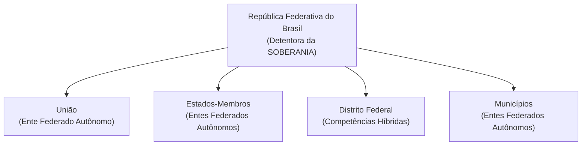

# 03 - Organização do Estado, Repartição de Competências e Servidores Públicos

> **Matéria:** Noções de Direito Constitucional  
> **Cargo:** A01 – Técnico de Controle Externo – Especialidade: Técnico Administrativo  
> **Arquivo:** `03_organizacao_do_estado_e_reparticao_de_competencias.md`  
> **Status:** 🟢 Teoria Aprofundada + 5 Questões FCC Comentadas (A a E)

---

## 📌 Ementa / Itens do Edital

- Da organização político-administrativa do Estado brasileiro (Artigos 18 e 19 da CF/88): forma federativa, autonomia dos entes e vedações federativas.
- Da União, dos Estados Federados, do Distrito Federal e dos Municípios: bens públicos, criação e desmembramento de entes, e competências materiais e legislativas.
- Repartição constitucional de competências:
    - Competências materiais exclusivas da União (Art. 21) e comuns de todos os entes (Art. 23);
    - Competências legislativas privativas da União (Art. 22) e concorrentes entre União, Estados e DF (Art. 24);
    - Competências remanescentes/residuais dos Estados (Art. 25) e competências de interesse local dos Municípios (Art. 30).
- Intervenção Federal e Estadual (Artigos 34 a 36 da CF/88): hipóteses, princípios sensíveis e procedimento.
- Regime constitucional da Administração Pública (Artigo 37 da CF/88): princípios fundamentais, concurso público, cargos em comissão e funções de confiança, teto remuneratório e regras de acumulação de cargos.
- Servidores públicos civis (Artigos 38 a 41 da CF/88): exercício de mandato eletivo, estágio probatório, estabilidade aos 3 anos, avaliação especial de desempenho e hipóteses constitucionais taxativas de perda do cargo público estável.

---

## 🧭 Sumário

1. [Forma Federativa e Organização Político-Administrativa](#1-forma-federativa-e-organizacao-politico-administrativa)
    1. [Características da Federação Brasileira e Autonomia dos Entes](#11-caracteristicas-da-federacao-brasileira-e-autonomia-dos-entes)
    2. [Vedações Constitucionais Federativas (Art. 19)](#12-vedacoes-constitucionais-federativas-art-19)
    3. [Bens Públicos Constitucionais e Criação de Novos Entes](#13-bens-publicos-constitucionais-e-criacao-de-novos-entes)
    4. [Teste 132](#Teste-132)
2. [O Modelo Constitucional de Repartição de Competências](#2-o-modelo-constitucional-de-reparticao-de-competencias)
    1. [Competências Legislativas: Privativa da União versus Concorrente](#21-competencias-legislativas-privativa-da-uniao-versus-concorrente)
    2. [Competências Administrativas: Exclusivas e Comuns](#22-competencias-administrativas-exclusivas-e-comuns)
    3. [Competências dos Estados e Municípios](#23-competencias-dos-estados-e-municipios)
    4. [Teste 133](#Teste-133)
    5. [Teste 134](#Teste-134)
    6. [Teste 135](#Teste-135)
    7. [Teste 136](#Teste-136)
3. [Mecanismos Excepcionais de Equilíbrio: Intervenção Federal e Estadual](#3-mecanismos-excepcionais-de-equilibrio-intervencao-federal-e-estadual)
    1. [Teste 137](#Teste-137)
4. [Regime Constitucional da Administração Pública e Servidores (Arts. 37 a 41)](#4-regime-constitucional-da-administracao-publica-e-servidores-arts-37-a-41)
    1. [Concurso Público, Funções de Confiança e Cargos em Comissão](#41-concurso-publico-funcoes-de-confianca-e-cargos-em-comissao)
    2. [Regra Constitucional da Não-Acumulação e Exceções (Art. 37, XVI)](#42-regra-constitucional-da-nao-acumulacao-e-excecoes-art-37-xvi)
    3. [Exercício de Mandato Eletivo pelo Servidor Público (Art. 38)](#43-exercicio-de-mandato-eletivo-pelo-servidor-publico-art-38)
    4. [Estabilidade e Perda do Cargo do Servidor Estável (Art. 41)](#44-estabilidade-e-perda-do-cargo-do-servidor-estavel-art-41)
    5. [Teste 138](#Teste-138)
    6. [Teste 139](#Teste-139)
    7. [Teste 140](#Teste-140)
    8. [Teste 141](#Teste-141)
    9. [Teste 142](#Teste-142)
5. [🌐 Fontes Oficiais & Doutrinárias Recomendadas](#fontes-oficiais-doutrinarias-recomendadas)

---

## 1. Forma Federativa e Organização Político-Administrativa

### 1.1 Características da Federação Brasileira e Autonomia dos Entes
A República Federativa do Brasil é formada pela união indissolúvel dos Estados e Municípios e do Distrito Federal (Art. 18, *caput*).

- **Origem Histórica:** Formou-se por **desagregação** (ou segregação), decorrente de um movimento **centrífugo** (o Estado unitário imperial descentralizou poderes políticos para as províncias que se transformaram em Estados-membros).
- **Indissolubilidade do Vínculo Federativo:** Não existe o direito de secessão (nenhum Estado ou Município pode se separar do Brasil). A tentativa de desmembramento justifica a intervenção federal imediata (art. 34, I) e constitui crime inafiançável e imprescritível (art. 5º, XLIV).
- **Soberania vs. Autonomia:**
    - A **Soberania** é atributo exclusivo da **República Federativa do Brasil** no plano internacional.
    - A **Autonomia** é outorgada aos entes federados (União, Estados, DF e Municípios), manifestando-se pela tríplice capacidade de auto-organização (Constituições e Leis Orgânicas), autogoverno (eleição de chefes dos poderes) e autoadministração (gestão e tributação próprias).

### 1.2 Vedações Constitucionais Federativas (Art. 19)
O art. 19 da Carta da República veda à União, aos Estados, ao Distrito Federal e aos Municípios:

1. **Estabelecer cultos religiosos ou igrejas, subvencioná-los, embaraçar-lhes o funcionamento ou manter com eles ou seus representantes relações de dependência ou aliança**, ressalvada, na forma da lei, a colaboração de interesse público *(Princípio da Laicidade Estatal)*.
2. **Recusar fé aos documentos públicos** *(Eficácia probatória nacional dos documentos emitidos por órgãos oficiais)*.
3. **Criar distinções entre brasileiros ou preferências entre si** *(Proibição de discriminação tributária, previdenciária ou funcional com base na origem regional)*.

### 1.3 Bens Públicos Constitucionais e Criação de Novos Entes
- **Bens da União (Art. 20):** Terras devolutas indispensáveis à defesa das fronteiras, recursos minerais (inclusive do subsolo), potenciais de energia hidráulica, mar territorial, terrenos de marinha e terras tradicionalmente ocupadas pelos índios.
- **Bens dos Estados (Art. 26):** Águas superficiais ou subterrâneas fluentes nos seus territórios, ilhas fluviais e lacustres não pertencentes à União e terras devolutas não compreendidas entre as da União.
- **Criação de Estados (Art. 18, § 3º):** Exige aprovação da população diretamente interessada por meio de **plebiscito** e edição de **Lei Complementar Federal** pelo Congresso Nacional.
- **Criação de Municípios (Art. 18, § 4º):** Depende de **Lei Complementar Federal** (definindo o período temporal), divulgação prévia dos Estudos de Viabilidade Municipal, consulta prévia por **plebiscito** às populações dos municípios envolvidos e promulgação de **Lei Ordinária Estadual**.

---

### Teste 132
**(FGV – TCE-PA – Auditor de Controle Externo Administrativa Gestao Governamental – 2024)**
O Estado do Pará editou a Lei Complementar X, alterada por outra Lei Complementar, permitindo a dispensa de estudo de impacto ambiental (EIA) e de relatório de impacto ambiental (RIMA) para todas as obras hidrelétricas com potencial de 10 a 30 megawatt (MW) e com determinada extensão da área inundada. Concernente aos temas de repartição de competência em matéria ambiental e licenciamento ambiental, assinale a afirmativa correta.

* **A)** A atuação normativa estadual, ainda que flexibilizadora, considerou o patamar mínimo estabelecido para a configuração de atividade potencialmente poluidora, assegurando o direito fundamental ao meio ambiente ecologicamente equilibrado.
* **B)** É permitido aos entes federados estabelecer procedimentos simplificados de licenciamento para determinados empreendimentos e atividades, desde que de médio ou de menor potencial de impacto ambiental.
* **C)** No caso concreto, ao prever o aumento do mínimo de fonte de energia primária, bem como ao inserir requisito para o licenciamento, consistente na extensão da área inundada, o poder legislativo estadual, com fundamento em suas peculiaridades regionais e na preponderância de seu interesse, não exorbitou dos limites expressamente estabelecidos pela legislação federal para o tratamento da matéria.
* **D)** No âmbito das competências legislativas e executivas em matéria ambiental, o sistema do direito constitucional positivo brasileiro não optou pelo federalismo cooperativo.
* **E)** Ao criar dispensa do licenciamento ambiental para atividade potencialmente causadora de significativa degradação do meio ambiente, a norma estadual invadiu a competência legislativa geral da União (Art. 24, VI, §§ 1º e 2º, da CF/88) e violou o direito ao meio ambiente ecologicamente equilibrado (Art. 225, § 1º, IV, da CF/88).

---

> **Comentário Detalhado:**
>
> - **A)** **Incorreta.** A opção apresenta proposição em desacordo com os fundamentos teóricos e técnicos do tópico ao afirmar que "A atuação normativa estadual, ainda que flexibilizadora, considerou o patamar mínimo estabelecido para a...". De acordo com a teoria estudada em *1.3 Bens Públicos Constitucionais e Criação de Novos Entes*, criação de Municípios (Art. 18, § 4º): Depende de Lei Complementar Federal (definindo o período temporal), divulgação prévia dos Estudos de Viabilidade Municipal, consulta prévia por plebiscito às populações dos municípios envolvidos e promulgação de Lei Ordinária Estadual.
> - **B)** **Incorreta.** A opção apresenta proposição em desacordo com os fundamentos teóricos e técnicos do tópico ao afirmar que "É permitido aos entes federados estabelecer procedimentos simplificados de licenciamento para determinados...". De acordo com a teoria estudada em *1.1 Características da Federação Brasileira e Autonomia dos Entes*, a Autonomia é outorgada aos entes federados (União, Estados, DF e Municípios), manifestando-se pela tríplice capacidade de auto-organização (Constituições e Leis Orgânicas), autogoverno (eleição de chefes dos poderes) e autoadministração (gestão e tributação próprias).
> - **C)** **Incorreta.** A opção apresenta proposição em desacordo com os fundamentos teóricos e técnicos do tópico ao afirmar que "No caso concreto, ao prever o aumento do mínimo de fonte de energia primária, bem como ao inserir requisito para o...". De acordo com a teoria estudada em *1.3 Bens Públicos Constitucionais e Criação de Novos Entes*, bens da União (Art. 20): Terras devolutas indispensáveis à defesa das fronteiras, recursos minerais (inclusive do subsolo), potenciais de energia hidráulica, mar territorial, terrenos de marinha e terras tradicionalmente ocupadas pelos índios.
> - **D)** **Incorreta.** A opção apresenta proposição em desacordo com os fundamentos teóricos e técnicos do tópico ao afirmar que "No âmbito das competências legislativas e executivas em matéria ambiental, o sistema do direito constitucional...". De acordo com a teoria estudada em *1.2 Vedações Constitucionais Federativas (Art. 19)*, criar distinções entre brasileiros ou preferências entre si *(Proibição de discriminação tributária, previdenciária ou funcional com base na origem regional)*.
> - **E)** **Correta.** Conforme fundamentado na seção *1.3 Bens Públicos Constitucionais e Criação de Novos Entes* deste guia, criação de Estados (Art. 18, § 3º): Exige aprovação da população diretamente interessada por meio de plebiscito e edição de Lei Complementar Federal pelo Congresso Nacional. Dessa forma, está plenamente correta a assertiva da banca (FGV – TCE-PA/2024) ao estabelecer que "Ao criar dispensa do licenciamento ambiental para atividade potencialmente causadora de significativa degradação...".
>
> **Gabarito: E**

---

### Teste 133
**(FCC – TRT-2 – Analista Judiciário - Tecnologia da Informação – 2014)**  
É competência privativa da União legislar sobre as matérias de direito:

* **A)** agrário, direito econômico, sistema estatístico e registros públicos.
* **B)** do trabalho, propaganda comercial, metalurgia e proteção à infância e à juventude.
* **C)** penal, direito penitenciário, cidadania e sistema cartográfico nacional.
* **D)** espacial, desapropriação, propaganda comercial e crimes de responsabilidade.
* **E)** agrário, direito penitenciário, metalurgia e sistema cartográfico oficial.

---

> **Comentário Detalhado:**
>
> - **A)** **Incorreto**. Direito econômico é de competência concorrente entre União, Estados e DF (art. 24, I, CF/88).
> - **B)** **Incorreto**. Proteção à infância e à juventude é competência concorrente (art. 24, XV, CF/88).
> - **C)** **Incorreto**. Direito penitenciário é de competência legislativa concorrente (art. 24, I, CF/88).
> - **D)** **Correto**. Todos os ramos e matérias listados inserem-se na competência privativa da União: direito espacial (art. 22, I), desapropriação (art. 22, II), propaganda comercial (art. 22, XXIX) e competência para definir crimes de responsabilidade e processo correspondente (Súmula Vinculante 46 do STF / art. 22, I e art. 85, CF/88).
> - **E)** **Incorreto**. Direito penitenciário é matéria de competência concorrente (art. 24, I, CF/88).
>
> **Gabarito: D**

### Teste 134
**(FGV – TCE-GO – Analista de Controle Externo Ciencias Contabeis – 2024)**
O Estado Alfa editou a Lei nº X, em matéria de competência legislativa concorrente com a União, em momento no qual este ente federativo ainda não tinha editado nenhuma norma a respeito da temática. Apesar desse diploma normativo ter sido enaltecido pela coletividade, muitos argumentavam com a sua inconstitucionalidade. À luz da sistemática constitucional vigente, é correto afirmar que o Estado Alfa

* **A)** não poderia ter editado a Lei nº X enquanto a União não legislasse sobre a temática.
* **B)** somente poderia legislar sobre a temática se houvesse lei complementar autorizando-o.
* **C)** editou corretamente a Lei nº X, e, caso colida com norma geral que venha a ser editada pela União, continuará válida, mas se tornará ineficaz.
* **D)** tinha competência legislativa plena para legislar sobre a temática, sendo que a Lei nº X será tida como revogada quando sobrevier a lei da União.
* **E)** pode legislar sobre a temática, sendo que a Lei nº X tem preeminência, no âmbito do seu território, em relação às normas gerais que venham a ser editadas pela União.

---

> **Comentário Detalhado:**
>
> - **A)** **Incorreta.** A opção apresenta proposição em desacordo com os fundamentos teóricos e técnicos do tópico ao afirmar que "não poderia ter editado a Lei nº X enquanto a União não legislasse sobre a temática". De acordo com a teoria estudada em *1.2 Vedações Constitucionais Federativas (Art. 19)*, estabelecer cultos religiosos ou igrejas, subvencioná-los, embaraçar-lhes o funcionamento ou manter com eles ou seus representantes relações de dependência ou aliança, ressalvada, na forma da lei, a colaboração de interesse público *(Princípio da Laicidade Estatal)*.
> - **B)** **Incorreta.** A opção incorre em restrição indevida ao limitar o escopo conceitual ao afirmar que "somente poderia legislar sobre a temática se houvesse lei complementar autorizando-o". De acordo com a teoria estudada em *1.3 Bens Públicos Constitucionais e Criação de Novos Entes*, criação de Estados (Art. 18, § 3º): Exige aprovação da população diretamente interessada por meio de plebiscito e edição de Lei Complementar Federal pelo Congresso Nacional.
> - **C)** **Incorreta.** A opção apresenta proposição em desacordo com os fundamentos teóricos e técnicos do tópico ao afirmar que "editou corretamente a Lei nº X, e, caso colida com norma geral que venha a ser editada pela União, continuará...". De acordo com a teoria estudada em *1.3 Bens Públicos Constitucionais e Criação de Novos Entes*, criação de Municípios (Art. 18, § 4º): Depende de Lei Complementar Federal (definindo o período temporal), divulgação prévia dos Estudos de Viabilidade Municipal, consulta prévia por plebiscito às populações dos municípios envolvidos e promulgação de Lei Ordinária Estadual.
> - **D)** **Incorreta.** A opção apresenta proposição em desacordo com os fundamentos teóricos e técnicos do tópico ao afirmar que "tinha competência legislativa plena para legislar sobre a temática, sendo que a Lei nº X será tida como revogada...". De acordo com a teoria estudada em *1.1 Características da Federação Brasileira e Autonomia dos Entes*, a República Federativa do Brasil é formada pela união indissolúvel dos Estados e Municípios e do Distrito Federal (Art. 18, *caput*).
> - **E)** **Correta.** Conforme fundamentado na seção *1.1 Características da Federação Brasileira e Autonomia dos Entes* deste guia, indissolubilidade do Vínculo Federativo: Não existe o direito de secessão (nenhum Estado ou Município pode se separar do Brasil). Dessa forma, está plenamente correta a assertiva da banca (FGV – TCE-GO/2024) ao estabelecer que "pode legislar sobre a temática, sendo que a Lei nº X tem preeminência, no âmbito do seu território, em relação às...".
>
> **Gabarito: E**

---

### Teste 135
**(FGV – TRT-1 – Analista Judiciario Area Administrativa – 2024)**
O estado Alfa, à mingua de normas da União disciplinando a respectiva temática, editou a Lei estadual nº X. Em momento posterior, a União editou a Lei nº Y, em sentido diametralmente oposto ao da Lei estadual nº X. Considerando os balizamentos estabelecidos pela ordem constitucional, é correto afirmar que a Lei nº Y:

* **A)** não deve ser aplicada no território de Alfa, enquanto a Lei estadual nº X permanecer em vigor;
* **B)** revoga a Lei estadual nº X, mas apenas se a temática estiver inserida na competência legislativa privativa da União;
* **C)** deve ser considerada nula, considerando o princípio federativo da especialização legislativa nos entes de menor proporção;
* **D)** suspende a eficácia da Lei estadual nº X, caso veicule normas gerais e a matéria se insira na competência legislativa concorrente;
* **E)** revoga a Lei estadual nº X se a temática estiver inserida na competência legislativa privativa da União ou na competência legislativa concorrente.

---

> **Comentário Detalhado:**
>
> - **A)** **Incorreta.** A opção apresenta proposição em desacordo com os fundamentos teóricos e técnicos do tópico ao afirmar que "não deve ser aplicada no território de Alfa, enquanto a Lei estadual nº X permanecer em vigor". De acordo com a teoria estudada em *1.2 Vedações Constitucionais Federativas (Art. 19)*, estabelecer cultos religiosos ou igrejas, subvencioná-los, embaraçar-lhes o funcionamento ou manter com eles ou seus representantes relações de dependência ou aliança, ressalvada, na forma da lei, a colaboração de interesse público *(Princípio da Laicidade Estatal)*.
> - **B)** **Correta.** Conforme fundamentado na seção *1.3 Bens Públicos Constitucionais e Criação de Novos Entes* deste guia, criação de Municípios (Art. 18, § 4º): Depende de Lei Complementar Federal (definindo o período temporal), divulgação prévia dos Estudos de Viabilidade Municipal, consulta prévia por plebiscito às populações dos municípios envolvidos e promulgação de Lei Ordinária Estadual. Dessa forma, está plenamente correta a assertiva da banca (FGV – TRT-1/2024) ao estabelecer que "revoga a Lei estadual nº X, mas apenas se a temática estiver inserida na competência legislativa privativa da União".
> - **C)** **Incorreta.** A opção apresenta proposição em desacordo com os fundamentos teóricos e técnicos do tópico ao afirmar que "deve ser considerada nula, considerando o princípio federativo da especialização legislativa nos entes de menor...". De acordo com a teoria estudada em *1.1 Características da Federação Brasileira e Autonomia dos Entes*, indissolubilidade do Vínculo Federativo: Não existe o direito de secessão (nenhum Estado ou Município pode se separar do Brasil).
> - **D)** **Incorreta.** A opção apresenta proposição em desacordo com os fundamentos teóricos e técnicos do tópico ao afirmar que "suspende a eficácia da Lei estadual nº X, caso veicule normas gerais e a matéria se insira na competência...". De acordo com a teoria estudada em *1.2 Vedações Constitucionais Federativas (Art. 19)*, recusar fé aos documentos públicos *(Eficácia probatória nacional dos documentos emitidos por órgãos oficiais)*.
> - **E)** **Incorreta.** A opção apresenta proposição em desacordo com os fundamentos teóricos e técnicos do tópico ao afirmar que "revoga a Lei estadual nº X se a temática estiver inserida na competência legislativa privativa da União ou na...". De acordo com a teoria estudada em *1.3 Bens Públicos Constitucionais e Criação de Novos Entes*, criação de Estados (Art. 18, § 3º): Exige aprovação da população diretamente interessada por meio de plebiscito e edição de Lei Complementar Federal pelo Congresso Nacional.
>
> **Gabarito: B**

---

### Teste 136
**(FGV – TCE-PA – Auditor de Controle Externo Administrativa Administracao – 2024)**
O Deputado Estadual Pedro pretendia apresentar à Assembleia Legislativa do Estado Delta projeto de lei versando sobre matéria de competência legislativa concorrente entre a União, os Estados e o Distrito Federal. Após promover alentada busca, constatou que nem a União nem o Estado Delta tinha legislado sobre a matéria. À luz da divisão constitucional de competências, Pedro concluiu corretamente que o Estado Delta

* **A)** somente pode legislar sobre a matéria após a União.
* **B)** pode legislar sobre a matéria, desde que seja expressamente autorizado pela União.
* **C)** pode legislar sobre a matéria, sendo que a superveniência de normas gerais da União revogará a lei estadual na hipótese de colidência.
* **D)** pode legislar sobre a matéria, sendo que a superveniência de normas gerais da União suspenderá a eficácia da lei estadual na hipótese de colidência.
* **E)** pode legislar sobre a matéria, sendo que a superveniência de normas gerais da União não terá influência sobre a lei estadual, ainda que sejam colidentes.

---

> **Comentário Detalhado:**
>
> - **A)** **Incorreta.** A opção incorre em restrição indevida ao limitar o escopo conceitual ao afirmar que "somente pode legislar sobre a matéria após a União". De acordo com a teoria estudada em *1.1 Características da Federação Brasileira e Autonomia dos Entes*, indissolubilidade do Vínculo Federativo: Não existe o direito de secessão (nenhum Estado ou Município pode se separar do Brasil).
> - **B)** **Incorreta.** A opção apresenta proposição em desacordo com os fundamentos teóricos e técnicos do tópico ao afirmar que "pode legislar sobre a matéria, desde que seja expressamente autorizado pela União". De acordo com a teoria estudada em *1.2 Vedações Constitucionais Federativas (Art. 19)*, recusar fé aos documentos públicos *(Eficácia probatória nacional dos documentos emitidos por órgãos oficiais)*.
> - **C)** **Incorreta.** A opção apresenta proposição em desacordo com os fundamentos teóricos e técnicos do tópico ao afirmar que "pode legislar sobre a matéria, sendo que a superveniência de normas gerais da União revogará a lei estadual na...". De acordo com a teoria estudada em *1.1 Características da Federação Brasileira e Autonomia dos Entes*, a República Federativa do Brasil é formada pela união indissolúvel dos Estados e Municípios e do Distrito Federal (Art. 18, *caput*).
> - **D)** **Correta.** Conforme fundamentado na seção *1.3 Bens Públicos Constitucionais e Criação de Novos Entes* deste guia, criação de Municípios (Art. 18, § 4º): Depende de Lei Complementar Federal (definindo o período temporal), divulgação prévia dos Estudos de Viabilidade Municipal, consulta prévia por plebiscito às populações dos municípios envolvidos e promulgação de Lei Ordinária Estadual. Dessa forma, está plenamente correta a assertiva da banca (FGV – TCE-PA/2024) ao estabelecer que "pode legislar sobre a matéria, sendo que a superveniência de normas gerais da União suspenderá a eficácia da lei...".
> - **E)** **Incorreta.** A opção apresenta proposição em desacordo com os fundamentos teóricos e técnicos do tópico ao afirmar que "pode legislar sobre a matéria, sendo que a superveniência de normas gerais da União não terá influência sobre a...". De acordo com a teoria estudada em *1.2 Vedações Constitucionais Federativas (Art. 19)*, o art. 19 da Carta da República veda à União, aos Estados, ao Distrito Federal e aos Municípios.
>
> **Gabarito: D**

---

### Teste 137
**(FGV – TCE-PI – Auditor de Controle Externo Controle Externo Especifica de Area Comum – 2025)**
Após ampla mobilização popular, o Município Alfa editou a Lei municipal nº X, dispondo que os jovens de até vinte e um anos de idade teriam direito a concessão de desconto de 50% sobre o preço do ingresso cobrado por casas de diversões situadas em seu território. Esse diploma normativo foi muito festejado no ambiente social, pois nem a legislação do Estado em cujo território Alfa está situado nem a legislação da União contêm preceito similar. Apesar disso, a associação dos empresários do setor, os quais teriam seus lucros reduzidos, criticou duramente a Lei municipal nº X, tendo solicitado que um especialista analisasse a sua conformidade constitucional, mais especificamente se Alfa poderia legislar sobre a matéria. Assinale a opção que apresenta o esclarecimento correto dado à associação.

* **A)** Compete privativamente à União legislar sobre produção e consumo, logo, a Lei municipal nº X é inconstitucional nesse aspecto.
* **B)** O Município Alfa somente tem competência para legislar sobre a matéria se houver lei complementar federal autorizativa.
* **C)** Todos os entes federativos possuem competência legislativa comum para legislar sobre lazer, logo, a Lei municipal nº X é constitucional nesse aspecto.
* **D)** Se trata de típico interesse local, logo, Alfa tem competência privativa para legislar sobre a matéria, o que torna a Lei municipal nº X constitucional nesse aspecto.
* **E)** O Município Alfa pode suplementar a legislação federal e estadual em matéria de direito econômico, logo, a Lei municipal nº X é constitucional nesse aspecto.

---

> **Comentário Detalhado:**
>
> - **A)** **Incorreta.** A opção apresenta proposição em desacordo com os fundamentos teóricos e técnicos do tópico ao afirmar que "Compete privativamente à União legislar sobre produção e consumo, logo, a Lei municipal nº X é inconstitucional...". De acordo com a teoria estudada em *1.2 Vedações Constitucionais Federativas (Art. 19)*, estabelecer cultos religiosos ou igrejas, subvencioná-los, embaraçar-lhes o funcionamento ou manter com eles ou seus representantes relações de dependência ou aliança, ressalvada, na forma da lei, a colaboração de interesse público *(Princípio da Laicidade Estatal)*.
> - **B)** **Incorreta.** A opção incorre em restrição indevida ao limitar o escopo conceitual ao afirmar que "O Município Alfa somente tem competência para legislar sobre a matéria se houver lei complementar federal...". De acordo com a teoria estudada em *1.1 Características da Federação Brasileira e Autonomia dos Entes*, indissolubilidade do Vínculo Federativo: Não existe o direito de secessão (nenhum Estado ou Município pode se separar do Brasil).
> - **C)** **Incorreta.** A opção apresenta proposição em desacordo com os fundamentos teóricos e técnicos do tópico ao afirmar que "Todos os entes federativos possuem competência legislativa comum para legislar sobre lazer, logo, a Lei municipal...". De acordo com a teoria estudada em *1.3 Bens Públicos Constitucionais e Criação de Novos Entes*, criação de Estados (Art. 18, § 3º): Exige aprovação da população diretamente interessada por meio de plebiscito e edição de Lei Complementar Federal pelo Congresso Nacional.
> - **D)** **Correta.** Conforme fundamentado na seção *1.3 Bens Públicos Constitucionais e Criação de Novos Entes* deste guia, criação de Municípios (Art. 18, § 4º): Depende de Lei Complementar Federal (definindo o período temporal), divulgação prévia dos Estudos de Viabilidade Municipal, consulta prévia por plebiscito às populações dos municípios envolvidos e promulgação de Lei Ordinária Estadual. Dessa forma, está plenamente correta a assertiva da banca (FGV – TCE-PI/2025) ao estabelecer que "Se trata de típico interesse local, logo, Alfa tem competência privativa para legislar sobre a matéria, o que...".
> - **E)** **Incorreta.** A opção apresenta proposição em desacordo com os fundamentos teóricos e técnicos do tópico ao afirmar que "O Município Alfa pode suplementar a legislação federal e estadual em matéria de direito econômico, logo, a Lei...". De acordo com a teoria estudada em *1.1 Características da Federação Brasileira e Autonomia dos Entes*, a República Federativa do Brasil é formada pela união indissolúvel dos Estados e Municípios e do Distrito Federal (Art. 18, *caput*).
>
> **Gabarito: D**

---

### Teste 138
**(FGV – TCE-PA – Auditor de Controle Externo Administrativa Gestao Governamental – 2024)**
Monique Gume, servidora pública efetiva lotada na Secretaria de Educação do Estado do Pará, procura uma conceituada advogada paraense e relata que tomou posse no cargo, após o devido concurso, na vigência da Lei Complementar nº XYZ, de 2002. Ocorre que, em 2023, a citada norma jurídica foi extinta pela promulgação da Lei Complementar nº ABC, que extinguiu uma gratificação de cinquenta por cento sobre o vencimento a que ela tinha direito. Destaque-se que o artigo nono da Lei Complementar de 2023 prevê a revogação por inteiro da Lei Complementar de 2002. Monique explica, ainda, que só realizou o concurso devido à gratificação, pois do contrário o cargo não possuiria atrativo suficiente. Com base na situação hipotética, assinale a afirmativa correta.

* **A)** A jurisprudência brasileira consagra a existência de direito adquirido a regime jurídico.
* **B)** Salvo disposição em contrário, a lei revogada se restaura por ter a lei revogadora perdido a vigência.
* **C)** Na situação hipotética, com a promulgação da Lei Complementar nº ABC de 2023, a Lei Complementar nº XYZ de 2002 foi ab-rogada expressamente.
* **D)** O princípio da supremacia do interesse público permite a violação do direito adquirido pela promulgação de uma lei ordinária.
* **E)** A lei nova que estabeleça disposições gerais ou especiais a par das já existentes revoga a lei anterior.

---

> **Comentário Detalhado:**
>
> - **A)** **Incorreta.** A opção apresenta proposição em desacordo com os fundamentos teóricos e técnicos do tópico ao afirmar que "A jurisprudência brasileira consagra a existência de direito adquirido a regime jurídico". De acordo com a teoria estudada em *1.3 Bens Públicos Constitucionais e Criação de Novos Entes*, criação de Estados (Art. 18, § 3º): Exige aprovação da população diretamente interessada por meio de plebiscito e edição de Lei Complementar Federal pelo Congresso Nacional.
> - **B)** **Incorreta.** A opção apresenta proposição em desacordo com os fundamentos teóricos e técnicos do tópico ao afirmar que "Salvo disposição em contrário, a lei revogada se restaura por ter a lei revogadora perdido a vigência". De acordo com a teoria estudada em *1.2 Vedações Constitucionais Federativas (Art. 19)*, estabelecer cultos religiosos ou igrejas, subvencioná-los, embaraçar-lhes o funcionamento ou manter com eles ou seus representantes relações de dependência ou aliança, ressalvada, na forma da lei, a colaboração de interesse público *(Princípio da Laicidade Estatal)*.
> - **C)** **Correta.** Conforme fundamentado na seção *1.3 Bens Públicos Constitucionais e Criação de Novos Entes* deste guia, criação de Municípios (Art. 18, § 4º): Depende de Lei Complementar Federal (definindo o período temporal), divulgação prévia dos Estudos de Viabilidade Municipal, consulta prévia por plebiscito às populações dos municípios envolvidos e promulgação de Lei Ordinária Estadual. Dessa forma, está plenamente correta a assertiva da banca (FGV – TCE-PA/2024) ao estabelecer que "Na situação hipotética, com a promulgação da Lei Complementar nº ABC de 2023, a Lei Complementar nº XYZ de 2002...".
> - **D)** **Incorreta.** A opção apresenta proposição em desacordo com os fundamentos teóricos e técnicos do tópico ao afirmar que "O princípio da supremacia do interesse público permite a violação do direito adquirido pela promulgação de uma lei...". De acordo com a teoria estudada em *1.1 Características da Federação Brasileira e Autonomia dos Entes*, indissolubilidade do Vínculo Federativo: Não existe o direito de secessão (nenhum Estado ou Município pode se separar do Brasil).
> - **E)** **Incorreta.** A opção apresenta proposição em desacordo com os fundamentos teóricos e técnicos do tópico ao afirmar que "A lei nova que estabeleça disposições gerais ou especiais a par das já existentes revoga a lei anterior". De acordo com a teoria estudada em *1.2 Vedações Constitucionais Federativas (Art. 19)*, criar distinções entre brasileiros ou preferências entre si *(Proibição de discriminação tributária, previdenciária ou funcional com base na origem regional)*.
>
> **Gabarito: C**

---

### Teste 139
**(FGV – TJ-AP – Analista Judiciário - Tecnologia da Informação – 2023)**  
Nair, servidora pública ocupante de cargo de provimento efetivo, logrou ser eleita vereadora no município em que é domiciliada.  
Preocupada com a possibilidade de conciliar o cargo público com a vereança, analisou os balizamentos estabelecidos pela Constituição da República, tendo concluído corretamente que:

* **A)** deve ser compulsoriamente afastada do cargo efetivo durante o exercício do mandato eletivo.
* **B)** deve optar por um ou outro estipêndio, pois a acumulação pecuniária de mandatos é sempre vedada.
* **C)** havendo compatibilidade de horários, perceberá as vantagens de seu cargo, sem prejuízo da remuneração do mandato.
* **D)** pode acumular ambos os cargos somente se tiver cumprido o estágio probatório com estabilidade.
* **E)** tem o direito de acumular ambos os cargos mesmo que haja incompatibilidade absoluta de jornadas.

---

> **Comentário Detalhado:**
>
> - **A)** **Incorreto**. O afastamento compulsório aplica-se ao mandato de Prefeito (art. 38, II) e aos federais/estaduais (art. 38, I). Para o mandato de Vereador, havendo compatibilidade, não há afastamento.
> - **B)** **Incorreto**. A regra da opção remuneratória aplica-se quando há incompatibilidade de horários ou no mandato de Prefeito.
> - **C)** **Correto**. Conforme o art. 38, III, da Constituição Federal: "investido no mandato de Vereador, havendo compatibilidade de horários, perceberá as vantagens de seu cargo, emprego ou função, sem prejuízo da remuneração do cargo eletivo, e, não havendo compatibilidade, será aplicada a norma do inciso anterior" (afastamento do cargo e opção pela remuneração).
> - **D)** **Incorreto**. A Constituição não condiciona o exercício do mandato eletivo à prévia estabilidade funcional.
> - **E)** **Incorreto**. Se houver incompatibilidade de horários, a acumulação física e remuneratória é vedada, devendo a servidora afastar-se do cargo efetivo.
>
> **Gabarito: C**

### Teste 140
**(FGV – TRF-1 – Analista Judiciário - Tecnologia da Informação – 2024)**  
Maria, servidora pública federal, foi condenada, em sentença penal transitada em julgado, pela prática de infração penal. No momento em que o regime de cumprimento da pena passou para o aberto, procurou se informar em relação aos atos da cidadania que poderia, ou não, praticar enquanto estivesse cumprindo a pena.  
Ao final, Maria concluiu corretamente que, na perspectiva das eleições para cargos dos Poderes Executivo e Legislativo:

* **A)** não pode votar nem concorrer a cargo eletivo durante o período de cumprimento da reprimenda penal imposta.
* **B)** pode exercer regularmente o direito ao voto, mas encontra-se temporariamente impedida de concorrer a cargo eletivo.
* **C)** pode votar e concorrer apenas a cargos eletivos municipais onde resida, vedadas candidaturas estaduais e federais.
* **D)** pode concorrer a cargo eletivo desde que obtenha autorização expressa do juízo de execuções penais competente.
* **E)** pode votar e ser votada normalmente porque a progressão para o regime prisional aberto restabelece a plenitude cidadã.

---

> **Comentário Detalhado:**
>
> - **A)** **Correto**. O art. 15, III, da CF/88 impõe a suspensão dos direitos políticos em decorrência de "condenação criminal transitada em julgado, enquanto durarem seus efeitos". Essa suspensão é autoaplicável e atinge tanto a capacidade eleitoral passiva (direito de ser votado / elegibilidade) quanto a capacidade eleitoral ativa (direito de votar / alistabilidade), independentemente da modalidade de pena (privativa de liberdade, restritiva de direitos ou regime aberto) ou da espécie do crime (Súmula 9 do TSE e entendimento pacificado do STF).
> - **B)** **Incorreto**. A suspensão atinge a cidadania em sua integralidade, retirando também o direito ao sufrágio ativo (voto).
> - **C)** **Incorreto**. A suspensão dos direitos políticos tem eficácia nacional e impede a participação em quaisquer pleitos eletivos.
> - **D)** **Incorreto**. O juízo da execução penal não tem competência para afastar a suspensão constitucional de direitos políticos.
> - **E)** **Incorreto**. A progressão para o regime aberto não extingue a punibilidade nem os efeitos condenatórios da sentença.
>
> **Gabarito: A**

### Teste 141
**(FGV – TCE-PA – Auditor de Controle Externo Administrativa Gestao Governamental – 2024)**
O Partido Político Alfa elegeu dezenove parlamentares na eleição para a Câmara dos Deputados. João, um dos Deputados Federais eleitos por Alfa, logo após a posse, insatisfeito com o que considerou um “fraquíssimo desempenho” da legenda, declarou à imprensa que adotaria as medidas necessárias para a sua desfiliação, com a correlata filiação ao Partido Político Beta, que teve melhor desempenho. Ao tomar conhecimento da declaração de João, o Diretório Nacional de Alfa informou que a desfiliação, sem sua aquiescência, importaria na perda do mandato eletivo. À luz da sistemática constitucional, é correto afirmar que

* **A)** caso João venha a se desfiliar de Alfa, partido político pelo qual foi eleito, a consequência será a perda do mandato eletivo.
* **B)** como Alfa não preencheu a cláusula constitucional de desempenho, João poderá se desfiliar sem perda do mandato.
* **C)** a desfiliação de Alfa, com a correlata filiação de Beta, somente será admitida na hipótese de transferência igualitária de parlamentares entre os partidos políticos.
* **D)** João, a exemplo dos demais parlamentares, pode se desfiliar do respectivo partido político nos sessenta dias subsequentes ao início do mandato e nos sessenta dias anteriores ao término do mandato.
* **E)** João apenas poderá se desfiliar de Alfa caso o partido político também não tenha obtido 3% dos votos válidos na eleição para a Câmara dos Deputados, distribuídos em um terço das unidades da Federação, com no mínimo 2% em cada uma.

---

> **Comentário Detalhado:**
>
> - **A)** **Correta.** Conforme fundamentado na seção *1.1 Características da Federação Brasileira e Autonomia dos Entes* deste guia, a Autonomia é outorgada aos entes federados (União, Estados, DF e Municípios), manifestando-se pela tríplice capacidade de auto-organização (Constituições e Leis Orgânicas), autogoverno (eleição de chefes dos poderes) e autoadministração (gestão e tributação próprias). Dessa forma, está plenamente correta a assertiva da banca (FGV – TCE-PA/2024) ao estabelecer que "caso João venha a se desfiliar de Alfa, partido político pelo qual foi eleito, a consequência será a perda do...".
> - **B)** **Incorreta.** A opção apresenta proposição em desacordo com os fundamentos teóricos e técnicos do tópico ao afirmar que "como Alfa não preencheu a cláusula constitucional de desempenho, João poderá se desfiliar sem perda do mandato". De acordo com a teoria estudada em *1.2 Vedações Constitucionais Federativas (Art. 19)*, recusar fé aos documentos públicos *(Eficácia probatória nacional dos documentos emitidos por órgãos oficiais)*.
> - **C)** **Incorreta.** A opção incorre em restrição indevida ao limitar o escopo conceitual ao afirmar que "a desfiliação de Alfa, com a correlata filiação de Beta, somente será admitida na hipótese de transferência...". De acordo com a teoria estudada em *1.1 Características da Federação Brasileira e Autonomia dos Entes*, origem Histórica: Formou-se por desagregação (ou segregação), decorrente de um movimento centrífugo (o Estado unitário imperial descentralizou poderes políticos para as províncias que se transformaram em Estados-membros).
> - **D)** **Incorreta.** A opção apresenta proposição em desacordo com os fundamentos teóricos e técnicos do tópico ao afirmar que "João, a exemplo dos demais parlamentares, pode se desfiliar do respectivo partido político nos sessenta dias...". De acordo com a teoria estudada em *1.1 Características da Federação Brasileira e Autonomia dos Entes*, indissolubilidade do Vínculo Federativo: Não existe o direito de secessão (nenhum Estado ou Município pode se separar do Brasil).
> - **E)** **Incorreta.** A opção incorre em restrição indevida ao limitar o escopo conceitual ao afirmar que "João apenas poderá se desfiliar de Alfa caso o partido político também não tenha obtido 3% dos votos válidos na...". De acordo com a teoria estudada em *1.1 Características da Federação Brasileira e Autonomia dos Entes*, a República Federativa do Brasil é formada pela união indissolúvel dos Estados e Municípios e do Distrito Federal (Art. 18, *caput*).
>
> **Gabarito: A**

---

### Teste 142
**(FGV – TCE-SC – Auditor Fiscal de Controle Externo Direito – 2026)**
A sociedade empresária Transporta 100% Ltda., com sede no Município Alfa, no ano de 2026, prestou serviço de transporte de 20 toneladas de feijão do Município Beta para o Município Gama. A mercadoria foi entregue sem avarias e integralmente ao destinatário constante no documento fiscal no Município Gama, a saber, a sociedade empresária Recebe 100% Ltda., que tem sua sede no Município Delta. Todos os quatro municípios se situam no mesmo estado da federação. Considerando as regras da Lei Complementar (LC) nº 214/2025 acerca do Imposto sobre Bens e Serviços (IBS), assinale a opção que indica corretamente o local onde se considera realizada essa operação de serviço de transporte de carga para efeitos de IBS:

* **A)** Município Alfa, por ser o local da sede de Transporta 100% Ltda.
* **B)** Município Beta, por ser o local de início do transporte.
* **C)** Município Gama, por ser o local da entrega do bem ao destinatário constante no documento fiscal.
* **D)** Município Delta, por ser o local da sede de Recebe 100% Ltda.
* **E)** Qualquer um dos quatro municípios, deixando a LC nº 214/2025 à escolha do sujeito passivo tributário.

---

> **Comentário Detalhado:**
>
> - **A)** **Incorreta.** A opção apresenta proposição em desacordo com os fundamentos teóricos e técnicos do tópico ao afirmar que "Município Alfa, por ser o local da sede de Transporta 100% Ltda". De acordo com a teoria estudada em *1.3 Bens Públicos Constitucionais e Criação de Novos Entes*, criação de Municípios (Art. 18, § 4º): Depende de Lei Complementar Federal (definindo o período temporal), divulgação prévia dos Estudos de Viabilidade Municipal, consulta prévia por plebiscito às populações dos municípios envolvidos e promulgação de Lei Ordinária Estadual.
> - **B)** **Correta.** Conforme fundamentado na seção *1.1 Características da Federação Brasileira e Autonomia dos Entes* deste guia, indissolubilidade do Vínculo Federativo: Não existe o direito de secessão (nenhum Estado ou Município pode se separar do Brasil). Dessa forma, está plenamente correta a assertiva da banca (FGV – TCE-SC/2026) ao estabelecer que "Município Beta, por ser o local de início do transporte".
> - **C)** **Incorreta.** A opção apresenta proposição em desacordo com os fundamentos teóricos e técnicos do tópico ao afirmar que "Município Gama, por ser o local da entrega do bem ao destinatário constante no documento fiscal". De acordo com a teoria estudada em *1.3 Bens Públicos Constitucionais e Criação de Novos Entes*, criação de Estados (Art. 18, § 3º): Exige aprovação da população diretamente interessada por meio de plebiscito e edição de Lei Complementar Federal pelo Congresso Nacional.
> - **D)** **Incorreta.** A opção apresenta proposição em desacordo com os fundamentos teóricos e técnicos do tópico ao afirmar que "Município Delta, por ser o local da sede de Recebe 100% Ltda". De acordo com a teoria estudada em *1.1 Características da Federação Brasileira e Autonomia dos Entes*, a República Federativa do Brasil é formada pela união indissolúvel dos Estados e Municípios e do Distrito Federal (Art. 18, *caput*).
> - **E)** **Incorreta.** A opção promove generalização excessiva que desconsidera as condições técnicas e normativas ao afirmar que "Qualquer um dos quatro municípios, deixando a LC nº 214/2025 à escolha do sujeito passivo tributário". De acordo com a teoria estudada em *1.1 Características da Federação Brasileira e Autonomia dos Entes*, a Autonomia é outorgada aos entes federados (União, Estados, DF e Municípios), manifestando-se pela tríplice capacidade de auto-organização (Constituições e Leis Orgânicas), autogoverno (eleição de chefes dos poderes) e autoadministração (gestão e tributação próprias).
>
> **Gabarito: B**

---

