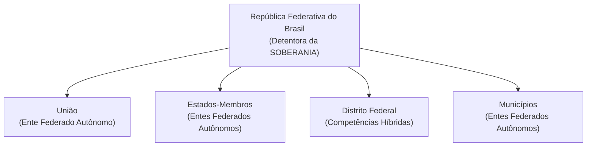

# 03 - Organização do Estado, Repartição de Competências e Servidores Públicos

> **Matéria:** Noções de Direito Constitucional  
> **Cargo:** A01 – Técnico de Controle Externo – Especialidade: Técnico Administrativo  
> **Arquivo:** `03_organizacao_do_estado_e_reparticao_de_competencias.md`  
> **Status:** 🟢 Teoria Aprofundada + 5 Questões FCC Comentadas (A a E)

---

## 📌 Ementa / Itens do Edital

- Da organização político-administrativa do Estado brasileiro (Artigos 18 e 19 da CF/88): forma federativa, autonomia dos entes e vedações federativas.
- Da União, dos Estados Federados, do Distrito Federal e dos Municípios: bens públicos, criação e desmembramento de entes, e competências materiais e legislativas.
- Repartição constitucional de competências:
    - Competências materiais exclusivas da União (Art. 21) e comuns de todos os entes (Art. 23);
    - Competências legislativas privativas da União (Art. 22) e concorrentes entre União, Estados e DF (Art. 24);
    - Competências remanescentes/residuais dos Estados (Art. 25) e competências de interesse local dos Municípios (Art. 30).
- Intervenção Federal e Estadual (Artigos 34 a 36 da CF/88): hipóteses, princípios sensíveis e procedimento.
- Regime constitucional da Administração Pública (Artigo 37 da CF/88): princípios fundamentais, concurso público, cargos em comissão e funções de confiança, teto remuneratório e regras de acumulação de cargos.
- Servidores públicos civis (Artigos 38 a 41 da CF/88): exercício de mandato eletivo, estágio probatório, estabilidade aos 3 anos, avaliação especial de desempenho e hipóteses constitucionais taxativas de perda do cargo público estável.

---

## 🧭 Sumário

1. [Forma Federativa e Organização Político-Administrativa](#1-forma-federativa-e-organizacao-politico-administrativa)
    1. [Características da Federação Brasileira e Autonomia dos Entes](#11-caracteristicas-da-federacao-brasileira-e-autonomia-dos-entes)
    2. [Vedações Constitucionais Federativas (Art. 19)](#12-vedacoes-constitucionais-federativas-art-19)
    3. [Bens Públicos Constitucionais e Criação de Novos Entes](#13-bens-publicos-constitucionais-e-criacao-de-novos-entes)
    4. [Teste 132](#Teste-132)
2. [O Modelo Constitucional de Repartição de Competências](#2-o-modelo-constitucional-de-reparticao-de-competencias)
    1. [Competências Legislativas: Privativa da União versus Concorrente](#21-competencias-legislativas-privativa-da-uniao-versus-concorrente)
    2. [Competências Administrativas: Exclusivas e Comuns](#22-competencias-administrativas-exclusivas-e-comuns)
    3. [Competências dos Estados e Municípios](#23-competencias-dos-estados-e-municipios)
    4. [Teste 133](#Teste-133)
    5. [Teste 134](#Teste-134)
    6. [Teste 135](#Teste-135)
    7. [Teste 136](#Teste-136)
3. [Mecanismos Excepcionais de Equilíbrio: Intervenção Federal e Estadual](#3-mecanismos-excepcionais-de-equilibrio-intervencao-federal-e-estadual)
    1. [Teste 137](#Teste-137)
4. [Regime Constitucional da Administração Pública e Servidores (Arts. 37 a 41)](#4-regime-constitucional-da-administracao-publica-e-servidores-arts-37-a-41)
    1. [Concurso Público, Funções de Confiança e Cargos em Comissão](#41-concurso-publico-funcoes-de-confianca-e-cargos-em-comissao)
    2. [Regra Constitucional da Não-Acumulação e Exceções (Art. 37, XVI)](#42-regra-constitucional-da-nao-acumulacao-e-excecoes-art-37-xvi)
    3. [Exercício de Mandato Eletivo pelo Servidor Público (Art. 38)](#43-exercicio-de-mandato-eletivo-pelo-servidor-publico-art-38)
    4. [Estabilidade e Perda do Cargo do Servidor Estável (Art. 41)](#44-estabilidade-e-perda-do-cargo-do-servidor-estavel-art-41)
    5. [Teste 138](#Teste-138)
    6. [Teste 139](#Teste-139)
    7. [Teste 140](#Teste-140)
    8. [Teste 141](#Teste-141)
    9. [Teste 142](#Teste-142)
5. [🌐 Fontes Oficiais & Doutrinárias Recomendadas](#fontes-oficiais-doutrinarias-recomendadas)

---

## 1. Forma Federativa e Organização Político-Administrativa

### 1.1 Características da Federação Brasileira e Autonomia dos Entes
A República Federativa do Brasil é formada pela união indissolúvel dos Estados e Municípios e do Distrito Federal (Art. 18, *caput*).

- **Origem Histórica:** Formou-se por **desagregação** (ou segregação), decorrente de um movimento **centrífugo** (o Estado unitário imperial descentralizou poderes políticos para as províncias que se transformaram em Estados-membros).
- **Indissolubilidade do Vínculo Federativo:** Não existe o direito de secessão (nenhum Estado ou Município pode se separar do Brasil). A tentativa de desmembramento justifica a intervenção federal imediata (art. 34, I) e constitui crime inafiançável e imprescritível (art. 5º, XLIV).
- **Soberania vs. Autonomia:**
    - A **Soberania** é atributo exclusivo da **República Federativa do Brasil** no plano internacional.
    - A **Autonomia** é outorgada aos entes federados (União, Estados, DF e Municípios), manifestando-se pela tríplice capacidade de auto-organização (Constituições e Leis Orgânicas), autogoverno (eleição de chefes dos poderes) e autoadministração (gestão e tributação próprias).

### 1.2 Vedações Constitucionais Federativas (Art. 19)
O art. 19 da Carta da República veda à União, aos Estados, ao Distrito Federal e aos Municípios:

1. **Estabelecer cultos religiosos ou igrejas, subvencioná-los, embaraçar-lhes o funcionamento ou manter com eles ou seus representantes relações de dependência ou aliança**, ressalvada, na forma da lei, a colaboração de interesse público *(Princípio da Laicidade Estatal)*.
2. **Recusar fé aos documentos públicos** *(Eficácia probatória nacional dos documentos emitidos por órgãos oficiais)*.
3. **Criar distinções entre brasileiros ou preferências entre si** *(Proibição de discriminação tributária, previdenciária ou funcional com base na origem regional)*.

### 1.3 Bens Públicos Constitucionais e Criação de Novos Entes
- **Bens da União (Art. 20):** Terras devolutas indispensáveis à defesa das fronteiras, recursos minerais (inclusive do subsolo), potenciais de energia hidráulica, mar territorial, terrenos de marinha e terras tradicionalmente ocupadas pelos índios.
- **Bens dos Estados (Art. 26):** Águas superficiais ou subterrâneas fluentes nos seus territórios, ilhas fluviais e lacustres não pertencentes à União e terras devolutas não compreendidas entre as da União.
- **Criação de Estados (Art. 18, § 3º):** Exige aprovação da população diretamente interessada por meio de **plebiscito** e edição de **Lei Complementar Federal** pelo Congresso Nacional.
- **Criação de Municípios (Art. 18, § 4º):** Depende de **Lei Complementar Federal** (definindo o período temporal), divulgação prévia dos Estudos de Viabilidade Municipal, consulta prévia por **plebiscito** às populações dos municípios envolvidos e promulgação de **Lei Ordinária Estadual**.

---

### Teste 132
**(FGV – TCE/SC – 2026 – Auditor Fiscal de Controle Externo - Administração)**
A Lei Complementar nº 214/2025 regulamentou a reforma tributária aprovada pela Emenda Constitucional nº 132/2023, instituindo o Imposto sobre Bens e Serviços (IBS), a Contribuição Social sobre Bens e Serviços (CBS) e o Imposto Seletivo (IS), que substituirão progressivamente tributos atualmente vigentes. Com base na estrutura e nos objetivos da reforma tributária regulamentada pela Lei Complementar nº 214/2025, assinale a afirmativa correta.

* **A)** O IBS substituirá tributos federais, estaduais e municipais, sendo administrado exclusivamente pela Receita Federal do Brasil, a quem caberá a arrecadação e a distribuição das receitas aos entes subnacionais.
* **B)** A CBS é de competência da União e substituirá o PIS e a Cofins, ao passo que o IBS é de competência compartilhada entre Estados, Distrito Federal e Municípios, substituindo o ICMS e o ISS, sendo ambos administrados pelo Comitê Gestor do IBS.
* **C)** O IS tem como fato gerador a circulação de bens e a prestação de serviços em geral, incidindo de forma ampla sobre toda a cadeia produtiva com o objetivo de simplificar a arrecadação e eliminar a cumulatividade tributária.
* **D)** A reforma tributária instituída pela LC nº 214/2025 terá implementação imediata, com a extinção do ICMS, do ISS, do PIS, da Cofins e do IPI a partir do exercício financeiro seguinte à sua publicação, sem período de transição.
* **E)** O IBS e a CBS formam a chamada Contribuição sobre Bens e Serviços dual, mas incidem sobre bases de cálculo distintas: o IBS incide exclusivamente sobre bens, e a CBS incide exclusivamente sobre serviços, mantendo a separação tradicional entre o ICMS e o ISS.

---

> **Comentário Detalhado:**
>
> - **A)** **Incorreta.** A opção incorre em restrição indevida ao limitar o escopo conceitual ao afirmar que "O IBS substituirá tributos federais, estaduais e municipais, sendo administrado exclusivamente pela Receita...". De acordo com a teoria estudada em *1.2 Vedações Constitucionais Federativas (Art. 19)*, o art. 19 da Carta da República veda à União, aos Estados, ao Distrito Federal e aos Municípios.
> - **B)** **Correta.** Conforme fundamentado na seção *1.1 Características da Federação Brasileira e Autonomia dos Entes* deste guia, a República Federativa do Brasil é formada pela união indissolúvel dos Estados e Municípios e do Distrito Federal (Art. 18, *caput*). Dessa forma, está plenamente correta a assertiva da banca (FGV – TCE/SC/2026) ao estabelecer que "A CBS é de competência da União e substituirá o PIS e a Cofins, ao passo que o IBS é de competência compartilhada...".
> - **C)** **Incorreta.** A opção apresenta proposição em desacordo com os fundamentos teóricos e técnicos do tópico ao afirmar que "O IS tem como fato gerador a circulação de bens e a prestação de serviços em geral, incidindo de forma ampla sobre...". De acordo com a teoria estudada em *1.3 Bens Públicos Constitucionais e Criação de Novos Entes*, criação de Municípios (Art. 18, § 4º): Depende de Lei Complementar Federal (definindo o período temporal), divulgação prévia dos Estudos de Viabilidade Municipal, consulta prévia por plebiscito às populações dos municípios envolvidos e promulgação de Lei Ordinária Estadual.
> - **D)** **Incorreta.** A opção apresenta proposição em desacordo com os fundamentos teóricos e técnicos do tópico ao afirmar que "A reforma tributária instituída pela LC nº 214/2025 terá implementação imediata, com a extinção do ICMS, do ISS...". De acordo com a teoria estudada em *1.2 Vedações Constitucionais Federativas (Art. 19)*, criar distinções entre brasileiros ou preferências entre si *(Proibição de discriminação tributária, previdenciária ou funcional com base na origem regional)*.
> - **E)** **Incorreta.** A opção incorre em restrição indevida ao limitar o escopo conceitual ao afirmar que "O IBS e a CBS formam a chamada Contribuição sobre Bens e Serviços dual, mas incidem sobre bases de cálculo...". De acordo com a teoria estudada em *1.3 Bens Públicos Constitucionais e Criação de Novos Entes*, criação de Estados (Art. 18, § 3º): Exige aprovação da população diretamente interessada por meio de plebiscito e edição de Lei Complementar Federal pelo Congresso Nacional.
>
> **Gabarito: B**

---

### Teste 133
**(FGV – TCE/PI – 2025 – Auditor de Controle Externo - Controle Externo - Específica de Área Comum)**
Com relação ao Anexo de Metas Fiscais, que integrará o Projeto de Lei de Diretrizes Orçamentárias, em atendimento ao disposto no Art. 4º, § 1º, da Lei Complementar nº 101/2000, e que deverá ser elaborado, de acordo com o Art. 1º, § 2º, da LRF, pelo Poder Executivo da União, dos Estados, do Distrito Federal e dos Municípios, abrangendo tanto o Poder Executivo quanto os Poderes Legislativo e Judiciário, avalie as afirmativas a seguir. I. O cumprimento das metas deve ser acompanhado com base nas informações divulgadas no Relatório Resumido da Execução Orçamentária e no Relatório de Gestão Fiscal. II. O Demonstrativo das Metas Anuais deverá ser instruído com a memória e a metodologia de cálculo, visando esclarecer a forma de obtenção dos valores relativos a receitas, despesas, resultado primário, resultado nominal, e montante da dívida pública. III. O Demonstrativo de Metas Anuais tem por objetivo, além de dar transparência sobre as metas fiscais, orientar a elaboração do projeto de lei orçamentária anual, de forma a permitir o alcance das metas, conforme planejado. Está correto o que se afirma em

* **A)** I, apenas.
* **B)** I e II, apenas.
* **C)** I e III, apenas.
* **D)** II e III, apenas.
* **E)** I, II e III. Auditoria Governamental

---

> **Comentário Detalhado:**
>
> - **A)** **Incorreta.** A opção incorre em restrição indevida ao limitar o escopo conceitual ao afirmar que "I, apenas". De acordo com a teoria estudada em *1.1 Características da Federação Brasileira e Autonomia dos Entes*, a República Federativa do Brasil é formada pela união indissolúvel dos Estados e Municípios e do Distrito Federal (Art. 18, *caput*).
> - **B)** **Incorreta.** A opção incorre em restrição indevida ao limitar o escopo conceitual ao afirmar que "I e II, apenas". De acordo com a teoria estudada em *1.2 Vedações Constitucionais Federativas (Art. 19)*, o art. 19 da Carta da República veda à União, aos Estados, ao Distrito Federal e aos Municípios.
> - **C)** **Incorreta.** A opção incorre em restrição indevida ao limitar o escopo conceitual ao afirmar que "I e III, apenas". De acordo com a teoria estudada em *1.3 Bens Públicos Constitucionais e Criação de Novos Entes*, criação de Municípios (Art. 18, § 4º): Depende de Lei Complementar Federal (definindo o período temporal), divulgação prévia dos Estudos de Viabilidade Municipal, consulta prévia por plebiscito às populações dos municípios envolvidos e promulgação de Lei Ordinária Estadual.
> - **D)** **Incorreta.** A opção incorre em restrição indevida ao limitar o escopo conceitual ao afirmar que "II e III, apenas". De acordo com a teoria estudada em *1.3 Bens Públicos Constitucionais e Criação de Novos Entes*, criação de Estados (Art. 18, § 3º): Exige aprovação da população diretamente interessada por meio de plebiscito e edição de Lei Complementar Federal pelo Congresso Nacional.
> - **E)** **Correta.** Conforme fundamentado na seção *1.1 Características da Federação Brasileira e Autonomia dos Entes* deste guia, a Autonomia é outorgada aos entes federados (União, Estados, DF e Municípios), manifestando-se pela tríplice capacidade de auto-organização (Constituições e Leis Orgânicas), autogoverno (eleição de chefes dos poderes) e autoadministração (gestão e tributação próprias). Dessa forma, está plenamente correta a assertiva da banca (FGV – TCE/PI/2025) ao estabelecer que "I, II e III. Auditoria Governamental".
>
> **Gabarito: E**

---

### Teste 134
**(FCC – TRT 2ª – 2014 – Analista Judiciário - Tecnologia da Informação)**
No próximo ano, uma enfermeira deverá estar de plantão 22. É competência privativa da União legislar sobre as maté- em 210 dos 365 dias do ano. No hospital em que ela tra- rias de direito balha, só se permite que uma enfermeira fique de plantão

* **A)** 78. tográfico.
* **B)** 85.
* **C)** 87.
* **D)** 90. _________________________________________________________
* **E)** agrário, direito penitenciário, metalurgia e sistema cartográfico.

---

> **Comentário Detalhado:**
>
> - **A)** **Incorreta.** A opção apresenta proposição em desacordo com os fundamentos teóricos e técnicos do tópico ao afirmar que "78. tográfico". De acordo com a teoria estudada em *1.1 Características da Federação Brasileira e Autonomia dos Entes*, a República Federativa do Brasil é formada pela união indissolúvel dos Estados e Municípios e do Distrito Federal (Art. 18, *caput*).
> - **B)** **Incorreta.** A opção apresenta proposição em desacordo com os fundamentos teóricos e técnicos do tópico ao afirmar que "85". De acordo com a teoria estudada em *1.1 Características da Federação Brasileira e Autonomia dos Entes*, a Autonomia é outorgada aos entes federados (União, Estados, DF e Municípios), manifestando-se pela tríplice capacidade de auto-organização (Constituições e Leis Orgânicas), autogoverno (eleição de chefes dos poderes) e autoadministração (gestão e tributação próprias).
> - **C)** **Correta.** Conforme fundamentado na seção *1.1 Características da Federação Brasileira e Autonomia dos Entes* deste guia, indissolubilidade do Vínculo Federativo: Não existe o direito de secessão (nenhum Estado ou Município pode se separar do Brasil). Dessa forma, está plenamente correta a assertiva da banca (FCC – TRT 2ª/2014) ao estabelecer que "87".
> - **D)** **Incorreta.** A opção apresenta proposição em desacordo com os fundamentos teóricos e técnicos do tópico ao afirmar que "90. _________________________________________________________". De acordo com a teoria estudada em *1.2 Vedações Constitucionais Federativas (Art. 19)*, o art. 19 da Carta da República veda à União, aos Estados, ao Distrito Federal e aos Municípios.
> - **E)** **Incorreta.** A opção apresenta proposição em desacordo com os fundamentos teóricos e técnicos do tópico ao afirmar que "agrário, direito penitenciário, metalurgia e sistema cartográfico". De acordo com a teoria estudada em *1.3 Bens Públicos Constitucionais e Criação de Novos Entes*, bens da União (Art. 20): Terras devolutas indispensáveis à defesa das fronteiras, recursos minerais (inclusive do subsolo), potenciais de energia hidráulica, mar territorial, terrenos de marinha e terras tradicionalmente ocupadas pelos índios.
>
> **Gabarito: C**

---

### Teste 135
**(FGV – TCE/PA – 2024 – Auditor de Controle Externo - Administrativa - Administração)**
XX, Deputado Estadual no âmbito da Assembleia Legislativa do Estado do Pará, almejava apresentar projeto de lei sobre determinada temática. Após alentada análise de sua assessoria, foi constatado que a referida temática se inseria no rol de competências legislativas privativas da União. Além disso, também se verificou que a União ainda não tinha editado uma lei disciplinando a referida temática. À luz da Constituição do Estado do Pará, é correto afirmar, em relação à competência legislativa da Assembleia Legislativa do Estado do Pará, que esse ente

* **A)** pode legislar sobre a temática, se houver autorização da União por meio de lei complementar.
* **B)** não pode legislar sobre a temática, não sendo possível a concessão de autorização ou de delegação pela União.
* **C)** somente pode legislar sobre a temática nos casos em que a Constituição da República adota o instituto do reenvio.
* **D)** pode legislar sobre a temática, sendo que a superveniência da lei da União revogará a lei estadual, caso dela destoe.
* **E)** pode legislar sobre a temática, sendo que a superveniência da lei da União suspenderá a eficácia da lei estadual, caso dela destoe.

---

> **Comentário Detalhado:**
>
> - **A)** **Correta.** Conforme fundamentado na seção *1.3 Bens Públicos Constitucionais e Criação de Novos Entes* deste guia, criação de Estados (Art. 18, § 3º): Exige aprovação da população diretamente interessada por meio de plebiscito e edição de Lei Complementar Federal pelo Congresso Nacional. Dessa forma, está plenamente correta a assertiva da banca (FGV – TCE/PA/2024) ao estabelecer que "pode legislar sobre a temática, se houver autorização da União por meio de lei complementar".
> - **B)** **Incorreta.** A opção apresenta proposição em desacordo com os fundamentos teóricos e técnicos do tópico ao afirmar que "não pode legislar sobre a temática, não sendo possível a concessão de autorização ou de delegação pela União". De acordo com a teoria estudada em *1.3 Bens Públicos Constitucionais e Criação de Novos Entes*, criação de Municípios (Art. 18, § 4º): Depende de Lei Complementar Federal (definindo o período temporal), divulgação prévia dos Estudos de Viabilidade Municipal, consulta prévia por plebiscito às populações dos municípios envolvidos e promulgação de Lei Ordinária Estadual.
> - **C)** **Incorreta.** A opção incorre em restrição indevida ao limitar o escopo conceitual ao afirmar que "somente pode legislar sobre a temática nos casos em que a Constituição da República adota o instituto do reenvio". De acordo com a teoria estudada em *1.1 Características da Federação Brasileira e Autonomia dos Entes*, a República Federativa do Brasil é formada pela união indissolúvel dos Estados e Municípios e do Distrito Federal (Art. 18, *caput*).
> - **D)** **Incorreta.** A opção apresenta proposição em desacordo com os fundamentos teóricos e técnicos do tópico ao afirmar que "pode legislar sobre a temática, sendo que a superveniência da lei da União revogará a lei estadual, caso dela...". De acordo com a teoria estudada em *1.1 Características da Federação Brasileira e Autonomia dos Entes*, indissolubilidade do Vínculo Federativo: Não existe o direito de secessão (nenhum Estado ou Município pode se separar do Brasil).
> - **E)** **Incorreta.** A opção apresenta proposição em desacordo com os fundamentos teóricos e técnicos do tópico ao afirmar que "pode legislar sobre a temática, sendo que a superveniência da lei da União suspenderá a eficácia da lei estadual...". De acordo com a teoria estudada em *1.2 Vedações Constitucionais Federativas (Art. 19)*, recusar fé aos documentos públicos *(Eficácia probatória nacional dos documentos emitidos por órgãos oficiais)*.
>
> **Gabarito: A**

---

### Teste 136
**(FGV – TRT 1ª – 2024 – Analista Judiciário - Área Administrativa)**
O estado Beta editou a Lei estadual nº X dispondo que a remuneração devida aos ocupantes dos cargos de provimento efetivo X e Y seria reajustada pelo mesmo índice e no momento em que fosse reajustada a remuneração dos cargos W e Z, existentes no âmbito federal. Nesse caso, é correto afirmar que a Lei estadual nº X deve ser considerada:

* **A)** constitucional, caso os cargos X e Y tenham requisitos de acesso e atribuições semelhantes aos cargos W e Z;
* **B)** inconstitucional, considerando ser vedada a vinculação remuneratória entre os cargos referidos no enunciado;
* **C)** inconstitucional, salvo se houver lei complementar da União autorizando que os estados e o Distrito Federal estabeleçam a referida vinculação;
* **D)** constitucional, considerando que os entes federativos menores podem vincular sua política remuneratória aos entes políticos maiores, não sendo a recíproca verdadeira;
* **E)** constitucional, se, além de os cargos X e Y terem requisitos de acesso e atribuições semelhantes aos cargos W e Z, todos estiverem inseridos em estrutura de poder da mesma natureza.

---

> **Comentário Detalhado:**
>
> - **A)** **Incorreta.** A opção apresenta proposição em desacordo com os fundamentos teóricos e técnicos do tópico ao afirmar que "constitucional, caso os cargos X e Y tenham requisitos de acesso e atribuições semelhantes aos cargos W e Z". De acordo com a teoria estudada em *1.2 Vedações Constitucionais Federativas (Art. 19)*, estabelecer cultos religiosos ou igrejas, subvencioná-los, embaraçar-lhes o funcionamento ou manter com eles ou seus representantes relações de dependência ou aliança, ressalvada, na forma da lei, a colaboração de interesse público *(Princípio da Laicidade Estatal)*.
> - **B)** **Correta.** Conforme fundamentado na seção *1.3 Bens Públicos Constitucionais e Criação de Novos Entes* deste guia, criação de Municípios (Art. 18, § 4º): Depende de Lei Complementar Federal (definindo o período temporal), divulgação prévia dos Estudos de Viabilidade Municipal, consulta prévia por plebiscito às populações dos municípios envolvidos e promulgação de Lei Ordinária Estadual. Dessa forma, está plenamente correta a assertiva da banca (FGV – TRT 1ª/2024) ao estabelecer que "inconstitucional, considerando ser vedada a vinculação remuneratória entre os cargos referidos no enunciado".
> - **C)** **Incorreta.** A opção apresenta proposição em desacordo com os fundamentos teóricos e técnicos do tópico ao afirmar que "inconstitucional, salvo se houver lei complementar da União autorizando que os estados e o Distrito Federal...". De acordo com a teoria estudada em *1.3 Bens Públicos Constitucionais e Criação de Novos Entes*, criação de Estados (Art. 18, § 3º): Exige aprovação da população diretamente interessada por meio de plebiscito e edição de Lei Complementar Federal pelo Congresso Nacional.
> - **D)** **Incorreta.** A opção apresenta proposição em desacordo com os fundamentos teóricos e técnicos do tópico ao afirmar que "constitucional, considerando que os entes federativos menores podem vincular sua política remuneratória aos entes...". De acordo com a teoria estudada em *1.1 Características da Federação Brasileira e Autonomia dos Entes*, origem Histórica: Formou-se por desagregação (ou segregação), decorrente de um movimento centrífugo (o Estado unitário imperial descentralizou poderes políticos para as províncias que se transformaram em Estados-membros).
> - **E)** **Incorreta.** A opção apresenta proposição em desacordo com os fundamentos teóricos e técnicos do tópico ao afirmar que "constitucional, se, além de os cargos X e Y terem requisitos de acesso e atribuições semelhantes aos cargos W e Z...". De acordo com a teoria estudada em *1.1 Características da Federação Brasileira e Autonomia dos Entes*, a República Federativa do Brasil é formada pela união indissolúvel dos Estados e Municípios e do Distrito Federal (Art. 18, *caput*).
>
> **Gabarito: B**

---

### Teste 137
**(FGV – TCE/PA – 2024 – Auditor de Controle Externo - Administrativa - Administração)**
O Deputado Estadual Pedro pretendia apresentar à Assembleia Legislativa do Estado Delta projeto de lei versando sobre matéria de competência legislativa concorrente entre a União, os Estados e o Distrito Federal. Após promover alentada busca, constatou que nem a União nem o Estado Delta tinha legislado sobre a matéria. À luz da divisão constitucional de competências, Pedro concluiu corretamente que o Estado Delta

* **A)** somente pode legislar sobre a matéria após a União.
* **B)** pode legislar sobre a matéria, desde que seja expressamente autorizado pela União.
* **C)** pode legislar sobre a matéria, sendo que a superveniência de normas gerais da União revogará a lei estadual na hipótese de colidência.
* **D)** pode legislar sobre a matéria, sendo que a superveniência de normas gerais da União suspenderá a eficácia da lei estadual na hipótese de colidência.
* **E)** pode legislar sobre a matéria, sendo que a superveniência de normas gerais da União não terá influência sobre a lei estadual, ainda que sejam colidentes.

---

> **Comentário Detalhado:**
>
> - **A)** **Incorreta.** A opção incorre em restrição indevida ao limitar o escopo conceitual ao afirmar que "somente pode legislar sobre a matéria após a União". De acordo com a teoria estudada em *1.1 Características da Federação Brasileira e Autonomia dos Entes*, indissolubilidade do Vínculo Federativo: Não existe o direito de secessão (nenhum Estado ou Município pode se separar do Brasil).
> - **B)** **Incorreta.** A opção apresenta proposição em desacordo com os fundamentos teóricos e técnicos do tópico ao afirmar que "pode legislar sobre a matéria, desde que seja expressamente autorizado pela União". De acordo com a teoria estudada em *1.2 Vedações Constitucionais Federativas (Art. 19)*, recusar fé aos documentos públicos *(Eficácia probatória nacional dos documentos emitidos por órgãos oficiais)*.
> - **C)** **Incorreta.** A opção apresenta proposição em desacordo com os fundamentos teóricos e técnicos do tópico ao afirmar que "pode legislar sobre a matéria, sendo que a superveniência de normas gerais da União revogará a lei estadual na...". De acordo com a teoria estudada em *1.1 Características da Federação Brasileira e Autonomia dos Entes*, a República Federativa do Brasil é formada pela união indissolúvel dos Estados e Municípios e do Distrito Federal (Art. 18, *caput*).
> - **D)** **Correta.** Conforme fundamentado na seção *1.3 Bens Públicos Constitucionais e Criação de Novos Entes* deste guia, criação de Municípios (Art. 18, § 4º): Depende de Lei Complementar Federal (definindo o período temporal), divulgação prévia dos Estudos de Viabilidade Municipal, consulta prévia por plebiscito às populações dos municípios envolvidos e promulgação de Lei Ordinária Estadual. Dessa forma, está plenamente correta a assertiva da banca (FGV – TCE/PA/2024) ao estabelecer que "pode legislar sobre a matéria, sendo que a superveniência de normas gerais da União suspenderá a eficácia da lei...".
> - **E)** **Incorreta.** A opção apresenta proposição em desacordo com os fundamentos teóricos e técnicos do tópico ao afirmar que "pode legislar sobre a matéria, sendo que a superveniência de normas gerais da União não terá influência sobre a...". De acordo com a teoria estudada em *1.2 Vedações Constitucionais Federativas (Art. 19)*, o art. 19 da Carta da República veda à União, aos Estados, ao Distrito Federal e aos Municípios.
>
> **Gabarito: D**

---

### Teste 138
**(FGV – TCE/PI – 2025 – Auditor de Controle Externo - Controle Externo - Específica de Área Comum)**
Após ampla mobilização popular, o Município Alfa editou a Lei municipal nº X, dispondo que os jovens de até vinte e um anos de idade teriam direito a concessão de desconto de 50% sobre o preço do ingresso cobrado por casas de diversões situadas em seu território. Esse diploma normativo foi muito festejado no ambiente social, pois nem a legislação do Estado em cujo território Alfa está situado nem a legislação da União contêm preceito similar. Apesar disso, a associação dos empresários do setor, os quais teriam seus lucros reduzidos, criticou duramente a Lei municipal nº X, tendo solicitado que um especialista analisasse a sua conformidade constitucional, mais especificamente se Alfa poderia legislar sobre a matéria. Assinale a opção que apresenta o esclarecimento correto dado à associação.

* **A)** Compete privativamente à União legislar sobre produção e consumo, logo, a Lei municipal nº X é inconstitucional nesse aspecto.
* **B)** O Município Alfa somente tem competência para legislar sobre a matéria se houver lei complementar federal autorizativa.
* **C)** Todos os entes federativos possuem competência legislativa comum para legislar sobre lazer, logo, a Lei municipal nº X é constitucional nesse aspecto.
* **D)** Se trata de típico interesse local, logo, Alfa tem competência privativa para legislar sobre a matéria, o que torna a Lei municipal nº X constitucional nesse aspecto.
* **E)** O Município Alfa pode suplementar a legislação federal e estadual em matéria de direito econômico, logo, a Lei municipal nº X é constitucional nesse aspecto.

---

> **Comentário Detalhado:**
>
> - **A)** **Incorreta.** A opção apresenta proposição em desacordo com os fundamentos teóricos e técnicos do tópico ao afirmar que "Compete privativamente à União legislar sobre produção e consumo, logo, a Lei municipal nº X é inconstitucional...". De acordo com a teoria estudada em *1.3 Bens Públicos Constitucionais e Criação de Novos Entes*, criação de Municípios (Art. 18, § 4º): Depende de Lei Complementar Federal (definindo o período temporal), divulgação prévia dos Estudos de Viabilidade Municipal, consulta prévia por plebiscito às populações dos municípios envolvidos e promulgação de Lei Ordinária Estadual.
> - **B)** **Incorreta.** A opção incorre em restrição indevida ao limitar o escopo conceitual ao afirmar que "O Município Alfa somente tem competência para legislar sobre a matéria se houver lei complementar federal...". De acordo com a teoria estudada em *1.3 Bens Públicos Constitucionais e Criação de Novos Entes*, criação de Estados (Art. 18, § 3º): Exige aprovação da população diretamente interessada por meio de plebiscito e edição de Lei Complementar Federal pelo Congresso Nacional.
> - **C)** **Incorreta.** A opção apresenta proposição em desacordo com os fundamentos teóricos e técnicos do tópico ao afirmar que "Todos os entes federativos possuem competência legislativa comum para legislar sobre lazer, logo, a Lei municipal...". De acordo com a teoria estudada em *1.2 Vedações Constitucionais Federativas (Art. 19)*, estabelecer cultos religiosos ou igrejas, subvencioná-los, embaraçar-lhes o funcionamento ou manter com eles ou seus representantes relações de dependência ou aliança, ressalvada, na forma da lei, a colaboração de interesse público *(Princípio da Laicidade Estatal)*.
> - **D)** **Incorreta.** A opção apresenta proposição em desacordo com os fundamentos teóricos e técnicos do tópico ao afirmar que "Se trata de típico interesse local, logo, Alfa tem competência privativa para legislar sobre a matéria, o que...". De acordo com a teoria estudada em *1.1 Características da Federação Brasileira e Autonomia dos Entes*, a República Federativa do Brasil é formada pela união indissolúvel dos Estados e Municípios e do Distrito Federal (Art. 18, *caput*).
> - **E)** **Correta.** Conforme fundamentado na seção *1.1 Características da Federação Brasileira e Autonomia dos Entes* deste guia, indissolubilidade do Vínculo Federativo: Não existe o direito de secessão (nenhum Estado ou Município pode se separar do Brasil). Dessa forma, está plenamente correta a assertiva da banca (FGV – TCE/PI/2025) ao estabelecer que "O Município Alfa pode suplementar a legislação federal e estadual em matéria de direito econômico, logo, a Lei...".
>
> **Gabarito: E**

---

### Teste 139
**(FGV – TCE/SC – 2026 – Auditor Fiscal de Controle Externo - Direito)**
Nos termos do texto constitucional, lei complementar instituirá o imposto sobre bens e serviços de competência compartilhada entre Estados, Distrito Federal e Municípios, o qual será informado pelo princípio da neutralidade. A respeito do tema, considerando as disposições da Constituição Federal, avalie as afirmativas a seguir. I. Incidirá sobre a importação de bens materiais ou imateriais, inclusive direitos, ou de serviços, realizada por pessoa física ou jurídica, ainda que não seja sujeito passivo habitual do imposto, qualquer que seja a sua finalidade. II. Será não cumulativo, compensando o imposto devido pelo contribuinte com o montante cobrado sobre todas as operações nas quais seja adquirente de bem material ou imaterial, inclusive direito, ou de serviço, excetuadas exclusivamente as consideradas de uso ou consumo pessoal, especificadas em lei complementar e as hipóteses previstas na Constituição. III. Será cobrado pelo somatório das alíquotas do Estado e do Município de destino da operação. Nesse cenário, considerando as disposições da Constituição Federal, o referido imposto atenderá ao que se afirma em

* **A)** I, apenas.
* **B)** II, apenas.
* **C)** III, apenas.
* **D)** I e III, apenas.
* **E)** I, II e III.

---

> **Comentário Detalhado:**
>
> - **A)** **Incorreta.** A opção incorre em restrição indevida ao limitar o escopo conceitual ao afirmar que "I, apenas". De acordo com a teoria estudada em *1.3 Bens Públicos Constitucionais e Criação de Novos Entes*, criação de Estados (Art. 18, § 3º): Exige aprovação da população diretamente interessada por meio de plebiscito e edição de Lei Complementar Federal pelo Congresso Nacional.
> - **B)** **Correta.** Conforme fundamentado na seção *1.3 Bens Públicos Constitucionais e Criação de Novos Entes* deste guia, criação de Municípios (Art. 18, § 4º): Depende de Lei Complementar Federal (definindo o período temporal), divulgação prévia dos Estudos de Viabilidade Municipal, consulta prévia por plebiscito às populações dos municípios envolvidos e promulgação de Lei Ordinária Estadual. Dessa forma, está plenamente correta a assertiva da banca (FGV – TCE/SC/2026) ao estabelecer que "II, apenas".
> - **C)** **Incorreta.** A opção incorre em restrição indevida ao limitar o escopo conceitual ao afirmar que "III, apenas". De acordo com a teoria estudada em *1.1 Características da Federação Brasileira e Autonomia dos Entes*, indissolubilidade do Vínculo Federativo: Não existe o direito de secessão (nenhum Estado ou Município pode se separar do Brasil).
> - **D)** **Incorreta.** A opção incorre em restrição indevida ao limitar o escopo conceitual ao afirmar que "I e III, apenas". De acordo com a teoria estudada em *1.1 Características da Federação Brasileira e Autonomia dos Entes*, a República Federativa do Brasil é formada pela união indissolúvel dos Estados e Municípios e do Distrito Federal (Art. 18, *caput*).
> - **E)** **Incorreta.** A opção apresenta proposição em desacordo com os fundamentos teóricos e técnicos do tópico ao afirmar que "I, II e III". De acordo com a teoria estudada em *1.2 Vedações Constitucionais Federativas (Art. 19)*, o art. 19 da Carta da República veda à União, aos Estados, ao Distrito Federal e aos Municípios.
>
> **Gabarito: B**

---

### Teste 140
**(FGV – TCE/GO – 2024 – Analista de Controle Externo - Ciências Contábeis)**
Maria, servidora ocupante de cargo de provimento efetivo no âmbito do Estado Alfa, e que se encontrava na segunda classe de sua carreira, tomou conhecimento de que estavam sendo realizados estudos, ainda embrionários, em relação à possibilidade de a sua sistemática estipendial ser alterada para o formato de subsídios. Ao se inteirar dos balizamentos constitucionais afetos a essa temática, Maria concluiu corretamente que

* **A)** somente os agentes políticos estão sujeitos à sistemática de subsídios, logo, não pode ser aplicada a ela.
* **B)** caso a sistemática de subsídios seja implementada, deve ser assegurado o direito de opção aos servidores que já ocupam cargos públicos.
* **C)** há mora legislativa do Estado Alfa, pois é obrigatória a submissão, à sistemática de subsídios, dos servidores organizados em carreira.
* **D)** subsídio é apenas um designativo atribuído à retribuição estipendial paga aos servidores, logo, sua implementação não afetará a situação jurídica dela.
* **E)** não há óbice a que a sistemática de subsídios seja estendida a servidores como Maria, mas, nesse caso, ela não poderá receber adicional por tempo de serviço.

---

> **Comentário Detalhado:**
>
> - **A)** **Incorreta.** A opção incorre em restrição indevida ao limitar o escopo conceitual ao afirmar que "somente os agentes políticos estão sujeitos à sistemática de subsídios, logo, não pode ser aplicada a ela". De acordo com a teoria estudada em *1.1 Características da Federação Brasileira e Autonomia dos Entes*, origem Histórica: Formou-se por desagregação (ou segregação), decorrente de um movimento centrífugo (o Estado unitário imperial descentralizou poderes políticos para as províncias que se transformaram em Estados-membros).
> - **B)** **Incorreta.** A opção apresenta proposição em desacordo com os fundamentos teóricos e técnicos do tópico ao afirmar que "caso a sistemática de subsídios seja implementada, deve ser assegurado o direito de opção aos servidores que já...". De acordo com a teoria estudada em *1.1 Características da Federação Brasileira e Autonomia dos Entes*, indissolubilidade do Vínculo Federativo: Não existe o direito de secessão (nenhum Estado ou Município pode se separar do Brasil).
> - **C)** **Incorreta.** A opção apresenta proposição em desacordo com os fundamentos teóricos e técnicos do tópico ao afirmar que "há mora legislativa do Estado Alfa, pois é obrigatória a submissão, à sistemática de subsídios, dos servidores...". De acordo com a teoria estudada em *1.2 Vedações Constitucionais Federativas (Art. 19)*, o art. 19 da Carta da República veda à União, aos Estados, ao Distrito Federal e aos Municípios.
> - **D)** **Incorreta.** A opção incorre em restrição indevida ao limitar o escopo conceitual ao afirmar que "subsídio é apenas um designativo atribuído à retribuição estipendial paga aos servidores, logo, sua implementação...". De acordo com a teoria estudada em *1.2 Vedações Constitucionais Federativas (Art. 19)*, estabelecer cultos religiosos ou igrejas, subvencioná-los, embaraçar-lhes o funcionamento ou manter com eles ou seus representantes relações de dependência ou aliança, ressalvada, na forma da lei, a colaboração de interesse público *(Princípio da Laicidade Estatal)*.
> - **E)** **Correta.** Conforme fundamentado na seção *1.3 Bens Públicos Constitucionais e Criação de Novos Entes* deste guia, criação de Municípios (Art. 18, § 4º): Depende de Lei Complementar Federal (definindo o período temporal), divulgação prévia dos Estudos de Viabilidade Municipal, consulta prévia por plebiscito às populações dos municípios envolvidos e promulgação de Lei Ordinária Estadual. Dessa forma, está plenamente correta a assertiva da banca (FGV – TCE/GO/2024) ao estabelecer que "não há óbice a que a sistemática de subsídios seja estendida a servidores como Maria, mas, nesse caso, ela não...".
>
> **Gabarito: E**

---

### Teste 141
**(FGV – TCE/PA – 2024 – Auditor de Controle Externo - Administrativa - Administração)**
O Chefe do Poder Executivo do Estado Alfa foi informado por sua assessoria a respeito da necessidade de aperfeiçoamento da estrutura administrativa, de modo a aumentar o nível de eficiência e a reduzir a despesa pública. Com esse objetivo, sugeriu-se que o Governador do Estado editasse decreto com os seguintes comandos: I. extinção de vinte cargos em comissão que estão vagos; II. organização da Administração Pública, sem aumento de despesa; e III. extinção de três órgãos públicos. Considerando a simetria com a União, é correto afirmar, em relação às três medidas alvitradas, que

* **A)** todas podem ser adotadas.
* **B)** somente a medida II pode ser adotada.
* **C)** somente a medida III pode ser adotada.
* **D)** somente as medidas I e II podem ser adotadas.
* **E)** somente as medidas I e III podem ser adotadas.

---

> **Comentário Detalhado:**
>
> - **A)** **Incorreta.** A opção apresenta proposição em desacordo com os fundamentos teóricos e técnicos do tópico ao afirmar que "todas podem ser adotadas". De acordo com a teoria estudada em *1.2 Vedações Constitucionais Federativas (Art. 19)*, recusar fé aos documentos públicos *(Eficácia probatória nacional dos documentos emitidos por órgãos oficiais)*.
> - **B)** **Incorreta.** A opção incorre em restrição indevida ao limitar o escopo conceitual ao afirmar que "somente a medida II pode ser adotada". De acordo com a teoria estudada em *1.1 Características da Federação Brasileira e Autonomia dos Entes*, indissolubilidade do Vínculo Federativo: Não existe o direito de secessão (nenhum Estado ou Município pode se separar do Brasil).
> - **C)** **Incorreta.** A opção incorre em restrição indevida ao limitar o escopo conceitual ao afirmar que "somente a medida III pode ser adotada". De acordo com a teoria estudada em *1.3 Bens Públicos Constitucionais e Criação de Novos Entes*, bens da União (Art. 20): Terras devolutas indispensáveis à defesa das fronteiras, recursos minerais (inclusive do subsolo), potenciais de energia hidráulica, mar territorial, terrenos de marinha e terras tradicionalmente ocupadas pelos índios.
> - **D)** **Correta.** Conforme fundamentado na seção *1.1 Características da Federação Brasileira e Autonomia dos Entes* deste guia, a Autonomia é outorgada aos entes federados (União, Estados, DF e Municípios), manifestando-se pela tríplice capacidade de auto-organização (Constituições e Leis Orgânicas), autogoverno (eleição de chefes dos poderes) e autoadministração (gestão e tributação próprias). Dessa forma, está plenamente correta a assertiva da banca (FGV – TCE/PA/2024) ao estabelecer que "somente as medidas I e II podem ser adotadas".
> - **E)** **Incorreta.** A opção incorre em restrição indevida ao limitar o escopo conceitual ao afirmar que "somente as medidas I e III podem ser adotadas". De acordo com a teoria estudada em *1.3 Bens Públicos Constitucionais e Criação de Novos Entes*, bens dos Estados (Art. 26): Águas superficiais ou subterrâneas fluentes nos seus territórios, ilhas fluviais e lacustres não pertencentes à União e terras devolutas não compreendidas entre as da União.
>
> **Gabarito: D**

---

### Teste 142
**(FGV – TCE/SC – 2026 – Auditor Fiscal de Controle Externo - Ciências Contábeis)**
A Lei Complementar nº 214/2025 instituiu o Imposto sobre Bens e Serviços (IBS). Esse imposto é de competência compartilhada entre

* **A)** Municípios e União.
* **B)** Estados e Municípios.
* **C)** Estados e Distrito Federal.
* **D)** Estados, Distrito Federal e União.
* **E)** Estados, Municípios e Distrito Federal. Realização

---

> **Comentário Detalhado:**
>
> - **A)** **Incorreta.** A opção apresenta proposição em desacordo com os fundamentos teóricos e técnicos do tópico ao afirmar que "Municípios e União". De acordo com a teoria estudada em *1.2 Vedações Constitucionais Federativas (Art. 19)*, o art. 19 da Carta da República veda à União, aos Estados, ao Distrito Federal e aos Municípios.
> - **B)** **Incorreta.** A opção apresenta proposição em desacordo com os fundamentos teóricos e técnicos do tópico ao afirmar que "Estados e Municípios". De acordo com a teoria estudada em *1.3 Bens Públicos Constitucionais e Criação de Novos Entes*, criação de Municípios (Art. 18, § 4º): Depende de Lei Complementar Federal (definindo o período temporal), divulgação prévia dos Estudos de Viabilidade Municipal, consulta prévia por plebiscito às populações dos municípios envolvidos e promulgação de Lei Ordinária Estadual.
> - **C)** **Incorreta.** A opção apresenta proposição em desacordo com os fundamentos teóricos e técnicos do tópico ao afirmar que "Estados e Distrito Federal". De acordo com a teoria estudada em *1.3 Bens Públicos Constitucionais e Criação de Novos Entes*, criação de Estados (Art. 18, § 3º): Exige aprovação da população diretamente interessada por meio de plebiscito e edição de Lei Complementar Federal pelo Congresso Nacional.
> - **D)** **Incorreta.** A opção apresenta proposição em desacordo com os fundamentos teóricos e técnicos do tópico ao afirmar que "Estados, Distrito Federal e União". De acordo com a teoria estudada em *1.1 Características da Federação Brasileira e Autonomia dos Entes*, a Autonomia é outorgada aos entes federados (União, Estados, DF e Municípios), manifestando-se pela tríplice capacidade de auto-organização (Constituições e Leis Orgânicas), autogoverno (eleição de chefes dos poderes) e autoadministração (gestão e tributação próprias).
> - **E)** **Correta.** Conforme fundamentado na seção *1.1 Características da Federação Brasileira e Autonomia dos Entes* deste guia, a República Federativa do Brasil é formada pela união indissolúvel dos Estados e Municípios e do Distrito Federal (Art. 18, *caput*). Dessa forma, está plenamente correta a assertiva da banca (FGV – TCE/SC/2026) ao estabelecer que "Estados, Municípios e Distrito Federal. Realização".
>
> **Gabarito: E**

---

