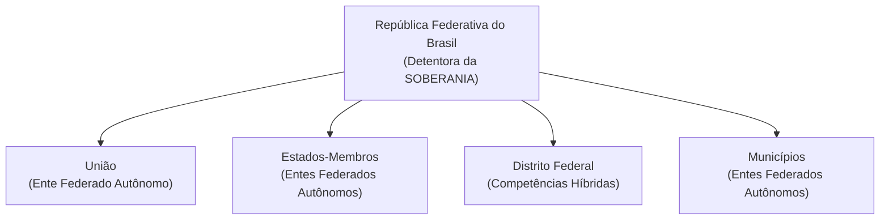

# 03 - Organização do Estado, Repartição de Competências e Servidores Públicos

> **Matéria:** Noções de Direito Constitucional  
> **Cargo:** A01 – Técnico de Controle Externo – Especialidade: Técnico Administrativo  
> **Arquivo:** `03_organizacao_do_estado_e_reparticao_de_competencias.md`  
> **Status:** 🟢 Teoria Aprofundada + 5 Questões FCC Comentadas (A a E)

---

## 📌 Ementa / Itens do Edital

- Da organização político-administrativa do Estado brasileiro (Artigos 18 e 19 da CF/88): forma federativa, autonomia dos entes e vedações federativas.
- Da União, dos Estados Federados, do Distrito Federal e dos Municípios: bens públicos, criação e desmembramento de entes, e competências materiais e legislativas.
- Repartição constitucional de competências:
    - Competências materiais exclusivas da União (Art. 21) e comuns de todos os entes (Art. 23);
    - Competências legislativas privativas da União (Art. 22) e concorrentes entre União, Estados e DF (Art. 24);
    - Competências remanescentes/residuais dos Estados (Art. 25) e competências de interesse local dos Municípios (Art. 30).
- Intervenção Federal e Estadual (Artigos 34 a 36 da CF/88): hipóteses, princípios sensíveis e procedimento.
- Regime constitucional da Administração Pública (Artigo 37 da CF/88): princípios fundamentais, concurso público, cargos em comissão e funções de confiança, teto remuneratório e regras de acumulação de cargos.
- Servidores públicos civis (Artigos 38 a 41 da CF/88): exercício de mandato eletivo, estágio probatório, estabilidade aos 3 anos, avaliação especial de desempenho e hipóteses constitucionais taxativas de perda do cargo público estável.

---

## 🧭 Sumário

1. [Forma Federativa e Organização Político-Administrativa](#1-forma-federativa-e-organizacao-politico-administrativa)
    1. [Características da Federação Brasileira e Autonomia dos Entes](#11-caracteristicas-da-federacao-brasileira-e-autonomia-dos-entes)
    2. [Vedações Constitucionais Federativas (Art. 19)](#12-vedacoes-constitucionais-federativas-art-19)
    3. [Bens Públicos Constitucionais e Criação de Novos Entes](#13-bens-publicos-constitucionais-e-criacao-de-novos-entes)
    4. [Teste 132](#Teste-132)
2. [O Modelo Constitucional de Repartição de Competências](#2-o-modelo-constitucional-de-reparticao-de-competencias)
    1. [Competências Legislativas: Privativa da União versus Concorrente](#21-competencias-legislativas-privativa-da-uniao-versus-concorrente)
    2. [Competências Administrativas: Exclusivas e Comuns](#22-competencias-administrativas-exclusivas-e-comuns)
    3. [Competências dos Estados e Municípios](#23-competencias-dos-estados-e-municipios)
    4. [Teste 133](#Teste-133)
    5. [Teste 134](#Teste-134)
    6. [Teste 135](#Teste-135)
    7. [Teste 136](#Teste-136)
3. [Mecanismos Excepcionais de Equilíbrio: Intervenção Federal e Estadual](#3-mecanismos-excepcionais-de-equilibrio-intervencao-federal-e-estadual)
    1. [Teste 137](#Teste-137)
4. [Regime Constitucional da Administração Pública e Servidores (Arts. 37 a 41)](#4-regime-constitucional-da-administracao-publica-e-servidores-arts-37-a-41)
    1. [Concurso Público, Funções de Confiança e Cargos em Comissão](#41-concurso-publico-funcoes-de-confianca-e-cargos-em-comissao)
    2. [Regra Constitucional da Não-Acumulação e Exceções (Art. 37, XVI)](#42-regra-constitucional-da-nao-acumulacao-e-excecoes-art-37-xvi)
    3. [Exercício de Mandato Eletivo pelo Servidor Público (Art. 38)](#43-exercicio-de-mandato-eletivo-pelo-servidor-publico-art-38)
    4. [Estabilidade e Perda do Cargo do Servidor Estável (Art. 41)](#44-estabilidade-e-perda-do-cargo-do-servidor-estavel-art-41)
    5. [Teste 138](#Teste-138)
    6. [Teste 139](#Teste-139)
    7. [Teste 140](#Teste-140)
    8. [Teste 141](#Teste-141)
    9. [Teste 142](#Teste-142)
5. [🌐 Fontes Oficiais & Doutrinárias Recomendadas](#fontes-oficiais-doutrinarias-recomendadas)

---

## 1. Forma Federativa e Organização Político-Administrativa

### 1.1 Características da Federação Brasileira e Autonomia dos Entes
A República Federativa do Brasil é formada pela união indissolúvel dos Estados e Municípios e do Distrito Federal (Art. 18, *caput*).

- **Origem Histórica:** Formou-se por **desagregação** (ou segregação), decorrente de um movimento **centrífugo** (o Estado unitário imperial descentralizou poderes políticos para as províncias que se transformaram em Estados-membros).
- **Indissolubilidade do Vínculo Federativo:** Não existe o direito de secessão (nenhum Estado ou Município pode se separar do Brasil). A tentativa de desmembramento justifica a intervenção federal imediata (art. 34, I) e constitui crime inafiançável e imprescritível (art. 5º, XLIV).
- **Soberania vs. Autonomia:**
    - A **Soberania** é atributo exclusivo da **República Federativa do Brasil** no plano internacional.
    - A **Autonomia** é outorgada aos entes federados (União, Estados, DF e Municípios), manifestando-se pela tríplice capacidade de auto-organização (Constituições e Leis Orgânicas), autogoverno (eleição de chefes dos poderes) e autoadministração (gestão e tributação próprias).

### 1.2 Vedações Constitucionais Federativas (Art. 19)
O art. 19 da Carta da República veda à União, aos Estados, ao Distrito Federal e aos Municípios:

1. **Estabelecer cultos religiosos ou igrejas, subvencioná-los, embaraçar-lhes o funcionamento ou manter com eles ou seus representantes relações de dependência ou aliança**, ressalvada, na forma da lei, a colaboração de interesse público *(Princípio da Laicidade Estatal)*.
2. **Recusar fé aos documentos públicos** *(Eficácia probatória nacional dos documentos emitidos por órgãos oficiais)*.
3. **Criar distinções entre brasileiros ou preferências entre si** *(Proibição de discriminação tributária, previdenciária ou funcional com base na origem regional)*.

### 1.3 Bens Públicos Constitucionais e Criação de Novos Entes
- **Bens da União (Art. 20):** Terras devolutas indispensáveis à defesa das fronteiras, recursos minerais (inclusive do subsolo), potenciais de energia hidráulica, mar territorial, terrenos de marinha e terras tradicionalmente ocupadas pelos índios.
- **Bens dos Estados (Art. 26):** Águas superficiais ou subterrâneas fluentes nos seus territórios, ilhas fluviais e lacustres não pertencentes à União e terras devolutas não compreendidas entre as da União.
- **Criação de Estados (Art. 18, § 3º):** Exige aprovação da população diretamente interessada por meio de **plebiscito** e edição de **Lei Complementar Federal** pelo Congresso Nacional.
- **Criação de Municípios (Art. 18, § 4º):** Depende de **Lei Complementar Federal** (definindo o período temporal), divulgação prévia dos Estudos de Viabilidade Municipal, consulta prévia por **plebiscito** às populações dos municípios envolvidos e promulgação de **Lei Ordinária Estadual**.

---
