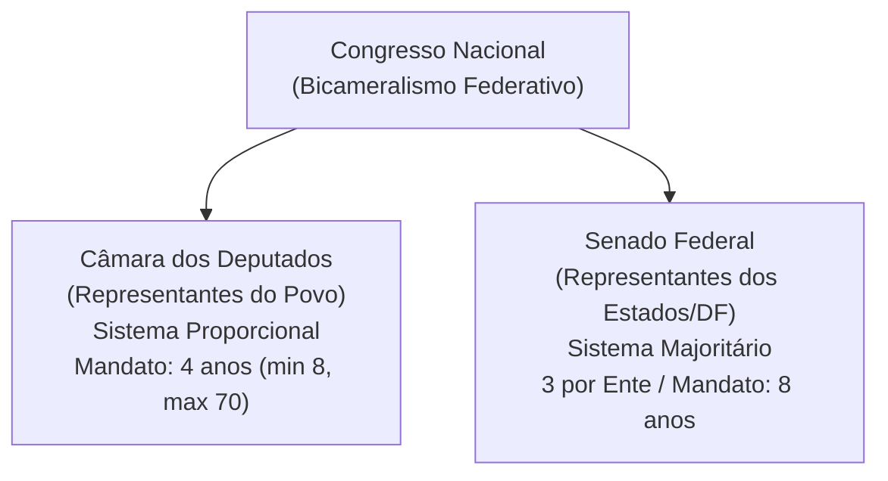

# 04 - Poder Legislativo, Processo Legislativo e Controle Externo (Arts. 70 a 75 da CF/88)

> **Matéria:** Noções de Direito Constitucional  
> **Cargo:** A01 – Técnico de Controle Externo – Especialidade: Técnico Administrativo  
> **Arquivo:** `04_poder_legislativo_processo_legislativo_e_fiscalizacao_tce.md`  
> **Status:** 🟢 Teoria Aprofundada + 5 Questões FCC Comentadas (A a E)

---

## 📌 Ementa / Itens do Edital

- Do Poder Legislativo: estrutura bicameral federal (Câmara dos Deputados e Senado Federal) e unicameral estadual/distrital/municipal.
- Atribuições do Congresso Nacional e competências privativas da Câmara dos Deputados (Art. 51) e do Senado Federal (Art. 52).
- Estatuto dos congressistas: imunidade material (inviolabilidade civil e penal) e imunidade formal/processual (prisão e prerrogativa de foro - Art. 53).
- Do processo legislativo (Artigos 59 a 69 da CF/88):
    - Emendas à Constituição (Art. 60): iniciativa restrita, rito qualificado de aprovação, inexistência de sanção/veto e limitações circunstanciais e materiais (cláusulas pétreas);
    - Leis Complementares vs. Leis Ordinárias (quórum e reserva de matéria);
    - Medidas Provisórias (Art. 62): pressupostos constitucionais, prazos e vedações temáticas absolutas.
- Da fiscalização contábil, financeira, orçamentária, operacional e patrimonial (Artigos 70 a 75 da CF/88):
    - Controle externo titularizado pelo Poder Legislativo com auxílio do Tribunal de Contas;
    - Competências do Tribunal de Contas (Art. 71 da CF/88);
    - Duplo regime de contas: Contas de Governo (parecer prévio opinativo) vs. Contas de Gestão/Ordenadores de Despesa (julgamento técnico definitivo);
    - Julgamento das contas de Prefeito Municipal (Art. 31, § 2º e Tema 835 do STF);
    - Sustação de atos administrativos ilegais vs. sustação de contratos administrativos (Art. 71, X e §§ 1º e 2º);
    - Eficácia de título executivo extrajudicial das decisões do Tribunal de Contas (Art. 71, § 3º da CF/88);
    - Princípio da simetria constitucional (Art. 75 da CF/88) e o Ministério Público de Contas (Art. 130 da CF/88).

---

## 🧭 Sumário

1. [Estrutura Bicameral e Atribuições das Casas Legislativas](#1-estrutura-bicameral-e-atribuicoes-das-casas-legislativas)
    1. [Modelo Bicameral Federal e Unicameral Estadual/Municipal](#11-modelo-bicameral-federal-e-unicameral-estadualmunicipal)
    2. [Repartição de Competências no Congresso Nacional](#12-reparticao-de-competencias-no-congresso-nacional)
    3. [Estatuto dos Congressistas e Imunidades Parlamentares](#13-estatuto-dos-congressistas-e-imunidades-parlamentares)
    4. [Teste 143](#Teste-143)
    5. [Teste 144](#Teste-144)
    6. [Teste 145](#Teste-145)
2. [O Processo Legislativo Constitucional](#2-o-processo-legislativo-constitucional)
    1. [Emendas à Constituição (Art. 60) e Limitações ao Poder de Reforma](#21-emendas-a-constituicao-art-60-e-limitacoes-ao-poder-de-reforma)
    2. [Leis Complementares versus Leis Ordinárias](#22-leis-complementares-versus-leis-ordinarias)
    3. [Medidas Provisórias (Art. 62): Prazos e Vedações Temáticas](#23-medidas-provisorias-art-62-prazos-e-vedacoes-tematicas)
    4. [Teste 146](#Teste-146)
    5. [Teste 147](#Teste-147)
    6. [Teste 148](#Teste-148)
3. [Fiscalização e Controle Externo pelos Tribunais de Contas (Arts. 70 a 75)](#3-fiscalizacao-e-controle-externo-pelos-tribunais-de-contas-arts-70-a-75)
    1. [Abrangência e Critérios da Fiscalização Financeira](#31-abrangencia-e-criterios-da-fiscalizacao-financeira)
    2. [O Julgamento de Contas Públicas: Contas de Governo versus Contas de Gestão](#32-o-julgamento-de-contas-publicas-contas-de-governo-versus-contas-de-gestao)
    3. [Sustação de Atos Ilegais versus Sustação de Contratos Administrativos](#33-sustacao-de-atos-ilegais-versus-sustacao-de-contratos-administrativos)
    4. [Eficácia das Decisões Condenatórias e Título Executivo Extrajudicial](#34-eficacia-das-decisoes-condenatorias-e-titulo-executivo-extrajudicial)
    5. [Simetria Federativa (Art. 75) e o Ministério Público de Contas (Art. 130)](#35-simetria-federativa-art-75-e-o-ministerio-publico-de-contas-art-130)
    6. [Teste 149](#Teste-149)
    7. [Teste 150](#Teste-150)
    8. [Teste 151](#Teste-151)
    9. [Teste 152](#Teste-152)
    10. [Teste 153](#Teste-153)
4. [🌐 Fontes Oficiais & Jurisprudenciais Recomendadas](#fontes-oficiais-jurisprudenciais-recomendadas)

---

## 1. Estrutura Bicameral e Atribuições das Casas Legislativas

O Poder Legislativo da União é exercido pelo Congresso Nacional, que se compõe da Câmara dos Deputados e do Senado Federal (modelo bicameral federativo):

- **Câmara dos Deputados (Art. 45):** Representa o **povo brasileiro**. Os deputados são eleitos pelo sistema eleitoral proporcional, para mandato de **4 anos** (uma legislatura). O número total de deputados por Estado e DF é proporcional à população, com piso mínimo de **8** e teto máximo de **70 deputados**.
- **Senado Federal (Art. 46):** Representa os **Estados e o Distrito Federal**. Cada unidade federada elege **3 senadores**, pelo sistema majoritário, com mandato de **8 anos** (duas legislaturas). A representação é renovada de quatro em quatro anos, alternadamente, por **um terço (1/3)** e **dois terços (2/3)**.

### 1.1 Modelo Bicameral Federal e Unicameral Estadual/Municipal
Enquanto na esfera federal vigora o bicameralismo, nos demais entes da Federação o Poder Legislativo adota compulsoriamente a estrutura **unicameral**:

- **Estados-Membros:** Assembleias Legislativas, compostas por Deputados Estaduais (art. 27);
- **Distrito Federal:** Câmara Legislativa do Distrito Federal, composta por Deputados Distritais (art. 32, § 2º);
- **Municípios:** Câmaras Municipais, compostas por Vereadores (art. 29, IV).

### 1.2 Repartição de Competências no Congresso Nacional
É fundamental distinguir os três tipos de atribuições legislativas federais:

1. **Competências com Sanção Presidencial (Art. 48):** Matérias deliberadas pelo Congresso Nacional que geram leis e demandam envio ao Presidente da República para sanção ou veto (ex.: sistema tributário, planos orçamentários, criação e extinção de cargos públicos).
2. **Competências Exclusivas do Congresso Nacional sem Sanção (Art. 49):** Deliberadas em sessão conjunta ou separada e formalizadas por **Decreto Legislativo**, sem qualquer interferência presidencial (ex.: sustar atos normativos do Executivo que exorbitem do poder regulamentar; autorizar o Presidente a declarar guerra ou celebrar a paz; julgar anualmente as contas prestadas pelo Presidente da República).
3. **Competências Privativas de Cada Casa (Arts. 51 e 52):** Formalizadas por **Resolução**, sem envio ao Presidente:
    - *Câmara dos Deputados (Art. 51, I):* Autorizar, por **dois terços** de seus membros, a instauração de processo contra o Presidente e o Vice-Presidente da República e os Ministros de Estado.
    - *Senado Federal (Art. 52, I e II):* Processar e julgar o Presidente e Vice-Presidente nos **crimes de responsabilidade**, bem como os Ministros do STF, os membros do CNJ e CNMP, o Procurador-Geral da República e o Advogado-Geral da União; sabatinar e aprovar a escolha de magistrados, Ministros do TCU e chefes de missão diplomática; suspender a execução, no todo ou em parte, de lei declarada inconstitucional por decisão definitiva do STF em controle difuso.

### 1.3 Estatuto dos Congressistas e Imunidades Parlamentares
O art. 53 da Constituição consagra o plexo de garantias institucionais dos membros do Congresso Nacional:

- **Imunidade Material (Real ou Substantiva):** Os Deputados e Senadores são invioláveis, civil e penalmente, por quaisquer de suas opiniões, palavras e votos. Exige conexão (nexo de causalidade) com o desempenho das funções parlamentares, sendo absoluta quando manifestada dentro do recinto do parlamento.
- **Imunidade Formal (Processual) quanto à Prisão (Art. 53, § 2º):** Desde a expedição do diploma, os membros do Congresso Nacional **não poderão ser presos**, salvo em flagrante de crime inafiançável. Nesse caso, os autos serão remetidos dentro de vinte e quatro horas à Casa respectiva, para que, pelo voto da maioria de seus membros, resolva sobre a prisão.
- **Foro por Prerrogativa de Função (Art. 53, § 1º):** Os Deputados e Senadores serão submetidos a julgamento perante o STF desde a expedição do diploma. Conforme tese firmada pelo STF na AP 937 e reafirmada pelo plenário, o foro especial aplica-se apenas aos crimes cometidos durante o exercício do mandato e relacionados com as funções parlamentares.

---

