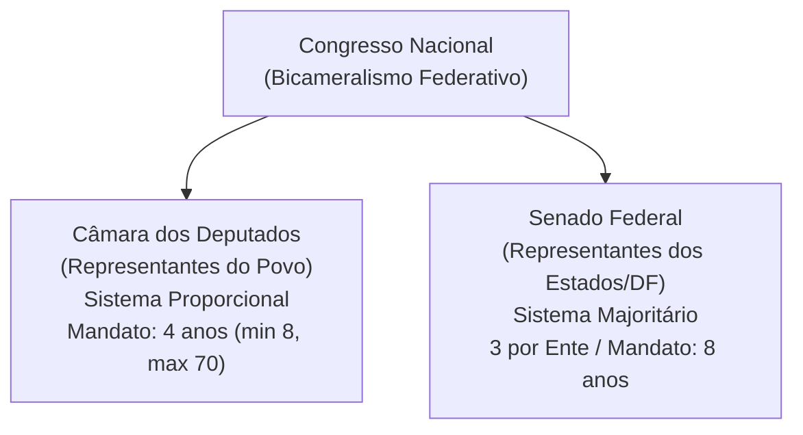

# 04 - Poder Legislativo, Processo Legislativo e Controle Externo (Arts. 70 a 75 da CF/88)

> **Matéria:** Noções de Direito Constitucional  
> **Cargo:** A01 – Técnico de Controle Externo – Especialidade: Técnico Administrativo  
> **Arquivo:** `04_poder_legislativo_processo_legislativo_e_fiscalizacao_tce.md`  
> **Status:** 🟢 Teoria Aprofundada + 5 Questões FCC Comentadas (A a E)

---

## 📌 Ementa / Itens do Edital

- Do Poder Legislativo: estrutura bicameral federal (Câmara dos Deputados e Senado Federal) e unicameral estadual/distrital/municipal.
- Atribuições do Congresso Nacional e competências privativas da Câmara dos Deputados (Art. 51) e do Senado Federal (Art. 52).
- Estatuto dos congressistas: imunidade material (inviolabilidade civil e penal) e imunidade formal/processual (prisão e prerrogativa de foro - Art. 53).
- Do processo legislativo (Artigos 59 a 69 da CF/88):
    - Emendas à Constituição (Art. 60): iniciativa restrita, rito qualificado de aprovação, inexistência de sanção/veto e limitações circunstanciais e materiais (cláusulas pétreas);
    - Leis Complementares vs. Leis Ordinárias (quórum e reserva de matéria);
    - Medidas Provisórias (Art. 62): pressupostos constitucionais, prazos e vedações temáticas absolutas.
- Da fiscalização contábil, financeira, orçamentária, operacional e patrimonial (Artigos 70 a 75 da CF/88):
    - Controle externo titularizado pelo Poder Legislativo com auxílio do Tribunal de Contas;
    - Competências do Tribunal de Contas (Art. 71 da CF/88);
    - Duplo regime de contas: Contas de Governo (parecer prévio opinativo) vs. Contas de Gestão/Ordenadores de Despesa (julgamento técnico definitivo);
    - Julgamento das contas de Prefeito Municipal (Art. 31, § 2º e Tema 835 do STF);
    - Sustação de atos administrativos ilegais vs. sustação de contratos administrativos (Art. 71, X e §§ 1º e 2º);
    - Eficácia de título executivo extrajudicial das decisões do Tribunal de Contas (Art. 71, § 3º da CF/88);
    - Princípio da simetria constitucional (Art. 75 da CF/88) e o Ministério Público de Contas (Art. 130 da CF/88).

---

## 🧭 Sumário

1. [Estrutura Bicameral e Atribuições das Casas Legislativas](#1-estrutura-bicameral-e-atribuicoes-das-casas-legislativas)
    1. [Modelo Bicameral Federal e Unicameral Estadual/Municipal](#11-modelo-bicameral-federal-e-unicameral-estadualmunicipal)
    2. [Repartição de Competências no Congresso Nacional](#12-reparticao-de-competencias-no-congresso-nacional)
    3. [Estatuto dos Congressistas e Imunidades Parlamentares](#13-estatuto-dos-congressistas-e-imunidades-parlamentares)
    4. [Teste 143](#Teste-143)
    5. [Teste 144](#Teste-144)
    6. [Teste 145](#Teste-145)
2. [O Processo Legislativo Constitucional](#2-o-processo-legislativo-constitucional)
    1. [Emendas à Constituição (Art. 60) e Limitações ao Poder de Reforma](#21-emendas-a-constituicao-art-60-e-limitacoes-ao-poder-de-reforma)
    2. [Leis Complementares versus Leis Ordinárias](#22-leis-complementares-versus-leis-ordinarias)
    3. [Medidas Provisórias (Art. 62): Prazos e Vedações Temáticas](#23-medidas-provisorias-art-62-prazos-e-vedacoes-tematicas)
    4. [Teste 146](#Teste-146)
    5. [Teste 147](#Teste-147)
    6. [Teste 148](#Teste-148)
3. [Fiscalização e Controle Externo pelos Tribunais de Contas (Arts. 70 a 75)](#3-fiscalizacao-e-controle-externo-pelos-tribunais-de-contas-arts-70-a-75)
    1. [Abrangência e Critérios da Fiscalização Financeira](#31-abrangencia-e-criterios-da-fiscalizacao-financeira)
    2. [O Julgamento de Contas Públicas: Contas de Governo versus Contas de Gestão](#32-o-julgamento-de-contas-publicas-contas-de-governo-versus-contas-de-gestao)
    3. [Sustação de Atos Ilegais versus Sustação de Contratos Administrativos](#33-sustacao-de-atos-ilegais-versus-sustacao-de-contratos-administrativos)
    4. [Eficácia das Decisões Condenatórias e Título Executivo Extrajudicial](#34-eficacia-das-decisoes-condenatorias-e-titulo-executivo-extrajudicial)
    5. [Simetria Federativa (Art. 75) e o Ministério Público de Contas (Art. 130)](#35-simetria-federativa-art-75-e-o-ministerio-publico-de-contas-art-130)
    6. [Teste 149](#Teste-149)
    7. [Teste 150](#Teste-150)
    8. [Teste 151](#Teste-151)
    9. [Teste 152](#Teste-152)
    10. [Teste 153](#Teste-153)
4. [🌐 Fontes Oficiais & Jurisprudenciais Recomendadas](#fontes-oficiais-jurisprudenciais-recomendadas)

---

## 1. Estrutura Bicameral e Atribuições das Casas Legislativas

O Poder Legislativo da União é exercido pelo Congresso Nacional, que se compõe da Câmara dos Deputados e do Senado Federal (modelo bicameral federativo):

- **Câmara dos Deputados (Art. 45):** Representa o **povo brasileiro**. Os deputados são eleitos pelo sistema eleitoral proporcional, para mandato de **4 anos** (uma legislatura). O número total de deputados por Estado e DF é proporcional à população, com piso mínimo de **8** e teto máximo de **70 deputados**.
- **Senado Federal (Art. 46):** Representa os **Estados e o Distrito Federal**. Cada unidade federada elege **3 senadores**, pelo sistema majoritário, com mandato de **8 anos** (duas legislaturas). A representação é renovada de quatro em quatro anos, alternadamente, por **um terço (1/3)** e **dois terços (2/3)**.

### 1.1 Modelo Bicameral Federal e Unicameral Estadual/Municipal
Enquanto na esfera federal vigora o bicameralismo, nos demais entes da Federação o Poder Legislativo adota compulsoriamente a estrutura **unicameral**:

- **Estados-Membros:** Assembleias Legislativas, compostas por Deputados Estaduais (art. 27);
- **Distrito Federal:** Câmara Legislativa do Distrito Federal, composta por Deputados Distritais (art. 32, § 2º);
- **Municípios:** Câmaras Municipais, compostas por Vereadores (art. 29, IV).

### 1.2 Repartição de Competências no Congresso Nacional
É fundamental distinguir os três tipos de atribuições legislativas federais:

1. **Competências com Sanção Presidencial (Art. 48):** Matérias deliberadas pelo Congresso Nacional que geram leis e demandam envio ao Presidente da República para sanção ou veto (ex.: sistema tributário, planos orçamentários, criação e extinção de cargos públicos).
2. **Competências Exclusivas do Congresso Nacional sem Sanção (Art. 49):** Deliberadas em sessão conjunta ou separada e formalizadas por **Decreto Legislativo**, sem qualquer interferência presidencial (ex.: sustar atos normativos do Executivo que exorbitem do poder regulamentar; autorizar o Presidente a declarar guerra ou celebrar a paz; julgar anualmente as contas prestadas pelo Presidente da República).
3. **Competências Privativas de Cada Casa (Arts. 51 e 52):** Formalizadas por **Resolução**, sem envio ao Presidente:
    - *Câmara dos Deputados (Art. 51, I):* Autorizar, por **dois terços** de seus membros, a instauração de processo contra o Presidente e o Vice-Presidente da República e os Ministros de Estado.
    - *Senado Federal (Art. 52, I e II):* Processar e julgar o Presidente e Vice-Presidente nos **crimes de responsabilidade**, bem como os Ministros do STF, os membros do CNJ e CNMP, o Procurador-Geral da República e o Advogado-Geral da União; sabatinar e aprovar a escolha de magistrados, Ministros do TCU e chefes de missão diplomática; suspender a execução, no todo ou em parte, de lei declarada inconstitucional por decisão definitiva do STF em controle difuso.

### 1.3 Estatuto dos Congressistas e Imunidades Parlamentares
O art. 53 da Constituição consagra o plexo de garantias institucionais dos membros do Congresso Nacional:

- **Imunidade Material (Real ou Substantiva):** Os Deputados e Senadores são invioláveis, civil e penalmente, por quaisquer de suas opiniões, palavras e votos. Exige conexão (nexo de causalidade) com o desempenho das funções parlamentares, sendo absoluta quando manifestada dentro do recinto do parlamento.
- **Imunidade Formal (Processual) quanto à Prisão (Art. 53, § 2º):** Desde a expedição do diploma, os membros do Congresso Nacional **não poderão ser presos**, salvo em flagrante de crime inafiançável. Nesse caso, os autos serão remetidos dentro de vinte e quatro horas à Casa respectiva, para que, pelo voto da maioria de seus membros, resolva sobre a prisão.
- **Foro por Prerrogativa de Função (Art. 53, § 1º):** Os Deputados e Senadores serão submetidos a julgamento perante o STF desde a expedição do diploma. Conforme tese firmada pelo STF na AP 937 e reafirmada pelo plenário, o foro especial aplica-se apenas aos crimes cometidos durante o exercício do mandato e relacionados com as funções parlamentares.

---

### Teste 001
**(FGV – TJ/SC – 2026 – Analista Administrativo)**
No campo da gestão pública, os conceitos de governabilidade e accountability constituem categorias distintas, embora complementares. A respeito dos conceitos de governabilidade e accountability, é correto afirmar que

* **A)** governabilidade refere-se à capacidade política do Estado de governar e decidir, originada de sua legitimidade democrática perante a sociedade, ao passo que accountability designa o dever de os agentes de governança prestarem contas de sua atuação e assumirem as consequências de seus atos e omissões.
* **B)** governabilidade e accountability são expressões sinônimas, ambas designando os mecanismos institucionais de prestação de contas dos governantes perante o Poder Legislativo e os órgãos de controle externo.
* **C)** governabilidade corresponde ao dever do agente público de prestar contas de modo claro, conciso e tempestivo, ao passo que accountability designa a capacidade administrativa do Estado de implementar suas políticas.
* **D)** governabilidade traduz a fiscalização exercida pelos órgãos de controle interno sobre a Administração Pública, enquanto accountability designa o conjunto de mecanismos de liderança, estratégia e controle aplicados à gestão.
* **E)** governabilidade e accountability constituem dimensões da gestão de riscos, voltadas à identificação e ao monitoramento de eventos potenciais que possam afetar o alcance dos objetivos institucionais.

---

> **Comentário Detalhado:**
>
> - **A)** **Correta.** Conforme fundamentado na seção *1.2 Repartição de Competências no Congresso Nacional* deste guia, competências Exclusivas do Congresso Nacional sem Sanção (Art. 49): Deliberadas em sessão conjunta ou separada e formalizadas por Decreto Legislativo, sem qualquer interferência presidencial (ex.: sustar atos normativos do Executivo que exorbitem do poder regulamentar; autorizar o Presidente a declarar guerra ou celebrar a paz; julgar anualmente as contas prestadas pelo Presidente da República). Dessa forma, está plenamente correta a assertiva da banca (FGV – TJ/SC/2026) ao estabelecer que "governabilidade refere se à capacidade política do Estado de governar e decidir, originada de sua legitimidade...".
> - **B)** **Incorreta.** A opção apresenta proposição em desacordo com os fundamentos teóricos e técnicos do tópico ao afirmar que "governabilidade e accountability são expressões sinônimas, ambas designando os mecanismos institucionais de...". De acordo com a teoria estudada em *1. Estrutura Bicameral e Atribuições das Casas Legislativas*, o Poder Legislativo da União é exercido pelo Congresso Nacional, que se compõe da Câmara dos Deputados e do Senado Federal (modelo bicameral federativo).
> - **C)** **Incorreta.** A opção apresenta proposição em desacordo com os fundamentos teóricos e técnicos do tópico ao afirmar que "governabilidade corresponde ao dever do agente público de prestar contas de modo claro, conciso e tempestivo, ao...". De acordo com a teoria estudada em *1.3 Estatuto dos Congressistas e Imunidades Parlamentares*, foro por Prerrogativa de Função (Art. 53, § 1º): Os Deputados e Senadores serão submetidos a julgamento perante o STF desde a expedição do diploma. Conforme tese firmada pelo STF na AP 937 e reafirmada pelo plenário, o foro especial aplica se apenas aos crimes cometidos durante o exercício do mandato e relacionados com as funções parlamentares.
> - **D)** **Incorreta.** A opção apresenta proposição em desacordo com os fundamentos teóricos e técnicos do tópico ao afirmar que "governabilidade traduz a fiscalização exercida pelos órgãos de controle interno sobre a Administração Pública...". De acordo com a teoria estudada em *1.1 Modelo Bicameral Federal e Unicameral Estadual/Municipal*, enquanto na esfera federal vigora o bicameralismo, nos demais entes da Federação o Poder Legislativo adota compulsoriamente a estrutura unicameral.
> - **E)** **Incorreta.** A opção apresenta proposição em desacordo com os fundamentos teóricos e técnicos do tópico ao afirmar que "governabilidade e accountability constituem dimensões da gestão de riscos, voltadas à identificação e ao...". De acordo com a teoria estudada em *1.3 Estatuto dos Congressistas e Imunidades Parlamentares*, o art. 53 da Constituição consagra o plexo de garantias institucionais dos membros do Congresso Nacional.
>
> **Gabarito: A**

---

### Teste 002
**(FGV – TJ/SC – 2026 – Analista Administrativo)**
No primeiro ano de mandato, o Presidente da República encaminha ao Congresso Nacional projeto de lei que estabelece, de forma regionalizada, diretrizes, objetivos e metas da Administração Pública federal, voltados às despesas de capital e aos programas de duração continuada, com vigência para os anos subsequentes. À luz da Constituição Federal, é correto afirmar que esse projeto de lei

* **A)** possui vigência de quatro anos, iniciando-se no segundo ano do mandato e encerrando-se no primeiro ano do mandato seguinte.
* **B)** tem vigência coincidente com o mandato presidencial, iniciando-se no primeiro ano e encerrando-se no último ano de governo.
* **C)** abrange exclusivamente despesas correntes, vedada a inclusão de despesas de capital.
* **D)** dispensa a regionalização das metas, por se tratar de planejamento estratégico nacional.
* **E)** caso rejeitado pelo Poder Legislativo, pode ser reeditado por medida provisória, em razão de sua natureza programática e provisória.

---

> **Comentário Detalhado:**
>
> - **A)** **Correta.** Conforme fundamentado na seção *1. Estrutura Bicameral e Atribuições das Casas Legislativas* deste guia, senado Federal (Art. 46): Representa os Estados e o Distrito Federal. Cada unidade federada elege 3 senadores, pelo sistema majoritário, com mandato de 8 anos (duas legislaturas). A representação é renovada de quatro em quatro anos, alternadamente, por um terço (1/3) e dois terços (2/3). Dessa forma, está plenamente correta a assertiva da banca (FGV – TJ/SC/2026) ao estabelecer que "possui vigência de quatro anos, iniciando se no segundo ano do mandato e encerrando se no primeiro ano do mandato...".
> - **B)** **Incorreta.** A opção apresenta proposição em desacordo com os fundamentos teóricos e técnicos do tópico ao afirmar que "tem vigência coincidente com o mandato presidencial, iniciando se no primeiro ano e encerrando se no último ano de...". De acordo com a teoria estudada em *1.2 Repartição de Competências no Congresso Nacional*, competências com Sanção Presidencial (Art. 48): Matérias deliberadas pelo Congresso Nacional que geram leis e demandam envio ao Presidente da República para sanção ou veto (ex.: sistema tributário, planos orçamentários, criação e extinção de cargos públicos).
> - **C)** **Incorreta.** A opção incorre em restrição indevida ao limitar o escopo conceitual ao afirmar que "abrange exclusivamente despesas correntes, vedada a inclusão de despesas de capital". De acordo com a teoria estudada em *1.3 Estatuto dos Congressistas e Imunidades Parlamentares*, imunidade Formal (Processual) quanto à Prisão (Art. 53, § 2º): Desde a expedição do diploma, os membros do Congresso Nacional não poderão ser presos, salvo em flagrante de crime inafiançável. Nesse caso, os autos serão remetidos dentro de vinte e quatro horas à Casa respectiva, para que, pelo voto da maioria de seus membros, resolva sobre a prisão.
> - **D)** **Incorreta.** A opção afasta requisito ou relação estrutural exigida pela matéria ao afirmar que "dispensa a regionalização das metas, por se tratar de planejamento estratégico nacional". De acordo com a teoria estudada em *1.2 Repartição de Competências no Congresso Nacional*, senado Federal (Art. 52, I e II): Processar e julgar o Presidente e Vice Presidente nos crimes de responsabilidade, bem como os Ministros do STF, os membros do CNJ e CNMP, o Procurador Geral da República e o Advogado Geral da União; sabatinar e aprovar a escolha de magistrados, Ministros do TCU e chefes de missão diplomática; suspender a execução, no todo ou em parte, de lei declarada inconstitucional por decisão definitiva do STF em controle difuso.
> - **E)** **Incorreta.** A opção apresenta proposição em desacordo com os fundamentos teóricos e técnicos do tópico ao afirmar que "caso rejeitado pelo Poder Legislativo, pode ser reeditado por medida provisória, em razão de sua natureza...". De acordo com a teoria estudada em *1.2 Repartição de Competências no Congresso Nacional*, competências Exclusivas do Congresso Nacional sem Sanção (Art. 49): Deliberadas em sessão conjunta ou separada e formalizadas por Decreto Legislativo, sem qualquer interferência presidencial (ex.: sustar atos normativos do Executivo que exorbitem do poder regulamentar; autorizar o Presidente a declarar guerra ou celebrar a paz; julgar anualmente as contas prestadas pelo Presidente da República).
>
> **Gabarito: A**

---

### Teste 003
**(FGV – TJ/SC – 2026 – Analista Administrativo)**
Durante a execução orçamentária, determinado ente federativo verificou a necessidade de realizar despesa não prevista na Lei Orçamentária Anual. Para tanto, o Poder Executivo pretendeu abrir crédito adicional por meio de ato infralegal, sem submissão ao Poder Legislativo. À luz da Constituição Federal, da Lei nº 4.320/1964 e da jurisprudência do Supremo Tribunal Federal, é correto afirmar que

* **A)** a abertura de crédito adicional independe de autorização legislativa, por se tratar de ato de execução orçamentária.
* **B)** a abertura de crédito adicional pode ser realizada por decreto, desde que haja indicação de fonte de recursos.
* **C)** a autorização legislativa somente é dispensável quando se tratar de crédito suplementar.
* **D)** a abertura de crédito adicional depende de autorização legislativa, mediante lei em sentido formal.
* **E)** a abertura de crédito adicional exige previsão geral na Lei de Diretrizes Orçamentárias, mas não autorização específica em lei formal.

---

> **Comentário Detalhado:**
>
> - **A)** **Incorreta.** A opção afasta requisito ou relação estrutural exigida pela matéria ao afirmar que "a abertura de crédito adicional independe de autorização legislativa, por se tratar de ato de execução orçamentária". De acordo com a teoria estudada em *1.1 Modelo Bicameral Federal e Unicameral Estadual/Municipal*, distrito Federal: Câmara Legislativa do Distrito Federal, composta por Deputados Distritais (art. 32, § 2º).
> - **B)** **Incorreta.** A opção apresenta proposição em desacordo com os fundamentos teóricos e técnicos do tópico ao afirmar que "a abertura de crédito adicional pode ser realizada por decreto, desde que haja indicação de fonte de recursos". De acordo com a teoria estudada em *1.3 Estatuto dos Congressistas e Imunidades Parlamentares*, imunidade Formal (Processual) quanto à Prisão (Art. 53, § 2º): Desde a expedição do diploma, os membros do Congresso Nacional não poderão ser presos, salvo em flagrante de crime inafiançável. Nesse caso, os autos serão remetidos dentro de vinte e quatro horas à Casa respectiva, para que, pelo voto da maioria de seus membros, resolva sobre a prisão.
> - **C)** **Incorreta.** A opção incorre em restrição indevida ao limitar o escopo conceitual ao afirmar que "a autorização legislativa somente é dispensável quando se tratar de crédito suplementar". De acordo com a teoria estudada em *1.2 Repartição de Competências no Congresso Nacional*, competências Exclusivas do Congresso Nacional sem Sanção (Art. 49): Deliberadas em sessão conjunta ou separada e formalizadas por Decreto Legislativo, sem qualquer interferência presidencial (ex.: sustar atos normativos do Executivo que exorbitem do poder regulamentar; autorizar o Presidente a declarar guerra ou celebrar a paz; julgar anualmente as contas prestadas pelo Presidente da República).
> - **D)** **Correta.** Conforme fundamentado na seção *1.2 Repartição de Competências no Congresso Nacional* deste guia, senado Federal (Art. 52, I e II): Processar e julgar o Presidente e Vice Presidente nos crimes de responsabilidade, bem como os Ministros do STF, os membros do CNJ e CNMP, o Procurador Geral da República e o Advogado Geral da União; sabatinar e aprovar a escolha de magistrados, Ministros do TCU e chefes de missão diplomática; suspender a execução, no todo ou em parte, de lei declarada inconstitucional por decisão definitiva do STF em controle difuso. Dessa forma, está plenamente correta a assertiva da banca (FGV – TJ/SC/2026) ao estabelecer que "a abertura de crédito adicional depende de autorização legislativa, mediante lei em sentido formal".
> - **E)** **Incorreta.** A opção apresenta proposição em desacordo com os fundamentos teóricos e técnicos do tópico ao afirmar que "a abertura de crédito adicional exige previsão geral na Lei de Diretrizes Orçamentárias, mas não autorização...". De acordo com a teoria estudada em *1.3 Estatuto dos Congressistas e Imunidades Parlamentares*, imunidade Material (Real ou Substantiva): Os Deputados e Senadores são invioláveis, civil e penalmente, por quaisquer de suas opiniões, palavras e votos. Exige conexão (nexo de causalidade) com o desempenho das funções parlamentares, sendo absoluta quando manifestada dentro do recinto do parlamento.
>
> **Gabarito: D**

---

### Teste 004
**(FGV – TJ/SC – 2026 – Analista Administrativo)**
As limitações dos mecanismos eleitorais e dos controles intraestatais para assegurar a responsividade dos governantes têm levado a literatura especializada a reconhecer a dimensão de accountability societal. Constitui exemplo de mecanismo de fiscalização e controle típico da accountability societal

* **A)** o julgamento das contas anuais do Chefe do Poder Executivo pelo Poder Legislativo, com auxílio do Tribunal de Contas competente.
* **B)** a aplicação de sanções a agentes públicos por improbidade administrativa pelos órgãos do Ministério Público e do Poder Judiciário.
* **C)** o exercício do voto pelos eleitores em pleitos periódicos para a renovação dos mandatos eletivos no Poder Executivo e no Poder Legislativo.
* **D)** a atuação de observatórios sociais e de organizações da sociedade civil organizada que monitoram contratos públicos e mobilizam a opinião pública por meio da mídia.
* **E)** a fiscalização das despesas públicas pelas Controladorias- Gerais no exercício do controle interno da Administração Pública. Realização

---

> **Comentário Detalhado:**
>
> - **A)** **Incorreta.** A opção apresenta proposição em desacordo com os fundamentos teóricos e técnicos do tópico ao afirmar que "o julgamento das contas anuais do Chefe do Poder Executivo pelo Poder Legislativo, com auxílio do Tribunal de...". De acordo com a teoria estudada em *1.2 Repartição de Competências no Congresso Nacional*, competências Exclusivas do Congresso Nacional sem Sanção (Art. 49): Deliberadas em sessão conjunta ou separada e formalizadas por Decreto Legislativo, sem qualquer interferência presidencial (ex.: sustar atos normativos do Executivo que exorbitem do poder regulamentar; autorizar o Presidente a declarar guerra ou celebrar a paz; julgar anualmente as contas prestadas pelo Presidente da República).
> - **B)** **Incorreta.** A opção apresenta proposição em desacordo com os fundamentos teóricos e técnicos do tópico ao afirmar que "a aplicação de sanções a agentes públicos por improbidade administrativa pelos órgãos do Ministério Público e do...". De acordo com a teoria estudada em *1.3 Estatuto dos Congressistas e Imunidades Parlamentares*, imunidade Material (Real ou Substantiva): Os Deputados e Senadores são invioláveis, civil e penalmente, por quaisquer de suas opiniões, palavras e votos. Exige conexão (nexo de causalidade) com o desempenho das funções parlamentares, sendo absoluta quando manifestada dentro do recinto do parlamento.
> - **C)** **Incorreta.** A opção apresenta proposição em desacordo com os fundamentos teóricos e técnicos do tópico ao afirmar que "o exercício do voto pelos eleitores em pleitos periódicos para a renovação dos mandatos eletivos no Poder...". De acordo com a teoria estudada em *1. Estrutura Bicameral e Atribuições das Casas Legislativas*, o Poder Legislativo da União é exercido pelo Congresso Nacional, que se compõe da Câmara dos Deputados e do Senado Federal (modelo bicameral federativo).
> - **D)** **Correta.** Conforme fundamentado na seção *1.2 Repartição de Competências no Congresso Nacional* deste guia, competências com Sanção Presidencial (Art. 48): Matérias deliberadas pelo Congresso Nacional que geram leis e demandam envio ao Presidente da República para sanção ou veto (ex.: sistema tributário, planos orçamentários, criação e extinção de cargos públicos). Dessa forma, está plenamente correta a assertiva da banca (FGV – TJ/SC/2026) ao estabelecer que "a atuação de observatórios sociais e de organizações da sociedade civil organizada que monitoram contratos...".
> - **E)** **Incorreta.** A opção apresenta proposição em desacordo com os fundamentos teóricos e técnicos do tópico ao afirmar que "a fiscalização das despesas públicas pelas Controladorias Gerais no exercício do controle interno da Administração...". De acordo com a teoria estudada em *1.3 Estatuto dos Congressistas e Imunidades Parlamentares*, foro por Prerrogativa de Função (Art. 53, § 1º): Os Deputados e Senadores serão submetidos a julgamento perante o STF desde a expedição do diploma. Conforme tese firmada pelo STF na AP 937 e reafirmada pelo plenário, o foro especial aplica se apenas aos crimes cometidos durante o exercício do mandato e relacionados com as funções parlamentares.
>
> **Gabarito: D**

---

### Teste 005
**(FGV – TCE/GO – 2024 – Analista de Controle Externo - Ciências Contábeis)**
O artigo 31 da Constituição Federal do Brasil estabelece que a fiscalização no âmbito municipal será conduzida pelo Poder Legislativo Municipal, por meio de controle externo, e pelos sistemas de controle interno do Poder Executivo Municipal, conforme determinado pela legislação. Assinale a opção que indica o órgão que auxilia o controle externo da Câmara Municipal.

* **A)** Controladoria do Estado.
* **B)** Tribunal de Contas do Estado.
* **C)** Secretaria da Fazenda.
* **D)** Secretaria de Auditoria.
* **E)** Conselho de Controle.

---

> **Comentário Detalhado:**
>
> - **A)** **Incorreta.** A opção apresenta proposição em desacordo com os fundamentos teóricos e técnicos do tópico ao afirmar que "Controladoria do Estado". De acordo com a teoria estudada em *1.1 Modelo Bicameral Federal e Unicameral Estadual/Municipal*, enquanto na esfera federal vigora o bicameralismo, nos demais entes da Federação o Poder Legislativo adota compulsoriamente a estrutura unicameral.
> - **B)** **Correta.** Conforme fundamentado na seção *1.2 Repartição de Competências no Congresso Nacional* deste guia, competências Exclusivas do Congresso Nacional sem Sanção (Art. 49): Deliberadas em sessão conjunta ou separada e formalizadas por Decreto Legislativo, sem qualquer interferência presidencial (ex.: sustar atos normativos do Executivo que exorbitem do poder regulamentar; autorizar o Presidente a declarar guerra ou celebrar a paz; julgar anualmente as contas prestadas pelo Presidente da República). Dessa forma, está plenamente correta a assertiva da banca (FGV – TCE/GO/2024) ao estabelecer que "Tribunal de Contas do Estado".
> - **C)** **Incorreta.** A opção apresenta proposição em desacordo com os fundamentos teóricos e técnicos do tópico ao afirmar que "Secretaria da Fazenda". De acordo com a teoria estudada em *1. Estrutura Bicameral e Atribuições das Casas Legislativas*, o Poder Legislativo da União é exercido pelo Congresso Nacional, que se compõe da Câmara dos Deputados e do Senado Federal (modelo bicameral federativo).
> - **D)** **Incorreta.** A opção apresenta proposição em desacordo com os fundamentos teóricos e técnicos do tópico ao afirmar que "Secretaria de Auditoria". De acordo com a teoria estudada em *1.1 Modelo Bicameral Federal e Unicameral Estadual/Municipal*, distrito Federal: Câmara Legislativa do Distrito Federal, composta por Deputados Distritais (art. 32, § 2º).
> - **E)** **Incorreta.** A opção apresenta proposição em desacordo com os fundamentos teóricos e técnicos do tópico ao afirmar que "Conselho de Controle". De acordo com a teoria estudada em *1.3 Estatuto dos Congressistas e Imunidades Parlamentares*, o art. 53 da Constituição consagra o plexo de garantias institucionais dos membros do Congresso Nacional.
>
> **Gabarito: B**

---

### Teste 006
**(FGV – TCE/GO – 2024 – Analista de Controle Externo - Ciências Contábeis)**
A Constituição Federal do Brasil, em seu artigo 71, estabelece que o controle externo das contas públicas será realizado pelo Congresso Nacional, com o auxílio do Tribunal de Contas da União (TCU). Assinale a opção que indica uma competência do TCU.

* **A)** avaliar a execução dos programas de governo.
* **B)** apreciar as contas prestadas anualmente pelo Governador.
* **C)** exercer o controle das operações de crédito, avais e garantias.
* **D)** fiscalizar a aplicação de quaisquer recursos repassados pela União mediante convênio a Estado.
* **E)** avaliar o cumprimento das metas previstas no plano plurianual.

---

> **Comentário Detalhado:**
>
> - **A)** **Incorreta.** A opção apresenta proposição em desacordo com os fundamentos teóricos e técnicos do tópico ao afirmar que "avaliar a execução dos programas de governo". De acordo com a teoria estudada em *1. Estrutura Bicameral e Atribuições das Casas Legislativas*, o Poder Legislativo da União é exercido pelo Congresso Nacional, que se compõe da Câmara dos Deputados e do Senado Federal (modelo bicameral federativo).
> - **B)** **Incorreta.** A opção apresenta proposição em desacordo com os fundamentos teóricos e técnicos do tópico ao afirmar que "apreciar as contas prestadas anualmente pelo Governador". De acordo com a teoria estudada em *1.2 Repartição de Competências no Congresso Nacional*, competências Exclusivas do Congresso Nacional sem Sanção (Art. 49): Deliberadas em sessão conjunta ou separada e formalizadas por Decreto Legislativo, sem qualquer interferência presidencial (ex.: sustar atos normativos do Executivo que exorbitem do poder regulamentar; autorizar o Presidente a declarar guerra ou celebrar a paz; julgar anualmente as contas prestadas pelo Presidente da República).
> - **C)** **Incorreta.** A opção apresenta proposição em desacordo com os fundamentos teóricos e técnicos do tópico ao afirmar que "exercer o controle das operações de crédito, avais e garantias". De acordo com a teoria estudada em *1.3 Estatuto dos Congressistas e Imunidades Parlamentares*, o art. 53 da Constituição consagra o plexo de garantias institucionais dos membros do Congresso Nacional.
> - **D)** **Correta.** Conforme fundamentado na seção *1.2 Repartição de Competências no Congresso Nacional* deste guia, senado Federal (Art. 52, I e II): Processar e julgar o Presidente e Vice Presidente nos crimes de responsabilidade, bem como os Ministros do STF, os membros do CNJ e CNMP, o Procurador Geral da República e o Advogado Geral da União; sabatinar e aprovar a escolha de magistrados, Ministros do TCU e chefes de missão diplomática; suspender a execução, no todo ou em parte, de lei declarada inconstitucional por decisão definitiva do STF em controle difuso. Dessa forma, está plenamente correta a assertiva da banca (FGV – TCE/GO/2024) ao estabelecer que "fiscalizar a aplicação de quaisquer recursos repassados pela União mediante convênio a Estado".
> - **E)** **Incorreta.** A opção apresenta proposição em desacordo com os fundamentos teóricos e técnicos do tópico ao afirmar que "avaliar o cumprimento das metas previstas no plano plurianual". De acordo com a teoria estudada em *1.3 Estatuto dos Congressistas e Imunidades Parlamentares*, imunidade Material (Real ou Substantiva): Os Deputados e Senadores são invioláveis, civil e penalmente, por quaisquer de suas opiniões, palavras e votos. Exige conexão (nexo de causalidade) com o desempenho das funções parlamentares, sendo absoluta quando manifestada dentro do recinto do parlamento.
>
> **Gabarito: D**

---

### Teste 007
**(FGV – TCE/GO – 2024 – Analista de Controle Externo - Ciências Contábeis)**
O Sistema de Controle Externo, conforme estabelecido na Constituição do Estado de Goiás, é essencial para garantir a fiscalização efetiva e transparente da aplicação dos recursos públicos. Assinale a opção que indica a instituição que exerce o assessoramento no controle externo do Poder Legislativo.

* **A)** Procuradoria-Geral da Assembleia Legislativa.
* **B)** Prefeitura Municipal.
* **C)** Secretaria Estadual de Planejamento.
* **D)** Câmara Municipal.
* **E)** Controladoria do Estado.

---

> **Comentário Detalhado:**
>
> - **A)** **Correta.** Conforme fundamentado na seção *1.1 Modelo Bicameral Federal e Unicameral Estadual/Municipal* deste guia, distrito Federal: Câmara Legislativa do Distrito Federal, composta por Deputados Distritais (art. 32, § 2º). Dessa forma, está plenamente correta a assertiva da banca (FGV – TCE/GO/2024) ao estabelecer que "Procuradoria Geral da Assembleia Legislativa".
> - **B)** **Incorreta.** A opção apresenta proposição em desacordo com os fundamentos teóricos e técnicos do tópico ao afirmar que "Prefeitura Municipal". De acordo com a teoria estudada em *1.1 Modelo Bicameral Federal e Unicameral Estadual/Municipal*, enquanto na esfera federal vigora o bicameralismo, nos demais entes da Federação o Poder Legislativo adota compulsoriamente a estrutura unicameral.
> - **C)** **Incorreta.** A opção apresenta proposição em desacordo com os fundamentos teóricos e técnicos do tópico ao afirmar que "Secretaria Estadual de Planejamento". De acordo com a teoria estudada em *1.2 Repartição de Competências no Congresso Nacional*, senado Federal (Art. 52, I e II): Processar e julgar o Presidente e Vice Presidente nos crimes de responsabilidade, bem como os Ministros do STF, os membros do CNJ e CNMP, o Procurador Geral da República e o Advogado Geral da União; sabatinar e aprovar a escolha de magistrados, Ministros do TCU e chefes de missão diplomática; suspender a execução, no todo ou em parte, de lei declarada inconstitucional por decisão definitiva do STF em controle difuso.
> - **D)** **Incorreta.** A opção apresenta proposição em desacordo com os fundamentos teóricos e técnicos do tópico ao afirmar que "Câmara Municipal". De acordo com a teoria estudada em *1. Estrutura Bicameral e Atribuições das Casas Legislativas*, o Poder Legislativo da União é exercido pelo Congresso Nacional, que se compõe da Câmara dos Deputados e do Senado Federal (modelo bicameral federativo).
> - **E)** **Incorreta.** A opção apresenta proposição em desacordo com os fundamentos teóricos e técnicos do tópico ao afirmar que "Controladoria do Estado". De acordo com a teoria estudada em *1.2 Repartição de Competências no Congresso Nacional*, competências com Sanção Presidencial (Art. 48): Matérias deliberadas pelo Congresso Nacional que geram leis e demandam envio ao Presidente da República para sanção ou veto (ex.: sistema tributário, planos orçamentários, criação e extinção de cargos públicos).
>
> **Gabarito: A**

---

### Teste 008
**(FGV – TCE/GO – 2024 – Analista de Controle Externo - Ciências Contábeis)**
A NBASP 10 tem como objetivo definir, no nível institucional, os princípios relacionados ao pré-requisito da independência e as diretrizes que devem reger a atuação independente dos Tribunais de Contas. Sobre a NBASP 10 - Independência dos Tribunais de Contas, analise os itens a seguir: I. O auxílio prestado pelos Tribunais de Contas ao Poder Legislativo, conforme art. 71 da Constituição Federal, representa subordinação hierárquica. II. Os Tribunais de Contas somente podem exercer suas funções com objetividade quando são independentes das entidades fiscalizadas e estão protegidos contra influências externas. III. Embora se reconheça que as instituições do Estado não podem ser totalmente independentes, os Tribunais de Contas devem exercer sua independência funcional e organizacional no cumprimento de suas competências constitucionais. Está correto o que se afirma em

* **A)** I, apenas.
* **B)** I e II, apenas.
* **C)** I e III, apenas.
* **D)** II e III, apenas.
* **E)** I, II e III.

---

> **Comentário Detalhado:**
>
> - **A)** **Incorreta.** A opção incorre em restrição indevida ao limitar o escopo conceitual ao afirmar que "I, apenas". De acordo com a teoria estudada em *1.3 Estatuto dos Congressistas e Imunidades Parlamentares*, foro por Prerrogativa de Função (Art. 53, § 1º): Os Deputados e Senadores serão submetidos a julgamento perante o STF desde a expedição do diploma. Conforme tese firmada pelo STF na AP 937 e reafirmada pelo plenário, o foro especial aplica se apenas aos crimes cometidos durante o exercício do mandato e relacionados com as funções parlamentares.
> - **B)** **Incorreta.** A opção incorre em restrição indevida ao limitar o escopo conceitual ao afirmar que "I e II, apenas". De acordo com a teoria estudada em *1.2 Repartição de Competências no Congresso Nacional*, câmara dos Deputados (Art. 51, I): Autorizar, por dois terços de seus membros, a instauração de processo contra o Presidente e o Vice Presidente da República e os Ministros de Estado.
> - **C)** **Incorreta.** A opção incorre em restrição indevida ao limitar o escopo conceitual ao afirmar que "I e III, apenas". De acordo com a teoria estudada em *1. Estrutura Bicameral e Atribuições das Casas Legislativas*, o Poder Legislativo da União é exercido pelo Congresso Nacional, que se compõe da Câmara dos Deputados e do Senado Federal (modelo bicameral federativo).
> - **D)** **Correta.** Conforme fundamentado na seção *1.2 Repartição de Competências no Congresso Nacional* deste guia, competências Exclusivas do Congresso Nacional sem Sanção (Art. 49): Deliberadas em sessão conjunta ou separada e formalizadas por Decreto Legislativo, sem qualquer interferência presidencial (ex.: sustar atos normativos do Executivo que exorbitem do poder regulamentar; autorizar o Presidente a declarar guerra ou celebrar a paz; julgar anualmente as contas prestadas pelo Presidente da República). Dessa forma, está plenamente correta a assertiva da banca (FGV – TCE/GO/2024) ao estabelecer que "II e III, apenas".
> - **E)** **Incorreta.** A opção apresenta proposição em desacordo com os fundamentos teóricos e técnicos do tópico ao afirmar que "I, II e III". De acordo com a teoria estudada em *1.1 Modelo Bicameral Federal e Unicameral Estadual/Municipal*, enquanto na esfera federal vigora o bicameralismo, nos demais entes da Federação o Poder Legislativo adota compulsoriamente a estrutura unicameral.
>
> **Gabarito: D**

---

### Teste 009
**(FGV – TCE/GO – 2024 – Analista de Controle Externo - Ciências Contábeis)**
O Chefe do Poder Executivo do Estado Alfa encaminhou o projeto de lei orçamentária anual, abrangendo todos os Poderes e instituições constitucionais que gozam de autonomia financeira. No âmbito da Comissão competente da Assembleia Legislativa, que deve emitir parecer sobre a temática, os seus integrantes estavam propensos a apresentar emendas, devidamente compatíveis com o plano plurianual e a lei de diretrizes orçamentárias, com o objetivo de aumentar os valores a serem direcionados a certas políticas públicas. Ao consultarem seus assessores a respeito dos balizamentos estabelecidos pela ordem constitucional a respeito da temática, foi-lhes corretamente informado que

* **A)** podem ser utilizados, como fontes de recursos das emendas, valores que seriam direcionados ao pagamento de juros da dívida pública interna mobiliária.
* **B)** somente podem ser utilizados recursos afetos às transferências tributárias constitucionais para os entes subnacionais.
* **C)** para que as emendas possam ser apresentadas, é necessário que seja ampliada, de modo justificado, a estimativa da receita para o respectivo exercício financeiro.
* **D)** é vedada a apresentação de emendas dessa natureza, considerando a iniciativa privativa do Governador do Estado para que seja iniciado o processo legislativo.
* **E)** é admitida a apresentação das emendas, desde que anulada alguma despesa, a exemplo das despesas de capital.

---

> **Comentário Detalhado:**
>
> - **A)** **Incorreta.** A opção apresenta proposição em desacordo com os fundamentos teóricos e técnicos do tópico ao afirmar que "podem ser utilizados, como fontes de recursos das emendas, valores que seriam direcionados ao pagamento de juros...". De acordo com a teoria estudada em *1.3 Estatuto dos Congressistas e Imunidades Parlamentares*, foro por Prerrogativa de Função (Art. 53, § 1º): Os Deputados e Senadores serão submetidos a julgamento perante o STF desde a expedição do diploma. Conforme tese firmada pelo STF na AP 937 e reafirmada pelo plenário, o foro especial aplica se apenas aos crimes cometidos durante o exercício do mandato e relacionados com as funções parlamentares.
> - **B)** **Incorreta.** A opção incorre em restrição indevida ao limitar o escopo conceitual ao afirmar que "somente podem ser utilizados recursos afetos às transferências tributárias constitucionais para os entes...". De acordo com a teoria estudada em *1.1 Modelo Bicameral Federal e Unicameral Estadual/Municipal*, enquanto na esfera federal vigora o bicameralismo, nos demais entes da Federação o Poder Legislativo adota compulsoriamente a estrutura unicameral.
> - **C)** **Incorreta.** A opção apresenta proposição em desacordo com os fundamentos teóricos e técnicos do tópico ao afirmar que "para que as emendas possam ser apresentadas, é necessário que seja ampliada, de modo justificado, a estimativa da...". De acordo com a teoria estudada em *1.2 Repartição de Competências no Congresso Nacional*, competências Exclusivas do Congresso Nacional sem Sanção (Art. 49): Deliberadas em sessão conjunta ou separada e formalizadas por Decreto Legislativo, sem qualquer interferência presidencial (ex.: sustar atos normativos do Executivo que exorbitem do poder regulamentar; autorizar o Presidente a declarar guerra ou celebrar a paz; julgar anualmente as contas prestadas pelo Presidente da República).
> - **D)** **Incorreta.** A opção apresenta proposição em desacordo com os fundamentos teóricos e técnicos do tópico ao afirmar que "é vedada a apresentação de emendas dessa natureza, considerando a iniciativa privativa do Governador do Estado...". De acordo com a teoria estudada em *1.2 Repartição de Competências no Congresso Nacional*, câmara dos Deputados (Art. 51, I): Autorizar, por dois terços de seus membros, a instauração de processo contra o Presidente e o Vice Presidente da República e os Ministros de Estado.
> - **E)** **Correta.** Conforme fundamentado na seção *1.3 Estatuto dos Congressistas e Imunidades Parlamentares* deste guia, imunidade Formal (Processual) quanto à Prisão (Art. 53, § 2º): Desde a expedição do diploma, os membros do Congresso Nacional não poderão ser presos, salvo em flagrante de crime inafiançável. Nesse caso, os autos serão remetidos dentro de vinte e quatro horas à Casa respectiva, para que, pelo voto da maioria de seus membros, resolva sobre a prisão. Dessa forma, está plenamente correta a assertiva da banca (FGV – TCE/GO/2024) ao estabelecer que "é admitida a apresentação das emendas, desde que anulada alguma despesa, a exemplo das despesas de capital".
>
> **Gabarito: E**

---

### Teste 010
**(FGV – TCE/GO – 2024 – Analista de Controle Externo - Ciências Contábeis)**
Certo Tribunal de Contas, no âmbito de sua competência, realizou uma tomada de contas especial, para fins de verificar a regularidade no cumprimento de determinado convênio interfederativo de repasse de verbas e promover a responsabilização pessoal dos envolvidos, dentre os quais o prefeito do Município Alfa. Considerando as disposições constitucionais acerca do controle exercido pelas Cortes de Contas e a orientação do Supremo Tribunal Federal acerca do tema, é correto afirmar que, em relação à mencionada tomada de contas especial

* **A)** não é possível que o Tribunal de Contas aprecie condutas e gastos realizados pelo prefeito, considerando que a Constituição determina que o julgamento das contas do Chefe do Poder Executivo deve ser realizado pela respectiva Casa Legislativa.
* **B)** cabe ao Tribunal de Contas apenas apreciar a regularidade dos gastos realizados pelo prefeito, mediante a elaboração de parecer, cuja conclusão apenas deixa de prevalecer pela votação de 2/3 (dois terços) da Câmara de Vereadores.
* **C)** deve aplicar as sanções pertinentes ao prefeito, em decorrência da apuração de irregularidades no convênio em questão, considerando ser o órgão responsável pelo julgamento anual das contas do Chefe do Poder Executivo.
* **D)** não pode ser compreendida como atribuição autônoma do Tribunal de Contas, de modo que eventual aplicação de penalidade ao Chefe do Poder Executivo, em decorrência de irregularidades no convênio em questão, deve ser submetida à apreciação da Casa Legislativa.
* **E)** pode promover a condenação administrativa do Chefe do Poder Executivo, quando identificada a responsabilidade pessoal em face de irregularidades no cumprimento do convênio em questão, sem necessidade de posterior julgamento ou aprovação do ato pelo respectivo Poder Legislativo.

---

> **Comentário Detalhado:**
>
> - **A)** **Incorreta.** A opção apresenta proposição em desacordo com os fundamentos teóricos e técnicos do tópico ao afirmar que "não é possível que o Tribunal de Contas aprecie condutas e gastos realizados pelo prefeito, considerando que a...". De acordo com a teoria estudada em *1.3 Estatuto dos Congressistas e Imunidades Parlamentares*, imunidade Formal (Processual) quanto à Prisão (Art. 53, § 2º): Desde a expedição do diploma, os membros do Congresso Nacional não poderão ser presos, salvo em flagrante de crime inafiançável. Nesse caso, os autos serão remetidos dentro de vinte e quatro horas à Casa respectiva, para que, pelo voto da maioria de seus membros, resolva sobre a prisão.
> - **B)** **Incorreta.** A opção incorre em restrição indevida ao limitar o escopo conceitual ao afirmar que "cabe ao Tribunal de Contas apenas apreciar a regularidade dos gastos realizados pelo prefeito, mediante a...". De acordo com a teoria estudada em *1. Estrutura Bicameral e Atribuições das Casas Legislativas*, o Poder Legislativo da União é exercido pelo Congresso Nacional, que se compõe da Câmara dos Deputados e do Senado Federal (modelo bicameral federativo).
> - **C)** **Incorreta.** A opção apresenta proposição em desacordo com os fundamentos teóricos e técnicos do tópico ao afirmar que "deve aplicar as sanções pertinentes ao prefeito, em decorrência da apuração de irregularidades no convênio em...". De acordo com a teoria estudada em *1.1 Modelo Bicameral Federal e Unicameral Estadual/Municipal*, enquanto na esfera federal vigora o bicameralismo, nos demais entes da Federação o Poder Legislativo adota compulsoriamente a estrutura unicameral.
> - **D)** **Incorreta.** A opção apresenta proposição em desacordo com os fundamentos teóricos e técnicos do tópico ao afirmar que "não pode ser compreendida como atribuição autônoma do Tribunal de Contas, de modo que eventual aplicação de...". De acordo com a teoria estudada em *1.3 Estatuto dos Congressistas e Imunidades Parlamentares*, foro por Prerrogativa de Função (Art. 53, § 1º): Os Deputados e Senadores serão submetidos a julgamento perante o STF desde a expedição do diploma. Conforme tese firmada pelo STF na AP 937 e reafirmada pelo plenário, o foro especial aplica se apenas aos crimes cometidos durante o exercício do mandato e relacionados com as funções parlamentares.
> - **E)** **Correta.** Conforme fundamentado na seção *1.2 Repartição de Competências no Congresso Nacional* deste guia, competências Exclusivas do Congresso Nacional sem Sanção (Art. 49): Deliberadas em sessão conjunta ou separada e formalizadas por Decreto Legislativo, sem qualquer interferência presidencial (ex.: sustar atos normativos do Executivo que exorbitem do poder regulamentar; autorizar o Presidente a declarar guerra ou celebrar a paz; julgar anualmente as contas prestadas pelo Presidente da República). Dessa forma, está plenamente correta a assertiva da banca (FGV – TCE/GO/2024) ao estabelecer que "pode promover a condenação administrativa do Chefe do Poder Executivo, quando identificada a responsabilidade...".
>
> **Gabarito: E**

---

### Teste 011
**(FGV – TCE/GO – 2024 – Analista de Controle Externo - Ciências Contábeis)**
O ciclo orçamentário compreende as seguintes etapas essenciais: elaboração da proposta, apreciação legislativa, execução, controle e avaliação. Este ciclo representa o período em que ocorrem as atividades fundamentais do orçamento público, desde sua concepção inicial até a avaliação final de seu desempenho. Sobre o ciclo orçamentário, analise os itens a seguir: I. A elaboração da proposta orçamentária envolve a consolidação pelo Poder Executivo do projeto da lei orçamentária anual, abrangendo as propostas orçamentárias dos demais Poderes, seguida do envio ao Poder Legislativo para apreciação; II. A avaliação orçamentária consiste na avaliação do cumprimento das metas previstas na LOA e da execução dos programas de governo e dos orçamentos da União; III. A execução orçamentária compreende a utilização dos créditos consignados no Orçamento Geral da União, visando à realização das ações atribuídas às unidades orçamentárias. Envolve os três estágios da receita: empenho, liquidação e pagamento. Está correto o que se afirma em

* **A)** I, apenas.
* **B)** I e II, apenas.
* **C)** I e III, apenas.
* **D)** II e III, apenas.
* **E)** I, II e III.

---

> **Comentário Detalhado:**
>
> - **A)** **Correta.** Conforme fundamentado na seção *1.2 Repartição de Competências no Congresso Nacional* deste guia, senado Federal (Art. 52, I e II): Processar e julgar o Presidente e Vice Presidente nos crimes de responsabilidade, bem como os Ministros do STF, os membros do CNJ e CNMP, o Procurador Geral da República e o Advogado Geral da União; sabatinar e aprovar a escolha de magistrados, Ministros do TCU e chefes de missão diplomática; suspender a execução, no todo ou em parte, de lei declarada inconstitucional por decisão definitiva do STF em controle difuso. Dessa forma, está plenamente correta a assertiva da banca (FGV – TCE/GO/2024) ao estabelecer que "I, apenas".
> - **B)** **Incorreta.** A opção incorre em restrição indevida ao limitar o escopo conceitual ao afirmar que "I e II, apenas". De acordo com a teoria estudada em *1.1 Modelo Bicameral Federal e Unicameral Estadual/Municipal*, enquanto na esfera federal vigora o bicameralismo, nos demais entes da Federação o Poder Legislativo adota compulsoriamente a estrutura unicameral.
> - **C)** **Incorreta.** A opção incorre em restrição indevida ao limitar o escopo conceitual ao afirmar que "I e III, apenas". De acordo com a teoria estudada em *1.2 Repartição de Competências no Congresso Nacional*, competências Exclusivas do Congresso Nacional sem Sanção (Art. 49): Deliberadas em sessão conjunta ou separada e formalizadas por Decreto Legislativo, sem qualquer interferência presidencial (ex.: sustar atos normativos do Executivo que exorbitem do poder regulamentar; autorizar o Presidente a declarar guerra ou celebrar a paz; julgar anualmente as contas prestadas pelo Presidente da República).
> - **D)** **Incorreta.** A opção incorre em restrição indevida ao limitar o escopo conceitual ao afirmar que "II e III, apenas". De acordo com a teoria estudada em *1. Estrutura Bicameral e Atribuições das Casas Legislativas*, o Poder Legislativo da União é exercido pelo Congresso Nacional, que se compõe da Câmara dos Deputados e do Senado Federal (modelo bicameral federativo).
> - **E)** **Incorreta.** A opção apresenta proposição em desacordo com os fundamentos teóricos e técnicos do tópico ao afirmar que "I, II e III". De acordo com a teoria estudada em *1.1 Modelo Bicameral Federal e Unicameral Estadual/Municipal*, distrito Federal: Câmara Legislativa do Distrito Federal, composta por Deputados Distritais (art. 32, § 2º).
>
> **Gabarito: A**

---

### Teste 012
**(FCC – TCE/GO – 2009 – Analista de Controle Externo - Gestão de Conhecimento)**
Compete ao Congresso Nacional, com a sanção do Pre- sidente da República,

* **A)** dispor sobre fixação do subsídio dos Ministros do Supremo Tribunal Federal.
* **B)** apreciar os atos de concessão e renovação de con- cessão de emissoras de rádio e televisão.
* **C)** escolher dois terços dos membros do Tribunal de Contas da União.
* **D)** autorizar referendo e convocar plebiscito.
* **E)** autorizar, em terras indígenas, a exploração e o aproveitamento de recursos hídricos e a pesquisa e lavra de riquezas minerais. _________________________________________________________

---

> **Comentário Detalhado:**
>
> - **A)** **Correta.** Conforme fundamentado na seção *1.2 Repartição de Competências no Congresso Nacional* deste guia, câmara dos Deputados (Art. 51, I): Autorizar, por dois terços de seus membros, a instauração de processo contra o Presidente e o Vice Presidente da República e os Ministros de Estado. Dessa forma, está plenamente correta a assertiva da banca (FCC – TCE/GO/2009) ao estabelecer que "dispor sobre fixação do subsídio dos Ministros do Supremo Tribunal Federal".
> - **B)** **Incorreta.** A opção apresenta proposição em desacordo com os fundamentos teóricos e técnicos do tópico ao afirmar que "apreciar os atos de concessão e renovação de con cessão de emissoras de rádio e televisão". De acordo com a teoria estudada em *1.2 Repartição de Competências no Congresso Nacional*, competências Exclusivas do Congresso Nacional sem Sanção (Art. 49): Deliberadas em sessão conjunta ou separada e formalizadas por Decreto Legislativo, sem qualquer interferência presidencial (ex.: sustar atos normativos do Executivo que exorbitem do poder regulamentar; autorizar o Presidente a declarar guerra ou celebrar a paz; julgar anualmente as contas prestadas pelo Presidente da República).
> - **C)** **Incorreta.** A opção apresenta proposição em desacordo com os fundamentos teóricos e técnicos do tópico ao afirmar que "escolher dois terços dos membros do Tribunal de Contas da União". De acordo com a teoria estudada em *1.2 Repartição de Competências no Congresso Nacional*, senado Federal (Art. 52, I e II): Processar e julgar o Presidente e Vice Presidente nos crimes de responsabilidade, bem como os Ministros do STF, os membros do CNJ e CNMP, o Procurador Geral da República e o Advogado Geral da União; sabatinar e aprovar a escolha de magistrados, Ministros do TCU e chefes de missão diplomática; suspender a execução, no todo ou em parte, de lei declarada inconstitucional por decisão definitiva do STF em controle difuso.
> - **D)** **Incorreta.** A opção apresenta proposição em desacordo com os fundamentos teóricos e técnicos do tópico ao afirmar que "autorizar referendo e convocar plebiscito". De acordo com a teoria estudada em *1.2 Repartição de Competências no Congresso Nacional*, competências com Sanção Presidencial (Art. 48): Matérias deliberadas pelo Congresso Nacional que geram leis e demandam envio ao Presidente da República para sanção ou veto (ex.: sistema tributário, planos orçamentários, criação e extinção de cargos públicos).
> - **E)** **Incorreta.** A opção apresenta proposição em desacordo com os fundamentos teóricos e técnicos do tópico ao afirmar que "autorizar, em terras indígenas, a exploração e o aproveitamento de recursos hídricos e a pesquisa e lavra de...". De acordo com a teoria estudada em *1. Estrutura Bicameral e Atribuições das Casas Legislativas*, o Poder Legislativo da União é exercido pelo Congresso Nacional, que se compõe da Câmara dos Deputados e do Senado Federal (modelo bicameral federativo).
>
> **Gabarito: A**

---

### Teste 013
**(FCC – TCE/GO – 2009 – Analista de Controle Externo - Gestão de Conhecimento)**
Ao organizar o Poder Legislativo, na esfera federal, a Constituição da República prevê que

* **A)** a Câmara dos Deputados será composta de repre- sentantes do povo, eleitos, pelo sistema majoritário, em cada Estado, em cada Território e no Distrito Federal.
* **B)** o Senado Federal será composto de representantes dos Estados e do Distrito Federal, eleitos segundo o princípio proporcional.
* **C)** a representação de cada Estado e do Distrito Fede- ral no Senado Federal será renovada de quatro em quatro anos, alternadamente, por um e dois terços.
* **D)** as deliberações de cada Casa Legislativa serão tomadas pela maioria absoluta de seus membros, salvo disposição constitucional em contrário.
* **E)** o número total de Senadores será estabelecido por lei complementar, proporcionalmente à população, procedendo-se aos ajustes necessários, no ano an- terior às eleições, para que nenhuma daquelas uni- dades da Federação tenha menos de oito ou mais de setenta representantes. _________________________________________________________

---

> **Comentário Detalhado:**
>
> - **A)** **Incorreta.** A opção apresenta proposição em desacordo com os fundamentos teóricos e técnicos do tópico ao afirmar que "a Câmara dos Deputados será composta de repre sentantes do povo, eleitos, pelo sistema majoritário, em cada...". De acordo com a teoria estudada em *1. Estrutura Bicameral e Atribuições das Casas Legislativas*, câmara dos Deputados (Art. 45): Representa o povo brasileiro. Os deputados são eleitos pelo sistema eleitoral proporcional, para mandato de 4 anos (uma legislatura). O número total de deputados por Estado e DF é proporcional à população, com piso mínimo de 8 e teto máximo de 70 deputados.
> - **B)** **Incorreta.** A opção apresenta proposição em desacordo com os fundamentos teóricos e técnicos do tópico ao afirmar que "o Senado Federal será composto de representantes dos Estados e do Distrito Federal, eleitos segundo o princípio...". De acordo com a teoria estudada em *1. Estrutura Bicameral e Atribuições das Casas Legislativas*, cN SF["Senado Federal<br/ (Representantes dos Estados/DF)<br/ Sistema Majoritário<br/ 3 por Ente / Mandato: 8 anos"].
> - **C)** **Correta.** Conforme fundamentado na seção *1. Estrutura Bicameral e Atribuições das Casas Legislativas* deste guia, senado Federal (Art. 46): Representa os Estados e o Distrito Federal. Cada unidade federada elege 3 senadores, pelo sistema majoritário, com mandato de 8 anos (duas legislaturas). A representação é renovada de quatro em quatro anos, alternadamente, por um terço (1/3) e dois terços (2/3). Dessa forma, está plenamente correta a assertiva da banca (FCC – TCE/GO/2009) ao estabelecer que "a representação de cada Estado e do Distrito Fede ral no Senado Federal será renovada de quatro em quatro anos...".
> - **D)** **Incorreta.** A opção apresenta proposição em desacordo com os fundamentos teóricos e técnicos do tópico ao afirmar que "as deliberações de cada Casa Legislativa serão tomadas pela maioria absoluta de seus membros, salvo disposição...". De acordo com a teoria estudada em *1.3 Estatuto dos Congressistas e Imunidades Parlamentares*, imunidade Formal (Processual) quanto à Prisão (Art. 53, § 2º): Desde a expedição do diploma, os membros do Congresso Nacional não poderão ser presos, salvo em flagrante de crime inafiançável. Nesse caso, os autos serão remetidos dentro de vinte e quatro horas à Casa respectiva, para que, pelo voto da maioria de seus membros, resolva sobre a prisão.
> - **E)** **Incorreta.** A opção apresenta proposição em desacordo com os fundamentos teóricos e técnicos do tópico ao afirmar que "o número total de Senadores será estabelecido por lei complementar, proporcionalmente à população, procedendo se...". De acordo com a teoria estudada em *1.2 Repartição de Competências no Congresso Nacional*, câmara dos Deputados (Art. 51, I): Autorizar, por dois terços de seus membros, a instauração de processo contra o Presidente e o Vice Presidente da República e os Ministros de Estado.
>
> **Gabarito: C**

---

### Teste 014
**(FGV – TRT 1ª – 2024 – Analista Judiciário - Área Administrativa)**
Com o objetivo de atender às necessidades urgentes do Poder Judiciário federal, o Presidente da República editou a Medida Provisória nº X, dispondo sobre a organização dos Tribunais Regionais Federais, o que foi muito comemorado por seus membros. Após o trâmite regular, a medida provisória teve sua votação iniciada na Câmara dos Deputados, sendo aprovada nessa Casa Legislativa e, posteriormente, no Senado Federal, sem alterações. Daí decorreu a promulgação da Lei nº Y, o que foi feito pelo Presidente da Mesa do Congresso Nacional. À luz da sistemática constitucional, é correto afirmar que essa narrativa:

* **A)** não apresenta incorreção;
* **B)** somente apresenta incorreção em relação à casa iniciadora;
* **C)** somente apresenta incorreção em relação ao objeto da medida provisória;
* **D)** somente apresenta incorreção em relação à promulgação no âmbito do Poder Legislativo;
* **E)** somente apresenta incorreção em relação à votação em separado nas Casas Legislativas.

---

> **Comentário Detalhado:**
>
> - **A)** **Incorreta.** A opção apresenta proposição em desacordo com os fundamentos teóricos e técnicos do tópico ao afirmar que "não apresenta incorreção". De acordo com a teoria estudada em *1.2 Repartição de Competências no Congresso Nacional*, câmara dos Deputados (Art. 51, I): Autorizar, por dois terços de seus membros, a instauração de processo contra o Presidente e o Vice Presidente da República e os Ministros de Estado.
> - **B)** **Incorreta.** A opção incorre em restrição indevida ao limitar o escopo conceitual ao afirmar que "somente apresenta incorreção em relação à casa iniciadora". De acordo com a teoria estudada em *1.2 Repartição de Competências no Congresso Nacional*, competências Privativas de Cada Casa (Arts. 51 e 52): Formalizadas por Resolução, sem envio ao Presidente.
> - **C)** **Correta.** Conforme fundamentado na seção *1.2 Repartição de Competências no Congresso Nacional* deste guia, senado Federal (Art. 52, I e II): Processar e julgar o Presidente e Vice Presidente nos crimes de responsabilidade, bem como os Ministros do STF, os membros do CNJ e CNMP, o Procurador Geral da República e o Advogado Geral da União; sabatinar e aprovar a escolha de magistrados, Ministros do TCU e chefes de missão diplomática; suspender a execução, no todo ou em parte, de lei declarada inconstitucional por decisão definitiva do STF em controle difuso. Dessa forma, está plenamente correta a assertiva da banca (FGV – TRT 1ª/2024) ao estabelecer que "somente apresenta incorreção em relação ao objeto da medida provisória".
> - **D)** **Incorreta.** A opção incorre em restrição indevida ao limitar o escopo conceitual ao afirmar que "somente apresenta incorreção em relação à promulgação no âmbito do Poder Legislativo". De acordo com a teoria estudada em *1. Estrutura Bicameral e Atribuições das Casas Legislativas*, o Poder Legislativo da União é exercido pelo Congresso Nacional, que se compõe da Câmara dos Deputados e do Senado Federal (modelo bicameral federativo).
> - **E)** **Incorreta.** A opção incorre em restrição indevida ao limitar o escopo conceitual ao afirmar que "somente apresenta incorreção em relação à votação em separado nas Casas Legislativas". De acordo com a teoria estudada em *1. Estrutura Bicameral e Atribuições das Casas Legislativas*, câmara dos Deputados (Art. 45): Representa o povo brasileiro. Os deputados são eleitos pelo sistema eleitoral proporcional, para mandato de 4 anos (uma legislatura). O número total de deputados por Estado e DF é proporcional à população, com piso mínimo de 8 e teto máximo de 70 deputados.
>
> **Gabarito: C**

---

### Teste 015
**(FGV – TRF/1 – 2024 – Analista Judiciario Area Apoio Especializado Especialidade Suporte Em Tecnologia Da Informacao)**
Maria, servidora pública federal, foi condenada, em sentença transitada em julgado, pela prática de infração penal. No momento em que o regime de cumprimento da pena passou para o aberto, procurou se informar em relação aos atos que poderia, ou não, praticar enquanto estivesse cumprindo a pena. Ao final, Maria concluiu corretamente que, na perspectiva das eleições para cargos dos Poderes Executivo e Legislativo:

* **A)** não pode votar nem concorrer a cargo eletivo;
* **B)** pode votar, mas não pode concorrer a cargo eletivo;
* **C)** pode votar e concorrer apenas a cargos eletivos do Poder Executivo, não do Legislativo;
* **D)** pode votar e concorrer a cargo eletivo, apenas não podendo deixar o distrito da culpa;
* **E)** pode votar e concorrer apenas a cargos eletivos do Poder Legislativo, não do Executivo.

---

> **Comentário Detalhado:**
>
> - **A)** **Correta.** Conforme fundamentado na seção *1.2 Repartição de Competências no Congresso Nacional* deste guia, competências Exclusivas do Congresso Nacional sem Sanção (Art. 49): Deliberadas em sessão conjunta ou separada e formalizadas por Decreto Legislativo, sem qualquer interferência presidencial (ex.: sustar atos normativos do Executivo que exorbitem do poder regulamentar; autorizar o Presidente a declarar guerra ou celebrar a paz; julgar anualmente as contas prestadas pelo Presidente da República). Dessa forma, está plenamente correta a assertiva da banca (FGV – TRF/1/2024) ao estabelecer que "não pode votar nem concorrer a cargo eletivo".
> - **B)** **Incorreta.** A opção apresenta proposição em desacordo com os fundamentos teóricos e técnicos do tópico ao afirmar que "pode votar, mas não pode concorrer a cargo eletivo". De acordo com a teoria estudada em *1.1 Modelo Bicameral Federal e Unicameral Estadual/Municipal*, enquanto na esfera federal vigora o bicameralismo, nos demais entes da Federação o Poder Legislativo adota compulsoriamente a estrutura unicameral.
> - **C)** **Incorreta.** A opção incorre em restrição indevida ao limitar o escopo conceitual ao afirmar que "pode votar e concorrer apenas a cargos eletivos do Poder Executivo, não do Legislativo". De acordo com a teoria estudada em *1. Estrutura Bicameral e Atribuições das Casas Legislativas*, o Poder Legislativo da União é exercido pelo Congresso Nacional, que se compõe da Câmara dos Deputados e do Senado Federal (modelo bicameral federativo).
> - **D)** **Incorreta.** A opção incorre em restrição indevida ao limitar o escopo conceitual ao afirmar que "pode votar e concorrer a cargo eletivo, apenas não podendo deixar o distrito da culpa". De acordo com a teoria estudada em *1. Estrutura Bicameral e Atribuições das Casas Legislativas*, senado Federal (Art. 46): Representa os Estados e o Distrito Federal. Cada unidade federada elege 3 senadores, pelo sistema majoritário, com mandato de 8 anos (duas legislaturas). A representação é renovada de quatro em quatro anos, alternadamente, por um terço (1/3) e dois terços (2/3).
> - **E)** **Incorreta.** A opção incorre em restrição indevida ao limitar o escopo conceitual ao afirmar que "pode votar e concorrer apenas a cargos eletivos do Poder Legislativo, não do Executivo". De acordo com a teoria estudada em *1.2 Repartição de Competências no Congresso Nacional*, competências com Sanção Presidencial (Art. 48): Matérias deliberadas pelo Congresso Nacional que geram leis e demandam envio ao Presidente da República para sanção ou veto (ex.: sistema tributário, planos orçamentários, criação e extinção de cargos públicos).
>
> **Gabarito: A**

---

### Teste 016
**(FCC – TRT 1ª – 2014 – Analista Judiciário - Tecnologia da Informação)**
As novas tecnologias estão em vertiginoso desenvol- do Poder Judiciário não poderão ser superiores aos vimento, mas não tomemos as novas tecnologias como pagos pelo Poder Legislativo. um caminho inteiramente seguro, pois falta às novas tecnologias, pela velocidade mesma com que se impõem, Está correto o que se afirma APENAS em o controle ético que submeta as novas tecnologias a um

* **A)** processar e julgar originalmente, os conflitos de atri-
* **B)** tomemos a elas − lhes falta − lhes submeta − − 2 3. É competência do Superior Tribunal de Justiça
* **C)** as tomemos falta-lhes as submeta
* **D)** lhes tomemos − lhes falta − as submeta
* **E)** as tomemos − falta a elas − submeta-las buições entre autoridades administrativas e judiciá- _________________________________________________________ rias da União, ou entre autoridades judiciárias de um Estado e administrativas de outro ou do Distrito Fe-

---

> **Comentário Detalhado:**
>
> - **A)** **Incorreta.** A opção apresenta proposição em desacordo com os fundamentos teóricos e técnicos do tópico ao afirmar que "processar e julgar originalmente, os conflitos de atri". De acordo com a teoria estudada em *1.2 Repartição de Competências no Congresso Nacional*, senado Federal (Art. 52, I e II): Processar e julgar o Presidente e Vice Presidente nos crimes de responsabilidade, bem como os Ministros do STF, os membros do CNJ e CNMP, o Procurador Geral da República e o Advogado Geral da União; sabatinar e aprovar a escolha de magistrados, Ministros do TCU e chefes de missão diplomática; suspender a execução, no todo ou em parte, de lei declarada inconstitucional por decisão definitiva do STF em controle difuso.
> - **B)** **Incorreta.** A opção apresenta proposição em desacordo com os fundamentos teóricos e técnicos do tópico ao afirmar que "tomemos a elas − lhes falta − lhes submeta − − 2 3. É competência do Superior Tribunal de Justiça". De acordo com a teoria estudada em *1. Estrutura Bicameral e Atribuições das Casas Legislativas*, o Poder Legislativo da União é exercido pelo Congresso Nacional, que se compõe da Câmara dos Deputados e do Senado Federal (modelo bicameral federativo).
> - **C)** **Correta.** Conforme fundamentado na seção *1.3 Estatuto dos Congressistas e Imunidades Parlamentares* deste guia, imunidade Formal (Processual) quanto à Prisão (Art. 53, § 2º): Desde a expedição do diploma, os membros do Congresso Nacional não poderão ser presos, salvo em flagrante de crime inafiançável. Nesse caso, os autos serão remetidos dentro de vinte e quatro horas à Casa respectiva, para que, pelo voto da maioria de seus membros, resolva sobre a prisão. Dessa forma, está plenamente correta a assertiva da banca (FCC – TRT 1ª/2014) ao estabelecer que "as tomemos falta lhes as submeta".
> - **D)** **Incorreta.** A opção apresenta proposição em desacordo com os fundamentos teóricos e técnicos do tópico ao afirmar que "lhes tomemos − lhes falta − as submeta". De acordo com a teoria estudada em *1.1 Modelo Bicameral Federal e Unicameral Estadual/Municipal*, enquanto na esfera federal vigora o bicameralismo, nos demais entes da Federação o Poder Legislativo adota compulsoriamente a estrutura unicameral.
> - **E)** **Incorreta.** A opção apresenta proposição em desacordo com os fundamentos teóricos e técnicos do tópico ao afirmar que "as tomemos − falta a elas − submeta las buições entre autoridades administrativas e judiciá rias da União, ou...". De acordo com a teoria estudada em *1. Estrutura Bicameral e Atribuições das Casas Legislativas*, senado Federal (Art. 46): Representa os Estados e o Distrito Federal. Cada unidade federada elege 3 senadores, pelo sistema majoritário, com mandato de 8 anos (duas legislaturas). A representação é renovada de quatro em quatro anos, alternadamente, por um terço (1/3) e dois terços (2/3).
>
> **Gabarito: C**

---

### Teste 017
**(FCC – TRT 16ª – 2014 – Analista Judiciário - Tecnologia da Informação)**
O orçamento corresponde ao principal instrumento da Administração pública para traçar programas, projetos e atividades para um período financeiro. Sobre orçamento público é INCORRETO afirmar:

* **A)** É dividido em três aspectos pela doutrina contábil: financeiro, econômico e jurídico.
* **B)** É o documento no qual é previsto o valor monetário que, num período determinado (geralmente 1 ano), deve “entrar e sair dos cofres públicos (receitas e despesas), com especificação de suas principais fontes de financiamento e das categorias de despesas mais relevantes”.
* **C)** É o demonstrativo orgânico da economia pública, representando o retrato real da vida do Estado onde o governo terá de decidir quanto, em que e como vai gastar o dinheiro que arrecadará dos contribuintes.
* **D)** É a lei da iniciativa do Poder Legislativo e, aprovada pelo poder Executivo, que estima receita e fixa despesa para o exercício financeiro.
* **E)** Sistema orçamentário é a estrutura formada por organizações, pessoas, informações, tecnologia, normas e procedimentos necessários ao cumprimento das funções fixadas para a Administração pública.

---

> **Comentário Detalhado:**
>
> - **A)** **Incorreta.** A opção apresenta proposição em desacordo com os fundamentos teóricos e técnicos do tópico ao afirmar que "É dividido em três aspectos pela doutrina contábil: financeiro, econômico e jurídico". De acordo com a teoria estudada em *1. Estrutura Bicameral e Atribuições das Casas Legislativas*, o Poder Legislativo da União é exercido pelo Congresso Nacional, que se compõe da Câmara dos Deputados e do Senado Federal (modelo bicameral federativo).
> - **B)** **Incorreta.** A opção apresenta proposição em desacordo com os fundamentos teóricos e técnicos do tópico ao afirmar que "É o documento no qual é previsto o valor monetário que, num período determinado (geralmente 1 ano), deve “entrar e...". De acordo com a teoria estudada em *1.1 Modelo Bicameral Federal e Unicameral Estadual/Municipal*, enquanto na esfera federal vigora o bicameralismo, nos demais entes da Federação o Poder Legislativo adota compulsoriamente a estrutura unicameral.
> - **C)** **Incorreta.** A opção apresenta proposição em desacordo com os fundamentos teóricos e técnicos do tópico ao afirmar que "É o demonstrativo orgânico da economia pública, representando o retrato real da vida do Estado onde o governo terá...". De acordo com a teoria estudada em *1.2 Repartição de Competências no Congresso Nacional*, senado Federal (Art. 52, I e II): Processar e julgar o Presidente e Vice Presidente nos crimes de responsabilidade, bem como os Ministros do STF, os membros do CNJ e CNMP, o Procurador Geral da República e o Advogado Geral da União; sabatinar e aprovar a escolha de magistrados, Ministros do TCU e chefes de missão diplomática; suspender a execução, no todo ou em parte, de lei declarada inconstitucional por decisão definitiva do STF em controle difuso.
> - **D)** **Correta.** Conforme fundamentado na seção *1.2 Repartição de Competências no Congresso Nacional* deste guia, competências Exclusivas do Congresso Nacional sem Sanção (Art. 49): Deliberadas em sessão conjunta ou separada e formalizadas por Decreto Legislativo, sem qualquer interferência presidencial (ex.: sustar atos normativos do Executivo que exorbitem do poder regulamentar; autorizar o Presidente a declarar guerra ou celebrar a paz; julgar anualmente as contas prestadas pelo Presidente da República). Dessa forma, está plenamente correta a assertiva da banca (FCC – TRT 16ª/2014) ao estabelecer que "É a lei da iniciativa do Poder Legislativo e, aprovada pelo poder Executivo, que estima receita e fixa despesa...".
> - **E)** **Incorreta.** A opção apresenta proposição em desacordo com os fundamentos teóricos e técnicos do tópico ao afirmar que "Sistema orçamentário é a estrutura formada por organizações, pessoas, informações, tecnologia, normas e...". De acordo com a teoria estudada em *1.3 Estatuto dos Congressistas e Imunidades Parlamentares*, foro por Prerrogativa de Função (Art. 53, § 1º): Os Deputados e Senadores serão submetidos a julgamento perante o STF desde a expedição do diploma. Conforme tese firmada pelo STF na AP 937 e reafirmada pelo plenário, o foro especial aplica se apenas aos crimes cometidos durante o exercício do mandato e relacionados com as funções parlamentares.
>
> **Gabarito: D**

---

### Teste 018
**(FCC – TRT 2ª – 2014 – Analista Judiciário - Tecnologia da Informação)**
Ato normativo emanado do Poder Legislativo federal criou, junto aos quadros do Ministério da Saúde, cargos de provimento efetivo autorizando seu preenchimento pela integração, no serviço público federal, de servidores públicos de Autarquia estadual da área da saúde que atuavam há muitos anos no serviço público federal, em razão de acordo entre o Estado e a União. Os atos administrativos de provimento pautados em referida norma legal

* **A)** não são passíveis de anulação pelo judiciário, porque a exigência de concurso público se dá tão somente para primeira investidura no serviço público.
* **B)** são passíveis de revogação, por motivo de conveniência e oportunidade, mas não de anulação, isso porque o administrador está adstrito ao princípio da legalidade que, na hipótese, fundamenta a transposição funcional de um cargo a outro, mesmo que de esfera governamental distinta.
* **C)** são passíveis de anulação pelo Poder Judiciário, porque têm por fundamento norma legal que ofende a Constituição Federal; sendo igualmente inválidos todos os atos administrativos eventualmente praticados por referidos servidores, que, por essa razão, não surtem efeitos.
* **D)** não são passíveis de anulação porque se cuidam de provimento derivado, considerando que os servidores mantinham vínculo anterior com a Administração pública de outra esfera governamental.
* **E)** são passíveis de anulação pelo Poder Judiciário, porque têm por fundamento norma legal que malfere a Constituição Federal, sendo, no entanto, válidos os atos administrativos eventualmente praticados por referidos servidores, se por outra razão não forem viciados.

---

> **Comentário Detalhado:**
>
> - **A)** **Incorreta.** A opção incorre em restrição indevida ao limitar o escopo conceitual ao afirmar que "não são passíveis de anulação pelo judiciário, porque a exigência de concurso público se dá tão somente para...". De acordo com a teoria estudada em *1. Estrutura Bicameral e Atribuições das Casas Legislativas*, o Poder Legislativo da União é exercido pelo Congresso Nacional, que se compõe da Câmara dos Deputados e do Senado Federal (modelo bicameral federativo).
> - **B)** **Incorreta.** A opção apresenta proposição em desacordo com os fundamentos teóricos e técnicos do tópico ao afirmar que "são passíveis de revogação, por motivo de conveniência e oportunidade, mas não de anulação, isso porque o...". De acordo com a teoria estudada em *1.1 Modelo Bicameral Federal e Unicameral Estadual/Municipal*, enquanto na esfera federal vigora o bicameralismo, nos demais entes da Federação o Poder Legislativo adota compulsoriamente a estrutura unicameral.
> - **C)** **Incorreta.** A opção apresenta proposição em desacordo com os fundamentos teóricos e técnicos do tópico ao afirmar que "são passíveis de anulação pelo Poder Judiciário, porque têm por fundamento norma legal que ofende a Constituição...". De acordo com a teoria estudada em *1.3 Estatuto dos Congressistas e Imunidades Parlamentares*, o art. 53 da Constituição consagra o plexo de garantias institucionais dos membros do Congresso Nacional.
> - **D)** **Incorreta.** A opção apresenta proposição em desacordo com os fundamentos teóricos e técnicos do tópico ao afirmar que "não são passíveis de anulação porque se cuidam de provimento derivado, considerando que os servidores mantinham...". De acordo com a teoria estudada em *1.3 Estatuto dos Congressistas e Imunidades Parlamentares*, imunidade Material (Real ou Substantiva): Os Deputados e Senadores são invioláveis, civil e penalmente, por quaisquer de suas opiniões, palavras e votos. Exige conexão (nexo de causalidade) com o desempenho das funções parlamentares, sendo absoluta quando manifestada dentro do recinto do parlamento.
> - **E)** **Correta.** Conforme fundamentado na seção *1.2 Repartição de Competências no Congresso Nacional* deste guia, competências Exclusivas do Congresso Nacional sem Sanção (Art. 49): Deliberadas em sessão conjunta ou separada e formalizadas por Decreto Legislativo, sem qualquer interferência presidencial (ex.: sustar atos normativos do Executivo que exorbitem do poder regulamentar; autorizar o Presidente a declarar guerra ou celebrar a paz; julgar anualmente as contas prestadas pelo Presidente da República). Dessa forma, está plenamente correta a assertiva da banca (FCC – TRT 2ª/2014) ao estabelecer que "são passíveis de anulação pelo Poder Judiciário, porque têm por fundamento norma legal que malfere a Constituição...".
>
> **Gabarito: E**

---

### Teste 019
**(FCC – TRT 2ª – 2014 – Analista Judiciário - Tecnologia da Informação)**
Órgão integrante do Poder Legislativo federal, no desempenho da função administrativa, solucionou controvérsia proferindo ato administrativo restritivo de direito sem, no entanto, observar a Lei no 9.784/1999. Considerando o âmbito de aplicação da referida lei, é correto afirmar que o administrador atuou

* **A)** conforme a lei, porque o referido ato normativo aplica-se, exclusivamente, ao Poder Executivo federal, abrangendo a Administração pública direta e indireta.
* **B)** conforme a lei, porque o referido ato normativo aplica-se ao Poder Executivo federal, abrangendo a Administração pública direta e indireta e ao Poder Judiciário federal, não se aplicando ao Poder Legislativo federal, estadual ou local.
* **C)** em desconformidade com a lei, porque os preceitos da supracitada norma também se aplicam aos órgãos dos Poderes Legislativo e Judiciário da União, quando no desempenho de função administrativa.
* **D)** em desconformidade com a lei, porque os preceitos da norma também se aplicam aos órgãos dos Poderes Legislativo e Judiciário da União, respectivamente, quando no desempenho de função legislativa e judicial.
* **E)** conforme a lei, porque o ato normativo aplica-se tão somente às unidades de atuação integrantes da estrutura da

---

> **Comentário Detalhado:**
>
> - **A)** **Incorreta.** A opção incorre em restrição indevida ao limitar o escopo conceitual ao afirmar que "conforme a lei, porque o referido ato normativo aplica se, exclusivamente, ao Poder Executivo federal, abrangendo...". De acordo com a teoria estudada em *1.2 Repartição de Competências no Congresso Nacional*, competências Exclusivas do Congresso Nacional sem Sanção (Art. 49): Deliberadas em sessão conjunta ou separada e formalizadas por Decreto Legislativo, sem qualquer interferência presidencial (ex.: sustar atos normativos do Executivo que exorbitem do poder regulamentar; autorizar o Presidente a declarar guerra ou celebrar a paz; julgar anualmente as contas prestadas pelo Presidente da República).
> - **B)** **Incorreta.** A opção apresenta proposição em desacordo com os fundamentos teóricos e técnicos do tópico ao afirmar que "conforme a lei, porque o referido ato normativo aplica se ao Poder Executivo federal, abrangendo a Administração...". De acordo com a teoria estudada em *1. Estrutura Bicameral e Atribuições das Casas Legislativas*, o Poder Legislativo da União é exercido pelo Congresso Nacional, que se compõe da Câmara dos Deputados e do Senado Federal (modelo bicameral federativo).
> - **C)** **Correta.** Conforme fundamentado na seção *1.2 Repartição de Competências no Congresso Nacional* deste guia, senado Federal (Art. 52, I e II): Processar e julgar o Presidente e Vice Presidente nos crimes de responsabilidade, bem como os Ministros do STF, os membros do CNJ e CNMP, o Procurador Geral da República e o Advogado Geral da União; sabatinar e aprovar a escolha de magistrados, Ministros do TCU e chefes de missão diplomática; suspender a execução, no todo ou em parte, de lei declarada inconstitucional por decisão definitiva do STF em controle difuso. Dessa forma, está plenamente correta a assertiva da banca (FCC – TRT 2ª/2014) ao estabelecer que "em desconformidade com a lei, porque os preceitos da supracitada norma também se aplicam aos órgãos dos Poderes...".
> - **D)** **Incorreta.** A opção apresenta proposição em desacordo com os fundamentos teóricos e técnicos do tópico ao afirmar que "em desconformidade com a lei, porque os preceitos da norma também se aplicam aos órgãos dos Poderes Legislativo e...". De acordo com a teoria estudada em *1.3 Estatuto dos Congressistas e Imunidades Parlamentares*, imunidade Material (Real ou Substantiva): Os Deputados e Senadores são invioláveis, civil e penalmente, por quaisquer de suas opiniões, palavras e votos. Exige conexão (nexo de causalidade) com o desempenho das funções parlamentares, sendo absoluta quando manifestada dentro do recinto do parlamento.
> - **E)** **Incorreta.** A opção incorre em restrição indevida ao limitar o escopo conceitual ao afirmar que "conforme a lei, porque o ato normativo aplica se tão somente às unidades de atuação integrantes da estrutura da". De acordo com a teoria estudada em *1.3 Estatuto dos Congressistas e Imunidades Parlamentares*, foro por Prerrogativa de Função (Art. 53, § 1º): Os Deputados e Senadores serão submetidos a julgamento perante o STF desde a expedição do diploma. Conforme tese firmada pelo STF na AP 937 e reafirmada pelo plenário, o foro especial aplica se apenas aos crimes cometidos durante o exercício do mandato e relacionados com as funções parlamentares.
>
> **Gabarito: C**

---

### Teste 020
**(FGV – TCE/PA – 2024 – Auditor de Controle Externo - Administrativa - Administração)**
O TCU tem sede no Distrito Federal e compõe-se de nove ministros, nomeados pelo Presidente da República, dentre os quais um terço, mediante aprovação do Senado Federal, e dois terços indicados pelo Congresso Nacional. (...) Junto ao Tribunal, funciona um Ministério Público especializado, composto por um Procurador-Geral, três Subprocuradores-gerais e quatro Procuradores. (ZIMLER, Benjamin. Direito Administrativo e Controle. Ed. Forum, p. 171) Sobre o Ministério Público especializado a que se refere o texto, assinale a afirmativa correta.

* **A)** Possui autonomia financeira e administrativa.
* **B)** Possui personalidade judiciária, inclusive para propor ações de inconstitucionalidade perante os Tribunais Superiores.
* **C)** Possui autonomia para gerir e prover seus recursos humanos, inclusive quanto ao pessoal de apoio administrativo.
* **D)** Ao Ministério Público junto ao TCU se aplicam os princípios institucionais da unidade, da indivisibilidade e da independência funcional.
* **E)** Poderá ajuizar a ação civil pública e outras ações de tutela coletiva perante o Tribunal de Contas da União.

---

> **Comentário Detalhado:**
>
> - **A)** **Incorreta.** A opção apresenta proposição em desacordo com os fundamentos teóricos e técnicos do tópico ao afirmar que "Possui autonomia financeira e administrativa". De acordo com a teoria estudada em *1. Estrutura Bicameral e Atribuições das Casas Legislativas*, senado Federal (Art. 46): Representa os Estados e o Distrito Federal. Cada unidade federada elege 3 senadores, pelo sistema majoritário, com mandato de 8 anos (duas legislaturas). A representação é renovada de quatro em quatro anos, alternadamente, por um terço (1/3) e dois terços (2/3).
> - **B)** **Incorreta.** A opção apresenta proposição em desacordo com os fundamentos teóricos e técnicos do tópico ao afirmar que "Possui personalidade judiciária, inclusive para propor ações de inconstitucionalidade perante os Tribunais...". De acordo com a teoria estudada em *1.2 Repartição de Competências no Congresso Nacional*, câmara dos Deputados (Art. 51, I): Autorizar, por dois terços de seus membros, a instauração de processo contra o Presidente e o Vice Presidente da República e os Ministros de Estado.
> - **C)** **Incorreta.** A opção apresenta proposição em desacordo com os fundamentos teóricos e técnicos do tópico ao afirmar que "Possui autonomia para gerir e prover seus recursos humanos, inclusive quanto ao pessoal de apoio administrativo". De acordo com a teoria estudada em *1.3 Estatuto dos Congressistas e Imunidades Parlamentares*, imunidade Formal (Processual) quanto à Prisão (Art. 53, § 2º): Desde a expedição do diploma, os membros do Congresso Nacional não poderão ser presos, salvo em flagrante de crime inafiançável. Nesse caso, os autos serão remetidos dentro de vinte e quatro horas à Casa respectiva, para que, pelo voto da maioria de seus membros, resolva sobre a prisão.
> - **D)** **Correta.** Conforme fundamentado na seção *1.2 Repartição de Competências no Congresso Nacional* deste guia, senado Federal (Art. 52, I e II): Processar e julgar o Presidente e Vice Presidente nos crimes de responsabilidade, bem como os Ministros do STF, os membros do CNJ e CNMP, o Procurador Geral da República e o Advogado Geral da União; sabatinar e aprovar a escolha de magistrados, Ministros do TCU e chefes de missão diplomática; suspender a execução, no todo ou em parte, de lei declarada inconstitucional por decisão definitiva do STF em controle difuso. Dessa forma, está plenamente correta a assertiva da banca (FGV – TCE/PA/2024) ao estabelecer que "Ao Ministério Público junto ao TCU se aplicam os princípios institucionais da unidade, da indivisibilidade e da...".
> - **E)** **Incorreta.** A opção apresenta proposição em desacordo com os fundamentos teóricos e técnicos do tópico ao afirmar que "Poderá ajuizar a ação civil pública e outras ações de tutela coletiva perante o Tribunal de Contas da União". De acordo com a teoria estudada em *1.2 Repartição de Competências no Congresso Nacional*, competências Exclusivas do Congresso Nacional sem Sanção (Art. 49): Deliberadas em sessão conjunta ou separada e formalizadas por Decreto Legislativo, sem qualquer interferência presidencial (ex.: sustar atos normativos do Executivo que exorbitem do poder regulamentar; autorizar o Presidente a declarar guerra ou celebrar a paz; julgar anualmente as contas prestadas pelo Presidente da República).
>
> **Gabarito: D**

---

### Teste 021
**(FGV – TCE/PA – 2024 – Auditor de Controle Externo - Administrativa - Administração)**
O Engenheiro João foi eleito prefeito de um município sob jurisdição de Tribunal de Contas do Estado do Alfa. Ao iniciar seu mandato, João assumiu a função de ordenador de despesas da Secretaria de Obras. Ao fim do seu primeiro ano de mandato, encaminhou ao Tribunal de Contas toda a documentação exigida para prestação de contas da Secretaria referente ao respectivo exercício financeiro. No entanto, o Tribunal verificou graves irregularidades na gestão da Secretaria de Obras e a prática de atos antieconômicos que resultaram em danos ao erário. Considerando a situação hipotética e a jurisprudência do Supremo Tribunal Federal, assinale a afirmativa correta quanto ao processamento e julgamento das contas de João no Tribunal de Contas Estadual (TCE).

* **A)** O TCE poderá aplicar multa e imputar débito a João, mas essa medida depende da rejeição das contas pelo Poder Legislativo.
* **B)** O TCE deverá elaborar parecer prévio e submetê-lo à apreciação do legislativo municipal que somente o rejeitará por decisão de 2/3 de seus membros.
* **C)** O TCE deverá julgar diretamente as contas de João como irregulares, aplicando-lhe as penalidades cabíveis.
* **D)** O Tribunal poderá determinar o afastamento temporário de João do seu cargo de Secretário e de Prefeito, até que seja proferida a decisão de mérito.
* **E)** O Tribunal deverá sobrestar o julgamento e considerar as contas iliquidáveis, tendo em vista a impossibilidade de julgamento.

---

> **Comentário Detalhado:**
>
> - **A)** **Incorreta.** A opção apresenta proposição em desacordo com os fundamentos teóricos e técnicos do tópico ao afirmar que "O TCE poderá aplicar multa e imputar débito a João, mas essa medida depende da rejeição das contas pelo Poder...". De acordo com a teoria estudada em *1.2 Repartição de Competências no Congresso Nacional*, competências Exclusivas do Congresso Nacional sem Sanção (Art. 49): Deliberadas em sessão conjunta ou separada e formalizadas por Decreto Legislativo, sem qualquer interferência presidencial (ex.: sustar atos normativos do Executivo que exorbitem do poder regulamentar; autorizar o Presidente a declarar guerra ou celebrar a paz; julgar anualmente as contas prestadas pelo Presidente da República).
> - **B)** **Correta.** Conforme fundamentado na seção *1.2 Repartição de Competências no Congresso Nacional* deste guia, senado Federal (Art. 52, I e II): Processar e julgar o Presidente e Vice Presidente nos crimes de responsabilidade, bem como os Ministros do STF, os membros do CNJ e CNMP, o Procurador Geral da República e o Advogado Geral da União; sabatinar e aprovar a escolha de magistrados, Ministros do TCU e chefes de missão diplomática; suspender a execução, no todo ou em parte, de lei declarada inconstitucional por decisão definitiva do STF em controle difuso. Dessa forma, está plenamente correta a assertiva da banca (FGV – TCE/PA/2024) ao estabelecer que "O TCE deverá elaborar parecer prévio e submetê lo à apreciação do legislativo municipal que somente o rejeitará...".
> - **C)** **Incorreta.** A opção apresenta proposição em desacordo com os fundamentos teóricos e técnicos do tópico ao afirmar que "O TCE deverá julgar diretamente as contas de João como irregulares, aplicando lhe as penalidades cabíveis". De acordo com a teoria estudada em *1.1 Modelo Bicameral Federal e Unicameral Estadual/Municipal*, enquanto na esfera federal vigora o bicameralismo, nos demais entes da Federação o Poder Legislativo adota compulsoriamente a estrutura unicameral.
> - **D)** **Incorreta.** A opção apresenta proposição em desacordo com os fundamentos teóricos e técnicos do tópico ao afirmar que "O Tribunal poderá determinar o afastamento temporário de João do seu cargo de Secretário e de Prefeito, até que...". De acordo com a teoria estudada em *1.1 Modelo Bicameral Federal e Unicameral Estadual/Municipal*, estados Membros: Assembleias Legislativas, compostas por Deputados Estaduais (art. 27).
> - **E)** **Incorreta.** A opção apresenta proposição em desacordo com os fundamentos teóricos e técnicos do tópico ao afirmar que "O Tribunal deverá sobrestar o julgamento e considerar as contas iliquidáveis, tendo em vista a impossibilidade de...". De acordo com a teoria estudada em *1.3 Estatuto dos Congressistas e Imunidades Parlamentares*, foro por Prerrogativa de Função (Art. 53, § 1º): Os Deputados e Senadores serão submetidos a julgamento perante o STF desde a expedição do diploma. Conforme tese firmada pelo STF na AP 937 e reafirmada pelo plenário, o foro especial aplica se apenas aos crimes cometidos durante o exercício do mandato e relacionados com as funções parlamentares.
>
> **Gabarito: B**

---

### Teste 022
**(FGV – TCE/PA – 2024 – Auditor de Controle Externo - Administrativa - Administração)**
O ciclo orçamentário é o processo contínuo e sistemático pelo qual os governos planejam, executam, controlam e avaliam a utilização dos recursos públicos ao longo de um período fiscal. Sobre o ciclo orçamentário, avalie as afirmativas a seguir: I. A elaboração da proposta orçamentária envolve a consolidação pelo Poder Legislativo do projeto da lei orçamentária anual, abrangendo as propostas orçamentárias dos demais Poderes, seguida do envio ao Poder Executivo para apreciação. II. A avaliação orçamentária consiste em verificar o cumprimento das metas previstas no PPA, além de analisar a execução dos programas de governo e dos orçamentos da União. III. A execução orçamentária compreende três estágios da receita: empenho, liquidação e pagamento. Está correto o que se afirma em

* **A)** I, apenas.
* **B)** I e II, apenas.
* **C)** I e III, apenas.
* **D)** II e III, apenas.
* **E)** I, II e III.

---

> **Comentário Detalhado:**
>
> - **A)** **Incorreta.** A opção incorre em restrição indevida ao limitar o escopo conceitual ao afirmar que "I, apenas". De acordo com a teoria estudada em *1.1 Modelo Bicameral Federal e Unicameral Estadual/Municipal*, enquanto na esfera federal vigora o bicameralismo, nos demais entes da Federação o Poder Legislativo adota compulsoriamente a estrutura unicameral.
> - **B)** **Correta.** Conforme fundamentado na seção *1.2 Repartição de Competências no Congresso Nacional* deste guia, senado Federal (Art. 52, I e II): Processar e julgar o Presidente e Vice Presidente nos crimes de responsabilidade, bem como os Ministros do STF, os membros do CNJ e CNMP, o Procurador Geral da República e o Advogado Geral da União; sabatinar e aprovar a escolha de magistrados, Ministros do TCU e chefes de missão diplomática; suspender a execução, no todo ou em parte, de lei declarada inconstitucional por decisão definitiva do STF em controle difuso. Dessa forma, está plenamente correta a assertiva da banca (FGV – TCE/PA/2024) ao estabelecer que "I e II, apenas".
> - **C)** **Incorreta.** A opção incorre em restrição indevida ao limitar o escopo conceitual ao afirmar que "I e III, apenas". De acordo com a teoria estudada em *1.2 Repartição de Competências no Congresso Nacional*, competências Exclusivas do Congresso Nacional sem Sanção (Art. 49): Deliberadas em sessão conjunta ou separada e formalizadas por Decreto Legislativo, sem qualquer interferência presidencial (ex.: sustar atos normativos do Executivo que exorbitem do poder regulamentar; autorizar o Presidente a declarar guerra ou celebrar a paz; julgar anualmente as contas prestadas pelo Presidente da República).
> - **D)** **Incorreta.** A opção incorre em restrição indevida ao limitar o escopo conceitual ao afirmar que "II e III, apenas". De acordo com a teoria estudada em *1. Estrutura Bicameral e Atribuições das Casas Legislativas*, o Poder Legislativo da União é exercido pelo Congresso Nacional, que se compõe da Câmara dos Deputados e do Senado Federal (modelo bicameral federativo).
> - **E)** **Incorreta.** A opção apresenta proposição em desacordo com os fundamentos teóricos e técnicos do tópico ao afirmar que "I, II e III". De acordo com a teoria estudada em *1.2 Repartição de Competências no Congresso Nacional*, competências com Sanção Presidencial (Art. 48): Matérias deliberadas pelo Congresso Nacional que geram leis e demandam envio ao Presidente da República para sanção ou veto (ex.: sistema tributário, planos orçamentários, criação e extinção de cargos públicos).
>
> **Gabarito: B**

---

### Teste 023
**(FGV – TCE/PA – 2024 – Auditor de Controle Externo - Administrativa - Direito)**
O papel do Poder Legislativo no ciclo orçamentário não se restringe à apreciação e à aprovação das leis orçamentárias. Nesse sentido, avalie se as responsabilidades orçamentárias do Poder Legislativo incluem: I. a avaliação da execução orçamentária, para fiscalizar os órgãos e entidades públicas, bem como da administração direta e indireta, ocorrendo principalmente com relação à aplicação de recursos, recebimento de valores e uso do patrimônio público; II. a fiscalização e julgamento das contas da Administração Pública Federal; e III. em situações excepcionais imprevistas ou urgentes, incluir créditos extraordinários, consignados por meio de medida provisória. Está correto o que se afirma em

* **A)** I, II e III.
* **B)** I e II, apenas.
* **C)** I e III, apenas.
* **D)** II e III, apenas.
* **E)** I, apenas.

---

> **Comentário Detalhado:**
>
> - **A)** **Incorreta.** A opção apresenta proposição em desacordo com os fundamentos teóricos e técnicos do tópico ao afirmar que "I, II e III". De acordo com a teoria estudada em *1.2 Repartição de Competências no Congresso Nacional*, senado Federal (Art. 52, I e II): Processar e julgar o Presidente e Vice Presidente nos crimes de responsabilidade, bem como os Ministros do STF, os membros do CNJ e CNMP, o Procurador Geral da República e o Advogado Geral da União; sabatinar e aprovar a escolha de magistrados, Ministros do TCU e chefes de missão diplomática; suspender a execução, no todo ou em parte, de lei declarada inconstitucional por decisão definitiva do STF em controle difuso.
> - **B)** **Correta.** Conforme fundamentado na seção *1.2 Repartição de Competências no Congresso Nacional* deste guia, competências Exclusivas do Congresso Nacional sem Sanção (Art. 49): Deliberadas em sessão conjunta ou separada e formalizadas por Decreto Legislativo, sem qualquer interferência presidencial (ex.: sustar atos normativos do Executivo que exorbitem do poder regulamentar; autorizar o Presidente a declarar guerra ou celebrar a paz; julgar anualmente as contas prestadas pelo Presidente da República). Dessa forma, está plenamente correta a assertiva da banca (FGV – TCE/PA/2024) ao estabelecer que "I e II, apenas".
> - **C)** **Incorreta.** A opção incorre em restrição indevida ao limitar o escopo conceitual ao afirmar que "I e III, apenas". De acordo com a teoria estudada em *1. Estrutura Bicameral e Atribuições das Casas Legislativas*, o Poder Legislativo da União é exercido pelo Congresso Nacional, que se compõe da Câmara dos Deputados e do Senado Federal (modelo bicameral federativo).
> - **D)** **Incorreta.** A opção incorre em restrição indevida ao limitar o escopo conceitual ao afirmar que "II e III, apenas". De acordo com a teoria estudada em *1.1 Modelo Bicameral Federal e Unicameral Estadual/Municipal*, enquanto na esfera federal vigora o bicameralismo, nos demais entes da Federação o Poder Legislativo adota compulsoriamente a estrutura unicameral.
> - **E)** **Incorreta.** A opção incorre em restrição indevida ao limitar o escopo conceitual ao afirmar que "I, apenas". De acordo com a teoria estudada em *1.2 Repartição de Competências no Congresso Nacional*, competências com Sanção Presidencial (Art. 48): Matérias deliberadas pelo Congresso Nacional que geram leis e demandam envio ao Presidente da República para sanção ou veto (ex.: sistema tributário, planos orçamentários, criação e extinção de cargos públicos).
>
> **Gabarito: B**

---

### Teste 024
**(FGV – TCE/PA – 2024 – Auditor de Controle Externo - Administrativa - Direito)**
Há, no âmbito financeiro-orçamentário, grande debate sobre se o orçamento público tem caráter meramente autorizativo ou efetivamente impositivo. Sobre o tema, avalie se as afirmativas a seguir são verdadeiras (V) ou falsas (F). ( ) A promulgação da Emenda Constitucional nº 100, que alterou normas do direito financeiro, tornou obrigatória a execução da programação orçamentária proveniente de emendas de bancada de parlamentares, consolidando o caráter autorizativo ao orçamento. ( ) A corrente que defende o caráter autorizativo do orçamento considera que o Poder Legislativo autoriza as despesas que podem ser realizadas pelos Poderes da República, assim, em regra, a lei orçamentária não impõe a execução integral das programações. ( ) A corrente que defende o caráter impositivo do orçamento afirma que a lei orçamentária configura autêntica obrigação de gasto ao administrador público, não se admitindo surpresas na execução orçamentária. As afirmativas são, respectivamente,

* **A)** V – F – V.
* **B)** V – F – F.
* **C)** F – V – V.
* **D)** F – F – V.
* **E)** F – V – F.

---

> **Comentário Detalhado:**
>
> - **A)** **Incorreta.** A opção apresenta proposição em desacordo com os fundamentos teóricos e técnicos do tópico ao afirmar que "V – F – V". De acordo com a teoria estudada em *1.2 Repartição de Competências no Congresso Nacional*, competências Exclusivas do Congresso Nacional sem Sanção (Art. 49): Deliberadas em sessão conjunta ou separada e formalizadas por Decreto Legislativo, sem qualquer interferência presidencial (ex.: sustar atos normativos do Executivo que exorbitem do poder regulamentar; autorizar o Presidente a declarar guerra ou celebrar a paz; julgar anualmente as contas prestadas pelo Presidente da República).
> - **B)** **Incorreta.** A opção apresenta proposição em desacordo com os fundamentos teóricos e técnicos do tópico ao afirmar que "V – F – F". De acordo com a teoria estudada em *1.3 Estatuto dos Congressistas e Imunidades Parlamentares*, imunidade Formal (Processual) quanto à Prisão (Art. 53, § 2º): Desde a expedição do diploma, os membros do Congresso Nacional não poderão ser presos, salvo em flagrante de crime inafiançável. Nesse caso, os autos serão remetidos dentro de vinte e quatro horas à Casa respectiva, para que, pelo voto da maioria de seus membros, resolva sobre a prisão.
> - **C)** **Correta.** Conforme fundamentado na seção *1.2 Repartição de Competências no Congresso Nacional* deste guia, senado Federal (Art. 52, I e II): Processar e julgar o Presidente e Vice Presidente nos crimes de responsabilidade, bem como os Ministros do STF, os membros do CNJ e CNMP, o Procurador Geral da República e o Advogado Geral da União; sabatinar e aprovar a escolha de magistrados, Ministros do TCU e chefes de missão diplomática; suspender a execução, no todo ou em parte, de lei declarada inconstitucional por decisão definitiva do STF em controle difuso. Dessa forma, está plenamente correta a assertiva da banca (FGV – TCE/PA/2024) ao estabelecer que "F – V – V".
> - **D)** **Incorreta.** A opção apresenta proposição em desacordo com os fundamentos teóricos e técnicos do tópico ao afirmar que "F – F – V". De acordo com a teoria estudada em *1. Estrutura Bicameral e Atribuições das Casas Legislativas*, o Poder Legislativo da União é exercido pelo Congresso Nacional, que se compõe da Câmara dos Deputados e do Senado Federal (modelo bicameral federativo).
> - **E)** **Incorreta.** A opção apresenta proposição em desacordo com os fundamentos teóricos e técnicos do tópico ao afirmar que "F – V – F". De acordo com a teoria estudada em *1.1 Modelo Bicameral Federal e Unicameral Estadual/Municipal*, enquanto na esfera federal vigora o bicameralismo, nos demais entes da Federação o Poder Legislativo adota compulsoriamente a estrutura unicameral.
>
> **Gabarito: C**

---

### Teste 025
**(FGV – TCE/PA – 2024 – Auditor de Controle Externo - Administrativa - Gestão Governamental)**
Após atendimento dos requisitos constitucionais, foi criado Estado-Membro da federação brasileira a partir da cisão de outro Estado. Nos 10 (dez) primeiros anos da criação desse novo Estado, deve- se observar a seguinte regra atinente à composição do respectivo Tribunal de Contas:

* **A)** Será composto por 7 (sete) Conselheiros, sendo três deles nomeados pelo Governador Eleito.
* **B)** Será composto por 7 (sete) Conselheiros de reputação ilibada e mais de 10 anos de experiência profissional.
* **C)** Será composto por 5 (cinco) Conselheiros eleitos pelo Poder Legislativo.
* **D)** Será composto por 3 (três) Conselheiros escolhidos pelo Poder Legislativo, desde que comprovem inidoneidade moral e experiência profissional.
* **E)** Será composto por 3 (Três) Conselheiros, nomeados pelo Governador eleito, dentre brasileiros de comprovada inidoneidade e notório saber.

---

> **Comentário Detalhado:**
>
> - **A)** **Incorreta.** A opção apresenta proposição em desacordo com os fundamentos teóricos e técnicos do tópico ao afirmar que "Será composto por 7 (sete) Conselheiros, sendo três deles nomeados pelo Governador Eleito". De acordo com a teoria estudada em *1.3 Estatuto dos Congressistas e Imunidades Parlamentares*, imunidade Material (Real ou Substantiva): Os Deputados e Senadores são invioláveis, civil e penalmente, por quaisquer de suas opiniões, palavras e votos. Exige conexão (nexo de causalidade) com o desempenho das funções parlamentares, sendo absoluta quando manifestada dentro do recinto do parlamento.
> - **B)** **Incorreta.** A opção apresenta proposição em desacordo com os fundamentos teóricos e técnicos do tópico ao afirmar que "Será composto por 7 (sete) Conselheiros de reputação ilibada e mais de 10 anos de experiência profissional". De acordo com a teoria estudada em *1.1 Modelo Bicameral Federal e Unicameral Estadual/Municipal*, enquanto na esfera federal vigora o bicameralismo, nos demais entes da Federação o Poder Legislativo adota compulsoriamente a estrutura unicameral.
> - **C)** **Incorreta.** A opção apresenta proposição em desacordo com os fundamentos teóricos e técnicos do tópico ao afirmar que "Será composto por 5 (cinco) Conselheiros eleitos pelo Poder Legislativo". De acordo com a teoria estudada em *1.2 Repartição de Competências no Congresso Nacional*, competências Exclusivas do Congresso Nacional sem Sanção (Art. 49): Deliberadas em sessão conjunta ou separada e formalizadas por Decreto Legislativo, sem qualquer interferência presidencial (ex.: sustar atos normativos do Executivo que exorbitem do poder regulamentar; autorizar o Presidente a declarar guerra ou celebrar a paz; julgar anualmente as contas prestadas pelo Presidente da República).
> - **D)** **Incorreta.** A opção apresenta proposição em desacordo com os fundamentos teóricos e técnicos do tópico ao afirmar que "Será composto por 3 (três) Conselheiros escolhidos pelo Poder Legislativo, desde que comprovem inidoneidade moral...". De acordo com a teoria estudada em *1. Estrutura Bicameral e Atribuições das Casas Legislativas*, o Poder Legislativo da União é exercido pelo Congresso Nacional, que se compõe da Câmara dos Deputados e do Senado Federal (modelo bicameral federativo).
> - **E)** **Correta.** Conforme fundamentado na seção *1.2 Repartição de Competências no Congresso Nacional* deste guia, é fundamental distinguir os três tipos de atribuições legislativas federais. Dessa forma, está plenamente correta a assertiva da banca (FGV – TCE/PA/2024) ao estabelecer que "Será composto por 3 (Três) Conselheiros, nomeados pelo Governador eleito, dentre brasileiros de comprovada...".
>
> **Gabarito: E**

---

### Teste 026
**(FGV – TCE/PA – 2024 – Auditor de Controle Externo - Administrativa - Gestão Governamental)**
A Lei Complementar nº 101, de 04 de maio de 2000, também conhecida como “Lei de Responsabilidade Fiscal”, atribuiu ao Poder Legislativo, diretamente ou com o auxílio dos Tribunais de Contas diversas funções inerentes ao processo de controle e avaliação da execução orçamentária. Sobre essas funções, analise as afirmativas a seguir. I. Os Tribunais de Contas alertarão os Poderes e Órgãos quando constatarem que o montante da despesa com pessoal ultrapassou 90% (noventa por cento) do limite. II. A fiscalização orçamentária realizada pelos Tribunais de Contas abrange a avaliação do cumprimento das metas estabelecidas na Lei de Diretrizes Orçamentárias. III. O cumprimento dos limites de gastos totais dos legislativos municipais não está alcançado pela fiscalização orçamentária a cargo dos Tribunais de Contas. IV. Os Tribunais de Contas possuem a prerrogativa legal para fiscalizar a destinação de recursos obtidos com a alienação de ativos dos entes municipais. Estão corretas as afirmativas

* **A)** I, II, III e IV.
* **B)** I, II e IV, somente.
* **C)** I, III e IV, somente.
* **D)** II e IV, somente.
* **E)** I, II e IIII, somente.

---

> **Comentário Detalhado:**
>
> - **A)** **Incorreta.** A opção apresenta proposição em desacordo com os fundamentos teóricos e técnicos do tópico ao afirmar que "I, II, III e IV". De acordo com a teoria estudada em *1.1 Modelo Bicameral Federal e Unicameral Estadual/Municipal*, enquanto na esfera federal vigora o bicameralismo, nos demais entes da Federação o Poder Legislativo adota compulsoriamente a estrutura unicameral.
> - **B)** **Incorreta.** A opção incorre em restrição indevida ao limitar o escopo conceitual ao afirmar que "I, II e IV, somente". De acordo com a teoria estudada em *1.2 Repartição de Competências no Congresso Nacional*, competências Exclusivas do Congresso Nacional sem Sanção (Art. 49): Deliberadas em sessão conjunta ou separada e formalizadas por Decreto Legislativo, sem qualquer interferência presidencial (ex.: sustar atos normativos do Executivo que exorbitem do poder regulamentar; autorizar o Presidente a declarar guerra ou celebrar a paz; julgar anualmente as contas prestadas pelo Presidente da República).
> - **C)** **Correta.** Conforme fundamentado na seção *1.2 Repartição de Competências no Congresso Nacional* deste guia, senado Federal (Art. 52, I e II): Processar e julgar o Presidente e Vice Presidente nos crimes de responsabilidade, bem como os Ministros do STF, os membros do CNJ e CNMP, o Procurador Geral da República e o Advogado Geral da União; sabatinar e aprovar a escolha de magistrados, Ministros do TCU e chefes de missão diplomática; suspender a execução, no todo ou em parte, de lei declarada inconstitucional por decisão definitiva do STF em controle difuso. Dessa forma, está plenamente correta a assertiva da banca (FGV – TCE/PA/2024) ao estabelecer que "I, III e IV, somente".
> - **D)** **Incorreta.** A opção incorre em restrição indevida ao limitar o escopo conceitual ao afirmar que "II e IV, somente". De acordo com a teoria estudada em *1.3 Estatuto dos Congressistas e Imunidades Parlamentares*, foro por Prerrogativa de Função (Art. 53, § 1º): Os Deputados e Senadores serão submetidos a julgamento perante o STF desde a expedição do diploma. Conforme tese firmada pelo STF na AP 937 e reafirmada pelo plenário, o foro especial aplica se apenas aos crimes cometidos durante o exercício do mandato e relacionados com as funções parlamentares.
> - **E)** **Incorreta.** A opção incorre em restrição indevida ao limitar o escopo conceitual ao afirmar que "I, II e IIII, somente". De acordo com a teoria estudada em *1. Estrutura Bicameral e Atribuições das Casas Legislativas*, o Poder Legislativo da União é exercido pelo Congresso Nacional, que se compõe da Câmara dos Deputados e do Senado Federal (modelo bicameral federativo).
>
> **Gabarito: C**

---

### Teste 027
**(FGV – TCE/PA – 2024 – Auditor de Controle Externo - Administrativa - Gestão Governamental)**
Em relação ao controle externo da execução orçamentária, assinale a afirmativa correta.

* **A)** O controle externo da execução orçamentária, pelo Poder Legislativo, não envolve a verificação do emprego do dinheiro público.
* **B)** O controle externo da execução orçamentária, pelo Poder Legislativo, não envolve a verificação da probidade da administração.
* **C)** O Poder Executivo deve prestar contas bimestralmente ao Poder Judiciário e ao Poder Legislativo.
* **D)** As contas do Poder Executivo devem ser submetidas ao Poder Legislativo, com parecer prévio do Tribunal de Contas ou órgão equivalente.
* **E)** Quando, no Município, não houver Tribunal de Contas ou órgão equivalente, a Secretaria de Fazenda poderá designar peritos contadores para verificarem as contas do prefeito e sobre elas emitirem parecer.

---

> **Comentário Detalhado:**
>
> - **A)** **Incorreta.** A opção apresenta proposição em desacordo com os fundamentos teóricos e técnicos do tópico ao afirmar que "O controle externo da execução orçamentária, pelo Poder Legislativo, não envolve a verificação do emprego do...". De acordo com a teoria estudada em *1. Estrutura Bicameral e Atribuições das Casas Legislativas*, o Poder Legislativo da União é exercido pelo Congresso Nacional, que se compõe da Câmara dos Deputados e do Senado Federal (modelo bicameral federativo).
> - **B)** **Incorreta.** A opção apresenta proposição em desacordo com os fundamentos teóricos e técnicos do tópico ao afirmar que "O controle externo da execução orçamentária, pelo Poder Legislativo, não envolve a verificação da probidade da...". De acordo com a teoria estudada em *1.1 Modelo Bicameral Federal e Unicameral Estadual/Municipal*, enquanto na esfera federal vigora o bicameralismo, nos demais entes da Federação o Poder Legislativo adota compulsoriamente a estrutura unicameral.
> - **C)** **Incorreta.** A opção apresenta proposição em desacordo com os fundamentos teóricos e técnicos do tópico ao afirmar que "O Poder Executivo deve prestar contas bimestralmente ao Poder Judiciário e ao Poder Legislativo". De acordo com a teoria estudada em *1.3 Estatuto dos Congressistas e Imunidades Parlamentares*, imunidade Formal (Processual) quanto à Prisão (Art. 53, § 2º): Desde a expedição do diploma, os membros do Congresso Nacional não poderão ser presos, salvo em flagrante de crime inafiançável. Nesse caso, os autos serão remetidos dentro de vinte e quatro horas à Casa respectiva, para que, pelo voto da maioria de seus membros, resolva sobre a prisão.
> - **D)** **Correta.** Conforme fundamentado na seção *1.2 Repartição de Competências no Congresso Nacional* deste guia, competências Exclusivas do Congresso Nacional sem Sanção (Art. 49): Deliberadas em sessão conjunta ou separada e formalizadas por Decreto Legislativo, sem qualquer interferência presidencial (ex.: sustar atos normativos do Executivo que exorbitem do poder regulamentar; autorizar o Presidente a declarar guerra ou celebrar a paz; julgar anualmente as contas prestadas pelo Presidente da República). Dessa forma, está plenamente correta a assertiva da banca (FGV – TCE/PA/2024) ao estabelecer que "As contas do Poder Executivo devem ser submetidas ao Poder Legislativo, com parecer prévio do Tribunal de Contas...".
> - **E)** **Incorreta.** A opção apresenta proposição em desacordo com os fundamentos teóricos e técnicos do tópico ao afirmar que "Quando, no Município, não houver Tribunal de Contas ou órgão equivalente, a Secretaria de Fazenda poderá designar...". De acordo com a teoria estudada em *1.2 Repartição de Competências no Congresso Nacional*, senado Federal (Art. 52, I e II): Processar e julgar o Presidente e Vice Presidente nos crimes de responsabilidade, bem como os Ministros do STF, os membros do CNJ e CNMP, o Procurador Geral da República e o Advogado Geral da União; sabatinar e aprovar a escolha de magistrados, Ministros do TCU e chefes de missão diplomática; suspender a execução, no todo ou em parte, de lei declarada inconstitucional por decisão definitiva do STF em controle difuso.
>
> **Gabarito: D**

---

### Teste 028
**(FGV – TCE/PI – 2025 – Auditor de Controle Externo - Controle Externo - Específica de Área Comum)**
O TCE-PI, no exercício do controle externo da Administração Pública, tem competência para controlar as contas dos administradores e demais responsáveis por dinheiros, bens e valores da Administração direta e indireta e as contas daqueles que derem causa a perda, extravio ou outra irregularidade de que resulte prejuízo ao erário. Em alguns casos, o TCE-PI julga diretamente as contas, e, em outros casos, apenas as aprecia, mediante parecer prévio, cabendo ao Poder Legislativo o seu julgamento. Nesses termos, considere os seguintes órgãos e agentes públicos: I. Mesa Diretora da Assembleia Legislativa. II. Presidente do Tribunal de Justiça. III. Presidente do TCE-PI. IV. Prefeito(a) de Teresina-PI. V. Governador(a) do Estado do Piauí. Caberá ao TCE-PI julgar as contas apenas de

* **A)** II e III.
* **B)** II e IV.
* **C)** I, II e III.
* **D)** I, IV e V.
* **E)** I, II, III e IV.

---

> **Comentário Detalhado:**
>
> - **A)** **Incorreta.** A opção apresenta proposição em desacordo com os fundamentos teóricos e técnicos do tópico ao afirmar que "II e III". De acordo com a teoria estudada em *1.1 Modelo Bicameral Federal e Unicameral Estadual/Municipal*, enquanto na esfera federal vigora o bicameralismo, nos demais entes da Federação o Poder Legislativo adota compulsoriamente a estrutura unicameral.
> - **B)** **Incorreta.** A opção apresenta proposição em desacordo com os fundamentos teóricos e técnicos do tópico ao afirmar que "II e IV". De acordo com a teoria estudada em *1.3 Estatuto dos Congressistas e Imunidades Parlamentares*, foro por Prerrogativa de Função (Art. 53, § 1º): Os Deputados e Senadores serão submetidos a julgamento perante o STF desde a expedição do diploma. Conforme tese firmada pelo STF na AP 937 e reafirmada pelo plenário, o foro especial aplica se apenas aos crimes cometidos durante o exercício do mandato e relacionados com as funções parlamentares.
> - **C)** **Correta.** Conforme fundamentado na seção *1.2 Repartição de Competências no Congresso Nacional* deste guia, competências Exclusivas do Congresso Nacional sem Sanção (Art. 49): Deliberadas em sessão conjunta ou separada e formalizadas por Decreto Legislativo, sem qualquer interferência presidencial (ex.: sustar atos normativos do Executivo que exorbitem do poder regulamentar; autorizar o Presidente a declarar guerra ou celebrar a paz; julgar anualmente as contas prestadas pelo Presidente da República). Dessa forma, está plenamente correta a assertiva da banca (FGV – TCE/PI/2025) ao estabelecer que "I, II e III".
> - **D)** **Incorreta.** A opção apresenta proposição em desacordo com os fundamentos teóricos e técnicos do tópico ao afirmar que "I, IV e V". De acordo com a teoria estudada em *1.2 Repartição de Competências no Congresso Nacional*, competências com Sanção Presidencial (Art. 48): Matérias deliberadas pelo Congresso Nacional que geram leis e demandam envio ao Presidente da República para sanção ou veto (ex.: sistema tributário, planos orçamentários, criação e extinção de cargos públicos).
> - **E)** **Incorreta.** A opção apresenta proposição em desacordo com os fundamentos teóricos e técnicos do tópico ao afirmar que "I, II, III e IV". De acordo com a teoria estudada em *1. Estrutura Bicameral e Atribuições das Casas Legislativas*, o Poder Legislativo da União é exercido pelo Congresso Nacional, que se compõe da Câmara dos Deputados e do Senado Federal (modelo bicameral federativo).
>
> **Gabarito: C**

---

### Teste 029
**(FGV – TCE/PI – 2025 – Auditor de Controle Externo - Controle Externo - Específica de Área Comum)**
Rodrigo, servidor público efetivo do município de Teresina-PI, requereu sua aposentadoria perante o órgão de origem, tendo o ato de aposentadoria sido encaminhado ao TCE-PI para fins de apreciação de sua legalidade. Seis anos após a chegada do processo à Corte de Contas, sua análise foi realizada por Márcio, auditor de controle externo, que verificou ainda serem necessários 7 meses de efetivo exercício das atividades para que Rodrigo alcançasse o período aquisitivo para sua aposentadoria. Considerando a jurisprudência do Supremo Tribunal Federal acerca do tema, o auditor, em sede de instrução processual, deve

* **A)** decidir pela remessa ao Poder Judiciário, visto que não cabe ao TCE-PI analisar a legalidade de atos de aposentadoria.
* **B)** remeter à Assembleia Legislativa, visto que cabe ao Poder Legislativo o exercício do controle externo da administração, observado o contraditório.
* **C)** remeter à Câmara Municipal, visto que cabe ao Poder Legislativo o exercício do controle externo da administração, observado o contraditório.
* **D)** opinar pela ilegalidade do ato de concessão inicial de aposentadoria, ante a ausência de cumprimento do período aquisitivo, independentemente de contraditório.
* **E)** opinar pela legalidade do ato de concessão inicial de aposentadoria, ante o advento do lapso de 6 anos desde a chegada do processo à Corte de Contas, independentemente de contraditório.

---

> **Comentário Detalhado:**
>
> - **A)** **Incorreta.** A opção apresenta proposição em desacordo com os fundamentos teóricos e técnicos do tópico ao afirmar que "decidir pela remessa ao Poder Judiciário, visto que não cabe ao TCE PI analisar a legalidade de atos de...". De acordo com a teoria estudada em *1.2 Repartição de Competências no Congresso Nacional*, competências Exclusivas do Congresso Nacional sem Sanção (Art. 49): Deliberadas em sessão conjunta ou separada e formalizadas por Decreto Legislativo, sem qualquer interferência presidencial (ex.: sustar atos normativos do Executivo que exorbitem do poder regulamentar; autorizar o Presidente a declarar guerra ou celebrar a paz; julgar anualmente as contas prestadas pelo Presidente da República).
> - **B)** **Incorreta.** A opção apresenta proposição em desacordo com os fundamentos teóricos e técnicos do tópico ao afirmar que "remeter à Assembleia Legislativa, visto que cabe ao Poder Legislativo o exercício do controle externo da...". De acordo com a teoria estudada em *1. Estrutura Bicameral e Atribuições das Casas Legislativas*, o Poder Legislativo da União é exercido pelo Congresso Nacional, que se compõe da Câmara dos Deputados e do Senado Federal (modelo bicameral federativo).
> - **C)** **Incorreta.** A opção apresenta proposição em desacordo com os fundamentos teóricos e técnicos do tópico ao afirmar que "remeter à Câmara Municipal, visto que cabe ao Poder Legislativo o exercício do controle externo da administração...". De acordo com a teoria estudada em *1.1 Modelo Bicameral Federal e Unicameral Estadual/Municipal*, enquanto na esfera federal vigora o bicameralismo, nos demais entes da Federação o Poder Legislativo adota compulsoriamente a estrutura unicameral.
> - **D)** **Incorreta.** A opção apresenta proposição em desacordo com os fundamentos teóricos e técnicos do tópico ao afirmar que "opinar pela ilegalidade do ato de concessão inicial de aposentadoria, ante a ausência de cumprimento do período...". De acordo com a teoria estudada em *1.2 Repartição de Competências no Congresso Nacional*, câmara dos Deputados (Art. 51, I): Autorizar, por dois terços de seus membros, a instauração de processo contra o Presidente e o Vice Presidente da República e os Ministros de Estado.
> - **E)** **Correta.** Conforme fundamentado na seção *1.3 Estatuto dos Congressistas e Imunidades Parlamentares* deste guia, foro por Prerrogativa de Função (Art. 53, § 1º): Os Deputados e Senadores serão submetidos a julgamento perante o STF desde a expedição do diploma. Conforme tese firmada pelo STF na AP 937 e reafirmada pelo plenário, o foro especial aplica se apenas aos crimes cometidos durante o exercício do mandato e relacionados com as funções parlamentares. Dessa forma, está plenamente correta a assertiva da banca (FGV – TCE/PI/2025) ao estabelecer que "opinar pela legalidade do ato de concessão inicial de aposentadoria, ante o advento do lapso de 6 anos desde a...".
>
> **Gabarito: E**

---

### Teste 030
**(FGV – TCE/PI – 2025 – Auditor de Controle Externo - Controle Externo - Específica de Área Comum)**
Os Tribunais de Contas dos Estados são compostos por sete Conselheiros, dentre os quais, três são escolhidos pelo Poder Executivo (Governador do Estado) e os demais pelo Poder Legislativo (Assembleia Legislativa). Sobre as regras constitucionais de escolha de Conselheiro do TCE pelo Governador do Estado Alfa, avalie as afirmativas a seguir. I. Os critérios de antiguidade e merecimento não se aplicam na escolha do Conselheiro-Substituto para a vaga de Conselheiro Titular. II. A escolha de Procurador do Ministério Público de Contas para a vaga de Conselheiro do TCE prescinde de aprovação da Assembleia Legislativa do Estado Alfa. III. O Membro do Ministério Público de Contas deve contar com idade máxima de setenta anos para ocupar a vaga de Conselheiro do TCE. Está correto o que se afirma em

* **A)** I, apenas.
* **B)** II apenas.
* **C)** III, apenas.
* **D)** I e III, apenas.
* **E)** II e III, apenas.

---

> **Comentário Detalhado:**
>
> - **A)** **Incorreta.** A opção incorre em restrição indevida ao limitar o escopo conceitual ao afirmar que "I, apenas". De acordo com a teoria estudada em *1.1 Modelo Bicameral Federal e Unicameral Estadual/Municipal*, enquanto na esfera federal vigora o bicameralismo, nos demais entes da Federação o Poder Legislativo adota compulsoriamente a estrutura unicameral.
> - **B)** **Incorreta.** A opção incorre em restrição indevida ao limitar o escopo conceitual ao afirmar que "II apenas". De acordo com a teoria estudada em *1.2 Repartição de Competências no Congresso Nacional*, senado Federal (Art. 52, I e II): Processar e julgar o Presidente e Vice Presidente nos crimes de responsabilidade, bem como os Ministros do STF, os membros do CNJ e CNMP, o Procurador Geral da República e o Advogado Geral da União; sabatinar e aprovar a escolha de magistrados, Ministros do TCU e chefes de missão diplomática; suspender a execução, no todo ou em parte, de lei declarada inconstitucional por decisão definitiva do STF em controle difuso.
> - **C)** **Correta.** Conforme fundamentado na seção *1.2 Repartição de Competências no Congresso Nacional* deste guia, competências Exclusivas do Congresso Nacional sem Sanção (Art. 49): Deliberadas em sessão conjunta ou separada e formalizadas por Decreto Legislativo, sem qualquer interferência presidencial (ex.: sustar atos normativos do Executivo que exorbitem do poder regulamentar; autorizar o Presidente a declarar guerra ou celebrar a paz; julgar anualmente as contas prestadas pelo Presidente da República). Dessa forma, está plenamente correta a assertiva da banca (FGV – TCE/PI/2025) ao estabelecer que "III, apenas".
> - **D)** **Incorreta.** A opção incorre em restrição indevida ao limitar o escopo conceitual ao afirmar que "I e III, apenas". De acordo com a teoria estudada em *1. Estrutura Bicameral e Atribuições das Casas Legislativas*, o Poder Legislativo da União é exercido pelo Congresso Nacional, que se compõe da Câmara dos Deputados e do Senado Federal (modelo bicameral federativo).
> - **E)** **Incorreta.** A opção incorre em restrição indevida ao limitar o escopo conceitual ao afirmar que "II e III, apenas". De acordo com a teoria estudada em *1.1 Modelo Bicameral Federal e Unicameral Estadual/Municipal*, distrito Federal: Câmara Legislativa do Distrito Federal, composta por Deputados Distritais (art. 32, § 2º).
>
> **Gabarito: C**

---

### Teste 031
**(FGV – TCE/PA – 2024 – Auditor de Controle Externo - Fiscalização - Ciências Atuariais)**
O Poder Executivo do Estado Alfa estava envolvido em uma grande crise institucional, com reiteradas situações de descumprimento de comandos normativos veiculados em leis federais. Por tal razão, a oposição ao governo consultou um especialista em relação à possibilidade desses fatos ensejarem a decretação de intervenção federal. O especialista esclareceu corretamente que

* **A)** é cabível a intervenção, a ser decretada pelo Presidente da República após provocação do Congresso Nacional.
* **B)** é cabível a intervenção provocada, sendo que há somente um legitimado para o ajuizamento da respectiva representação.
* **C)** apesar da gravidade da situação, a hipótese não se enquadra no rol daquelas que autorizam a decretação da intervenção federal.
* **D)** é cabível a intervenção espontânea, a ser decretada pelo Presidente da República, com posterior manifestação do Congresso Nacional.
* **E)** é cabível a intervenção após o provimento, pelo Tribunal de Justiça ou pelo Tribunal de Contas, da representação que venha a ser apresentada.

---

> **Comentário Detalhado:**
>
> - **A)** **Incorreta.** A opção apresenta proposição em desacordo com os fundamentos teóricos e técnicos do tópico ao afirmar que "é cabível a intervenção, a ser decretada pelo Presidente da República após provocação do Congresso Nacional". De acordo com a teoria estudada em *1.2 Repartição de Competências no Congresso Nacional*, competências Exclusivas do Congresso Nacional sem Sanção (Art. 49): Deliberadas em sessão conjunta ou separada e formalizadas por Decreto Legislativo, sem qualquer interferência presidencial (ex.: sustar atos normativos do Executivo que exorbitem do poder regulamentar; autorizar o Presidente a declarar guerra ou celebrar a paz; julgar anualmente as contas prestadas pelo Presidente da República).
> - **B)** **Correta.** Conforme fundamentado na seção *1. Estrutura Bicameral e Atribuições das Casas Legislativas* deste guia, senado Federal (Art. 46): Representa os Estados e o Distrito Federal. Cada unidade federada elege 3 senadores, pelo sistema majoritário, com mandato de 8 anos (duas legislaturas). A representação é renovada de quatro em quatro anos, alternadamente, por um terço (1/3) e dois terços (2/3). Dessa forma, está plenamente correta a assertiva da banca (FGV – TCE/PA/2024) ao estabelecer que "é cabível a intervenção provocada, sendo que há somente um legitimado para o ajuizamento da respectiva...".
> - **C)** **Incorreta.** A opção apresenta proposição em desacordo com os fundamentos teóricos e técnicos do tópico ao afirmar que "apesar da gravidade da situação, a hipótese não se enquadra no rol daquelas que autorizam a decretação da...". De acordo com a teoria estudada em *1.3 Estatuto dos Congressistas e Imunidades Parlamentares*, imunidade Material (Real ou Substantiva): Os Deputados e Senadores são invioláveis, civil e penalmente, por quaisquer de suas opiniões, palavras e votos. Exige conexão (nexo de causalidade) com o desempenho das funções parlamentares, sendo absoluta quando manifestada dentro do recinto do parlamento.
> - **D)** **Incorreta.** A opção apresenta proposição em desacordo com os fundamentos teóricos e técnicos do tópico ao afirmar que "é cabível a intervenção espontânea, a ser decretada pelo Presidente da República, com posterior manifestação do...". De acordo com a teoria estudada em *1.3 Estatuto dos Congressistas e Imunidades Parlamentares*, imunidade Formal (Processual) quanto à Prisão (Art. 53, § 2º): Desde a expedição do diploma, os membros do Congresso Nacional não poderão ser presos, salvo em flagrante de crime inafiançável. Nesse caso, os autos serão remetidos dentro de vinte e quatro horas à Casa respectiva, para que, pelo voto da maioria de seus membros, resolva sobre a prisão.
> - **E)** **Incorreta.** A opção apresenta proposição em desacordo com os fundamentos teóricos e técnicos do tópico ao afirmar que "é cabível a intervenção após o provimento, pelo Tribunal de Justiça ou pelo Tribunal de Contas, da representação...". De acordo com a teoria estudada em *1.2 Repartição de Competências no Congresso Nacional*, é fundamental distinguir os três tipos de atribuições legislativas federais.
>
> **Gabarito: B**

---

### Teste 032
**(FGV – TCE/PA – 2024 – Auditor de Controle Externo - Fiscalização - Ciências Atuariais)**
Com o objetivo de evitar uma iminente greve em certos setores do funcionalismo público federal, o Presidente da República, após se reunir com os Ministros das respectivas áreas, editou a Medida Provisória nº X (MPX), acolhendo parte das reivindicações das lideranças dos servidores públicos, de modo a alterar o regime jurídico da categoria. A MPX foi editada no dia seguinte à aprovação do Projeto de Lei nº Y (PLY) sobre a matéria no âmbito do Congresso Nacional. O PLY, no entanto, ainda não tinha sido encaminhado ao Poder Executivo. À luz da sistemática constitucional, é correto afirmar que a MPX

* **A)** não poderia ter sido editada.
* **B)** somente poderia ter sido editada após o recebimento do PLY.
* **C)** irá sobrestar o encaminhamento do PLY, devendo ser anexada a ele.
* **D)** foi editada com base no juízo de conveniência e oportunidade do Presidente da República, não tendo vício.
* **E)** embora não tenha vício, perderá a eficácia, naquilo que for colidente com o PLY, caso este último seja sancionado.

---

> **Comentário Detalhado:**
>
> - **A)** **Correta.** Conforme fundamentado na seção *1.2 Repartição de Competências no Congresso Nacional* deste guia, senado Federal (Art. 52, I e II): Processar e julgar o Presidente e Vice Presidente nos crimes de responsabilidade, bem como os Ministros do STF, os membros do CNJ e CNMP, o Procurador Geral da República e o Advogado Geral da União; sabatinar e aprovar a escolha de magistrados, Ministros do TCU e chefes de missão diplomática; suspender a execução, no todo ou em parte, de lei declarada inconstitucional por decisão definitiva do STF em controle difuso. Dessa forma, está plenamente correta a assertiva da banca (FGV – TCE/PA/2024) ao estabelecer que "não poderia ter sido editada".
> - **B)** **Incorreta.** A opção incorre em restrição indevida ao limitar o escopo conceitual ao afirmar que "somente poderia ter sido editada após o recebimento do PLY". De acordo com a teoria estudada em *1.2 Repartição de Competências no Congresso Nacional*, competências Exclusivas do Congresso Nacional sem Sanção (Art. 49): Deliberadas em sessão conjunta ou separada e formalizadas por Decreto Legislativo, sem qualquer interferência presidencial (ex.: sustar atos normativos do Executivo que exorbitem do poder regulamentar; autorizar o Presidente a declarar guerra ou celebrar a paz; julgar anualmente as contas prestadas pelo Presidente da República).
> - **C)** **Incorreta.** A opção apresenta proposição em desacordo com os fundamentos teóricos e técnicos do tópico ao afirmar que "irá sobrestar o encaminhamento do PLY, devendo ser anexada a ele". De acordo com a teoria estudada em *1.3 Estatuto dos Congressistas e Imunidades Parlamentares*, imunidade Formal (Processual) quanto à Prisão (Art. 53, § 2º): Desde a expedição do diploma, os membros do Congresso Nacional não poderão ser presos, salvo em flagrante de crime inafiançável. Nesse caso, os autos serão remetidos dentro de vinte e quatro horas à Casa respectiva, para que, pelo voto da maioria de seus membros, resolva sobre a prisão.
> - **D)** **Incorreta.** A opção apresenta proposição em desacordo com os fundamentos teóricos e técnicos do tópico ao afirmar que "foi editada com base no juízo de conveniência e oportunidade do Presidente da República, não tendo vício". De acordo com a teoria estudada em *1.2 Repartição de Competências no Congresso Nacional*, competências com Sanção Presidencial (Art. 48): Matérias deliberadas pelo Congresso Nacional que geram leis e demandam envio ao Presidente da República para sanção ou veto (ex.: sistema tributário, planos orçamentários, criação e extinção de cargos públicos).
> - **E)** **Incorreta.** A opção apresenta proposição em desacordo com os fundamentos teóricos e técnicos do tópico ao afirmar que "embora não tenha vício, perderá a eficácia, naquilo que for colidente com o PLY, caso este último seja sancionado". De acordo com a teoria estudada em *1.2 Repartição de Competências no Congresso Nacional*, câmara dos Deputados (Art. 51, I): Autorizar, por dois terços de seus membros, a instauração de processo contra o Presidente e o Vice Presidente da República e os Ministros de Estado.
>
> **Gabarito: A**

---

### Teste 033
**(FGV – TCE/PA – 2024 – Auditor de Controle Externo - Fiscalização - Ciências Atuariais)**
A NBASP 300 estabelece diversas diretrizes a serem observadas no monitoramento dos achados e das recomendações decorrentes dos trabalhos de auditorias operacionais. Em relação ao tema, avalie se as diretrizes a seguir, relativas às definidas naquela norma, estão corretas. I. O monitoramento deve ser relatado adequadamente para dar um retorno ao poder legislativo, se possível, juntamente com as conclusões e os impactos de todas as ações corretivas relevantes. II. O monitoramento é uma atividade independente que aumenta o valor do processo de auditoria ao fortalecer o impacto da auditoria e lançar as bases para o aprimoramento de futuros trabalhos de auditoria. III. O monitoramento encoraja somente o Tribunal de Contas, e não os auditados, a levar a auditoria a sério e fornece aos auditores lições úteis e indicadores de desempenho. IV. O monitoramento se restringe à implantação das recomendações, não podendo incluir a avaliação de outras ações implementadas pelo auditado. Estão corretas as diretrizes

* **A)** I, II, III e IV.
* **B)** III e IV, somente.
* **C)** I, II e IV, somente.
* **D)** II e III, somente.
* **E)** I e II, somente.

---

> **Comentário Detalhado:**
>
> - **A)** **Incorreta.** A opção apresenta proposição em desacordo com os fundamentos teóricos e técnicos do tópico ao afirmar que "I, II, III e IV". De acordo com a teoria estudada em *1. Estrutura Bicameral e Atribuições das Casas Legislativas*, o Poder Legislativo da União é exercido pelo Congresso Nacional, que se compõe da Câmara dos Deputados e do Senado Federal (modelo bicameral federativo).
> - **B)** **Incorreta.** A opção incorre em restrição indevida ao limitar o escopo conceitual ao afirmar que "III e IV, somente". De acordo com a teoria estudada em *1.1 Modelo Bicameral Federal e Unicameral Estadual/Municipal*, enquanto na esfera federal vigora o bicameralismo, nos demais entes da Federação o Poder Legislativo adota compulsoriamente a estrutura unicameral.
> - **C)** **Incorreta.** A opção incorre em restrição indevida ao limitar o escopo conceitual ao afirmar que "I, II e IV, somente". De acordo com a teoria estudada em *1.2 Repartição de Competências no Congresso Nacional*, câmara dos Deputados (Art. 51, I): Autorizar, por dois terços de seus membros, a instauração de processo contra o Presidente e o Vice Presidente da República e os Ministros de Estado.
> - **D)** **Incorreta.** A opção incorre em restrição indevida ao limitar o escopo conceitual ao afirmar que "II e III, somente". De acordo com a teoria estudada em *1.3 Estatuto dos Congressistas e Imunidades Parlamentares*, imunidade Material (Real ou Substantiva): Os Deputados e Senadores são invioláveis, civil e penalmente, por quaisquer de suas opiniões, palavras e votos. Exige conexão (nexo de causalidade) com o desempenho das funções parlamentares, sendo absoluta quando manifestada dentro do recinto do parlamento.
> - **E)** **Correta.** Conforme fundamentado na seção *1.2 Repartição de Competências no Congresso Nacional* deste guia, competências Exclusivas do Congresso Nacional sem Sanção (Art. 49): Deliberadas em sessão conjunta ou separada e formalizadas por Decreto Legislativo, sem qualquer interferência presidencial (ex.: sustar atos normativos do Executivo que exorbitem do poder regulamentar; autorizar o Presidente a declarar guerra ou celebrar a paz; julgar anualmente as contas prestadas pelo Presidente da República). Dessa forma, está plenamente correta a assertiva da banca (FGV – TCE/PA/2024) ao estabelecer que "I e II, somente".
>
> **Gabarito: E**

---

### Teste 034
**(FGV – TCE/SC – 2026 – Auditor Fiscal de Controle Externo - Administração)**
No âmbito do planejamento público, os Poderes Executivo, Legislativo e Judiciário desempenham funções típicas e atípicas que se articulam por meio do sistema de freios e contrapesos previsto na Constituição Federal de 1988. Considerando as competências e funções dos três Poderes no contexto do planejamento das organizações públicas, assinale a afirmativa correta.

* **A)** Cabe exclusivamente ao Poder Executivo federal a iniciativa de elaborar o Plano Plurianual (PPA), a Lei de Diretrizes Orçamentárias (LDO) e a Lei Orçamentária Anual (LOA), instrumentos que, após aprovação pelo Congresso Nacional, não podem ser alterados durante o exercício financeiro.
* **B)** O Poder Judiciário, no exercício de sua função típica de julgar, não participa do processo de planejamento público, cabendo- lhe apenas aplicar as normas elaboradas pelo Legislativo e executadas pelo Executivo.
* **C)** O Poder Legislativo exerce função de planejamento ao aprovar o PPA, a LDO e a LOA, bem como ao fiscalizar a execução orçamentária com o auxílio do Tribunal de Contas da União, nos termos dos artigos 70 e 165 da Constituição Federal de 1988.
* **D)** A função de planejamento é privativa do Poder Executivo, razão pela qual o Poder Legislativo limita-se a ratificar as propostas orçamentárias encaminhadas pelo Executivo, sem poder emendá-las ou rejeitá-las.
* **E)** Os Poderes Legislativo e Judiciário estão dispensados de elaborar planos estratégicos e instrumentos de planejamento interno, pois a atividade de planejamento é função constitucional reservada ao Poder Executivo.

---

> **Comentário Detalhado:**
>
> - **A)** **Incorreta.** A opção incorre em restrição indevida ao limitar o escopo conceitual ao afirmar que "Cabe exclusivamente ao Poder Executivo federal a iniciativa de elaborar o Plano Plurianual (PPA), a Lei de...". De acordo com a teoria estudada em *1.2 Repartição de Competências no Congresso Nacional*, competências Exclusivas do Congresso Nacional sem Sanção (Art. 49): Deliberadas em sessão conjunta ou separada e formalizadas por Decreto Legislativo, sem qualquer interferência presidencial (ex.: sustar atos normativos do Executivo que exorbitem do poder regulamentar; autorizar o Presidente a declarar guerra ou celebrar a paz; julgar anualmente as contas prestadas pelo Presidente da República).
> - **B)** **Incorreta.** A opção incorre em restrição indevida ao limitar o escopo conceitual ao afirmar que "O Poder Judiciário, no exercício de sua função típica de julgar, não participa do processo de planejamento...". De acordo com a teoria estudada em *1. Estrutura Bicameral e Atribuições das Casas Legislativas*, o Poder Legislativo da União é exercido pelo Congresso Nacional, que se compõe da Câmara dos Deputados e do Senado Federal (modelo bicameral federativo).
> - **C)** **Correta.** Conforme fundamentado na seção *1.2 Repartição de Competências no Congresso Nacional* deste guia, senado Federal (Art. 52, I e II): Processar e julgar o Presidente e Vice Presidente nos crimes de responsabilidade, bem como os Ministros do STF, os membros do CNJ e CNMP, o Procurador Geral da República e o Advogado Geral da União; sabatinar e aprovar a escolha de magistrados, Ministros do TCU e chefes de missão diplomática; suspender a execução, no todo ou em parte, de lei declarada inconstitucional por decisão definitiva do STF em controle difuso. Dessa forma, está plenamente correta a assertiva da banca (FGV – TCE/SC/2026) ao estabelecer que "O Poder Legislativo exerce função de planejamento ao aprovar o PPA, a LDO e a LOA, bem como ao fiscalizar a...".
> - **D)** **Incorreta.** A opção apresenta proposição em desacordo com os fundamentos teóricos e técnicos do tópico ao afirmar que "A função de planejamento é privativa do Poder Executivo, razão pela qual o Poder Legislativo limita se a ratificar...". De acordo com a teoria estudada em *1.1 Modelo Bicameral Federal e Unicameral Estadual/Municipal*, enquanto na esfera federal vigora o bicameralismo, nos demais entes da Federação o Poder Legislativo adota compulsoriamente a estrutura unicameral.
> - **E)** **Incorreta.** A opção apresenta proposição em desacordo com os fundamentos teóricos e técnicos do tópico ao afirmar que "Os Poderes Legislativo e Judiciário estão dispensados de elaborar planos estratégicos e instrumentos de...". De acordo com a teoria estudada em *1.3 Estatuto dos Congressistas e Imunidades Parlamentares*, o art. 53 da Constituição consagra o plexo de garantias institucionais dos membros do Congresso Nacional.
>
> **Gabarito: C**

---

### Teste 035
**(FGV – TCE/SC – 2026 – Auditor Fiscal de Controle Externo - Administração)**
Um Estado federado aprovou, por meio de lei específica, um programa de habitação social destinado a famílias de baixa renda, com dotação orçamentária prevista no PPA e na LOA vigentes. Dois anos após o início da execução, um relatório interno da Secretaria de Habitação apontou que apenas 18% das unidades habitacionais previstas haviam sido entregues, embora 74% dos recursos já tivessem sido empenhados. O Secretário de Habitação, ao ser questionado pela imprensa, afirmou que o Tribunal de Contas somente poderia atuar ao final do exercício financeiro e que, enquanto o programa estivesse em execução, a avaliação dos resultados era prerrogativa exclusiva do Poder Executivo, sendo vedada qualquer interferência externa no mérito das escolhas de gestão. Com base nas competências constitucionais dos órgãos de controle externo e no papel do Poder Legislativo, no ciclo de políticas públicas, a afirmação do Secretário é

* **A)** inconstitucional em ambos os aspectos: o Tribunal de Contas pode realizar auditorias operacionais durante a execução do programa e o Poder Legislativo tem competência para fiscalizar a eficácia, eficiência e economicidade das políticas públicas em curso, não se limitando ao exame da legalidade formal das despesas.
* **B)** parcialmente correta: embora o Tribunal de Contas possa atuar durante a execução, a avaliação do mérito das escolhas de gestão, como o ritmo de entrega das unidades habitacionais, é prerrogativa do Poder Executivo, insuscetível de controle externo enquanto não configurada ilegalidade formal na aplicação dos recursos.
* **C)** correta quanto ao Tribunal de Contas, pois sua atuação durante a execução restringe-se à fiscalização de contratos individualmente considerados, não abrangendo a avaliação de resultados e metas de programas governamentais em andamento.
* **D)** correta quanto ao Poder Legislativo, pois a Constituição Federal reserva ao Executivo a avaliação dos programas governamentais durante a implementação, cabendo ao Legislativo apenas apreciar as contas ao final do exercício e deliberar sobre créditos adicionais solicitados pelo Executivo.
* **E)** inconstitucional apenas quanto ao Tribunal de Contas, pois o Legislativo, de fato, não pode interferir no mérito das escolhas de gestão do Executivo durante a execução de programas aprovados em lei, sob pena de violação ao princípio da separação dos Poderes.

---

> **Comentário Detalhado:**
>
> - **A)** **Correta.** Conforme fundamentado na seção *1.2 Repartição de Competências no Congresso Nacional* deste guia, competências Exclusivas do Congresso Nacional sem Sanção (Art. 49): Deliberadas em sessão conjunta ou separada e formalizadas por Decreto Legislativo, sem qualquer interferência presidencial (ex.: sustar atos normativos do Executivo que exorbitem do poder regulamentar; autorizar o Presidente a declarar guerra ou celebrar a paz; julgar anualmente as contas prestadas pelo Presidente da República). Dessa forma, está plenamente correta a assertiva da banca (FGV – TCE/SC/2026) ao estabelecer que "inconstitucional em ambos os aspectos: o Tribunal de Contas pode realizar auditorias operacionais durante a...".
> - **B)** **Incorreta.** A opção apresenta proposição em desacordo com os fundamentos teóricos e técnicos do tópico ao afirmar que "parcialmente correta: embora o Tribunal de Contas possa atuar durante a execução, a avaliação do mérito das...". De acordo com a teoria estudada em *1.1 Modelo Bicameral Federal e Unicameral Estadual/Municipal*, enquanto na esfera federal vigora o bicameralismo, nos demais entes da Federação o Poder Legislativo adota compulsoriamente a estrutura unicameral.
> - **C)** **Incorreta.** A opção apresenta proposição em desacordo com os fundamentos teóricos e técnicos do tópico ao afirmar que "correta quanto ao Tribunal de Contas, pois sua atuação durante a execução restringe se à fiscalização de contratos...". De acordo com a teoria estudada em *1.2 Repartição de Competências no Congresso Nacional*, senado Federal (Art. 52, I e II): Processar e julgar o Presidente e Vice Presidente nos crimes de responsabilidade, bem como os Ministros do STF, os membros do CNJ e CNMP, o Procurador Geral da República e o Advogado Geral da União; sabatinar e aprovar a escolha de magistrados, Ministros do TCU e chefes de missão diplomática; suspender a execução, no todo ou em parte, de lei declarada inconstitucional por decisão definitiva do STF em controle difuso.
> - **D)** **Incorreta.** A opção incorre em restrição indevida ao limitar o escopo conceitual ao afirmar que "correta quanto ao Poder Legislativo, pois a Constituição Federal reserva ao Executivo a avaliação dos programas...". De acordo com a teoria estudada em *1.3 Estatuto dos Congressistas e Imunidades Parlamentares*, foro por Prerrogativa de Função (Art. 53, § 1º): Os Deputados e Senadores serão submetidos a julgamento perante o STF desde a expedição do diploma. Conforme tese firmada pelo STF na AP 937 e reafirmada pelo plenário, o foro especial aplica se apenas aos crimes cometidos durante o exercício do mandato e relacionados com as funções parlamentares.
> - **E)** **Incorreta.** A opção incorre em restrição indevida ao limitar o escopo conceitual ao afirmar que "inconstitucional apenas quanto ao Tribunal de Contas, pois o Legislativo, de fato, não pode interferir no mérito...". De acordo com a teoria estudada em *1.3 Estatuto dos Congressistas e Imunidades Parlamentares*, imunidade Formal (Processual) quanto à Prisão (Art. 53, § 2º): Desde a expedição do diploma, os membros do Congresso Nacional não poderão ser presos, salvo em flagrante de crime inafiançável. Nesse caso, os autos serão remetidos dentro de vinte e quatro horas à Casa respectiva, para que, pelo voto da maioria de seus membros, resolva sobre a prisão.
>
> **Gabarito: A**

---

### Teste 036
**(FGV – TCE/SC – 2026 – Auditor Fiscal de Controle Externo - Ciências Contábeis)**
Com base na Lei nº 10.028/2000, avalie se as possíveis infrações administrativas contra as leis de finanças públicas incluem: I. Deixar de divulgar ou de enviar ao Poder Legislativo e ao Tribunal de Contas o relatório de gestão fiscal, nos prazos e condições estabelecidos em lei. II. Propor lei de diretrizes orçamentárias anual que não contenha as metas fiscais na forma da lei. III. Deixar de expedir ato determinando limitação de empenho e movimentação financeira, nos casos e condições estabelecidos em lei. De acordo com a Lei nº 10.028/2000, constitui(em) infração(ões) administrativa(s) contra as leis de finanças públicas o que se apresenta em

* **A)** I, apenas.
* **B)** I e II, apenas.
* **C)** I e III, apenas.
* **D)** II e III, apenas.
* **E)** I, II e III.

---

> **Comentário Detalhado:**
>
> - **A)** **Incorreta.** A opção incorre em restrição indevida ao limitar o escopo conceitual ao afirmar que "I, apenas". De acordo com a teoria estudada em *1. Estrutura Bicameral e Atribuições das Casas Legislativas*, o Poder Legislativo da União é exercido pelo Congresso Nacional, que se compõe da Câmara dos Deputados e do Senado Federal (modelo bicameral federativo).
> - **B)** **Incorreta.** A opção incorre em restrição indevida ao limitar o escopo conceitual ao afirmar que "I e II, apenas". De acordo com a teoria estudada em *1.1 Modelo Bicameral Federal e Unicameral Estadual/Municipal*, enquanto na esfera federal vigora o bicameralismo, nos demais entes da Federação o Poder Legislativo adota compulsoriamente a estrutura unicameral.
> - **C)** **Incorreta.** A opção incorre em restrição indevida ao limitar o escopo conceitual ao afirmar que "I e III, apenas". De acordo com a teoria estudada em *1.2 Repartição de Competências no Congresso Nacional*, competências com Sanção Presidencial (Art. 48): Matérias deliberadas pelo Congresso Nacional que geram leis e demandam envio ao Presidente da República para sanção ou veto (ex.: sistema tributário, planos orçamentários, criação e extinção de cargos públicos).
> - **D)** **Incorreta.** A opção incorre em restrição indevida ao limitar o escopo conceitual ao afirmar que "II e III, apenas". De acordo com a teoria estudada em *1.2 Repartição de Competências no Congresso Nacional*, câmara dos Deputados (Art. 51, I): Autorizar, por dois terços de seus membros, a instauração de processo contra o Presidente e o Vice Presidente da República e os Ministros de Estado.
> - **E)** **Correta.** Conforme fundamentado na seção *1.2 Repartição de Competências no Congresso Nacional* deste guia, competências Exclusivas do Congresso Nacional sem Sanção (Art. 49): Deliberadas em sessão conjunta ou separada e formalizadas por Decreto Legislativo, sem qualquer interferência presidencial (ex.: sustar atos normativos do Executivo que exorbitem do poder regulamentar; autorizar o Presidente a declarar guerra ou celebrar a paz; julgar anualmente as contas prestadas pelo Presidente da República). Dessa forma, está plenamente correta a assertiva da banca (FGV – TCE/SC/2026) ao estabelecer que "I, II e III".
>
> **Gabarito: E**

---

### Teste 037
**(FGV – TCE/SC – 2026 – Auditor Fiscal de Controle Externo - Direito)**
O Território Federal Alfa, por determinação da Constituição Federal de 1988, foi transformado no Estado Alfa. Também por força de disposição constitucional, em seus primeiros dez anos de existência, o Tribunal de Contas do Estado Alfa (TCE-Alfa) teve apenas três Conselheiros, com uma diminuta estrutura de servidores públicos. Com a passagem dos anos e a consolidação do TCE-Alfa, a repartição interna do limite global da receita corrente líquida para as despesas com pessoal entre a Assembleia Legislativa e o TCE-Alfa, tal como determinada na Lei de Responsabilidade Fiscal – LRF (LC nº 101/2000), demonstrou que o TCE-Alfa teria suas atividades gravemente prejudicadas caso não houvesse redistribuição desta repartição. Em razão disso, uma Associação dos Membros dos Tribunais de Contas de caráter nacional ingressa com Ação Direta de Inconstitucionalidade perante o Supremo Tribunal Federal, requerendo tal redistribuição. À luz do previsto na Lei de Responsabilidade Fiscal e da jurisprudência vinculante do STF, assinale a afirmativa correta.

* **A)** O STF não pode atuar como legislador positivo, razão pela qual tal pedido de nova repartição interna do limite global da receita corrente líquida para as despesas com pessoal entre a Assembleia Legislativa e o TCE-Alfa, em tese, não pode ser deferido pela Suprema Corte brasileira.
* **B)** O STF pode, excepcionalmente, quando absolutamente necessário ao bom funcionamento do TCE-Alfa, fixar os novos percentuais efetivos de distribuição interna dos limites de gastos totais com pessoal pretendidos.
* **C)** Em situações excepcionais, em que comprovada a necessidade oriunda da dificuldade de gastos com pessoal para o desempenho de suas atribuições, afigura-se em tese possível que o STF autorize remanejamento dos limites internos de despesas com pessoal entre Assembleia Legislativa e o TCE-Alfa.
* **D)** Embora não se possa fazer nova distribuição interna dos limites de gastos totais com pessoal entre Assembleia Legislativa e TCE-Alfa, para que não haja prejuízo à Assembleia Legislativa, pode o STF, em situações excepcionais, ampliar o percentual máximo de limites de gastos com pessoal estabelecido pela LRF quanto ao Poder Legislativo e ao TCE-Alfa.
* **E)** O STF, em situações excepcionais, pode autorizar que parte dos limites de gastos com pessoal deferido ao Poder Executivo pela LRF seja alocado ao Poder Legislativo, de modo a suprir o valor necessário ao bom funcionamento do TCE-Alfa.

---

> **Comentário Detalhado:**
>
> - **A)** **Correta.** Conforme fundamentado na seção *1.2 Repartição de Competências no Congresso Nacional* deste guia, senado Federal (Art. 52, I e II): Processar e julgar o Presidente e Vice Presidente nos crimes de responsabilidade, bem como os Ministros do STF, os membros do CNJ e CNMP, o Procurador Geral da República e o Advogado Geral da União; sabatinar e aprovar a escolha de magistrados, Ministros do TCU e chefes de missão diplomática; suspender a execução, no todo ou em parte, de lei declarada inconstitucional por decisão definitiva do STF em controle difuso. Dessa forma, está plenamente correta a assertiva da banca (FGV – TCE/SC/2026) ao estabelecer que "O STF não pode atuar como legislador positivo, razão pela qual tal pedido de nova repartição interna do limite...".
> - **B)** **Incorreta.** A opção apresenta proposição em desacordo com os fundamentos teóricos e técnicos do tópico ao afirmar que "O STF pode, excepcionalmente, quando absolutamente necessário ao bom funcionamento do TCE Alfa, fixar os novos...". De acordo com a teoria estudada em *1.3 Estatuto dos Congressistas e Imunidades Parlamentares*, foro por Prerrogativa de Função (Art. 53, § 1º): Os Deputados e Senadores serão submetidos a julgamento perante o STF desde a expedição do diploma. Conforme tese firmada pelo STF na AP 937 e reafirmada pelo plenário, o foro especial aplica se apenas aos crimes cometidos durante o exercício do mandato e relacionados com as funções parlamentares.
> - **C)** **Incorreta.** A opção apresenta proposição em desacordo com os fundamentos teóricos e técnicos do tópico ao afirmar que "Em situações excepcionais, em que comprovada a necessidade oriunda da dificuldade de gastos com pessoal para o...". De acordo com a teoria estudada em *1.3 Estatuto dos Congressistas e Imunidades Parlamentares*, imunidade Formal (Processual) quanto à Prisão (Art. 53, § 2º): Desde a expedição do diploma, os membros do Congresso Nacional não poderão ser presos, salvo em flagrante de crime inafiançável. Nesse caso, os autos serão remetidos dentro de vinte e quatro horas à Casa respectiva, para que, pelo voto da maioria de seus membros, resolva sobre a prisão.
> - **D)** **Incorreta.** A opção apresenta proposição em desacordo com os fundamentos teóricos e técnicos do tópico ao afirmar que "Embora não se possa fazer nova distribuição interna dos limites de gastos totais com pessoal entre Assembleia...". De acordo com a teoria estudada em *1.2 Repartição de Competências no Congresso Nacional*, competências Exclusivas do Congresso Nacional sem Sanção (Art. 49): Deliberadas em sessão conjunta ou separada e formalizadas por Decreto Legislativo, sem qualquer interferência presidencial (ex.: sustar atos normativos do Executivo que exorbitem do poder regulamentar; autorizar o Presidente a declarar guerra ou celebrar a paz; julgar anualmente as contas prestadas pelo Presidente da República).
> - **E)** **Incorreta.** A opção apresenta proposição em desacordo com os fundamentos teóricos e técnicos do tópico ao afirmar que "O STF, em situações excepcionais, pode autorizar que parte dos limites de gastos com pessoal deferido ao Poder...". De acordo com a teoria estudada em *1.2 Repartição de Competências no Congresso Nacional*, câmara dos Deputados (Art. 51, I): Autorizar, por dois terços de seus membros, a instauração de processo contra o Presidente e o Vice Presidente da República e os Ministros de Estado.
>
> **Gabarito: A**

---

### Teste 038
**(FGV – TCE/SC – 2026 – Auditor Fiscal de Controle Externo - Direito)**
Em setembro de 2026, o Presidente da República encaminhou ao Congresso Nacional o projeto da Lei Orçamentária Anual (LOA) para 2027. O projeto incluiu dotação orçamentária para despesas relativas à continuidade da construção de uma rodovia federal (investimento iniciado em 2024 e com previsão de conclusão em 2028), bem como para o início de um novo investimento de modernização de portos, com execução prevista para os exercícios de 2027 e 2028. Considerando as disposições da Constituição Federal de 1988 sobre elaboração orçamentária, assinale a afirmativa correta.

* **A)** A LOA para 2027 pode prever despesas para investimentos plurianuais e para aqueles já em andamento, mas não pode incluir despesas referentes a novos investimentos com execução prevista para além do exercício de 2027.
* **B)** A LOA para 2027 pode conter previsões de despesas para exercícios seguintes, desde que se refiram exclusivamente a investimentos já em andamento, vedada a inclusão de novos investimentos plurianuais.
* **C)** A LOA para 2027 pode conter previsões de despesas para exercícios seguintes, abrangendo tanto investimentos plurianuais já em andamento quanto novos investimentos, com a especificação desses investimentos.
* **D)** A LOA para 2027 não pode prever despesas para exercícios seguintes, pois a Constituição Federal exige que cada exercício financeiro tenha sua própria lei orçamentária, vedado o comprometimento de receitas futuras.
* **E)** A LOA para 2027 não pode prever despesas para exercícios seguintes, pois despesas que ultrapassem mais de um exercício financeiro somente podem ser previstas por meio do Plano Plurianual (PPA).

---

> **Comentário Detalhado:**
>
> - **A)** **Correta.** Conforme fundamentado na seção *1.2 Repartição de Competências no Congresso Nacional* deste guia, senado Federal (Art. 52, I e II): Processar e julgar o Presidente e Vice Presidente nos crimes de responsabilidade, bem como os Ministros do STF, os membros do CNJ e CNMP, o Procurador Geral da República e o Advogado Geral da União; sabatinar e aprovar a escolha de magistrados, Ministros do TCU e chefes de missão diplomática; suspender a execução, no todo ou em parte, de lei declarada inconstitucional por decisão definitiva do STF em controle difuso. Dessa forma, está plenamente correta a assertiva da banca (FGV – TCE/SC/2026) ao estabelecer que "A LOA para 2027 pode prever despesas para investimentos plurianuais e para aqueles já em andamento, mas não pode...".
> - **B)** **Incorreta.** A opção incorre em restrição indevida ao limitar o escopo conceitual ao afirmar que "A LOA para 2027 pode conter previsões de despesas para exercícios seguintes, desde que se refiram exclusivamente a...". De acordo com a teoria estudada em *1.3 Estatuto dos Congressistas e Imunidades Parlamentares*, foro por Prerrogativa de Função (Art. 53, § 1º): Os Deputados e Senadores serão submetidos a julgamento perante o STF desde a expedição do diploma. Conforme tese firmada pelo STF na AP 937 e reafirmada pelo plenário, o foro especial aplica se apenas aos crimes cometidos durante o exercício do mandato e relacionados com as funções parlamentares.
> - **C)** **Incorreta.** A opção apresenta proposição em desacordo com os fundamentos teóricos e técnicos do tópico ao afirmar que "A LOA para 2027 pode conter previsões de despesas para exercícios seguintes, abrangendo tanto investimentos...". De acordo com a teoria estudada em *1.3 Estatuto dos Congressistas e Imunidades Parlamentares*, imunidade Formal (Processual) quanto à Prisão (Art. 53, § 2º): Desde a expedição do diploma, os membros do Congresso Nacional não poderão ser presos, salvo em flagrante de crime inafiançável. Nesse caso, os autos serão remetidos dentro de vinte e quatro horas à Casa respectiva, para que, pelo voto da maioria de seus membros, resolva sobre a prisão.
> - **D)** **Incorreta.** A opção apresenta proposição em desacordo com os fundamentos teóricos e técnicos do tópico ao afirmar que "A LOA para 2027 não pode prever despesas para exercícios seguintes, pois a Constituição Federal exige que cada...". De acordo com a teoria estudada em *1.3 Estatuto dos Congressistas e Imunidades Parlamentares*, o art. 53 da Constituição consagra o plexo de garantias institucionais dos membros do Congresso Nacional.
> - **E)** **Incorreta.** A opção incorre em restrição indevida ao limitar o escopo conceitual ao afirmar que "A LOA para 2027 não pode prever despesas para exercícios seguintes, pois despesas que ultrapassem mais de um...". De acordo com a teoria estudada em *1.2 Repartição de Competências no Congresso Nacional*, competências com Sanção Presidencial (Art. 48): Matérias deliberadas pelo Congresso Nacional que geram leis e demandam envio ao Presidente da República para sanção ou veto (ex.: sistema tributário, planos orçamentários, criação e extinção de cargos públicos).
>
> **Gabarito: A**

---

