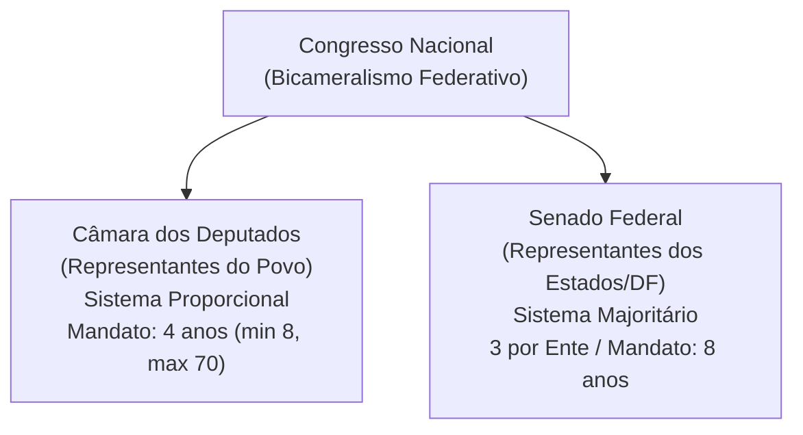

# 04 - Poder Legislativo, Processo Legislativo e Controle Externo (Arts. 70 a 75 da CF/88)

> **Matéria:** Noções de Direito Constitucional  
> **Cargo:** A01 – Técnico de Controle Externo – Especialidade: Técnico Administrativo  
> **Arquivo:** `04_poder_legislativo_processo_legislativo_e_fiscalizacao_tce.md`  
> **Status:** 🟢 Teoria Aprofundada + 5 Questões FCC Comentadas (A a E)

---

## 📌 Ementa / Itens do Edital

- Do Poder Legislativo: estrutura bicameral federal (Câmara dos Deputados e Senado Federal) e unicameral estadual/distrital/municipal.
- Atribuições do Congresso Nacional e competências privativas da Câmara dos Deputados (Art. 51) e do Senado Federal (Art. 52).
- Estatuto dos congressistas: imunidade material (inviolabilidade civil e penal) e imunidade formal/processual (prisão e prerrogativa de foro - Art. 53).
- Do processo legislativo (Artigos 59 a 69 da CF/88):
    - Emendas à Constituição (Art. 60): iniciativa restrita, rito qualificado de aprovação, inexistência de sanção/veto e limitações circunstanciais e materiais (cláusulas pétreas);
    - Leis Complementares vs. Leis Ordinárias (quórum e reserva de matéria);
    - Medidas Provisórias (Art. 62): pressupostos constitucionais, prazos e vedações temáticas absolutas.
- Da fiscalização contábil, financeira, orçamentária, operacional e patrimonial (Artigos 70 a 75 da CF/88):
    - Controle externo titularizado pelo Poder Legislativo com auxílio do Tribunal de Contas;
    - Competências do Tribunal de Contas (Art. 71 da CF/88);
    - Duplo regime de contas: Contas de Governo (parecer prévio opinativo) vs. Contas de Gestão/Ordenadores de Despesa (julgamento técnico definitivo);
    - Julgamento das contas de Prefeito Municipal (Art. 31, § 2º e Tema 835 do STF);
    - Sustação de atos administrativos ilegais vs. sustação de contratos administrativos (Art. 71, X e §§ 1º e 2º);
    - Eficácia de título executivo extrajudicial das decisões do Tribunal de Contas (Art. 71, § 3º da CF/88);
    - Princípio da simetria constitucional (Art. 75 da CF/88) e o Ministério Público de Contas (Art. 130 da CF/88).

---

## 🧭 Sumário

1. [Estrutura Bicameral e Atribuições das Casas Legislativas](#1-estrutura-bicameral-e-atribuicoes-das-casas-legislativas)
    1. [Modelo Bicameral Federal e Unicameral Estadual/Municipal](#11-modelo-bicameral-federal-e-unicameral-estadualmunicipal)
    2. [Repartição de Competências no Congresso Nacional](#12-reparticao-de-competencias-no-congresso-nacional)
    3. [Estatuto dos Congressistas e Imunidades Parlamentares](#13-estatuto-dos-congressistas-e-imunidades-parlamentares)
    4. [Teste 143](#Teste-143)
    5. [Teste 144](#Teste-144)
    6. [Teste 145](#Teste-145)
2. [O Processo Legislativo Constitucional](#2-o-processo-legislativo-constitucional)
    1. [Emendas à Constituição (Art. 60) e Limitações ao Poder de Reforma](#21-emendas-a-constituicao-art-60-e-limitacoes-ao-poder-de-reforma)
    2. [Leis Complementares versus Leis Ordinárias](#22-leis-complementares-versus-leis-ordinarias)
    3. [Medidas Provisórias (Art. 62): Prazos e Vedações Temáticas](#23-medidas-provisorias-art-62-prazos-e-vedacoes-tematicas)
    4. [Teste 146](#Teste-146)
    5. [Teste 147](#Teste-147)
    6. [Teste 148](#Teste-148)
3. [Fiscalização e Controle Externo pelos Tribunais de Contas (Arts. 70 a 75)](#3-fiscalizacao-e-controle-externo-pelos-tribunais-de-contas-arts-70-a-75)
    1. [Abrangência e Critérios da Fiscalização Financeira](#31-abrangencia-e-criterios-da-fiscalizacao-financeira)
    2. [O Julgamento de Contas Públicas: Contas de Governo versus Contas de Gestão](#32-o-julgamento-de-contas-publicas-contas-de-governo-versus-contas-de-gestao)
    3. [Sustação de Atos Ilegais versus Sustação de Contratos Administrativos](#33-sustacao-de-atos-ilegais-versus-sustacao-de-contratos-administrativos)
    4. [Eficácia das Decisões Condenatórias e Título Executivo Extrajudicial](#34-eficacia-das-decisoes-condenatorias-e-titulo-executivo-extrajudicial)
    5. [Simetria Federativa (Art. 75) e o Ministério Público de Contas (Art. 130)](#35-simetria-federativa-art-75-e-o-ministerio-publico-de-contas-art-130)
    6. [Teste 149](#Teste-149)
    7. [Teste 150](#Teste-150)
    8. [Teste 151](#Teste-151)
    9. [Teste 152](#Teste-152)
    10. [Teste 153](#Teste-153)
4. [🌐 Fontes Oficiais & Jurisprudenciais Recomendadas](#fontes-oficiais-jurisprudenciais-recomendadas)

---

## 1. Estrutura Bicameral e Atribuições das Casas Legislativas

O Poder Legislativo da União é exercido pelo Congresso Nacional, que se compõe da Câmara dos Deputados e do Senado Federal (modelo bicameral federativo):

- **Câmara dos Deputados (Art. 45):** Representa o **povo brasileiro**. Os deputados são eleitos pelo sistema eleitoral proporcional, para mandato de **4 anos** (uma legislatura). O número total de deputados por Estado e DF é proporcional à população, com piso mínimo de **8** e teto máximo de **70 deputados**.
- **Senado Federal (Art. 46):** Representa os **Estados e o Distrito Federal**. Cada unidade federada elege **3 senadores**, pelo sistema majoritário, com mandato de **8 anos** (duas legislaturas). A representação é renovada de quatro em quatro anos, alternadamente, por **um terço (1/3)** e **dois terços (2/3)**.

### 1.1 Modelo Bicameral Federal e Unicameral Estadual/Municipal
Enquanto na esfera federal vigora o bicameralismo, nos demais entes da Federação o Poder Legislativo adota compulsoriamente a estrutura **unicameral**:

- **Estados-Membros:** Assembleias Legislativas, compostas por Deputados Estaduais (art. 27);
- **Distrito Federal:** Câmara Legislativa do Distrito Federal, composta por Deputados Distritais (art. 32, § 2º);
- **Municípios:** Câmaras Municipais, compostas por Vereadores (art. 29, IV).

### 1.2 Repartição de Competências no Congresso Nacional
É fundamental distinguir os três tipos de atribuições legislativas federais:

1. **Competências com Sanção Presidencial (Art. 48):** Matérias deliberadas pelo Congresso Nacional que geram leis e demandam envio ao Presidente da República para sanção ou veto (ex.: sistema tributário, planos orçamentários, criação e extinção de cargos públicos).
2. **Competências Exclusivas do Congresso Nacional sem Sanção (Art. 49):** Deliberadas em sessão conjunta ou separada e formalizadas por **Decreto Legislativo**, sem qualquer interferência presidencial (ex.: sustar atos normativos do Executivo que exorbitem do poder regulamentar; autorizar o Presidente a declarar guerra ou celebrar a paz; julgar anualmente as contas prestadas pelo Presidente da República).
3. **Competências Privativas de Cada Casa (Arts. 51 e 52):** Formalizadas por **Resolução**, sem envio ao Presidente:
    - *Câmara dos Deputados (Art. 51, I):* Autorizar, por **dois terços** de seus membros, a instauração de processo contra o Presidente e o Vice-Presidente da República e os Ministros de Estado.
    - *Senado Federal (Art. 52, I e II):* Processar e julgar o Presidente e Vice-Presidente nos **crimes de responsabilidade**, bem como os Ministros do STF, os membros do CNJ e CNMP, o Procurador-Geral da República e o Advogado-Geral da União; sabatinar e aprovar a escolha de magistrados, Ministros do TCU e chefes de missão diplomática; suspender a execução, no todo ou em parte, de lei declarada inconstitucional por decisão definitiva do STF em controle difuso.

### 1.3 Estatuto dos Congressistas e Imunidades Parlamentares
O art. 53 da Constituição consagra o plexo de garantias institucionais dos membros do Congresso Nacional:

- **Imunidade Material (Real ou Substantiva):** Os Deputados e Senadores são invioláveis, civil e penalmente, por quaisquer de suas opiniões, palavras e votos. Exige conexão (nexo de causalidade) com o desempenho das funções parlamentares, sendo absoluta quando manifestada dentro do recinto do parlamento.
- **Imunidade Formal (Processual) quanto à Prisão (Art. 53, § 2º):** Desde a expedição do diploma, os membros do Congresso Nacional **não poderão ser presos**, salvo em flagrante de crime inafiançável. Nesse caso, os autos serão remetidos dentro de vinte e quatro horas à Casa respectiva, para que, pelo voto da maioria de seus membros, resolva sobre a prisão.
- **Foro por Prerrogativa de Função (Art. 53, § 1º):** Os Deputados e Senadores serão submetidos a julgamento perante o STF desde a expedição do diploma. Conforme tese firmada pelo STF na AP 937 e reafirmada pelo plenário, o foro especial aplica-se apenas aos crimes cometidos durante o exercício do mandato e relacionados com as funções parlamentares.

---

### Teste 143
**(IBFC – TJ-MG – Analista Judiciario Classe C Analista de Tecnologia da Informacao – 2022)**
Sobre os Poderes Legislativo, Executivo e Judiciário, segundo a Constituição Federal de 1988 (CF/88), analise as afirmativas a seguir. I. O Poder Legislativo é exercido pelo Congresso Nacional, que se compõe da Câmara dos Deputados e do Senado Federal, sendo que, cada legislatura terá a duração de quatro anos. II. O Poder Executivo é exercido pelo Presidente da República, auxiliado pelos Ministros de Estado, sendo que, a eleição do Presidente da República importará a do Vice-Presidente com ele registrado, ambos tomarão posse em sessão do Congresso Nacional, podendo modificar a Constituição e leis, segundo julgarem importantes para o crescimento econômico do Brasil. III. O Superior Tribunal de Justiça é o órgão máximo do Poder Judiciário, cujos Ministros serão nomeados pelo Presidente da República, cabendo-lhe, precipuamente, a guarda da Constituição. IV. São crimes de responsabilidade os atos do Presidente da República que atentem contra a Constituição Federal e, especialmente, contra o livre exercício do Poder Legislativo, do Poder Judiciário, do Ministério Público e dos Poderes constitucionais das unidades da Federação. Estão corretas as afirmativas:

* **A)** I e II apenas
* **B)** II e III apenas
* **C)** I e IV apenas
* **D)** III e IV apenas
* **E)** I e III apenas

---

> **Comentário Detalhado:**
>
> - **A)** **Incorreta.** A opção incorre em restrição indevida ao limitar o escopo conceitual ao afirmar que "I e II apenas". De acordo com a teoria estudada em *1.2 Repartição de Competências no Congresso Nacional*, *Senado Federal (Art. 52, I e II):* Processar e julgar o Presidente e Vice-Presidente nos crimes de responsabilidade, bem como os Ministros do STF, os membros do CNJ e CNMP, o Procurador-Geral da República e o Advogado-Geral da União; sabatinar e aprovar a escolha de magistrados, Ministros do TCU e chefes de missão diplomática; suspender a execução, no todo ou em parte, de lei declarada inconstitucional por decisão definitiva do STF em controle difuso.
> - **B)** **Incorreta.** A opção incorre em restrição indevida ao limitar o escopo conceitual ao afirmar que "II e III apenas". De acordo com a teoria estudada em *1. Estrutura Bicameral e Atribuições das Casas Legislativas*, o Poder Legislativo da União é exercido pelo Congresso Nacional, que se compõe da Câmara dos Deputados e do Senado Federal (modelo bicameral federativo).
> - **C)** **Correta.** Conforme fundamentado na seção *1.2 Repartição de Competências no Congresso Nacional* deste guia, competências Exclusivas do Congresso Nacional sem Sanção (Art. 49): Deliberadas em sessão conjunta ou separada e formalizadas por Decreto Legislativo, sem qualquer interferência presidencial (ex.: sustar atos normativos do Executivo que exorbitem do poder regulamentar; autorizar o Presidente a declarar guerra ou celebrar a paz; julgar anualmente as contas prestadas pelo Presidente da República). Dessa forma, está plenamente correta a assertiva da banca (IBFC – TJ-MG/2022) ao estabelecer que "I e IV apenas".
> - **D)** **Incorreta.** A opção incorre em restrição indevida ao limitar o escopo conceitual ao afirmar que "III e IV apenas". De acordo com a teoria estudada em *1.2 Repartição de Competências no Congresso Nacional*, *Câmara dos Deputados (Art. 51, I):* Autorizar, por dois terços de seus membros, a instauração de processo contra o Presidente e o Vice-Presidente da República e os Ministros de Estado.
> - **E)** **Incorreta.** A opção incorre em restrição indevida ao limitar o escopo conceitual ao afirmar que "I e III apenas". De acordo com a teoria estudada em *1.2 Repartição de Competências no Congresso Nacional*, competências com Sanção Presidencial (Art. 48): Matérias deliberadas pelo Congresso Nacional que geram leis e demandam envio ao Presidente da República para sanção ou veto (ex.: sistema tributário, planos orçamentários, criação e extinção de cargos públicos).
>
> **Gabarito: C**

---

### Teste 144
**(FCC – TRT – Analista Judiciário - Tecnologia da Informação – 2009)**  
Compete ao Congresso Nacional, com a sanção do Presidente da República:

* **A)** dispor sobre fixação do subsídio dos Ministros do Supremo Tribunal Federal por lei específica.
* **B)** apreciar os atos de outorga e renovação de concessão de emissoras de rádio e televisão.
* **C)** escolher dois terços dos membros que compõem o Tribunal de Contas da União.
* **D)** autorizar previamente a realização de referendo e convocar plebiscito nacional.
* **E)** autorizar, em terras indígenas, a exploração e o aproveitamento de recursos hídricos.

---

> **Comentário Detalhado:**
>
> - **A)** **Correto**. O art. 48, XV, da CF/88 estabelece que cabe ao Congresso Nacional, com a sanção do Presidente da República (mediante lei ordinária federal de iniciativa conjunta dos Poderes), dispor sobre a "fixação do subsídio dos Ministros do Supremo Tribunal Federal". As matérias do art. 48 exigem sanção presidencial.
> - **B)** **Incorreto**. A apreciação de atos de concessão e renovação de emissoras de rádio e televisão é competência exclusiva do Congresso Nacional (art. 49, XII, CF/88), formalizada por decreto legislativo, sem sanção presidencial.
> - **C)** **Incorreto**. Escolher dois terços dos membros do TCU é competência exclusiva do Congresso Nacional (art. 49, XIII, CF/88).
> - **D)** **Incorreto**. Autorizar referendo e convocar plebiscito é competência exclusiva do Congresso Nacional (art. 49, XV, CF/88).
> - **E)** **Incorreto**. Autorizar a exploração de recursos hídricos e minerais em terras indígenas é competência exclusiva do Congresso Nacional (art. 49, XVI, CF/88).
>
> **Gabarito: A**

### Teste 145
**(FCC – TRT – Analista Judiciário - Tecnologia da Informação – 2009)**  
Ao organizar o Poder Legislativo na esfera federal, a Constituição da República prevê que:

* **A)** a Câmara dos Deputados será composta de representantes eleitos pelo sistema proporcional em cada unidade federada.
* **B)** o Senado Federal será composto de representantes dos Estados e do Distrito Federal, eleitos segundo o princípio proporcional.
* **C)** a representação de cada Estado no Senado Federal será renovada de quatro em quatro anos pelo critério de um terço fixo.
* **D)** as deliberações de cada Casa Legislativa serão tomadas pela unanimidade de seus membros, salvo disposição regimental.
* **E)** o número total de Senadores varia proporcionalmente à população de cada Estado apurada pelo Censo oficial da União.

---

> **Comentário Detalhado:**
>
> - **A)** **Correto**. Conforme o art. 45 da CF/88: "A Câmara dos Deputados compõe-se de representantes do povo, eleitos, pelo sistema proporcional, em cada Estado, em cada Território e no Distrito Federal".
> - **B)** **Incorreto**. O Senado Federal é composto por representantes eleitos segundo o princípio majoritário (art. 46, caput, CF/88).
> - **C)** **Incorreto**. A representação no Senado é renovada de quatro em quatro anos, alternadamente, por um e dois terços (art. 46, § 2º, CF/88).
> - **D)** **Incorreto**. As deliberações são tomadas, em regra, por maioria simples (maioria dos votos, presente a maioria absoluta de seus membros - art. 47, CF/88).
> - **E)** **Incorreto**. Cada Estado e o Distrito Federal elegem exatamente três Senadores, com representação paritária e fixa que não varia com a população (art. 46, § 1º, CF/88).
>
> **Gabarito: A**

### Teste 146
**(FGV – TRT-1 – Analista Judiciario Area Administrativa – 2024)**
Com o objetivo de atender às necessidades urgentes do Poder Judiciário federal, o Presidente da República editou a Medida Provisória nº X, dispondo sobre a organização dos Tribunais Regionais Federais, o que foi muito comemorado por seus membros. Após o trâmite regular, a medida provisória teve sua votação iniciada na Câmara dos Deputados, sendo aprovada nessa Casa Legislativa e, posteriormente, no Senado Federal, sem alterações. Daí decorreu a promulgação da Lei nº Y, o que foi feito pelo Presidente da Mesa do Congresso Nacional. À luz da sistemática constitucional, é correto afirmar que essa narrativa:

* **A)** não apresenta incorreção;
* **B)** somente apresenta incorreção em relação à casa iniciadora;
* **C)** somente apresenta incorreção em relação ao objeto da medida provisória;
* **D)** somente apresenta incorreção em relação à promulgação no âmbito do Poder Legislativo;
* **E)** somente apresenta incorreção em relação à votação em separado nas Casas Legislativas.

---

> **Comentário Detalhado:**
>
> - **A)** **Incorreta.** A opção apresenta proposição em desacordo com os fundamentos teóricos e técnicos do tópico ao afirmar que "não apresenta incorreção". De acordo com a teoria estudada em *1.2 Repartição de Competências no Congresso Nacional*, competências Exclusivas do Congresso Nacional sem Sanção (Art. 49): Deliberadas em sessão conjunta ou separada e formalizadas por Decreto Legislativo, sem qualquer interferência presidencial (ex.: sustar atos normativos do Executivo que exorbitem do poder regulamentar; autorizar o Presidente a declarar guerra ou celebrar a paz; julgar anualmente as contas prestadas pelo Presidente da República).
> - **B)** **Incorreta.** A opção incorre em restrição indevida ao limitar o escopo conceitual ao afirmar que "somente apresenta incorreção em relação à casa iniciadora". De acordo com a teoria estudada em *1.1 Modelo Bicameral Federal e Unicameral Estadual/Municipal*, enquanto na esfera federal vigora o bicameralismo, nos demais entes da Federação o Poder Legislativo adota compulsoriamente a estrutura unicameral.
> - **C)** **Incorreta.** A opção incorre em restrição indevida ao limitar o escopo conceitual ao afirmar que "somente apresenta incorreção em relação ao objeto da medida provisória". De acordo com a teoria estudada em *1.2 Repartição de Competências no Congresso Nacional*, *Senado Federal (Art. 52, I e II):* Processar e julgar o Presidente e Vice-Presidente nos crimes de responsabilidade, bem como os Ministros do STF, os membros do CNJ e CNMP, o Procurador-Geral da República e o Advogado-Geral da União; sabatinar e aprovar a escolha de magistrados, Ministros do TCU e chefes de missão diplomática; suspender a execução, no todo ou em parte, de lei declarada inconstitucional por decisão definitiva do STF em controle difuso.
> - **D)** **Correta.** Conforme fundamentado na seção *1. Estrutura Bicameral e Atribuições das Casas Legislativas* deste guia, o Poder Legislativo da União é exercido pelo Congresso Nacional, que se compõe da Câmara dos Deputados e do Senado Federal (modelo bicameral federativo). Dessa forma, está plenamente correta a assertiva da banca (FGV – TRT-1/2024) ao estabelecer que "somente apresenta incorreção em relação à promulgação no âmbito do Poder Legislativo".
> - **E)** **Incorreta.** A opção incorre em restrição indevida ao limitar o escopo conceitual ao afirmar que "somente apresenta incorreção em relação à votação em separado nas Casas Legislativas". De acordo com a teoria estudada em *1. Estrutura Bicameral e Atribuições das Casas Legislativas*, câmara dos Deputados (Art. 45): Representa o povo brasileiro. Os deputados são eleitos pelo sistema eleitoral proporcional, para mandato de 4 anos (uma legislatura).
>
> **Gabarito: D**

---

### Teste 147
**(FGV – TCE-PA – Auditor de Controle Externo Administrativa Gestao Governamental – 2024)**
O Presidente da República, em matéria de sua iniciativa privativa, apresentou projeto de lei à Câmara dos Deputados. Após tramitação regular, o projeto foi aprovado, com alterações, e encaminhado para o Senado Federal. Nessa Casa Legislativa, foi aprovado um substitutivo alterando integralmente, embora sem aumento de despesa, a forma como a respectiva matéria fora disciplinada no projeto. Considerando a sistemática constitucional, é correto afirmar que

* **A)** o Senado Federal, ao aprovar o substitutivo, assumiu a função de Casa Iniciadora, reiniciando a tramitação do projeto.
* **B)** por se tratar de matéria de iniciativa privativa do Chefe do Poder Executivo, o Senado Federal não poderia ter aprovado o substitutivo.
* **C)** após ser apreciado pela Câmara dos Deputados, o substitutivo, se aprovado, será encaminhado ao Chefe do Poder Executivo para fins de sanção ou veto.
* **D)** o Senado Federal, embora tenha atuado como Casa Revisora, deve apreciar as emendas que venham a ser aprovadas na Câmara dos Deputados, após esta Casa analisar o substitutivo.
* **E)** por se tratar de matéria de iniciativa privativa do Chefe do Poder Executivo, o substitutivo aprovado pelo Senado Federal somente poderia versar sobre redação, não sobre o mérito.

---

> **Comentário Detalhado:**
>
> - **A)** **Incorreta.** A opção apresenta proposição em desacordo com os fundamentos teóricos e técnicos do tópico ao afirmar que "o Senado Federal, ao aprovar o substitutivo, assumiu a função de Casa Iniciadora, reiniciando a tramitação do...". De acordo com a teoria estudada em *1. Estrutura Bicameral e Atribuições das Casas Legislativas*, o Poder Legislativo da União é exercido pelo Congresso Nacional, que se compõe da Câmara dos Deputados e do Senado Federal (modelo bicameral federativo).
> - **B)** **Incorreta.** A opção apresenta proposição em desacordo com os fundamentos teóricos e técnicos do tópico ao afirmar que "por se tratar de matéria de iniciativa privativa do Chefe do Poder Executivo, o Senado Federal não poderia ter...". De acordo com a teoria estudada em *1.2 Repartição de Competências no Congresso Nacional*, competências com Sanção Presidencial (Art. 48): Matérias deliberadas pelo Congresso Nacional que geram leis e demandam envio ao Presidente da República para sanção ou veto (ex.: sistema tributário, planos orçamentários, criação e extinção de cargos públicos).
> - **C)** **Correta.** Conforme fundamentado na seção *1.2 Repartição de Competências no Congresso Nacional* deste guia, competências Exclusivas do Congresso Nacional sem Sanção (Art. 49): Deliberadas em sessão conjunta ou separada e formalizadas por Decreto Legislativo, sem qualquer interferência presidencial (ex.: sustar atos normativos do Executivo que exorbitem do poder regulamentar; autorizar o Presidente a declarar guerra ou celebrar a paz; julgar anualmente as contas prestadas pelo Presidente da República). Dessa forma, está plenamente correta a assertiva da banca (FGV – TCE-PA/2024) ao estabelecer que "após ser apreciado pela Câmara dos Deputados, o substitutivo, se aprovado, será encaminhado ao Chefe do Poder...".
> - **D)** **Incorreta.** A opção apresenta proposição em desacordo com os fundamentos teóricos e técnicos do tópico ao afirmar que "o Senado Federal, embora tenha atuado como Casa Revisora, deve apreciar as emendas que venham a ser aprovadas na...". De acordo com a teoria estudada em *1.2 Repartição de Competências no Congresso Nacional*, *Câmara dos Deputados (Art. 51, I):* Autorizar, por dois terços de seus membros, a instauração de processo contra o Presidente e o Vice-Presidente da República e os Ministros de Estado.
> - **E)** **Incorreta.** A opção incorre em restrição indevida ao limitar o escopo conceitual ao afirmar que "por se tratar de matéria de iniciativa privativa do Chefe do Poder Executivo, o substitutivo aprovado pelo Senado...". De acordo com a teoria estudada em *1.2 Repartição de Competências no Congresso Nacional*, *Senado Federal (Art. 52, I e II):* Processar e julgar o Presidente e Vice-Presidente nos crimes de responsabilidade, bem como os Ministros do STF, os membros do CNJ e CNMP, o Procurador-Geral da República e o Advogado-Geral da União; sabatinar e aprovar a escolha de magistrados, Ministros do TCU e chefes de missão diplomática; suspender a execução, no todo ou em parte, de lei declarada inconstitucional por decisão definitiva do STF em controle difuso.
>
> **Gabarito: C**

---

### Teste 148
**(FGV – TCE-PA – Auditor de Controle Externo Administrativa Administracao – 2024)**
O Presidente da República apresentou projeto de lei complementar versando sobre matéria de sua iniciativa exclusiva, estranha à sistemática orçamentária. No âmbito da Câmara dos Deputados, foi aprovada emenda que estendia o alcance da proposição legislativa e acarretava aumento de despesa obrigatória, sendo indicada a respectiva fonte de custeio. Após o trâmite regular, o projeto foi aprovado nas duas Casas do Congresso Nacional, mas foi vetado pelo Presidente da República. O veto foi derrubado pelo Poder Legislativo e, ato contínuo, foi promulgada a Lei nº X pelo Presidente do Senado Federal. Com base nas normas constitucionais afetas ao processo legislativo, é correto afirmar que a narrativa

* **A)** não apresenta nenhuma incorreção.
* **B)** somente apresenta incorreção em relação à emenda aprovada pela Câmara dos Deputados.
* **C)** somente apresenta incorreção em relação à promulgação realizada pelo Presidente do Senado Federal.
* **D)** somente apresenta incorreção em relação à promulgação, que deveria ser realizada em momento anterior à derrubada do veto.
* **E)** somente apresenta incorreção em relação à emenda aprovada pela Câmara dos Deputados, e à promulgação realizada pelo Presidente do Senado Federal.

---

> **Comentário Detalhado:**
>
> - **A)** **Incorreta.** A opção apresenta proposição em desacordo com os fundamentos teóricos e técnicos do tópico ao afirmar que "não apresenta nenhuma incorreção". De acordo com a teoria estudada em *1.2 Repartição de Competências no Congresso Nacional*, *Câmara dos Deputados (Art. 51, I):* Autorizar, por dois terços de seus membros, a instauração de processo contra o Presidente e o Vice-Presidente da República e os Ministros de Estado.
> - **B)** **Incorreta.** A opção incorre em restrição indevida ao limitar o escopo conceitual ao afirmar que "somente apresenta incorreção em relação à emenda aprovada pela Câmara dos Deputados". De acordo com a teoria estudada em *1.2 Repartição de Competências no Congresso Nacional*, *Senado Federal (Art. 52, I e II):* Processar e julgar o Presidente e Vice-Presidente nos crimes de responsabilidade, bem como os Ministros do STF, os membros do CNJ e CNMP, o Procurador-Geral da República e o Advogado-Geral da União; sabatinar e aprovar a escolha de magistrados, Ministros do TCU e chefes de missão diplomática; suspender a execução, no todo ou em parte, de lei declarada inconstitucional por decisão definitiva do STF em controle difuso.
> - **C)** **Incorreta.** A opção incorre em restrição indevida ao limitar o escopo conceitual ao afirmar que "somente apresenta incorreção em relação à promulgação realizada pelo Presidente do Senado Federal". De acordo com a teoria estudada em *1.1 Modelo Bicameral Federal e Unicameral Estadual/Municipal*, distrito Federal: Câmara Legislativa do Distrito Federal, composta por Deputados Distritais (art. 32, § 2º).
> - **D)** **Incorreta.** A opção incorre em restrição indevida ao limitar o escopo conceitual ao afirmar que "somente apresenta incorreção em relação à promulgação, que deveria ser realizada em momento anterior à derrubada...". De acordo com a teoria estudada em *1.2 Repartição de Competências no Congresso Nacional*, competências com Sanção Presidencial (Art. 48): Matérias deliberadas pelo Congresso Nacional que geram leis e demandam envio ao Presidente da República para sanção ou veto (ex.: sistema tributário, planos orçamentários, criação e extinção de cargos públicos).
> - **E)** **Correta.** Conforme fundamentado na seção *1. Estrutura Bicameral e Atribuições das Casas Legislativas* deste guia, o Poder Legislativo da União é exercido pelo Congresso Nacional, que se compõe da Câmara dos Deputados e do Senado Federal (modelo bicameral federativo). Dessa forma, está plenamente correta a assertiva da banca (FGV – TCE-PA/2024) ao estabelecer que "somente apresenta incorreção em relação à emenda aprovada pela Câmara dos Deputados, e à promulgação realizada...".
>
> **Gabarito: E**

---

### Teste 149
**(FGV – TRT – Analista Judiciário - Tecnologia da Informação – 2024)**  
O artigo 31 da Constituição Federal do Brasil estabelece que a fiscalização no âmbito municipal será conduzida pelo Poder Legislativo Municipal, por meio de controle externo, e pelos sistemas de controle interno do Poder Executivo Municipal, conforme determinado pela legislação.  
Assinale a opção que indica o órgão que auxilia o controle externo da Câmara Municipal:

* **A)** Controladoria-Geral do Estado federado.
* **B)** Tribunal de Contas do Estado competente.
* **C)** Secretaria da Fazenda e Planejamento.
* **D)** Secretaria Municipal de Auditoria Interna.
* **E)** Conselho Comunitário de Controle Social.

---

> **Comentário Detalhado:**
>
> - **A)** **Incorreto**. As controladorias executivas atuam no controle interno de seus respectivos entes federativos.
> - **B)** **Correto**. Conforme o art. 31, § 1º, da Constituição Federal: "O controle externo da Câmara Municipal será exercido com o auxílio dos Tribunais de Contas dos Estados ou do Município ou dos Conselhos ou Tribunais de Contas dos Municípios, onde houver". No caso de Goiás, o controle das contas municipais era historicamente exercido com o auxílio do TCM-GO e, no plano geral dos Estados que não possuem tribunal municipal, pelo respectivo Tribunal de Contas do Estado (TCE).
> - **C)** **Incorreto**. A Fazenda é órgão executivo integrante da administração direta municipal.
> - **D)** **Incorreto**. A secretaria de auditoria integra a estrutura de controle interno do Executivo.
> - **E)** **Incorreto**. Conselhos comunitários realizam controle social, sem caráter de órgão técnico auxiliar constitucional.
>
> **Gabarito: B**

### Teste 150
**(FGV – TJ-AP – Analista Judiciario Apoio Especializado Tecnologia da Informacao Banco de Dados – 2023)**
Pedro, estudante de direito, foi questionado por seu professor em relação às fases do processo legislativo para a elaboração de uma lei orgânica municipal. De acordo com Pedro: (1) o projeto deve ser aprovado em dois turnos de votação; (2) pelo voto de dois terços dos membros da Câmara Municipal; e (3) com a sanção do chefe do Poder Executivo. Ao analisar as afirmações de Pedro em relação ao processo legislativo, o professor observou, corretamente, que:

* **A)** todas estão certas;
* **B)** apenas a afirmação 2 está certa;
* **C)** apenas a afirmação 3 está certa;
* **D)** apenas a afirmação 1 e 2 estão certas;
* **E)** apenas a afirmação 1 e 3 estão certas.

---

> **Comentário Detalhado:**
>
> - **A)** **Incorreta.** A opção apresenta proposição em desacordo com os fundamentos teóricos e técnicos do tópico ao afirmar que "todas estão certas". De acordo com a teoria estudada em *1.2 Repartição de Competências no Congresso Nacional*, competências Exclusivas do Congresso Nacional sem Sanção (Art. 49): Deliberadas em sessão conjunta ou separada e formalizadas por Decreto Legislativo, sem qualquer interferência presidencial (ex.: sustar atos normativos do Executivo que exorbitem do poder regulamentar; autorizar o Presidente a declarar guerra ou celebrar a paz; julgar anualmente as contas prestadas pelo Presidente da República).
> - **B)** **Incorreta.** A opção incorre em restrição indevida ao limitar o escopo conceitual ao afirmar que "apenas a afirmação 2 está certa". De acordo com a teoria estudada em *1. Estrutura Bicameral e Atribuições das Casas Legislativas*, o Poder Legislativo da União é exercido pelo Congresso Nacional, que se compõe da Câmara dos Deputados e do Senado Federal (modelo bicameral federativo).
> - **C)** **Incorreta.** A opção incorre em restrição indevida ao limitar o escopo conceitual ao afirmar que "apenas a afirmação 3 está certa". De acordo com a teoria estudada em *1.1 Modelo Bicameral Federal e Unicameral Estadual/Municipal*, enquanto na esfera federal vigora o bicameralismo, nos demais entes da Federação o Poder Legislativo adota compulsoriamente a estrutura unicameral.
> - **D)** **Correta.** Conforme fundamentado na seção *1.2 Repartição de Competências no Congresso Nacional* deste guia, *Câmara dos Deputados (Art. 51, I):* Autorizar, por dois terços de seus membros, a instauração de processo contra o Presidente e o Vice-Presidente da República e os Ministros de Estado. Dessa forma, está plenamente correta a assertiva da banca (FGV – TJ-AP/2023) ao estabelecer que "apenas a afirmação 1 e 2 estão certas".
> - **E)** **Incorreta.** A opção incorre em restrição indevida ao limitar o escopo conceitual ao afirmar que "apenas a afirmação 1 e 3 estão certas". De acordo com a teoria estudada em *1. Estrutura Bicameral e Atribuições das Casas Legislativas*, a representação é renovada de quatro em quatro anos, alternadamente, por um terço (1/3) e dois terços (2/3).
>
> **Gabarito: D**

---

### Teste 151
**(FCC – TRT – Analista Judiciário - Tecnologia da Informação – 2009)**  
Compete ao Tribunal de Contas do Estado de Goiás:

* **A)** julgar as contas dos administradores e demais responsáveis por bens públicos da administração direta e indireta.
* **B)** apreciar as contas dos gestores e ordenadores de despesas exclusivamente dos órgãos da administração direta.
* **C)** processar e julgar o Governador e o Vice-Governador por crimes de responsabilidade e infrações político-administrativas.
* **D)** julgar, anualmente, as contas prestadas pelo Governador do Estado com força executiva condenatória.
* **E)** proceder à tomada de contas do Governador quando não prestadas dentro de sessenta dias da abertura da sessão.

---

> **Comentário Detalhado:**
>
> - **A)** **Correto**. Nos termos do art. 71, II, da CF/88 (reproduzido na Constituição Estadual de Goiás): compete ao Tribunal de Contas "julgar as contas dos administradores e demais responsáveis por dinheiros, bens e valores públicos da administração direta e indireta, incluídas as fundações e sociedades instituídas e mantidas pelo Poder Público estadual, e as contas daqueles que derem causa a perda, extravio ou outra irregularidade de que resulte prejuízo ao erário público".
> - **B)** **Incorreto**. A competência abrange indistintamente os responsáveis pela administração direta e indireta, e não apenas a direta. Ademais, o ato sobre tais gestores é de *julgar*, e não meramente apreciar.
> - **C)** **Incorreto**. O julgamento do Governador por crime de responsabilidade compete a Tribunal Especial (ou Assembleia Legislativa), jamais ao Tribunal de Contas.
> - **D)** **Incorreto**. O Tribunal de Contas não *julga* as contas do Chefe do Executivo; compete-lhe emitir *parecer prévio* anual (art. 71, I, CF/88), cabendo o julgamento político exclusivamente ao Poder Legislativo.
> - **E)** **Incorreto**. Proceder à tomada de contas do Governador na omissão deste é competência privativa da Assembleia Legislativa (art. 51, II c/c art. 84, XXIV, CF/88).
>
> **Gabarito: A**

### Teste 152
**(FGV – TJ-AP – Analista Judiciario Apoio Especializado Tecnologia da Informacao Banco de Dados – 2023)**
A Assembleia Legislativa do Estado Alfa recebeu uma proposição legislativa que tem por objeto a alteração das atribuições de certo órgão colegiado da Administração Superior do Ministério Público do Estado. Considerando os balizamentos estabelecidos pela Constituição da República a respeito das normas que estabelecem a organização, as atribuições e o estatuto de cada Ministério Público, é correto afirmar que a proposição legislativa precisa ter a natureza de:

* **A)** projeto de lei ordinária, de iniciativa privativa do governador do Estado;
* **B)** projeto de lei ordinária, de iniciativa privativa do Colégio de Procuradores de Justiça;
* **C)** projeto de lei complementar, de iniciativa privativa do procurador-geral de Justiça;
* **D)** proposta de emenda constitucional, podendo ter sido apresentada por qualquer legitimado para a reforma;
* **E)** projeto de lei complementar, podendo ter sido apresentado pelo procurador-geral de Justiça ou pelo governador do Estado.

---

> **Comentário Detalhado:**
>
> - **A)** **Incorreta.** A opção apresenta proposição em desacordo com os fundamentos teóricos e técnicos do tópico ao afirmar que "projeto de lei ordinária, de iniciativa privativa do governador do Estado". De acordo com a teoria estudada em *1.3 Estatuto dos Congressistas e Imunidades Parlamentares*, o art. 53 da Constituição consagra o plexo de garantias institucionais dos membros do Congresso Nacional.
> - **B)** **Incorreta.** A opção apresenta proposição em desacordo com os fundamentos teóricos e técnicos do tópico ao afirmar que "projeto de lei ordinária, de iniciativa privativa do Colégio de Procuradores de Justiça". De acordo com a teoria estudada em *1.1 Modelo Bicameral Federal e Unicameral Estadual/Municipal*, distrito Federal: Câmara Legislativa do Distrito Federal, composta por Deputados Distritais (art. 32, § 2º).
> - **C)** **Correta.** Conforme fundamentado na seção *1.2 Repartição de Competências no Congresso Nacional* deste guia, *Senado Federal (Art. 52, I e II):* Processar e julgar o Presidente e Vice-Presidente nos crimes de responsabilidade, bem como os Ministros do STF, os membros do CNJ e CNMP, o Procurador-Geral da República e o Advogado-Geral da União; sabatinar e aprovar a escolha de magistrados, Ministros do TCU e chefes de missão diplomática; suspender a execução, no todo ou em parte, de lei declarada inconstitucional por decisão definitiva do STF em controle difuso. Dessa forma, está plenamente correta a assertiva da banca (FGV – TJ-AP/2023) ao estabelecer que "projeto de lei complementar, de iniciativa privativa do procurador-geral de Justiça".
> - **D)** **Incorreta.** A opção promove generalização excessiva que desconsidera as condições técnicas e normativas ao afirmar que "proposta de emenda constitucional, podendo ter sido apresentada por qualquer legitimado para a reforma". De acordo com a teoria estudada em *1.2 Repartição de Competências no Congresso Nacional*, competências Exclusivas do Congresso Nacional sem Sanção (Art. 49): Deliberadas em sessão conjunta ou separada e formalizadas por Decreto Legislativo, sem qualquer interferência presidencial (ex.: sustar atos normativos do Executivo que exorbitem do poder regulamentar; autorizar o Presidente a declarar guerra ou celebrar a paz; julgar anualmente as contas prestadas pelo Presidente da República).
> - **E)** **Incorreta.** A opção apresenta proposição em desacordo com os fundamentos teóricos e técnicos do tópico ao afirmar que "projeto de lei complementar, podendo ter sido apresentado pelo procurador-geral de Justiça ou pelo governador do...". De acordo com a teoria estudada em *1.2 Repartição de Competências no Congresso Nacional*, competências com Sanção Presidencial (Art. 48): Matérias deliberadas pelo Congresso Nacional que geram leis e demandam envio ao Presidente da República para sanção ou veto (ex.: sistema tributário, planos orçamentários, criação e extinção de cargos públicos).
>
> **Gabarito: C**

---

### Teste 153
**(FGV – TCE-GO – Analista de Controle Externo Juridica – 2024)**
O Chefe do Poder Executivo do Estado Alfa encaminhou o projeto de lei orçamentária anual à Assembleia Legislativa. Poucos dias depois, foi comunicado pelo Procurador-Geral de Justiça de que a proposta subscrita por este agente, referente à estrutura por ele chefiada, carecia de pequena alteração. À luz da sistemática da Constituição da República, aplicável por simetria ao Estado Alfa, é correto afirmar, em relação à alteração pretendida, que ela

* **A)** não pode ser promovida, considerando a ocorrência da preclusão consumativa no processo legislativo.
* **B)** somente pode ser promovida pelo Governador do Estado, enquanto não iniciada a votação em Plenário.
* **C)** somente pode ser promovida pelo Governador do Estado, por meio de proposição suplementar, enquanto não encerrada a apreciação do projeto pela Comissão competente.
* **D)** somente pode ser promovida pelo Procurador-Geral de Justiça, considerando a autonomia financeira do Ministério Público, enquanto não iniciada a votação em Plenário.
* **E)** somente pode ser promovida pelo Governador do Estado, por meio de mensagem, enquanto não iniciada a votação, na Comissão competente, da parte cuja alteração é proposta.

---

> **Comentário Detalhado:**
>
> - **A)** **Incorreta.** A opção apresenta proposição em desacordo com os fundamentos teóricos e técnicos do tópico ao afirmar que "não pode ser promovida, considerando a ocorrência da preclusão consumativa no processo legislativo". De acordo com a teoria estudada em *1.1 Modelo Bicameral Federal e Unicameral Estadual/Municipal*, enquanto na esfera federal vigora o bicameralismo, nos demais entes da Federação o Poder Legislativo adota compulsoriamente a estrutura unicameral.
> - **B)** **Incorreta.** A opção incorre em restrição indevida ao limitar o escopo conceitual ao afirmar que "somente pode ser promovida pelo Governador do Estado, enquanto não iniciada a votação em Plenário". De acordo com a teoria estudada em *1.3 Estatuto dos Congressistas e Imunidades Parlamentares*, imunidade Formal (Processual) quanto à Prisão (Art. 53, § 2º): Desde a expedição do diploma, os membros do Congresso Nacional não poderão ser presos, salvo em flagrante de crime inafiançável.
> - **C)** **Incorreta.** A opção incorre em restrição indevida ao limitar o escopo conceitual ao afirmar que "somente pode ser promovida pelo Governador do Estado, por meio de proposição suplementar, enquanto não encerrada a...". De acordo com a teoria estudada em *1.3 Estatuto dos Congressistas e Imunidades Parlamentares*, conforme tese firmada pelo STF na AP 937 e reafirmada pelo plenário, o foro especial aplica-se apenas aos crimes cometidos durante o exercício do mandato e relacionados com as funções parlamentares.
> - **D)** **Correta.** Conforme fundamentado na seção *1.2 Repartição de Competências no Congresso Nacional* deste guia, *Senado Federal (Art. 52, I e II):* Processar e julgar o Presidente e Vice-Presidente nos crimes de responsabilidade, bem como os Ministros do STF, os membros do CNJ e CNMP, o Procurador-Geral da República e o Advogado-Geral da União; sabatinar e aprovar a escolha de magistrados, Ministros do TCU e chefes de missão diplomática; suspender a execução, no todo ou em parte, de lei declarada inconstitucional por decisão definitiva do STF em controle difuso. Dessa forma, está plenamente correta a assertiva da banca (FGV – TCE-GO/2024) ao estabelecer que "somente pode ser promovida pelo Procurador-Geral de Justiça, considerando a autonomia financeira do Ministério...".
> - **E)** **Incorreta.** A opção incorre em restrição indevida ao limitar o escopo conceitual ao afirmar que "somente pode ser promovida pelo Governador do Estado, por meio de mensagem, enquanto não iniciada a votação, na...". De acordo com a teoria estudada em *1.2 Repartição de Competências no Congresso Nacional*, competências Exclusivas do Congresso Nacional sem Sanção (Art. 49): Deliberadas em sessão conjunta ou separada e formalizadas por Decreto Legislativo, sem qualquer interferência presidencial (ex.: sustar atos normativos do Executivo que exorbitem do poder regulamentar; autorizar o Presidente a declarar guerra ou celebrar a paz; julgar anualmente as contas prestadas pelo Presidente da República).
>
> **Gabarito: D**

---

