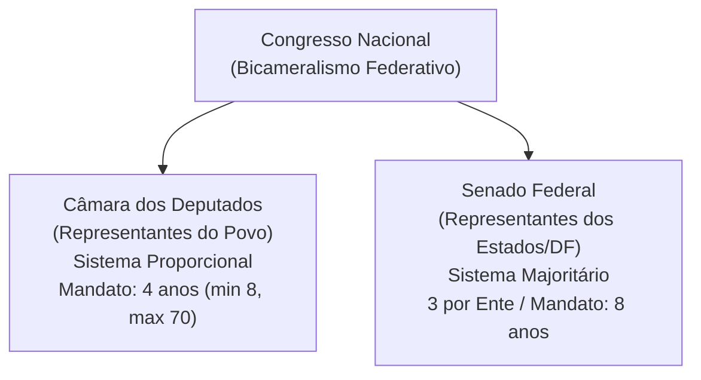

# 04 - Poder Legislativo, Processo Legislativo e Controle Externo (Arts. 70 a 75 da CF/88)

> **Matéria:** Noções de Direito Constitucional  
> **Cargo:** A01 – Técnico de Controle Externo – Especialidade: Técnico Administrativo  
> **Arquivo:** `04_poder_legislativo_processo_legislativo_e_fiscalizacao_tce.md`  
> **Status:** 🟢 Teoria Aprofundada + 5 Questões FCC Comentadas (A a E)

---

## 📌 Ementa / Itens do Edital

- Do Poder Legislativo: estrutura bicameral federal (Câmara dos Deputados e Senado Federal) e unicameral estadual/distrital/municipal.
- Atribuições do Congresso Nacional e competências privativas da Câmara dos Deputados (Art. 51) e do Senado Federal (Art. 52).
- Estatuto dos congressistas: imunidade material (inviolabilidade civil e penal) e imunidade formal/processual (prisão e prerrogativa de foro - Art. 53).
- Do processo legislativo (Artigos 59 a 69 da CF/88):
    - Emendas à Constituição (Art. 60): iniciativa restrita, rito qualificado de aprovação, inexistência de sanção/veto e limitações circunstanciais e materiais (cláusulas pétreas);
    - Leis Complementares vs. Leis Ordinárias (quórum e reserva de matéria);
    - Medidas Provisórias (Art. 62): pressupostos constitucionais, prazos e vedações temáticas absolutas.
- Da fiscalização contábil, financeira, orçamentária, operacional e patrimonial (Artigos 70 a 75 da CF/88):
    - Controle externo titularizado pelo Poder Legislativo com auxílio do Tribunal de Contas;
    - Competências do Tribunal de Contas (Art. 71 da CF/88);
    - Duplo regime de contas: Contas de Governo (parecer prévio opinativo) vs. Contas de Gestão/Ordenadores de Despesa (julgamento técnico definitivo);
    - Julgamento das contas de Prefeito Municipal (Art. 31, § 2º e Tema 835 do STF);
    - Sustação de atos administrativos ilegais vs. sustação de contratos administrativos (Art. 71, X e §§ 1º e 2º);
    - Eficácia de título executivo extrajudicial das decisões do Tribunal de Contas (Art. 71, § 3º da CF/88);
    - Princípio da simetria constitucional (Art. 75 da CF/88) e o Ministério Público de Contas (Art. 130 da CF/88).

---

## 🧭 Sumário

1. [Estrutura Bicameral e Atribuições das Casas Legislativas](#1-estrutura-bicameral-e-atribuicoes-das-casas-legislativas)
    1. [Modelo Bicameral Federal e Unicameral Estadual/Municipal](#11-modelo-bicameral-federal-e-unicameral-estadualmunicipal)
    2. [Repartição de Competências no Congresso Nacional](#12-reparticao-de-competencias-no-congresso-nacional)
    3. [Estatuto dos Congressistas e Imunidades Parlamentares](#13-estatuto-dos-congressistas-e-imunidades-parlamentares)
    4. [Teste 143](#Teste-143)
    5. [Teste 144](#Teste-144)
    6. [Teste 145](#Teste-145)
2. [O Processo Legislativo Constitucional](#2-o-processo-legislativo-constitucional)
    1. [Emendas à Constituição (Art. 60) e Limitações ao Poder de Reforma](#21-emendas-a-constituicao-art-60-e-limitacoes-ao-poder-de-reforma)
    2. [Leis Complementares versus Leis Ordinárias](#22-leis-complementares-versus-leis-ordinarias)
    3. [Medidas Provisórias (Art. 62): Prazos e Vedações Temáticas](#23-medidas-provisorias-art-62-prazos-e-vedacoes-tematicas)
    4. [Teste 146](#Teste-146)
    5. [Teste 147](#Teste-147)
    6. [Teste 148](#Teste-148)
3. [Fiscalização e Controle Externo pelos Tribunais de Contas (Arts. 70 a 75)](#3-fiscalizacao-e-controle-externo-pelos-tribunais-de-contas-arts-70-a-75)
    1. [Abrangência e Critérios da Fiscalização Financeira](#31-abrangencia-e-criterios-da-fiscalizacao-financeira)
    2. [O Julgamento de Contas Públicas: Contas de Governo versus Contas de Gestão](#32-o-julgamento-de-contas-publicas-contas-de-governo-versus-contas-de-gestao)
    3. [Sustação de Atos Ilegais versus Sustação de Contratos Administrativos](#33-sustacao-de-atos-ilegais-versus-sustacao-de-contratos-administrativos)
    4. [Eficácia das Decisões Condenatórias e Título Executivo Extrajudicial](#34-eficacia-das-decisoes-condenatorias-e-titulo-executivo-extrajudicial)
    5. [Simetria Federativa (Art. 75) e o Ministério Público de Contas (Art. 130)](#35-simetria-federativa-art-75-e-o-ministerio-publico-de-contas-art-130)
    6. [Teste 149](#Teste-149)
    7. [Teste 150](#Teste-150)
    8. [Teste 151](#Teste-151)
    9. [Teste 152](#Teste-152)
    10. [Teste 153](#Teste-153)
4. [🌐 Fontes Oficiais & Jurisprudenciais Recomendadas](#fontes-oficiais-jurisprudenciais-recomendadas)

---

## 1. Estrutura Bicameral e Atribuições das Casas Legislativas

O Poder Legislativo da União é exercido pelo Congresso Nacional, que se compõe da Câmara dos Deputados e do Senado Federal (modelo bicameral federativo):

- **Câmara dos Deputados (Art. 45):** Representa o **povo brasileiro**. Os deputados são eleitos pelo sistema eleitoral proporcional, para mandato de **4 anos** (uma legislatura). O número total de deputados por Estado e DF é proporcional à população, com piso mínimo de **8** e teto máximo de **70 deputados**.
- **Senado Federal (Art. 46):** Representa os **Estados e o Distrito Federal**. Cada unidade federada elege **3 senadores**, pelo sistema majoritário, com mandato de **8 anos** (duas legislaturas). A representação é renovada de quatro em quatro anos, alternadamente, por **um terço (1/3)** e **dois terços (2/3)**.

### 1.1 Modelo Bicameral Federal e Unicameral Estadual/Municipal
Enquanto na esfera federal vigora o bicameralismo, nos demais entes da Federação o Poder Legislativo adota compulsoriamente a estrutura **unicameral**:

- **Estados-Membros:** Assembleias Legislativas, compostas por Deputados Estaduais (art. 27);
- **Distrito Federal:** Câmara Legislativa do Distrito Federal, composta por Deputados Distritais (art. 32, § 2º);
- **Municípios:** Câmaras Municipais, compostas por Vereadores (art. 29, IV).

### 1.2 Repartição de Competências no Congresso Nacional
É fundamental distinguir os três tipos de atribuições legislativas federais:

1. **Competências com Sanção Presidencial (Art. 48):** Matérias deliberadas pelo Congresso Nacional que geram leis e demandam envio ao Presidente da República para sanção ou veto (ex.: sistema tributário, planos orçamentários, criação e extinção de cargos públicos).
2. **Competências Exclusivas do Congresso Nacional sem Sanção (Art. 49):** Deliberadas em sessão conjunta ou separada e formalizadas por **Decreto Legislativo**, sem qualquer interferência presidencial (ex.: sustar atos normativos do Executivo que exorbitem do poder regulamentar; autorizar o Presidente a declarar guerra ou celebrar a paz; julgar anualmente as contas prestadas pelo Presidente da República).
3. **Competências Privativas de Cada Casa (Arts. 51 e 52):** Formalizadas por **Resolução**, sem envio ao Presidente:
    - *Câmara dos Deputados (Art. 51, I):* Autorizar, por **dois terços** de seus membros, a instauração de processo contra o Presidente e o Vice-Presidente da República e os Ministros de Estado.
    - *Senado Federal (Art. 52, I e II):* Processar e julgar o Presidente e Vice-Presidente nos **crimes de responsabilidade**, bem como os Ministros do STF, os membros do CNJ e CNMP, o Procurador-Geral da República e o Advogado-Geral da União; sabatinar e aprovar a escolha de magistrados, Ministros do TCU e chefes de missão diplomática; suspender a execução, no todo ou em parte, de lei declarada inconstitucional por decisão definitiva do STF em controle difuso.

### 1.3 Estatuto dos Congressistas e Imunidades Parlamentares
O art. 53 da Constituição consagra o plexo de garantias institucionais dos membros do Congresso Nacional:

- **Imunidade Material (Real ou Substantiva):** Os Deputados e Senadores são invioláveis, civil e penalmente, por quaisquer de suas opiniões, palavras e votos. Exige conexão (nexo de causalidade) com o desempenho das funções parlamentares, sendo absoluta quando manifestada dentro do recinto do parlamento.
- **Imunidade Formal (Processual) quanto à Prisão (Art. 53, § 2º):** Desde a expedição do diploma, os membros do Congresso Nacional **não poderão ser presos**, salvo em flagrante de crime inafiançável. Nesse caso, os autos serão remetidos dentro de vinte e quatro horas à Casa respectiva, para que, pelo voto da maioria de seus membros, resolva sobre a prisão.
- **Foro por Prerrogativa de Função (Art. 53, § 1º):** Os Deputados e Senadores serão submetidos a julgamento perante o STF desde a expedição do diploma. Conforme tese firmada pelo STF na AP 937 e reafirmada pelo plenário, o foro especial aplica-se apenas aos crimes cometidos durante o exercício do mandato e relacionados com as funções parlamentares.

---

### Teste 143
**(FCC – TCE/GO – 2009 – Analista de Controle Externo - Gestão de Conhecimento)**
Compete ao Supremo Tribunal Federal processar e julgar, originariamente,

* **A)** a homologação de sentenças estrangeiras e a con- cessão de exequatur às cartas rogatórias.
* **B)** os conflitos de atribuições entre autoridades adminis- trativas e judiciárias da União, ou entre autoridades judiciárias de um Estado e administrativas de outro, ou do Distrito Federal, ou entre as deste e da União.
* **C)** as causas em que forem partes Estado estrangeiro ou organismo internacional, de um lado, e, do outro, Município ou pessoa residente ou domiciliada no País.
* **D)** nas infrações penais comuns, o Presidente da Repú- blica, o Vice-Presidente, os membros do Congresso Nacional, seus próprios Ministros e o Procurador- Geral da República.
* **E)** a execução de sentença nas causas de sua compe- tência originária, sendo vedada a delegação de atribuições para a prática de atos processuais. _________________________________________________________

---

> **Comentário Detalhado:**
>
> - **A)** **Incorreta.** A opção apresenta proposição em desacordo com os fundamentos teóricos e técnicos do tópico ao afirmar que "a homologação de sentenças estrangeiras e a con- cessão de exequatur às cartas rogatórias". De acordo com a teoria estudada em *1.2 Repartição de Competências no Congresso Nacional*, *Câmara dos Deputados (Art. 51, I):* Autorizar, por dois terços de seus membros, a instauração de processo contra o Presidente e o Vice-Presidente da República e os Ministros de Estado.
> - **B)** **Incorreta.** A opção apresenta proposição em desacordo com os fundamentos teóricos e técnicos do tópico ao afirmar que "os conflitos de atribuições entre autoridades adminis- trativas e judiciárias da União, ou entre autoridades...". De acordo com a teoria estudada em *1.2 Repartição de Competências no Congresso Nacional*, competências Exclusivas do Congresso Nacional sem Sanção (Art. 49): Deliberadas em sessão conjunta ou separada e formalizadas por Decreto Legislativo, sem qualquer interferência presidencial (ex.: sustar atos normativos do Executivo que exorbitem do poder regulamentar; autorizar o Presidente a declarar guerra ou celebrar a paz; julgar anualmente as contas prestadas pelo Presidente da República).
> - **C)** **Incorreta.** A opção apresenta proposição em desacordo com os fundamentos teóricos e técnicos do tópico ao afirmar que "as causas em que forem partes Estado estrangeiro ou organismo internacional, de um lado, e, do outro, Município ou...". De acordo com a teoria estudada em *1.2 Repartição de Competências no Congresso Nacional*, competências com Sanção Presidencial (Art. 48): Matérias deliberadas pelo Congresso Nacional que geram leis e demandam envio ao Presidente da República para sanção ou veto (ex.: sistema tributário, planos orçamentários, criação e extinção de cargos públicos).
> - **D)** **Correta.** Conforme fundamentado na seção *1.2 Repartição de Competências no Congresso Nacional* deste guia, *Senado Federal (Art. 52, I e II):* Processar e julgar o Presidente e Vice-Presidente nos crimes de responsabilidade, bem como os Ministros do STF, os membros do CNJ e CNMP, o Procurador-Geral da República e o Advogado-Geral da União; sabatinar e aprovar a escolha de magistrados, Ministros do TCU e chefes de missão diplomática; suspender a execução, no todo ou em parte, de lei declarada inconstitucional por decisão definitiva do STF em controle difuso. Dessa forma, está plenamente correta a assertiva da banca (FCC – TCE/GO/2009) ao estabelecer que "nas infrações penais comuns, o Presidente da Repú- blica, o Vice-Presidente, os membros do Congresso Nacional...".
> - **E)** **Incorreta.** A opção apresenta proposição em desacordo com os fundamentos teóricos e técnicos do tópico ao afirmar que "a execução de sentença nas causas de sua compe- tência originária, sendo vedada a delegação de atribuições para a...". De acordo com a teoria estudada em *1.2 Repartição de Competências no Congresso Nacional*, competências Privativas de Cada Casa (Arts. 51 e 52): Formalizadas por Resolução, sem envio ao Presidente.
>
> **Gabarito: D**

---

### Teste 144
**(FGV – TCE/PA – 2024 – Auditor de Controle Externo - Administrativa - Direito)**
A empresa Gama Ltda adquiriu um terreno para ali construir um posto de combustível. O imóvel, segundo estudos preliminares, está localizado em uma Área de Preservação Permanente (APP), próximo a uma nascente subterrânea que alimenta um dos rios que cortam o município. Mesmo com essa informação, o Instituto Ambiental Estadual, autarquia estadual, concedeu a licença para a construção do posto sob o argumento de que a nascente está canalizada e não haveria impacto significativo no meio ambiente. Além disso, alegou a autarquia estadual que antes da instalação do posto de gasolina, já havia sido concedida licença ambiental para um outro empreendimento que funcionou e causou dano ambiental no local. O Ministério Público não concordou e ingressou com ação civil pública contra a empresa, o instituto ambiental e os sócios da pessoa jurídica argumentando que a instalação do posto de combustível em uma APP contraria as leis ambientais e comprovou novo dano ambiental causado pela empresa Gama Ltda. No entanto, o juiz julgou os pedidos improcedentes sob o argumento de que não foram produzidas provas da ilegalidade de localização e instalação da empresa, diante do fato de que a licença foi concedida antes da instalação do empreendimento. Além disso, o magistrado alegou que, antes da instalação do posto de gasolina, já havia sido concedida licença ambiental para um outro empreendimento que funcionou no local. Assim, o juízo entendeu que não foi o posto de gasolina não deve ser condenado, porque a área já estava degradada. A sentença foi mantida pelo Tribunal de 2ª instância, pelos mesmos fundamentos. Ainda inconformado, o Ministério Público interpôs recurso especial. Com base na narrativa, assinale a afirmativa correta.

* **A)** Entendeu corretamente o tribunal de origem no sentido de que o posto de gasolina não tem responsabilidade civil, pois não teria provocado danos ambientais considerando que a área já estava degradada.
* **B)** Eventual aplicação de penalidades administrativas, em razão da responsabilidade administrativa ambiental do posto de gasolina, não obedeceria à sistemática da teoria da culpabilidade, sendo desnecessária a demonstração de seu elemento subjetivo e demonstração do nexo causal entre a conduta e o dano.
* **C)** Conquanto houvesse a instalação do empreendimento em área de preservação permanente, não foram produzidas provas da ilegalidade de localização e instalação da empresa, diante do fato de que a licença foi concedida antes da instalação do empreendimento.
* **D)** A consolidação da intervenção na área de preservação permanente não justifica que seja mantida a situação lesiva ao meio ambiente.
* **E)** A violação das regras protetivas do meio ambiente atrai a responsabilidade civil objetiva, informada pela teoria do risco integral, nos termos do Art. 14, § 1º, da Lei nº 6.938/81, contra a empresa e os sócios da pessoa jurídica, exceto para a autarquia estadual, com presunção do prejuízo causado ao meio ambiente (dano in re ipsa), ensejando o dever de indenizar.

---

> **Comentário Detalhado:**
>
> - **A)** **Incorreta.** A opção apresenta proposição em desacordo com os fundamentos teóricos e técnicos do tópico ao afirmar que "Entendeu corretamente o tribunal de origem no sentido de que o posto de gasolina não tem responsabilidade civil...". De acordo com a teoria estudada em *1.3 Estatuto dos Congressistas e Imunidades Parlamentares*, imunidade Material (Real ou Substantiva): Os Deputados e Senadores são invioláveis, civil e penalmente, por quaisquer de suas opiniões, palavras e votos.
> - **B)** **Incorreta.** A opção afasta requisito ou relação estrutural exigida pela matéria ao afirmar que "Eventual aplicação de penalidades administrativas, em razão da responsabilidade administrativa ambiental do posto...". De acordo com a teoria estudada em *1.3 Estatuto dos Congressistas e Imunidades Parlamentares*, exige conexão (nexo de causalidade) com o desempenho das funções parlamentares, sendo absoluta quando manifestada dentro do recinto do parlamento.
> - **C)** **Incorreta.** A opção apresenta proposição em desacordo com os fundamentos teóricos e técnicos do tópico ao afirmar que "Conquanto houvesse a instalação do empreendimento em área de preservação permanente, não foram produzidas provas...". De acordo com a teoria estudada em *1.2 Repartição de Competências no Congresso Nacional*, *Câmara dos Deputados (Art. 51, I):* Autorizar, por dois terços de seus membros, a instauração de processo contra o Presidente e o Vice-Presidente da República e os Ministros de Estado.
> - **D)** **Correta.** Conforme fundamentado na seção *1.2 Repartição de Competências no Congresso Nacional* deste guia, competências com Sanção Presidencial (Art. 48): Matérias deliberadas pelo Congresso Nacional que geram leis e demandam envio ao Presidente da República para sanção ou veto (ex.: sistema tributário, planos orçamentários, criação e extinção de cargos públicos). Dessa forma, está plenamente correta a assertiva da banca (FGV – TCE/PA/2024) ao estabelecer que "A consolidação da intervenção na área de preservação permanente não justifica que seja mantida a situação lesiva...".
> - **E)** **Incorreta.** A opção apresenta proposição em desacordo com os fundamentos teóricos e técnicos do tópico ao afirmar que "A violação das regras protetivas do meio ambiente atrai a responsabilidade civil objetiva, informada pela teoria...". De acordo com a teoria estudada em *1.2 Repartição de Competências no Congresso Nacional*, *Senado Federal (Art. 52, I e II):* Processar e julgar o Presidente e Vice-Presidente nos crimes de responsabilidade, bem como os Ministros do STF, os membros do CNJ e CNMP, o Procurador-Geral da República e o Advogado-Geral da União; sabatinar e aprovar a escolha de magistrados, Ministros do TCU e chefes de missão diplomática; suspender a execução, no todo ou em parte, de lei declarada inconstitucional por decisão definitiva do STF em controle difuso.
>
> **Gabarito: D**

---

### Teste 145
**(FGV – TJ/SC – 2026 – Analista Administrativo)**
No primeiro ano de mandato, o Presidente da República encaminha ao Congresso Nacional projeto de lei que estabelece, de forma regionalizada, diretrizes, objetivos e metas da Administração Pública federal, voltados às despesas de capital e aos programas de duração continuada, com vigência para os anos subsequentes. À luz da Constituição Federal, é correto afirmar que esse projeto de lei

* **A)** possui vigência de quatro anos, iniciando-se no segundo ano do mandato e encerrando-se no primeiro ano do mandato seguinte.
* **B)** tem vigência coincidente com o mandato presidencial, iniciando-se no primeiro ano e encerrando-se no último ano de governo.
* **C)** abrange exclusivamente despesas correntes, vedada a inclusão de despesas de capital.
* **D)** dispensa a regionalização das metas, por se tratar de planejamento estratégico nacional.
* **E)** caso rejeitado pelo Poder Legislativo, pode ser reeditado por medida provisória, em razão de sua natureza programática e provisória.

---

> **Comentário Detalhado:**
>
> - **A)** **Correta.** Conforme fundamentado na seção *1.2 Repartição de Competências no Congresso Nacional* deste guia, *Senado Federal (Art. 52, I e II):* Processar e julgar o Presidente e Vice-Presidente nos crimes de responsabilidade, bem como os Ministros do STF, os membros do CNJ e CNMP, o Procurador-Geral da República e o Advogado-Geral da União; sabatinar e aprovar a escolha de magistrados, Ministros do TCU e chefes de missão diplomática; suspender a execução, no todo ou em parte, de lei declarada inconstitucional por decisão definitiva do STF em controle difuso. Dessa forma, está plenamente correta a assertiva da banca (FGV – TJ/SC/2026) ao estabelecer que "possui vigência de quatro anos, iniciando-se no segundo ano do mandato e encerrando-se no primeiro ano do mandato...".
> - **B)** **Incorreta.** A opção apresenta proposição em desacordo com os fundamentos teóricos e técnicos do tópico ao afirmar que "tem vigência coincidente com o mandato presidencial, iniciando-se no primeiro ano e encerrando-se no último ano de...". De acordo com a teoria estudada em *1.2 Repartição de Competências no Congresso Nacional*, competências com Sanção Presidencial (Art. 48): Matérias deliberadas pelo Congresso Nacional que geram leis e demandam envio ao Presidente da República para sanção ou veto (ex.: sistema tributário, planos orçamentários, criação e extinção de cargos públicos).
> - **C)** **Incorreta.** A opção incorre em restrição indevida ao limitar o escopo conceitual ao afirmar que "abrange exclusivamente despesas correntes, vedada a inclusão de despesas de capital". De acordo com a teoria estudada em *1. Estrutura Bicameral e Atribuições das Casas Legislativas*, câmara dos Deputados (Art. 45): Representa o povo brasileiro. Os deputados são eleitos pelo sistema eleitoral proporcional, para mandato de 4 anos (uma legislatura).
> - **D)** **Incorreta.** A opção afasta requisito ou relação estrutural exigida pela matéria ao afirmar que "dispensa a regionalização das metas, por se tratar de planejamento estratégico nacional". De acordo com a teoria estudada em *1.2 Repartição de Competências no Congresso Nacional*, competências Exclusivas do Congresso Nacional sem Sanção (Art. 49): Deliberadas em sessão conjunta ou separada e formalizadas por Decreto Legislativo, sem qualquer interferência presidencial (ex.: sustar atos normativos do Executivo que exorbitem do poder regulamentar; autorizar o Presidente a declarar guerra ou celebrar a paz; julgar anualmente as contas prestadas pelo Presidente da República).
> - **E)** **Incorreta.** A opção apresenta proposição em desacordo com os fundamentos teóricos e técnicos do tópico ao afirmar que "caso rejeitado pelo Poder Legislativo, pode ser reeditado por medida provisória, em razão de sua natureza...". De acordo com a teoria estudada em *1.3 Estatuto dos Congressistas e Imunidades Parlamentares*, nesse caso, os autos serão remetidos dentro de vinte e quatro horas à Casa respectiva, para que, pelo voto da maioria de seus membros, resolva sobre a prisão.
>
> **Gabarito: A**

---

### Teste 146
**(FCC – TCE/GO – 2009 – Analista de Controle Externo - Gestão de Conhecimento)**
Ao organizar o Poder Legislativo, na esfera federal, a Constituição da República prevê que

* **A)** a Câmara dos Deputados será composta de repre- sentantes do povo, eleitos, pelo sistema majoritário, em cada Estado, em cada Território e no Distrito Federal.
* **B)** o Senado Federal será composto de representantes dos Estados e do Distrito Federal, eleitos segundo o princípio proporcional.
* **C)** a representação de cada Estado e do Distrito Fede- ral no Senado Federal será renovada de quatro em quatro anos, alternadamente, por um e dois terços.
* **D)** as deliberações de cada Casa Legislativa serão tomadas pela maioria absoluta de seus membros, salvo disposição constitucional em contrário.
* **E)** o número total de Senadores será estabelecido por lei complementar, proporcionalmente à população, procedendo-se aos ajustes necessários, no ano an- terior às eleições, para que nenhuma daquelas uni- dades da Federação tenha menos de oito ou mais de setenta representantes. _________________________________________________________

---

> **Comentário Detalhado:**
>
> - **A)** **Incorreta.** A opção apresenta proposição em desacordo com os fundamentos teóricos e técnicos do tópico ao afirmar que "a Câmara dos Deputados será composta de repre- sentantes do povo, eleitos, pelo sistema majoritário, em cada...". De acordo com a teoria estudada em *1. Estrutura Bicameral e Atribuições das Casas Legislativas*, câmara dos Deputados (Art. 45): Representa o povo brasileiro. Os deputados são eleitos pelo sistema eleitoral proporcional, para mandato de 4 anos (uma legislatura).
> - **B)** **Incorreta.** A opção apresenta proposição em desacordo com os fundamentos teóricos e técnicos do tópico ao afirmar que "o Senado Federal será composto de representantes dos Estados e do Distrito Federal, eleitos segundo o princípio...". De acordo com a teoria estudada em *1. Estrutura Bicameral e Atribuições das Casas Legislativas*, senado Federal (Art. 46): Representa os Estados e o Distrito Federal. Cada unidade federada elege 3 senadores, pelo sistema majoritário, com mandato de 8 anos (duas legislaturas).
> - **C)** **Correta.** Conforme fundamentado na seção *1. Estrutura Bicameral e Atribuições das Casas Legislativas* deste guia, a representação é renovada de quatro em quatro anos, alternadamente, por um terço (1/3) e dois terços (2/3). Dessa forma, está plenamente correta a assertiva da banca (FCC – TCE/GO/2009) ao estabelecer que "a representação de cada Estado e do Distrito Fede- ral no Senado Federal será renovada de quatro em quatro anos...".
> - **D)** **Incorreta.** A opção apresenta proposição em desacordo com os fundamentos teóricos e técnicos do tópico ao afirmar que "as deliberações de cada Casa Legislativa serão tomadas pela maioria absoluta de seus membros, salvo disposição...". De acordo com a teoria estudada em *1.3 Estatuto dos Congressistas e Imunidades Parlamentares*, nesse caso, os autos serão remetidos dentro de vinte e quatro horas à Casa respectiva, para que, pelo voto da maioria de seus membros, resolva sobre a prisão.
> - **E)** **Incorreta.** A opção apresenta proposição em desacordo com os fundamentos teóricos e técnicos do tópico ao afirmar que "o número total de Senadores será estabelecido por lei complementar, proporcionalmente à população, procedendo-se...". De acordo com a teoria estudada em *1. Estrutura Bicameral e Atribuições das Casas Legislativas*, o número total de deputados por Estado e DF é proporcional à população, com piso mínimo de 8 e teto máximo de 70 deputados.
>
> **Gabarito: C**

---

### Teste 147
**(FGV – TJ/AP – 2023 – Analista Judiciario Apoio Especializado Tecnologia Da Informacao Banco De Dados)**
Pedro, estudante de direito, foi questionado por seu professor em relação às fases do processo legislativo para a elaboração de uma lei orgânica municipal. De acordo com Pedro: (1) o projeto deve ser aprovado em dois turnos de votação; (2) pelo voto de dois terços dos membros da Câmara Municipal; e (3) com a sanção do chefe do Poder Executivo. Ao analisar as afirmações de Pedro em relação ao processo legislativo, o professor observou, corretamente, que:

* **A)** todas estão certas;
* **B)** apenas a afirmação 2 está certa;
* **C)** apenas a afirmação 3 está certa;
* **D)** apenas a afirmação 1 e 2 estão certas;
* **E)** apenas a afirmação 1 e 3 estão certas.

---

> **Comentário Detalhado:**
>
> - **A)** **Incorreta.** A opção apresenta proposição em desacordo com os fundamentos teóricos e técnicos do tópico ao afirmar que "todas estão certas". De acordo com a teoria estudada em *1.2 Repartição de Competências no Congresso Nacional*, competências Exclusivas do Congresso Nacional sem Sanção (Art. 49): Deliberadas em sessão conjunta ou separada e formalizadas por Decreto Legislativo, sem qualquer interferência presidencial (ex.: sustar atos normativos do Executivo que exorbitem do poder regulamentar; autorizar o Presidente a declarar guerra ou celebrar a paz; julgar anualmente as contas prestadas pelo Presidente da República).
> - **B)** **Incorreta.** A opção incorre em restrição indevida ao limitar o escopo conceitual ao afirmar que "apenas a afirmação 2 está certa". De acordo com a teoria estudada em *1. Estrutura Bicameral e Atribuições das Casas Legislativas*, o Poder Legislativo da União é exercido pelo Congresso Nacional, que se compõe da Câmara dos Deputados e do Senado Federal (modelo bicameral federativo).
> - **C)** **Incorreta.** A opção incorre em restrição indevida ao limitar o escopo conceitual ao afirmar que "apenas a afirmação 3 está certa". De acordo com a teoria estudada em *1.1 Modelo Bicameral Federal e Unicameral Estadual/Municipal*, enquanto na esfera federal vigora o bicameralismo, nos demais entes da Federação o Poder Legislativo adota compulsoriamente a estrutura unicameral.
> - **D)** **Correta.** Conforme fundamentado na seção *1.2 Repartição de Competências no Congresso Nacional* deste guia, *Câmara dos Deputados (Art. 51, I):* Autorizar, por dois terços de seus membros, a instauração de processo contra o Presidente e o Vice-Presidente da República e os Ministros de Estado. Dessa forma, está plenamente correta a assertiva da banca (FGV – TJ/AP/2023) ao estabelecer que "apenas a afirmação 1 e 2 estão certas".
> - **E)** **Incorreta.** A opção incorre em restrição indevida ao limitar o escopo conceitual ao afirmar que "apenas a afirmação 1 e 3 estão certas". De acordo com a teoria estudada em *1. Estrutura Bicameral e Atribuições das Casas Legislativas*, a representação é renovada de quatro em quatro anos, alternadamente, por um terço (1/3) e dois terços (2/3).
>
> **Gabarito: D**

---

### Teste 148
**(FGV – TCE/PA – 2024 – Auditor de Controle Externo - Administrativa - Administração)**
O Presidente da República apresentou projeto de lei complementar versando sobre matéria de sua iniciativa exclusiva, estranha à sistemática orçamentária. No âmbito da Câmara dos Deputados, foi aprovada emenda que estendia o alcance da proposição legislativa e acarretava aumento de despesa obrigatória, sendo indicada a respectiva fonte de custeio. Após o trâmite regular, o projeto foi aprovado nas duas Casas do Congresso Nacional, mas foi vetado pelo Presidente da República. O veto foi derrubado pelo Poder Legislativo e, ato contínuo, foi promulgada a Lei nº X pelo Presidente do Senado Federal. Com base nas normas constitucionais afetas ao processo legislativo, é correto afirmar que a narrativa

* **A)** não apresenta nenhuma incorreção.
* **B)** somente apresenta incorreção em relação à emenda aprovada pela Câmara dos Deputados.
* **C)** somente apresenta incorreção em relação à promulgação realizada pelo Presidente do Senado Federal.
* **D)** somente apresenta incorreção em relação à promulgação, que deveria ser realizada em momento anterior à derrubada do veto.
* **E)** somente apresenta incorreção em relação à emenda aprovada pela Câmara dos Deputados, e à promulgação realizada pelo Presidente do Senado Federal.

---

> **Comentário Detalhado:**
>
> - **A)** **Incorreta.** A opção apresenta proposição em desacordo com os fundamentos teóricos e técnicos do tópico ao afirmar que "não apresenta nenhuma incorreção". De acordo com a teoria estudada em *1.2 Repartição de Competências no Congresso Nacional*, *Câmara dos Deputados (Art. 51, I):* Autorizar, por dois terços de seus membros, a instauração de processo contra o Presidente e o Vice-Presidente da República e os Ministros de Estado.
> - **B)** **Incorreta.** A opção incorre em restrição indevida ao limitar o escopo conceitual ao afirmar que "somente apresenta incorreção em relação à emenda aprovada pela Câmara dos Deputados". De acordo com a teoria estudada em *1.2 Repartição de Competências no Congresso Nacional*, *Senado Federal (Art. 52, I e II):* Processar e julgar o Presidente e Vice-Presidente nos crimes de responsabilidade, bem como os Ministros do STF, os membros do CNJ e CNMP, o Procurador-Geral da República e o Advogado-Geral da União; sabatinar e aprovar a escolha de magistrados, Ministros do TCU e chefes de missão diplomática; suspender a execução, no todo ou em parte, de lei declarada inconstitucional por decisão definitiva do STF em controle difuso.
> - **C)** **Incorreta.** A opção incorre em restrição indevida ao limitar o escopo conceitual ao afirmar que "somente apresenta incorreção em relação à promulgação realizada pelo Presidente do Senado Federal". De acordo com a teoria estudada em *1.1 Modelo Bicameral Federal e Unicameral Estadual/Municipal*, distrito Federal: Câmara Legislativa do Distrito Federal, composta por Deputados Distritais (art. 32, § 2º).
> - **D)** **Incorreta.** A opção incorre em restrição indevida ao limitar o escopo conceitual ao afirmar que "somente apresenta incorreção em relação à promulgação, que deveria ser realizada em momento anterior à derrubada...". De acordo com a teoria estudada em *1.2 Repartição de Competências no Congresso Nacional*, competências com Sanção Presidencial (Art. 48): Matérias deliberadas pelo Congresso Nacional que geram leis e demandam envio ao Presidente da República para sanção ou veto (ex.: sistema tributário, planos orçamentários, criação e extinção de cargos públicos).
> - **E)** **Correta.** Conforme fundamentado na seção *1. Estrutura Bicameral e Atribuições das Casas Legislativas* deste guia, o Poder Legislativo da União é exercido pelo Congresso Nacional, que se compõe da Câmara dos Deputados e do Senado Federal (modelo bicameral federativo). Dessa forma, está plenamente correta a assertiva da banca (FGV – TCE/PA/2024) ao estabelecer que "somente apresenta incorreção em relação à emenda aprovada pela Câmara dos Deputados, e à promulgação realizada...".
>
> **Gabarito: E**

---

### Teste 149
**(FGV – TRT 1ª – 2024 – Analista Judiciário - Área Administrativa)**
Com o objetivo de atender às necessidades urgentes do Poder Judiciário federal, o Presidente da República editou a Medida Provisória nº X, dispondo sobre a organização dos Tribunais Regionais Federais, o que foi muito comemorado por seus membros. Após o trâmite regular, a medida provisória teve sua votação iniciada na Câmara dos Deputados, sendo aprovada nessa Casa Legislativa e, posteriormente, no Senado Federal, sem alterações. Daí decorreu a promulgação da Lei nº Y, o que foi feito pelo Presidente da Mesa do Congresso Nacional. À luz da sistemática constitucional, é correto afirmar que essa narrativa:

* **A)** não apresenta incorreção;
* **B)** somente apresenta incorreção em relação à casa iniciadora;
* **C)** somente apresenta incorreção em relação ao objeto da medida provisória;
* **D)** somente apresenta incorreção em relação à promulgação no âmbito do Poder Legislativo;
* **E)** somente apresenta incorreção em relação à votação em separado nas Casas Legislativas.

---

> **Comentário Detalhado:**
>
> - **A)** **Incorreta.** A opção apresenta proposição em desacordo com os fundamentos teóricos e técnicos do tópico ao afirmar que "não apresenta incorreção". De acordo com a teoria estudada em *1.2 Repartição de Competências no Congresso Nacional*, *Câmara dos Deputados (Art. 51, I):* Autorizar, por dois terços de seus membros, a instauração de processo contra o Presidente e o Vice-Presidente da República e os Ministros de Estado.
> - **B)** **Incorreta.** A opção incorre em restrição indevida ao limitar o escopo conceitual ao afirmar que "somente apresenta incorreção em relação à casa iniciadora". De acordo com a teoria estudada em *1.2 Repartição de Competências no Congresso Nacional*, competências Privativas de Cada Casa (Arts. 51 e 52): Formalizadas por Resolução, sem envio ao Presidente.
> - **C)** **Correta.** Conforme fundamentado na seção *1.2 Repartição de Competências no Congresso Nacional* deste guia, *Senado Federal (Art. 52, I e II):* Processar e julgar o Presidente e Vice-Presidente nos crimes de responsabilidade, bem como os Ministros do STF, os membros do CNJ e CNMP, o Procurador-Geral da República e o Advogado-Geral da União; sabatinar e aprovar a escolha de magistrados, Ministros do TCU e chefes de missão diplomática; suspender a execução, no todo ou em parte, de lei declarada inconstitucional por decisão definitiva do STF em controle difuso. Dessa forma, está plenamente correta a assertiva da banca (FGV – TRT 1ª/2024) ao estabelecer que "somente apresenta incorreção em relação ao objeto da medida provisória".
> - **D)** **Incorreta.** A opção incorre em restrição indevida ao limitar o escopo conceitual ao afirmar que "somente apresenta incorreção em relação à promulgação no âmbito do Poder Legislativo". De acordo com a teoria estudada em *1. Estrutura Bicameral e Atribuições das Casas Legislativas*, o Poder Legislativo da União é exercido pelo Congresso Nacional, que se compõe da Câmara dos Deputados e do Senado Federal (modelo bicameral federativo).
> - **E)** **Incorreta.** A opção incorre em restrição indevida ao limitar o escopo conceitual ao afirmar que "somente apresenta incorreção em relação à votação em separado nas Casas Legislativas". De acordo com a teoria estudada em *1. Estrutura Bicameral e Atribuições das Casas Legislativas*, câmara dos Deputados (Art. 45): Representa o povo brasileiro. Os deputados são eleitos pelo sistema eleitoral proporcional, para mandato de 4 anos (uma legislatura).
>
> **Gabarito: C**

---

### Teste 150
**(FGV – TCE/PA – 2024 – Auditor de Controle Externo - Administrativa - Administração)**
O órgão de auditoria interna da Secretaria de Estado de Saúde do Pará identificou desfalques na gestão de medicamentos que resultaram em danos da ordem de R$80.000,00 ao erário. Imediatamente, a auditoria interna oficiou a autoridade administrativa competente, que instaurou sindicância para apurar os fatos e, após quarenta dias, confirmou que: a) O dano apurado fora de R$84.000,00. b) Os atos danosos não decorreram de conduta dolosa dos servidores envolvidos. No mesmo prazo, a autoridade administrativa obteve o ressarcimento integral do dano. Considerando as normas do RITCE-PA aplicáveis à situação hipotética, assinale a opção que apresenta a medida a ser adotada pela autoridade administrativa da Secretaria de Saúde.

* **A)** Instaurar tomada de contas especial e encaminhar o processo ao TCE-PA no prazo de 120 dias.
* **B)** Anular o processo de sindicância em razão de inobservância do prazo de 30 (trinta) dias para sua conclusão e determinar a instauração de tomada de contas especial.
* **C)** Converter o processo de sindicância em tomada de contas especial e, independentemente dos valores envolvidos, encaminhar o resultado da apuração ao TCE-PA para julgamento.
* **D)** Arquivar o processo, pois não há mais necessidade de instauração de tomada de contas e nem de seu encaminhamento ao TCE-PA.
* **E)** Encaminhar os autos ao Ministério Público de Contas junto ao TCE-PA para adoção das medidas necessárias à ação de improbidade administrativa a ser processada pela Corte de Contas.

---

> **Comentário Detalhado:**
>
> - **A)** **Incorreta.** A opção apresenta proposição em desacordo com os fundamentos teóricos e técnicos do tópico ao afirmar que "Instaurar tomada de contas especial e encaminhar o processo ao TCE-PA no prazo de 120 dias". De acordo com a teoria estudada em *1.2 Repartição de Competências no Congresso Nacional*, competências Exclusivas do Congresso Nacional sem Sanção (Art. 49): Deliberadas em sessão conjunta ou separada e formalizadas por Decreto Legislativo, sem qualquer interferência presidencial (ex.: sustar atos normativos do Executivo que exorbitem do poder regulamentar; autorizar o Presidente a declarar guerra ou celebrar a paz; julgar anualmente as contas prestadas pelo Presidente da República).
> - **B)** **Incorreta.** A opção apresenta proposição em desacordo com os fundamentos teóricos e técnicos do tópico ao afirmar que "Anular o processo de sindicância em razão de inobservância do prazo de 30 (trinta) dias para sua conclusão e...". De acordo com a teoria estudada em *1.3 Estatuto dos Congressistas e Imunidades Parlamentares*, conforme tese firmada pelo STF na AP 937 e reafirmada pelo plenário, o foro especial aplica-se apenas aos crimes cometidos durante o exercício do mandato e relacionados com as funções parlamentares.
> - **C)** **Incorreta.** A opção apresenta proposição em desacordo com os fundamentos teóricos e técnicos do tópico ao afirmar que "Converter o processo de sindicância em tomada de contas especial e, independentemente dos valores envolvidos...". De acordo com a teoria estudada em *1.3 Estatuto dos Congressistas e Imunidades Parlamentares*, foro por Prerrogativa de Função (Art. 53, § 1º): Os Deputados e Senadores serão submetidos a julgamento perante o STF desde a expedição do diploma.
> - **D)** **Correta.** Conforme fundamentado na seção *1.2 Repartição de Competências no Congresso Nacional* deste guia, *Câmara dos Deputados (Art. 51, I):* Autorizar, por dois terços de seus membros, a instauração de processo contra o Presidente e o Vice-Presidente da República e os Ministros de Estado. Dessa forma, está plenamente correta a assertiva da banca (FGV – TCE/PA/2024) ao estabelecer que "Arquivar o processo, pois não há mais necessidade de instauração de tomada de contas e nem de seu encaminhamento...".
> - **E)** **Incorreta.** A opção apresenta proposição em desacordo com os fundamentos teóricos e técnicos do tópico ao afirmar que "Encaminhar os autos ao Ministério Público de Contas junto ao TCE-PA para adoção das medidas necessárias à ação de...". De acordo com a teoria estudada em *1.3 Estatuto dos Congressistas e Imunidades Parlamentares*, imunidade Formal (Processual) quanto à Prisão (Art. 53, § 2º): Desde a expedição do diploma, os membros do Congresso Nacional não poderão ser presos, salvo em flagrante de crime inafiançável.
>
> **Gabarito: D**

---

### Teste 151
**(FGV – TCE/PA – 2024 – Auditor de Controle Externo - Administrativa - Gestão Governamental)**
Benjamin Zimler registra que o controle interno se caracteriza como gênero do qual se constituem espécies o controle administrativo e o sistema de controle interno estatuído no art. 74 da Constituição Federal. (ZIMLER, Benjamin. Direito Administrativo e Controle. Ed. Fórum, 2015, p. 165) O dispositivo constitucional citado pelo autor atribui ao sistema de controle interno a função de

* **A)** fiscalizar as contas nacionais das empresas supranacionais de cujo capital social a União participe, de forma direta ou indireta, nos termos do tratado constitutivo.
* **B)** fiscalizar a aplicação de quaisquer recursos repassados pela União mediante convênio, acordo, ajuste ou outros instrumentos congêneres, a Estado, ao Distrito Federal ou a Município.
* **C)** julgar as contas dos administradores e demais responsáveis por dinheiros, bens e valores públicos da administração direta e indireta.
* **D)** exercer o controle das operações de crédito, avais e garantias, bem como dos direitos e haveres da União.
* **E)** comprovar somente a legalidade da gestão orçamentária, financeira e patrimonial nos órgãos e entidades da administração federal.

---

> **Comentário Detalhado:**
>
> - **A)** **Incorreta.** A opção apresenta proposição em desacordo com os fundamentos teóricos e técnicos do tópico ao afirmar que "fiscalizar as contas nacionais das empresas supranacionais de cujo capital social a União participe, de forma...". De acordo com a teoria estudada em *1.3 Estatuto dos Congressistas e Imunidades Parlamentares*, o art. 53 da Constituição consagra o plexo de garantias institucionais dos membros do Congresso Nacional.
> - **B)** **Incorreta.** A opção apresenta proposição em desacordo com os fundamentos teóricos e técnicos do tópico ao afirmar que "fiscalizar a aplicação de quaisquer recursos repassados pela União mediante convênio, acordo, ajuste ou outros...". De acordo com a teoria estudada em *1. Estrutura Bicameral e Atribuições das Casas Legislativas*, senado Federal (Art. 46): Representa os Estados e o Distrito Federal. Cada unidade federada elege 3 senadores, pelo sistema majoritário, com mandato de 8 anos (duas legislaturas).
> - **C)** **Incorreta.** A opção apresenta proposição em desacordo com os fundamentos teóricos e técnicos do tópico ao afirmar que "julgar as contas dos administradores e demais responsáveis por dinheiros, bens e valores públicos da administração...". De acordo com a teoria estudada em *1.2 Repartição de Competências no Congresso Nacional*, competências Exclusivas do Congresso Nacional sem Sanção (Art. 49): Deliberadas em sessão conjunta ou separada e formalizadas por Decreto Legislativo, sem qualquer interferência presidencial (ex.: sustar atos normativos do Executivo que exorbitem do poder regulamentar; autorizar o Presidente a declarar guerra ou celebrar a paz; julgar anualmente as contas prestadas pelo Presidente da República).
> - **D)** **Correta.** Conforme fundamentado na seção *1.2 Repartição de Competências no Congresso Nacional* deste guia, *Senado Federal (Art. 52, I e II):* Processar e julgar o Presidente e Vice-Presidente nos crimes de responsabilidade, bem como os Ministros do STF, os membros do CNJ e CNMP, o Procurador-Geral da República e o Advogado-Geral da União; sabatinar e aprovar a escolha de magistrados, Ministros do TCU e chefes de missão diplomática; suspender a execução, no todo ou em parte, de lei declarada inconstitucional por decisão definitiva do STF em controle difuso. Dessa forma, está plenamente correta a assertiva da banca (FGV – TCE/PA/2024) ao estabelecer que "exercer o controle das operações de crédito, avais e garantias, bem como dos direitos e haveres da União".
> - **E)** **Incorreta.** A opção incorre em restrição indevida ao limitar o escopo conceitual ao afirmar que "comprovar somente a legalidade da gestão orçamentária, financeira e patrimonial nos órgãos e entidades da...". De acordo com a teoria estudada em *1. Estrutura Bicameral e Atribuições das Casas Legislativas*, o Poder Legislativo da União é exercido pelo Congresso Nacional, que se compõe da Câmara dos Deputados e do Senado Federal (modelo bicameral federativo).
>
> **Gabarito: D**

---

### Teste 152
**(FGV – TCE/PA – 2024 – Auditor de Controle Externo - Administrativa - Administração)**
Um dos grandes debates doutrinários se relaciona às objeções dirigidas contra a ideia de jurisdição de contas: A oposição que se faz à jurisdição de contas, ou seja, aquela realizada no âmbito da atividade processual do Tribunal de Contas, diz respeito à jurisdição uma. Outros elementos compõem o espectro de oposições, porém, encontram-se conectados a esta principal objeção. (HOEMKE, Hamilton Hobus. Tribunal de Contas-Direito Processual de Contas: jurisdição, provas e partes. Conceito Editorial, 2015, p. 56) Os argumentos a favor do reconhecimento da função jurisdicional na atividade processual dos Tribunais de Contas se fundam em sua função constitucional de

* **A)** exercer o controle das operações de crédito, avais e garantias, bem como dos direitos e haveres da União.
* **B)** comprovar a legalidade e avaliar os resultados, quanto à eficácia e eficiência, da gestão orçamentária, financeira e patrimonial nos órgãos e entidades da administração federal, bem como da aplicação de recursos públicos por entidades de direito privado.
* **C)** avaliar o cumprimento das metas previstas no plano plurianual, a execução dos programas de governo e dos orçamentos da União.
* **D)** julgar as contas dos administradores e demais responsáveis por dinheiros, bens e valores públicos da administração direta e indireta, incluídas as fundações e sociedades instituídas e mantidas pelo Poder Público federal, e as contas daqueles que derem causa a perda, extravio ou outra irregularidade de que resulte prejuízo ao erário público.
* **E)** executar, diretamente, as multas e débitos imputados pela Corte de Contas.

---

> **Comentário Detalhado:**
>
> - **A)** **Incorreta.** A opção apresenta proposição em desacordo com os fundamentos teóricos e técnicos do tópico ao afirmar que "exercer o controle das operações de crédito, avais e garantias, bem como dos direitos e haveres da União". De acordo com a teoria estudada em *1.2 Repartição de Competências no Congresso Nacional*, *Senado Federal (Art. 52, I e II):* Processar e julgar o Presidente e Vice-Presidente nos crimes de responsabilidade, bem como os Ministros do STF, os membros do CNJ e CNMP, o Procurador-Geral da República e o Advogado-Geral da União; sabatinar e aprovar a escolha de magistrados, Ministros do TCU e chefes de missão diplomática; suspender a execução, no todo ou em parte, de lei declarada inconstitucional por decisão definitiva do STF em controle difuso.
> - **B)** **Incorreta.** A opção apresenta proposição em desacordo com os fundamentos teóricos e técnicos do tópico ao afirmar que "comprovar a legalidade e avaliar os resultados, quanto à eficácia e eficiência, da gestão orçamentária, financeira...". De acordo com a teoria estudada em *1.1 Modelo Bicameral Federal e Unicameral Estadual/Municipal*, enquanto na esfera federal vigora o bicameralismo, nos demais entes da Federação o Poder Legislativo adota compulsoriamente a estrutura unicameral.
> - **C)** **Incorreta.** A opção apresenta proposição em desacordo com os fundamentos teóricos e técnicos do tópico ao afirmar que "avaliar o cumprimento das metas previstas no plano plurianual, a execução dos programas de governo e dos...". De acordo com a teoria estudada em *1. Estrutura Bicameral e Atribuições das Casas Legislativas*, o Poder Legislativo da União é exercido pelo Congresso Nacional, que se compõe da Câmara dos Deputados e do Senado Federal (modelo bicameral federativo).
> - **D)** **Correta.** Conforme fundamentado na seção *1.2 Repartição de Competências no Congresso Nacional* deste guia, competências Exclusivas do Congresso Nacional sem Sanção (Art. 49): Deliberadas em sessão conjunta ou separada e formalizadas por Decreto Legislativo, sem qualquer interferência presidencial (ex.: sustar atos normativos do Executivo que exorbitem do poder regulamentar; autorizar o Presidente a declarar guerra ou celebrar a paz; julgar anualmente as contas prestadas pelo Presidente da República). Dessa forma, está plenamente correta a assertiva da banca (FGV – TCE/PA/2024) ao estabelecer que "julgar as contas dos administradores e demais responsáveis por dinheiros, bens e valores públicos da administração...".
> - **E)** **Incorreta.** A opção apresenta proposição em desacordo com os fundamentos teóricos e técnicos do tópico ao afirmar que "executar, diretamente, as multas e débitos imputados pela Corte de Contas". De acordo com a teoria estudada em *1.2 Repartição de Competências no Congresso Nacional*, competências com Sanção Presidencial (Art. 48): Matérias deliberadas pelo Congresso Nacional que geram leis e demandam envio ao Presidente da República para sanção ou veto (ex.: sistema tributário, planos orçamentários, criação e extinção de cargos públicos).
>
> **Gabarito: D**

---

### Teste 153
**(FGV – TCE/PA – 2024 – Auditor de Controle Externo - Administrativa - Gestão Governamental)**
O Estado do Pará editou a Lei Complementar X, alterada por outra Lei Complementar, permitindo a dispensa de estudo de impacto ambiental (EIA) e de relatório de impacto ambiental (RIMA) para todas as obras hidrelétricas com potencial de 10 a 30 megawatt (MW) e com determinada extensão da área inundada. Concernente aos temas de repartição de competência em matéria ambiental e licenciamento ambiental, assinale a afirmativa correta.

* **A)** A atuação normativa estadual, ainda que flexibilizadora, considerou o patamar mínimo estabelecido para a configuração de atividade potencialmente poluidora, assegurando o direito fundamental ao meio ambiente ecologicamente equilibrado.
* **B)** É permitido aos entes federados estabelecer procedimentos simplificados de licenciamento para determinados empreendimentos e atividades, desde que de médio ou de menor potencial de impacto ambiental.
* **C)** No caso concreto, ao prever o aumento do mínimo de fonte de energia primária, bem como ao inserir requisito para o licenciamento, consistente na extensão da área inundada, o poder legislativo estadual, com fundamento em suas peculiaridades regionais e na preponderância de seu interesse, não exorbitou dos limites expressamente estabelecidos pela legislação federal para o tratamento da matéria.
* **D)** No âmbito das competências legislativas e executivas em matéria ambiental, o sistema do direito constitucional positivo brasileiro não optou pelo federalismo cooperativo.
* **E)** Ao criar dispensa do licenciamento ambiental para atividade potencialmente causadora de significativa degradação do meio ambiente, a norma estadual invadiu a competência legislativa geral da União (Art. 24, VI, §§ 1º e 2º, da CF/88) e violou o direito ao meio ambiente ecologicamente equilibrado (Art. 225, § 1º, IV, da CF/88).

---

> **Comentário Detalhado:**
>
> - **A)** **Incorreta.** A opção apresenta proposição em desacordo com os fundamentos teóricos e técnicos do tópico ao afirmar que "A atuação normativa estadual, ainda que flexibilizadora, considerou o patamar mínimo estabelecido para a...". De acordo com a teoria estudada em *1.1 Modelo Bicameral Federal e Unicameral Estadual/Municipal*, distrito Federal: Câmara Legislativa do Distrito Federal, composta por Deputados Distritais (art. 32, § 2º).
> - **B)** **Incorreta.** A opção apresenta proposição em desacordo com os fundamentos teóricos e técnicos do tópico ao afirmar que "É permitido aos entes federados estabelecer procedimentos simplificados de licenciamento para determinados...". De acordo com a teoria estudada em *1.1 Modelo Bicameral Federal e Unicameral Estadual/Municipal*, enquanto na esfera federal vigora o bicameralismo, nos demais entes da Federação o Poder Legislativo adota compulsoriamente a estrutura unicameral.
> - **C)** **Incorreta.** A opção apresenta proposição em desacordo com os fundamentos teóricos e técnicos do tópico ao afirmar que "No caso concreto, ao prever o aumento do mínimo de fonte de energia primária, bem como ao inserir requisito para o...". De acordo com a teoria estudada em *1. Estrutura Bicameral e Atribuições das Casas Legislativas*, o Poder Legislativo da União é exercido pelo Congresso Nacional, que se compõe da Câmara dos Deputados e do Senado Federal (modelo bicameral federativo).
> - **D)** **Incorreta.** A opção apresenta proposição em desacordo com os fundamentos teóricos e técnicos do tópico ao afirmar que "No âmbito das competências legislativas e executivas em matéria ambiental, o sistema do direito constitucional...". De acordo com a teoria estudada em *1. Estrutura Bicameral e Atribuições das Casas Legislativas*, câmara dos Deputados (Art. 45): Representa o povo brasileiro. Os deputados são eleitos pelo sistema eleitoral proporcional, para mandato de 4 anos (uma legislatura).
> - **E)** **Correta.** Conforme fundamentado na seção *1.2 Repartição de Competências no Congresso Nacional* deste guia, *Senado Federal (Art. 52, I e II):* Processar e julgar o Presidente e Vice-Presidente nos crimes de responsabilidade, bem como os Ministros do STF, os membros do CNJ e CNMP, o Procurador-Geral da República e o Advogado-Geral da União; sabatinar e aprovar a escolha de magistrados, Ministros do TCU e chefes de missão diplomática; suspender a execução, no todo ou em parte, de lei declarada inconstitucional por decisão definitiva do STF em controle difuso. Dessa forma, está plenamente correta a assertiva da banca (FGV – TCE/PA/2024) ao estabelecer que "Ao criar dispensa do licenciamento ambiental para atividade potencialmente causadora de significativa degradação...".
>
> **Gabarito: E**

---

