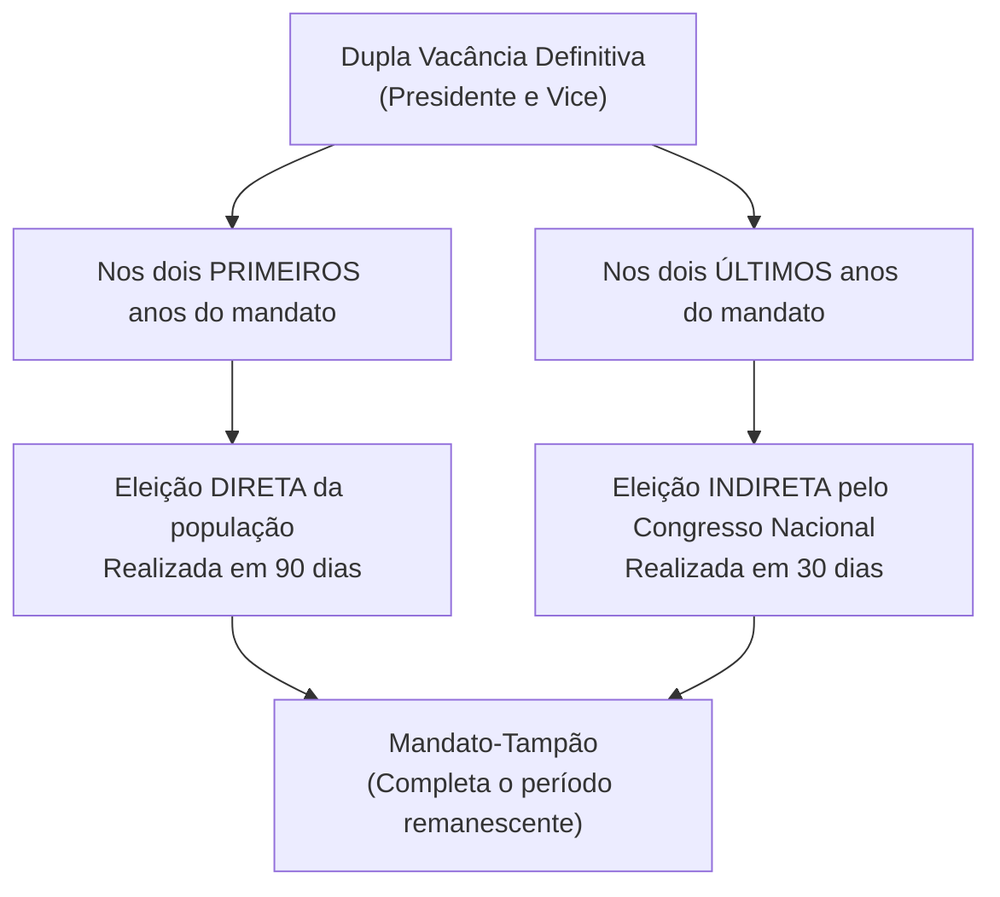
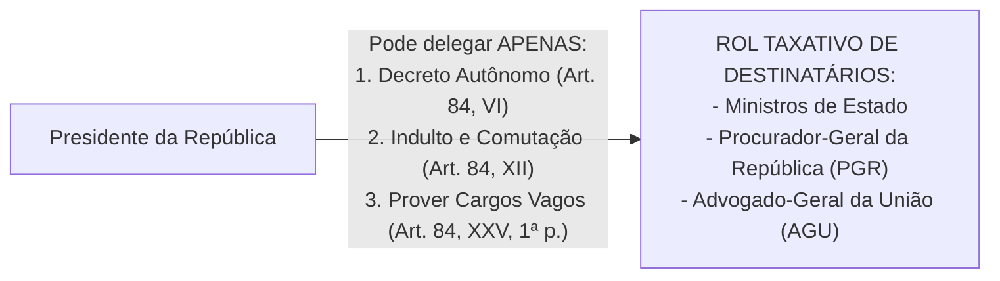

# 05 - Poder Executivo, Poder Judiciário e Funções Essenciais à Justiça

> **Matéria:** Noções de Direito Constitucional  
> **Cargo:** A01 – Técnico de Controle Externo – Especialidade: Técnico Administrativo  
> **Arquivo:** `05_poder_executivo_poder_judiciario_e_funcoes_essenciais.md`  
> **Status:** 🟢 Teoria Aprofundada + 5 Questões FCC Comentadas (A a E)

---

## 📌 Ementa / Itens do Edital

- Do Poder Executivo: eleição, posse, impedimento, vacância e sucessão presidencial;
- Atribuições e prerrogativas do Presidente da República (Artigo 84 da CF/88): competências indelegáveis e competências privativas delegáveis (decretos autônomos, indulto e provimento de cargos vagos);
- Responsabilidade do Presidente da República (Artigos 85 e 86 da CF/88):
    - Crimes comuns vs. crimes de responsabilidade (*impeachment*);
    - Juízo prévio de admissibilidade pela Câmara dos Deputados (quórum qualificado de 2/3);
    - Competência de julgamento pelo STF e pelo Senado Federal (presidido pelo Presidente do STF);
    - Imunidades presidenciais: imunidade prisional temporária e cláusula de irresponsabilidade relativa por atos estranhos ao mandato;
- Do Poder Judiciário: disposições gerais, estatuto e garantias da magistratura (vitaliciedade, inamovibilidade e irredutibilidade) e vedações expressas (quarentena de saída);
- Do Supremo Tribunal Federal (STF - Artigos 101 a 103-A da CF/88): composição (11 Ministros), nomeação, sabatina pelo Senado Federal, competências originárias e recursais, e o regime das Súmulas Vinculantes (Art. 103-A);
- Do Conselho Nacional de Justiça (CNJ - Artigo 103-B da CF/88): organização, composição (15 membros) e limites de atuação (natureza estritamente administrativa, orçamentária e correcional, sem competência jurisdicional);
- Do Superior Tribunal de Justiça (STJ - Artigos 104 e 105 da CF/88): composição (no mínimo 33 Ministros), uniformização da lei federal infraconstitucional e o filtro da relevância no Recurso Especial (EC nº 125/2022);
- Das Funções Essenciais à Justiça:
    - Ministério Público (Artigos 127 a 130-A da CF/88): princípios institucionais, autonomia, garantias, vedações e o Conselho Nacional do Ministério Público (CNMP);
    - Advocacia Pública (Artigos 131 e 132 da CF/88): AGU e Procuradorias Estaduais (PGE-GO);
    - Advocacia Privada (Artigo 133 da CF/88): indispensabilidade e inviolabilidade profissional;
    - Defensoria Pública (Artigos 134 e 135 da CF/88): assistência jurídica aos hipossuficientes e autonomia institucional expressa.

---

## 🧭 Sumário

1. [Poder Executivo: Estrutura, Atribuições e Responsabilidade](#1-poder-executivo-estrutura-atribuicoes-e-responsabilidade)
    1. [Dupla Vacância dos Cargos Presidenciais (Art. 81 da CF/88)](#11-dupla-vacancia-dos-cargos-presidenciais-art-81-da-cf88)
    2. [Atribuições Delegáveis do Presidente da República (Art. 84, Parágrafo Único)](#12-atribuicoes-delegaveis-do-presidente-da-republica-art-84-paragrafo-unico)
    3. [Responsabilidade do Presidente da República e Imunidades (Arts. 85 e 86)](#13-responsabilidade-do-presidente-da-republica-e-imunidades-arts-85-e-86)
    4. [Teste 154](#Teste-154)
    5. [Teste 155](#Teste-155)
    6. [Teste 156](#Teste-156)
    7. [Teste 157](#Teste-157)
2. [Poder Judiciário: Estrutura Orgânica, CNJ e Súmula Vinculante](#2-poder-judiciario-estrutura-organica-cnj-e-sumula-vinculante)
    1. [Garantias e Vedações dos Magistrados (Art. 95 da CF/88)](#21-garantias-e-vedacoes-dos-magistrados-art-95-da-cf88)
    2. [Conselho Nacional de Justiça (CNJ - Art. 103-B)](#22-conselho-nacional-de-justica-cnj-art-103-b)
    3. [Supremo Tribunal Federal e o Regime da Súmula Vinculante (Art. 103-A)](#23-supremo-tribunal-federal-e-o-regime-da-sumula-vinculante-art-103-a)
    4. [Superior Tribunal de Justiça e o Filtro de Relevância (Arts. 104 e 105)](#24-superior-tribunal-de-justica-e-o-filtro-de-relevancia-arts-104-e-105)
    5. [Teste 158](#Teste-158)
    6. [Teste 159](#Teste-159)
    7. [Teste 160](#Teste-160)
    8. [Teste 161](#Teste-161)
3. [Funções Essenciais à Justiça](#3-funcoes-essenciais-a-justica)
    1. [Ministério Público e o CNMP (Arts. 127 a 130-A)](#31-ministerio-publico-e-o-cnmp-arts-127-a-130-a)
    2. [Advocacia Pública (Arts. 131 e 132)](#32-advocacia-publica-arts-131-e-132)
    3. [Defensoria Pública (Arts. 134 e 135)](#33-defensoria-publica-arts-134-e-135)
    4. [Advocacia Privada (Art. 133)](#34-advocacia-privada-art-133)
    5. [Teste 162](#Teste-162)
    6. [Teste 163](#Teste-163)
    7. [Teste 164](#Teste-164)
4. [🌐 Fontes Oficiais & Jurisprudenciais Recomendadas](#fontes-oficiais-jurisprudenciais-recomendadas)

---

## 1. Poder Executivo: Estrutura, Atribuições e Responsabilidade

### 1.1 Dupla Vacância dos Cargos Presidenciais (Art. 81 da CF/88)
Ocorrendo a vacância definitiva tanto do cargo de Presidente quanto de Vice-Presidente da República, aplicam-se regras distintas a depender do momento do mandato:

- **Primeiros 2 anos do mandato:** Ocorrendo a vacância definitiva de ambos os cargos na primeira metade da legislatura, far-se-á eleição **direta** noventa dias depois de aberta a última vaga.
- **Últimos 2 anos do mandato:** Se a dupla vacância definitiva ocorrer na segunda metade da legislatura (3º ou 4º ano do mandato), a eleição para ambos os cargos será feita **indireta**, trinta dias depois da última vaga, pelo **Congresso Nacional**, na forma da lei.
- Em qualquer das hipóteses de eleição extraordinária, os eleitos deverão completar o período remanescente de seus antecessores (*mandato-tampão* - art. 81, § 2º).

### 1.2 Atribuições Delegáveis do Presidente da República (Art. 84, Parágrafo Único)
O art. 84 fixa as competências privativas do Presidente da República. Em regra, são privativas e indelegáveis. Todavia, a Constituição autoriza a **delegação de apenas TRÊS matérias específicas**:

1. **Art. 84, VI:** Dispor, mediante **decreto autônomo**, sobre:
    - *a)* Organização e funcionamento da administração federal, quando não implicar aumento de despesa nem criação ou extinção de órgãos públicos;
    - *b)* Extinção de funções ou cargos públicos, quando vagos;

2. **Art. 84, XII:** Conceder **indulto e comutar penas**, com audiência, se necessário, dos órgãos instituídos em lei;
3. **Art. 84, XXV, primeira parte:** **Prover** cargos públicos federais, na forma da lei.

> 🚨 **ALERTA DE PROVA / PEGADINHA FCC:**  
>
> - **Extinção de Órgãos Públicos:** O Presidente NÃO pode criar nem extinguir Ministérios ou órgãos públicos por decreto! A criação e extinção de órgãos públicos exige expressamente **lei formal ordinária** (art. 88 da CF/88). O decreto autônomo serve exclusivamente para organizar órgãos existentes sem gerar custos ou extinguir cargos vagos.  
> - **Extinção de Cargos Públicos Ocupados:** Depende obrigatoriamente de lei formal. Por decreto autônomo, o Chefe do Executivo só pode extinguir cargos e funções quando estiverem **vagos**!

### 1.3 Responsabilidade do Presidente da República e Imunidades (Arts. 85 e 86)
O Presidente da República responde perante o STF por crimes comuns e perante o Senado Federal por crimes de responsabilidade (*impeachment*).

| Aspecto Procedimental | Crime Comum (Penal) | Crime de Responsabilidade (*Impeachment*) |
| :--- | :--- | :--- |
| **Juízo de Admissibilidade** | **Câmara dos Deputados** (quórum de 2/3 dos membros) | **Câmara dos Deputados** (quórum de 2/3 dos membros) |
| **Órgão Julgador Competente** | **Supremo Tribunal Federal (STF)** | **Senado Federal** (sob presidência do Presidente do STF) |
| **Instauração do Processo** | Recebimento da denúncia ou queixa pelo STF | Deliberação do Plenário do Senado Federal por maioria simples |
| **Afastamento Preventivo** | Fica suspenso de suas funções por até 180 dias | Fica suspenso de suas funções por até 180 dias |
| **Sanção Constitucional** | Penas privativas de liberdade / multas criminais | **Perda do cargo** + **inabilitação por 8 anos** para qualquer função pública (quórum de 2/3 do Senado) |
| **Imunidade Prisional (Art. 86, § 3º)** | **Não pode ser preso**, na vigência do mandato, senão após sentença penal condenatória transitada em julgado | Inaplicável medida penal coercitiva |
| **Irresponsabilidade Relativa (Art. 86, § 4º)** | **Não pode ser responsabilizado por atos estranhos ao exercício de suas funções** na vigência do mandato | Aplicável a atos conexos ao exercício funcional |

---

### Teste 154
**(FGV – TCE/PA – 2024 – Auditor de Controle Externo - Administrativa - Gestão Governamental)**
O Presidente da República, em matéria de sua iniciativa privativa, apresentou projeto de lei à Câmara dos Deputados. Após tramitação regular, o projeto foi aprovado, com alterações, e encaminhado para o Senado Federal. Nessa Casa Legislativa, foi aprovado um substitutivo alterando integralmente, embora sem aumento de despesa, a forma como a respectiva matéria fora disciplinada no projeto. Considerando a sistemática constitucional, é correto afirmar que

* **A)** o Senado Federal, ao aprovar o substitutivo, assumiu a função de Casa Iniciadora, reiniciando a tramitação do projeto.
* **B)** por se tratar de matéria de iniciativa privativa do Chefe do Poder Executivo, o Senado Federal não poderia ter aprovado o substitutivo.
* **C)** após ser apreciado pela Câmara dos Deputados, o substitutivo, se aprovado, será encaminhado ao Chefe do Poder Executivo para fins de sanção ou veto.
* **D)** o Senado Federal, embora tenha atuado como Casa Revisora, deve apreciar as emendas que venham a ser aprovadas na Câmara dos Deputados, após esta Casa analisar o substitutivo.
* **E)** por se tratar de matéria de iniciativa privativa do Chefe do Poder Executivo, o substitutivo aprovado pelo Senado Federal somente poderia versar sobre redação, não sobre o mérito.

---

> **Comentário Detalhado:**
>
> - **A)** **Incorreta.** A opção apresenta proposição em desacordo com os fundamentos teóricos e técnicos do tópico ao afirmar que "o Senado Federal, ao aprovar o substitutivo, assumiu a função de Casa Iniciadora, reiniciando a tramitação do...". De acordo com a teoria estudada em *1.3 Responsabilidade do Presidente da República e Imunidades (Arts. 85 e 86)*, sanção Constitucional: Penas privativas de liberdade / multas criminais — Perda do cargo + inabilitação por 8 anos para qualquer função pública (quórum de 2/3 do Senado).
> - **B)** **Incorreta.** A opção apresenta proposição em desacordo com os fundamentos teóricos e técnicos do tópico ao afirmar que "por se tratar de matéria de iniciativa privativa do Chefe do Poder Executivo, o Senado Federal não poderia ter...". De acordo com a teoria estudada em *1.2 Atribuições Delegáveis do Presidente da República (Art. 84, Parágrafo Único)*, extinção de Cargos Públicos Ocupados: Depende obrigatoriamente de lei formal. Por decreto autônomo, o Chefe do Executivo só pode extinguir cargos e funções quando estiverem vagos!.
> - **C)** **Correta.** Conforme fundamentado na seção *1.3 Responsabilidade do Presidente da República e Imunidades (Arts. 85 e 86)* deste guia, juízo de Admissibilidade: Câmara dos Deputados (quórum de 2/3 dos membros) — Câmara dos Deputados (quórum de 2/3 dos membros). Dessa forma, está plenamente correta a assertiva da banca (FGV – TCE/PA/2024) ao estabelecer que "após ser apreciado pela Câmara dos Deputados, o substitutivo, se aprovado, será encaminhado ao Chefe do Poder...".
> - **D)** **Incorreta.** A opção apresenta proposição em desacordo com os fundamentos teóricos e técnicos do tópico ao afirmar que "o Senado Federal, embora tenha atuado como Casa Revisora, deve apreciar as emendas que venham a ser aprovadas na...". De acordo com a teoria estudada em *1.3 Responsabilidade do Presidente da República e Imunidades (Arts. 85 e 86)*, imunidade Prisional (Art. 86, § 3º): Não pode ser preso, na vigência do mandato, senão após sentença penal condenatória transitada em julgado — Inaplicável medida penal coercitiva.
> - **E)** **Incorreta.** A opção incorre em restrição indevida ao limitar o escopo conceitual ao afirmar que "por se tratar de matéria de iniciativa privativa do Chefe do Poder Executivo, o substitutivo aprovado pelo Senado...". De acordo com a teoria estudada em *1.3 Responsabilidade do Presidente da República e Imunidades (Arts. 85 e 86)*, irresponsabilidade Relativa (Art. 86, § 4º): Não pode ser responsabilizado por atos estranhos ao exercício de suas funções na vigência do mandato — Aplicável a atos conexos ao exercício funcional.
>
> **Gabarito: C**

---

### Teste 155
**(FGV – TCE/PA – 2024 – Auditor de Controle Externo - Fiscalização - Ciências Atuariais)**
Após ampla mobilização popular, visando à contenção do gasto público e ao zelo pela moralidade administrativa, foram iniciados debates, no âmbito da Assembleia Legislativa do Estado Sigma, para a apresentação de proposta de emenda constitucional que iria dispor que as leis orgânicas dos municípios situados no território de Sigma devem estatuir: I. o número máximo de secretarias do Poder Executivo; II. a remuneração máxima dos cargos do Poder Executivo; III. os balizamentos a serem observados para a prática de atos discricionários. Considerando as três temáticas referidas, é correto afirmar que a Constituição Estadual

* **A)** pode dispor sobre todas.
* **B)** não pode dispor sobre nenhuma.
* **C)** pode dispor apenas sobre a matéria referida em II.
* **D)** pode dispor apenas sobre as matérias referidas em I e III.
* **E)** pode dispor apenas sobre as matérias referidas em I e II.

---

> **Comentário Detalhado:**
>
> - **A)** **Incorreta.** A opção apresenta proposição em desacordo com os fundamentos teóricos e técnicos do tópico ao afirmar que "pode dispor sobre todas". De acordo com a teoria estudada em *1.2 Atribuições Delegáveis do Presidente da República (Art. 84, Parágrafo Único)*, extinção de Cargos Públicos Ocupados: Depende obrigatoriamente de lei formal. Por decreto autônomo, o Chefe do Executivo só pode extinguir cargos e funções quando estiverem vagos!.
> - **B)** **Correta.** Conforme fundamentado na seção *1.2 Atribuições Delegáveis do Presidente da República (Art. 84, Parágrafo Único)* deste guia, art. 84, VI: Dispor, mediante decreto autônomo, sobre. Dessa forma, está plenamente correta a assertiva da banca (FGV – TCE/PA/2024) ao estabelecer que "não pode dispor sobre nenhuma".
> - **C)** **Incorreta.** A opção incorre em restrição indevida ao limitar o escopo conceitual ao afirmar que "pode dispor apenas sobre a matéria referida em II". De acordo com a teoria estudada em *1.3 Responsabilidade do Presidente da República e Imunidades (Arts. 85 e 86)*, imunidade Prisional (Art. 86, § 3º): Não pode ser preso, na vigência do mandato, senão após sentença penal condenatória transitada em julgado — Inaplicável medida penal coercitiva.
> - **D)** **Incorreta.** A opção incorre em restrição indevida ao limitar o escopo conceitual ao afirmar que "pode dispor apenas sobre as matérias referidas em I e III". De acordo com a teoria estudada em *1.2 Atribuições Delegáveis do Presidente da República (Art. 84, Parágrafo Único)*, o art. 84 fixa as competências privativas do Presidente da República. Em regra, são privativas e indelegáveis. Todavia, a Constituição autoriza a delegação de apenas TRÊS matérias específicas.
> - **E)** **Incorreta.** A opção incorre em restrição indevida ao limitar o escopo conceitual ao afirmar que "pode dispor apenas sobre as matérias referidas em I e II". De acordo com a teoria estudada em *1.3 Responsabilidade do Presidente da República e Imunidades (Arts. 85 e 86)*, irresponsabilidade Relativa (Art. 86, § 4º): Não pode ser responsabilizado por atos estranhos ao exercício de suas funções na vigência do mandato — Aplicável a atos conexos ao exercício funcional.
>
> **Gabarito: B**

---

### Teste 156
**(FCC – TCE/GO – 2009 – Analista de Controle Externo - Gestão de Conhecimento)**
Vagando os cargos de Presidente e Vice-Presidente da República,

* **A)** será chamado ao exercício da Presidência o Pre- sidente da Câmara dos Deputados, que deverá com- pletar o período de mandato de seus antecessores.
* **B)** será realizada eleição pelo Congresso Nacional, trin- ta dias depois da última vaga, caso a vacância ocorra nos últimos dois anos do período presiden- cial.
* **C)** deverá ser convocado plebiscito para decidir quanto à necessidade de realização de nova eleição.
* **D)** caberá ao Tribunal Superior Eleitoral dar posse aos candidatos segundos colocados no pleito em que eleitos os antecessores.
* **E)** não há solução prevista expressamente na Cons- tituição da República para a sucessão, cabendo ao Congresso Nacional dispor sobre a matéria. _________________________________________________________

---

> **Comentário Detalhado:**
>
> - **A)** **Incorreta.** A opção apresenta proposição em desacordo com os fundamentos teóricos e técnicos do tópico ao afirmar que "será chamado ao exercício da Presidência o Pre- sidente da Câmara dos Deputados, que deverá com- pletar o período...". De acordo com a teoria estudada em *1.1 Dupla Vacância dos Cargos Presidenciais (Art. 81 da CF/88)*, em qualquer das hipóteses de eleição extraordinária, os eleitos deverão completar o período remanescente de seus antecessores (*mandato-tampão* - art. 81, § 2º).
> - **B)** **Correta.** Conforme fundamentado na seção *1.1 Dupla Vacância dos Cargos Presidenciais (Art. 81 da CF/88)* deste guia, últimos 2 anos do mandato: Se a dupla vacância definitiva ocorrer na segunda metade da legislatura (3º ou 4º ano do mandato), a eleição para ambos os cargos será feita indireta, trinta dias depois da última vaga, pelo Congresso Nacional, na forma da lei. Dessa forma, está plenamente correta a assertiva da banca (FCC – TCE/GO/2009) ao estabelecer que "será realizada eleição pelo Congresso Nacional, trin- ta dias depois da última vaga, caso a vacância ocorra nos...".
> - **C)** **Incorreta.** A opção apresenta proposição em desacordo com os fundamentos teóricos e técnicos do tópico ao afirmar que "deverá ser convocado plebiscito para decidir quanto à necessidade de realização de nova eleição". De acordo com a teoria estudada em *1.1 Dupla Vacância dos Cargos Presidenciais (Art. 81 da CF/88)*, primeiros 2 anos do mandato: Ocorrendo a vacância definitiva de ambos os cargos na primeira metade da legislatura, far-se-á eleição direta noventa dias depois de aberta a última vaga.
> - **D)** **Incorreta.** A opção apresenta proposição em desacordo com os fundamentos teóricos e técnicos do tópico ao afirmar que "caberá ao Tribunal Superior Eleitoral dar posse aos candidatos segundos colocados no pleito em que eleitos os...". De acordo com a teoria estudada em *1.1 Dupla Vacância dos Cargos Presidenciais (Art. 81 da CF/88)*, ocorrendo a vacância definitiva tanto do cargo de Presidente quanto de Vice-Presidente da República, aplicam-se regras distintas a depender do momento do mandato.
> - **E)** **Incorreta.** A opção apresenta proposição em desacordo com os fundamentos teóricos e técnicos do tópico ao afirmar que "não há solução prevista expressamente na Cons- tituição da República para a sucessão, cabendo ao Congresso...". De acordo com a teoria estudada em *1.2 Atribuições Delegáveis do Presidente da República (Art. 84, Parágrafo Único)*, art. 84, VI: Dispor, mediante decreto autônomo, sobre.
>
> **Gabarito: B**

---

### Teste 157
**(FGV – TCE/PA – 2024 – Auditor de Controle Externo - Fiscalização - Ciências Atuariais)**
Foi instituído um grupo de trabalho no âmbito do Poder Executivo do Estado Alfa, com o objetivo de elaborar anteprojeto de proposição legislativa destinada a promover alterações no regime próprio de previdência social, especificamente direcionadas aos servidores públicos com deficiência que fossem ocupantes de cargos de provimento efetivo. As medidas propostas no anteprojeto são as seguintes: I. a avaliação da deficiência seria realizada não só nos planos físico e mental, mas em uma perspectiva biopsicossocial; II. o cômputo, como tempo de contribuição, dos períodos de férias e licença especial não fruídos pelos servidores até o requerimento de aposentadoria; e III. esses servidores, conforme o grau da deficiência, podem se aposentar com idade inferior aos servidores que não possuem deficiência. A assessoria do Chefe do Poder Executivo, ao analisar a conformidade, com a Constituição da República, das três alterações propostas, concluiu corretamente que

* **A)** todas apresentam conformidade constitucional.
* **B)** apenas a alteração I apresenta conformidade constitucional.
* **C)** apenas a alteração II apresenta conformidade constitucional.
* **D)** apenas as alterações I e III apresentam conformidade constitucional.
* **E)** apenas as alterações II e III apresentam conformidade constitucional.

---

> **Comentário Detalhado:**
>
> - **A)** **Incorreta.** A opção apresenta proposição em desacordo com os fundamentos teóricos e técnicos do tópico ao afirmar que "todas apresentam conformidade constitucional". De acordo com a teoria estudada em *1.2 Atribuições Delegáveis do Presidente da República (Art. 84, Parágrafo Único)*, extinção de Cargos Públicos Ocupados: Depende obrigatoriamente de lei formal. Por decreto autônomo, o Chefe do Executivo só pode extinguir cargos e funções quando estiverem vagos!.
> - **B)** **Incorreta.** A opção incorre em restrição indevida ao limitar o escopo conceitual ao afirmar que "apenas a alteração I apresenta conformidade constitucional". De acordo com a teoria estudada em *1.2 Atribuições Delegáveis do Presidente da República (Art. 84, Parágrafo Único)*, o art. 84 fixa as competências privativas do Presidente da República. Em regra, são privativas e indelegáveis. Todavia, a Constituição autoriza a delegação de apenas TRÊS matérias específicas.
> - **C)** **Incorreta.** A opção incorre em restrição indevida ao limitar o escopo conceitual ao afirmar que "apenas a alteração II apresenta conformidade constitucional". De acordo com a teoria estudada em *1.2 Atribuições Delegáveis do Presidente da República (Art. 84, Parágrafo Único)*, *b)* Extinção de funções ou cargos públicos, quando vagos.
> - **D)** **Correta.** Conforme fundamentado na seção *1.3 Responsabilidade do Presidente da República e Imunidades (Arts. 85 e 86)* deste guia, sanção Constitucional: Penas privativas de liberdade / multas criminais — Perda do cargo + inabilitação por 8 anos para qualquer função pública (quórum de 2/3 do Senado). Dessa forma, está plenamente correta a assertiva da banca (FGV – TCE/PA/2024) ao estabelecer que "apenas as alterações I e III apresentam conformidade constitucional".
> - **E)** **Incorreta.** A opção incorre em restrição indevida ao limitar o escopo conceitual ao afirmar que "apenas as alterações II e III apresentam conformidade constitucional". De acordo com a teoria estudada em *1.2 Atribuições Delegáveis do Presidente da República (Art. 84, Parágrafo Único)*, art. 84, XXV, primeira parte: Prover cargos públicos federais, na forma da lei.
>
> **Gabarito: D**

---

### Teste 158
**(FGV – TCE/PA – 2024 – Auditor de Controle Externo - Fiscalização - Ciências Atuariais)**
Com o objetivo de evitar uma iminente greve em certos setores do funcionalismo público federal, o Presidente da República, após se reunir com os Ministros das respectivas áreas, editou a Medida Provisória nº X (MPX), acolhendo parte das reivindicações das lideranças dos servidores públicos, de modo a alterar o regime jurídico da categoria. A MPX foi editada no dia seguinte à aprovação do Projeto de Lei nº Y (PLY) sobre a matéria no âmbito do Congresso Nacional. O PLY, no entanto, ainda não tinha sido encaminhado ao Poder Executivo. À luz da sistemática constitucional, é correto afirmar que a MPX

* **A)** não poderia ter sido editada.
* **B)** somente poderia ter sido editada após o recebimento do PLY.
* **C)** irá sobrestar o encaminhamento do PLY, devendo ser anexada a ele.
* **D)** foi editada com base no juízo de conveniência e oportunidade do Presidente da República, não tendo vício.
* **E)** embora não tenha vício, perderá a eficácia, naquilo que for colidente com o PLY, caso este último seja sancionado.

---

> **Comentário Detalhado:**
>
> - **A)** **Correta.** Conforme fundamentado na seção *1.1 Dupla Vacância dos Cargos Presidenciais (Art. 81 da CF/88)* deste guia, últimos 2 anos do mandato: Se a dupla vacância definitiva ocorrer na segunda metade da legislatura (3º ou 4º ano do mandato), a eleição para ambos os cargos será feita indireta, trinta dias depois da última vaga, pelo Congresso Nacional, na forma da lei. Dessa forma, está plenamente correta a assertiva da banca (FGV – TCE/PA/2024) ao estabelecer que "não poderia ter sido editada".
> - **B)** **Incorreta.** A opção incorre em restrição indevida ao limitar o escopo conceitual ao afirmar que "somente poderia ter sido editada após o recebimento do PLY". De acordo com a teoria estudada em *1.3 Responsabilidade do Presidente da República e Imunidades (Arts. 85 e 86)*, imunidade Prisional (Art. 86, § 3º): Não pode ser preso, na vigência do mandato, senão após sentença penal condenatória transitada em julgado — Inaplicável medida penal coercitiva.
> - **C)** **Incorreta.** A opção apresenta proposição em desacordo com os fundamentos teóricos e técnicos do tópico ao afirmar que "irá sobrestar o encaminhamento do PLY, devendo ser anexada a ele". De acordo com a teoria estudada em *1.3 Responsabilidade do Presidente da República e Imunidades (Arts. 85 e 86)*, irresponsabilidade Relativa (Art. 86, § 4º): Não pode ser responsabilizado por atos estranhos ao exercício de suas funções na vigência do mandato — Aplicável a atos conexos ao exercício funcional.
> - **D)** **Incorreta.** A opção apresenta proposição em desacordo com os fundamentos teóricos e técnicos do tópico ao afirmar que "foi editada com base no juízo de conveniência e oportunidade do Presidente da República, não tendo vício". De acordo com a teoria estudada em *1.3 Responsabilidade do Presidente da República e Imunidades (Arts. 85 e 86)*, juízo de Admissibilidade: Câmara dos Deputados (quórum de 2/3 dos membros) — Câmara dos Deputados (quórum de 2/3 dos membros).
> - **E)** **Incorreta.** A opção apresenta proposição em desacordo com os fundamentos teóricos e técnicos do tópico ao afirmar que "embora não tenha vício, perderá a eficácia, naquilo que for colidente com o PLY, caso este último seja sancionado". De acordo com a teoria estudada em *1.2 Atribuições Delegáveis do Presidente da República (Art. 84, Parágrafo Único)*, art. 84, XXV, primeira parte: Prover cargos públicos federais, na forma da lei.
>
> **Gabarito: A**

---

### Teste 159
**(FGV – TCE/PA – 2024 – Auditor de Controle Externo - Administrativa - Direito)**
Marcos, Juiz de Direito, passou a responder a processo administrativo perante o Tribunal de Justiça a que estava vinculado, em razão da possível prática de infração disciplinar. Por gozar de grande popularidade na comarca em que era titular de órgão jurisdicional, situada no Município Alfa, e por entender que a instauração desse processo era manifestamente injusta, decidiu pedir exoneração do cargo de Juiz de Direito para concorrer ao cargo eletivo de Prefeito Municipal de Alfa. Ao terem conhecimento desses fatos, partidos políticos que pretendiam apresentar candidatos próprios iniciaram estudos com o objetivo de avaliar a possível configuração de uma causa de inelegibilidade. Nesse caso, é correto afirmar que

* **A)** Marcos somente está inelegível para concorrer a um cargo eletivo no Município Alfa.
* **B)** o pedido de exoneração é direito subjetivo de Marcos, não podendo caracterizar uma causa de inelegibilidade.
* **C)** Marcos está inelegível, considerando que respondia a processo administrativo disciplinar ao pedir exoneração.
* **D)** Marcos somente está inelegível se o processo administrativo disciplinar estiver em tramitação no âmbito do Conselho Nacional de Justiça.
* **E)** Marcos somente estaria inelegível se tivesse pedido exoneração após a prolação de decisão condenatória, ainda que suscetível de recurso.

---

> **Comentário Detalhado:**
>
> - **A)** **Incorreta.** A opção incorre em restrição indevida ao limitar o escopo conceitual ao afirmar que "Marcos somente está inelegível para concorrer a um cargo eletivo no Município Alfa". De acordo com a teoria estudada em *1.3 Responsabilidade do Presidente da República e Imunidades (Arts. 85 e 86)*, o Presidente da República responde perante o STF por crimes comuns e perante o Senado Federal por crimes de responsabilidade (*impeachment*).
> - **B)** **Incorreta.** A opção apresenta proposição em desacordo com os fundamentos teóricos e técnicos do tópico ao afirmar que "o pedido de exoneração é direito subjetivo de Marcos, não podendo caracterizar uma causa de inelegibilidade". De acordo com a teoria estudada em *1.3 Responsabilidade do Presidente da República e Imunidades (Arts. 85 e 86)*, órgão Julgador Competente: Supremo Tribunal Federal (STF) — Senado Federal (sob presidência do Presidente do STF).
> - **C)** **Correta.** Conforme fundamentado na seção *1.3 Responsabilidade do Presidente da República e Imunidades (Arts. 85 e 86)* deste guia, instauração do Processo: Recebimento da denúncia ou queixa pelo STF — Deliberação do Plenário do Senado Federal por maioria simples. Dessa forma, está plenamente correta a assertiva da banca (FGV – TCE/PA/2024) ao estabelecer que "Marcos está inelegível, considerando que respondia a processo administrativo disciplinar ao pedir exoneração".
> - **D)** **Incorreta.** A opção incorre em restrição indevida ao limitar o escopo conceitual ao afirmar que "Marcos somente está inelegível se o processo administrativo disciplinar estiver em tramitação no âmbito do...". De acordo com a teoria estudada em *1.1 Dupla Vacância dos Cargos Presidenciais (Art. 81 da CF/88)*, últimos 2 anos do mandato: Se a dupla vacância definitiva ocorrer na segunda metade da legislatura (3º ou 4º ano do mandato), a eleição para ambos os cargos será feita indireta, trinta dias depois da última vaga, pelo Congresso Nacional, na forma da lei.
> - **E)** **Incorreta.** A opção incorre em restrição indevida ao limitar o escopo conceitual ao afirmar que "Marcos somente estaria inelegível se tivesse pedido exoneração após a prolação de decisão condenatória, ainda que...". De acordo com a teoria estudada em *1.3 Responsabilidade do Presidente da República e Imunidades (Arts. 85 e 86)*, imunidade Prisional (Art. 86, § 3º): Não pode ser preso, na vigência do mandato, senão após sentença penal condenatória transitada em julgado — Inaplicável medida penal coercitiva.
>
> **Gabarito: C**

---

### Teste 160
**(FGV – TJ/MT – 2024 – Analista Judiciario Tecnologia Da Informacao)**
Determinado órgão, em âmbito nacional, tem a competência de controlar a atuação administrativa e financeira do Poder Judiciário e o cumprimento dos deveres funcionais dos juízes, além de outras atribuições que lhe forem conferidas pelo Estatuto da Magistratura. Nesse cenário, considerando as disposições da Constituição Federal de 1988, se está diante de uma competência do

* **A)** Tribunal Superior do Trabalho.
* **B)** Conselho Nacional de Justiça.
* **C)** Superior Tribunal de Justiça.
* **D)** Tribunal Superior Eleitoral.
* **E)** Supremo Tribunal Federal.

---

> **Comentário Detalhado:**
>
> - **A)** **Incorreta.** A opção apresenta proposição em desacordo com os fundamentos teóricos e técnicos do tópico ao afirmar que "Tribunal Superior do Trabalho". De acordo com a teoria estudada em *1.2 Atribuições Delegáveis do Presidente da República (Art. 84, Parágrafo Único)*, o art. 84 fixa as competências privativas do Presidente da República. Em regra, são privativas e indelegáveis. Todavia, a Constituição autoriza a delegação de apenas TRÊS matérias específicas.
> - **B)** **Correta.** Conforme fundamentado na seção *1.1 Dupla Vacância dos Cargos Presidenciais (Art. 81 da CF/88)* deste guia, últimos 2 anos do mandato: Se a dupla vacância definitiva ocorrer na segunda metade da legislatura (3º ou 4º ano do mandato), a eleição para ambos os cargos será feita indireta, trinta dias depois da última vaga, pelo Congresso Nacional, na forma da lei. Dessa forma, está plenamente correta a assertiva da banca (FGV – TJ/MT/2024) ao estabelecer que "Conselho Nacional de Justiça".
> - **C)** **Incorreta.** A opção apresenta proposição em desacordo com os fundamentos teóricos e técnicos do tópico ao afirmar que "Superior Tribunal de Justiça". De acordo com a teoria estudada em *1.3 Responsabilidade do Presidente da República e Imunidades (Arts. 85 e 86)*, órgão Julgador Competente: Supremo Tribunal Federal (STF) — Senado Federal (sob presidência do Presidente do STF).
> - **D)** **Incorreta.** A opção apresenta proposição em desacordo com os fundamentos teóricos e técnicos do tópico ao afirmar que "Tribunal Superior Eleitoral". De acordo com a teoria estudada em *1.2 Atribuições Delegáveis do Presidente da República (Art. 84, Parágrafo Único)*, art. 84, VI: Dispor, mediante decreto autônomo, sobre.
> - **E)** **Incorreta.** A opção apresenta proposição em desacordo com os fundamentos teóricos e técnicos do tópico ao afirmar que "Supremo Tribunal Federal". De acordo com a teoria estudada em *1.2 Atribuições Delegáveis do Presidente da República (Art. 84, Parágrafo Único)*, *a)* Organização e funcionamento da administração federal, quando não implicar aumento de despesa nem criação ou extinção de órgãos públicos.
>
> **Gabarito: B**

---

### Teste 161
**(FGV – TJ/RR – 2024 – Analista Judiciario Gestao E Governanca De Tecnologia Da Informacao)**
O Conselho Nacional de Justiça compõe-se de 15 (quinze) membros com mandato de 2 (dois) anos, admitida 1 (uma) recondução. As opções a seguir apresentam membros que participam desse Conselho, à exceção de uma. Assinale-a.

* **A)** Um juiz de Tribunal Regional Federal, indicado pelo Superior Tribunal de Justiça.
* **B)** Um juiz de Tribunal Regional do Trabalho, indicado pelo Tribunal Superior do Trabalho.
* **C)** Dois cidadãos, de notável saber jurídico e reputação ilibada, indicados um pela Câmara dos Deputados e outro pelo Senado Federal.
* **D)** Um juiz do Tribunal Regional Eleitoral, indicado pelo Supremo Tribunal Federal.
* **E)** Um membro do Ministério Público estadual, escolhido pelo Procurador-Geral da República dentre os nomes indicados pelo órgão competente de cada instituição estadual.

---

> **Comentário Detalhado:**
>
> - **A)** **Incorreta.** A opção apresenta proposição em desacordo com os fundamentos teóricos e técnicos do tópico ao afirmar que "Um juiz de Tribunal Regional Federal, indicado pelo Superior Tribunal de Justiça". De acordo com a teoria estudada em *1.1 Dupla Vacância dos Cargos Presidenciais (Art. 81 da CF/88)*, últimos 2 anos do mandato: Se a dupla vacância definitiva ocorrer na segunda metade da legislatura (3º ou 4º ano do mandato), a eleição para ambos os cargos será feita indireta, trinta dias depois da última vaga, pelo Congresso Nacional, na forma da lei.
> - **B)** **Incorreta.** A opção apresenta proposição em desacordo com os fundamentos teóricos e técnicos do tópico ao afirmar que "Um juiz de Tribunal Regional do Trabalho, indicado pelo Tribunal Superior do Trabalho". De acordo com a teoria estudada em *1.3 Responsabilidade do Presidente da República e Imunidades (Arts. 85 e 86)*, juízo de Admissibilidade: Câmara dos Deputados (quórum de 2/3 dos membros) — Câmara dos Deputados (quórum de 2/3 dos membros).
> - **C)** **Incorreta.** A opção apresenta proposição em desacordo com os fundamentos teóricos e técnicos do tópico ao afirmar que "Dois cidadãos, de notável saber jurídico e reputação ilibada, indicados um pela Câmara dos Deputados e outro pelo...". De acordo com a teoria estudada em *1.3 Responsabilidade do Presidente da República e Imunidades (Arts. 85 e 86)*, o Presidente da República responde perante o STF por crimes comuns e perante o Senado Federal por crimes de responsabilidade (*impeachment*).
> - **D)** **Correta.** Conforme fundamentado na seção *1.3 Responsabilidade do Presidente da República e Imunidades (Arts. 85 e 86)* deste guia, órgão Julgador Competente: Supremo Tribunal Federal (STF) — Senado Federal (sob presidência do Presidente do STF). Dessa forma, está plenamente correta a assertiva da banca (FGV – TJ/RR/2024) ao estabelecer que "Um juiz do Tribunal Regional Eleitoral, indicado pelo Supremo Tribunal Federal".
> - **E)** **Incorreta.** A opção apresenta proposição em desacordo com os fundamentos teóricos e técnicos do tópico ao afirmar que "Um membro do Ministério Público estadual, escolhido pelo Procurador-Geral da República dentre os nomes indicados...". De acordo com a teoria estudada em *1.1 Dupla Vacância dos Cargos Presidenciais (Art. 81 da CF/88)*, ocorrendo a vacância definitiva tanto do cargo de Presidente quanto de Vice-Presidente da República, aplicam-se regras distintas a depender do momento do mandato.
>
> **Gabarito: D**

---

### Teste 162
**(FGV – TJ/SC – 2026 – Analista Administrativo)**
No Brasil, as políticas judiciárias de inclusão e cidadania são coordenadas, principalmente, pelo Conselho Nacional de Justiça (CNJ) e visam a transformar o Poder Judiciário em um agente ativo na promoção de direitos fundamentais e na remoção de barreiras ao acesso à justiça. Considerando as normas vigentes sobre essas políticas, assinale a afirmativa correta.

* **A)** As pessoas em situação de rua terão assegurado o acesso às dependências do Poder Judiciário para o exercício de seus direitos, salvo se estiverem com vestimentas e condições de higiene incompatíveis com as regras do Tribunal.
* **B)** Os tribunais deverão viabilizar atendimento prioritário e desburocratizado às pessoas em situação de rua, não se conferindo atendimento especial a qualquer pessoa, ainda que caracterizada como LGBTQUIA+ ou migrantes.
* **C)** Entende-se como mulheres em condição de especial vulnerabilidade econômico-social, as mulheres vítimas de violência física, moral, patrimonial, psicológica ou sexual, salvo as mulheres trans e travestis.
* **D)** A Resolução 497/2023 do CNJ instituiu, no âmbito do Poder Judiciário Nacional, à exceção do Supremo Tribunal Federal, o Programa “Transformação”, para fomentar a adoção de políticas afirmativas que reduzam as desigualdades no mercado de trabalho de mulheres de grupos vulneráveis.
* **E)** O Programa “Transformação” consiste na reserva, pelos Tribunais e Conselhos, de, no mínimo, 10% (dez por cento) das vagas nos contratos que envolvam prestação de serviços contínuos com regime de dedicação exclusiva de mão de obra. Conhecimentos Específicos Administração Geral

---

> **Comentário Detalhado:**
>
> - **A)** **Incorreta.** A opção apresenta proposição em desacordo com os fundamentos teóricos e técnicos do tópico ao afirmar que "As pessoas em situação de rua terão assegurado o acesso às dependências do Poder Judiciário para o exercício de...". De acordo com a teoria estudada em *1.1 Dupla Vacância dos Cargos Presidenciais (Art. 81 da CF/88)*, ocorrendo a vacância definitiva tanto do cargo de Presidente quanto de Vice-Presidente da República, aplicam-se regras distintas a depender do momento do mandato.
> - **B)** **Incorreta.** A opção promove generalização excessiva que desconsidera as condições técnicas e normativas ao afirmar que "Os tribunais deverão viabilizar atendimento prioritário e desburocratizado às pessoas em situação de rua, não se...". De acordo com a teoria estudada em *1.1 Dupla Vacância dos Cargos Presidenciais (Art. 81 da CF/88)*, em qualquer das hipóteses de eleição extraordinária, os eleitos deverão completar o período remanescente de seus antecessores (*mandato-tampão* - art. 81, § 2º).
> - **C)** **Incorreta.** A opção apresenta proposição em desacordo com os fundamentos teóricos e técnicos do tópico ao afirmar que "Entende-se como mulheres em condição de especial vulnerabilidade econômico-social, as mulheres vítimas de...". De acordo com a teoria estudada em *1.3 Responsabilidade do Presidente da República e Imunidades (Arts. 85 e 86)*, órgão Julgador Competente: Supremo Tribunal Federal (STF) — Senado Federal (sob presidência do Presidente do STF).
> - **D)** **Correta.** Conforme fundamentado na seção *1.1 Dupla Vacância dos Cargos Presidenciais (Art. 81 da CF/88)* deste guia, últimos 2 anos do mandato: Se a dupla vacância definitiva ocorrer na segunda metade da legislatura (3º ou 4º ano do mandato), a eleição para ambos os cargos será feita indireta, trinta dias depois da última vaga, pelo Congresso Nacional, na forma da lei. Dessa forma, está plenamente correta a assertiva da banca (FGV – TJ/SC/2026) ao estabelecer que "A Resolução 497/2023 do CNJ instituiu, no âmbito do Poder Judiciário Nacional, à exceção do Supremo Tribunal...".
> - **E)** **Incorreta.** A opção apresenta proposição em desacordo com os fundamentos teóricos e técnicos do tópico ao afirmar que "O Programa “Transformação” consiste na reserva, pelos Tribunais e Conselhos, de, no mínimo, 10% (dez por cento)...". De acordo com a teoria estudada em *1.2 Atribuições Delegáveis do Presidente da República (Art. 84, Parágrafo Único)*, *a)* Organização e funcionamento da administração federal, quando não implicar aumento de despesa nem criação ou extinção de órgãos públicos.
>
> **Gabarito: D**

---

### Teste 163
**(FGV – TJ/AP – 2023 – Analista Judiciario Apoio Especializado Tecnologia Da Informacao Banco De Dados)**
A Assembleia Legislativa do Estado Alfa recebeu uma proposição legislativa que tem por objeto a alteração das atribuições de certo órgão colegiado da Administração Superior do Ministério Público do Estado. Considerando os balizamentos estabelecidos pela Constituição da República a respeito das normas que estabelecem a organização, as atribuições e o estatuto de cada Ministério Público, é correto afirmar que a proposição legislativa precisa ter a natureza de:

* **A)** projeto de lei ordinária, de iniciativa privativa do governador do Estado;
* **B)** projeto de lei ordinária, de iniciativa privativa do Colégio de Procuradores de Justiça;
* **C)** projeto de lei complementar, de iniciativa privativa do procurador-geral de Justiça;
* **D)** proposta de emenda constitucional, podendo ter sido apresentada por qualquer legitimado para a reforma;
* **E)** projeto de lei complementar, podendo ter sido apresentado pelo procurador-geral de Justiça ou pelo governador do Estado.

---

> **Comentário Detalhado:**
>
> - **A)** **Incorreta.** A opção apresenta proposição em desacordo com os fundamentos teóricos e técnicos do tópico ao afirmar que "projeto de lei ordinária, de iniciativa privativa do governador do Estado". De acordo com a teoria estudada em *1.2 Atribuições Delegáveis do Presidente da República (Art. 84, Parágrafo Único)*, extinção de Órgãos Públicos: O Presidente NÃO pode criar nem extinguir Ministérios ou órgãos públicos por decreto! A criação e extinção de órgãos públicos exige expressamente lei formal ordinária (art. 88 da CF/88).
> - **B)** **Incorreta.** A opção apresenta proposição em desacordo com os fundamentos teóricos e técnicos do tópico ao afirmar que "projeto de lei ordinária, de iniciativa privativa do Colégio de Procuradores de Justiça". De acordo com a teoria estudada em *1.2 Atribuições Delegáveis do Presidente da República (Art. 84, Parágrafo Único)*, art. 84, XII: Conceder indulto e comutar penas, com audiência, se necessário, dos órgãos instituídos em lei.
> - **C)** **Correta.** Conforme fundamentado na seção *1.2 Atribuições Delegáveis do Presidente da República (Art. 84, Parágrafo Único)* deste guia, *a)* Organização e funcionamento da administração federal, quando não implicar aumento de despesa nem criação ou extinção de órgãos públicos. Dessa forma, está plenamente correta a assertiva da banca (FGV – TJ/AP/2023) ao estabelecer que "projeto de lei complementar, de iniciativa privativa do procurador-geral de Justiça".
> - **D)** **Incorreta.** A opção promove generalização excessiva que desconsidera as condições técnicas e normativas ao afirmar que "proposta de emenda constitucional, podendo ter sido apresentada por qualquer legitimado para a reforma". De acordo com a teoria estudada em *1.3 Responsabilidade do Presidente da República e Imunidades (Arts. 85 e 86)*, sanção Constitucional: Penas privativas de liberdade / multas criminais — Perda do cargo + inabilitação por 8 anos para qualquer função pública (quórum de 2/3 do Senado).
> - **E)** **Incorreta.** A opção apresenta proposição em desacordo com os fundamentos teóricos e técnicos do tópico ao afirmar que "projeto de lei complementar, podendo ter sido apresentado pelo procurador-geral de Justiça ou pelo governador do...". De acordo com a teoria estudada em *1.2 Atribuições Delegáveis do Presidente da República (Art. 84, Parágrafo Único)*, art. 84, XXV, primeira parte: Prover cargos públicos federais, na forma da lei.
>
> **Gabarito: C**

---

### Teste 164
**(FGV – TJ/RR – 2024 – Analista Judiciario Gestao E Governanca De Tecnologia Da Informacao)**
Considerando os impedimentos e incompatibilidades dos Magistrados e dos Servidores da Justiça previstos no Novo Código de Organização Judiciária do Estado de Roraima (Lei Complementar Estadual nº 221/2014 - COJERR), é correto afirmar que

* **A)** nenhum Servidor da Justiça, em qualquer categoria, poderá funcionar juntamente com o cônjuge ou parente, consanguíneo ou afim, em linha reta ou colateral até o terceiro grau na mesma Comarca, mesmo que não haja dependência hierárquica entre as funções dos respectivos cargos.
* **B)** o impedimento relativo ao funcionamento de servidores da Justiça de atuar no mesmo feito com cônjuges e parentes não pode ser aplicado quando alguma das partes, seu procurador ou o agente do Ministério Público, mantiver com o servidor idêntica relação de parentesco, consanguíneo ou afim.
* **C)** na hipótese de verificação de impedimento do servidor da Justiça em razão da atuação de seu com o cônjuge ou parente, consanguíneo ou afim, em linha reta ou colateral até o terceiro grau na mesma Comarca, será afastado o primeiro nomeado.
* **D)** exceto em atos ou processos administrativos ou de jurisdição graciosa do Tribunal de Justiça, não poderão funcionar conjuntamente como Juízes, no Tribunal Pleno, cônjuges e parentes consanguíneos ou afins em linha reta, ou colateral até o terceiro grau.
* **E)** são válidas e eficazes as remoções de Magistrados feitas a pedido que motivarem impedimento entre Magistrados ou entre Magistrado e o membro do Ministério Público ou Auxiliar de Justiça, em razão de ser o cônjuge ou parente, consanguíneo ou afim, em linha reta ou colateral até o terceiro grau.

---

> **Comentário Detalhado:**
>
> - **A)** **Incorreta.** A opção promove generalização excessiva que desconsidera as condições técnicas e normativas ao afirmar que "nenhum Servidor da Justiça, em qualquer categoria, poderá funcionar juntamente com o cônjuge ou parente...". De acordo com a teoria estudada em *1.1 Dupla Vacância dos Cargos Presidenciais (Art. 81 da CF/88)*, em qualquer das hipóteses de eleição extraordinária, os eleitos deverão completar o período remanescente de seus antecessores (*mandato-tampão* - art. 81, § 2º).
> - **B)** **Incorreta.** A opção apresenta proposição em desacordo com os fundamentos teóricos e técnicos do tópico ao afirmar que "o impedimento relativo ao funcionamento de servidores da Justiça de atuar no mesmo feito com cônjuges e parentes...". De acordo com a teoria estudada em *1.3 Responsabilidade do Presidente da República e Imunidades (Arts. 85 e 86)*, imunidade Prisional (Art. 86, § 3º): Não pode ser preso, na vigência do mandato, senão após sentença penal condenatória transitada em julgado — Inaplicável medida penal coercitiva.
> - **C)** **Incorreta.** A opção apresenta proposição em desacordo com os fundamentos teóricos e técnicos do tópico ao afirmar que "na hipótese de verificação de impedimento do servidor da Justiça em razão da atuação de seu com o cônjuge ou...". De acordo com a teoria estudada em *1.2 Atribuições Delegáveis do Presidente da República (Art. 84, Parágrafo Único)*, *a)* Organização e funcionamento da administração federal, quando não implicar aumento de despesa nem criação ou extinção de órgãos públicos.
> - **D)** **Correta.** Conforme fundamentado na seção *1.3 Responsabilidade do Presidente da República e Imunidades (Arts. 85 e 86)* deste guia, irresponsabilidade Relativa (Art. 86, § 4º): Não pode ser responsabilizado por atos estranhos ao exercício de suas funções na vigência do mandato — Aplicável a atos conexos ao exercício funcional. Dessa forma, está plenamente correta a assertiva da banca (FGV – TJ/RR/2024) ao estabelecer que "exceto em atos ou processos administrativos ou de jurisdição graciosa do Tribunal de Justiça, não poderão...".
> - **E)** **Incorreta.** A opção apresenta proposição em desacordo com os fundamentos teóricos e técnicos do tópico ao afirmar que "são válidas e eficazes as remoções de Magistrados feitas a pedido que motivarem impedimento entre Magistrados ou...". De acordo com a teoria estudada em *1.1 Dupla Vacância dos Cargos Presidenciais (Art. 81 da CF/88)*, últimos 2 anos do mandato: Se a dupla vacância definitiva ocorrer na segunda metade da legislatura (3º ou 4º ano do mandato), a eleição para ambos os cargos será feita indireta, trinta dias depois da última vaga, pelo Congresso Nacional, na forma da lei.
>
> **Gabarito: D**

---

