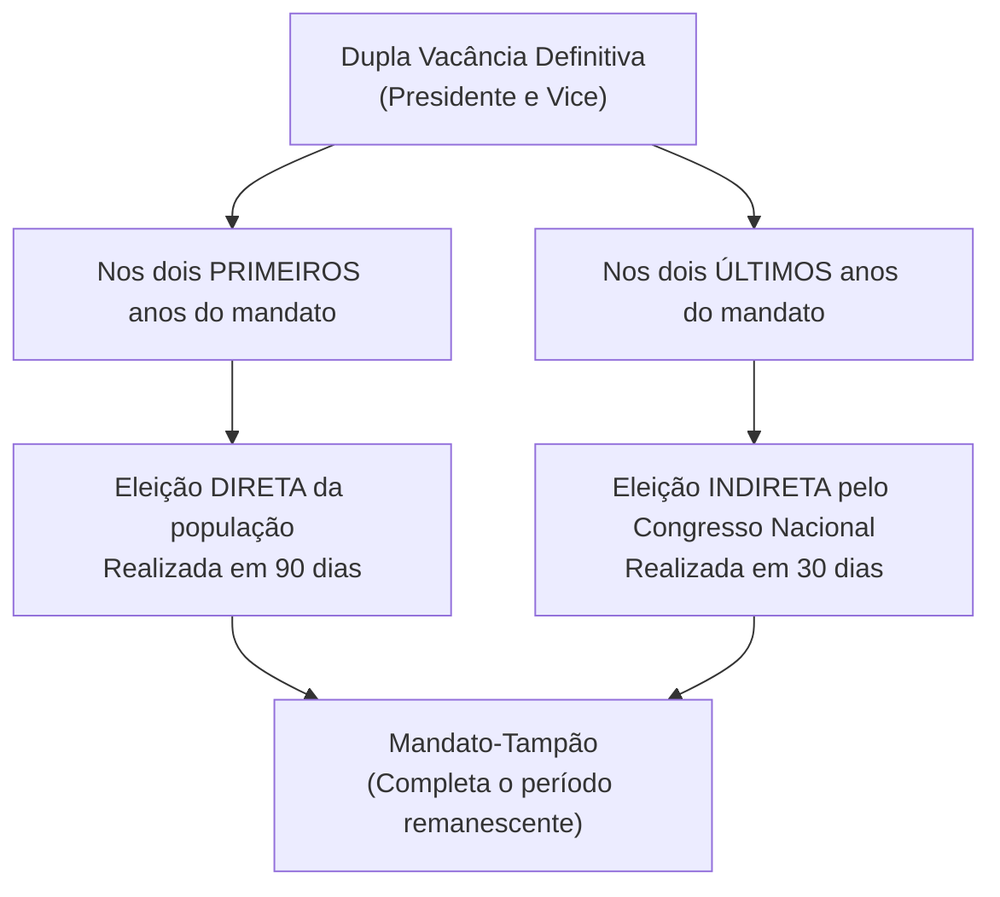
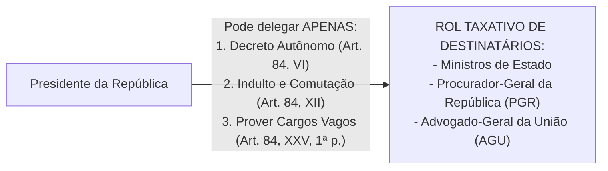

# 05 - Poder Executivo, Poder Judiciário e Funções Essenciais à Justiça

> **Matéria:** Noções de Direito Constitucional  
> **Cargo:** A01 – Técnico de Controle Externo – Especialidade: Técnico Administrativo  
> **Arquivo:** `05_poder_executivo_poder_judiciario_e_funcoes_essenciais.md`  
> **Status:** 🟢 Teoria Aprofundada + 5 Questões FCC Comentadas (A a E)

---

## 📌 Ementa / Itens do Edital

- Do Poder Executivo: eleição, posse, impedimento, vacância e sucessão presidencial;
- Atribuições e prerrogativas do Presidente da República (Artigo 84 da CF/88): competências indelegáveis e competências privativas delegáveis (decretos autônomos, indulto e provimento de cargos vagos);
- Responsabilidade do Presidente da República (Artigos 85 e 86 da CF/88):
    - Crimes comuns vs. crimes de responsabilidade (*impeachment*);
    - Juízo prévio de admissibilidade pela Câmara dos Deputados (quórum qualificado de 2/3);
    - Competência de julgamento pelo STF e pelo Senado Federal (presidido pelo Presidente do STF);
    - Imunidades presidenciais: imunidade prisional temporária e cláusula de irresponsabilidade relativa por atos estranhos ao mandato;
- Do Poder Judiciário: disposições gerais, estatuto e garantias da magistratura (vitaliciedade, inamovibilidade e irredutibilidade) e vedações expressas (quarentena de saída);
- Do Supremo Tribunal Federal (STF - Artigos 101 a 103-A da CF/88): composição (11 Ministros), nomeação, sabatina pelo Senado Federal, competências originárias e recursais, e o regime das Súmulas Vinculantes (Art. 103-A);
- Do Conselho Nacional de Justiça (CNJ - Artigo 103-B da CF/88): organização, composição (15 membros) e limites de atuação (natureza estritamente administrativa, orçamentária e correcional, sem competência jurisdicional);
- Do Superior Tribunal de Justiça (STJ - Artigos 104 e 105 da CF/88): composição (no mínimo 33 Ministros), uniformização da lei federal infraconstitucional e o filtro da relevância no Recurso Especial (EC nº 125/2022);
- Das Funções Essenciais à Justiça:
    - Ministério Público (Artigos 127 a 130-A da CF/88): princípios institucionais, autonomia, garantias, vedações e o Conselho Nacional do Ministério Público (CNMP);
    - Advocacia Pública (Artigos 131 e 132 da CF/88): AGU e Procuradorias Estaduais (PGE-GO);
    - Advocacia Privada (Artigo 133 da CF/88): indispensabilidade e inviolabilidade profissional;
    - Defensoria Pública (Artigos 134 e 135 da CF/88): assistência jurídica aos hipossuficientes e autonomia institucional expressa.

---

## 🧭 Sumário

1. [Poder Executivo: Estrutura, Atribuições e Responsabilidade](#1-poder-executivo-estrutura-atribuicoes-e-responsabilidade)
    1. [Dupla Vacância dos Cargos Presidenciais (Art. 81 da CF/88)](#11-dupla-vacancia-dos-cargos-presidenciais-art-81-da-cf88)
    2. [Atribuições Delegáveis do Presidente da República (Art. 84, Parágrafo Único)](#12-atribuicoes-delegaveis-do-presidente-da-republica-art-84-paragrafo-unico)
    3. [Responsabilidade do Presidente da República e Imunidades (Arts. 85 e 86)](#13-responsabilidade-do-presidente-da-republica-e-imunidades-arts-85-e-86)
    4. [Teste 154](#Teste-154)
    5. [Teste 155](#Teste-155)
    6. [Teste 156](#Teste-156)
    7. [Teste 157](#Teste-157)
2. [Poder Judiciário: Estrutura Orgânica, CNJ e Súmula Vinculante](#2-poder-judiciario-estrutura-organica-cnj-e-sumula-vinculante)
    1. [Garantias e Vedações dos Magistrados (Art. 95 da CF/88)](#21-garantias-e-vedacoes-dos-magistrados-art-95-da-cf88)
    2. [Conselho Nacional de Justiça (CNJ - Art. 103-B)](#22-conselho-nacional-de-justica-cnj-art-103-b)
    3. [Supremo Tribunal Federal e o Regime da Súmula Vinculante (Art. 103-A)](#23-supremo-tribunal-federal-e-o-regime-da-sumula-vinculante-art-103-a)
    4. [Superior Tribunal de Justiça e o Filtro de Relevância (Arts. 104 e 105)](#24-superior-tribunal-de-justica-e-o-filtro-de-relevancia-arts-104-e-105)
    5. [Teste 158](#Teste-158)
    6. [Teste 159](#Teste-159)
    7. [Teste 160](#Teste-160)
    8. [Teste 161](#Teste-161)
3. [Funções Essenciais à Justiça](#3-funcoes-essenciais-a-justica)
    1. [Ministério Público e o CNMP (Arts. 127 a 130-A)](#31-ministerio-publico-e-o-cnmp-arts-127-a-130-a)
    2. [Advocacia Pública (Arts. 131 e 132)](#32-advocacia-publica-arts-131-e-132)
    3. [Defensoria Pública (Arts. 134 e 135)](#33-defensoria-publica-arts-134-e-135)
    4. [Advocacia Privada (Art. 133)](#34-advocacia-privada-art-133)
    5. [Teste 162](#Teste-162)
    6. [Teste 163](#Teste-163)
    7. [Teste 164](#Teste-164)
4. [🌐 Fontes Oficiais & Jurisprudenciais Recomendadas](#fontes-oficiais-jurisprudenciais-recomendadas)

---

## 1. Poder Executivo: Estrutura, Atribuições e Responsabilidade

### 1.1 Dupla Vacância dos Cargos Presidenciais (Art. 81 da CF/88)
Ocorrendo a vacância definitiva tanto do cargo de Presidente quanto de Vice-Presidente da República, aplicam-se regras distintas a depender do momento do mandato:

- **Primeiros 2 anos do mandato:** Ocorrendo a vacância definitiva de ambos os cargos na primeira metade da legislatura, far-se-á eleição **direta** noventa dias depois de aberta a última vaga.
- **Últimos 2 anos do mandato:** Se a dupla vacância definitiva ocorrer na segunda metade da legislatura (3º ou 4º ano do mandato), a eleição para ambos os cargos será feita **indireta**, trinta dias depois da última vaga, pelo **Congresso Nacional**, na forma da lei.
- Em qualquer das hipóteses de eleição extraordinária, os eleitos deverão completar o período remanescente de seus antecessores (*mandato-tampão* - art. 81, § 2º).

### 1.2 Atribuições Delegáveis do Presidente da República (Art. 84, Parágrafo Único)
O art. 84 fixa as competências privativas do Presidente da República. Em regra, são privativas e indelegáveis. Todavia, a Constituição autoriza a **delegação de apenas TRÊS matérias específicas**:

1. **Art. 84, VI:** Dispor, mediante **decreto autônomo**, sobre:
    - *a)* Organização e funcionamento da administração federal, quando não implicar aumento de despesa nem criação ou extinção de órgãos públicos;
    - *b)* Extinção de funções ou cargos públicos, quando vagos;

2. **Art. 84, XII:** Conceder **indulto e comutar penas**, com audiência, se necessário, dos órgãos instituídos em lei;
3. **Art. 84, XXV, primeira parte:** **Prover** cargos públicos federais, na forma da lei.

> 🚨 **ALERTA DE PROVA / PEGADINHA FCC:**  
>
> - **Extinção de Órgãos Públicos:** O Presidente NÃO pode criar nem extinguir Ministérios ou órgãos públicos por decreto! A criação e extinção de órgãos públicos exige expressamente **lei formal ordinária** (art. 88 da CF/88). O decreto autônomo serve exclusivamente para organizar órgãos existentes sem gerar custos ou extinguir cargos vagos.  
> - **Extinção de Cargos Públicos Ocupados:** Depende obrigatoriamente de lei formal. Por decreto autônomo, o Chefe do Executivo só pode extinguir cargos e funções quando estiverem **vagos**!

### 1.3 Responsabilidade do Presidente da República e Imunidades (Arts. 85 e 86)
O Presidente da República responde perante o STF por crimes comuns e perante o Senado Federal por crimes de responsabilidade (*impeachment*).

| Aspecto Procedimental | Crime Comum (Penal) | Crime de Responsabilidade (*Impeachment*) |
| :--- | :--- | :--- |
| **Juízo de Admissibilidade** | **Câmara dos Deputados** (quórum de 2/3 dos membros) | **Câmara dos Deputados** (quórum de 2/3 dos membros) |
| **Órgão Julgador Competente** | **Supremo Tribunal Federal (STF)** | **Senado Federal** (sob presidência do Presidente do STF) |
| **Instauração do Processo** | Recebimento da denúncia ou queixa pelo STF | Deliberação do Plenário do Senado Federal por maioria simples |
| **Afastamento Preventivo** | Fica suspenso de suas funções por até 180 dias | Fica suspenso de suas funções por até 180 dias |
| **Sanção Constitucional** | Penas privativas de liberdade / multas criminais | **Perda do cargo** + **inabilitação por 8 anos** para qualquer função pública (quórum de 2/3 do Senado) |
| **Imunidade Prisional (Art. 86, § 3º)** | **Não pode ser preso**, na vigência do mandato, senão após sentença penal condenatória transitada em julgado | Inaplicável medida penal coercitiva |
| **Irresponsabilidade Relativa (Art. 86, § 4º)** | **Não pode ser responsabilizado por atos estranhos ao exercício de suas funções** na vigência do mandato | Aplicável a atos conexos ao exercício funcional |

---

### Teste 001
**(FGV – TJ/SC – 2026 – Analista Administrativo)**
A sociedade empresária Alfa teria praticado atos lesivos ao Estado Beta, consistentes em alegada fraude à licitação praticada em detrimento da Secretaria de Estado de Educação do Poder Executivo do referido ente federativo. No curso do processo administrativo instaurado para a apuração dos fatos, o representante legal de Alfa cogitou a celebração de ajuste no âmbito da consensualidade de colaboração, conforme disciplina estabelecida na Lei nº 12.846/2013. Em relação ao ajuste cogitado pelo representante legal de Alfa, é correto afirmar que

* **A)** é vedado, considerando a indisponibilidade dos interesses envolvidos.
* **B)** deve ser celebrado no plano administrativo e homologado pelo Poder Judiciário.
* **C)** exime Alfa, caso celebrado, da obrigação de reparar integralmente o dano causado.
* **D)** deve ser celebrado no plano processual, pelo Ministério Público, com a correlata homologação pelo Poder Judiciário.
* **E)** independe de homologação pelo Poder Judiciário e não afasta a possibilidade de suspensão ou interdição parcial das atividades de Alfa.

---

> **Comentário Detalhado:**
>
> - **A)** **Incorreta.** A opção apresenta proposição em desacordo com os fundamentos teóricos e técnicos do tópico ao afirmar que "é vedado, considerando a indisponibilidade dos interesses envolvidos". De acordo com a teoria estudada em *1.3 Responsabilidade do Presidente da República e Imunidades (Arts. 85 e 86)*, instauração do Processo: Recebimento da denúncia ou queixa pelo STF — Deliberação do Plenário do Senado Federal por maioria simples.
> - **B)** **Incorreta.** A opção apresenta proposição em desacordo com os fundamentos teóricos e técnicos do tópico ao afirmar que "deve ser celebrado no plano administrativo e homologado pelo Poder Judiciário". De acordo com a teoria estudada em *1.3 Responsabilidade do Presidente da República e Imunidades (Arts. 85 e 86)*, irresponsabilidade Relativa (Art. 86, § 4º): Não pode ser responsabilizado por atos estranhos ao exercício de suas funções na vigência do mandato — Aplicável a atos conexos ao exercício funcional.
> - **C)** **Incorreta.** A opção apresenta proposição em desacordo com os fundamentos teóricos e técnicos do tópico ao afirmar que "exime Alfa, caso celebrado, da obrigação de reparar integralmente o dano causado". De acordo com a teoria estudada em *1.1 Dupla Vacância dos Cargos Presidenciais (Art. 81 da CF/88)*, últimos 2 anos do mandato: Se a dupla vacância definitiva ocorrer na segunda metade da legislatura (3º ou 4º ano do mandato), a eleição para ambos os cargos será feita indireta, trinta dias depois da última vaga, pelo Congresso Nacional, na forma da lei.
> - **D)** **Incorreta.** A opção apresenta proposição em desacordo com os fundamentos teóricos e técnicos do tópico ao afirmar que "deve ser celebrado no plano processual, pelo Ministério Público, com a correlata homologação pelo Poder Judiciário". De acordo com a teoria estudada em *1.3 Responsabilidade do Presidente da República e Imunidades (Arts. 85 e 86)*, imunidade Prisional (Art. 86, § 3º): Não pode ser preso, na vigência do mandato, senão após sentença penal condenatória transitada em julgado — Inaplicável medida penal coercitiva.
> - **E)** **Correta.** Conforme fundamentado na seção *1.2 Atribuições Delegáveis do Presidente da República (Art. 84, Parágrafo Único)* deste guia, extinção de Cargos Públicos Ocupados: Depende obrigatoriamente de lei formal. Por decreto autônomo, o Chefe do Executivo só pode extinguir cargos e funções quando estiverem vagos!. Dessa forma, está plenamente correta a assertiva da banca (FGV – TJ/SC/2026) ao estabelecer que "independe de homologação pelo Poder Judiciário e não afasta a possibilidade de suspensão ou interdição parcial das...".
>
> **Gabarito: E**

---

### Teste 002
**(FGV – TJ/SC – 2026 – Analista Administrativo)**
Maria ocupa cargo de primeiro escalão em determinado ente federativo, na condição de Secretária de Estado. As normas afetas à prevenção e ao tratamento do conflito de interesses nesse ente seguem os balizamentos oferecidos pela Lei nº 12.813/2013. Maria pretende exercer determinada atividade privada de cunho econômico. Embora o exercício dessa atividade não seja vedado pelas referidas normas, Maria tem dúvida em relação à sua licitude, pois implicaria na prestação de serviços a pessoas jurídicas que têm interesse em decisões de colegiado administrativo do qual ela participa. Ao analisar a sistemática legal, Maria concluiu corretamente que

* **A)** a ausência de vedação legal ao exercício da atividade afasta a possibilidade de ser configurado o conflito de interesses.
* **B)** o interesse das pessoas jurídicas nas decisões do colegiado de que Maria participe não configura conflito de interesses.
* **C)** o conflito de interesses na situação descrita é afastado, caso Maria esteja em gozo de licença ou em período de afastamento.
* **D)** a situação descrita configura conflito de interesses, devendo ser fiscalizada por Comissão de Ética Pública instituída no âmbito do Poder Executivo do ente federativo ao qual Maria está vinculada.
* **E)** o conflito de interesses somente estará configurado se Maria divulgar ou fizer uso de informações privilegiadas obtidas no exercício funcional, para viabilizar a prestação do serviço para o qual seja contratada. Noções de Informática e Proteção de Dados

---

> **Comentário Detalhado:**
>
> - **A)** **Incorreta.** A opção apresenta proposição em desacordo com os fundamentos teóricos e técnicos do tópico ao afirmar que "a ausência de vedação legal ao exercício da atividade afasta a possibilidade de ser configurado o conflito de...". De acordo com a teoria estudada em *1.3 Responsabilidade do Presidente da República e Imunidades (Arts. 85 e 86)*, irresponsabilidade Relativa (Art. 86, § 4º): Não pode ser responsabilizado por atos estranhos ao exercício de suas funções na vigência do mandato — Aplicável a atos conexos ao exercício funcional.
> - **B)** **Incorreta.** A opção apresenta proposição em desacordo com os fundamentos teóricos e técnicos do tópico ao afirmar que "o interesse das pessoas jurídicas nas decisões do colegiado de que Maria participe não configura conflito de...". De acordo com a teoria estudada em *1.3 Responsabilidade do Presidente da República e Imunidades (Arts. 85 e 86)*, imunidade Prisional (Art. 86, § 3º): Não pode ser preso, na vigência do mandato, senão após sentença penal condenatória transitada em julgado — Inaplicável medida penal coercitiva.
> - **C)** **Incorreta.** A opção apresenta proposição em desacordo com os fundamentos teóricos e técnicos do tópico ao afirmar que "o conflito de interesses na situação descrita é afastado, caso Maria esteja em gozo de licença ou em período de...". De acordo com a teoria estudada em *1.3 Responsabilidade do Presidente da República e Imunidades (Arts. 85 e 86)*, afastamento Preventivo: Fica suspenso de suas funções por até 180 dias — Fica suspenso de suas funções por até 180 dias.
> - **D)** **Correta.** Conforme fundamentado na seção *1.2 Atribuições Delegáveis do Presidente da República (Art. 84, Parágrafo Único)* deste guia, extinção de Cargos Públicos Ocupados: Depende obrigatoriamente de lei formal. Por decreto autônomo, o Chefe do Executivo só pode extinguir cargos e funções quando estiverem vagos!. Dessa forma, está plenamente correta a assertiva da banca (FGV – TJ/SC/2026) ao estabelecer que "a situação descrita configura conflito de interesses, devendo ser fiscalizada por Comissão de Ética Pública...".
> - **E)** **Incorreta.** A opção incorre em restrição indevida ao limitar o escopo conceitual ao afirmar que "o conflito de interesses somente estará configurado se Maria divulgar ou fizer uso de informações privilegiadas...". De acordo com a teoria estudada em *1.1 Dupla Vacância dos Cargos Presidenciais (Art. 81 da CF/88)*, últimos 2 anos do mandato: Se a dupla vacância definitiva ocorrer na segunda metade da legislatura (3º ou 4º ano do mandato), a eleição para ambos os cargos será feita indireta, trinta dias depois da última vaga, pelo Congresso Nacional, na forma da lei.
>
> **Gabarito: D**

---

### Teste 003
**(FGV – TJ/SC – 2026 – Analista Administrativo)**
No que diz respeito às políticas institucionais de privacidade e ao tratamento de dados pessoais no âmbito do Poder Judiciário, analise as afirmativas a seguir. I. O tratamento de dados pessoais realizado para fins de atividades jurisdicionais é isento de medidas de segurança e conformidade, as quais devem ser aplicadas exclusivamente às atividades administrativas dos tribunais. II. Os tribunais devem designar um Encarregado pelo Tratamento de Dados Pessoais (DPO) para atuar como canal de comunicação entre o órgão, os titulares dos dados e a Autoridade Nacional de Proteção de Dados (ANPD). III. No Poder Judiciário, a responsabilidade pela segurança da informação e pela preservação da confidencialidade dos dados é atribuída exclusivamente aos servidores das unidades de Tecnologia da Informação (TI). Está correto o que se afirma, apenas, em

* **A)** I.
* **B)** II.
* **C)** III.
* **D)** I e II.
* **E)** II e III.

---

> **Comentário Detalhado:**
>
> - **A)** **Incorreta.** A opção apresenta proposição em desacordo com os fundamentos teóricos e técnicos do tópico ao afirmar que "I". De acordo com a teoria estudada em *1.3 Responsabilidade do Presidente da República e Imunidades (Arts. 85 e 86)*, imunidade Prisional (Art. 86, § 3º): Não pode ser preso, na vigência do mandato, senão após sentença penal condenatória transitada em julgado — Inaplicável medida penal coercitiva.
> - **B)** **Correta.** Conforme fundamentado na seção *1.3 Responsabilidade do Presidente da República e Imunidades (Arts. 85 e 86)* deste guia, órgão Julgador Competente: Supremo Tribunal Federal (STF) — Senado Federal (sob presidência do Presidente do STF). Dessa forma, está plenamente correta a assertiva da banca (FGV – TJ/SC/2026) ao estabelecer que "II".
> - **C)** **Incorreta.** A opção apresenta proposição em desacordo com os fundamentos teóricos e técnicos do tópico ao afirmar que "III". De acordo com a teoria estudada em *1.3 Responsabilidade do Presidente da República e Imunidades (Arts. 85 e 86)*, irresponsabilidade Relativa (Art. 86, § 4º): Não pode ser responsabilizado por atos estranhos ao exercício de suas funções na vigência do mandato — Aplicável a atos conexos ao exercício funcional.
> - **D)** **Incorreta.** A opção apresenta proposição em desacordo com os fundamentos teóricos e técnicos do tópico ao afirmar que "I e II". De acordo com a teoria estudada em *1.2 Atribuições Delegáveis do Presidente da República (Art. 84, Parágrafo Único)*, extinção de Órgãos Públicos: O Presidente NÃO pode criar nem extinguir Ministérios ou órgãos públicos por decreto! A criação e extinção de órgãos públicos exige expressamente lei formal ordinária (art. 88 da CF/88). O decreto autônomo serve exclusivamente para organizar órgãos existentes sem gerar custos ou extinguir cargos vagos.
> - **E)** **Incorreta.** A opção apresenta proposição em desacordo com os fundamentos teóricos e técnicos do tópico ao afirmar que "II e III". De acordo com a teoria estudada em *1.1 Dupla Vacância dos Cargos Presidenciais (Art. 81 da CF/88)*, ultimos2 Indir["Eleição INDIRETA pelo Congresso Nacional<br/ Realizada em 30 dias"].
>
> **Gabarito: B**

---

### Teste 004
**(FGV – TJ/SC – 2026 – Analista Administrativo)**
No ordenamento jurídico brasileiro, a proteção dos direitos fundamentais decorre tanto das normas constitucionais quanto dos tratados internacionais de direitos humanos ratificados pelo Brasil. Além disso, os direitos e as garantias fundamentais possuem aplicação imediata, nos termos da Constituição Federal, independentemente de regulamentação para produzirem efeitos. Considerando as disposições da Constituição Federal e dos tratados internacionais de direitos humanos incorporados ao ordenamento jurídico brasileiro, assinale a afirmativa correta.

* **A)** Os tratados de direitos humanos ratificados após a Emenda Constitucional nº 45/2004 com quórum qualificado (dois quintos, dois turnos, duas casas) equivalem a emendas constitucionais.
* **B)** O Supremo Tribunal Federal não admite a utilização do Pacto de São José da Costa Rica para servir de fundamentos a determinadas decisões, como no caso da prisão civil do depositário infiel.
* **C)** Os tratados de direitos humanos ratificados pelo rito comum, por maioria absoluta, possuem hierarquia superior à das leis ordinárias e inferior à da Constituição Federal.
* **D)** Os juízes brasileiros devem verificar se as leis internas estão em conformidade com os tratados internacionais de direitos humanos, priorizando a norma mais favorável.
* **E)** Ainda que haja inércia de autoridades estaduais, não é permitido à Justiça Federal assumir a competência para processar e julgar casos de graves violações de direitos humanos.

---

> **Comentário Detalhado:**
>
> - **A)** **Incorreta.** A opção apresenta proposição em desacordo com os fundamentos teóricos e técnicos do tópico ao afirmar que "Os tratados de direitos humanos ratificados após a Emenda Constitucional nº 45/2004 com quórum qualificado (dois...". De acordo com a teoria estudada em *1.3 Responsabilidade do Presidente da República e Imunidades (Arts. 85 e 86)*, sanção Constitucional: Penas privativas de liberdade / multas criminais — Perda do cargo + inabilitação por 8 anos para qualquer função pública (quórum de 2/3 do Senado).
> - **B)** **Incorreta.** A opção apresenta proposição em desacordo com os fundamentos teóricos e técnicos do tópico ao afirmar que "O Supremo Tribunal Federal não admite a utilização do Pacto de São José da Costa Rica para servir de fundamentos a...". De acordo com a teoria estudada em *Fundamentos Teóricos*, status: 🟢 Teoria Aprofundada + 5 Questões FCC Comentadas (A a E).
> - **C)** **Incorreta.** A opção apresenta proposição em desacordo com os fundamentos teóricos e técnicos do tópico ao afirmar que "Os tratados de direitos humanos ratificados pelo rito comum, por maioria absoluta, possuem hierarquia superior à...". De acordo com a teoria estudada em *1.2 Atribuições Delegáveis do Presidente da República (Art. 84, Parágrafo Único)*, o art. 84 fixa as competências privativas do Presidente da República. Em regra, são privativas e indelegáveis. Todavia, a Constituição autoriza a delegação de apenas TRÊS matérias específicas.
> - **D)** **Correta.** Conforme fundamentado na seção *1.1 Dupla Vacância dos Cargos Presidenciais (Art. 81 da CF/88)* deste guia, ocorrendo a vacância definitiva tanto do cargo de Presidente quanto de Vice Presidente da República, aplicam se regras distintas a depender do momento do mandato. Dessa forma, está plenamente correta a assertiva da banca (FGV – TJ/SC/2026) ao estabelecer que "Os juízes brasileiros devem verificar se as leis internas estão em conformidade com os tratados internacionais de...".
> - **E)** **Incorreta.** A opção apresenta proposição em desacordo com os fundamentos teóricos e técnicos do tópico ao afirmar que "Ainda que haja inércia de autoridades estaduais, não é permitido à Justiça Federal assumir a competência para...". De acordo com a teoria estudada em *1.1 Dupla Vacância dos Cargos Presidenciais (Art. 81 da CF/88)*, vacancia["Dupla Vacância Definitiva<br/ (Presidente e Vice)"].
>
> **Gabarito: D**

---

### Teste 005
**(FGV – TJ/SC – 2026 – Analista Administrativo)**
A ordem jurídica brasileira prevê mecanismos específicos de proteção destinados à promoção da igualdade e à prevenção de discriminações contra grupos vulneráveis. Considerando a Constituição Federal, a legislação vigente e a jurisprudência dos tribunais superiores, assinale a afirmativa correta.

* **A)** É obrigação do poder público assegurar à pessoa idosa, diversas garantias, entre elas, a prioridade no recebimento da restituição do Imposto de Renda.
* **B)** A deficiência não afeta a plena capacidade civil da pessoa, salvo o exercício do direito à curatela e à adoção, como adotante ou adotando.
* **C)** Nos processos seletivos para ingresso nos cursos de instituições de ensino superior, deve haver atendimento preferencial à pessoa com deficiência, não sendo possível conceder dilação de tempo.
* **D)** A Constituição Federal protege a liberdade de consciência e de crença, não sendo assegurada a assistência religiosa aos praticantes de quaisquer religiões, internados em hospitais públicos, diante da laicidade do Estado.
* **E)** O Supremo Tribunal Federal, por não equiparar a homofobia e a transfobia ao crime de racismo, não permite aplicar à homofobia as sanções previstas na Lei nº 7.716/1989.

---

> **Comentário Detalhado:**
>
> - **A)** **Correta.** Conforme fundamentado na seção *1.3 Responsabilidade do Presidente da República e Imunidades (Arts. 85 e 86)* deste guia, instauração do Processo: Recebimento da denúncia ou queixa pelo STF — Deliberação do Plenário do Senado Federal por maioria simples. Dessa forma, está plenamente correta a assertiva da banca (FGV – TJ/SC/2026) ao estabelecer que "É obrigação do poder público assegurar à pessoa idosa, diversas garantias, entre elas, a prioridade no recebimento...".
> - **B)** **Incorreta.** A opção apresenta proposição em desacordo com os fundamentos teóricos e técnicos do tópico ao afirmar que "A deficiência não afeta a plena capacidade civil da pessoa, salvo o exercício do direito à curatela e à adoção...". De acordo com a teoria estudada em *1.3 Responsabilidade do Presidente da República e Imunidades (Arts. 85 e 86)*, irresponsabilidade Relativa (Art. 86, § 4º): Não pode ser responsabilizado por atos estranhos ao exercício de suas funções na vigência do mandato — Aplicável a atos conexos ao exercício funcional.
> - **C)** **Incorreta.** A opção apresenta proposição em desacordo com os fundamentos teóricos e técnicos do tópico ao afirmar que "Nos processos seletivos para ingresso nos cursos de instituições de ensino superior, deve haver atendimento...". De acordo com a teoria estudada em *1.2 Atribuições Delegáveis do Presidente da República (Art. 84, Parágrafo Único)*, art. 84, XII: Conceder indulto e comutar penas, com audiência, se necessário, dos órgãos instituídos em lei.
> - **D)** **Incorreta.** A opção apresenta proposição em desacordo com os fundamentos teóricos e técnicos do tópico ao afirmar que "A Constituição Federal protege a liberdade de consciência e de crença, não sendo assegurada a assistência...". De acordo com a teoria estudada em *1.2 Atribuições Delegáveis do Presidente da República (Art. 84, Parágrafo Único)*, o art. 84 fixa as competências privativas do Presidente da República. Em regra, são privativas e indelegáveis. Todavia, a Constituição autoriza a delegação de apenas TRÊS matérias específicas.
> - **E)** **Incorreta.** A opção apresenta proposição em desacordo com os fundamentos teóricos e técnicos do tópico ao afirmar que "O Supremo Tribunal Federal, por não equiparar a homofobia e a transfobia ao crime de racismo, não permite aplicar...". De acordo com a teoria estudada em *1.3 Responsabilidade do Presidente da República e Imunidades (Arts. 85 e 86)*, órgão Julgador Competente: Supremo Tribunal Federal (STF) — Senado Federal (sob presidência do Presidente do STF).
>
> **Gabarito: A**

---

### Teste 006
**(FGV – TJ/SC – 2026 – Analista Administrativo)**
No Brasil, as políticas judiciárias de inclusão e cidadania são coordenadas, principalmente, pelo Conselho Nacional de Justiça (CNJ) e visam a transformar o Poder Judiciário em um agente ativo na promoção de direitos fundamentais e na remoção de barreiras ao acesso à justiça. Considerando as normas vigentes sobre essas políticas, assinale a afirmativa correta.

* **A)** As pessoas em situação de rua terão assegurado o acesso às dependências do Poder Judiciário para o exercício de seus direitos, salvo se estiverem com vestimentas e condições de higiene incompatíveis com as regras do Tribunal.
* **B)** Os tribunais deverão viabilizar atendimento prioritário e desburocratizado às pessoas em situação de rua, não se conferindo atendimento especial a qualquer pessoa, ainda que caracterizada como LGBTQUIA+ ou migrantes.
* **C)** Entende-se como mulheres em condição de especial vulnerabilidade econômico-social, as mulheres vítimas de violência física, moral, patrimonial, psicológica ou sexual, salvo as mulheres trans e travestis.
* **D)** A Resolução 497/2023 do CNJ instituiu, no âmbito do Poder Judiciário Nacional, à exceção do Supremo Tribunal Federal, o Programa “Transformação”, para fomentar a adoção de políticas afirmativas que reduzam as desigualdades no mercado de trabalho de mulheres de grupos vulneráveis.
* **E)** O Programa “Transformação” consiste na reserva, pelos Tribunais e Conselhos, de, no mínimo, 10% (dez por cento) das vagas nos contratos que envolvam prestação de serviços contínuos com regime de dedicação exclusiva de mão de obra. Conhecimentos Específicos Administração Geral

---

> **Comentário Detalhado:**
>
> - **A)** **Incorreta.** A opção apresenta proposição em desacordo com os fundamentos teóricos e técnicos do tópico ao afirmar que "As pessoas em situação de rua terão assegurado o acesso às dependências do Poder Judiciário para o exercício de...". De acordo com a teoria estudada em *1.1 Dupla Vacância dos Cargos Presidenciais (Art. 81 da CF/88)*, últimos 2 anos do mandato: Se a dupla vacância definitiva ocorrer na segunda metade da legislatura (3º ou 4º ano do mandato), a eleição para ambos os cargos será feita indireta, trinta dias depois da última vaga, pelo Congresso Nacional, na forma da lei.
> - **B)** **Incorreta.** A opção promove generalização excessiva que desconsidera as condições técnicas e normativas ao afirmar que "Os tribunais deverão viabilizar atendimento prioritário e desburocratizado às pessoas em situação de rua, não se...". De acordo com a teoria estudada em *1.1 Dupla Vacância dos Cargos Presidenciais (Art. 81 da CF/88)*, em qualquer das hipóteses de eleição extraordinária, os eleitos deverão completar o período remanescente de seus antecessores ( mandato tampão art. 81, § 2º).
> - **C)** **Incorreta.** A opção apresenta proposição em desacordo com os fundamentos teóricos e técnicos do tópico ao afirmar que "Entende se como mulheres em condição de especial vulnerabilidade econômico social, as mulheres vítimas de...". De acordo com a teoria estudada em *1.3 Responsabilidade do Presidente da República e Imunidades (Arts. 85 e 86)*, órgão Julgador Competente: Supremo Tribunal Federal (STF) — Senado Federal (sob presidência do Presidente do STF).
> - **D)** **Correta.** Conforme fundamentado na seção *1.1 Dupla Vacância dos Cargos Presidenciais (Art. 81 da CF/88)* deste guia, ultimos2 Indir["Eleição INDIRETA pelo Congresso Nacional<br/ Realizada em 30 dias"]. Dessa forma, está plenamente correta a assertiva da banca (FGV – TJ/SC/2026) ao estabelecer que "A Resolução 497/2023 do CNJ instituiu, no âmbito do Poder Judiciário Nacional, à exceção do Supremo Tribunal...".
> - **E)** **Incorreta.** A opção apresenta proposição em desacordo com os fundamentos teóricos e técnicos do tópico ao afirmar que "O Programa “Transformação” consiste na reserva, pelos Tribunais e Conselhos, de, no mínimo, 10% (dez por cento)...". De acordo com a teoria estudada em *1.2 Atribuições Delegáveis do Presidente da República (Art. 84, Parágrafo Único)*, a) Organização e funcionamento da administração federal, quando não implicar aumento de despesa nem criação ou extinção de órgãos públicos.
>
> **Gabarito: D**

---

### Teste 007
**(FGV – TJ/SC – 2026 – Analista Administrativo)**
O Tribunal de Justiça do Estado Alfa, embora dispusesse de sistema eletrônico plenamente operacional, manteve, sem justificativa técnica, a tramitação exclusivamente em papel de processos administrativos de baixa complexidade, o que resultou em atrasos reiterados, retrabalho, custos elevados e demora injustificada no atendimento aos cidadãos, sem qualquer ganho compensatório em termos de qualidade ou segurança jurídica. A conduta descrita afronta diretamente o princípio da Administração Pública, expresso no art. 37, caput, da Constituição Federal de 1988, denominado

* **A)** legalidade.
* **B)** impessoalidade.
* **C)** moralidade.
* **D)** publicidade.
* **E)** eficiência.

---

> **Comentário Detalhado:**
>
> - **A)** **Incorreta.** A opção apresenta proposição em desacordo com os fundamentos teóricos e técnicos do tópico ao afirmar que "legalidade". De acordo com a teoria estudada em *1.2 Atribuições Delegáveis do Presidente da República (Art. 84, Parágrafo Único)*, o art. 84 fixa as competências privativas do Presidente da República. Em regra, são privativas e indelegáveis. Todavia, a Constituição autoriza a delegação de apenas TRÊS matérias específicas.
> - **B)** **Incorreta.** A opção apresenta proposição em desacordo com os fundamentos teóricos e técnicos do tópico ao afirmar que "impessoalidade". De acordo com a teoria estudada em *1.2 Atribuições Delegáveis do Presidente da República (Art. 84, Parágrafo Único)*, a) Organização e funcionamento da administração federal, quando não implicar aumento de despesa nem criação ou extinção de órgãos públicos.
> - **C)** **Incorreta.** A opção apresenta proposição em desacordo com os fundamentos teóricos e técnicos do tópico ao afirmar que "moralidade". De acordo com a teoria estudada em *1.1 Dupla Vacância dos Cargos Presidenciais (Art. 81 da CF/88)*, em qualquer das hipóteses de eleição extraordinária, os eleitos deverão completar o período remanescente de seus antecessores ( mandato tampão art. 81, § 2º).
> - **D)** **Incorreta.** A opção apresenta proposição em desacordo com os fundamentos teóricos e técnicos do tópico ao afirmar que "publicidade". De acordo com a teoria estudada em *1.3 Responsabilidade do Presidente da República e Imunidades (Arts. 85 e 86)*, sanção Constitucional: Penas privativas de liberdade / multas criminais — Perda do cargo + inabilitação por 8 anos para qualquer função pública (quórum de 2/3 do Senado).
> - **E)** **Correta.** Conforme fundamentado na seção *1.2 Atribuições Delegáveis do Presidente da República (Art. 84, Parágrafo Único)* deste guia, extinção de Órgãos Públicos: O Presidente NÃO pode criar nem extinguir Ministérios ou órgãos públicos por decreto! A criação e extinção de órgãos públicos exige expressamente lei formal ordinária (art. 88 da CF/88). O decreto autônomo serve exclusivamente para organizar órgãos existentes sem gerar custos ou extinguir cargos vagos. Dessa forma, está plenamente correta a assertiva da banca (FGV – TJ/SC/2026) ao estabelecer que "eficiência".
>
> **Gabarito: E**

---

### Teste 008
**(FGV – TJ/SC – 2026 – Analista Administrativo)**
Em determinado Estado, a Lei de Diretrizes Orçamentárias previu a concessão de revisão geral anual da remuneração dos servidores públicos. No entanto, a Lei Orçamentária Anual correspondente não incluiu dotação específica para esse fim. Diante da ausência de revisão remuneratória no curso do ano, servidores pleitearam judicialmente a implementação da revisão. À luz da Constituição Federal e da jurisprudência do Supremo Tribunal Federal, é correto afirmar que a revisão remuneratória

* **A)** é devida, pois a previsão na LDO é suficiente para autorizar o reajuste remuneratório.
* **B)** é devida, pois decorre diretamente do princípio da irredutibilidade remuneratória.
* **C)** é possível, desde que haja disponibilidade financeira, ainda que sem previsão orçamentária específica.
* **D)** é automática, pois constitui direito subjetivo assegurado constitucionalmente aos servidores públicos.
* **E)** não é devida, pois depende cumulativamente de previsão na LDO e de dotação na LOA.

---

> **Comentário Detalhado:**
>
> - **A)** **Incorreta.** A opção apresenta proposição em desacordo com os fundamentos teóricos e técnicos do tópico ao afirmar que "é devida, pois a previsão na LDO é suficiente para autorizar o reajuste remuneratório". De acordo com a teoria estudada em *1.2 Atribuições Delegáveis do Presidente da República (Art. 84, Parágrafo Único)*, art. 84, XXV, primeira parte: Prover cargos públicos federais, na forma da lei.
> - **B)** **Incorreta.** A opção apresenta proposição em desacordo com os fundamentos teóricos e técnicos do tópico ao afirmar que "é devida, pois decorre diretamente do princípio da irredutibilidade remuneratória". De acordo com a teoria estudada em *1.2 Atribuições Delegáveis do Presidente da República (Art. 84, Parágrafo Único)*, extinção de Órgãos Públicos: O Presidente NÃO pode criar nem extinguir Ministérios ou órgãos públicos por decreto! A criação e extinção de órgãos públicos exige expressamente lei formal ordinária (art. 88 da CF/88). O decreto autônomo serve exclusivamente para organizar órgãos existentes sem gerar custos ou extinguir cargos vagos.
> - **C)** **Incorreta.** A opção apresenta proposição em desacordo com os fundamentos teóricos e técnicos do tópico ao afirmar que "é possível, desde que haja disponibilidade financeira, ainda que sem previsão orçamentária específica". De acordo com a teoria estudada em *1.2 Atribuições Delegáveis do Presidente da República (Art. 84, Parágrafo Único)*, o art. 84 fixa as competências privativas do Presidente da República. Em regra, são privativas e indelegáveis. Todavia, a Constituição autoriza a delegação de apenas TRÊS matérias específicas.
> - **D)** **Incorreta.** A opção apresenta proposição em desacordo com os fundamentos teóricos e técnicos do tópico ao afirmar que "é automática, pois constitui direito subjetivo assegurado constitucionalmente aos servidores públicos". De acordo com a teoria estudada em *1.2 Atribuições Delegáveis do Presidente da República (Art. 84, Parágrafo Único)*, a) Organização e funcionamento da administração federal, quando não implicar aumento de despesa nem criação ou extinção de órgãos públicos.
> - **E)** **Correta.** Conforme fundamentado na seção *1.2 Atribuições Delegáveis do Presidente da República (Art. 84, Parágrafo Único)* deste guia, extinção de Cargos Públicos Ocupados: Depende obrigatoriamente de lei formal. Por decreto autônomo, o Chefe do Executivo só pode extinguir cargos e funções quando estiverem vagos!. Dessa forma, está plenamente correta a assertiva da banca (FGV – TJ/SC/2026) ao estabelecer que "não é devida, pois depende cumulativamente de previsão na LDO e de dotação na LOA".
>
> **Gabarito: E**

---

### Teste 009
**(FGV – TJ/SC – 2026 – Analista Administrativo)**
Durante a execução orçamentária federal, verificou-se a utilização de emendas do relator para alocação de recursos públicos sem identificação clara dos parlamentares beneficiários nem transparência quanto à destinação final das verbas. À luz da Constituição Federal e da jurisprudência do Supremo Tribunal Federal, é correto afirmar que tal prática, denominada de “orçamento secreto”, é

* **A)** válida, pois decorre da discricionariedade parlamentar na alocação de recursos orçamentários.
* **B)** legítima, desde que haja previsão genérica na lei orçamentária anual.
* **C)** inconstitucional, pois as emendas do relator violam os princípios da unidade e da anualidade.
* **D)** regular, desde que os recursos sejam aplicados em políticas públicas de interesse social.
* **E)** incompatível com os princípios da transparência, publicidade e planejamento orçamentário.

---

> **Comentário Detalhado:**
>
> - **A)** **Incorreta.** A opção apresenta proposição em desacordo com os fundamentos teóricos e técnicos do tópico ao afirmar que "válida, pois decorre da discricionariedade parlamentar na alocação de recursos orçamentários". De acordo com a teoria estudada em *1.2 Atribuições Delegáveis do Presidente da República (Art. 84, Parágrafo Único)*, o art. 84 fixa as competências privativas do Presidente da República. Em regra, são privativas e indelegáveis. Todavia, a Constituição autoriza a delegação de apenas TRÊS matérias específicas.
> - **B)** **Incorreta.** A opção apresenta proposição em desacordo com os fundamentos teóricos e técnicos do tópico ao afirmar que "legítima, desde que haja previsão genérica na lei orçamentária anual". De acordo com a teoria estudada em *1.2 Atribuições Delegáveis do Presidente da República (Art. 84, Parágrafo Único)*, art. 84, XXV, primeira parte: Prover cargos públicos federais, na forma da lei.
> - **C)** **Incorreta.** A opção apresenta proposição em desacordo com os fundamentos teóricos e técnicos do tópico ao afirmar que "inconstitucional, pois as emendas do relator violam os princípios da unidade e da anualidade". De acordo com a teoria estudada em *1.3 Responsabilidade do Presidente da República e Imunidades (Arts. 85 e 86)*, órgão Julgador Competente: Supremo Tribunal Federal (STF) — Senado Federal (sob presidência do Presidente do STF).
> - **D)** **Incorreta.** A opção apresenta proposição em desacordo com os fundamentos teóricos e técnicos do tópico ao afirmar que "regular, desde que os recursos sejam aplicados em políticas públicas de interesse social". De acordo com a teoria estudada em *1.2 Atribuições Delegáveis do Presidente da República (Art. 84, Parágrafo Único)*, a) Organização e funcionamento da administração federal, quando não implicar aumento de despesa nem criação ou extinção de órgãos públicos.
> - **E)** **Correta.** Conforme fundamentado na seção *1.1 Dupla Vacância dos Cargos Presidenciais (Art. 81 da CF/88)* deste guia, ocorrendo a vacância definitiva tanto do cargo de Presidente quanto de Vice Presidente da República, aplicam se regras distintas a depender do momento do mandato. Dessa forma, está plenamente correta a assertiva da banca (FGV – TJ/SC/2026) ao estabelecer que "incompatível com os princípios da transparência, publicidade e planejamento orçamentário".
>
> **Gabarito: E**

---

### Teste 010
**(FGV – TJ/SC – 2026 – Analista Administrativo)**
Um Estado possui na Lei Orçamentária Anual dotação de R$ 10 milhões para a construção de escolas. Durante a execução orçamentária, o Poder Executivo firma contrato administrativo para construção de novas unidades no valor total de R$ 18 milhões, sem abertura de crédito adicional e sem autorização legislativa. Considerando o regime constitucional das finanças públicas, a consequência jurídica dessa prática é a

* **A)** possibilidade de execução da despesa, desde que haja disponibilidade financeira suficiente no exercício.
* **B)** vedação à realização da despesa, por ausência de prévio crédito orçamentário ou adicional.
* **C)** regularidade da execução, caso a despesa esteja alinhada às diretrizes da LDO.
* **D)** necessidade de ajuste contábil apenas posterior, sem impacto na validade da despesa.
* **E)** possibilidade de execução da despesa, desde que posteriormente incluída em crédito adicional.

---

> **Comentário Detalhado:**
>
> - **A)** **Incorreta.** A opção apresenta proposição em desacordo com os fundamentos teóricos e técnicos do tópico ao afirmar que "possibilidade de execução da despesa, desde que haja disponibilidade financeira suficiente no exercício". De acordo com a teoria estudada em *1.3 Responsabilidade do Presidente da República e Imunidades (Arts. 85 e 86)*, irresponsabilidade Relativa (Art. 86, § 4º): Não pode ser responsabilizado por atos estranhos ao exercício de suas funções na vigência do mandato — Aplicável a atos conexos ao exercício funcional.
> - **B)** **Correta.** Conforme fundamentado na seção *1.2 Atribuições Delegáveis do Presidente da República (Art. 84, Parágrafo Único)* deste guia, a) Organização e funcionamento da administração federal, quando não implicar aumento de despesa nem criação ou extinção de órgãos públicos. Dessa forma, está plenamente correta a assertiva da banca (FGV – TJ/SC/2026) ao estabelecer que "vedação à realização da despesa, por ausência de prévio crédito orçamentário ou adicional".
> - **C)** **Incorreta.** A opção apresenta proposição em desacordo com os fundamentos teóricos e técnicos do tópico ao afirmar que "regularidade da execução, caso a despesa esteja alinhada às diretrizes da LDO". De acordo com a teoria estudada em *1.2 Atribuições Delegáveis do Presidente da República (Art. 84, Parágrafo Único)*, extinção de Cargos Públicos Ocupados: Depende obrigatoriamente de lei formal. Por decreto autônomo, o Chefe do Executivo só pode extinguir cargos e funções quando estiverem vagos!.
> - **D)** **Incorreta.** A opção incorre em restrição indevida ao limitar o escopo conceitual ao afirmar que "necessidade de ajuste contábil apenas posterior, sem impacto na validade da despesa". De acordo com a teoria estudada em *1.3 Responsabilidade do Presidente da República e Imunidades (Arts. 85 e 86)*, sanção Constitucional: Penas privativas de liberdade / multas criminais — Perda do cargo + inabilitação por 8 anos para qualquer função pública (quórum de 2/3 do Senado).
> - **E)** **Incorreta.** A opção apresenta proposição em desacordo com os fundamentos teóricos e técnicos do tópico ao afirmar que "possibilidade de execução da despesa, desde que posteriormente incluída em crédito adicional". De acordo com a teoria estudada em *1.1 Dupla Vacância dos Cargos Presidenciais (Art. 81 da CF/88)*, últimos 2 anos do mandato: Se a dupla vacância definitiva ocorrer na segunda metade da legislatura (3º ou 4º ano do mandato), a eleição para ambos os cargos será feita indireta, trinta dias depois da última vaga, pelo Congresso Nacional, na forma da lei.
>
> **Gabarito: B**

---

### Teste 011
**(FGV – TJ/SC – 2026 – Analista Administrativo)**
Projeto de lei ordinária de iniciativa popular, aprovado pela Assembleia Legislativa de determinado Estado, fixou a obrigatoriedade de destinação mínima anual de percentual do orçamento estadual para determinada política pública, vinculando receitas e impondo gasto contínuo ao Poder Executivo. Considerando o regime constitucional orçamentário, a consequência jurídica dessa medida é a

* **A)** inconstitucionalidade da norma, pois a destinação do orçamento é matéria reservada à lei complementar.
* **B)** possibilidade de aplicação da norma, desde que compatível com a Lei de Diretrizes Orçamentárias.
* **C)** inconstitucionalidade da norma, por violação à iniciativa privativa do Poder Executivo em matéria orçamentária.
* **D)** regularidade da vinculação, desde que respeitados os limites da Lei de Responsabilidade Fiscal.
* **E)** admissibilidade da medida, por se tratar de definição legítima de política pública pelo Legislativo. Transparência e Controle na Administração Pública

---

> **Comentário Detalhado:**
>
> - **A)** **Incorreta.** A opção apresenta proposição em desacordo com os fundamentos teóricos e técnicos do tópico ao afirmar que "inconstitucionalidade da norma, pois a destinação do orçamento é matéria reservada à lei complementar". De acordo com a teoria estudada em *1.2 Atribuições Delegáveis do Presidente da República (Art. 84, Parágrafo Único)*, extinção de Órgãos Públicos: O Presidente NÃO pode criar nem extinguir Ministérios ou órgãos públicos por decreto! A criação e extinção de órgãos públicos exige expressamente lei formal ordinária (art. 88 da CF/88). O decreto autônomo serve exclusivamente para organizar órgãos existentes sem gerar custos ou extinguir cargos vagos.
> - **B)** **Incorreta.** A opção apresenta proposição em desacordo com os fundamentos teóricos e técnicos do tópico ao afirmar que "possibilidade de aplicação da norma, desde que compatível com a Lei de Diretrizes Orçamentárias". De acordo com a teoria estudada em *1.1 Dupla Vacância dos Cargos Presidenciais (Art. 81 da CF/88)*, últimos 2 anos do mandato: Se a dupla vacância definitiva ocorrer na segunda metade da legislatura (3º ou 4º ano do mandato), a eleição para ambos os cargos será feita indireta, trinta dias depois da última vaga, pelo Congresso Nacional, na forma da lei.
> - **C)** **Correta.** Conforme fundamentado na seção *1.2 Atribuições Delegáveis do Presidente da República (Art. 84, Parágrafo Único)* deste guia, extinção de Cargos Públicos Ocupados: Depende obrigatoriamente de lei formal. Por decreto autônomo, o Chefe do Executivo só pode extinguir cargos e funções quando estiverem vagos!. Dessa forma, está plenamente correta a assertiva da banca (FGV – TJ/SC/2026) ao estabelecer que "inconstitucionalidade da norma, por violação à iniciativa privativa do Poder Executivo em matéria orçamentária".
> - **D)** **Incorreta.** A opção apresenta proposição em desacordo com os fundamentos teóricos e técnicos do tópico ao afirmar que "regularidade da vinculação, desde que respeitados os limites da Lei de Responsabilidade Fiscal". De acordo com a teoria estudada em *1.3 Responsabilidade do Presidente da República e Imunidades (Arts. 85 e 86)*, sanção Constitucional: Penas privativas de liberdade / multas criminais — Perda do cargo + inabilitação por 8 anos para qualquer função pública (quórum de 2/3 do Senado).
> - **E)** **Incorreta.** A opção apresenta proposição em desacordo com os fundamentos teóricos e técnicos do tópico ao afirmar que "admissibilidade da medida, por se tratar de definição legítima de política pública pelo Legislativo. Transparência...". De acordo com a teoria estudada em *1.3 Responsabilidade do Presidente da República e Imunidades (Arts. 85 e 86)*, imunidade Prisional (Art. 86, § 3º): Não pode ser preso, na vigência do mandato, senão após sentença penal condenatória transitada em julgado — Inaplicável medida penal coercitiva.
>
> **Gabarito: C**

---

### Teste 012
**(FGV – TCE/GO – 2024 – Analista de Controle Externo - Ciências Contábeis)**
Determinado processo administrativo foi encaminhado para apreciação do Ministério Público de Contas do Estado de Goiás, ocasião em que, com base nas regras de distribuição, foi encaminhado ao Procurador de Contas XX. No momento da distribuição, dois assessores do Procurador-Geral de Contas debateram sobre a possibilidade, ou não, de serem estabelecidas orientações a serem observadas pelo Procurador que atuará no caso, quanto à análise do seu mérito. Ao final do debate, os assessores concluíram corretamente que

* **A)** não podem ser estabelecidas orientações vinculantes, em relação à análise do mérito.
* **B)** por força do princípio hierárquico, as orientações podem ser estabelecidas e serão vinculantes.
* **C)** será possível a revogação das conclusões do parecer, por razões de conveniência e oportunidade.
* **D)** as orientações podem ser estabelecidas, mas apenas no âmbito do planejamento estratégico, pelo colegiado competente do Ministério Público de Contas.
* **E)** como o Ministério Público de Contas integra a estrutura do Tribunal de Contas, cabe a esta estrutura, por sua presidência, estabelecer as referidas orientações.

---

> **Comentário Detalhado:**
>
> - **A)** **Correta.** Conforme fundamentado na seção *1.1 Dupla Vacância dos Cargos Presidenciais (Art. 81 da CF/88)* deste guia, ocorrendo a vacância definitiva tanto do cargo de Presidente quanto de Vice Presidente da República, aplicam se regras distintas a depender do momento do mandato. Dessa forma, está plenamente correta a assertiva da banca (FGV – TCE/GO/2024) ao estabelecer que "não podem ser estabelecidas orientações vinculantes, em relação à análise do mérito".
> - **B)** **Incorreta.** A opção apresenta proposição em desacordo com os fundamentos teóricos e técnicos do tópico ao afirmar que "por força do princípio hierárquico, as orientações podem ser estabelecidas e serão vinculantes". De acordo com a teoria estudada em *1.3 Responsabilidade do Presidente da República e Imunidades (Arts. 85 e 86)*, imunidade Prisional (Art. 86, § 3º): Não pode ser preso, na vigência do mandato, senão após sentença penal condenatória transitada em julgado — Inaplicável medida penal coercitiva.
> - **C)** **Incorreta.** A opção apresenta proposição em desacordo com os fundamentos teóricos e técnicos do tópico ao afirmar que "será possível a revogação das conclusões do parecer, por razões de conveniência e oportunidade". De acordo com a teoria estudada em *1.3 Responsabilidade do Presidente da República e Imunidades (Arts. 85 e 86)*, irresponsabilidade Relativa (Art. 86, § 4º): Não pode ser responsabilizado por atos estranhos ao exercício de suas funções na vigência do mandato — Aplicável a atos conexos ao exercício funcional.
> - **D)** **Incorreta.** A opção incorre em restrição indevida ao limitar o escopo conceitual ao afirmar que "as orientações podem ser estabelecidas, mas apenas no âmbito do planejamento estratégico, pelo colegiado...". De acordo com a teoria estudada em *1.3 Responsabilidade do Presidente da República e Imunidades (Arts. 85 e 86)*, órgão Julgador Competente: Supremo Tribunal Federal (STF) — Senado Federal (sob presidência do Presidente do STF).
> - **E)** **Incorreta.** A opção apresenta proposição em desacordo com os fundamentos teóricos e técnicos do tópico ao afirmar que "como o Ministério Público de Contas integra a estrutura do Tribunal de Contas, cabe a esta estrutura, por sua...". De acordo com a teoria estudada em *1.2 Atribuições Delegáveis do Presidente da República (Art. 84, Parágrafo Único)*, pres["Presidente da República"] |"Pode delegar APENAS:<br/ 1. Decreto Autônomo (Art. 84, VI)<br/ 2. Indulto e Comutação (Art. 84, XII)<br/ 3. Prover Cargos Vagos (Art. 84, XXV, 1ª p.)"| Destinatarios["ROL TAXATIVO DE DESTINATÁRIOS:<br/ Ministros de Estado<br/ Procurador Geral da República (PGR)<br/ Advogado Geral da União (AGU)"].
>
> **Gabarito: A**

---

### Teste 013
**(FGV – TCE/GO – 2024 – Analista de Controle Externo - Ciências Contábeis)**
Maria, pessoa natural, com trinta anos de idade, que jamais tinha providenciado o seu alistamento eleitoral, almejava ter acesso a informações de interesse coletivo que se encontravam em poder de determinada estrutura orgânica do Poder Executivo do Estado Alfa. À luz dos balizamentos estabelecidos pela Lei Estadual nº 18.025/2013, é correto afirmar que Maria

* **A)** ao formular o pedido de acesso à informação, deve se identificar a apresentar documento comprobatório de sua identidade.
* **B)** precisa apresentar o pedido de acesso à informação por meio eletrônico, sendo vedado fazê-lo por meio físico.
* **C)** deve apresentar o requerimento de acesso à informação com o uso de formulário padronizado.
* **D)** deve apresentar justificativa para o acesso às informações almejadas.
* **E)** não pode ter acesso às informações almejadas, isto por não ser cidadã.

---

> **Comentário Detalhado:**
>
> - **A)** **Incorreta.** A opção apresenta proposição em desacordo com os fundamentos teóricos e técnicos do tópico ao afirmar que "ao formular o pedido de acesso à informação, deve se identificar a apresentar documento comprobatório de sua...". De acordo com a teoria estudada em *1.2 Atribuições Delegáveis do Presidente da República (Art. 84, Parágrafo Único)*, extinção de Cargos Públicos Ocupados: Depende obrigatoriamente de lei formal. Por decreto autônomo, o Chefe do Executivo só pode extinguir cargos e funções quando estiverem vagos!.
> - **B)** **Incorreta.** A opção apresenta proposição em desacordo com os fundamentos teóricos e técnicos do tópico ao afirmar que "precisa apresentar o pedido de acesso à informação por meio eletrônico, sendo vedado fazê lo por meio físico". De acordo com a teoria estudada em *1.2 Atribuições Delegáveis do Presidente da República (Art. 84, Parágrafo Único)*, art. 84, XII: Conceder indulto e comutar penas, com audiência, se necessário, dos órgãos instituídos em lei.
> - **C)** **Correta.** Conforme fundamentado na seção *1.1 Dupla Vacância dos Cargos Presidenciais (Art. 81 da CF/88)* deste guia, últimos 2 anos do mandato: Se a dupla vacância definitiva ocorrer na segunda metade da legislatura (3º ou 4º ano do mandato), a eleição para ambos os cargos será feita indireta, trinta dias depois da última vaga, pelo Congresso Nacional, na forma da lei. Dessa forma, está plenamente correta a assertiva da banca (FGV – TCE/GO/2024) ao estabelecer que "deve apresentar o requerimento de acesso à informação com o uso de formulário padronizado".
> - **D)** **Incorreta.** A opção apresenta proposição em desacordo com os fundamentos teóricos e técnicos do tópico ao afirmar que "deve apresentar justificativa para o acesso às informações almejadas". De acordo com a teoria estudada em *1.2 Atribuições Delegáveis do Presidente da República (Art. 84, Parágrafo Único)*, art. 84, XXV, primeira parte: Prover cargos públicos federais, na forma da lei.
> - **E)** **Incorreta.** A opção apresenta proposição em desacordo com os fundamentos teóricos e técnicos do tópico ao afirmar que "não pode ter acesso às informações almejadas, isto por não ser cidadã". De acordo com a teoria estudada em *1.3 Responsabilidade do Presidente da República e Imunidades (Arts. 85 e 86)*, imunidade Prisional (Art. 86, § 3º): Não pode ser preso, na vigência do mandato, senão após sentença penal condenatória transitada em julgado — Inaplicável medida penal coercitiva.
>
> **Gabarito: C**

---

### Teste 014
**(FGV – TCE/GO – 2024 – Analista de Controle Externo - Ciências Contábeis)**
As funções dos Tribunais de Contas são estipuladas na Lei Complementar nº 101/2000, que trata da responsabilidade fiscal no Brasil. Assinale a opção que indica por quem as contas do Poder Judiciário serão apresentadas no âmbito dos Estados.

* **A)** Presidentes do Supremo Tribunal Federal.
* **B)** Presidentes dos Tribunais Superiores.
* **C)** Conselhos de Gestão Fiscal.
* **D)** Presidentes dos Tribunais de Justiça.
* **E)** Presidentes de Conselho de Administração.

---

> **Comentário Detalhado:**
>
> - **A)** **Incorreta.** A opção apresenta proposição em desacordo com os fundamentos teóricos e técnicos do tópico ao afirmar que "Presidentes do Supremo Tribunal Federal". De acordo com a teoria estudada em *1.3 Responsabilidade do Presidente da República e Imunidades (Arts. 85 e 86)*, órgão Julgador Competente: Supremo Tribunal Federal (STF) — Senado Federal (sob presidência do Presidente do STF).
> - **B)** **Incorreta.** A opção apresenta proposição em desacordo com os fundamentos teóricos e técnicos do tópico ao afirmar que "Presidentes dos Tribunais Superiores". De acordo com a teoria estudada em *1.3 Responsabilidade do Presidente da República e Imunidades (Arts. 85 e 86)*, afastamento Preventivo: Fica suspenso de suas funções por até 180 dias — Fica suspenso de suas funções por até 180 dias.
> - **C)** **Incorreta.** A opção apresenta proposição em desacordo com os fundamentos teóricos e técnicos do tópico ao afirmar que "Conselhos de Gestão Fiscal". De acordo com a teoria estudada em *1.3 Responsabilidade do Presidente da República e Imunidades (Arts. 85 e 86)*, irresponsabilidade Relativa (Art. 86, § 4º): Não pode ser responsabilizado por atos estranhos ao exercício de suas funções na vigência do mandato — Aplicável a atos conexos ao exercício funcional.
> - **D)** **Correta.** Conforme fundamentado na seção *1.2 Atribuições Delegáveis do Presidente da República (Art. 84, Parágrafo Único)* deste guia, extinção de Cargos Públicos Ocupados: Depende obrigatoriamente de lei formal. Por decreto autônomo, o Chefe do Executivo só pode extinguir cargos e funções quando estiverem vagos!. Dessa forma, está plenamente correta a assertiva da banca (FGV – TCE/GO/2024) ao estabelecer que "Presidentes dos Tribunais de Justiça".
> - **E)** **Incorreta.** A opção apresenta proposição em desacordo com os fundamentos teóricos e técnicos do tópico ao afirmar que "Presidentes de Conselho de Administração". De acordo com a teoria estudada em *1.2 Atribuições Delegáveis do Presidente da República (Art. 84, Parágrafo Único)*, a) Organização e funcionamento da administração federal, quando não implicar aumento de despesa nem criação ou extinção de órgãos públicos.
>
> **Gabarito: D**

---

### Teste 015
**(FGV – TCE/GO – 2024 – Analista de Controle Externo - Ciências Contábeis)**
Um município brasileiro fictício promulgou lei instituindo nova modalidade de licitação denominada pife. Em seguimento, a novel legislação foi regulamentada pelo Prefeito Municipal e três editais de licitação, com a nova modalidade, foram publicados com o objetivo de contratar obras públicas. O Corpo de Auditoria do Tribunal de Contas com jurisdição sobre o município examinou o caso e, considerando o disposto no artigo 22, XXVII da Constituição Federal que atribui competência privativa à União para legislar sobre normas gerais de licitação e contratação, em todas as modalidades, para as administrações públicas diretas e indireta de todos os entes federados, representou ao Plenário quanto a constitucionalidade da norma. Tendo por orientação o prescrito na Súmula 347 do Supremo Tribunal Federal, é correto afirmar que a representação deve ser

* **A)** conhecida, uma vez cumprir os requisitos de legitimidade, porém não provida, uma vez que falece competência aos Tribunais de Contas para apreciação da constitucionalidade de leis.
* **B)** conhecida, uma vez cumprir os requisitos de legitimidade, e parcialmente provida, uma vez que o Tribunal de Contas poderá determinar a sustação dos editais de licitação, contudo não poderá se pronunciar quanto a lei e o decreto, haja vista falecer competência para apreciação da constitucionalidade.
* **C)** conhecida, uma vez cumprir os requisitos de legitimidade, e provida, determinando-se a sustação dos três editais e que a Administração Pública se abstenha de aplicar as referidas lei e regulamentação às suas licitações, uma vez que atos doravante praticados com base nos referidos normativos serão considerados como irregulares e implicarão na responsabilização pessoal dos agentes que lhes derem causa.
* **D)** conhecida, uma vez cumprir os requisitos de legitimidade, e provida, determinando-se a sustação dos três editais e, quanto as normas, somente sendo possível, representar ao poder competente à apreciação da inconstitucionalidade.
* **E)** conhecida e provida, sendo declarada a inconstitucionalidade da norma com efeito erga omnes.

---

> **Comentário Detalhado:**
>
> - **A)** **Incorreta.** A opção apresenta proposição em desacordo com os fundamentos teóricos e técnicos do tópico ao afirmar que "conhecida, uma vez cumprir os requisitos de legitimidade, porém não provida, uma vez que falece competência aos...". De acordo com a teoria estudada em *1.3 Responsabilidade do Presidente da República e Imunidades (Arts. 85 e 86)*, irresponsabilidade Relativa (Art. 86, § 4º): Não pode ser responsabilizado por atos estranhos ao exercício de suas funções na vigência do mandato — Aplicável a atos conexos ao exercício funcional.
> - **B)** **Incorreta.** A opção apresenta proposição em desacordo com os fundamentos teóricos e técnicos do tópico ao afirmar que "conhecida, uma vez cumprir os requisitos de legitimidade, e parcialmente provida, uma vez que o Tribunal de Contas...". De acordo com a teoria estudada em *1.2 Atribuições Delegáveis do Presidente da República (Art. 84, Parágrafo Único)*, extinção de Órgãos Públicos: O Presidente NÃO pode criar nem extinguir Ministérios ou órgãos públicos por decreto! A criação e extinção de órgãos públicos exige expressamente lei formal ordinária (art. 88 da CF/88). O decreto autônomo serve exclusivamente para organizar órgãos existentes sem gerar custos ou extinguir cargos vagos.
> - **C)** **Correta.** Conforme fundamentado na seção *1.2 Atribuições Delegáveis do Presidente da República (Art. 84, Parágrafo Único)* deste guia, o art. 84 fixa as competências privativas do Presidente da República. Em regra, são privativas e indelegáveis. Todavia, a Constituição autoriza a delegação de apenas TRÊS matérias específicas. Dessa forma, está plenamente correta a assertiva da banca (FGV – TCE/GO/2024) ao estabelecer que "conhecida, uma vez cumprir os requisitos de legitimidade, e provida, determinando se a sustação dos três editais e...".
> - **D)** **Incorreta.** A opção incorre em restrição indevida ao limitar o escopo conceitual ao afirmar que "conhecida, uma vez cumprir os requisitos de legitimidade, e provida, determinando se a sustação dos três editais...". De acordo com a teoria estudada em *1.1 Dupla Vacância dos Cargos Presidenciais (Art. 81 da CF/88)*, ocorrendo a vacância definitiva tanto do cargo de Presidente quanto de Vice Presidente da República, aplicam se regras distintas a depender do momento do mandato.
> - **E)** **Incorreta.** A opção apresenta proposição em desacordo com os fundamentos teóricos e técnicos do tópico ao afirmar que "conhecida e provida, sendo declarada a inconstitucionalidade da norma com efeito erga omnes". De acordo com a teoria estudada em *1.1 Dupla Vacância dos Cargos Presidenciais (Art. 81 da CF/88)*, últimos 2 anos do mandato: Se a dupla vacância definitiva ocorrer na segunda metade da legislatura (3º ou 4º ano do mandato), a eleição para ambos os cargos será feita indireta, trinta dias depois da última vaga, pelo Congresso Nacional, na forma da lei.
>
> **Gabarito: C**

---

### Teste 016
**(FGV – TCE/GO – 2024 – Analista de Controle Externo - Ciências Contábeis)**
Em um Tribunal de Contas Estadual havia sete conselheiros, sendo quatro nomeados pela Assembleia Legislativa e três pelo Governador do Estado. Ocorre que o decano da Corte de Contas se aposentou, conselheiro este que havia sido indicado pela Assembleia Legislativa, liberando sua vaga. Ocorre que, por razões históricas, as três indicações realizadas pelos Governadores à época foram de livre escolha, tendo sido preenchidas por membros da sociedade local, até então estranhos ao quadro de pessoal do Tribunal de Contas. A par da situação, o Governador questionou a Procuradoria-Geral quanto a possibilidade de ele nomear um dentre os membros do Ministério Público junto à Corte de Contas de modo a garantir a sua representatividade no Plenário, em observância ao prescrito na Carta Magna. Qual das alternativas apresenta parecer condizente à Súmula 653 e ao tema de repercussão geral 652, ambos do Supremo Tribunal Federal:

* **A)** Se mostra plenamente possível, haja vista a necessidade de salvaguardar as regras da Constituição Federal.
* **B)** Não se mostra possível a nomeação do membro do Ministério Público junto à Corte de Contas pelo Governador, contudo em observância da regra Constitucional deve a Assembleia Legislativa indicar um dos membros do parquet de contas.
* **C)** A situação é possível, contudo, há precedência para a ocupação da vaga por um dentre os auditores-substitutos, pela ordem prescrita no texto constitucional.
* **D)** A situação é possível desde que o texto da Constituição Estadual seja emendado de modo a modificar a divisão proporcional das indicações entre os Poderes Legislativo e Executivo.
* **E)** É inconstitucional a nomeação, pelo Governador, de membro do Ministério Público junto à Corte de Contas para preenchimento de cargo vago de conselheiro quando se tratar de vaga reservada à escolha da Assembleia Legislativa.

---

> **Comentário Detalhado:**
>
> - **A)** **Incorreta.** A opção apresenta proposição em desacordo com os fundamentos teóricos e técnicos do tópico ao afirmar que "Se mostra plenamente possível, haja vista a necessidade de salvaguardar as regras da Constituição Federal". De acordo com a teoria estudada em *1.1 Dupla Vacância dos Cargos Presidenciais (Art. 81 da CF/88)*, últimos 2 anos do mandato: Se a dupla vacância definitiva ocorrer na segunda metade da legislatura (3º ou 4º ano do mandato), a eleição para ambos os cargos será feita indireta, trinta dias depois da última vaga, pelo Congresso Nacional, na forma da lei.
> - **B)** **Incorreta.** A opção apresenta proposição em desacordo com os fundamentos teóricos e técnicos do tópico ao afirmar que "Não se mostra possível a nomeação do membro do Ministério Público junto à Corte de Contas pelo Governador, contudo...". De acordo com a teoria estudada em *1.2 Atribuições Delegáveis do Presidente da República (Art. 84, Parágrafo Único)*, o art. 84 fixa as competências privativas do Presidente da República. Em regra, são privativas e indelegáveis. Todavia, a Constituição autoriza a delegação de apenas TRÊS matérias específicas.
> - **C)** **Incorreta.** A opção apresenta proposição em desacordo com os fundamentos teóricos e técnicos do tópico ao afirmar que "A situação é possível, contudo, há precedência para a ocupação da vaga por um dentre os auditores substitutos...". De acordo com a teoria estudada em *1.3 Responsabilidade do Presidente da República e Imunidades (Arts. 85 e 86)*, sanção Constitucional: Penas privativas de liberdade / multas criminais — Perda do cargo + inabilitação por 8 anos para qualquer função pública (quórum de 2/3 do Senado).
> - **D)** **Incorreta.** A opção apresenta proposição em desacordo com os fundamentos teóricos e técnicos do tópico ao afirmar que "A situação é possível desde que o texto da Constituição Estadual seja emendado de modo a modificar a divisão...". De acordo com a teoria estudada em *1.2 Atribuições Delegáveis do Presidente da República (Art. 84, Parágrafo Único)*, extinção de Cargos Públicos Ocupados: Depende obrigatoriamente de lei formal. Por decreto autônomo, o Chefe do Executivo só pode extinguir cargos e funções quando estiverem vagos!.
> - **E)** **Correta.** Conforme fundamentado na seção *1.1 Dupla Vacância dos Cargos Presidenciais (Art. 81 da CF/88)* deste guia, primeiros 2 anos do mandato: Ocorrendo a vacância definitiva de ambos os cargos na primeira metade da legislatura, far se á eleição direta noventa dias depois de aberta a última vaga. Dessa forma, está plenamente correta a assertiva da banca (FGV – TCE/GO/2024) ao estabelecer que "É inconstitucional a nomeação, pelo Governador, de membro do Ministério Público junto à Corte de Contas para...".
>
> **Gabarito: E**

---

### Teste 017
**(FGV – TCE/GO – 2024 – Analista de Controle Externo - Ciências Contábeis)**
Ao estudar a remuneração, direitos e vantagens no âmbito da remuneração dos agentes públicos, Helena verificou que o subsídio é uma espécie remuneratória que tem definição constitucional, de modo que decidiu aprofundar os estudos acerca das respectivas peculiaridades. Nesse contexto, considerando o disposto na CRFB/88 e a orientação do Supremo Tribunal Federal acerca do tema, é correto afirmar que o subsídio

* **A)** não é a espécie remuneratória dos Secretários de Estado.
* **B)** não deve obedecer ao teto constitucional de remuneração.
* **C)** pode ser instituído e majorado por Decreto.
* **D)** não pode ser utilizado para a remuneração dos servidores de carreira.
* **E)** não abarca as parcelas indenizatórias pagas aos agentes públicos. Administração Financeira e Orçamentária

---

> **Comentário Detalhado:**
>
> - **A)** **Incorreta.** A opção apresenta proposição em desacordo com os fundamentos teóricos e técnicos do tópico ao afirmar que "não é a espécie remuneratória dos Secretários de Estado". De acordo com a teoria estudada em *1.2 Atribuições Delegáveis do Presidente da República (Art. 84, Parágrafo Único)*, b) Extinção de funções ou cargos públicos, quando vagos.
> - **B)** **Incorreta.** A opção apresenta proposição em desacordo com os fundamentos teóricos e técnicos do tópico ao afirmar que "não deve obedecer ao teto constitucional de remuneração". De acordo com a teoria estudada em *1.3 Responsabilidade do Presidente da República e Imunidades (Arts. 85 e 86)*, sanção Constitucional: Penas privativas de liberdade / multas criminais — Perda do cargo + inabilitação por 8 anos para qualquer função pública (quórum de 2/3 do Senado).
> - **C)** **Incorreta.** A opção apresenta proposição em desacordo com os fundamentos teóricos e técnicos do tópico ao afirmar que "pode ser instituído e majorado por Decreto". De acordo com a teoria estudada em *1.2 Atribuições Delegáveis do Presidente da República (Art. 84, Parágrafo Único)*, extinção de Órgãos Públicos: O Presidente NÃO pode criar nem extinguir Ministérios ou órgãos públicos por decreto! A criação e extinção de órgãos públicos exige expressamente lei formal ordinária (art. 88 da CF/88). O decreto autônomo serve exclusivamente para organizar órgãos existentes sem gerar custos ou extinguir cargos vagos.
> - **D)** **Incorreta.** A opção apresenta proposição em desacordo com os fundamentos teóricos e técnicos do tópico ao afirmar que "não pode ser utilizado para a remuneração dos servidores de carreira". De acordo com a teoria estudada em *1.3 Responsabilidade do Presidente da República e Imunidades (Arts. 85 e 86)*, imunidade Prisional (Art. 86, § 3º): Não pode ser preso, na vigência do mandato, senão após sentença penal condenatória transitada em julgado — Inaplicável medida penal coercitiva.
> - **E)** **Correta.** Conforme fundamentado na seção *1.2 Atribuições Delegáveis do Presidente da República (Art. 84, Parágrafo Único)* deste guia, a) Organização e funcionamento da administração federal, quando não implicar aumento de despesa nem criação ou extinção de órgãos públicos. Dessa forma, está plenamente correta a assertiva da banca (FGV – TCE/GO/2024) ao estabelecer que "não abarca as parcelas indenizatórias pagas aos agentes públicos. Administração Financeira e Orçamentária".
>
> **Gabarito: E**

---

### Teste 018
**(FGV – TCE/GO – 2024 – Analista de Controle Externo - Ciências Contábeis)**
Suprimento de fundos é um adiantamento concedido ao servidor para pagamento de despesas, com prazo certo para utilização e comprovação de gastos. Sobre Suprimento de Fundos, analise os itens a seguir: I. A concessão do benefício ocorre por meio do Cartão de Pagamento do Governo Federal (CPGF); II. O CPGF foi criado para substituir o uso de cheques na Administração Pública; III. O Portal da Transparência do Governo Federal publica, semanalmente, as faturas dos cartões de pagamentos utilizados pelo Poder Executivo Federal. Está correto o que se afirma em

* **A)** I, apenas.
* **B)** I e II, apenas.
* **C)** I e III, apenas.
* **D)** II e III, apenas.
* **E)** I, II e III.

---

> **Comentário Detalhado:**
>
> - **A)** **Incorreta.** A opção incorre em restrição indevida ao limitar o escopo conceitual ao afirmar que "I, apenas". De acordo com a teoria estudada em *1.2 Atribuições Delegáveis do Presidente da República (Art. 84, Parágrafo Único)*, extinção de Cargos Públicos Ocupados: Depende obrigatoriamente de lei formal. Por decreto autônomo, o Chefe do Executivo só pode extinguir cargos e funções quando estiverem vagos!.
> - **B)** **Correta.** Conforme fundamentado na seção *1.2 Atribuições Delegáveis do Presidente da República (Art. 84, Parágrafo Único)* deste guia, a) Organização e funcionamento da administração federal, quando não implicar aumento de despesa nem criação ou extinção de órgãos públicos. Dessa forma, está plenamente correta a assertiva da banca (FGV – TCE/GO/2024) ao estabelecer que "I e II, apenas".
> - **C)** **Incorreta.** A opção incorre em restrição indevida ao limitar o escopo conceitual ao afirmar que "I e III, apenas". De acordo com a teoria estudada em *Fundamentos Teóricos*, status: 🟢 Teoria Aprofundada + 5 Questões FCC Comentadas (A a E).
> - **D)** **Incorreta.** A opção incorre em restrição indevida ao limitar o escopo conceitual ao afirmar que "II e III, apenas". De acordo com a teoria estudada em *1.1 Dupla Vacância dos Cargos Presidenciais (Art. 81 da CF/88)*, ocorrendo a vacância definitiva tanto do cargo de Presidente quanto de Vice Presidente da República, aplicam se regras distintas a depender do momento do mandato.
> - **E)** **Incorreta.** A opção apresenta proposição em desacordo com os fundamentos teóricos e técnicos do tópico ao afirmar que "I, II e III". De acordo com a teoria estudada em *1.1 Dupla Vacância dos Cargos Presidenciais (Art. 81 da CF/88)*, vacancia["Dupla Vacância Definitiva<br/ (Presidente e Vice)"].
>
> **Gabarito: B**

---

### Teste 019
**(FGV – TCE/GO – 2024 – Analista de Controle Externo - Controle Externo)**
Accountability é a responsabilidade e prestação de contas transparente e ética que as organizações e indivíduos assumem perante suas ações e resultados, promovendo a confiança e a credibilidade em suas atividades. Assinale, dentre as opções a seguir, o tipo de accountability que compreende a fiscalização e controle mútuo dos Três Poderes, através de órgãos legalmente estabelecidos para essa finalidade – um sistema de checks and balances (freios e contrapesos) previsto na Constituição, que inclui Tribunais de Contas, Ministério Público, controladorias e agências fiscalizadoras.

* **A)** Vertical.
* **B)** Societal.
* **C)** Holístico.
* **D)** Horizontal.
* **E)** Social.

---

> **Comentário Detalhado:**
>
> - **A)** **Incorreta.** A opção apresenta proposição em desacordo com os fundamentos teóricos e técnicos do tópico ao afirmar que "Vertical". De acordo com a teoria estudada em *1.3 Responsabilidade do Presidente da República e Imunidades (Arts. 85 e 86)*, o Presidente da República responde perante o STF por crimes comuns e perante o Senado Federal por crimes de responsabilidade ( impeachment ).
> - **B)** **Incorreta.** A opção apresenta proposição em desacordo com os fundamentos teóricos e técnicos do tópico ao afirmar que "Societal". De acordo com a teoria estudada em *1.2 Atribuições Delegáveis do Presidente da República (Art. 84, Parágrafo Único)*, a) Organização e funcionamento da administração federal, quando não implicar aumento de despesa nem criação ou extinção de órgãos públicos.
> - **C)** **Incorreta.** A opção apresenta proposição em desacordo com os fundamentos teóricos e técnicos do tópico ao afirmar que "Holístico". De acordo com a teoria estudada em *1.2 Atribuições Delegáveis do Presidente da República (Art. 84, Parágrafo Único)*, art. 84, XII: Conceder indulto e comutar penas, com audiência, se necessário, dos órgãos instituídos em lei.
> - **D)** **Correta.** Conforme fundamentado na seção *1.2 Atribuições Delegáveis do Presidente da República (Art. 84, Parágrafo Único)* deste guia, o art. 84 fixa as competências privativas do Presidente da República. Em regra, são privativas e indelegáveis. Todavia, a Constituição autoriza a delegação de apenas TRÊS matérias específicas. Dessa forma, está plenamente correta a assertiva da banca (FGV – TCE/GO/2024) ao estabelecer que "Horizontal".
> - **E)** **Incorreta.** A opção apresenta proposição em desacordo com os fundamentos teóricos e técnicos do tópico ao afirmar que "Social". De acordo com a teoria estudada em *1.2 Atribuições Delegáveis do Presidente da República (Art. 84, Parágrafo Único)*, extinção de Órgãos Públicos: O Presidente NÃO pode criar nem extinguir Ministérios ou órgãos públicos por decreto! A criação e extinção de órgãos públicos exige expressamente lei formal ordinária (art. 88 da CF/88). O decreto autônomo serve exclusivamente para organizar órgãos existentes sem gerar custos ou extinguir cargos vagos.
>
> **Gabarito: D**

---

### Teste 020
**(FGV – TCE/GO – 2024 – Analista de Controle Externo - Controle Externo)**
A Constituição Federal de 1988 determinou que o controle externo da administração pública brasileira seja conduzido pelo Tribunal de Contas e pelo Ministério Público. Essas instituições possuem autonomia formal em relação ao governo, sendo responsáveis por fiscalizar a correta aplicação dos recursos públicos, garantir a transparência nos atos de gestão e fortalecer a participação da sociedade civil. Além disso, têm o poder de atuar mediante solicitação do cidadão, ampliando assim o controle democrático sobre a administração pública. Com relação à accountability, analise os itens a seguir: I. O conceito de accountability é fundamental na teoria democrática moderna, uma vez que estabelece que os governantes e ocupantes de funções públicas devem prestar contas à sociedade, seguindo critérios democráticos que definem o propósito e o alcance de cada instituição. II. O que deve ser prestado conta à sociedade não é apenas determinado pelos ocupantes dos cargos públicos, mas sim por um processo amplo que engloba a criação de leis por políticos eleitos, a interação de controles entre os poderes para evitar a centralização decisória e a definição de padrões republicanos para evitar o exercício personalizado do poder ou a influência de grupos de interesse. III. A lógica da transparência apresentada pelo ideário do governo aberto pode levar a uma falácia em torno da accountability. Está correto o que se afirma em

* **A)** I, apenas.
* **B)** I e II, apenas.
* **C)** I e III, apenas.
* **D)** II e III, apenas.
* **E)** I, II e III. Noções de Análise de Dados

---

> **Comentário Detalhado:**
>
> - **A)** **Correta.** Conforme fundamentado na seção *1.3 Responsabilidade do Presidente da República e Imunidades (Arts. 85 e 86)* deste guia, irresponsabilidade Relativa (Art. 86, § 4º): Não pode ser responsabilizado por atos estranhos ao exercício de suas funções na vigência do mandato — Aplicável a atos conexos ao exercício funcional. Dessa forma, está plenamente correta a assertiva da banca (FGV – TCE/GO/2024) ao estabelecer que "I, apenas".
> - **B)** **Incorreta.** A opção incorre em restrição indevida ao limitar o escopo conceitual ao afirmar que "I e II, apenas". De acordo com a teoria estudada em *1.2 Atribuições Delegáveis do Presidente da República (Art. 84, Parágrafo Único)*, extinção de Órgãos Públicos: O Presidente NÃO pode criar nem extinguir Ministérios ou órgãos públicos por decreto! A criação e extinção de órgãos públicos exige expressamente lei formal ordinária (art. 88 da CF/88). O decreto autônomo serve exclusivamente para organizar órgãos existentes sem gerar custos ou extinguir cargos vagos.
> - **C)** **Incorreta.** A opção incorre em restrição indevida ao limitar o escopo conceitual ao afirmar que "I e III, apenas". De acordo com a teoria estudada em *1.2 Atribuições Delegáveis do Presidente da República (Art. 84, Parágrafo Único)*, extinção de Cargos Públicos Ocupados: Depende obrigatoriamente de lei formal. Por decreto autônomo, o Chefe do Executivo só pode extinguir cargos e funções quando estiverem vagos!.
> - **D)** **Incorreta.** A opção incorre em restrição indevida ao limitar o escopo conceitual ao afirmar que "II e III, apenas". De acordo com a teoria estudada em *1.2 Atribuições Delegáveis do Presidente da República (Art. 84, Parágrafo Único)*, a) Organização e funcionamento da administração federal, quando não implicar aumento de despesa nem criação ou extinção de órgãos públicos.
> - **E)** **Incorreta.** A opção apresenta proposição em desacordo com os fundamentos teóricos e técnicos do tópico ao afirmar que "I, II e III. Noções de Análise de Dados". De acordo com a teoria estudada em *1.2 Atribuições Delegáveis do Presidente da República (Art. 84, Parágrafo Único)*, b) Extinção de funções ou cargos públicos, quando vagos.
>
> **Gabarito: A**

---

### Teste 021
**(FCC – TCE/GO – 2009 – Analista de Controle Externo - Gestão de Conhecimento)**
Considere as seguintes afirmações sobre a disciplina

* **A)** impede sua apreciação pelo Poder Judiciário. bens do acusado, nos casos de atos de improbidade que importem enriquecimento ilícito ou que lesem o
* **B)** os herdeiros do infrator respondem ilimitadamente pelos prejuízos causados por este, caso venha a
* **C)** a propositura da ação gera automaticamente a in- do ato. disponibilidade dos bens do acusado, cabendo pos- teriormente sua ratificação por decisão judicial.
* **D)** a condenação ao ressarcimento do dano deverá ser efetuada em ação autônoma, ainda que a condena-
* **E)** são imputáveis apenas os agentes administrativos _________________________________________________________ que tenham direta participação no evento, sem pre-

---

> **Comentário Detalhado:**
>
> - **A)** **Incorreta.** A opção apresenta proposição em desacordo com os fundamentos teóricos e técnicos do tópico ao afirmar que "impede sua apreciação pelo Poder Judiciário. bens do acusado, nos casos de atos de improbidade que importem...". De acordo com a teoria estudada em *1.3 Responsabilidade do Presidente da República e Imunidades (Arts. 85 e 86)*, irresponsabilidade Relativa (Art. 86, § 4º): Não pode ser responsabilizado por atos estranhos ao exercício de suas funções na vigência do mandato — Aplicável a atos conexos ao exercício funcional.
> - **B)** **Incorreta.** A opção apresenta proposição em desacordo com os fundamentos teóricos e técnicos do tópico ao afirmar que "os herdeiros do infrator respondem ilimitadamente pelos prejuízos causados por este, caso venha a". De acordo com a teoria estudada em *Fundamentos Teóricos*, status: 🟢 Teoria Aprofundada + 5 Questões FCC Comentadas (A a E).
> - **C)** **Incorreta.** A opção apresenta proposição em desacordo com os fundamentos teóricos e técnicos do tópico ao afirmar que "a propositura da ação gera automaticamente a in do ato. disponibilidade dos bens do acusado, cabendo pos...". De acordo com a teoria estudada em *1.1 Dupla Vacância dos Cargos Presidenciais (Art. 81 da CF/88)*, ocorrendo a vacância definitiva tanto do cargo de Presidente quanto de Vice Presidente da República, aplicam se regras distintas a depender do momento do mandato.
> - **D)** **Correta.** Conforme fundamentado na seção *1.3 Responsabilidade do Presidente da República e Imunidades (Arts. 85 e 86)* deste guia, imunidade Prisional (Art. 86, § 3º): Não pode ser preso, na vigência do mandato, senão após sentença penal condenatória transitada em julgado — Inaplicável medida penal coercitiva. Dessa forma, está plenamente correta a assertiva da banca (FCC – TCE/GO/2009) ao estabelecer que "a condenação ao ressarcimento do dano deverá ser efetuada em ação autônoma, ainda que a condena".
> - **E)** **Incorreta.** A opção incorre em restrição indevida ao limitar o escopo conceitual ao afirmar que "são imputáveis apenas os agentes administrativos que tenham direta participação no evento, sem pre". De acordo com a teoria estudada em *1.1 Dupla Vacância dos Cargos Presidenciais (Art. 81 da CF/88)*, primeiros2 Dir["Eleição DIRETA da população<br/ Realizada em 90 dias"].
>
> **Gabarito: D**

---

### Teste 022
**(FGV – TCE/GO – 2024 – Analista de Controle Externo - Jurídica)**
Diante das orientações consolidadas pelo Supremo Tribunal Federal acerca da temática da improbidade administrativa, notadamente após as alterações promovidas 14.230/2021 na Lei nº 8.429/92, é correto afirmar que

* **A)** o novo regime prevê a responsabilização objetiva pela prática de atos de improbidade administrativa.
* **B)** são prescritíveis as ações de ressarcimento ao erário decorrentes de atos de improbidade dolosos que ocasionam lesão aos cofres públicos.
* **C)** a revogação da modalidade culposa deve retroagir para beneficiar os agentes públicos condenados pela prática do ato de improbidade.
* **D)** o regime prescricional previsto no novel diploma é irretroativo, aplicando-se os novos marcos temporais a partir da publicação da lei.
* **E)** os entes federativos não têm legitimidade para ajuizar ação de improbidade administrativa nas situações em que sejam lesados, diante da exclusividade conferida ao Ministério Público para tanto.

---

> **Comentário Detalhado:**
>
> - **A)** **Incorreta.** A opção apresenta proposição em desacordo com os fundamentos teóricos e técnicos do tópico ao afirmar que "o novo regime prevê a responsabilização objetiva pela prática de atos de improbidade administrativa". De acordo com a teoria estudada em *1.3 Responsabilidade do Presidente da República e Imunidades (Arts. 85 e 86)*, irresponsabilidade Relativa (Art. 86, § 4º): Não pode ser responsabilizado por atos estranhos ao exercício de suas funções na vigência do mandato — Aplicável a atos conexos ao exercício funcional.
> - **B)** **Incorreta.** A opção apresenta proposição em desacordo com os fundamentos teóricos e técnicos do tópico ao afirmar que "são prescritíveis as ações de ressarcimento ao erário decorrentes de atos de improbidade dolosos que ocasionam...". De acordo com a teoria estudada em *1.2 Atribuições Delegáveis do Presidente da República (Art. 84, Parágrafo Único)*, art. 84, XXV, primeira parte: Prover cargos públicos federais, na forma da lei.
> - **C)** **Incorreta.** A opção apresenta proposição em desacordo com os fundamentos teóricos e técnicos do tópico ao afirmar que "a revogação da modalidade culposa deve retroagir para beneficiar os agentes públicos condenados pela prática do...". De acordo com a teoria estudada em *1.2 Atribuições Delegáveis do Presidente da República (Art. 84, Parágrafo Único)*, extinção de Órgãos Públicos: O Presidente NÃO pode criar nem extinguir Ministérios ou órgãos públicos por decreto! A criação e extinção de órgãos públicos exige expressamente lei formal ordinária (art. 88 da CF/88). O decreto autônomo serve exclusivamente para organizar órgãos existentes sem gerar custos ou extinguir cargos vagos.
> - **D)** **Correta.** Conforme fundamentado na seção *1.1 Dupla Vacância dos Cargos Presidenciais (Art. 81 da CF/88)* deste guia, últimos 2 anos do mandato: Se a dupla vacância definitiva ocorrer na segunda metade da legislatura (3º ou 4º ano do mandato), a eleição para ambos os cargos será feita indireta, trinta dias depois da última vaga, pelo Congresso Nacional, na forma da lei. Dessa forma, está plenamente correta a assertiva da banca (FGV – TCE/GO/2024) ao estabelecer que "o regime prescricional previsto no novel diploma é irretroativo, aplicando se os novos marcos temporais a partir...".
> - **E)** **Incorreta.** A opção apresenta proposição em desacordo com os fundamentos teóricos e técnicos do tópico ao afirmar que "os entes federativos não têm legitimidade para ajuizar ação de improbidade administrativa nas situações em que...". De acordo com a teoria estudada em *1.1 Dupla Vacância dos Cargos Presidenciais (Art. 81 da CF/88)*, ocorrendo a vacância definitiva tanto do cargo de Presidente quanto de Vice Presidente da República, aplicam se regras distintas a depender do momento do mandato.
>
> **Gabarito: D**

---

### Teste 023
**(FGV – TCE/GO – 2024 – Analista de Controle Externo - Jurídica)**
Em decorrência da verificação em processo de tomada especial de contas de fraude à lei e confusão patrimonial entre sociedade e sócios da sociedade Ômega, certo Tribunal de Contas determinou, após o devido processo administrativo, a desconsideração da personalidade jurídica da mencionada sociedade, viabilizando que a imposição de ressarcimento ao erário alcançasse o patrimônio de seus sócios, para fins de resguardar o resultado útil do processo, mediante a garantia do contraditório e da ampla defesa. Diante dessa situação hipotética, à luz da orientação do Supremo Tribunal Federal, é correto afirmar que a medida determinada no âmbito do controle realizado pela Corte de Contas é

* **A)** inconstitucional, na medida em que viola a propriedade privada e a livre iniciativa.
* **B)** constitucional, por se lhe reconhecer todos os poderes inerentes à atividade jurisdicional.
* **C)** inconstitucional, considerando que não está especificada dentre as suas atribuições na forma em que delimitada na Constituição.
* **D)** inconstitucional, pois tal desconsideração da personalidade jurídica apenas poderia ser determinada pelo Poder Judiciário.
* **E)** constitucional, porque abarcada pelo poder geral de cautela que lhe é reconhecido com base na teoria dos poderes implícitos. Direito Civil

---

> **Comentário Detalhado:**
>
> - **A)** **Incorreta.** A opção apresenta proposição em desacordo com os fundamentos teóricos e técnicos do tópico ao afirmar que "inconstitucional, na medida em que viola a propriedade privada e a livre iniciativa". De acordo com a teoria estudada em *1.3 Responsabilidade do Presidente da República e Imunidades (Arts. 85 e 86)*, imunidade Prisional (Art. 86, § 3º): Não pode ser preso, na vigência do mandato, senão após sentença penal condenatória transitada em julgado — Inaplicável medida penal coercitiva.
> - **B)** **Incorreta.** A opção apresenta proposição em desacordo com os fundamentos teóricos e técnicos do tópico ao afirmar que "constitucional, por se lhe reconhecer todos os poderes inerentes à atividade jurisdicional". De acordo com a teoria estudada em *1.2 Atribuições Delegáveis do Presidente da República (Art. 84, Parágrafo Único)*, pres["Presidente da República"] |"Pode delegar APENAS:<br/ 1. Decreto Autônomo (Art. 84, VI)<br/ 2. Indulto e Comutação (Art. 84, XII)<br/ 3. Prover Cargos Vagos (Art. 84, XXV, 1ª p.)"| Destinatarios["ROL TAXATIVO DE DESTINATÁRIOS:<br/ Ministros de Estado<br/ Procurador Geral da República (PGR)<br/ Advogado Geral da União (AGU)"].
> - **C)** **Incorreta.** A opção apresenta proposição em desacordo com os fundamentos teóricos e técnicos do tópico ao afirmar que "inconstitucional, considerando que não está especificada dentre as suas atribuições na forma em que delimitada na...". De acordo com a teoria estudada em *1.2 Atribuições Delegáveis do Presidente da República (Art. 84, Parágrafo Único)*, art. 84, XXV, primeira parte: Prover cargos públicos federais, na forma da lei.
> - **D)** **Incorreta.** A opção incorre em restrição indevida ao limitar o escopo conceitual ao afirmar que "inconstitucional, pois tal desconsideração da personalidade jurídica apenas poderia ser determinada pelo Poder...". De acordo com a teoria estudada em *1.3 Responsabilidade do Presidente da República e Imunidades (Arts. 85 e 86)*, sanção Constitucional: Penas privativas de liberdade / multas criminais — Perda do cargo + inabilitação por 8 anos para qualquer função pública (quórum de 2/3 do Senado).
> - **E)** **Correta.** Conforme fundamentado na seção *Fundamentos Teóricos* deste guia, status: 🟢 Teoria Aprofundada + 5 Questões FCC Comentadas (A a E). Dessa forma, está plenamente correta a assertiva da banca (FGV – TCE/GO/2024) ao estabelecer que "constitucional, porque abarcada pelo poder geral de cautela que lhe é reconhecido com base na teoria dos poderes...".
>
> **Gabarito: E**

---

### Teste 024
**(FGV – TCE/GO – 2024 – Analista de Controle Externo - Jurídica)**
O processo estrutural tem atraído maior atenção da doutrina e jurisprudência pátrias. Aponta-se, como alguns fatores para tanto, o protagonismo do Poder Judiciário no combate às inações das políticas públicas, bem como a necessidade de tratamento macro de falhas na promoção de direitos fundamentais e sociais. Sobre o assunto, assinale a alternativa correta.

* **A)** O processo estrutural tem como principal característica a sua similitude com o processo coletivo, razão pela qual sua disciplina é inteiramente dada pela Lei da Ação Civil Pública (Lei nº 7.347/1985).
* **B)** A complexidade e a multipolaridade dos processos estruturais impedem a cumulação de pedidos em face do réu, somente admitindo pretensões de índole condenatória.
* **C)** Por se tratar de espécie de processo destinada exclusivamente à efetivação de políticas públicas, o processo estrutural é incompatível com a pretensão de mudar o comportamento de estruturas privadas de interesse público.
* **D)** A rigidez do procedimento faz com que os litígios estruturais não admitam a flexibilização de técnicas processuais em prol da eficiência da decisão judicial, tampouco a adoção de regimes de transição.
* **E)** Um exemplo de processo estrutural colhido da jurisprudência é o julgamento no qual o Supremo Tribunal Federal reconheceu o estado de coisas inconstitucional no sistema carcerário brasileiro.

---

> **Comentário Detalhado:**
>
> - **A)** **Incorreta.** A opção apresenta proposição em desacordo com os fundamentos teóricos e técnicos do tópico ao afirmar que "O processo estrutural tem como principal característica a sua similitude com o processo coletivo, razão pela qual...". De acordo com a teoria estudada em *1.3 Responsabilidade do Presidente da República e Imunidades (Arts. 85 e 86)*, órgão Julgador Competente: Supremo Tribunal Federal (STF) — Senado Federal (sob presidência do Presidente do STF).
> - **B)** **Incorreta.** A opção incorre em restrição indevida ao limitar o escopo conceitual ao afirmar que "A complexidade e a multipolaridade dos processos estruturais impedem a cumulação de pedidos em face do réu...". De acordo com a teoria estudada em *1.3 Responsabilidade do Presidente da República e Imunidades (Arts. 85 e 86)*, imunidade Prisional (Art. 86, § 3º): Não pode ser preso, na vigência do mandato, senão após sentença penal condenatória transitada em julgado — Inaplicável medida penal coercitiva.
> - **C)** **Incorreta.** A opção incorre em restrição indevida ao limitar o escopo conceitual ao afirmar que "Por se tratar de espécie de processo destinada exclusivamente à efetivação de políticas públicas, o processo...". De acordo com a teoria estudada em *1.2 Atribuições Delegáveis do Presidente da República (Art. 84, Parágrafo Único)*, extinção de Órgãos Públicos: O Presidente NÃO pode criar nem extinguir Ministérios ou órgãos públicos por decreto! A criação e extinção de órgãos públicos exige expressamente lei formal ordinária (art. 88 da CF/88). O decreto autônomo serve exclusivamente para organizar órgãos existentes sem gerar custos ou extinguir cargos vagos.
> - **D)** **Incorreta.** A opção apresenta proposição em desacordo com os fundamentos teóricos e técnicos do tópico ao afirmar que "A rigidez do procedimento faz com que os litígios estruturais não admitam a flexibilização de técnicas processuais...". De acordo com a teoria estudada em *1.1 Dupla Vacância dos Cargos Presidenciais (Art. 81 da CF/88)*, ocorrendo a vacância definitiva tanto do cargo de Presidente quanto de Vice Presidente da República, aplicam se regras distintas a depender do momento do mandato.
> - **E)** **Correta.** Conforme fundamentado na seção *1.3 Responsabilidade do Presidente da República e Imunidades (Arts. 85 e 86)* deste guia, instauração do Processo: Recebimento da denúncia ou queixa pelo STF — Deliberação do Plenário do Senado Federal por maioria simples. Dessa forma, está plenamente correta a assertiva da banca (FGV – TCE/GO/2024) ao estabelecer que "Um exemplo de processo estrutural colhido da jurisprudência é o julgamento no qual o Supremo Tribunal Federal...".
>
> **Gabarito: E**

---

### Teste 025
**(FGV – TCE/GO – 2024 – Analista de Controle Externo - Jurídica)**
A Lei Complementar nº 200, de 30 de agosto de 2023, instituiu o novo regime fiscal, também denominado de novo arcabouço fiscal. Assinale a afirmação correta sobre esta norma complementar.

* **A)** Substituiu o denominado teto de gastos, que limitava as despesas anuais, permitindo-se que as despesas cresçam acima da variação oficial da inflação, mas dentro de uma faixa que vai de 0,6% a 2,5% de crescimento real ao ano.
* **B)** Aplica-se às receitas e despesas financeiras, não se aplicando às receitas e despesas primárias dos orçamentos fiscal e da seguridade social da União.
* **C)** Impõe limites globalizados para o montante das dotações orçamentárias relativas a despesas primárias do Poder Executivo, Legislativo, Judiciário Federais, o Ministério Público da União e à Defensoria da União.
* **D)** As despesas nos valores custeados com recursos de doações ou com recursos decorrentes de acordos judiciais ou extrajudiciais firmados para reparação de danos em decorrência de desastre devem ser incluídas nos limites individualizados para o montante global das dotações orçamentárias.
* **E)** Prevê que lei orçamentária anual estabelecerá as diretrizes de política fiscal e as respectivas metas anuais de resultado primário do Governo Central, para o exercício a que se referir e para os 3 (três) seguintes, compatíveis com a trajetória sustentável da dívida pública.

---

> **Comentário Detalhado:**
>
> - **A)** **Correta.** Conforme fundamentado na seção *1.1 Dupla Vacância dos Cargos Presidenciais (Art. 81 da CF/88)* deste guia, últimos 2 anos do mandato: Se a dupla vacância definitiva ocorrer na segunda metade da legislatura (3º ou 4º ano do mandato), a eleição para ambos os cargos será feita indireta, trinta dias depois da última vaga, pelo Congresso Nacional, na forma da lei. Dessa forma, está plenamente correta a assertiva da banca (FGV – TCE/GO/2024) ao estabelecer que "Substituiu o denominado teto de gastos, que limitava as despesas anuais, permitindo se que as despesas cresçam...".
> - **B)** **Incorreta.** A opção apresenta proposição em desacordo com os fundamentos teóricos e técnicos do tópico ao afirmar que "Aplica se às receitas e despesas financeiras, não se aplicando às receitas e despesas primárias dos orçamentos...". De acordo com a teoria estudada em *1.2 Atribuições Delegáveis do Presidente da República (Art. 84, Parágrafo Único)*, pres["Presidente da República"] |"Pode delegar APENAS:<br/ 1. Decreto Autônomo (Art. 84, VI)<br/ 2. Indulto e Comutação (Art. 84, XII)<br/ 3. Prover Cargos Vagos (Art. 84, XXV, 1ª p.)"| Destinatarios["ROL TAXATIVO DE DESTINATÁRIOS:<br/ Ministros de Estado<br/ Procurador Geral da República (PGR)<br/ Advogado Geral da União (AGU)"].
> - **C)** **Incorreta.** A opção apresenta proposição em desacordo com os fundamentos teóricos e técnicos do tópico ao afirmar que "Impõe limites globalizados para o montante das dotações orçamentárias relativas a despesas primárias do Poder...". De acordo com a teoria estudada em *1.2 Atribuições Delegáveis do Presidente da República (Art. 84, Parágrafo Único)*, art. 84, XXV, primeira parte: Prover cargos públicos federais, na forma da lei.
> - **D)** **Incorreta.** A opção apresenta proposição em desacordo com os fundamentos teóricos e técnicos do tópico ao afirmar que "As despesas nos valores custeados com recursos de doações ou com recursos decorrentes de acordos judiciais ou...". De acordo com a teoria estudada em *1.3 Responsabilidade do Presidente da República e Imunidades (Arts. 85 e 86)*, imunidade Prisional (Art. 86, § 3º): Não pode ser preso, na vigência do mandato, senão após sentença penal condenatória transitada em julgado — Inaplicável medida penal coercitiva.
> - **E)** **Incorreta.** A opção apresenta proposição em desacordo com os fundamentos teóricos e técnicos do tópico ao afirmar que "Prevê que lei orçamentária anual estabelecerá as diretrizes de política fiscal e as respectivas metas anuais de...". De acordo com a teoria estudada em *1.2 Atribuições Delegáveis do Presidente da República (Art. 84, Parágrafo Único)*, o art. 84 fixa as competências privativas do Presidente da República. Em regra, são privativas e indelegáveis. Todavia, a Constituição autoriza a delegação de apenas TRÊS matérias específicas.
>
> **Gabarito: A**

---

### Teste 026
**(FGV – TCE/GO – 2024 – Analista de Controle Externo - Jurídica)**
O art. 100, da Constituição Federal, dispõe que os pagamentos devidos pelas Fazendas Públicas Federal, Estaduais, Distrital e Municipais, em virtude de sentença judiciária, far-se-ão exclusivamente na ordem cronológica de apresentação dos precatórios. Sobre a matéria e considerando a jurisprudência do Supremo Tribunal Federal – STF, analise os itens a seguir: I. No caso de necessidade de complementação da indenização, ao final do processo expropriatório, deverá o pagamento ser feito mediante depósito judicial direto se o Poder Público não estiver em dia com os precatórios; II. Não incidem juros da mora entre a data da realização dos cálculos e a da requisição ou do precatório; III. Os privilégios da Fazenda Pública são inextensíveis às sociedades de economia mista que executam atividades em regime de concorrência ou que tenham como objetivo distribuir lucros aos seus acionistas. Está correto o que se afirma em

* **A)** I, II e III.
* **B)** I e II, apenas.
* **C)** I e III, apenas.
* **D)** II e III, apenas.
* **E)** I, apenas.

---

> **Comentário Detalhado:**
>
> - **A)** **Incorreta.** A opção apresenta proposição em desacordo com os fundamentos teóricos e técnicos do tópico ao afirmar que "I, II e III". De acordo com a teoria estudada em *1.3 Responsabilidade do Presidente da República e Imunidades (Arts. 85 e 86)*, órgão Julgador Competente: Supremo Tribunal Federal (STF) — Senado Federal (sob presidência do Presidente do STF).
> - **B)** **Incorreta.** A opção incorre em restrição indevida ao limitar o escopo conceitual ao afirmar que "I e II, apenas". De acordo com a teoria estudada em *1.3 Responsabilidade do Presidente da República e Imunidades (Arts. 85 e 86)*, instauração do Processo: Recebimento da denúncia ou queixa pelo STF — Deliberação do Plenário do Senado Federal por maioria simples.
> - **C)** **Correta.** Conforme fundamentado na seção *1.3 Responsabilidade do Presidente da República e Imunidades (Arts. 85 e 86)* deste guia, imunidade Prisional (Art. 86, § 3º): Não pode ser preso, na vigência do mandato, senão após sentença penal condenatória transitada em julgado — Inaplicável medida penal coercitiva. Dessa forma, está plenamente correta a assertiva da banca (FGV – TCE/GO/2024) ao estabelecer que "I e III, apenas".
> - **D)** **Incorreta.** A opção incorre em restrição indevida ao limitar o escopo conceitual ao afirmar que "II e III, apenas". De acordo com a teoria estudada em *1.1 Dupla Vacância dos Cargos Presidenciais (Art. 81 da CF/88)*, primeiros 2 anos do mandato: Ocorrendo a vacância definitiva de ambos os cargos na primeira metade da legislatura, far se á eleição direta noventa dias depois de aberta a última vaga.
> - **E)** **Incorreta.** A opção incorre em restrição indevida ao limitar o escopo conceitual ao afirmar que "I, apenas". De acordo com a teoria estudada em *1.2 Atribuições Delegáveis do Presidente da República (Art. 84, Parágrafo Único)*, o art. 84 fixa as competências privativas do Presidente da República. Em regra, são privativas e indelegáveis. Todavia, a Constituição autoriza a delegação de apenas TRÊS matérias específicas.
>
> **Gabarito: C**

---

### Teste 027
**(FGV – TCE/GO – 2024 – Analista de Controle Externo - Jurídica)**
De acordo com a Constituição Federal e a legislação em vigor, a lei orçamentária anual (LOA) compreende

* **A)** as diretrizes, objetivos e metas da administração pública a serem priorizadas durante o período de 1 (um) ano de sua vigência.
* **B)** as metas e prioridades da administração pública, estabelecendo as diretrizes de política fiscal e respectivas metas, em consonância com trajetória sustentável da dívida pública.
* **C)** o orçamento fiscal anual, podendo conter dispositivo não previsto na receita e na fixação da despesa, e a autorização para abertura de créditos suplementares e contratação de operações de crédito.
* **D)** o orçamento de todos os poderes, no período de um ano, sendo vedado prever despesas para exercícios seguintes, com a especificação dos investimentos plurianuais e daqueles em andamento.
* **E)** o orçamento fiscal (receitas e despesas), o orçamento de investimentos e o orçamento da seguridade social, todos de duração anual, abrangendo as finanças de todos os Poderes da União, fundos, órgãos e entidades da Administração Pública Federal direta e indireta.

---

> **Comentário Detalhado:**
>
> - **A)** **Incorreta.** A opção apresenta proposição em desacordo com os fundamentos teóricos e técnicos do tópico ao afirmar que "as diretrizes, objetivos e metas da administração pública a serem priorizadas durante o período de 1 (um) ano de...". De acordo com a teoria estudada em *1.1 Dupla Vacância dos Cargos Presidenciais (Art. 81 da CF/88)*, últimos 2 anos do mandato: Se a dupla vacância definitiva ocorrer na segunda metade da legislatura (3º ou 4º ano do mandato), a eleição para ambos os cargos será feita indireta, trinta dias depois da última vaga, pelo Congresso Nacional, na forma da lei.
> - **B)** **Incorreta.** A opção apresenta proposição em desacordo com os fundamentos teóricos e técnicos do tópico ao afirmar que "as metas e prioridades da administração pública, estabelecendo as diretrizes de política fiscal e respectivas...". De acordo com a teoria estudada em *1.2 Atribuições Delegáveis do Presidente da República (Art. 84, Parágrafo Único)*, pres["Presidente da República"] |"Pode delegar APENAS:<br/ 1. Decreto Autônomo (Art. 84, VI)<br/ 2. Indulto e Comutação (Art. 84, XII)<br/ 3. Prover Cargos Vagos (Art. 84, XXV, 1ª p.)"| Destinatarios["ROL TAXATIVO DE DESTINATÁRIOS:<br/ Ministros de Estado<br/ Procurador Geral da República (PGR)<br/ Advogado Geral da União (AGU)"].
> - **C)** **Incorreta.** A opção apresenta proposição em desacordo com os fundamentos teóricos e técnicos do tópico ao afirmar que "o orçamento fiscal anual, podendo conter dispositivo não previsto na receita e na fixação da despesa, e a...". De acordo com a teoria estudada em *1.2 Atribuições Delegáveis do Presidente da República (Art. 84, Parágrafo Único)*, art. 84, XII: Conceder indulto e comutar penas, com audiência, se necessário, dos órgãos instituídos em lei.
> - **D)** **Incorreta.** A opção apresenta proposição em desacordo com os fundamentos teóricos e técnicos do tópico ao afirmar que "o orçamento de todos os poderes, no período de um ano, sendo vedado prever despesas para exercícios seguintes, com...". De acordo com a teoria estudada em *1.2 Atribuições Delegáveis do Presidente da República (Art. 84, Parágrafo Único)*, extinção de Órgãos Públicos: O Presidente NÃO pode criar nem extinguir Ministérios ou órgãos públicos por decreto! A criação e extinção de órgãos públicos exige expressamente lei formal ordinária (art. 88 da CF/88). O decreto autônomo serve exclusivamente para organizar órgãos existentes sem gerar custos ou extinguir cargos vagos.
> - **E)** **Correta.** Conforme fundamentado na seção *1.2 Atribuições Delegáveis do Presidente da República (Art. 84, Parágrafo Único)* deste guia, a) Organização e funcionamento da administração federal, quando não implicar aumento de despesa nem criação ou extinção de órgãos públicos. Dessa forma, está plenamente correta a assertiva da banca (FGV – TCE/GO/2024) ao estabelecer que "o orçamento fiscal (receitas e despesas), o orçamento de investimentos e o orçamento da seguridade social, todos...".
>
> **Gabarito: E**

---

### Teste 028
**(CEBRASPE – TRF 6ª – 2025 – Analista Judiciário - Apoio Especializado - Governança e Gestão de Tecnologia da Informação)**
Os sistemas utilizados em atividades judiciais e administrativas dos órgãos integrantes do Poder Judiciário devem aderir aos requisitos do MoReq-Jus para assegurar a confidencialidade, a integridade, a disponibilidade, a autenticidade, o não repúdio, a conformidade e a preservação de processos e documentos do Poder Judiciário. À luz da Resolução CNJ n.º 335/2020, que institui política pública para a governança e a gestão de processo judicial eletrônico, julgue os itens a seguir.

* **C)** Certo
* **E)** Errado

---

> **Comentário Detalhado:**
>
> - **C)** **Correta.** O item está **Certo**. Conforme fundamentado na seção *1.3 Responsabilidade do Presidente da República e Imunidades (Arts. 85 e 86)*, instauração do Processo: Recebimento da denúncia ou queixa pelo STF — Deliberação do Plenário do Senado Federal por maioria simples. Dessa forma, está plenamente correta a assertiva da banca (CEBRASPE – TRF 6ª/2025) ao afirmar que "Os sistemas utilizados em atividades judiciais e administrativas dos órgãos integrantes do Poder Judiciário...".
> - **E)** **Incorreta.** A assertiva não incorre em erro conceitual, guardando conformidade com a teoria estudada.
>
> **Gabarito: C**

---

### Teste 029
**(CEBRASPE – TRF 6ª – 2025 – Analista Judiciário - Apoio Especializado - Governança e Gestão de Tecnologia da Informação)**
A política de governança e gestão da Plataforma Digital do Poder Judiciário Brasileiro (PDPJ-Br) será coordenada pelo CNJ, com a participação, sempre que possível, de representantes do Poder Judiciário e do Sistema de Justiça.

* **C)** Certo
* **E)** Errado

---

> **Comentário Detalhado:**
>
> - **C)** **Correta.** O item está **Certo**. Conforme fundamentado na seção *Fundamentos Teóricos*, status: 🟢 Teoria Aprofundada + 5 Questões FCC Comentadas (A a E). Dessa forma, está plenamente correta a assertiva da banca (CEBRASPE – TRF 6ª/2025) ao afirmar que "A política de governança e gestão da Plataforma Digital do Poder Judiciário Brasileiro (PDPJ Br) será...".
> - **E)** **Incorreta.** A assertiva não incorre em erro conceitual, guardando conformidade com a teoria estudada.
>
> **Gabarito: C**

---

### Teste 030
**(CEBRASPE – TRF 6ª – 2025 – Analista Judiciário - Apoio Especializado - Governança e Gestão de Tecnologia da Informação)**
É proibida a contratação de qualquer novo sistema, módulo ou funcionalidade privados, mesmo de forma não onerosa, que causem dependência tecnológica do fornecedor e que não permitam o compartilhamento não oneroso na Plataforma Digital do Poder Judiciário Brasileiro (PDPJ-Br). De acordo com a Portaria CNJ n.º 252/2020, que dispõe sobre o modelo de governança e gestão da PDPJ-Br, julgue os itens que se seguem.

* **C)** Certo
* **E)** Errado

---

> **Comentário Detalhado:**
>
> - **C)** **Correta.** O item está **Certo**. Conforme fundamentado na seção *1.1 Dupla Vacância dos Cargos Presidenciais (Art. 81 da CF/88)*, últimos 2 anos do mandato: Se a dupla vacância definitiva ocorrer na segunda metade da legislatura (3º ou 4º ano do mandato), a eleição para ambos os cargos será feita indireta, trinta dias depois da última vaga, pelo Congresso Nacional, na forma da lei. Dessa forma, está plenamente correta a assertiva da banca (CEBRASPE – TRF 6ª/2025) ao afirmar que "É proibida a contratação de qualquer novo sistema, módulo ou funcionalidade privados, mesmo de forma não...".
> - **E)** **Incorreta.** A assertiva não incorre em erro conceitual, guardando conformidade com a teoria estudada.
>
> **Gabarito: C**

---

### Teste 031
**(CEBRASPE – TRF 6ª – 2025 – Analista Judiciário - Apoio Especializado - Governança e Gestão de Tecnologia da Informação)**
A Resolução CNJ n.º 396/2021 também é aplicável às soluções tecnológicas que não tratem de processo judicial eletrônico, desde que sirvam ao Poder Judiciário.

* **C)** Certo
* **E)** Errado

---

> **Comentário Detalhado:**
>
> - **C)** **Correta.** O item está **Certo**. Conforme fundamentado na seção *1.3 Responsabilidade do Presidente da República e Imunidades (Arts. 85 e 86)*, instauração do Processo: Recebimento da denúncia ou queixa pelo STF — Deliberação do Plenário do Senado Federal por maioria simples. Dessa forma, está plenamente correta a assertiva da banca (CEBRASPE – TRF 6ª/2025) ao afirmar que "A Resolução CNJ n.º 396/2021 também é aplicável às soluções tecnológicas que não tratem de processo judicial...".
> - **E)** **Incorreta.** A assertiva não incorre em erro conceitual, guardando conformidade com a teoria estudada.
>
> **Gabarito: C**

---

### Teste 032
**(CEBRASPE – TRF 6ª – 2025 – Analista Judiciário - Apoio Especializado - Governança e Gestão de Tecnologia da Informação)**
A ENSEC-PJ tem, entre outras finalidades, o objetivo de estabelecer governança de segurança cibernética e fortalecer a gestão e coordenação integrada de ações de segurança cibernética nos órgãos do Poder Judiciário.

* **C)** Certo
* **E)** Errado

---

> **Comentário Detalhado:**
>
> - **C)** **Correta.** O item está **Certo**. Conforme fundamentado na seção *1.2 Atribuições Delegáveis do Presidente da República (Art. 84, Parágrafo Único)*, a) Organização e funcionamento da administração federal, quando não implicar aumento de despesa nem criação ou extinção de órgãos públicos. Dessa forma, está plenamente correta a assertiva da banca (CEBRASPE – TRF 6ª/2025) ao afirmar que "A ENSEC PJ tem, entre outras finalidades, o objetivo de estabelecer governança de segurança cibernética e...".
> - **E)** **Incorreta.** A assertiva não incorre em erro conceitual, guardando conformidade com a teoria estudada.
>
> **Gabarito: C**

---

### Teste 033
**(CEBRASPE – STJ – 2024 – Analista Judiciário - Apoio Especializado - Suporte em Tecnologia da Informação)**
O gerenciamento de crises cibernéticas do Poder Judiciário encontra-se dividido em três fases: planejamento, execução e melhoria contínua.

* **C)** Certo
* **E)** Errado

---

> **Comentário Detalhado:**
>
> - **C)** **Correta.** O item está **Certo**. Conforme fundamentado na seção *1.2 Atribuições Delegáveis do Presidente da República (Art. 84, Parágrafo Único)*, o art. 84 fixa as competências privativas do Presidente da República. Em regra, são privativas e indelegáveis. Todavia, a Constituição autoriza a delegação de apenas TRÊS matérias específicas. Dessa forma, está plenamente correta a assertiva da banca (CEBRASPE – STJ/2024) ao afirmar que "O gerenciamento de crises cibernéticas do Poder Judiciário encontra se dividido em três fases: planejamento...".
> - **E)** **Incorreta.** A assertiva não incorre em erro conceitual, guardando conformidade com a teoria estudada.
>
> **Gabarito: C**

---

### Teste 034
**(CEBRASPE – STJ – 2024 – Analista Judiciário - Apoio Especializado - Suporte em Tecnologia da Informação)**
As funções básicas do protocolo de prevenção de incidentes cibernéticos do Poder Judiciário restringem-se a identificar, proteger, detectar e responder aos ataques ou ameaças.

* **C)** Certo
* **E)** Errado

---

> **Comentário Detalhado:**
>
> - **C)** **Incorreta.** A proposição apresenta proposição em desacordo com os fundamentos teóricos e técnicos do tópico ao afirmar que "As funções básicas do protocolo de prevenção de incidentes cibernéticos do Poder Judiciário restringem se a...". De acordo com a teoria em *1.2 Atribuições Delegáveis do Presidente da República (Art. 84, Parágrafo Único)*, b) Extinção de funções ou cargos públicos, quando vagos.
> - **E)** **Correta.** O item está **Errado** (gabarito oficial: **E**), pois contraria a disciplina teórica aplicável.
>
> **Gabarito: E**

---

### Teste 035
**(FGV – TJ/AP – 2023 – Analista Judiciario Apoio Especializado Tecnologia Da Informacao Banco De Dados)**
Eliane, servidora ocupante de cargo de provimento efetivo, em atuação em determinado órgão do Poder Executivo do Estado do Amapá, consultou o Departamento de Recursos Humanos em relação à possibilidade de requerer a sua “movimentação”, a pedido, para outro órgão do Poder Executivo. Na situação descrita na narrativa, a “movimentação” almejada por Eliane é:

* **A)** admitida, sendo denominada remoção;
* **B)** admitida, sendo denominada realocação;
* **C)** admitida, sendo denominada transferência;
* **D)** denominada relotação e tem sempre caráter temporário;
* **E)** expressamente vedada, por importar em burla à exigência de prévia aprovação em concurso público.

---

> **Comentário Detalhado:**
>
> - **A)** **Correta.** Conforme fundamentado na seção *1.2 Atribuições Delegáveis do Presidente da República (Art. 84, Parágrafo Único)* deste guia, extinção de Cargos Públicos Ocupados: Depende obrigatoriamente de lei formal. Por decreto autônomo, o Chefe do Executivo só pode extinguir cargos e funções quando estiverem vagos!. Dessa forma, está plenamente correta a assertiva da banca (FGV – TJ/AP/2023) ao estabelecer que "admitida, sendo denominada remoção".
> - **B)** **Incorreta.** A opção apresenta proposição em desacordo com os fundamentos teóricos e técnicos do tópico ao afirmar que "admitida, sendo denominada realocação". De acordo com a teoria estudada em *1.3 Responsabilidade do Presidente da República e Imunidades (Arts. 85 e 86)*, órgão Julgador Competente: Supremo Tribunal Federal (STF) — Senado Federal (sob presidência do Presidente do STF).
> - **C)** **Incorreta.** A opção apresenta proposição em desacordo com os fundamentos teóricos e técnicos do tópico ao afirmar que "admitida, sendo denominada transferência". De acordo com a teoria estudada em *Fundamentos Teóricos*, status: 🟢 Teoria Aprofundada + 5 Questões FCC Comentadas (A a E).
> - **D)** **Incorreta.** A opção promove generalização excessiva que desconsidera as condições técnicas e normativas ao afirmar que "denominada relotação e tem sempre caráter temporário". De acordo com a teoria estudada em *1.1 Dupla Vacância dos Cargos Presidenciais (Art. 81 da CF/88)*, ocorrendo a vacância definitiva tanto do cargo de Presidente quanto de Vice Presidente da República, aplicam se regras distintas a depender do momento do mandato.
> - **E)** **Incorreta.** A opção apresenta proposição em desacordo com os fundamentos teóricos e técnicos do tópico ao afirmar que "expressamente vedada, por importar em burla à exigência de prévia aprovação em concurso público". De acordo com a teoria estudada em *1.2 Atribuições Delegáveis do Presidente da República (Art. 84, Parágrafo Único)*, extinção de Órgãos Públicos: O Presidente NÃO pode criar nem extinguir Ministérios ou órgãos públicos por decreto! A criação e extinção de órgãos públicos exige expressamente lei formal ordinária (art. 88 da CF/88). O decreto autônomo serve exclusivamente para organizar órgãos existentes sem gerar custos ou extinguir cargos vagos.
>
> **Gabarito: A**

---

### Teste 036
**(FGV – TJ/AP – 2023 – Analista Judiciario Apoio Especializado Tecnologia Da Informacao Banco De Dados)**
De acordo com a Resolução CNJ nº 396/2021, que institui a Estratégia Nacional de Segurança Cibernética do Poder Judiciário (ENSEC-PJ), no seu Art. 18, estabelece que a Rede de Cooperação do Judiciário na área de segurança cibernética tem o seguinte objetivo:

* **A)** evitar ambiente colaborativo com outros órgãos do Poder Judiciário, de forma a manter em segredo quaisquer ameaças e eventuais ataques ou incidentes cibernéticos;
* **B)** estimular o compartilhamento de informações sobre incidentes e vulnerabilidades cibernéticas, exceto as do âmbito do Poder Judiciário;
* **C)** realizar exercícios cibernéticos com a participação de entes restritos ao Poder Judiciário, no intuito de evitar vazamento de dados sensíveis;
* **D)** fortalecer o Centro de Prevenção, Tratamento e Resposta a Incidentes Cibernéticos (CPTRIC-PJ) do CNJ;
* **E)** desestimular a estrutura judiciária quanto ao aprimoramento de investigações de crimes cibernéticos.

---

> **Comentário Detalhado:**
>
> - **A)** **Incorreta.** A opção apresenta proposição em desacordo com os fundamentos teóricos e técnicos do tópico ao afirmar que "evitar ambiente colaborativo com outros órgãos do Poder Judiciário, de forma a manter em segredo quaisquer ameaças...". De acordo com a teoria estudada em *1.1 Dupla Vacância dos Cargos Presidenciais (Art. 81 da CF/88)*, últimos 2 anos do mandato: Se a dupla vacância definitiva ocorrer na segunda metade da legislatura (3º ou 4º ano do mandato), a eleição para ambos os cargos será feita indireta, trinta dias depois da última vaga, pelo Congresso Nacional, na forma da lei.
> - **B)** **Incorreta.** A opção apresenta proposição em desacordo com os fundamentos teóricos e técnicos do tópico ao afirmar que "estimular o compartilhamento de informações sobre incidentes e vulnerabilidades cibernéticas, exceto as do âmbito...". De acordo com a teoria estudada em *1.1 Dupla Vacância dos Cargos Presidenciais (Art. 81 da CF/88)*, ocorrendo a vacância definitiva tanto do cargo de Presidente quanto de Vice Presidente da República, aplicam se regras distintas a depender do momento do mandato.
> - **C)** **Incorreta.** A opção apresenta proposição em desacordo com os fundamentos teóricos e técnicos do tópico ao afirmar que "realizar exercícios cibernéticos com a participação de entes restritos ao Poder Judiciário, no intuito de evitar...". De acordo com a teoria estudada em *1.1 Dupla Vacância dos Cargos Presidenciais (Art. 81 da CF/88)*, vacancia["Dupla Vacância Definitiva<br/ (Presidente e Vice)"].
> - **D)** **Correta.** Conforme fundamentado na seção *1.1 Dupla Vacância dos Cargos Presidenciais (Art. 81 da CF/88)* deste guia, ultimos2 Indir["Eleição INDIRETA pelo Congresso Nacional<br/ Realizada em 30 dias"]. Dessa forma, está plenamente correta a assertiva da banca (FGV – TJ/AP/2023) ao estabelecer que "fortalecer o Centro de Prevenção, Tratamento e Resposta a Incidentes Cibernéticos (CPTRIC PJ) do CNJ".
> - **E)** **Incorreta.** A opção apresenta proposição em desacordo com os fundamentos teóricos e técnicos do tópico ao afirmar que "desestimular a estrutura judiciária quanto ao aprimoramento de investigações de crimes cibernéticos". De acordo com a teoria estudada em *1.3 Responsabilidade do Presidente da República e Imunidades (Arts. 85 e 86)*, o Presidente da República responde perante o STF por crimes comuns e perante o Senado Federal por crimes de responsabilidade ( impeachment ).
>
> **Gabarito: D**

---

### Teste 037
**(FGV – TJ/AP – 2023 – Analista Judiciario Apoio Especializado Tecnologia Da Informacao Seguranca Da Informacao)**
A Estratégia Nacional de Segurança Cibernética do Poder Judiciário (ENSEC-PJ) define, em seu Art. 12, um modelo centralizado de governança nacional na segurança cibernética para os órgãos no âmbito do Poder Judiciário, à exceção do Supremo Tribunal Federal. Um dos objetivos desse modelo centralizado é:

* **A)** realizar exercícios cibernéticos com a participação de múltiplos entes;
* **B)** estabelecer norma sobre a definição dos requisitos metodológicos para a implementação da gestão de risco dos ativos da informação no Poder Judiciário;
* **C)** estabelecer rotinas de verificações de conformidade em segurança cibernética;
* **D)** elaborar a Política de Segurança da Informação e normas internas correlatas ao tema, observadas as normas de segurança da informação editadas pelo CNJ;
* **E)** promover ações de capacitação e profissionalização dos recursos humanos em temas relacionados à segurança da informação.

---

> **Comentário Detalhado:**
>
> - **A)** **Incorreta.** A opção apresenta proposição em desacordo com os fundamentos teóricos e técnicos do tópico ao afirmar que "realizar exercícios cibernéticos com a participação de múltiplos entes". De acordo com a teoria estudada em *1.1 Dupla Vacância dos Cargos Presidenciais (Art. 81 da CF/88)*, ultimos2 Indir["Eleição INDIRETA pelo Congresso Nacional<br/ Realizada em 30 dias"].
> - **B)** **Incorreta.** A opção apresenta proposição em desacordo com os fundamentos teóricos e técnicos do tópico ao afirmar que "estabelecer norma sobre a definição dos requisitos metodológicos para a implementação da gestão de risco dos...". De acordo com a teoria estudada em *1.1 Dupla Vacância dos Cargos Presidenciais (Art. 81 da CF/88)*, últimos 2 anos do mandato: Se a dupla vacância definitiva ocorrer na segunda metade da legislatura (3º ou 4º ano do mandato), a eleição para ambos os cargos será feita indireta, trinta dias depois da última vaga, pelo Congresso Nacional, na forma da lei.
> - **C)** **Correta.** Conforme fundamentado na seção *1.3 Responsabilidade do Presidente da República e Imunidades (Arts. 85 e 86)* deste guia, órgão Julgador Competente: Supremo Tribunal Federal (STF) — Senado Federal (sob presidência do Presidente do STF). Dessa forma, está plenamente correta a assertiva da banca (FGV – TJ/AP/2023) ao estabelecer que "estabelecer rotinas de verificações de conformidade em segurança cibernética".
> - **D)** **Incorreta.** A opção apresenta proposição em desacordo com os fundamentos teóricos e técnicos do tópico ao afirmar que "elaborar a Política de Segurança da Informação e normas internas correlatas ao tema, observadas as normas de...". De acordo com a teoria estudada em *1.2 Atribuições Delegáveis do Presidente da República (Art. 84, Parágrafo Único)*, a) Organização e funcionamento da administração federal, quando não implicar aumento de despesa nem criação ou extinção de órgãos públicos.
> - **E)** **Incorreta.** A opção apresenta proposição em desacordo com os fundamentos teóricos e técnicos do tópico ao afirmar que "promover ações de capacitação e profissionalização dos recursos humanos em temas relacionados à segurança da...". De acordo com a teoria estudada em *1.2 Atribuições Delegáveis do Presidente da República (Art. 84, Parágrafo Único)*, art. 84, XII: Conceder indulto e comutar penas, com audiência, se necessário, dos órgãos instituídos em lei.
>
> **Gabarito: C**

---

### Teste 038
**(FGV – TJ/AP – 2023 – Analista Judiciario Apoio Especializado Tecnologia Da Informacao Telecomunicacoes)**
Com base na Instrução Normativa nº 4, de 11 de setembro de 2014 (MPOG/SLTI), que dispõe sobre o processo de contratação de Soluções de Tecnologia da Informação pelos órgãos integrantes do Sistema de Administração dos Recursos de Tecnologia da Informação (SISP) do Poder Executivo Federal. A primeira fase da contratação de Soluções de Tecnologia da Informação se inicia com a elaboração do Documento de Oficialização de Demanda (DOD). Esse documento:

* **A)** apresenta os riscos e ameaças à contratação;
* **B)** demonstra a viabilidade técnica e econômica da contratação;
* **C)** detalha a necessidade que deverá ser atendida pela contratação;
* **D)** descreve as atividades de alocação de recursos necessários para a contratação;
* **E)** reúne as especificações necessárias para definir a Solução de Tecnologia da Informação a ser contratada.

---

> **Comentário Detalhado:**
>
> - **A)** **Incorreta.** A opção apresenta proposição em desacordo com os fundamentos teóricos e técnicos do tópico ao afirmar que "apresenta os riscos e ameaças à contratação". De acordo com a teoria estudada em *1.3 Responsabilidade do Presidente da República e Imunidades (Arts. 85 e 86)*, irresponsabilidade Relativa (Art. 86, § 4º): Não pode ser responsabilizado por atos estranhos ao exercício de suas funções na vigência do mandato — Aplicável a atos conexos ao exercício funcional.
> - **B)** **Incorreta.** A opção apresenta proposição em desacordo com os fundamentos teóricos e técnicos do tópico ao afirmar que "demonstra a viabilidade técnica e econômica da contratação". De acordo com a teoria estudada em *1.2 Atribuições Delegáveis do Presidente da República (Art. 84, Parágrafo Único)*, a) Organização e funcionamento da administração federal, quando não implicar aumento de despesa nem criação ou extinção de órgãos públicos.
> - **C)** **Correta.** Conforme fundamentado na seção *1.3 Responsabilidade do Presidente da República e Imunidades (Arts. 85 e 86)* deste guia, imunidade Prisional (Art. 86, § 3º): Não pode ser preso, na vigência do mandato, senão após sentença penal condenatória transitada em julgado — Inaplicável medida penal coercitiva. Dessa forma, está plenamente correta a assertiva da banca (FGV – TJ/AP/2023) ao estabelecer que "detalha a necessidade que deverá ser atendida pela contratação".
> - **D)** **Incorreta.** A opção apresenta proposição em desacordo com os fundamentos teóricos e técnicos do tópico ao afirmar que "descreve as atividades de alocação de recursos necessários para a contratação". De acordo com a teoria estudada em *1.2 Atribuições Delegáveis do Presidente da República (Art. 84, Parágrafo Único)*, extinção de Cargos Públicos Ocupados: Depende obrigatoriamente de lei formal. Por decreto autônomo, o Chefe do Executivo só pode extinguir cargos e funções quando estiverem vagos!.
> - **E)** **Incorreta.** A opção apresenta proposição em desacordo com os fundamentos teóricos e técnicos do tópico ao afirmar que "reúne as especificações necessárias para definir a Solução de Tecnologia da Informação a ser contratada". De acordo com a teoria estudada em *1.3 Responsabilidade do Presidente da República e Imunidades (Arts. 85 e 86)*, instauração do Processo: Recebimento da denúncia ou queixa pelo STF — Deliberação do Plenário do Senado Federal por maioria simples.
>
> **Gabarito: C**

---

### Teste 039
**(CEBRASPE – TRF/6 – 2025 – Analista Judiciario Apoio Especializado Tecnologia Da Informacao)**
A Portaria CNJ n.º 162/2021, em razão da recente expansão do trabalho remoto, aprovou um manual específico sobre segurança cibernética para essa modalidade de trabalho.

* **C)** Certo
* **E)** Errado

---

> **Comentário Detalhado:**
>
> - **C)** **Correta.** O item está **Certo**. Conforme fundamentado na seção *Fundamentos Teóricos*, status: 🟢 Teoria Aprofundada + 5 Questões FCC Comentadas (A a E). Dessa forma, está plenamente correta a assertiva da banca (CEBRASPE – TRF/6/2025) ao afirmar que "A Portaria CNJ n.º 162/2021, em razão da recente expansão do trabalho remoto, aprovou um manual específico...".
> - **E)** **Incorreta.** A assertiva não incorre em erro conceitual, guardando conformidade com a teoria estudada.
>
> **Gabarito: C**

---

### Teste 040
**(FCC – TRT 23ª – 2016 – Analista Judiciário - Apoio Especializado - Tecnologia da Informação)**
Um Analista está desenvolvendo um Modelo Entidade-Relacionamento do banco de dados de um tribunal sob uma perspectiva lógica e parte do modelo é formado pelas duas entidades abaixo, relacionadas com cardinalidade n:m. A entidade Processo contém os atributos: − NuM_Seq (número sequencial do processo por unidade de origem) − valor inteiro − (PK). − Dig (dígito verificador) − valor inteiro − (PK). − Ano (ano do ajuizamento) − valor inteiro − (PK). − Org (órgão ou segmento do Poder Judiciário, sendo 5 o correspondente à Justiça do Trabalho) − valor inteiro. − Tribunal (tribunal do segmento do Poder Judiciário, sendo 23 para o TRT da 23a Região) − valor inteiro (FK). − Origem (unidade de origem do processo, sendo 4 zeros para o TRT) − valor inteiro. A entidade Advogado contém os atributos: − Num_OAB (número da OAB) − cadeia de caracteres − primary key. − Nome (nome do advogado) − cadeia de caracteres. − Telefone (telefone residencial e comercial) − cadeia de caracteres. Considerando que Advogado acompanha Processo,

* **A)** IIF
* **B)** IFNULL
* **C)** NVL
* **D)** COALESCE
* **E)** ISNULL

---

> **Comentário Detalhado:**
>
> - **A)** **Incorreta.** A opção apresenta proposição em desacordo com os fundamentos teóricos e técnicos do tópico ao afirmar que "IIF". De acordo com a teoria estudada em *1.2 Atribuições Delegáveis do Presidente da República (Art. 84, Parágrafo Único)*, art. 84, XXV, primeira parte: Prover cargos públicos federais, na forma da lei.
> - **B)** **Incorreta.** A opção apresenta proposição em desacordo com os fundamentos teóricos e técnicos do tópico ao afirmar que "IFNULL". De acordo com a teoria estudada em *1.2 Atribuições Delegáveis do Presidente da República (Art. 84, Parágrafo Único)*, pres["Presidente da República"] |"Pode delegar APENAS:<br/ 1. Decreto Autônomo (Art. 84, VI)<br/ 2. Indulto e Comutação (Art. 84, XII)<br/ 3. Prover Cargos Vagos (Art. 84, XXV, 1ª p.)"| Destinatarios["ROL TAXATIVO DE DESTINATÁRIOS:<br/ Ministros de Estado<br/ Procurador Geral da República (PGR)<br/ Advogado Geral da União (AGU)"].
> - **C)** **Correta.** Conforme fundamentado na seção *1.3 Responsabilidade do Presidente da República e Imunidades (Arts. 85 e 86)* deste guia, órgão Julgador Competente: Supremo Tribunal Federal (STF) — Senado Federal (sob presidência do Presidente do STF). Dessa forma, está plenamente correta a assertiva da banca (FCC – TRT 23ª/2016) ao estabelecer que "NVL".
> - **D)** **Incorreta.** A opção apresenta proposição em desacordo com os fundamentos teóricos e técnicos do tópico ao afirmar que "COALESCE". De acordo com a teoria estudada em *1.3 Responsabilidade do Presidente da República e Imunidades (Arts. 85 e 86)*, instauração do Processo: Recebimento da denúncia ou queixa pelo STF — Deliberação do Plenário do Senado Federal por maioria simples.
> - **E)** **Incorreta.** A opção apresenta proposição em desacordo com os fundamentos teóricos e técnicos do tópico ao afirmar que "ISNULL". De acordo com a teoria estudada em *Fundamentos Teóricos*, status: 🟢 Teoria Aprofundada + 5 Questões FCC Comentadas (A a E).
>
> **Gabarito: C**

---

### Teste 041
**(FCC – TRT 23ª – 2016 – Analista Judiciário - Apoio Especializado - Tecnologia da Informação)**
Um Analista do Tribunal pretende contratar algumas soluções de Tecnologia da Informação e Comunicação para serem utilizadas em seu projeto prioritário. Para tanto, ele deve reportar-se à Resolução no 182 de 17 de outubro de 2013 que dispõe sobre as diretrizes para as contratações de Solução de Tecnologia da Informação e Comunicação pelos órgãos submetidos ao controle administrativo e financeiro do Conselho Nacional de Justiça − CNJ. Ao estudar a referida resolução ele viu que a execução da fase de Elaboração dos Estudos Preliminares da STIC é

* **A)** gargalo, regras de negócio e capacidade.
* **B)** gargalo, capacidade e regras de negócio.
* **C)** capacidade, regras de negócio e gargalo.
* **D)** regras de negócio, capacidade e gargalo.
* **E)** regras de negócio, gargalo e capacidade.

---

> **Comentário Detalhado:**
>
> - **A)** **Incorreta.** A opção apresenta proposição em desacordo com os fundamentos teóricos e técnicos do tópico ao afirmar que "gargalo, regras de negócio e capacidade". De acordo com a teoria estudada em *1.1 Dupla Vacância dos Cargos Presidenciais (Art. 81 da CF/88)*, ultimos2 Indir["Eleição INDIRETA pelo Congresso Nacional<br/ Realizada em 30 dias"].
> - **B)** **Incorreta.** A opção apresenta proposição em desacordo com os fundamentos teóricos e técnicos do tópico ao afirmar que "gargalo, capacidade e regras de negócio". De acordo com a teoria estudada em *1.1 Dupla Vacância dos Cargos Presidenciais (Art. 81 da CF/88)*, últimos 2 anos do mandato: Se a dupla vacância definitiva ocorrer na segunda metade da legislatura (3º ou 4º ano do mandato), a eleição para ambos os cargos será feita indireta, trinta dias depois da última vaga, pelo Congresso Nacional, na forma da lei.
> - **C)** **Incorreta.** A opção apresenta proposição em desacordo com os fundamentos teóricos e técnicos do tópico ao afirmar que "capacidade, regras de negócio e gargalo". De acordo com a teoria estudada em *1.2 Atribuições Delegáveis do Presidente da República (Art. 84, Parágrafo Único)*, a) Organização e funcionamento da administração federal, quando não implicar aumento de despesa nem criação ou extinção de órgãos públicos.
> - **D)** **Incorreta.** A opção apresenta proposição em desacordo com os fundamentos teóricos e técnicos do tópico ao afirmar que "regras de negócio, capacidade e gargalo". De acordo com a teoria estudada em *1.2 Atribuições Delegáveis do Presidente da República (Art. 84, Parágrafo Único)*, art. 84, XII: Conceder indulto e comutar penas, com audiência, se necessário, dos órgãos instituídos em lei.
> - **E)** **Correta.** Conforme fundamentado na seção *1.1 Dupla Vacância dos Cargos Presidenciais (Art. 81 da CF/88)* deste guia, ocorrendo a vacância definitiva tanto do cargo de Presidente quanto de Vice Presidente da República, aplicam se regras distintas a depender do momento do mandato. Dessa forma, está plenamente correta a assertiva da banca (FCC – TRT 23ª/2016) ao estabelecer que "regras de negócio, gargalo e capacidade".
>
> **Gabarito: E**

---

### Teste 042
**(FCC – TRT 9ª – 2015 – Analista Judiciário - Apoio Especializado - Tecnologia da Informação)**
Considere os seguintes itens: _________________________________________________________ I. Hino nacional. Noções de Direito Administrativo II. Feriados oficiais nacionais. III. Armas nacionais. 25. Sabe-se que em algumas hipóteses a Administração pública está, por lei, autorizada a contratar diretamente, é IV. Selo nacional. dizer, sem a realização de procedimento licitatório. Quanto a essas situações, é correto afirmar que os casos de Nos termos da Constituição Federal, além da Bandeira nacional, é símbolo da República Federativa do Brasil o

* **A)** II e III. clusivo, se a hipótese fática não estiver arrolada no
* **B)** dispensa de licitação estão elencados de forma
* **C)** I, III e IV.
* **D)** I, II e III. exaustiva pela legislação, o que implica a impossibi- lidade de contratação direta, sob esse fundamento,
* **E)** I e IV. se a hipótese fática não constar de algum dos dispo- _________________________________________________________ sitivos legais autorizadores da contratação direta, por dispensa de licitação.

---

> **Comentário Detalhado:**
>
> - **A)** **Incorreta.** A opção apresenta proposição em desacordo com os fundamentos teóricos e técnicos do tópico ao afirmar que "II e III. clusivo, se a hipótese fática não estiver arrolada no". De acordo com a teoria estudada em *1.1 Dupla Vacância dos Cargos Presidenciais (Art. 81 da CF/88)*, ocorrendo a vacância definitiva tanto do cargo de Presidente quanto de Vice Presidente da República, aplicam se regras distintas a depender do momento do mandato.
> - **B)** **Incorreta.** A opção afasta requisito ou relação estrutural exigida pela matéria ao afirmar que "dispensa de licitação estão elencados de forma". De acordo com a teoria estudada em *1.2 Atribuições Delegáveis do Presidente da República (Art. 84, Parágrafo Único)*, art. 84, XXV, primeira parte: Prover cargos públicos federais, na forma da lei.
> - **C)** **Correta.** Conforme fundamentado na seção *1.1 Dupla Vacância dos Cargos Presidenciais (Art. 81 da CF/88)* deste guia, últimos 2 anos do mandato: Se a dupla vacância definitiva ocorrer na segunda metade da legislatura (3º ou 4º ano do mandato), a eleição para ambos os cargos será feita indireta, trinta dias depois da última vaga, pelo Congresso Nacional, na forma da lei. Dessa forma, está plenamente correta a assertiva da banca (FCC – TRT 9ª/2015) ao estabelecer que "I, III e IV".
> - **D)** **Incorreta.** A opção apresenta proposição em desacordo com os fundamentos teóricos e técnicos do tópico ao afirmar que "I, II e III. exaustiva pela legislação, o que implica a impossibi lidade de contratação direta, sob esse...". De acordo com a teoria estudada em *1.3 Responsabilidade do Presidente da República e Imunidades (Arts. 85 e 86)*, órgão Julgador Competente: Supremo Tribunal Federal (STF) — Senado Federal (sob presidência do Presidente do STF).
> - **E)** **Incorreta.** A opção afasta requisito ou relação estrutural exigida pela matéria ao afirmar que "I e IV. se a hipótese fática não constar de algum dos dispo sitivos legais autorizadores da contratação direta...". De acordo com a teoria estudada em *1.1 Dupla Vacância dos Cargos Presidenciais (Art. 81 da CF/88)*, primeiros2 Dir["Eleição DIRETA da população<br/ Realizada em 90 dias"].
>
> **Gabarito: C**

---

### Teste 043
**(FCC – TRT 9ª – 2015 – Analista Judiciário - Apoio Especializado - Tecnologia da Informação)**
O denominado Poder de autotutela é uma decorrência do princípio da legalidade. Cuida-se de controle que a Administração exerce sobre seus próprios atos, que podem ser

* **A)** anulados, quando eivados de vícios que os tornem ilegais, sendo vedada, no entanto, pela via administrativa, a revogação por motivos de conveniência e oportunidade.
* **B)** anulados ou revogados, no entanto, na hipótese de revogação há a necessidade de participação do judiciário, que exerce controle de razoabilidade e proporcionalidade da medida.
* **C)** declarados nulos, ante a presença de vício de legalidade, ou revogados, por motivo de conveniência e oportunidade, respeitados os direitos adquiridos, e rassalvada, quando o caso, a apreciação judicial.
* **D)** revogados ou anulados, respectivamente por motivo de conveniência e oportunidade e em razão de vício de legalidade, sendo passível de controle judicial tão somente a retirada do ato, pela Administração, por motivo de legalidade, restrito ao judiciário o controle da autotutela fundamentado em juízo discricionário.
* **E)** anulados por ilegalidade e revogados por motivo de conveniência e oportunidade, sempre por meio de recurso ao Poder judiciário, em razão do princípio da inafastabilidade da jurisdição.

---

> **Comentário Detalhado:**
>
> - **A)** **Incorreta.** A opção apresenta proposição em desacordo com os fundamentos teóricos e técnicos do tópico ao afirmar que "anulados, quando eivados de vícios que os tornem ilegais, sendo vedada, no entanto, pela via administrativa, a...". De acordo com a teoria estudada em *1.2 Atribuições Delegáveis do Presidente da República (Art. 84, Parágrafo Único)*, a) Organização e funcionamento da administração federal, quando não implicar aumento de despesa nem criação ou extinção de órgãos públicos.
> - **B)** **Incorreta.** A opção apresenta proposição em desacordo com os fundamentos teóricos e técnicos do tópico ao afirmar que "anulados ou revogados, no entanto, na hipótese de revogação há a necessidade de participação do judiciário, que...". De acordo com a teoria estudada em *1.3 Responsabilidade do Presidente da República e Imunidades (Arts. 85 e 86)*, imunidade Prisional (Art. 86, § 3º): Não pode ser preso, na vigência do mandato, senão após sentença penal condenatória transitada em julgado — Inaplicável medida penal coercitiva.
> - **C)** **Correta.** Conforme fundamentado na seção *1.3 Responsabilidade do Presidente da República e Imunidades (Arts. 85 e 86)* deste guia, irresponsabilidade Relativa (Art. 86, § 4º): Não pode ser responsabilizado por atos estranhos ao exercício de suas funções na vigência do mandato — Aplicável a atos conexos ao exercício funcional. Dessa forma, está plenamente correta a assertiva da banca (FCC – TRT 9ª/2015) ao estabelecer que "declarados nulos, ante a presença de vício de legalidade, ou revogados, por motivo de conveniência e oportunidade...".
> - **D)** **Incorreta.** A opção incorre em restrição indevida ao limitar o escopo conceitual ao afirmar que "revogados ou anulados, respectivamente por motivo de conveniência e oportunidade e em razão de vício de...". De acordo com a teoria estudada em *1.3 Responsabilidade do Presidente da República e Imunidades (Arts. 85 e 86)*, juízo de Admissibilidade: Câmara dos Deputados (quórum de 2/3 dos membros) — Câmara dos Deputados (quórum de 2/3 dos membros).
> - **E)** **Incorreta.** A opção promove generalização excessiva que desconsidera as condições técnicas e normativas ao afirmar que "anulados por ilegalidade e revogados por motivo de conveniência e oportunidade, sempre por meio de recurso ao...". De acordo com a teoria estudada em *Fundamentos Teóricos*, status: 🟢 Teoria Aprofundada + 5 Questões FCC Comentadas (A a E).
>
> **Gabarito: C**

---

### Teste 044
**(FGV – TRT da 24º Região – 2025 – Analista Judiciário - Área Administrativa - Contabilidade)**
Ao apreciar recurso interposto contra o juízo monocrático de primeira instância, o relator, no âmbito da Turma competente do Tribunal Regional do Trabalho da 24ª Região (TRT-24), a partir de requerimento do Ministério Público, entendeu que se tratava de hipótese de assunção de competência. Nessa situação, à luz do Regimento Interno do TRT-24, assinale a afirmativa correta.

* **A)** A análise do recurso deve ser suspensa até que o Tribunal Pleno aprecie a matéria de direito.
* **B)** O Tribunal Pleno, preenchidos os requisitos exigidos, irá julgar o recurso interposto.
* **C)** O entendimento da Turma dará origem à instauração de requerimento de edição de súmula pelo Tribunal Pleno.
* **D)** Os demais processos sobre a mesma matéria em tramitação, na área de jurisdição do TRT-24, devem ser suspensos.
* **E)** O entendimento da Turma, sobre a questão de direito, deve ser aplicado aos demais processos que tenham por objeto a mesma questão de direito.

---

> **Comentário Detalhado:**
>
> - **A)** **Incorreta.** A opção apresenta proposição em desacordo com os fundamentos teóricos e técnicos do tópico ao afirmar que "A análise do recurso deve ser suspensa até que o Tribunal Pleno aprecie a matéria de direito". De acordo com a teoria estudada em *1.3 Responsabilidade do Presidente da República e Imunidades (Arts. 85 e 86)*, imunidade Prisional (Art. 86, § 3º): Não pode ser preso, na vigência do mandato, senão após sentença penal condenatória transitada em julgado — Inaplicável medida penal coercitiva.
> - **B)** **Correta.** Conforme fundamentado na seção *1.3 Responsabilidade do Presidente da República e Imunidades (Arts. 85 e 86)* deste guia, juízo de Admissibilidade: Câmara dos Deputados (quórum de 2/3 dos membros) — Câmara dos Deputados (quórum de 2/3 dos membros). Dessa forma, está plenamente correta a assertiva da banca (FGV – TRT da 24º Região/2025) ao estabelecer que "O Tribunal Pleno, preenchidos os requisitos exigidos, irá julgar o recurso interposto".
> - **C)** **Incorreta.** A opção apresenta proposição em desacordo com os fundamentos teóricos e técnicos do tópico ao afirmar que "O entendimento da Turma dará origem à instauração de requerimento de edição de súmula pelo Tribunal Pleno". De acordo com a teoria estudada em *1.3 Responsabilidade do Presidente da República e Imunidades (Arts. 85 e 86)*, instauração do Processo: Recebimento da denúncia ou queixa pelo STF — Deliberação do Plenário do Senado Federal por maioria simples.
> - **D)** **Incorreta.** A opção apresenta proposição em desacordo com os fundamentos teóricos e técnicos do tópico ao afirmar que "Os demais processos sobre a mesma matéria em tramitação, na área de jurisdição do TRT 24, devem ser suspensos". De acordo com a teoria estudada em *1.3 Responsabilidade do Presidente da República e Imunidades (Arts. 85 e 86)*, irresponsabilidade Relativa (Art. 86, § 4º): Não pode ser responsabilizado por atos estranhos ao exercício de suas funções na vigência do mandato — Aplicável a atos conexos ao exercício funcional.
> - **E)** **Incorreta.** A opção apresenta proposição em desacordo com os fundamentos teóricos e técnicos do tópico ao afirmar que "O entendimento da Turma, sobre a questão de direito, deve ser aplicado aos demais processos que tenham por objeto...". De acordo com a teoria estudada em *1.3 Responsabilidade do Presidente da República e Imunidades (Arts. 85 e 86)*, órgão Julgador Competente: Supremo Tribunal Federal (STF) — Senado Federal (sob presidência do Presidente do STF).
>
> **Gabarito: B**

---

### Teste 045
**(FGV – TRT da 24º Região – 2025 – Analista Judiciário - Área Administrativa - Contabilidade)**
De acordo com a Lei de Responsabilidade Fiscal (Lei Complementar nº 101/2000), o incentivo à participação popular e à realização de audiências públicas, durante os processos de elaboração e discussão dos planos, lei de diretrizes orçamentárias e orçamentos e a liberação ao pleno conhecimento e acompanhamento da sociedade, em tempo real, de informações pormenorizadas sobre a execução orçamentária e financeira, em meios eletrônicos de acesso público são mecanismos que asseguram a(o)

* **A)** satisfação da população.
* **B)** transparência da gestão fiscal.
* **C)** apoio às entidades públicas.
* **D)** controle do processo decisório.
* **E)** confiança no Poder Executivo da União.

---

> **Comentário Detalhado:**
>
> - **A)** **Incorreta.** A opção apresenta proposição em desacordo com os fundamentos teóricos e técnicos do tópico ao afirmar que "satisfação da população". De acordo com a teoria estudada em *1.1 Dupla Vacância dos Cargos Presidenciais (Art. 81 da CF/88)*, primeiros2 Dir["Eleição DIRETA da população<br/ Realizada em 90 dias"].
> - **B)** **Correta.** Conforme fundamentado na seção *1.1 Dupla Vacância dos Cargos Presidenciais (Art. 81 da CF/88)* deste guia, últimos 2 anos do mandato: Se a dupla vacância definitiva ocorrer na segunda metade da legislatura (3º ou 4º ano do mandato), a eleição para ambos os cargos será feita indireta, trinta dias depois da última vaga, pelo Congresso Nacional, na forma da lei. Dessa forma, está plenamente correta a assertiva da banca (FGV – TRT da 24º Região/2025) ao estabelecer que "transparência da gestão fiscal".
> - **C)** **Incorreta.** A opção apresenta proposição em desacordo com os fundamentos teóricos e técnicos do tópico ao afirmar que "apoio às entidades públicas". De acordo com a teoria estudada em *1.2 Atribuições Delegáveis do Presidente da República (Art. 84, Parágrafo Único)*, art. 84, XII: Conceder indulto e comutar penas, com audiência, se necessário, dos órgãos instituídos em lei.
> - **D)** **Incorreta.** A opção apresenta proposição em desacordo com os fundamentos teóricos e técnicos do tópico ao afirmar que "controle do processo decisório". De acordo com a teoria estudada em *1.3 Responsabilidade do Presidente da República e Imunidades (Arts. 85 e 86)*, instauração do Processo: Recebimento da denúncia ou queixa pelo STF — Deliberação do Plenário do Senado Federal por maioria simples.
> - **E)** **Incorreta.** A opção apresenta proposição em desacordo com os fundamentos teóricos e técnicos do tópico ao afirmar que "confiança no Poder Executivo da União". De acordo com a teoria estudada em *1.2 Atribuições Delegáveis do Presidente da República (Art. 84, Parágrafo Único)*, extinção de Cargos Públicos Ocupados: Depende obrigatoriamente de lei formal. Por decreto autônomo, o Chefe do Executivo só pode extinguir cargos e funções quando estiverem vagos!.
>
> **Gabarito: B**

---

### Teste 046
**(FGV – TRT da 24º Região – 2025 – Analista Judiciário - Área Administrativa - Sem Especialidade)**
Segundo o Manual de Redação da Presidência da República, a objetividade é uma das marcas de um texto de redação oficial. Para que essa objetividade seja atingida, é aconselhável, entre outras coisas,

* **A)** Identifique, pelo menos, três fatores (de ordens diferentes) que podem estar impactando negativamente a QVT na unidade.
* **B)** Indique duas ações práticas que poderiam ser implementadas para melhorar o clima organizacional e aumentar a motivação dos servidores, justificando sua escolha.
* **C)** usar digressões temáticas.
* **D)** empregar linguagem culta ou erudita.
* **E)** construir textos longos em parágrafos extensos. Questão Discursiva Você foi recém-nomeado para o cargo de Analista Judiciário em uma unidade administrativa do Poder Judiciário Federal. Após os primeiros meses de ambientação, identificou que o clima organizacional da unidade é tenso, com sinais evidentes de insatisfação dos servidores, que mostram alto índice de afastamentos por problemas de saúde mental, baixa motivação, comunicação falha entre as equipes, resistência a mudanças, alta rotatividade e produtividade em declínio. Conversando com colegas e líderes da unidade, percebeu que a organização ainda não possui uma política estruturada voltada para a promoção da Qualidade de Vida no Trabalho (QVT). Diante disso, e considerando os cinco grupos de fatores condicionantes da QVT (de primeira a quinta ordem), você foi convidado pela chefia a propor ações práticas para melhorar a qualidade de vida dos servidores da unidade. Com base nos seus conhecimentos sobre QVT, responda aos questionamentos a seguir.

---

> **Comentário Detalhado:**
>
> - **A)** **Incorreta.** A opção apresenta proposição em desacordo com os fundamentos teóricos e técnicos do tópico ao afirmar que "Identifique, pelo menos, três fatores (de ordens diferentes) que podem estar impactando negativamente a QVT na...". De acordo com a teoria estudada em *1.2 Atribuições Delegáveis do Presidente da República (Art. 84, Parágrafo Único)*, o art. 84 fixa as competências privativas do Presidente da República. Em regra, são privativas e indelegáveis. Todavia, a Constituição autoriza a delegação de apenas TRÊS matérias específicas.
> - **B)** **Correta.** Conforme fundamentado na seção *1.3 Responsabilidade do Presidente da República e Imunidades (Arts. 85 e 86)* deste guia, imunidade Prisional (Art. 86, § 3º): Não pode ser preso, na vigência do mandato, senão após sentença penal condenatória transitada em julgado — Inaplicável medida penal coercitiva. Dessa forma, está plenamente correta a assertiva da banca (FGV – TRT da 24º Região/2025) ao estabelecer que "Indique duas ações práticas que poderiam ser implementadas para melhorar o clima organizacional e aumentar a...".
> - **C)** **Incorreta.** A opção apresenta proposição em desacordo com os fundamentos teóricos e técnicos do tópico ao afirmar que "usar digressões temáticas". De acordo com a teoria estudada em *1.3 Responsabilidade do Presidente da República e Imunidades (Arts. 85 e 86)*, irresponsabilidade Relativa (Art. 86, § 4º): Não pode ser responsabilizado por atos estranhos ao exercício de suas funções na vigência do mandato — Aplicável a atos conexos ao exercício funcional.
> - **D)** **Incorreta.** A opção apresenta proposição em desacordo com os fundamentos teóricos e técnicos do tópico ao afirmar que "empregar linguagem culta ou erudita". De acordo com a teoria estudada em *1.3 Responsabilidade do Presidente da República e Imunidades (Arts. 85 e 86)*, órgão Julgador Competente: Supremo Tribunal Federal (STF) — Senado Federal (sob presidência do Presidente do STF).
> - **E)** **Incorreta.** A opção apresenta proposição em desacordo com os fundamentos teóricos e técnicos do tópico ao afirmar que "construir textos longos em parágrafos extensos. Questão Discursiva Você foi recém nomeado para o cargo de Analista...". De acordo com a teoria estudada em *1.1 Dupla Vacância dos Cargos Presidenciais (Art. 81 da CF/88)*, primeiros 2 anos do mandato: Ocorrendo a vacância definitiva de ambos os cargos na primeira metade da legislatura, far se á eleição direta noventa dias depois de aberta a última vaga.
>
> **Gabarito: B**

---

### Teste 047
**(FGV – TRT 16ª – 2022 – Analista Judiciário (Área Administrativa - Tecnologia da Informação))**
De acordo com a Estratégia Nacional de Segurança Cibernética do Poder Judiciário (Resolução CNJ n 396/2021), para elevar o nível de segurança das infraestruturas críticas, deve-se

* **A)** utilizar tecnologias que inviabilizem a análise consolidada dos registros de auditorias coletados nos ativos de informação.
* **B)** elaborar requisitos de segurança cibernética para incentivar o trabalho remoto no âmbito do Supremo Tribunal Federal.
* **C)** realizar, ao menos anualmente, testes de conformidade em segurança para aferir a eficácia dos controles estabelecidos.
* **D)** providenciar a realização de cópias de segurança atualizadas e segregadas de forma automática em local protegido.
* **E)** evitar troca de informações com outros membros do poder público em geral e do setor privado.

---

> **Comentário Detalhado:**
>
> - **A)** **Incorreta.** A opção apresenta proposição em desacordo com os fundamentos teóricos e técnicos do tópico ao afirmar que "utilizar tecnologias que inviabilizem a análise consolidada dos registros de auditorias coletados nos ativos de...". De acordo com a teoria estudada em *1.2 Atribuições Delegáveis do Presidente da República (Art. 84, Parágrafo Único)*, art. 84, XXV, primeira parte: Prover cargos públicos federais, na forma da lei.
> - **B)** **Incorreta.** A opção apresenta proposição em desacordo com os fundamentos teóricos e técnicos do tópico ao afirmar que "elaborar requisitos de segurança cibernética para incentivar o trabalho remoto no âmbito do Supremo Tribunal...". De acordo com a teoria estudada em *1.3 Responsabilidade do Presidente da República e Imunidades (Arts. 85 e 86)*, órgão Julgador Competente: Supremo Tribunal Federal (STF) — Senado Federal (sob presidência do Presidente do STF).
> - **C)** **Incorreta.** A opção apresenta proposição em desacordo com os fundamentos teóricos e técnicos do tópico ao afirmar que "realizar, ao menos anualmente, testes de conformidade em segurança para aferir a eficácia dos controles...". De acordo com a teoria estudada em *1.1 Dupla Vacância dos Cargos Presidenciais (Art. 81 da CF/88)*, ultimos2 Indir["Eleição INDIRETA pelo Congresso Nacional<br/ Realizada em 30 dias"].
> - **D)** **Correta.** Conforme fundamentado na seção *1.1 Dupla Vacância dos Cargos Presidenciais (Art. 81 da CF/88)* deste guia, últimos 2 anos do mandato: Se a dupla vacância definitiva ocorrer na segunda metade da legislatura (3º ou 4º ano do mandato), a eleição para ambos os cargos será feita indireta, trinta dias depois da última vaga, pelo Congresso Nacional, na forma da lei. Dessa forma, está plenamente correta a assertiva da banca (FGV – TRT 16ª/2022) ao estabelecer que "providenciar a realização de cópias de segurança atualizadas e segregadas de forma automática em local protegido".
> - **E)** **Incorreta.** A opção apresenta proposição em desacordo com os fundamentos teóricos e técnicos do tópico ao afirmar que "evitar troca de informações com outros membros do poder público em geral e do setor privado". De acordo com a teoria estudada em *1.2 Atribuições Delegáveis do Presidente da República (Art. 84, Parágrafo Único)*, pres["Presidente da República"] |"Pode delegar APENAS:<br/ 1. Decreto Autônomo (Art. 84, VI)<br/ 2. Indulto e Comutação (Art. 84, XII)<br/ 3. Prover Cargos Vagos (Art. 84, XXV, 1ª p.)"| Destinatarios["ROL TAXATIVO DE DESTINATÁRIOS:<br/ Ministros de Estado<br/ Procurador Geral da República (PGR)<br/ Advogado Geral da União (AGU)"].
>
> **Gabarito: D**

---

### Teste 048
**(FGV – TRT 16ª – 2022 – Analista Judiciário (Área Administrativa - Tecnologia da Informação))**
De acordo com a política pública para a governança e a gestão de processo judicial eletrônico (Resolução CNJ n 335/2020), a Plataforma Digital do Poder Judiciário Brasileiro tem por objetivo

* **A)** implantar o conceito de desenvolvimento autônomo, no qual cada tribunal adota as soluções tecnológicas que preferir.
* **B)** integrar e consolidar todos os sistemas eletrônicos do Judiciário brasileiro em um ambiente unificado.
* **C)** instituir padrões de desenvolvimento para reforçar o acoplamento entre os componentes da plataforma digital.
* **D)** evitar a decomposição funcional de aplicações monolíticas por meio da computação de borda.
* **E)** disciplinar a experiência digital dos sites dos tribunais aos princípios de design ibero-americano. Realização

---

> **Comentário Detalhado:**
>
> - **A)** **Incorreta.** A opção apresenta proposição em desacordo com os fundamentos teóricos e técnicos do tópico ao afirmar que "implantar o conceito de desenvolvimento autônomo, no qual cada tribunal adota as soluções tecnológicas que preferir". De acordo com a teoria estudada em *1.2 Atribuições Delegáveis do Presidente da República (Art. 84, Parágrafo Único)*, art. 84, VI: Dispor, mediante decreto autônomo, sobre.
> - **B)** **Correta.** Conforme fundamentado na seção *1.3 Responsabilidade do Presidente da República e Imunidades (Arts. 85 e 86)* deste guia, instauração do Processo: Recebimento da denúncia ou queixa pelo STF — Deliberação do Plenário do Senado Federal por maioria simples. Dessa forma, está plenamente correta a assertiva da banca (FGV – TRT 16ª/2022) ao estabelecer que "integrar e consolidar todos os sistemas eletrônicos do Judiciário brasileiro em um ambiente unificado".
> - **C)** **Incorreta.** A opção apresenta proposição em desacordo com os fundamentos teóricos e técnicos do tópico ao afirmar que "instituir padrões de desenvolvimento para reforçar o acoplamento entre os componentes da plataforma digital". De acordo com a teoria estudada em *Fundamentos Teóricos*, status: 🟢 Teoria Aprofundada + 5 Questões FCC Comentadas (A a E).
> - **D)** **Incorreta.** A opção apresenta proposição em desacordo com os fundamentos teóricos e técnicos do tópico ao afirmar que "evitar a decomposição funcional de aplicações monolíticas por meio da computação de borda". De acordo com a teoria estudada em *1.3 Responsabilidade do Presidente da República e Imunidades (Arts. 85 e 86)*, irresponsabilidade Relativa (Art. 86, § 4º): Não pode ser responsabilizado por atos estranhos ao exercício de suas funções na vigência do mandato — Aplicável a atos conexos ao exercício funcional.
> - **E)** **Incorreta.** A opção apresenta proposição em desacordo com os fundamentos teóricos e técnicos do tópico ao afirmar que "disciplinar a experiência digital dos sites dos tribunais aos princípios de design ibero americano. Realização". De acordo com a teoria estudada em *1.1 Dupla Vacância dos Cargos Presidenciais (Art. 81 da CF/88)*, ocorrendo a vacância definitiva tanto do cargo de Presidente quanto de Vice Presidente da República, aplicam se regras distintas a depender do momento do mandato.
>
> **Gabarito: B**

---

### Teste 049
**(FGV – TRT 1ª – 2024 – Analista Judiciário - Área Administrativa)**
A Constituição Federal, em seu Art. 225, impõe ao Poder Público e à coletividade o dever de defender o meio ambiente ecologicamente equilibrado e preservá-lo para as presentes e futuras gerações. Buscando a adoção de políticas públicas de âmbito nacional, em prol da melhoria da prestação jurisdicional e do efetivo cumprimento da Carta Constitucional por parte dos administradores da Justiça, foi editada pelo CNJ a Resolução nº 400/2021, que dispõe sobre a política de sustentabilidade no âmbito do Poder Judiciário. De acordo com o referido ato normativo, é correto afirmar que:

* **A)** os indicadores de desempenho do Plano de Logística Sustentável serão uniformes para todos os órgãos do Poder Judiciário, sendo vedada a inclusão de novos temas pelos órgãos do Poder Judiciário;
* **B)** a unidade de sustentabilidade dos órgãos do Poder Judiciário deve fomentar ações que estimulem o uso sustentável de recursos naturais e bens públicos, a promoção das contratações sustentáveis e a promoção da equidade e da diversidade;
* **C)** a adequada gestão dos resíduos gerados deve priorizar a disposição final dos resíduos segregados pelos órgãos do Poder Judiciário em aterros sanitários;
* **D)** é vedada a adoção das compras compartilhadas com outros órgãos, a fim de garantir a rastreabilidade e a origem dos insumos adquiridos, que devem ser apuradas nos indicadores do Plano de Logística Sustentável;
* **E)** a unidade de sustentabilidade deve ser criada pelos órgãos do Poder Judiciário por tempo determinado, pelo prazo necessário à elaboração do Plano de Logística Sustentável.

---

> **Comentário Detalhado:**
>
> - **A)** **Incorreta.** A opção apresenta proposição em desacordo com os fundamentos teóricos e técnicos do tópico ao afirmar que "os indicadores de desempenho do Plano de Logística Sustentável serão uniformes para todos os órgãos do Poder...". De acordo com a teoria estudada em *1.2 Atribuições Delegáveis do Presidente da República (Art. 84, Parágrafo Único)*, extinção de Órgãos Públicos: O Presidente NÃO pode criar nem extinguir Ministérios ou órgãos públicos por decreto! A criação e extinção de órgãos públicos exige expressamente lei formal ordinária (art. 88 da CF/88). O decreto autônomo serve exclusivamente para organizar órgãos existentes sem gerar custos ou extinguir cargos vagos.
> - **B)** **Correta.** Conforme fundamentado na seção *1.2 Atribuições Delegáveis do Presidente da República (Art. 84, Parágrafo Único)* deste guia, a) Organização e funcionamento da administração federal, quando não implicar aumento de despesa nem criação ou extinção de órgãos públicos. Dessa forma, está plenamente correta a assertiva da banca (FGV – TRT 1ª/2024) ao estabelecer que "a unidade de sustentabilidade dos órgãos do Poder Judiciário deve fomentar ações que estimulem o uso sustentável...".
> - **C)** **Incorreta.** A opção apresenta proposição em desacordo com os fundamentos teóricos e técnicos do tópico ao afirmar que "a adequada gestão dos resíduos gerados deve priorizar a disposição final dos resíduos segregados pelos órgãos do...". De acordo com a teoria estudada em *1.2 Atribuições Delegáveis do Presidente da República (Art. 84, Parágrafo Único)*, art. 84, XXV, primeira parte: Prover cargos públicos federais, na forma da lei.
> - **D)** **Incorreta.** A opção apresenta proposição em desacordo com os fundamentos teóricos e técnicos do tópico ao afirmar que "é vedada a adoção das compras compartilhadas com outros órgãos, a fim de garantir a rastreabilidade e a origem dos...". De acordo com a teoria estudada em *1.3 Responsabilidade do Presidente da República e Imunidades (Arts. 85 e 86)*, imunidade Prisional (Art. 86, § 3º): Não pode ser preso, na vigência do mandato, senão após sentença penal condenatória transitada em julgado — Inaplicável medida penal coercitiva.
> - **E)** **Incorreta.** A opção apresenta proposição em desacordo com os fundamentos teóricos e técnicos do tópico ao afirmar que "a unidade de sustentabilidade deve ser criada pelos órgãos do Poder Judiciário por tempo determinado, pelo prazo...". De acordo com a teoria estudada em *1.2 Atribuições Delegáveis do Presidente da República (Art. 84, Parágrafo Único)*, art. 84, XII: Conceder indulto e comutar penas, com audiência, se necessário, dos órgãos instituídos em lei.
>
> **Gabarito: B**

---

### Teste 050
**(FGV – TRT 1ª – 2024 – Analista Judiciário - Área Administrativa)**
A Lei nº 10.048/2000 trata da prioridade de atendimento às pessoas que especifica, dentre as quais a pessoa com deficiência. Sua estrutura basicamente se divide em apontar as pessoas beneficiárias da prioridade e quem deve respeito à legislação, sobretudo o Estado e pessoas jurídicas de direito privado, além da previsão das consequências pelo descumprimento. Quanto à referida lei, é correto afirmar que:

* **A)** os acompanhantes pessoais da pessoa com deficiência somente serão atendidos após o atendimento de todas as pessoas com deficiência que estejam presentes no momento e queiram ser atendidas;
* **B)** o Poder Judiciário não se submete à imposição de atendimento prioritário, por meio de serviços coletivos, que prezem pelo tratamento igualitário à pessoa com deficiência, por conta da separação de poderes;
* **C)** o atendimento por meio de postos, caixas, guichês, linhas ou atendentes específicos para pessoas com deficiência não deve ser realizado, porque essa conduta acaba por expor e discriminar tal parcela da sociedade;
* **D)** o atendente pessoal da pessoa com deficiência, diferentemente do acompanhante, deve ser atendido separadamente da pessoa com prioridade, porquanto entendeu o legislador ter ela menos relevância;
* **E)** o atendimento à pessoa com deficiência deve se dar imediatamente após findo o atendimento em andamento e antes de qualquer outro, caso inexistam postos, caixas, guichês, linhas ou atendentes específicos destinados ao público prioritário.

---

> **Comentário Detalhado:**
>
> - **A)** **Incorreta.** A opção incorre em restrição indevida ao limitar o escopo conceitual ao afirmar que "os acompanhantes pessoais da pessoa com deficiência somente serão atendidos após o atendimento de todas as pessoas...". De acordo com a teoria estudada em *1.1 Dupla Vacância dos Cargos Presidenciais (Art. 81 da CF/88)*, ocorrendo a vacância definitiva tanto do cargo de Presidente quanto de Vice Presidente da República, aplicam se regras distintas a depender do momento do mandato.
> - **B)** **Incorreta.** A opção apresenta proposição em desacordo com os fundamentos teóricos e técnicos do tópico ao afirmar que "o Poder Judiciário não se submete à imposição de atendimento prioritário, por meio de serviços coletivos, que...". De acordo com a teoria estudada em *1.1 Dupla Vacância dos Cargos Presidenciais (Art. 81 da CF/88)*, em qualquer das hipóteses de eleição extraordinária, os eleitos deverão completar o período remanescente de seus antecessores ( mandato tampão art. 81, § 2º).
> - **C)** **Incorreta.** A opção apresenta proposição em desacordo com os fundamentos teóricos e técnicos do tópico ao afirmar que "o atendimento por meio de postos, caixas, guichês, linhas ou atendentes específicos para pessoas com deficiência...". De acordo com a teoria estudada em *1.3 Responsabilidade do Presidente da República e Imunidades (Arts. 85 e 86)*, sanção Constitucional: Penas privativas de liberdade / multas criminais — Perda do cargo + inabilitação por 8 anos para qualquer função pública (quórum de 2/3 do Senado).
> - **D)** **Incorreta.** A opção apresenta proposição em desacordo com os fundamentos teóricos e técnicos do tópico ao afirmar que "o atendente pessoal da pessoa com deficiência, diferentemente do acompanhante, deve ser atendido separadamente da...". De acordo com a teoria estudada em *1.3 Responsabilidade do Presidente da República e Imunidades (Arts. 85 e 86)*, irresponsabilidade Relativa (Art. 86, § 4º): Não pode ser responsabilizado por atos estranhos ao exercício de suas funções na vigência do mandato — Aplicável a atos conexos ao exercício funcional.
> - **E)** **Correta.** Conforme fundamentado na seção *1.3 Responsabilidade do Presidente da República e Imunidades (Arts. 85 e 86)* deste guia, imunidade Prisional (Art. 86, § 3º): Não pode ser preso, na vigência do mandato, senão após sentença penal condenatória transitada em julgado — Inaplicável medida penal coercitiva. Dessa forma, está plenamente correta a assertiva da banca (FGV – TRT 1ª/2024) ao estabelecer que "o atendimento à pessoa com deficiência deve se dar imediatamente após findo o atendimento em andamento e antes de...".
>
> **Gabarito: E**

---

### Teste 051
**(FGV – TRT 1ª – 2024 – Analista Judiciário - Área Administrativa)**
Quando do estudo das questões atinentes aos agentes públicos na Constituição da República de 1988, chamaram a atenção de Ofélia as disposições concernentes às garantias da estabilidade e da vitaliciedade dos agentes públicos, de modo que ela decidiu aprofundar os seus conhecimentos acerca do tema, inclusive com relação à orientação do Supremo Tribunal Federal. Nesse contexto, Ofélia veio a concluir corretamente que:

* **A)** a vitaliciedade será necessariamente adquirida após a aprovação em concurso público, após dois anos de efetivo exercício;
* **B)** é possível estender a garantia da vitaliciedade aos ocupantes dos cargos efetivos, integrantes dos quadros de carreira da Administração Pública, mediante previsão em norma local;
* **C)** os agentes vitalícios somente poderão ser demitidos por sentença judicial transitada em julgado, razão pela qual a penalidade de demissão não é a eles aplicável em sede de processo administrativo disciplinar;
* **D)** a avaliação de desempenho não é condição necessária para a aquisição da garantia da estabilidade, bastando, portanto, o transcurso do prazo de três anos de efetivo exercício;
* **E)** dentre os agentes públicos aos quais pode ser assegurada a garantia da vitaliciedade estão integrantes da Advocacia Pública, notadamente os procuradores de estado e do Distrito Federal.

---

> **Comentário Detalhado:**
>
> - **A)** **Incorreta.** A opção apresenta proposição em desacordo com os fundamentos teóricos e técnicos do tópico ao afirmar que "a vitaliciedade será necessariamente adquirida após a aprovação em concurso público, após dois anos de efetivo...". De acordo com a teoria estudada em *1.3 Responsabilidade do Presidente da República e Imunidades (Arts. 85 e 86)*, irresponsabilidade Relativa (Art. 86, § 4º): Não pode ser responsabilizado por atos estranhos ao exercício de suas funções na vigência do mandato — Aplicável a atos conexos ao exercício funcional.
> - **B)** **Incorreta.** A opção apresenta proposição em desacordo com os fundamentos teóricos e técnicos do tópico ao afirmar que "é possível estender a garantia da vitaliciedade aos ocupantes dos cargos efetivos, integrantes dos quadros de...". De acordo com a teoria estudada em *1.2 Atribuições Delegáveis do Presidente da República (Art. 84, Parágrafo Único)*, a) Organização e funcionamento da administração federal, quando não implicar aumento de despesa nem criação ou extinção de órgãos públicos.
> - **C)** **Correta.** Conforme fundamentado na seção *1.3 Responsabilidade do Presidente da República e Imunidades (Arts. 85 e 86)* deste guia, imunidade Prisional (Art. 86, § 3º): Não pode ser preso, na vigência do mandato, senão após sentença penal condenatória transitada em julgado — Inaplicável medida penal coercitiva. Dessa forma, está plenamente correta a assertiva da banca (FGV – TRT 1ª/2024) ao estabelecer que "os agentes vitalícios somente poderão ser demitidos por sentença judicial transitada em julgado, razão pela qual a...".
> - **D)** **Incorreta.** A opção apresenta proposição em desacordo com os fundamentos teóricos e técnicos do tópico ao afirmar que "a avaliação de desempenho não é condição necessária para a aquisição da garantia da estabilidade, bastando...". De acordo com a teoria estudada em *1.2 Atribuições Delegáveis do Presidente da República (Art. 84, Parágrafo Único)*, o art. 84 fixa as competências privativas do Presidente da República. Em regra, são privativas e indelegáveis. Todavia, a Constituição autoriza a delegação de apenas TRÊS matérias específicas.
> - **E)** **Incorreta.** A opção apresenta proposição em desacordo com os fundamentos teóricos e técnicos do tópico ao afirmar que "dentre os agentes públicos aos quais pode ser assegurada a garantia da vitaliciedade estão integrantes da...". De acordo com a teoria estudada em *1.2 Atribuições Delegáveis do Presidente da República (Art. 84, Parágrafo Único)*, extinção de Órgãos Públicos: O Presidente NÃO pode criar nem extinguir Ministérios ou órgãos públicos por decreto! A criação e extinção de órgãos públicos exige expressamente lei formal ordinária (art. 88 da CF/88). O decreto autônomo serve exclusivamente para organizar órgãos existentes sem gerar custos ou extinguir cargos vagos.
>
> **Gabarito: C**

---

### Teste 052
**(FGV – TRT 1ª – 2024 – Analista Judiciário - Área Administrativa)**
Considere o trecho a seguir, extraído de um Decreto do Poder Executivo Federal: “Art. 13. Os órgãos e as unidades orçamentárias do Poder Executivo federal constantes dos Orçamentos Fiscal e da Seguridade Social da União somente poderão empenhar dotações orçamentárias até: I - 9 de dezembro de 2024, para as despesas primárias discricionárias [...]; e II - 31 de dezembro de 2024, para as demais despesas [...]” O trecho acima indica que o Decreto:

* **A)** consiste em instrumento auxiliar na indicação de necessidade de limitação de empenho e movimentação financeira;
* **B)** corresponde a um instrumento que assegura o cumprimento da meta de resultado primário;
* **C)** pode indicar ressalva às despesas incluídas no cômputo da meta fiscal;
* **D)** representa uma exceção ao princípio da exclusividade orçamentária;
* **E)** resulta em descumprimento do princípio da anualidade da execução orçamentária.

---

> **Comentário Detalhado:**
>
> - **A)** **Correta.** Conforme fundamentado na seção *1.2 Atribuições Delegáveis do Presidente da República (Art. 84, Parágrafo Único)* deste guia, pres["Presidente da República"] |"Pode delegar APENAS:<br/ 1. Decreto Autônomo (Art. 84, VI)<br/ 2. Indulto e Comutação (Art. 84, XII)<br/ 3. Prover Cargos Vagos (Art. 84, XXV, 1ª p.)"| Destinatarios["ROL TAXATIVO DE DESTINATÁRIOS:<br/ Ministros de Estado<br/ Procurador Geral da República (PGR)<br/ Advogado Geral da União (AGU)"]. Dessa forma, está plenamente correta a assertiva da banca (FGV – TRT 1ª/2024) ao estabelecer que "consiste em instrumento auxiliar na indicação de necessidade de limitação de empenho e movimentação financeira".
> - **B)** **Incorreta.** A opção apresenta proposição em desacordo com os fundamentos teóricos e técnicos do tópico ao afirmar que "corresponde a um instrumento que assegura o cumprimento da meta de resultado primário". De acordo com a teoria estudada em *1.2 Atribuições Delegáveis do Presidente da República (Art. 84, Parágrafo Único)*, extinção de Cargos Públicos Ocupados: Depende obrigatoriamente de lei formal. Por decreto autônomo, o Chefe do Executivo só pode extinguir cargos e funções quando estiverem vagos!.
> - **C)** **Incorreta.** A opção apresenta proposição em desacordo com os fundamentos teóricos e técnicos do tópico ao afirmar que "pode indicar ressalva às despesas incluídas no cômputo da meta fiscal". De acordo com a teoria estudada em *1.2 Atribuições Delegáveis do Presidente da República (Art. 84, Parágrafo Único)*, extinção de Órgãos Públicos: O Presidente NÃO pode criar nem extinguir Ministérios ou órgãos públicos por decreto! A criação e extinção de órgãos públicos exige expressamente lei formal ordinária (art. 88 da CF/88). O decreto autônomo serve exclusivamente para organizar órgãos existentes sem gerar custos ou extinguir cargos vagos.
> - **D)** **Incorreta.** A opção apresenta proposição em desacordo com os fundamentos teóricos e técnicos do tópico ao afirmar que "representa uma exceção ao princípio da exclusividade orçamentária". De acordo com a teoria estudada em *1.2 Atribuições Delegáveis do Presidente da República (Art. 84, Parágrafo Único)*, a) Organização e funcionamento da administração federal, quando não implicar aumento de despesa nem criação ou extinção de órgãos públicos.
> - **E)** **Incorreta.** A opção apresenta proposição em desacordo com os fundamentos teóricos e técnicos do tópico ao afirmar que "resulta em descumprimento do princípio da anualidade da execução orçamentária". De acordo com a teoria estudada em *1.2 Atribuições Delegáveis do Presidente da República (Art. 84, Parágrafo Único)*, art. 84, XII: Conceder indulto e comutar penas, com audiência, se necessário, dos órgãos instituídos em lei.
>
> **Gabarito: A**

---

### Teste 053
**(FGV – TRF/1 – 2024 – Analista Judiciario Area Apoio Especializado Especialidade Suporte Em Tecnologia Da Informacao)**
As contratações de solução de tecnologia da informação e comunicação (STIC) deverão ser precedidas de encaminhamento pela área demandante do projeto básico ou termo de referência. Esse documento deverá conter a fundamentação da contratação dispondo, entre outros elementos, sobre os(as):

* **A)** obrigações contratuais que o órgão e a empresa deverão observar;
* **B)** informações sobre o impacto social decorrente da contratação;
* **C)** alinhamentos entre a contratação e o planejamento de transformação digital do órgão;
* **D)** objetivos a serem alcançados por meio da plataforma digital do Poder Judiciário brasileiro - PDPJ-Br;
* **E)** benefícios diretos e indiretos resultantes da implementação da plataforma digital do Poder Judiciário brasileiro - PDPJ-Br.

---

> **Comentário Detalhado:**
>
> - **A)** **Correta.** Conforme fundamentado na seção *1.1 Dupla Vacância dos Cargos Presidenciais (Art. 81 da CF/88)* deste guia, em qualquer das hipóteses de eleição extraordinária, os eleitos deverão completar o período remanescente de seus antecessores ( mandato tampão art. 81, § 2º). Dessa forma, está plenamente correta a assertiva da banca (FGV – TRF/1/2024) ao estabelecer que "obrigações contratuais que o órgão e a empresa deverão observar".
> - **B)** **Incorreta.** A opção apresenta proposição em desacordo com os fundamentos teóricos e técnicos do tópico ao afirmar que "informações sobre o impacto social decorrente da contratação". De acordo com a teoria estudada em *1.3 Responsabilidade do Presidente da República e Imunidades (Arts. 85 e 86)*, órgão Julgador Competente: Supremo Tribunal Federal (STF) — Senado Federal (sob presidência do Presidente do STF).
> - **C)** **Incorreta.** A opção apresenta proposição em desacordo com os fundamentos teóricos e técnicos do tópico ao afirmar que "alinhamentos entre a contratação e o planejamento de transformação digital do órgão". De acordo com a teoria estudada em *1.3 Responsabilidade do Presidente da República e Imunidades (Arts. 85 e 86)*, imunidade Prisional (Art. 86, § 3º): Não pode ser preso, na vigência do mandato, senão após sentença penal condenatória transitada em julgado — Inaplicável medida penal coercitiva.
> - **D)** **Incorreta.** A opção apresenta proposição em desacordo com os fundamentos teóricos e técnicos do tópico ao afirmar que "objetivos a serem alcançados por meio da plataforma digital do Poder Judiciário brasileiro PDPJ Br". De acordo com a teoria estudada em *1.3 Responsabilidade do Presidente da República e Imunidades (Arts. 85 e 86)*, irresponsabilidade Relativa (Art. 86, § 4º): Não pode ser responsabilizado por atos estranhos ao exercício de suas funções na vigência do mandato — Aplicável a atos conexos ao exercício funcional.
> - **E)** **Incorreta.** A opção apresenta proposição em desacordo com os fundamentos teóricos e técnicos do tópico ao afirmar que "benefícios diretos e indiretos resultantes da implementação da plataforma digital do Poder Judiciário brasileiro...". De acordo com a teoria estudada em *Fundamentos Teóricos*, status: 🟢 Teoria Aprofundada + 5 Questões FCC Comentadas (A a E).
>
> **Gabarito: A**

---

### Teste 054
**(FGV – TRF/1 – 2024 – Analista Judiciario Area Apoio Especializado Especialidade Suporte Em Tecnologia Da Informacao)**
A estratégia nacional de tecnologia da informação e comunicação do Poder Judiciário (ENTIC-JUD) é o principal instrumento de promoção da governança ágil e da transformação digital do Poder Judiciário. De acordo com a ENTIC-JUD, cada órgão do Poder Judiciário deverá:

* **A)** classificar seus sistemas de informação, identificando quais são operacionais;
* **B)** elaborar e aplicar práticas de segurança da informação e proteção de dados a serem informadas para todos os órgãos do Poder Judiciário;
* **C)** executar ou contatar serviços de desenvolvimento e de sustentação de sistemas de informação obedecendo aos requisitos estabelecidos na ENTIC-JUD;
* **D)** elaborar o plano de gestão de continuidade de negócios e serviços, objetivando mitigar as ameaças mapeadas para atuar de forma preditiva e preventiva em relação às possíveis incertezas;
* **E)** elaborar o plano de gestão de riscos de tecnologia da informação e comunicação, no qual estejam estabelecidas as estratégias e os planos de ação que garantam o funcionamento dos serviços essenciais quando da ocorrência de falhas.

---

> **Comentário Detalhado:**
>
> - **A)** **Incorreta.** A opção apresenta proposição em desacordo com os fundamentos teóricos e técnicos do tópico ao afirmar que "classificar seus sistemas de informação, identificando quais são operacionais". De acordo com a teoria estudada em *1.1 Dupla Vacância dos Cargos Presidenciais (Art. 81 da CF/88)*, ultimos2 Indir["Eleição INDIRETA pelo Congresso Nacional<br/ Realizada em 30 dias"].
> - **B)** **Incorreta.** A opção apresenta proposição em desacordo com os fundamentos teóricos e técnicos do tópico ao afirmar que "elaborar e aplicar práticas de segurança da informação e proteção de dados a serem informadas para todos os órgãos...". De acordo com a teoria estudada em *1.2 Atribuições Delegáveis do Presidente da República (Art. 84, Parágrafo Único)*, a) Organização e funcionamento da administração federal, quando não implicar aumento de despesa nem criação ou extinção de órgãos públicos.
> - **C)** **Correta.** Conforme fundamentado na seção *1.3 Responsabilidade do Presidente da República e Imunidades (Arts. 85 e 86)* deste guia, órgão Julgador Competente: Supremo Tribunal Federal (STF) — Senado Federal (sob presidência do Presidente do STF). Dessa forma, está plenamente correta a assertiva da banca (FGV – TRF/1/2024) ao estabelecer que "executar ou contatar serviços de desenvolvimento e de sustentação de sistemas de informação obedecendo aos...".
> - **D)** **Incorreta.** A opção apresenta proposição em desacordo com os fundamentos teóricos e técnicos do tópico ao afirmar que "elaborar o plano de gestão de continuidade de negócios e serviços, objetivando mitigar as ameaças mapeadas para...". De acordo com a teoria estudada em *1.1 Dupla Vacância dos Cargos Presidenciais (Art. 81 da CF/88)*, últimos 2 anos do mandato: Se a dupla vacância definitiva ocorrer na segunda metade da legislatura (3º ou 4º ano do mandato), a eleição para ambos os cargos será feita indireta, trinta dias depois da última vaga, pelo Congresso Nacional, na forma da lei.
> - **E)** **Incorreta.** A opção apresenta proposição em desacordo com os fundamentos teóricos e técnicos do tópico ao afirmar que "elaborar o plano de gestão de riscos de tecnologia da informação e comunicação, no qual estejam estabelecidas as...". De acordo com a teoria estudada em *Fundamentos Teóricos*, status: 🟢 Teoria Aprofundada + 5 Questões FCC Comentadas (A a E).
>
> **Gabarito: C**

---

### Teste 055
**(FGV – TRF/1 – 2024 – Analista Judiciario Area Apoio Especializado Especialidade Suporte Em Tecnologia Da Informacao)**
A política de gestão e governança da plataforma digital do Poder Judiciário brasileiro (PDPJ-Br) estabelece requisitos para os dados e documentos no âmbito da plataforma. Dentre esses requisitos, são estabelecidos padrões de:

* **A)** tabelas distribuídas;
* **B)** controle físico e financeiro;
* **C)** documentos e assinaturas digitais;
* **D)** bases distribuídas e independentes;
* **E)** dados públicos a serem armazenados.

---

> **Comentário Detalhado:**
>
> - **A)** **Incorreta.** A opção apresenta proposição em desacordo com os fundamentos teóricos e técnicos do tópico ao afirmar que "tabelas distribuídas". De acordo com a teoria estudada em *1.1 Dupla Vacância dos Cargos Presidenciais (Art. 81 da CF/88)*, ocorrendo a vacância definitiva tanto do cargo de Presidente quanto de Vice Presidente da República, aplicam se regras distintas a depender do momento do mandato.
> - **B)** **Incorreta.** A opção apresenta proposição em desacordo com os fundamentos teóricos e técnicos do tópico ao afirmar que "controle físico e financeiro". De acordo com a teoria estudada em *1.1 Dupla Vacância dos Cargos Presidenciais (Art. 81 da CF/88)*, vacancia["Dupla Vacância Definitiva<br/ (Presidente e Vice)"].
> - **C)** **Correta.** Conforme fundamentado na seção *Fundamentos Teóricos* deste guia, status: 🟢 Teoria Aprofundada + 5 Questões FCC Comentadas (A a E). Dessa forma, está plenamente correta a assertiva da banca (FGV – TRF/1/2024) ao estabelecer que "documentos e assinaturas digitais".
> - **D)** **Incorreta.** A opção apresenta proposição em desacordo com os fundamentos teóricos e técnicos do tópico ao afirmar que "bases distribuídas e independentes". De acordo com a teoria estudada em *1.1 Dupla Vacância dos Cargos Presidenciais (Art. 81 da CF/88)*, vacancia Primeiros2["Nos dois PRIMEIROS anos do mandato"].
> - **E)** **Incorreta.** A opção apresenta proposição em desacordo com os fundamentos teóricos e técnicos do tópico ao afirmar que "dados públicos a serem armazenados". De acordo com a teoria estudada em *1.2 Atribuições Delegáveis do Presidente da República (Art. 84, Parágrafo Único)*, a) Organização e funcionamento da administração federal, quando não implicar aumento de despesa nem criação ou extinção de órgãos públicos.
>
> **Gabarito: C**

---

### Teste 056
**(FGV – TRF/1 – 2024 – Analista Judiciario Area Apoio Especializado Especialidade Suporte Em Tecnologia Da Informacao)**
A política de segurança da cibernética do Poder Judiciário (PSEC-PJ) tem por finalidade prover princípios, objetivos e instrumentos capazes de assegurar a segurança cibernética no Poder Judiciário. Dentre os instrumentos da PSEC-PJ, foi instituído o protocolo de gerenciamento de crises cibernéticas no âmbito do Poder Judiciário (PGCC-PJ). Considerando o previsto na PSEC-PJ e no PGCC-PJ, ações responsivas devem ser colocadas em prática quando:

* **A)** um incidente de segurança impactar o processo judicial eletrônico;
* **B)** o computador de um analista judiciário do TRF1 for contaminado por vírus;
* **C)** a mídia noticiar o comprometimento de credenciais de acesso de um sistema descontinuado;
* **D)** o servidor de arquivos de backup do TRF1 ficar em manutenção por dois dias consecutivos;
* **E)** a contratação do serviço da nuvem nacional da plataforma digital do Poder Judiciário brasileiro atrair grande atenção da mídia e da população em geral.

---

> **Comentário Detalhado:**
>
> - **A)** **Correta.** Conforme fundamentado na seção *1.3 Responsabilidade do Presidente da República e Imunidades (Arts. 85 e 86)* deste guia, instauração do Processo: Recebimento da denúncia ou queixa pelo STF — Deliberação do Plenário do Senado Federal por maioria simples. Dessa forma, está plenamente correta a assertiva da banca (FGV – TRF/1/2024) ao estabelecer que "um incidente de segurança impactar o processo judicial eletrônico".
> - **B)** **Incorreta.** A opção apresenta proposição em desacordo com os fundamentos teóricos e técnicos do tópico ao afirmar que "o computador de um analista judiciário do TRF1 for contaminado por vírus". De acordo com a teoria estudada em *1.2 Atribuições Delegáveis do Presidente da República (Art. 84, Parágrafo Único)*, art. 84, XXV, primeira parte: Prover cargos públicos federais, na forma da lei.
> - **C)** **Incorreta.** A opção apresenta proposição em desacordo com os fundamentos teóricos e técnicos do tópico ao afirmar que "a mídia noticiar o comprometimento de credenciais de acesso de um sistema descontinuado". De acordo com a teoria estudada em *1.2 Atribuições Delegáveis do Presidente da República (Art. 84, Parágrafo Único)*, pres["Presidente da República"] |"Pode delegar APENAS:<br/ 1. Decreto Autônomo (Art. 84, VI)<br/ 2. Indulto e Comutação (Art. 84, XII)<br/ 3. Prover Cargos Vagos (Art. 84, XXV, 1ª p.)"| Destinatarios["ROL TAXATIVO DE DESTINATÁRIOS:<br/ Ministros de Estado<br/ Procurador Geral da República (PGR)<br/ Advogado Geral da União (AGU)"].
> - **D)** **Incorreta.** A opção apresenta proposição em desacordo com os fundamentos teóricos e técnicos do tópico ao afirmar que "o servidor de arquivos de backup do TRF1 ficar em manutenção por dois dias consecutivos". De acordo com a teoria estudada em *1.1 Dupla Vacância dos Cargos Presidenciais (Art. 81 da CF/88)*, vacancia Primeiros2["Nos dois PRIMEIROS anos do mandato"].
> - **E)** **Incorreta.** A opção apresenta proposição em desacordo com os fundamentos teóricos e técnicos do tópico ao afirmar que "a contratação do serviço da nuvem nacional da plataforma digital do Poder Judiciário brasileiro atrair grande...". De acordo com a teoria estudada em *1.1 Dupla Vacância dos Cargos Presidenciais (Art. 81 da CF/88)*, primeiros2 Dir["Eleição DIRETA da população<br/ Realizada em 90 dias"].
>
> **Gabarito: A**

---

### Teste 057
**(FGV – TRF/1 – 2024 – Analista Judiciario Area Apoio Especializado Especialidade Tecnologia Da Informacao)**
O TRF1 iniciou o planejamento da contratação para o desenvolvimento de uma nova solução tecnológica. A equipe de planejamento da contratação registrou, no estudo técnico preliminar, que a solução está aderente aos requisitos técnicos da plataforma digital do Poder Judiciário brasileiro (PDPJ-Br). Considerando a política pública para a governança e gestão do processo judicial eletrônico, a contratação da solução tecnológicas será proibida se:

* **A)** atender a peculiaridades regionais do Tribunal;
* **B)** causar redução dos custos com ações isoladas;
* **C)** causar dependência tecnológica do fornecedor;
* **D)** permitir o compartilhamento da solução na PDPJ-Br;
* **E)** permitir a coexistência com outras soluções da PDPJ-Br.

---

> **Comentário Detalhado:**
>
> - **A)** **Incorreta.** A opção apresenta proposição em desacordo com os fundamentos teóricos e técnicos do tópico ao afirmar que "atender a peculiaridades regionais do Tribunal". De acordo com a teoria estudada em *1.3 Responsabilidade do Presidente da República e Imunidades (Arts. 85 e 86)*, instauração do Processo: Recebimento da denúncia ou queixa pelo STF — Deliberação do Plenário do Senado Federal por maioria simples.
> - **B)** **Correta.** Conforme fundamentado na seção *1.2 Atribuições Delegáveis do Presidente da República (Art. 84, Parágrafo Único)* deste guia, extinção de Órgãos Públicos: O Presidente NÃO pode criar nem extinguir Ministérios ou órgãos públicos por decreto! A criação e extinção de órgãos públicos exige expressamente lei formal ordinária (art. 88 da CF/88). O decreto autônomo serve exclusivamente para organizar órgãos existentes sem gerar custos ou extinguir cargos vagos. Dessa forma, está plenamente correta a assertiva da banca (FGV – TRF/1/2024) ao estabelecer que "causar redução dos custos com ações isoladas".
> - **C)** **Incorreta.** A opção apresenta proposição em desacordo com os fundamentos teóricos e técnicos do tópico ao afirmar que "causar dependência tecnológica do fornecedor". De acordo com a teoria estudada em *Fundamentos Teóricos*, status: 🟢 Teoria Aprofundada + 5 Questões FCC Comentadas (A a E).
> - **D)** **Incorreta.** A opção apresenta proposição em desacordo com os fundamentos teóricos e técnicos do tópico ao afirmar que "permitir o compartilhamento da solução na PDPJ Br". De acordo com a teoria estudada em *1.1 Dupla Vacância dos Cargos Presidenciais (Art. 81 da CF/88)*, ocorrendo a vacância definitiva tanto do cargo de Presidente quanto de Vice Presidente da República, aplicam se regras distintas a depender do momento do mandato.
> - **E)** **Incorreta.** A opção apresenta proposição em desacordo com os fundamentos teóricos e técnicos do tópico ao afirmar que "permitir a coexistência com outras soluções da PDPJ Br". De acordo com a teoria estudada em *1.1 Dupla Vacância dos Cargos Presidenciais (Art. 81 da CF/88)*, vacancia["Dupla Vacância Definitiva<br/ (Presidente e Vice)"].
>
> **Gabarito: B**

---

### Teste 058
**(FGV – TRT/DA – 2025 – Analista Judiciario Area Apoio Especializado Tecnologia Da Informacao)**
O anexo II da Portaria 162/2021 do Conselho Nacional de Justiça estabelece um protocolo de gerenciamento de crises cibernéticas do poder judiciário (PGCRC-PJ). O gerenciamento de crises se refere às atividades que devem ser executadas para avaliar o problema e determinar a resposta inicial diante da ocorrência de um evento adverso de segurança da informação. O gerenciamento de crises está divido em

* **A)** 3 fases.
* **B)** 4 fases.
* **C)** 5 fases.
* **D)** 6 fases.
* **E)** 7 fases.

---

> **Comentário Detalhado:**
>
> - **A)** **Correta.** Conforme fundamentado na seção *1.1 Dupla Vacância dos Cargos Presidenciais (Art. 81 da CF/88)* deste guia, ultimos2 Indir["Eleição INDIRETA pelo Congresso Nacional<br/ Realizada em 30 dias"]. Dessa forma, está plenamente correta a assertiva da banca (FGV – TRT/DA/2025) ao estabelecer que "3 fases".
> - **B)** **Incorreta.** A opção apresenta proposição em desacordo com os fundamentos teóricos e técnicos do tópico ao afirmar que "4 fases". De acordo com a teoria estudada em *1.1 Dupla Vacância dos Cargos Presidenciais (Art. 81 da CF/88)*, últimos 2 anos do mandato: Se a dupla vacância definitiva ocorrer na segunda metade da legislatura (3º ou 4º ano do mandato), a eleição para ambos os cargos será feita indireta, trinta dias depois da última vaga, pelo Congresso Nacional, na forma da lei.
> - **C)** **Incorreta.** A opção apresenta proposição em desacordo com os fundamentos teóricos e técnicos do tópico ao afirmar que "5 fases". De acordo com a teoria estudada em *1.3 Responsabilidade do Presidente da República e Imunidades (Arts. 85 e 86)*, imunidade Prisional (Art. 86, § 3º): Não pode ser preso, na vigência do mandato, senão após sentença penal condenatória transitada em julgado — Inaplicável medida penal coercitiva.
> - **D)** **Incorreta.** A opção apresenta proposição em desacordo com os fundamentos teóricos e técnicos do tópico ao afirmar que "6 fases". De acordo com a teoria estudada em *1.3 Responsabilidade do Presidente da República e Imunidades (Arts. 85 e 86)*, irresponsabilidade Relativa (Art. 86, § 4º): Não pode ser responsabilizado por atos estranhos ao exercício de suas funções na vigência do mandato — Aplicável a atos conexos ao exercício funcional.
> - **E)** **Incorreta.** A opção apresenta proposição em desacordo com os fundamentos teóricos e técnicos do tópico ao afirmar que "7 fases". De acordo com a teoria estudada em *Fundamentos Teóricos*, status: 🟢 Teoria Aprofundada + 5 Questões FCC Comentadas (A a E).
>
> **Gabarito: A**

---

### Teste 059
**(FGV – TRT/DA – 2025 – Analista Judiciario Area Apoio Especializado Tecnologia Da Informacao)**
A Resolução 396/2021 do Conselho Nacional de Justiça institui a Estratégia Nacional de Segurança Cibernética do Poder Judiciário (ENSEC-PJ). A respeito dos objetivos da ENSEC-PJ, avalie as afirmativas a seguir. I. Baratear a execução das atividades do Judiciário no ambiente digital para reduzir o tempo de atendimento e recuperação de falhas. II. Aumentar a resiliência às ameaças cibernéticas por meio da gestão ativa de permissões de usuários de sistemas informatizados. III. Permitir a manutenção e a continuidade dos serviços, ou o seu restabelecimento em menor tempo possível. IV. Estabelecer governança de segurança cibernética e fortalecer a gestão e coordenação integrada de ações de segurança cibernética nos órgãos do Poder Judiciário. Está correto o que se afirma em

* **A)** I e II, apenas.
* **B)** II e III, apenas.
* **C)** III e IV, apenas.
* **D)** I, III e IV, apenas.
* **E)** II, III e IV, apenas.

---

> **Comentário Detalhado:**
>
> - **A)** **Incorreta.** A opção incorre em restrição indevida ao limitar o escopo conceitual ao afirmar que "I e II, apenas". De acordo com a teoria estudada em *1.1 Dupla Vacância dos Cargos Presidenciais (Art. 81 da CF/88)*, últimos 2 anos do mandato: Se a dupla vacância definitiva ocorrer na segunda metade da legislatura (3º ou 4º ano do mandato), a eleição para ambos os cargos será feita indireta, trinta dias depois da última vaga, pelo Congresso Nacional, na forma da lei.
> - **B)** **Incorreta.** A opção incorre em restrição indevida ao limitar o escopo conceitual ao afirmar que "II e III, apenas". De acordo com a teoria estudada em *1.2 Atribuições Delegáveis do Presidente da República (Art. 84, Parágrafo Único)*, a) Organização e funcionamento da administração federal, quando não implicar aumento de despesa nem criação ou extinção de órgãos públicos.
> - **C)** **Correta.** Conforme fundamentado na seção *1.1 Dupla Vacância dos Cargos Presidenciais (Art. 81 da CF/88)* deste guia, ultimos2 Indir["Eleição INDIRETA pelo Congresso Nacional<br/ Realizada em 30 dias"]. Dessa forma, está plenamente correta a assertiva da banca (FGV – TRT/DA/2025) ao estabelecer que "III e IV, apenas".
> - **D)** **Incorreta.** A opção incorre em restrição indevida ao limitar o escopo conceitual ao afirmar que "I, III e IV, apenas". De acordo com a teoria estudada em *1.2 Atribuições Delegáveis do Presidente da República (Art. 84, Parágrafo Único)*, art. 84, XII: Conceder indulto e comutar penas, com audiência, se necessário, dos órgãos instituídos em lei.
> - **E)** **Incorreta.** A opção incorre em restrição indevida ao limitar o escopo conceitual ao afirmar que "II, III e IV, apenas". De acordo com a teoria estudada em *1.2 Atribuições Delegáveis do Presidente da República (Art. 84, Parágrafo Único)*, extinção de Órgãos Públicos: O Presidente NÃO pode criar nem extinguir Ministérios ou órgãos públicos por decreto! A criação e extinção de órgãos públicos exige expressamente lei formal ordinária (art. 88 da CF/88). O decreto autônomo serve exclusivamente para organizar órgãos existentes sem gerar custos ou extinguir cargos vagos.
>
> **Gabarito: C**

---

### Teste 060
**(FGV – TJ/RR – 2024 – Analista Judiciario Gestao E Governanca De Tecnologia Da Informacao)**
Ao analisar o ciclo da gestão de desempenho por competências delineado na Resolução TJRR/TP nº 28/2023, João concluiu corretamente que

* **A)** o planejamento anual das qualificações a serem oferecidas pela Escola do Poder Judiciário deverá contemplar o conteúdo dos planos de desenvolvimento individual (PDI).
* **B)** a gestão de desempenho por competências é realizada em ciclos mensais, composto das seguintes fases: acordo de desempenho, avaliação do desempenho, feedback pós-avaliação; e planos de desenvolvimento.
* **C)** o feedback poderá ser realizado de forma individual ou por grupo de servidores sob a mesma chefia, sendo vedada a alteração das notas inicialmente atribuídas na avaliação de desempenho.
* **D)** os planos de desenvolvimento consistem em compromissos firmados entre servidor e chefia imediata quanto aos resultados e comportamentos esperados no período a ser avaliado.
* **E)** a avaliação de desempenho é a aferição sistemática das competências das pessoas, expressadas pelo conjunto de aptidões e conhecimentos demonstrados no ambiente de trabalho, não podendo ser composta da autoavaliação.

---

> **Comentário Detalhado:**
>
> - **A)** **Correta.** Conforme fundamentado na seção *1.2 Atribuições Delegáveis do Presidente da República (Art. 84, Parágrafo Único)* deste guia, o art. 84 fixa as competências privativas do Presidente da República. Em regra, são privativas e indelegáveis. Todavia, a Constituição autoriza a delegação de apenas TRÊS matérias específicas. Dessa forma, está plenamente correta a assertiva da banca (FGV – TJ/RR/2024) ao estabelecer que "o planejamento anual das qualificações a serem oferecidas pela Escola do Poder Judiciário deverá contemplar o...".
> - **B)** **Incorreta.** A opção apresenta proposição em desacordo com os fundamentos teóricos e técnicos do tópico ao afirmar que "a gestão de desempenho por competências é realizada em ciclos mensais, composto das seguintes fases: acordo de...". De acordo com a teoria estudada em *1.1 Dupla Vacância dos Cargos Presidenciais (Art. 81 da CF/88)*, primeiros2 Dir["Eleição DIRETA da população<br/ Realizada em 90 dias"].
> - **C)** **Incorreta.** A opção apresenta proposição em desacordo com os fundamentos teóricos e técnicos do tópico ao afirmar que "o feedback poderá ser realizado de forma individual ou por grupo de servidores sob a mesma chefia, sendo vedada a...". De acordo com a teoria estudada em *1.3 Responsabilidade do Presidente da República e Imunidades (Arts. 85 e 86)*, órgão Julgador Competente: Supremo Tribunal Federal (STF) — Senado Federal (sob presidência do Presidente do STF).
> - **D)** **Incorreta.** A opção apresenta proposição em desacordo com os fundamentos teóricos e técnicos do tópico ao afirmar que "os planos de desenvolvimento consistem em compromissos firmados entre servidor e chefia imediata quanto aos...". De acordo com a teoria estudada em *1.1 Dupla Vacância dos Cargos Presidenciais (Art. 81 da CF/88)*, ocorrendo a vacância definitiva tanto do cargo de Presidente quanto de Vice Presidente da República, aplicam se regras distintas a depender do momento do mandato.
> - **E)** **Incorreta.** A opção apresenta proposição em desacordo com os fundamentos teóricos e técnicos do tópico ao afirmar que "a avaliação de desempenho é a aferição sistemática das competências das pessoas, expressadas pelo conjunto de...". De acordo com a teoria estudada em *1.3 Responsabilidade do Presidente da República e Imunidades (Arts. 85 e 86)*, imunidade Prisional (Art. 86, § 3º): Não pode ser preso, na vigência do mandato, senão após sentença penal condenatória transitada em julgado — Inaplicável medida penal coercitiva.
>
> **Gabarito: A**

---

### Teste 061
**(FGV – TJ/RR – 2024 – Analista Judiciario Gestao E Governanca De Tecnologia Da Informacao)**
Os órgãos do Poder Judiciário devem realizar a gestão do respectivo Plano de Logística Sustentável (PLS). O PLS deverá ser composto, no mínimo, pelos indicadores de desempenho relacionados aos seguintes temas, à exceção de um. Assinale-o.

* **A)** Logística reversa.
* **B)** Energia elétrica.
* **C)** Água e esgoto.
* **D)** Gestão de resíduos.
* **E)** Qualidade de vida no ambiente de trabalho.

---

> **Comentário Detalhado:**
>
> - **A)** **Correta.** Conforme fundamentado na seção *1.3 Responsabilidade do Presidente da República e Imunidades (Arts. 85 e 86)* deste guia, imunidade Prisional (Art. 86, § 3º): Não pode ser preso, na vigência do mandato, senão após sentença penal condenatória transitada em julgado — Inaplicável medida penal coercitiva. Dessa forma, está plenamente correta a assertiva da banca (FGV – TJ/RR/2024) ao estabelecer que "Logística reversa".
> - **B)** **Incorreta.** A opção apresenta proposição em desacordo com os fundamentos teóricos e técnicos do tópico ao afirmar que "Energia elétrica". De acordo com a teoria estudada em *1.3 Responsabilidade do Presidente da República e Imunidades (Arts. 85 e 86)*, irresponsabilidade Relativa (Art. 86, § 4º): Não pode ser responsabilizado por atos estranhos ao exercício de suas funções na vigência do mandato — Aplicável a atos conexos ao exercício funcional.
> - **C)** **Incorreta.** A opção apresenta proposição em desacordo com os fundamentos teóricos e técnicos do tópico ao afirmar que "Água e esgoto". De acordo com a teoria estudada em *1.2 Atribuições Delegáveis do Presidente da República (Art. 84, Parágrafo Único)*, a) Organização e funcionamento da administração federal, quando não implicar aumento de despesa nem criação ou extinção de órgãos públicos.
> - **D)** **Incorreta.** A opção apresenta proposição em desacordo com os fundamentos teóricos e técnicos do tópico ao afirmar que "Gestão de resíduos". De acordo com a teoria estudada em *1.2 Atribuições Delegáveis do Presidente da República (Art. 84, Parágrafo Único)*, art. 84, XII: Conceder indulto e comutar penas, com audiência, se necessário, dos órgãos instituídos em lei.
> - **E)** **Incorreta.** A opção apresenta proposição em desacordo com os fundamentos teóricos e técnicos do tópico ao afirmar que "Qualidade de vida no ambiente de trabalho". De acordo com a teoria estudada em *1.2 Atribuições Delegáveis do Presidente da República (Art. 84, Parágrafo Único)*, extinção de Órgãos Públicos: O Presidente NÃO pode criar nem extinguir Ministérios ou órgãos públicos por decreto! A criação e extinção de órgãos públicos exige expressamente lei formal ordinária (art. 88 da CF/88). O decreto autônomo serve exclusivamente para organizar órgãos existentes sem gerar custos ou extinguir cargos vagos.
>
> **Gabarito: A**

---

### Teste 062
**(FGV – TJ/RR – 2024 – Analista Judiciario Gestao E Governanca De Tecnologia Da Informacao)**
Segundo a Resolução nº 400 de 16/06/2021 do Conselho Nacional de Justiça, os órgãos do Poder Judiciário devem adotar modelos de gestão organizacional com processos estruturados que promovam a sustentabilidade, com base em ações ambientalmente corretas, economicamente viáveis e socialmente justas e inclusivas, culturalmente diversas e pautadas na integridade, em busca de um desenvolvimento nacional sustentável. De acordo com a referida norma é correto afirmar que

* **A)** contratações compartilhadas são práticas institucionais que tenham como objetivo a promoção de comportamentos éticos e que contribuam para o desenvolvimento ambiental, social, cultural e econômico, melhorando, simultaneamente, o meio ambiente e a qualidade de vida do quadro de pessoal e auxiliar do Poder Judiciário.
* **B)** as ações socialmente justas e inclusivas têm como objetivo respeitar a variedade e a convivência entre ideias, características, gêneros e regionalismos no ambiente de trabalho.
* **C)** as ações ambientalmente corretas devem ter como objetivo a redução do impacto no meio ambiente, tendo como premissas o aumento do consumo, com o reaproveitamento e reciclagem de materiais e a observância aos modelos de padrão de consumo.
* **D)** as ações economicamente viáveis devem buscar critérios de eficiência contínua dos gastos, levando em consideração a real necessidade da compra/contratação dentre as propostas mais vantajosas (análise custo-benefício) para sustentação da instituição, tendo em vista as inovações nos processos de trabalho.
* **E)** as ações culturalmente diversas devem fomentar na instituição e em ações externas a adoção de comportamentos que promovam o equilíbrio e o bem-estar no ambiente de trabalho, por meio de atividades voltadas ao cuidado preventivo com a saúde, acessibilidade e inclusão social dos quadros de pessoal e auxiliar.

---

> **Comentário Detalhado:**
>
> - **A)** **Incorreta.** A opção apresenta proposição em desacordo com os fundamentos teóricos e técnicos do tópico ao afirmar que "contratações compartilhadas são práticas institucionais que tenham como objetivo a promoção de comportamentos...". De acordo com a teoria estudada em *1.1 Dupla Vacância dos Cargos Presidenciais (Art. 81 da CF/88)*, últimos 2 anos do mandato: Se a dupla vacância definitiva ocorrer na segunda metade da legislatura (3º ou 4º ano do mandato), a eleição para ambos os cargos será feita indireta, trinta dias depois da última vaga, pelo Congresso Nacional, na forma da lei.
> - **B)** **Incorreta.** A opção apresenta proposição em desacordo com os fundamentos teóricos e técnicos do tópico ao afirmar que "as ações socialmente justas e inclusivas têm como objetivo respeitar a variedade e a convivência entre ideias...". De acordo com a teoria estudada em *1.2 Atribuições Delegáveis do Presidente da República (Art. 84, Parágrafo Único)*, a) Organização e funcionamento da administração federal, quando não implicar aumento de despesa nem criação ou extinção de órgãos públicos.
> - **C)** **Incorreta.** A opção apresenta proposição em desacordo com os fundamentos teóricos e técnicos do tópico ao afirmar que "as ações ambientalmente corretas devem ter como objetivo a redução do impacto no meio ambiente, tendo como...". De acordo com a teoria estudada em *1.2 Atribuições Delegáveis do Presidente da República (Art. 84, Parágrafo Único)*, art. 84, XII: Conceder indulto e comutar penas, com audiência, se necessário, dos órgãos instituídos em lei.
> - **D)** **Correta.** Conforme fundamentado na seção *1.1 Dupla Vacância dos Cargos Presidenciais (Art. 81 da CF/88)* deste guia, ultimos2 Indir["Eleição INDIRETA pelo Congresso Nacional<br/ Realizada em 30 dias"]. Dessa forma, está plenamente correta a assertiva da banca (FGV – TJ/RR/2024) ao estabelecer que "as ações economicamente viáveis devem buscar critérios de eficiência contínua dos gastos, levando em consideração...".
> - **E)** **Incorreta.** A opção apresenta proposição em desacordo com os fundamentos teóricos e técnicos do tópico ao afirmar que "as ações culturalmente diversas devem fomentar na instituição e em ações externas a adoção de comportamentos que...". De acordo com a teoria estudada em *1.3 Responsabilidade do Presidente da República e Imunidades (Arts. 85 e 86)*, afastamento Preventivo: Fica suspenso de suas funções por até 180 dias — Fica suspenso de suas funções por até 180 dias.
>
> **Gabarito: D**

---

### Teste 063
**(FGV – TJ/RR – 2024 – Analista Judiciario Gestao E Governanca De Tecnologia Da Informacao)**
A unidade de sustentabilidade prevista na resolução nº 400/21 deve, preferencialmente, ser subordinada diretamente à Presidência, à Secretária-Geral ou à Diretoria-Geral do órgão do Poder Judiciário. A seguinte lotação mínima deverá ser observada na unidade de sustentabilidade:

* **A)** 10 (dez) servidores(as), nos tribunais que possuam mais de 5.000 servidores do quadro de pessoal.
* **B)** 3 (três) servidores(as), nos tribunais que possuam mais de 5.000 servidores do quadro de pessoal.
* **C)** 4 (quatro) servidores(as), nos tribunais cuja quantidade de servidores seja inferior ao quantitativo de 5.000 servidores do quadro de pessoal.
* **D)** 3 (três) servidores(as), nos tribunais cuja quantidade de servidores seja inferior ao quantitativo de 5.000 servidores do quadro de pessoal.
* **E)** 6 (seis) servidores(as), nos tribunais que possuam mais de 5.000 servidores do quadro de pessoal.

---

> **Comentário Detalhado:**
>
> - **A)** **Incorreta.** A opção apresenta proposição em desacordo com os fundamentos teóricos e técnicos do tópico ao afirmar que "10 (dez) servidores(as), nos tribunais que possuam mais de 5.000 servidores do quadro de pessoal". De acordo com a teoria estudada em *1.3 Responsabilidade do Presidente da República e Imunidades (Arts. 85 e 86)*, órgão Julgador Competente: Supremo Tribunal Federal (STF) — Senado Federal (sob presidência do Presidente do STF).
> - **B)** **Correta.** Conforme fundamentado na seção *1.2 Atribuições Delegáveis do Presidente da República (Art. 84, Parágrafo Único)* deste guia, o art. 84 fixa as competências privativas do Presidente da República. Em regra, são privativas e indelegáveis. Todavia, a Constituição autoriza a delegação de apenas TRÊS matérias específicas. Dessa forma, está plenamente correta a assertiva da banca (FGV – TJ/RR/2024) ao estabelecer que "3 (três) servidores(as), nos tribunais que possuam mais de 5.000 servidores do quadro de pessoal".
> - **C)** **Incorreta.** A opção apresenta proposição em desacordo com os fundamentos teóricos e técnicos do tópico ao afirmar que "4 (quatro) servidores(as), nos tribunais cuja quantidade de servidores seja inferior ao quantitativo de 5.000...". De acordo com a teoria estudada em *1.2 Atribuições Delegáveis do Presidente da República (Art. 84, Parágrafo Único)*, pres["Presidente da República"] |"Pode delegar APENAS:<br/ 1. Decreto Autônomo (Art. 84, VI)<br/ 2. Indulto e Comutação (Art. 84, XII)<br/ 3. Prover Cargos Vagos (Art. 84, XXV, 1ª p.)"| Destinatarios["ROL TAXATIVO DE DESTINATÁRIOS:<br/ Ministros de Estado<br/ Procurador Geral da República (PGR)<br/ Advogado Geral da União (AGU)"].
> - **D)** **Incorreta.** A opção apresenta proposição em desacordo com os fundamentos teóricos e técnicos do tópico ao afirmar que "3 (três) servidores(as), nos tribunais cuja quantidade de servidores seja inferior ao quantitativo de 5.000...". De acordo com a teoria estudada em *1.3 Responsabilidade do Presidente da República e Imunidades (Arts. 85 e 86)*, imunidade Prisional (Art. 86, § 3º): Não pode ser preso, na vigência do mandato, senão após sentença penal condenatória transitada em julgado — Inaplicável medida penal coercitiva.
> - **E)** **Incorreta.** A opção apresenta proposição em desacordo com os fundamentos teóricos e técnicos do tópico ao afirmar que "6 (seis) servidores(as), nos tribunais que possuam mais de 5.000 servidores do quadro de pessoal". De acordo com a teoria estudada em *1.3 Responsabilidade do Presidente da República e Imunidades (Arts. 85 e 86)*, irresponsabilidade Relativa (Art. 86, § 4º): Não pode ser responsabilizado por atos estranhos ao exercício de suas funções na vigência do mandato — Aplicável a atos conexos ao exercício funcional.
>
> **Gabarito: B**

---

### Teste 064
**(FGV – TJ/RR – 2024 – Analista Judiciario Gestao E Governanca De Tecnologia Da Informacao)**
Sobre o Mapa Estratégico do Poder Judiciário 2021/2026 avalie se as afirmativas a seguir estão corretas. I. O aperfeiçoamento da gestão orçamentária e financeira refere- se à utilização de mecanismos para alinhar as necessidades orçamentárias de custeio, investimentos e pessoal ao aprimoramento da prestação jurisdicional, atendendo aos princípios constitucionais da administração pública. II. O aperfeiçoamento da gestão da justiça criminal refere-se à adoção de medidas preventivas à criminalidade e ao aprimoramento do sistema criminal, por meio de maior aplicação de penas e medidas alternativas, investimento na justiça restaurativa e aperfeiçoamento do sistema penitenciário. III. A prevenção de litígios e adoção de soluções consensuais para conflitos se referem ao fomento de meios extrajudiciais para prevenção e para resolução negociada de conflitos, com a participação ativa do cidadão. Está correto o que se afirma em

* **A)** I, apenas.
* **B)** I e II, apenas.
* **C)** I e III, apenas.
* **D)** II e III, apenas.
* **E)** I, II e III. CONHECIMENTOS ESPECÍFICOS

---

> **Comentário Detalhado:**
>
> - **A)** **Incorreta.** A opção incorre em restrição indevida ao limitar o escopo conceitual ao afirmar que "I, apenas". De acordo com a teoria estudada em *1.2 Atribuições Delegáveis do Presidente da República (Art. 84, Parágrafo Único)*, art. 84, XII: Conceder indulto e comutar penas, com audiência, se necessário, dos órgãos instituídos em lei.
> - **B)** **Incorreta.** A opção incorre em restrição indevida ao limitar o escopo conceitual ao afirmar que "I e II, apenas". De acordo com a teoria estudada em *1.3 Responsabilidade do Presidente da República e Imunidades (Arts. 85 e 86)*, sanção Constitucional: Penas privativas de liberdade / multas criminais — Perda do cargo + inabilitação por 8 anos para qualquer função pública (quórum de 2/3 do Senado).
> - **C)** **Incorreta.** A opção incorre em restrição indevida ao limitar o escopo conceitual ao afirmar que "I e III, apenas". De acordo com a teoria estudada em *Fundamentos Teóricos*, status: 🟢 Teoria Aprofundada + 5 Questões FCC Comentadas (A a E).
> - **D)** **Incorreta.** A opção incorre em restrição indevida ao limitar o escopo conceitual ao afirmar que "II e III, apenas". De acordo com a teoria estudada em *1.1 Dupla Vacância dos Cargos Presidenciais (Art. 81 da CF/88)*, ocorrendo a vacância definitiva tanto do cargo de Presidente quanto de Vice Presidente da República, aplicam se regras distintas a depender do momento do mandato.
> - **E)** **Correta.** Conforme fundamentado na seção *1.2 Atribuições Delegáveis do Presidente da República (Art. 84, Parágrafo Único)* deste guia, a) Organização e funcionamento da administração federal, quando não implicar aumento de despesa nem criação ou extinção de órgãos públicos. Dessa forma, está plenamente correta a assertiva da banca (FGV – TJ/RR/2024) ao estabelecer que "I, II e III. CONHECIMENTOS ESPECÍFICOS".
>
> **Gabarito: E**

---

### Teste 065
**(FGV – TJ/RR – 2024 – Analista Judiciario Gestao E Governanca De Tecnologia Da Informacao)**
O Conselho Nacional de Justiça compõe-se de 15 (quinze) membros com mandato de 2 (dois) anos, admitida 1 (uma) recondução. As opções a seguir apresentam membros que participam desse Conselho, à exceção de uma. Assinale-a.

* **A)** Um juiz de Tribunal Regional Federal, indicado pelo Superior Tribunal de Justiça.
* **B)** Um juiz de Tribunal Regional do Trabalho, indicado pelo Tribunal Superior do Trabalho.
* **C)** Dois cidadãos, de notável saber jurídico e reputação ilibada, indicados um pela Câmara dos Deputados e outro pelo Senado Federal.
* **D)** Um juiz do Tribunal Regional Eleitoral, indicado pelo Supremo Tribunal Federal.
* **E)** Um membro do Ministério Público estadual, escolhido pelo Procurador-Geral da República dentre os nomes indicados pelo órgão competente de cada instituição estadual.

---

> **Comentário Detalhado:**
>
> - **A)** **Incorreta.** A opção apresenta proposição em desacordo com os fundamentos teóricos e técnicos do tópico ao afirmar que "Um juiz de Tribunal Regional Federal, indicado pelo Superior Tribunal de Justiça". De acordo com a teoria estudada em *1.1 Dupla Vacância dos Cargos Presidenciais (Art. 81 da CF/88)*, vacancia Primeiros2["Nos dois PRIMEIROS anos do mandato"].
> - **B)** **Incorreta.** A opção apresenta proposição em desacordo com os fundamentos teóricos e técnicos do tópico ao afirmar que "Um juiz de Tribunal Regional do Trabalho, indicado pelo Tribunal Superior do Trabalho". De acordo com a teoria estudada em *1.1 Dupla Vacância dos Cargos Presidenciais (Art. 81 da CF/88)*, vacancia Ultimos2["Nos dois ÚLTIMOS anos do mandato"].
> - **C)** **Incorreta.** A opção apresenta proposição em desacordo com os fundamentos teóricos e técnicos do tópico ao afirmar que "Dois cidadãos, de notável saber jurídico e reputação ilibada, indicados um pela Câmara dos Deputados e outro pelo...". De acordo com a teoria estudada em *1.3 Responsabilidade do Presidente da República e Imunidades (Arts. 85 e 86)*, juízo de Admissibilidade: Câmara dos Deputados (quórum de 2/3 dos membros) — Câmara dos Deputados (quórum de 2/3 dos membros).
> - **D)** **Correta.** Conforme fundamentado na seção *1.3 Responsabilidade do Presidente da República e Imunidades (Arts. 85 e 86)* deste guia, órgão Julgador Competente: Supremo Tribunal Federal (STF) — Senado Federal (sob presidência do Presidente do STF). Dessa forma, está plenamente correta a assertiva da banca (FGV – TJ/RR/2024) ao estabelecer que "Um juiz do Tribunal Regional Eleitoral, indicado pelo Supremo Tribunal Federal".
> - **E)** **Incorreta.** A opção apresenta proposição em desacordo com os fundamentos teóricos e técnicos do tópico ao afirmar que "Um membro do Ministério Público estadual, escolhido pelo Procurador Geral da República dentre os nomes indicados...". De acordo com a teoria estudada em *1.2 Atribuições Delegáveis do Presidente da República (Art. 84, Parágrafo Único)*, pres["Presidente da República"] |"Pode delegar APENAS:<br/ 1. Decreto Autônomo (Art. 84, VI)<br/ 2. Indulto e Comutação (Art. 84, XII)<br/ 3. Prover Cargos Vagos (Art. 84, XXV, 1ª p.)"| Destinatarios["ROL TAXATIVO DE DESTINATÁRIOS:<br/ Ministros de Estado<br/ Procurador Geral da República (PGR)<br/ Advogado Geral da União (AGU)"].
>
> **Gabarito: D**

---

### Teste 066
**(FGV – TJ/RR – 2024 – Analista Judiciario Gestao E Governanca De Tecnologia Da Informacao)**
O Poder Judiciário adotou o modelo centralizado de governança na segurança cibernética, de acordo com a Resolução Nº 396 de 07/06/2021 que instituiu a Estratégia Nacional de Segurança Cibernética do Poder Judiciário (ENSEC-PJ). Nesse modelo, o órgão central que coordena as ações para viabilizar a governança na segurança cibernética é

* **A)** o Conselho Nacional de Justiça (CNJ).
* **B)** o Comitê Gestor de Segurança da Informação do Poder Judiciário (CGSI-PJ).
* **C)** o Centro de Prevenção, Tratamento e Resposta a Incidentes Cibernéticos do Poder Judiciário (CPTRIC-PJ).
* **D)** a Equipe de Tratamento e Resposta a Incidentes de Segurança Cibernética (ETIR).
* **E)** o Sistema de Gestão de Segurança da Informação do Poder Judiciário (SGSI-PJ).

---

> **Comentário Detalhado:**
>
> - **A)** **Correta.** Conforme fundamentado na seção *1.1 Dupla Vacância dos Cargos Presidenciais (Art. 81 da CF/88)* deste guia, ultimos2 Indir["Eleição INDIRETA pelo Congresso Nacional<br/ Realizada em 30 dias"]. Dessa forma, está plenamente correta a assertiva da banca (FGV – TJ/RR/2024) ao estabelecer que "o Conselho Nacional de Justiça (CNJ)".
> - **B)** **Incorreta.** A opção apresenta proposição em desacordo com os fundamentos teóricos e técnicos do tópico ao afirmar que "o Comitê Gestor de Segurança da Informação do Poder Judiciário (CGSI PJ)". De acordo com a teoria estudada em *1.1 Dupla Vacância dos Cargos Presidenciais (Art. 81 da CF/88)*, últimos 2 anos do mandato: Se a dupla vacância definitiva ocorrer na segunda metade da legislatura (3º ou 4º ano do mandato), a eleição para ambos os cargos será feita indireta, trinta dias depois da última vaga, pelo Congresso Nacional, na forma da lei.
> - **C)** **Incorreta.** A opção apresenta proposição em desacordo com os fundamentos teóricos e técnicos do tópico ao afirmar que "o Centro de Prevenção, Tratamento e Resposta a Incidentes Cibernéticos do Poder Judiciário (CPTRIC PJ)". De acordo com a teoria estudada em *1.3 Responsabilidade do Presidente da República e Imunidades (Arts. 85 e 86)*, órgão Julgador Competente: Supremo Tribunal Federal (STF) — Senado Federal (sob presidência do Presidente do STF).
> - **D)** **Incorreta.** A opção apresenta proposição em desacordo com os fundamentos teóricos e técnicos do tópico ao afirmar que "a Equipe de Tratamento e Resposta a Incidentes de Segurança Cibernética (ETIR)". De acordo com a teoria estudada em *Fundamentos Teóricos*, status: 🟢 Teoria Aprofundada + 5 Questões FCC Comentadas (A a E).
> - **E)** **Incorreta.** A opção apresenta proposição em desacordo com os fundamentos teóricos e técnicos do tópico ao afirmar que "o Sistema de Gestão de Segurança da Informação do Poder Judiciário (SGSI PJ)". De acordo com a teoria estudada em *1.1 Dupla Vacância dos Cargos Presidenciais (Art. 81 da CF/88)*, ocorrendo a vacância definitiva tanto do cargo de Presidente quanto de Vice Presidente da República, aplicam se regras distintas a depender do momento do mandato.
>
> **Gabarito: A**

---

### Teste 067
**(FGV – TJ/RR – 2024 – Analista Judiciario Gestao E Governanca De Tecnologia Da Informacao)**
Os Manuais e Protocolos criados pela Resolução CNJ nº 396/2021, que instituiu a Estratégia Nacional de Segurança Cibernética do Poder Judiciário (ENSEC-PJ), aprovados pela Portaria nº 162, de 10/06/2021, normatizam diversas atividades na área de segurança cibernética a serem implantadas pelos diversos órgãos do Poder Judiciário. Com base nos Manuais e Protocolos aprovados pela Portaria nº 162 de 10/06/2021, analise as afirmações a seguir. I. Os Protocolos e Manuais serão atualizados a qualquer tempo por indicação do Comitê Gestor de Segurança Cibernética do Poder Judiciário. II. O Protocolo de Investigação de Ilícitos Cibernéticos do Poder Judiciário (PIILC-PJ) deverá ser implementado por todos os órgãos do Poder Judiciário, com exceção do Supremo Tribunal Federal. III. O Manual de Proteção de Infraestruturas de TIC descreve as ações responsivas a serem colocadas em prática quando ficar evidente que um incidente de segurança cibernética não será mitigado rapidamente e poderá durar dias, semanas ou meses. Está correto o que se afirma em

* **A)** I, apenas.
* **B)** I e II, apenas.
* **C)** I e III, apenas.
* **D)** II e III, apenas.
* **E)** I, II e III.

---

> **Comentário Detalhado:**
>
> - **A)** **Incorreta.** A opção incorre em restrição indevida ao limitar o escopo conceitual ao afirmar que "I, apenas". De acordo com a teoria estudada em *1.1 Dupla Vacância dos Cargos Presidenciais (Art. 81 da CF/88)*, ultimos2 Indir["Eleição INDIRETA pelo Congresso Nacional<br/ Realizada em 30 dias"].
> - **B)** **Correta.** Conforme fundamentado na seção *1.3 Responsabilidade do Presidente da República e Imunidades (Arts. 85 e 86)* deste guia, órgão Julgador Competente: Supremo Tribunal Federal (STF) — Senado Federal (sob presidência do Presidente do STF). Dessa forma, está plenamente correta a assertiva da banca (FGV – TJ/RR/2024) ao estabelecer que "I e II, apenas".
> - **C)** **Incorreta.** A opção incorre em restrição indevida ao limitar o escopo conceitual ao afirmar que "I e III, apenas". De acordo com a teoria estudada em *1.1 Dupla Vacância dos Cargos Presidenciais (Art. 81 da CF/88)*, últimos 2 anos do mandato: Se a dupla vacância definitiva ocorrer na segunda metade da legislatura (3º ou 4º ano do mandato), a eleição para ambos os cargos será feita indireta, trinta dias depois da última vaga, pelo Congresso Nacional, na forma da lei.
> - **D)** **Incorreta.** A opção incorre em restrição indevida ao limitar o escopo conceitual ao afirmar que "II e III, apenas". De acordo com a teoria estudada em *1.1 Dupla Vacância dos Cargos Presidenciais (Art. 81 da CF/88)*, em qualquer das hipóteses de eleição extraordinária, os eleitos deverão completar o período remanescente de seus antecessores ( mandato tampão art. 81, § 2º).
> - **E)** **Incorreta.** A opção apresenta proposição em desacordo com os fundamentos teóricos e técnicos do tópico ao afirmar que "I, II e III". De acordo com a teoria estudada em *1.3 Responsabilidade do Presidente da República e Imunidades (Arts. 85 e 86)*, sanção Constitucional: Penas privativas de liberdade / multas criminais — Perda do cargo + inabilitação por 8 anos para qualquer função pública (quórum de 2/3 do Senado).
>
> **Gabarito: B**

---

### Teste 068
**(FGV – TJ/RR – 2024 – Analista Judiciario Infraestrutura De Tecnologia Da Informacao)**
Os Manuais e Protocolos criados pela Resolução CNJ nº 396/2021, que instituiu a Estratégia Nacional de Segurança Cibernética do Poder Judiciário (ENSEC-PJ) e aprovados pela Portaria nº 162 de 10/06/2021 normatizam diversas atividades na área de segurança cibernética a serem implantadas pelos diversos órgãos do Poder Judiciário. Com base nos Manuais e Protocolos aprovados pela Portaria nº 162, de 10/06/2021, analise as informações a seguir. I. Os Protocolos e Manuais serão atualizados a qualquer tempo por indicação do Comitê Gestor de Segurança Cibernética do Poder Judiciário. II. O Protocolo de Investigação de Ilícitos Cibernéticos do Poder Judiciário (PIILC-PJ) deverá ser implementado por todos os órgãos do Poder Judiciário, com exceção do Supremo Tribunal Federal. III. O Manual de Proteção de Infraestruturas de TIC descreve as ações responsivas a serem colocadas em prática quando ficar evidente que um incidente de segurança cibernética não será mitigado rapidamente e poderá durar dias, semanas ou meses. É correto o que se afirma em

* **A)** I, apenas.
* **B)** I e II, apenas.
* **C)** I e III, apenas.
* **D)** II e III, apenas.
* **E)** I, II e III.

---

> **Comentário Detalhado:**
>
> - **A)** **Incorreta.** A opção incorre em restrição indevida ao limitar o escopo conceitual ao afirmar que "I, apenas". De acordo com a teoria estudada em *1.1 Dupla Vacância dos Cargos Presidenciais (Art. 81 da CF/88)*, ultimos2 Indir["Eleição INDIRETA pelo Congresso Nacional<br/ Realizada em 30 dias"].
> - **B)** **Correta.** Conforme fundamentado na seção *1.3 Responsabilidade do Presidente da República e Imunidades (Arts. 85 e 86)* deste guia, órgão Julgador Competente: Supremo Tribunal Federal (STF) — Senado Federal (sob presidência do Presidente do STF). Dessa forma, está plenamente correta a assertiva da banca (FGV – TJ/RR/2024) ao estabelecer que "I e II, apenas".
> - **C)** **Incorreta.** A opção incorre em restrição indevida ao limitar o escopo conceitual ao afirmar que "I e III, apenas". De acordo com a teoria estudada em *1.1 Dupla Vacância dos Cargos Presidenciais (Art. 81 da CF/88)*, últimos 2 anos do mandato: Se a dupla vacância definitiva ocorrer na segunda metade da legislatura (3º ou 4º ano do mandato), a eleição para ambos os cargos será feita indireta, trinta dias depois da última vaga, pelo Congresso Nacional, na forma da lei.
> - **D)** **Incorreta.** A opção incorre em restrição indevida ao limitar o escopo conceitual ao afirmar que "II e III, apenas". De acordo com a teoria estudada em *1.1 Dupla Vacância dos Cargos Presidenciais (Art. 81 da CF/88)*, em qualquer das hipóteses de eleição extraordinária, os eleitos deverão completar o período remanescente de seus antecessores ( mandato tampão art. 81, § 2º).
> - **E)** **Incorreta.** A opção apresenta proposição em desacordo com os fundamentos teóricos e técnicos do tópico ao afirmar que "I, II e III". De acordo com a teoria estudada em *1.3 Responsabilidade do Presidente da República e Imunidades (Arts. 85 e 86)*, sanção Constitucional: Penas privativas de liberdade / multas criminais — Perda do cargo + inabilitação por 8 anos para qualquer função pública (quórum de 2/3 do Senado).
>
> **Gabarito: B**

---

### Teste 069
**(CEBRASPE – STJ – 2015 – Analista Judiciario Suporte Em Tecnologia Da Informacao)**
O controle interno exercido pelo CNJ não alcança atos de conteúdo jurisdicional emanados de tribunais.

* **C)** Certo
* **E)** Errado

---

> **Comentário Detalhado:**
>
> - **C)** **Correta.** O item está **Certo**. Conforme fundamentado na seção *1.3 Responsabilidade do Presidente da República e Imunidades (Arts. 85 e 86)*, irresponsabilidade Relativa (Art. 86, § 4º): Não pode ser responsabilizado por atos estranhos ao exercício de suas funções na vigência do mandato — Aplicável a atos conexos ao exercício funcional. Dessa forma, está plenamente correta a assertiva da banca (CEBRASPE – STJ/2015) ao afirmar que "O controle interno exercido pelo CNJ não alcança atos de conteúdo jurisdicional emanados de tribunais".
> - **E)** **Incorreta.** A assertiva não incorre em erro conceitual, guardando conformidade com a teoria estudada.
>
> **Gabarito: C**

---

### Teste 070
**(CEBRASPE – STJ – 2015 – Analista Judiciario Suporte Em Tecnologia Da Informacao)**
Membros do Ministério Público não podem sofrer sanções por ato de improbidade administrativa em razão de seu enquadramento como agentes políticos e de sua vitaliciedade no cargo.

* **C)** Certo
* **E)** Errado

---

> **Comentário Detalhado:**
>
> - **C)** **Incorreta.** A proposição apresenta proposição em desacordo com os fundamentos teóricos e técnicos do tópico ao afirmar que "Membros do Ministério Público não podem sofrer sanções por ato de improbidade administrativa em razão de seu...". De acordo com a teoria em *1.3 Responsabilidade do Presidente da República e Imunidades (Arts. 85 e 86)*, juízo de Admissibilidade: Câmara dos Deputados (quórum de 2/3 dos membros) — Câmara dos Deputados (quórum de 2/3 dos membros).
> - **E)** **Correta.** O item está **Errado** (gabarito oficial: **E**), pois contraria a disciplina teórica aplicável.
>
> **Gabarito: E**

---

### Teste 071
**(CEBRASPE – STJ – 2015 – Analista Judiciario Suporte Em Tecnologia Da Informacao)**
O STJ tem a atribuição de monitorar e avaliar os PLSs dos órgãos que compõem o Poder Judiciário.

* **C)** Certo
* **E)** Errado

---

> **Comentário Detalhado:**
>
> - **C)** **Incorreta.** A proposição apresenta proposição em desacordo com os fundamentos teóricos e técnicos do tópico ao afirmar que "O STJ tem a atribuição de monitorar e avaliar os PLSs dos órgãos que compõem o Poder Judiciário". De acordo com a teoria em *1.2 Atribuições Delegáveis do Presidente da República (Art. 84, Parágrafo Único)*, a) Organização e funcionamento da administração federal, quando não implicar aumento de despesa nem criação ou extinção de órgãos públicos.
> - **E)** **Correta.** O item está **Errado** (gabarito oficial: **E**), pois contraria a disciplina teórica aplicável.
>
> **Gabarito: E**

---

### Teste 072
**(CEBRASPE – STJ – 2015 – Analista Judiciario Suporte Em Tecnologia Da Informacao)**
O acompanhamento das práticas de sustentabilidade nos órgãos e conselhos do Poder Judiciário ainda depende da criação de indicadores mínimos para a avaliação do desempenho ambiental e econômico do PLS-PJ.

* **C)** Certo
* **E)** Errado

---

> **Comentário Detalhado:**
>
> - **C)** **Incorreta.** A proposição apresenta proposição em desacordo com os fundamentos teóricos e técnicos do tópico ao afirmar que "O acompanhamento das práticas de sustentabilidade nos órgãos e conselhos do Poder Judiciário ainda depende da...". De acordo com a teoria em *1.2 Atribuições Delegáveis do Presidente da República (Art. 84, Parágrafo Único)*, a) Organização e funcionamento da administração federal, quando não implicar aumento de despesa nem criação ou extinção de órgãos públicos.
> - **E)** **Correta.** O item está **Errado** (gabarito oficial: **E**), pois contraria a disciplina teórica aplicável.
>
> **Gabarito: E**

---

### Teste 073
**(CEBRASPE – TJ/DFT – 2015 – Analista Judiciario Suporte Em Tecnologia Da Informacao)**
O direito não é mero pensamento, mas sim força viva. estabelece novas ações sociais e ambientais e as integra às 10 Por isso, a justiça segura, em uma das mãos, a balança, com a existentes no âmbito do Poder Judiciário do Distrito Federal e qual pesa o direito, e, na outra, a espada, com a qual o defende. Territórios, visando à preservação e à recuperação do meio

* **C)** Certo
* **E)** Errado

---

> **Comentário Detalhado:**
>
> - **C)** **Correta.** O item está **Certo**. Conforme fundamentado na seção *1.2 Atribuições Delegáveis do Presidente da República (Art. 84, Parágrafo Único)*, extinção de Órgãos Públicos: O Presidente NÃO pode criar nem extinguir Ministérios ou órgãos públicos por decreto! A criação e extinção de órgãos públicos exige expressamente lei formal ordinária (art. 88 da CF/88). O decreto autônomo serve exclusivamente para organizar órgãos existentes sem gerar custos ou extinguir cargos vagos. Dessa forma, está plenamente correta a assertiva da banca (CEBRASPE – TJ/DFT/2015) ao afirmar que "O direito não é mero pensamento, mas sim força viva. estabelece novas ações sociais e ambientais e as integra...".
> - **E)** **Incorreta.** A assertiva não incorre em erro conceitual, guardando conformidade com a teoria estudada.
>
> **Gabarito: C**

---

### Teste 074
**(CEBRASPE – TJ/DFT – 2015 – Analista Judiciario Suporte Em Tecnologia Da Informacao)**
Historicamente, a sociedade tem atuado à sombra do Poder Judiciário na luta contra a violência. Atualmente, essa situação mudou e o envolvimento da sociedade na formulação de políticas de prevenção da violência é cada vez mais fundamental.

* **C)** Certo
* **E)** Errado

---

> **Comentário Detalhado:**
>
> - **C)** **Incorreta.** A proposição apresenta proposição em desacordo com os fundamentos teóricos e técnicos do tópico ao afirmar que "Historicamente, a sociedade tem atuado à sombra do Poder Judiciário na luta contra a violência. Atualmente...". De acordo com a teoria em *Fundamentos Teóricos*, status: 🟢 Teoria Aprofundada + 5 Questões FCC Comentadas (A a E).
> - **E)** **Correta.** O item está **Errado** (gabarito oficial: **E**), pois contraria a disciplina teórica aplicável.
>
> **Gabarito: E**

---

### Teste 075
**(CEBRASPE – TJ/DFT – 2015 – Analista Judiciario Suporte Em Tecnologia Da Informacao)**
Um quinto dos cargos de desembargador devem ser preenchidos por membros do Ministério Público do Distrito Federal e Territórios e por advogados em efetivo exercício da profissão.

* **C)** Certo
* **E)** Errado

---

> **Comentário Detalhado:**
>
> - **C)** **Correta.** O item está **Certo**. Conforme fundamentado na seção *1.3 Responsabilidade do Presidente da República e Imunidades (Arts. 85 e 86)*, irresponsabilidade Relativa (Art. 86, § 4º): Não pode ser responsabilizado por atos estranhos ao exercício de suas funções na vigência do mandato — Aplicável a atos conexos ao exercício funcional. Dessa forma, está plenamente correta a assertiva da banca (CEBRASPE – TJ/DFT/2015) ao afirmar que "Um quinto dos cargos de desembargador devem ser preenchidos por membros do Ministério Público do Distrito...".
> - **E)** **Incorreta.** A assertiva não incorre em erro conceitual, guardando conformidade com a teoria estudada.
>
> **Gabarito: C**

---

### Teste 076
**(FGV – TJ/DFT – 2022 – Analista Judiciario Suporte Em Tecnologia Da Informacao)**
O órgão XPTO do Poder Judiciário está implementando tecnologia em nuvem para prover serviços para outros órgãos. Os serviços ofertados consistirão em um ambiente no qual os clientes receberão máquinas virtuais, com suas áreas de armazenamento definidas (storage) e as interfaces de rede de acordo com os ambientes (produtivos ou não produtivos), nas quais poderão instalar os sistemas operacionais e suas aplicações para disponibilizarem serviços para seus clientes. De acordo com a NIST SP 800-145, o modelo de serviço de nuvem implementado pelo órgão XPTO é o:

* **A)** infrastructure as a service;
* **B)** on-demand self-service;
* **C)** software as a service;
* **D)** platform as a service;
* **E)** measured service.

---

> **Comentário Detalhado:**
>
> - **A)** **Correta.** Conforme fundamentado na seção *1.3 Responsabilidade do Presidente da República e Imunidades (Arts. 85 e 86)* deste guia, órgão Julgador Competente: Supremo Tribunal Federal (STF) — Senado Federal (sob presidência do Presidente do STF). Dessa forma, está plenamente correta a assertiva da banca (FGV – TJ/DFT/2022) ao estabelecer que "infrastructure as a service".
> - **B)** **Incorreta.** A opção apresenta proposição em desacordo com os fundamentos teóricos e técnicos do tópico ao afirmar que "on demand self service". De acordo com a teoria estudada em *1.2 Atribuições Delegáveis do Presidente da República (Art. 84, Parágrafo Único)*, art. 84, XXV, primeira parte: Prover cargos públicos federais, na forma da lei.
> - **C)** **Incorreta.** A opção apresenta proposição em desacordo com os fundamentos teóricos e técnicos do tópico ao afirmar que "software as a service". De acordo com a teoria estudada em *1.2 Atribuições Delegáveis do Presidente da República (Art. 84, Parágrafo Único)*, pres["Presidente da República"] |"Pode delegar APENAS:<br/ 1. Decreto Autônomo (Art. 84, VI)<br/ 2. Indulto e Comutação (Art. 84, XII)<br/ 3. Prover Cargos Vagos (Art. 84, XXV, 1ª p.)"| Destinatarios["ROL TAXATIVO DE DESTINATÁRIOS:<br/ Ministros de Estado<br/ Procurador Geral da República (PGR)<br/ Advogado Geral da União (AGU)"].
> - **D)** **Incorreta.** A opção apresenta proposição em desacordo com os fundamentos teóricos e técnicos do tópico ao afirmar que "platform as a service". De acordo com a teoria estudada em *1.2 Atribuições Delegáveis do Presidente da República (Art. 84, Parágrafo Único)*, a) Organização e funcionamento da administração federal, quando não implicar aumento de despesa nem criação ou extinção de órgãos públicos.
> - **E)** **Incorreta.** A opção apresenta proposição em desacordo com os fundamentos teóricos e técnicos do tópico ao afirmar que "measured service". De acordo com a teoria estudada em *1.2 Atribuições Delegáveis do Presidente da República (Art. 84, Parágrafo Único)*, art. 84, XII: Conceder indulto e comutar penas, com audiência, se necessário, dos órgãos instituídos em lei.
>
> **Gabarito: A**

---

### Teste 077
**(FGV – TJ/DFT – 2022 – Analista Judiciario Suporte Em Tecnologia Da Informacao)**
A Estratégia Nacional de Tecnologia da Informação e Comunicação do Poder Judiciário (ENTIC-JUD) visa ao incremento da governança, da gestão e da colaboração tecnológica no âmbito do Poder Judiciário, com o objetivo de maximizar os resultados com otimização de recursos, pautados em eficiência, eficácia, efetividade e economicidade dos órgãos. A fim de cumprir o objetivo da ENTIC-JUD, todos os órgãos do Poder Judiciário devem constituir um Comitê de Governança de Tecnologia da Informação e Comunicação multidisciplinar. Uma das atribuições desse comitê, de acordo com a Resolução CNJ nº 370/2021, é:

* **A)** acompanhar o andamento das iniciativas estratégicas bem como seus desdobramentos;
* **B)** estabelecer plano de ação para iniciativas de curta duração ou escopo simplificado;
* **C)** monitorar a execução orçamentária e financeira de Tecnologia da Informação e Comunicações (TIC);
* **D)** aprovar planos táticos e operacionais junto à alta administração, disseminando a importância da área de TIC nos tribunais;
* **E)** promover ações de transparência, responsabilidade e prestação de conta, possibilitando um maior controle e acompanhamento da governança para convergência dos interesses entre Poder Judiciário e a sociedade.

---

> **Comentário Detalhado:**
>
> - **A)** **Incorreta.** A opção apresenta proposição em desacordo com os fundamentos teóricos e técnicos do tópico ao afirmar que "acompanhar o andamento das iniciativas estratégicas bem como seus desdobramentos". De acordo com a teoria estudada em *1.3 Responsabilidade do Presidente da República e Imunidades (Arts. 85 e 86)*, juízo de Admissibilidade: Câmara dos Deputados (quórum de 2/3 dos membros) — Câmara dos Deputados (quórum de 2/3 dos membros).
> - **B)** **Incorreta.** A opção apresenta proposição em desacordo com os fundamentos teóricos e técnicos do tópico ao afirmar que "estabelecer plano de ação para iniciativas de curta duração ou escopo simplificado". De acordo com a teoria estudada em *1.3 Responsabilidade do Presidente da República e Imunidades (Arts. 85 e 86)*, órgão Julgador Competente: Supremo Tribunal Federal (STF) — Senado Federal (sob presidência do Presidente do STF).
> - **C)** **Incorreta.** A opção apresenta proposição em desacordo com os fundamentos teóricos e técnicos do tópico ao afirmar que "monitorar a execução orçamentária e financeira de Tecnologia da Informação e Comunicações (TIC)". De acordo com a teoria estudada em *1.3 Responsabilidade do Presidente da República e Imunidades (Arts. 85 e 86)*, instauração do Processo: Recebimento da denúncia ou queixa pelo STF — Deliberação do Plenário do Senado Federal por maioria simples.
> - **D)** **Incorreta.** A opção apresenta proposição em desacordo com os fundamentos teóricos e técnicos do tópico ao afirmar que "aprovar planos táticos e operacionais junto à alta administração, disseminando a importância da área de TIC nos...". De acordo com a teoria estudada em *1.2 Atribuições Delegáveis do Presidente da República (Art. 84, Parágrafo Único)*, a) Organização e funcionamento da administração federal, quando não implicar aumento de despesa nem criação ou extinção de órgãos públicos.
> - **E)** **Correta.** Conforme fundamentado na seção *1.3 Responsabilidade do Presidente da República e Imunidades (Arts. 85 e 86)* deste guia, o Presidente da República responde perante o STF por crimes comuns e perante o Senado Federal por crimes de responsabilidade ( impeachment ). Dessa forma, está plenamente correta a assertiva da banca (FGV – TJ/DFT/2022) ao estabelecer que "promover ações de transparência, responsabilidade e prestação de conta, possibilitando um maior controle e...".
>
> **Gabarito: E**

---

### Teste 078
**(FGV – TJ/DFT – 2022 – Analista Judiciario Suporte Em Tecnologia Da Informacao)**
O Poder Judiciário criou a Plataforma Digital do Poder Judiciário Brasileiro (PDPJ-Br) para disponibilizar soluções para uso por todos os sistemas de processo judicial eletrônico do Poder Judiciário nacional. A PDPJ-Br é disponibilizada na forma de um marketplace que pode ser hospedada em nuvem. O requisito a ser observado para permitir a hospedagem da PDPJ-Br em um provedor de serviços de nuvem é que a nuvem:

* **A)** seja híbrida e exclusiva para o Poder Judiciário;
* **B)** seja híbrida, podendo ser compartilhada somente outro órgão público;
* **C)** armazene os dados em um datacenter em território nacional;
* **D)** transmita os dados por equipamentos em território nacional;
* **E)** realize o backup dos dados em equipamentos do Poder Judiciário.

---

> **Comentário Detalhado:**
>
> - **A)** **Incorreta.** A opção apresenta proposição em desacordo com os fundamentos teóricos e técnicos do tópico ao afirmar que "seja híbrida e exclusiva para o Poder Judiciário". De acordo com a teoria estudada em *1.1 Dupla Vacância dos Cargos Presidenciais (Art. 81 da CF/88)*, ultimos2 Indir["Eleição INDIRETA pelo Congresso Nacional<br/ Realizada em 30 dias"].
> - **B)** **Incorreta.** A opção incorre em restrição indevida ao limitar o escopo conceitual ao afirmar que "seja híbrida, podendo ser compartilhada somente outro órgão público". De acordo com a teoria estudada em *1.3 Responsabilidade do Presidente da República e Imunidades (Arts. 85 e 86)*, imunidade Prisional (Art. 86, § 3º): Não pode ser preso, na vigência do mandato, senão após sentença penal condenatória transitada em julgado — Inaplicável medida penal coercitiva.
> - **C)** **Correta.** Conforme fundamentado na seção *1.1 Dupla Vacância dos Cargos Presidenciais (Art. 81 da CF/88)* deste guia, últimos 2 anos do mandato: Se a dupla vacância definitiva ocorrer na segunda metade da legislatura (3º ou 4º ano do mandato), a eleição para ambos os cargos será feita indireta, trinta dias depois da última vaga, pelo Congresso Nacional, na forma da lei. Dessa forma, está plenamente correta a assertiva da banca (FGV – TJ/DFT/2022) ao estabelecer que "armazene os dados em um datacenter em território nacional".
> - **D)** **Incorreta.** A opção apresenta proposição em desacordo com os fundamentos teóricos e técnicos do tópico ao afirmar que "transmita os dados por equipamentos em território nacional". De acordo com a teoria estudada em *1.3 Responsabilidade do Presidente da República e Imunidades (Arts. 85 e 86)*, irresponsabilidade Relativa (Art. 86, § 4º): Não pode ser responsabilizado por atos estranhos ao exercício de suas funções na vigência do mandato — Aplicável a atos conexos ao exercício funcional.
> - **E)** **Incorreta.** A opção apresenta proposição em desacordo com os fundamentos teóricos e técnicos do tópico ao afirmar que "realize o backup dos dados em equipamentos do Poder Judiciário". De acordo com a teoria estudada em *1.3 Responsabilidade do Presidente da República e Imunidades (Arts. 85 e 86)*, instauração do Processo: Recebimento da denúncia ou queixa pelo STF — Deliberação do Plenário do Senado Federal por maioria simples.
>
> **Gabarito: C**

---

### Teste 079
**(FGV – TJ/DFT – 2022 – Analista Judiciario Suporte Em Tecnologia Da Informacao)**
A Estratégia Nacional de Segurança da Informação e Cibernética do Poder Judiciário (ENSEC-PJ) foi instituída com o objetivo de incrementar a segurança cibernética nos órgãos do Poder Judiciário, abrangendo aspectos essenciais da segurança da informação e definindo objetivos para fortalecer o espaço cibernético do Poder Judiciário, assim como divulgar ações para os órgãos em seu âmbito de atuação. Um dos objetivos da ENSEC-PJ, instituída pela Resolução CNJ nº 396/2021, é:

* **A)** estabelecer modelo centralizado de governança cibernética nacional;
* **B)** permitir a manutenção e a continuidade dos serviços, ou o seu restabelecimento em menor tempo possível;
* **C)** fortalecer as ações de governança cibernética;
* **D)** realizar prática em gestão de incidentes e efetivar o aprimoramento contínuo do processo;
* **E)** estabelecer rede de cooperação do Judiciário para a segurança cibernética.

---

> **Comentário Detalhado:**
>
> - **A)** **Incorreta.** A opção apresenta proposição em desacordo com os fundamentos teóricos e técnicos do tópico ao afirmar que "estabelecer modelo centralizado de governança cibernética nacional". De acordo com a teoria estudada em *1.1 Dupla Vacância dos Cargos Presidenciais (Art. 81 da CF/88)*, últimos 2 anos do mandato: Se a dupla vacância definitiva ocorrer na segunda metade da legislatura (3º ou 4º ano do mandato), a eleição para ambos os cargos será feita indireta, trinta dias depois da última vaga, pelo Congresso Nacional, na forma da lei.
> - **B)** **Correta.** Conforme fundamentado na seção *1.1 Dupla Vacância dos Cargos Presidenciais (Art. 81 da CF/88)* deste guia, ultimos2 Indir["Eleição INDIRETA pelo Congresso Nacional<br/ Realizada em 30 dias"]. Dessa forma, está plenamente correta a assertiva da banca (FGV – TJ/DFT/2022) ao estabelecer que "permitir a manutenção e a continuidade dos serviços, ou o seu restabelecimento em menor tempo possível".
> - **C)** **Incorreta.** A opção apresenta proposição em desacordo com os fundamentos teóricos e técnicos do tópico ao afirmar que "fortalecer as ações de governança cibernética". De acordo com a teoria estudada em *1.2 Atribuições Delegáveis do Presidente da República (Art. 84, Parágrafo Único)*, a) Organização e funcionamento da administração federal, quando não implicar aumento de despesa nem criação ou extinção de órgãos públicos.
> - **D)** **Incorreta.** A opção apresenta proposição em desacordo com os fundamentos teóricos e técnicos do tópico ao afirmar que "realizar prática em gestão de incidentes e efetivar o aprimoramento contínuo do processo". De acordo com a teoria estudada em *1.3 Responsabilidade do Presidente da República e Imunidades (Arts. 85 e 86)*, instauração do Processo: Recebimento da denúncia ou queixa pelo STF — Deliberação do Plenário do Senado Federal por maioria simples.
> - **E)** **Incorreta.** A opção apresenta proposição em desacordo com os fundamentos teóricos e técnicos do tópico ao afirmar que "estabelecer rede de cooperação do Judiciário para a segurança cibernética". De acordo com a teoria estudada em *1.2 Atribuições Delegáveis do Presidente da República (Art. 84, Parágrafo Único)*, art. 84, XII: Conceder indulto e comutar penas, com audiência, se necessário, dos órgãos instituídos em lei.
>
> **Gabarito: B**

---

### Teste 080
**(FGV – TJ/BA – 2015 – Analista Judiciario Tecnologia Da Informacao)**
Determinado Juiz de Direito do Tribunal de Justiça da Bahia foi denunciado criminalmente pelo Ministério Público Estadual, que lhe imputa a prática de crime comum. De acordo com o egimento nterno do Tribunal de ustiça do stado da ahia, é competente para processá-lo e julgá-lo originariamente:

* **A)** o Tribunal Pleno;
* **B)** a Turma Criminal, escolhida por livre distribuição;
* **C)** a Seção Criminal;
* **D)** a Câmara Criminal, escolhida por livre distribuição;
* **E)** o Juízo Criminal de primeiro grau do local do fato, escolhido por livre distribuição.

---

> **Comentário Detalhado:**
>
> - **A)** **Correta.** Conforme fundamentado na seção *1.3 Responsabilidade do Presidente da República e Imunidades (Arts. 85 e 86)* deste guia, órgão Julgador Competente: Supremo Tribunal Federal (STF) — Senado Federal (sob presidência do Presidente do STF). Dessa forma, está plenamente correta a assertiva da banca (FGV – TJ/BA/2015) ao estabelecer que "o Tribunal Pleno".
> - **B)** **Incorreta.** A opção apresenta proposição em desacordo com os fundamentos teóricos e técnicos do tópico ao afirmar que "a Turma Criminal, escolhida por livre distribuição". De acordo com a teoria estudada em *Fundamentos Teóricos*, status: 🟢 Teoria Aprofundada + 5 Questões FCC Comentadas (A a E).
> - **C)** **Incorreta.** A opção apresenta proposição em desacordo com os fundamentos teóricos e técnicos do tópico ao afirmar que "a Seção Criminal". De acordo com a teoria estudada em *1.1 Dupla Vacância dos Cargos Presidenciais (Art. 81 da CF/88)*, ocorrendo a vacância definitiva tanto do cargo de Presidente quanto de Vice Presidente da República, aplicam se regras distintas a depender do momento do mandato.
> - **D)** **Incorreta.** A opção apresenta proposição em desacordo com os fundamentos teóricos e técnicos do tópico ao afirmar que "a Câmara Criminal, escolhida por livre distribuição". De acordo com a teoria estudada em *1.3 Responsabilidade do Presidente da República e Imunidades (Arts. 85 e 86)*, juízo de Admissibilidade: Câmara dos Deputados (quórum de 2/3 dos membros) — Câmara dos Deputados (quórum de 2/3 dos membros).
> - **E)** **Incorreta.** A opção apresenta proposição em desacordo com os fundamentos teóricos e técnicos do tópico ao afirmar que "o Juízo Criminal de primeiro grau do local do fato, escolhido por livre distribuição". De acordo com a teoria estudada em *1.1 Dupla Vacância dos Cargos Presidenciais (Art. 81 da CF/88)*, vacancia["Dupla Vacância Definitiva<br/ (Presidente e Vice)"].
>
> **Gabarito: A**

---

### Teste 081
**(FGV – TJ/BA – 2015 – Analista Judiciario Tecnologia Da Informacao)**
Em regra, dependem de preparo, consoante dispõe o egimento nterno do Tribunal de ustiça do stado da ahia:

* **A)** os reexames de sentença e os recursos interpostos pelo Ministério Público, pela efensoria Pública, pela azenda Pública e por entidades da administração indireta, assim como as aç es por eles intentadas;
* **B)** os processos e recursos previstos no statuto da riança e do Adolescente;
* **C)** os conflitos de compet ncia, as exceç es de impedimento, de suspeição e de incompet ncia;
* **D)** as aç es diretas de inconstitucionalidade, as reclamaç es e os pedidos de intervenção;
* **E)** os mandados de segurança, sendo que, quando indicados os litisconsortes, o preparo incluirá as cartas, inclusive as de ordem a serem expedidas.

---

> **Comentário Detalhado:**
>
> - **A)** **Incorreta.** A opção apresenta proposição em desacordo com os fundamentos teóricos e técnicos do tópico ao afirmar que "os reexames de sentença e os recursos interpostos pelo Ministério Público, pela efensoria Pública, pela azenda...". De acordo com a teoria estudada em *1.2 Atribuições Delegáveis do Presidente da República (Art. 84, Parágrafo Único)*, a) Organização e funcionamento da administração federal, quando não implicar aumento de despesa nem criação ou extinção de órgãos públicos.
> - **B)** **Incorreta.** A opção apresenta proposição em desacordo com os fundamentos teóricos e técnicos do tópico ao afirmar que "os processos e recursos previstos no statuto da riança e do Adolescente". De acordo com a teoria estudada em *Fundamentos Teóricos*, status: 🟢 Teoria Aprofundada + 5 Questões FCC Comentadas (A a E).
> - **C)** **Incorreta.** A opção apresenta proposição em desacordo com os fundamentos teóricos e técnicos do tópico ao afirmar que "os conflitos de compet ncia, as exceç es de impedimento, de suspeição e de incompet ncia". De acordo com a teoria estudada em *1.1 Dupla Vacância dos Cargos Presidenciais (Art. 81 da CF/88)*, ocorrendo a vacância definitiva tanto do cargo de Presidente quanto de Vice Presidente da República, aplicam se regras distintas a depender do momento do mandato.
> - **D)** **Incorreta.** A opção apresenta proposição em desacordo com os fundamentos teóricos e técnicos do tópico ao afirmar que "as aç es diretas de inconstitucionalidade, as reclamaç es e os pedidos de intervenção". De acordo com a teoria estudada em *1.1 Dupla Vacância dos Cargos Presidenciais (Art. 81 da CF/88)*, vacancia["Dupla Vacância Definitiva<br/ (Presidente e Vice)"].
> - **E)** **Correta.** Conforme fundamentado na seção *1.2 Atribuições Delegáveis do Presidente da República (Art. 84, Parágrafo Único)* deste guia, o art. 84 fixa as competências privativas do Presidente da República. Em regra, são privativas e indelegáveis. Todavia, a Constituição autoriza a delegação de apenas TRÊS matérias específicas. Dessa forma, está plenamente correta a assertiva da banca (FGV – TJ/BA/2015) ao estabelecer que "os mandados de segurança, sendo que, quando indicados os litisconsortes, o preparo incluirá as cartas, inclusive...".
>
> **Gabarito: E**

---

### Teste 082
**(FGV – TJ/MT – 2024 – Analista Judiciario Tecnologia Da Informacao)**
João, servidor estável, ocupante de cargo de provimento efetivo no Poder Judiciário do Estado de Mato Grosso, foi aprovado em concurso público de provas e títulos e tomou posse em outro cargo público, com remuneração mais elevada, no âmbito da mesma estrutura estatal de poder, o que o levou a deixar o cargo anterior, que permanece vago. Ao fim do estágio probatório do novo cargo, foi considerado inabilitado. Após analisar o regime jurídico a que está sujeito, João concluiu corretamente que ele será

* **A)** exonerado.
* **B)** reintegrado ao cargo de origem.
* **C)** reconduzido ao cargo de origem.
* **D)** transferido para o cargo de origem.
* **E)** aproveitado em outro cargo, com atribuições e remuneração semelhantes às do cargo de origem.

---

> **Comentário Detalhado:**
>
> - **A)** **Incorreta.** A opção apresenta proposição em desacordo com os fundamentos teóricos e técnicos do tópico ao afirmar que "exonerado". De acordo com a teoria estudada em *Fundamentos Teóricos*, status: 🟢 Teoria Aprofundada + 5 Questões FCC Comentadas (A a E).
> - **B)** **Correta.** Conforme fundamentado na seção *1.3 Responsabilidade do Presidente da República e Imunidades (Arts. 85 e 86)* deste guia, imunidade Prisional (Art. 86, § 3º): Não pode ser preso, na vigência do mandato, senão após sentença penal condenatória transitada em julgado — Inaplicável medida penal coercitiva. Dessa forma, está plenamente correta a assertiva da banca (FGV – TJ/MT/2024) ao estabelecer que "reintegrado ao cargo de origem".
> - **C)** **Incorreta.** A opção apresenta proposição em desacordo com os fundamentos teóricos e técnicos do tópico ao afirmar que "reconduzido ao cargo de origem". De acordo com a teoria estudada em *1.1 Dupla Vacância dos Cargos Presidenciais (Art. 81 da CF/88)*, ocorrendo a vacância definitiva tanto do cargo de Presidente quanto de Vice Presidente da República, aplicam se regras distintas a depender do momento do mandato.
> - **D)** **Incorreta.** A opção apresenta proposição em desacordo com os fundamentos teóricos e técnicos do tópico ao afirmar que "transferido para o cargo de origem". De acordo com a teoria estudada em *1.1 Dupla Vacância dos Cargos Presidenciais (Art. 81 da CF/88)*, vacancia["Dupla Vacância Definitiva<br/ (Presidente e Vice)"].
> - **E)** **Incorreta.** A opção apresenta proposição em desacordo com os fundamentos teóricos e técnicos do tópico ao afirmar que "aproveitado em outro cargo, com atribuições e remuneração semelhantes às do cargo de origem". De acordo com a teoria estudada em *1.2 Atribuições Delegáveis do Presidente da República (Art. 84, Parágrafo Único)*, o art. 84 fixa as competências privativas do Presidente da República. Em regra, são privativas e indelegáveis. Todavia, a Constituição autoriza a delegação de apenas TRÊS matérias específicas.
>
> **Gabarito: B**

---

### Teste 083
**(FGV – TJ/MT – 2024 – Analista Judiciario Tecnologia Da Informacao)**
O Chefe do Poder Judiciário do Estado de Mato Grosso recebeu solicitação, do Chefe do Poder Executivo do Município Alfa, situado no território do referido Estado, almejando a cessão de João, servidor daquela estrutura de poder. Considerando a sistemática estabelecida pelo regime jurídico a que João está sujeito, é correto afirmar que

* **A)** a cessão é vedada, pois somente pode ocorrer entre órgãos do Poder Executivo.
* **B)** a cessão deve ser limitada a cinco anos, prorrogáveis por interesse da Administração Pública.
* **C)** realizada a cessão, o ônus da remuneração de João deve ficar a cargo do Poder Judiciário de Mato Grosso.
* **D)** realizada a cessão, é vedado que João ocupe cargo em comissão no Poder Executivo do Município Alfa.
* **E)** somente é permitida a cessão caso o Poder Executivo do Município Alfa não tenha quadro de pessoal próprio. MATEMÁTICA, RACIOCÍNIO LÓGICO E ESTATÍSTICA

---

> **Comentário Detalhado:**
>
> - **A)** **Incorreta.** A opção incorre em restrição indevida ao limitar o escopo conceitual ao afirmar que "a cessão é vedada, pois somente pode ocorrer entre órgãos do Poder Executivo". De acordo com a teoria estudada em *1.2 Atribuições Delegáveis do Presidente da República (Art. 84, Parágrafo Único)*, extinção de Cargos Públicos Ocupados: Depende obrigatoriamente de lei formal. Por decreto autônomo, o Chefe do Executivo só pode extinguir cargos e funções quando estiverem vagos!.
> - **B)** **Correta.** Conforme fundamentado na seção *1.2 Atribuições Delegáveis do Presidente da República (Art. 84, Parágrafo Único)* deste guia, a) Organização e funcionamento da administração federal, quando não implicar aumento de despesa nem criação ou extinção de órgãos públicos. Dessa forma, está plenamente correta a assertiva da banca (FGV – TJ/MT/2024) ao estabelecer que "a cessão deve ser limitada a cinco anos, prorrogáveis por interesse da Administração Pública".
> - **C)** **Incorreta.** A opção apresenta proposição em desacordo com os fundamentos teóricos e técnicos do tópico ao afirmar que "realizada a cessão, o ônus da remuneração de João deve ficar a cargo do Poder Judiciário de Mato Grosso". De acordo com a teoria estudada em *1.1 Dupla Vacância dos Cargos Presidenciais (Art. 81 da CF/88)*, primeiros2 Dir["Eleição DIRETA da população<br/ Realizada em 90 dias"].
> - **D)** **Incorreta.** A opção apresenta proposição em desacordo com os fundamentos teóricos e técnicos do tópico ao afirmar que "realizada a cessão, é vedado que João ocupe cargo em comissão no Poder Executivo do Município Alfa". De acordo com a teoria estudada em *1.1 Dupla Vacância dos Cargos Presidenciais (Art. 81 da CF/88)*, ultimos2 Indir["Eleição INDIRETA pelo Congresso Nacional<br/ Realizada em 30 dias"].
> - **E)** **Incorreta.** A opção incorre em restrição indevida ao limitar o escopo conceitual ao afirmar que "somente é permitida a cessão caso o Poder Executivo do Município Alfa não tenha quadro de pessoal próprio...". De acordo com a teoria estudada em *1.3 Responsabilidade do Presidente da República e Imunidades (Arts. 85 e 86)*, imunidade Prisional (Art. 86, § 3º): Não pode ser preso, na vigência do mandato, senão após sentença penal condenatória transitada em julgado — Inaplicável medida penal coercitiva.
>
> **Gabarito: B**

---

### Teste 084
**(FGV – TJ/MT – 2024 – Analista Judiciario Tecnologia Da Informacao)**
Em dezembro de 2024, João, estagiário voluntário da 1ª Vara da Comarca Alfa, revelou, a terceira pessoa, circunstância de que tinha ciência em razão das atribuições da função exercida junto ao Poder Judiciário e que deveria permanecer em segredo, propiciando beneficiamento por informação privilegiada. Após um breve período de investigação, apurou-se que João não agiu com dolo. Na verdade, o estagiário, atuando de maneira imprudente, acabou por revelar os fatos sigilosos. Nesse cenário, considerando as disposições da Lei nº 8.429/1992, é correto afirmar que João

* **A)** não praticou ato de improbidade administrativa, já que exerce a função pública na qualidade de estagiário voluntário.
* **B)** praticou ato de improbidade administrativa que atenta contra os princípios da Administração Pública.
* **C)** praticou ato de improbidade administrativa que importa enriquecimento ilícito.
* **D)** praticou ato de improbidade administrativa que causa prejuízo ao erário.
* **E)** não praticou ato de improbidade administrativa, por não ter agido com dolo.

---

> **Comentário Detalhado:**
>
> - **A)** **Incorreta.** A opção apresenta proposição em desacordo com os fundamentos teóricos e técnicos do tópico ao afirmar que "não praticou ato de improbidade administrativa, já que exerce a função pública na qualidade de estagiário...". De acordo com a teoria estudada em *1.3 Responsabilidade do Presidente da República e Imunidades (Arts. 85 e 86)*, imunidade Prisional (Art. 86, § 3º): Não pode ser preso, na vigência do mandato, senão após sentença penal condenatória transitada em julgado — Inaplicável medida penal coercitiva.
> - **B)** **Incorreta.** A opção apresenta proposição em desacordo com os fundamentos teóricos e técnicos do tópico ao afirmar que "praticou ato de improbidade administrativa que atenta contra os princípios da Administração Pública". De acordo com a teoria estudada em *1.2 Atribuições Delegáveis do Presidente da República (Art. 84, Parágrafo Único)*, a) Organização e funcionamento da administração federal, quando não implicar aumento de despesa nem criação ou extinção de órgãos públicos.
> - **C)** **Incorreta.** A opção apresenta proposição em desacordo com os fundamentos teóricos e técnicos do tópico ao afirmar que "praticou ato de improbidade administrativa que importa enriquecimento ilícito". De acordo com a teoria estudada em *1.2 Atribuições Delegáveis do Presidente da República (Art. 84, Parágrafo Único)*, art. 84, XII: Conceder indulto e comutar penas, com audiência, se necessário, dos órgãos instituídos em lei.
> - **D)** **Incorreta.** A opção apresenta proposição em desacordo com os fundamentos teóricos e técnicos do tópico ao afirmar que "praticou ato de improbidade administrativa que causa prejuízo ao erário". De acordo com a teoria estudada em *1.2 Atribuições Delegáveis do Presidente da República (Art. 84, Parágrafo Único)*, art. 84, XXV, primeira parte: Prover cargos públicos federais, na forma da lei.
> - **E)** **Correta.** Conforme fundamentado na seção *1.3 Responsabilidade do Presidente da República e Imunidades (Arts. 85 e 86)* deste guia, sanção Constitucional: Penas privativas de liberdade / multas criminais — Perda do cargo + inabilitação por 8 anos para qualquer função pública (quórum de 2/3 do Senado). Dessa forma, está plenamente correta a assertiva da banca (FGV – TJ/MT/2024) ao estabelecer que "não praticou ato de improbidade administrativa, por não ter agido com dolo".
>
> **Gabarito: E**

---

### Teste 085
**(FGV – TJ/MT – 2024 – Analista Judiciario Tecnologia Da Informacao)**
Determinado órgão, em âmbito nacional, tem a competência de controlar a atuação administrativa e financeira do Poder Judiciário e o cumprimento dos deveres funcionais dos juízes, além de outras atribuições que lhe forem conferidas pelo Estatuto da Magistratura. Nesse cenário, considerando as disposições da Constituição Federal de 1988, se está diante de uma competência do

* **A)** Tribunal Superior do Trabalho.
* **B)** Conselho Nacional de Justiça.
* **C)** Superior Tribunal de Justiça.
* **D)** Tribunal Superior Eleitoral.
* **E)** Supremo Tribunal Federal.

---

> **Comentário Detalhado:**
>
> - **A)** **Incorreta.** A opção apresenta proposição em desacordo com os fundamentos teóricos e técnicos do tópico ao afirmar que "Tribunal Superior do Trabalho". De acordo com a teoria estudada em *1.1 Dupla Vacância dos Cargos Presidenciais (Art. 81 da CF/88)*, últimos 2 anos do mandato: Se a dupla vacância definitiva ocorrer na segunda metade da legislatura (3º ou 4º ano do mandato), a eleição para ambos os cargos será feita indireta, trinta dias depois da última vaga, pelo Congresso Nacional, na forma da lei.
> - **B)** **Correta.** Conforme fundamentado na seção *1.1 Dupla Vacância dos Cargos Presidenciais (Art. 81 da CF/88)* deste guia, ultimos2 Indir["Eleição INDIRETA pelo Congresso Nacional<br/ Realizada em 30 dias"]. Dessa forma, está plenamente correta a assertiva da banca (FGV – TJ/MT/2024) ao estabelecer que "Conselho Nacional de Justiça".
> - **C)** **Incorreta.** A opção apresenta proposição em desacordo com os fundamentos teóricos e técnicos do tópico ao afirmar que "Superior Tribunal de Justiça". De acordo com a teoria estudada em *1.2 Atribuições Delegáveis do Presidente da República (Art. 84, Parágrafo Único)*, o art. 84 fixa as competências privativas do Presidente da República. Em regra, são privativas e indelegáveis. Todavia, a Constituição autoriza a delegação de apenas TRÊS matérias específicas.
> - **D)** **Incorreta.** A opção apresenta proposição em desacordo com os fundamentos teóricos e técnicos do tópico ao afirmar que "Tribunal Superior Eleitoral". De acordo com a teoria estudada em *1.3 Responsabilidade do Presidente da República e Imunidades (Arts. 85 e 86)*, órgão Julgador Competente: Supremo Tribunal Federal (STF) — Senado Federal (sob presidência do Presidente do STF).
> - **E)** **Incorreta.** A opção apresenta proposição em desacordo com os fundamentos teóricos e técnicos do tópico ao afirmar que "Supremo Tribunal Federal". De acordo com a teoria estudada em *1.2 Atribuições Delegáveis do Presidente da República (Art. 84, Parágrafo Único)*, art. 84, VI: Dispor, mediante decreto autônomo, sobre.
>
> **Gabarito: B**

---

### Teste 086
**(FCC – TRT 1ª – 2014 – Analista Judiciário - Tecnologia da Informação)**
Todas as formas verbais estão adequadamente emprega- _________________________________________________________ das quanto ao sentido e corretamente flexionadas na frase: 22. Considere as assertivas abaixo:

* **A)** Muitas pessoas já se contraporam, no passado, aos I. É vedada a acumulação remunerada de um cargo abusos que adviram com as novidades tecnológicas. público de professor com outro cargo público técni- co ou científico, exceto se ambos exigirem a mes-
* **B)** O que sobrevier à globalização proverá ou não de ma formação profissional para o exercício das fun- razão os argumentos utilizados pelo autor do texto. ções.
* **C)** Se alguém se dispor a concordar com suas opiniões, II. A proibição de acumulação remunerada de cargos satisfazer-se-á em se manter passivo diante da globalização? e empregos públicos abrange as autarquias, funda- ções, empresas públicas, sociedades de economia
* **D)** Ainda ontem nos contemos diante do seu entusias- mista, suas subsidiárias e sociedades controladas mo, desistindo de o dissuadir de que nós é que está- direta ou indiretamente, pelo poder público. vamos certos. III. O servidor público da Administração direta, autár-
* **E)** O que contribue para a globalização não diminui os quica e fundacional, investido no mandato de Ve- abismos que sempre se interporam entre as classes reador, será afastado do cargo, emprego ou função, sociais. _________________________________________________________ sendo-lhe facultado optar pela sua remuneração. IV. Os vencimentos dos cargos do Poder Executivo e

---

> **Comentário Detalhado:**
>
> - **A)** **Incorreta.** A opção apresenta proposição em desacordo com os fundamentos teóricos e técnicos do tópico ao afirmar que "Muitas pessoas já se contraporam, no passado, aos I. É vedada a acumulação remunerada de um cargo abusos que...". De acordo com a teoria estudada em *1.1 Dupla Vacância dos Cargos Presidenciais (Art. 81 da CF/88)*, primeiros 2 anos do mandato: Ocorrendo a vacância definitiva de ambos os cargos na primeira metade da legislatura, far se á eleição direta noventa dias depois de aberta a última vaga.
> - **B)** **Correta.** Conforme fundamentado na seção *1.3 Responsabilidade do Presidente da República e Imunidades (Arts. 85 e 86)* deste guia, irresponsabilidade Relativa (Art. 86, § 4º): Não pode ser responsabilizado por atos estranhos ao exercício de suas funções na vigência do mandato — Aplicável a atos conexos ao exercício funcional. Dessa forma, está plenamente correta a assertiva da banca (FCC – TRT 1ª/2014) ao estabelecer que "O que sobrevier à globalização proverá ou não de ma formação profissional para o exercício das fun razão os...".
> - **C)** **Incorreta.** A opção apresenta proposição em desacordo com os fundamentos teóricos e técnicos do tópico ao afirmar que "Se alguém se dispor a concordar com suas opiniões, II. A proibição de acumulação remunerada de cargos satisfazer...". De acordo com a teoria estudada em *1.2 Atribuições Delegáveis do Presidente da República (Art. 84, Parágrafo Único)*, art. 84, VI: Dispor, mediante decreto autônomo, sobre.
> - **D)** **Incorreta.** A opção apresenta proposição em desacordo com os fundamentos teóricos e técnicos do tópico ao afirmar que "Ainda ontem nos contemos diante do seu entusias mista, suas subsidiárias e sociedades controladas mo, desistindo...". De acordo com a teoria estudada em *1.2 Atribuições Delegáveis do Presidente da República (Art. 84, Parágrafo Único)*, a) Organização e funcionamento da administração federal, quando não implicar aumento de despesa nem criação ou extinção de órgãos públicos.
> - **E)** **Incorreta.** A opção promove generalização excessiva que desconsidera as condições técnicas e normativas ao afirmar que "O que contribue para a globalização não diminui os quica e fundacional, investido no mandato de Ve abismos que...". De acordo com a teoria estudada em *1.2 Atribuições Delegáveis do Presidente da República (Art. 84, Parágrafo Único)*, extinção de Cargos Públicos Ocupados: Depende obrigatoriamente de lei formal. Por decreto autônomo, o Chefe do Executivo só pode extinguir cargos e funções quando estiverem vagos!.
>
> **Gabarito: B**

---

### Teste 087
**(FCC – TRT 1ª – 2014 – Analista Judiciário - Tecnologia da Informação)**
A Administração pública está sujeita a observância de nor- mas e princípios, alguns expressos, outros implícitos. A instauração, instrução e decisão dos processos adminis- trativos está sujeita a incidência de princípios, tendo a Lei no 9784/99 elencado, de forma expressa, mais princípios do que a Constituição Federal, no que concerne à ativida- de administrativa. Sobre a aplicação dos princípios men- cionados nesses Diplomas, tem-se que

* **A)** contratos administrativos, excluindo-se os contratos da Administração, tais como os de locação e como- dato.
* **B)** contratos celebrados pelos órgãos da Administra- ção direta, excluídos os entes que integram a Admi- nistração indireta, como autarquias e fundações.
* **C)** ajustes que possuam natureza contratual, excluídos os atos de outra natureza firmados entre a Ad- ministração e particulares.
* **D)** ajustes que estabeleçam, em variados graus e medi- das, obrigações e direitos entre as partes, ainda que não estejam revestidos de natureza contratual.
* **E)** contratos e atos celebrados entre a Administração pública em geral e particulares, desde que se sub- metam ao regime jurídico de direito público em sen- tido estrito.

---

> **Comentário Detalhado:**
>
> - **A)** **Incorreta.** A opção apresenta proposição em desacordo com os fundamentos teóricos e técnicos do tópico ao afirmar que "contratos administrativos, excluindo se os contratos da Administração, tais como os de locação e como dato". De acordo com a teoria estudada em *1.2 Atribuições Delegáveis do Presidente da República (Art. 84, Parágrafo Único)*, pres["Presidente da República"] |"Pode delegar APENAS:<br/ 1. Decreto Autônomo (Art. 84, VI)<br/ 2. Indulto e Comutação (Art. 84, XII)<br/ 3. Prover Cargos Vagos (Art. 84, XXV, 1ª p.)"| Destinatarios["ROL TAXATIVO DE DESTINATÁRIOS:<br/ Ministros de Estado<br/ Procurador Geral da República (PGR)<br/ Advogado Geral da União (AGU)"].
> - **B)** **Incorreta.** A opção apresenta proposição em desacordo com os fundamentos teóricos e técnicos do tópico ao afirmar que "contratos celebrados pelos órgãos da Administra ção direta, excluídos os entes que integram a Admi nistração...". De acordo com a teoria estudada em *1.1 Dupla Vacância dos Cargos Presidenciais (Art. 81 da CF/88)*, últimos 2 anos do mandato: Se a dupla vacância definitiva ocorrer na segunda metade da legislatura (3º ou 4º ano do mandato), a eleição para ambos os cargos será feita indireta, trinta dias depois da última vaga, pelo Congresso Nacional, na forma da lei.
> - **C)** **Incorreta.** A opção apresenta proposição em desacordo com os fundamentos teóricos e técnicos do tópico ao afirmar que "ajustes que possuam natureza contratual, excluídos os atos de outra natureza firmados entre a Ad ministração e...". De acordo com a teoria estudada em *1.3 Responsabilidade do Presidente da República e Imunidades (Arts. 85 e 86)*, irresponsabilidade Relativa (Art. 86, § 4º): Não pode ser responsabilizado por atos estranhos ao exercício de suas funções na vigência do mandato — Aplicável a atos conexos ao exercício funcional.
> - **D)** **Incorreta.** A opção apresenta proposição em desacordo com os fundamentos teóricos e técnicos do tópico ao afirmar que "ajustes que estabeleçam, em variados graus e medi das, obrigações e direitos entre as partes, ainda que não...". De acordo com a teoria estudada em *1.2 Atribuições Delegáveis do Presidente da República (Art. 84, Parágrafo Único)*, art. 84, XXV, primeira parte: Prover cargos públicos federais, na forma da lei.
> - **E)** **Correta.** Conforme fundamentado na seção *1.2 Atribuições Delegáveis do Presidente da República (Art. 84, Parágrafo Único)* deste guia, a) Organização e funcionamento da administração federal, quando não implicar aumento de despesa nem criação ou extinção de órgãos públicos. Dessa forma, está plenamente correta a assertiva da banca (FCC – TRT 1ª/2014) ao estabelecer que "contratos e atos celebrados entre a Administração pública em geral e particulares, desde que se sub metam ao...".
>
> **Gabarito: E**

---

### Teste 088
**(FCC – TRT 13ª – 2014 – Analista Judiciário - Tecnologia da Informação)**
Determinado órgão do Poder Judiciário contratou, mediante prévio procedimento licitatório, a prestação de serviços de vigilância, pelo prazo de 12 meses. O edital de licitação e o respectivo contrato previram a prorrogação do prazo originalmente es- tabelecido para a prestação dos serviços em questão. Referida previsão, à luz das disposições da Lei no 8.666/93,

* **A)** possibilita a prorrogação por períodos iguais e sucessivos, limitada a 60 meses e, em caráter excepcional, devidamente justificado e mediante autorização da autoridade superior, por mais 12 meses.
* **B)** obriga o contratado a anuir com a prorrogação, por igual período, salvo comprovada impossibilidade de manutenção das condições originalmente pactuadas.
* **C)** condiciona-se à anuência do contratado e à comprovação de economicidade da prorrogação, observado o limite máximo de 48 (quarenta e oito) meses.
* **D)** possibilita, apenas, uma prorrogação, por igual período, eis que se trata de serviço de natureza contínua, condicionada à anuência do contratado.
* **E)** viola as disposições legais que atrelam a contratação à vigência dos créditos orçamentários, sendo possível, contudo, a prorrogação mediante aditamento contratual, observado o limite máximo de 48 (quarenta e oito) meses.

---

> **Comentário Detalhado:**
>
> - **A)** **Correta.** Conforme fundamentado na seção *1.2 Atribuições Delegáveis do Presidente da República (Art. 84, Parágrafo Único)* deste guia, art. 84, VI: Dispor, mediante decreto autônomo, sobre. Dessa forma, está plenamente correta a assertiva da banca (FCC – TRT 13ª/2014) ao estabelecer que "possibilita a prorrogação por períodos iguais e sucessivos, limitada a 60 meses e, em caráter excepcional...".
> - **B)** **Incorreta.** A opção apresenta proposição em desacordo com os fundamentos teóricos e técnicos do tópico ao afirmar que "obriga o contratado a anuir com a prorrogação, por igual período, salvo comprovada impossibilidade de manutenção...". De acordo com a teoria estudada em *1.1 Dupla Vacância dos Cargos Presidenciais (Art. 81 da CF/88)*, dir Mandato["Mandato Tampão<br/ (Completa o período remanescente)"].
> - **C)** **Incorreta.** A opção apresenta proposição em desacordo com os fundamentos teóricos e técnicos do tópico ao afirmar que "condiciona se à anuência do contratado e à comprovação de economicidade da prorrogação, observado o limite máximo...". De acordo com a teoria estudada em *1.3 Responsabilidade do Presidente da República e Imunidades (Arts. 85 e 86)*, órgão Julgador Competente: Supremo Tribunal Federal (STF) — Senado Federal (sob presidência do Presidente do STF).
> - **D)** **Incorreta.** A opção incorre em restrição indevida ao limitar o escopo conceitual ao afirmar que "possibilita, apenas, uma prorrogação, por igual período, eis que se trata de serviço de natureza contínua...". De acordo com a teoria estudada em *1.1 Dupla Vacância dos Cargos Presidenciais (Art. 81 da CF/88)*, em qualquer das hipóteses de eleição extraordinária, os eleitos deverão completar o período remanescente de seus antecessores ( mandato tampão art. 81, § 2º).
> - **E)** **Incorreta.** A opção apresenta proposição em desacordo com os fundamentos teóricos e técnicos do tópico ao afirmar que "viola as disposições legais que atrelam a contratação à vigência dos créditos orçamentários, sendo possível...". De acordo com a teoria estudada em *1.3 Responsabilidade do Presidente da República e Imunidades (Arts. 85 e 86)*, imunidade Prisional (Art. 86, § 3º): Não pode ser preso, na vigência do mandato, senão após sentença penal condenatória transitada em julgado — Inaplicável medida penal coercitiva.
>
> **Gabarito: A**

---

### Teste 089
**(FCC – TRT 13ª – 2014 – Analista Judiciário - Tecnologia da Informação)**
De acordo com as disposições contidas na Resolução no 70/2009 do Conselho Nacional de Justiça − CNJ, que dispõe sobre o Planejamento e a Gestão Estratégica no âmbito do Poder Judiciário,

* **A)** os Tribunais deverão elaborar seus respectivos pla- nejamentos estratégicos, com abrangência, mínima, de 2(dois) anos.
* **B)** são estabelecidos os objetivos estratégicos do Poder Judiciário, entre os quais se inserem imparcialidade e celeridade.
* **C)** o Plano Estratégico Nacional fixa, para os Tribunais, as metas de curto, médio e longo prazo.
* **D)** constitui missão do Poder Judiciário, fixada no Plano Estratégico Nacional, ser reconhecido pela socieda- de como instrumento efetivo de justiça e equidade.
* **E)** os planejamentos estratégicos dos Tribunais de- verão conter, pelo menos, um indicador de resultado para cada objetivo estratégico. _________________________________________________________

---

> **Comentário Detalhado:**
>
> - **A)** **Incorreta.** A opção apresenta proposição em desacordo com os fundamentos teóricos e técnicos do tópico ao afirmar que "os Tribunais deverão elaborar seus respectivos pla nejamentos estratégicos, com abrangência, mínima, de 2(dois)...". De acordo com a teoria estudada em *1.1 Dupla Vacância dos Cargos Presidenciais (Art. 81 da CF/88)*, em qualquer das hipóteses de eleição extraordinária, os eleitos deverão completar o período remanescente de seus antecessores ( mandato tampão art. 81, § 2º).
> - **B)** **Incorreta.** A opção apresenta proposição em desacordo com os fundamentos teóricos e técnicos do tópico ao afirmar que "são estabelecidos os objetivos estratégicos do Poder Judiciário, entre os quais se inserem imparcialidade e...". De acordo com a teoria estudada em *1.1 Dupla Vacância dos Cargos Presidenciais (Art. 81 da CF/88)*, últimos 2 anos do mandato: Se a dupla vacância definitiva ocorrer na segunda metade da legislatura (3º ou 4º ano do mandato), a eleição para ambos os cargos será feita indireta, trinta dias depois da última vaga, pelo Congresso Nacional, na forma da lei.
> - **C)** **Incorreta.** A opção apresenta proposição em desacordo com os fundamentos teóricos e técnicos do tópico ao afirmar que "o Plano Estratégico Nacional fixa, para os Tribunais, as metas de curto, médio e longo prazo". De acordo com a teoria estudada em *1.2 Atribuições Delegáveis do Presidente da República (Art. 84, Parágrafo Único)*, o art. 84 fixa as competências privativas do Presidente da República. Em regra, são privativas e indelegáveis. Todavia, a Constituição autoriza a delegação de apenas TRÊS matérias específicas.
> - **D)** **Incorreta.** A opção apresenta proposição em desacordo com os fundamentos teóricos e técnicos do tópico ao afirmar que "constitui missão do Poder Judiciário, fixada no Plano Estratégico Nacional, ser reconhecido pela socieda de como...". De acordo com a teoria estudada em *1.3 Responsabilidade do Presidente da República e Imunidades (Arts. 85 e 86)*, imunidade Prisional (Art. 86, § 3º): Não pode ser preso, na vigência do mandato, senão após sentença penal condenatória transitada em julgado — Inaplicável medida penal coercitiva.
> - **E)** **Correta.** Conforme fundamentado na seção *1.1 Dupla Vacância dos Cargos Presidenciais (Art. 81 da CF/88)* deste guia, ultimos2 Indir["Eleição INDIRETA pelo Congresso Nacional<br/ Realizada em 30 dias"]. Dessa forma, está plenamente correta a assertiva da banca (FCC – TRT 13ª/2014) ao estabelecer que "os planejamentos estratégicos dos Tribunais de verão conter, pelo menos, um indicador de resultado para cada...".
>
> **Gabarito: E**

---

### Teste 090
**(FGV – TRT/13 – 2022 – Analista Judiciario Tecnologia Da Informacao)**
A Estratégia Nacional de Segurança Cibernética do Poder Judiciário (ENSEC-PJ) tem sua regulamentação instituída pela Resolução CNJ nº 396/2021 e pela Portaria CNJ nº 162/2021. Quanto às definições de eventos Cibernéticos do Poder Judiciário, assinale V para a afirmativa verdadeira e F para a falsa. I. Na Prevenção de Incidentes Cibernéticos do Poder Judiciário são princípios críticos que asseguram a construção de sistema de segurança cibernética eficaz: base de conhecimento de vírus, diagnóstico contínuo e automação. II. Na Investigação para Ilícitos Cibernéticos do Poder Judiciário o protocolo tem por finalidade estabelecer os procedimentos básicos para coleta e preservação de evidências e para comunicação obrigatória dos fatos penalmente relevantes ao Ministério Público e ao órgão de polícia judiciária com atribuição para o início da persecução penal. III. Considerando a Prevenção e Mitigação de Ameaças Cibernéticas e Confiança Digital, na etapa de recuperação espera-se que a organização conte com plano que preveja ações a serem executadas durante ou após um incidente e que incorpore as lições aprendidas, bem como que exista gerenciamento de comunicação com o público e um plano de recuperação de reputação após incidentes. As afirmativas são, respectivamente,

* **A)** F, V e V.
* **B)** F, F e V.
* **C)** V, F e F.
* **D)** V, V e F.
* **E)** V, F e V.

---

> **Comentário Detalhado:**
>
> - **A)** **Correta.** Conforme fundamentado na seção *1.3 Responsabilidade do Presidente da República e Imunidades (Arts. 85 e 86)* deste guia, imunidade Prisional (Art. 86, § 3º): Não pode ser preso, na vigência do mandato, senão após sentença penal condenatória transitada em julgado — Inaplicável medida penal coercitiva. Dessa forma, está plenamente correta a assertiva da banca (FGV – TRT/13/2022) ao estabelecer que "F, V e V".
> - **B)** **Incorreta.** A opção apresenta proposição em desacordo com os fundamentos teóricos e técnicos do tópico ao afirmar que "F, F e V". De acordo com a teoria estudada em *1.1 Dupla Vacância dos Cargos Presidenciais (Art. 81 da CF/88)*, ocorrendo a vacância definitiva tanto do cargo de Presidente quanto de Vice Presidente da República, aplicam se regras distintas a depender do momento do mandato.
> - **C)** **Incorreta.** A opção apresenta proposição em desacordo com os fundamentos teóricos e técnicos do tópico ao afirmar que "V, F e F". De acordo com a teoria estudada em *1.2 Atribuições Delegáveis do Presidente da República (Art. 84, Parágrafo Único)*, a) Organização e funcionamento da administração federal, quando não implicar aumento de despesa nem criação ou extinção de órgãos públicos.
> - **D)** **Incorreta.** A opção apresenta proposição em desacordo com os fundamentos teóricos e técnicos do tópico ao afirmar que "V, V e F". De acordo com a teoria estudada em *1.3 Responsabilidade do Presidente da República e Imunidades (Arts. 85 e 86)*, órgão Julgador Competente: Supremo Tribunal Federal (STF) — Senado Federal (sob presidência do Presidente do STF).
> - **E)** **Incorreta.** A opção apresenta proposição em desacordo com os fundamentos teóricos e técnicos do tópico ao afirmar que "V, F e V". De acordo com a teoria estudada em *1.1 Dupla Vacância dos Cargos Presidenciais (Art. 81 da CF/88)*, ultimos2 Indir["Eleição INDIRETA pelo Congresso Nacional<br/ Realizada em 30 dias"].
>
> **Gabarito: A**

---

### Teste 091
**(FCC – TRT 16ª – 2014 – Analista Judiciário - Tecnologia da Informação)**
Sobre o Planejamento e Gestão Estratégica, descrito na Resolução no 70/2009 do Conselho Nacional de Justiça, está correto afirmar:

* **A)** Os tribunais garantirão a participação efetiva de serventuários e de magistrados de primeiro e segundo graus, indicados pelas respectivas entidades de classe, na elaboração e na execução de suas propostas orçamentárias e planejamentos estratégicos.
* **B)** Os planejamentos estratégicos, alinhados ao Plano Estratégico Nacional, devem ter uma abrangência mínima de quatro anos e deverão ter, pelo menos, um indicador de resultado para cada objetivo estratégico.
* **C)** As propostas orçamentárias dos tribunais devem ser alinhadas aos respectivos planejamentos táticos para que sejam garantidos os recursos necessários a sua execução.
* **D)** Os Tribunais promoverão Reuniões de Análise da Estratégia (RAE) semestrais para acompanhamento dos resultados das metas fixadas, oportunidade em que poderão promover ajustes e outras medidas necessárias à melhoria do desempenho.
* **E)** Um dos objetivos estratégicos é facilitar o acesso à Justiça, com o objetivo de centralizar a relação da população com os órgãos judiciais e garantir equidade no atendimento à sociedade.

---

> **Comentário Detalhado:**
>
> - **A)** **Correta.** Conforme fundamentado na seção *1.1 Dupla Vacância dos Cargos Presidenciais (Art. 81 da CF/88)* deste guia, ultimos2 Indir["Eleição INDIRETA pelo Congresso Nacional<br/ Realizada em 30 dias"]. Dessa forma, está plenamente correta a assertiva da banca (FCC – TRT 16ª/2014) ao estabelecer que "Os tribunais garantirão a participação efetiva de serventuários e de magistrados de primeiro e segundo graus...".
> - **B)** **Incorreta.** A opção apresenta proposição em desacordo com os fundamentos teóricos e técnicos do tópico ao afirmar que "Os planejamentos estratégicos, alinhados ao Plano Estratégico Nacional, devem ter uma abrangência mínima de quatro...". De acordo com a teoria estudada em *1.1 Dupla Vacância dos Cargos Presidenciais (Art. 81 da CF/88)*, últimos 2 anos do mandato: Se a dupla vacância definitiva ocorrer na segunda metade da legislatura (3º ou 4º ano do mandato), a eleição para ambos os cargos será feita indireta, trinta dias depois da última vaga, pelo Congresso Nacional, na forma da lei.
> - **C)** **Incorreta.** A opção apresenta proposição em desacordo com os fundamentos teóricos e técnicos do tópico ao afirmar que "As propostas orçamentárias dos tribunais devem ser alinhadas aos respectivos planejamentos táticos para que sejam...". De acordo com a teoria estudada em *1.3 Responsabilidade do Presidente da República e Imunidades (Arts. 85 e 86)*, imunidade Prisional (Art. 86, § 3º): Não pode ser preso, na vigência do mandato, senão após sentença penal condenatória transitada em julgado — Inaplicável medida penal coercitiva.
> - **D)** **Incorreta.** A opção apresenta proposição em desacordo com os fundamentos teóricos e técnicos do tópico ao afirmar que "Os Tribunais promoverão Reuniões de Análise da Estratégia (RAE) semestrais para acompanhamento dos resultados das...". De acordo com a teoria estudada em *Fundamentos Teóricos*, status: 🟢 Teoria Aprofundada + 5 Questões FCC Comentadas (A a E).
> - **E)** **Incorreta.** A opção apresenta proposição em desacordo com os fundamentos teóricos e técnicos do tópico ao afirmar que "Um dos objetivos estratégicos é facilitar o acesso à Justiça, com o objetivo de centralizar a relação da população...". De acordo com a teoria estudada em *1.1 Dupla Vacância dos Cargos Presidenciais (Art. 81 da CF/88)*, primeiros2 Dir["Eleição DIRETA da população<br/ Realizada em 90 dias"].
>
> **Gabarito: A**

---

### Teste 092
**(FCC – TRT 2ª – 2014 – Analista Judiciário - Tecnologia da Informação)**
A instrução Normativa no 04/2010 (MPOG/SLTI IN 04 2010) dispõe sobre o Processo de Contratação de Soluções de Tecnologia da Informação (TI) pelos órgãos integrantes do Sistema de Administração dos Recursos de Informação e Informática (SISP) do Poder Executivo Federal. No capítulo II, que trata do Processo de Contratação, o Artigo 10 dispõe que a fase de Planejamento da Contratação consiste nas etapas de Análise de Viabilidade da Contratação,

* **A)** Plano de Negócio, Estratégia da Contratação, Análise de Riscos e Termo de Contratação.
* **B)** Plano de Sustentação, Estratégia da Contratação, Análise de Riscos e Termo de Referência ou Projeto Básico.
* **C)** Planejamento Estratégico, Planejamento de Governança Corporativa, Planejamento de Gerenciamento de Serviços e Efetivação de Acordo Contratual.
* **D)** Plano de Sustentação, Plano de Governança Corporativa, Análise de Riscos e Termo de Aceitação do Projeto.
* **E)** Planejamento Estratégico, Análise de Riscos, Termo de Referência e Projeto Básico.

---

> **Comentário Detalhado:**
>
> - **A)** **Incorreta.** A opção apresenta proposição em desacordo com os fundamentos teóricos e técnicos do tópico ao afirmar que "Plano de Negócio, Estratégia da Contratação, Análise de Riscos e Termo de Contratação". De acordo com a teoria estudada em *1.2 Atribuições Delegáveis do Presidente da República (Art. 84, Parágrafo Único)*, extinção de Cargos Públicos Ocupados: Depende obrigatoriamente de lei formal. Por decreto autônomo, o Chefe do Executivo só pode extinguir cargos e funções quando estiverem vagos!.
> - **B)** **Correta.** Conforme fundamentado na seção *1.2 Atribuições Delegáveis do Presidente da República (Art. 84, Parágrafo Único)* deste guia, a) Organização e funcionamento da administração federal, quando não implicar aumento de despesa nem criação ou extinção de órgãos públicos. Dessa forma, está plenamente correta a assertiva da banca (FCC – TRT 2ª/2014) ao estabelecer que "Plano de Sustentação, Estratégia da Contratação, Análise de Riscos e Termo de Referência ou Projeto Básico".
> - **C)** **Incorreta.** A opção apresenta proposição em desacordo com os fundamentos teóricos e técnicos do tópico ao afirmar que "Planejamento Estratégico, Planejamento de Governança Corporativa, Planejamento de Gerenciamento de Serviços e...". De acordo com a teoria estudada em *1.3 Responsabilidade do Presidente da República e Imunidades (Arts. 85 e 86)*, instauração do Processo: Recebimento da denúncia ou queixa pelo STF — Deliberação do Plenário do Senado Federal por maioria simples.
> - **D)** **Incorreta.** A opção apresenta proposição em desacordo com os fundamentos teóricos e técnicos do tópico ao afirmar que "Plano de Sustentação, Plano de Governança Corporativa, Análise de Riscos e Termo de Aceitação do Projeto". De acordo com a teoria estudada em *1.2 Atribuições Delegáveis do Presidente da República (Art. 84, Parágrafo Único)*, art. 84, XII: Conceder indulto e comutar penas, com audiência, se necessário, dos órgãos instituídos em lei.
> - **E)** **Incorreta.** A opção apresenta proposição em desacordo com os fundamentos teóricos e técnicos do tópico ao afirmar que "Planejamento Estratégico, Análise de Riscos, Termo de Referência e Projeto Básico". De acordo com a teoria estudada em *1.2 Atribuições Delegáveis do Presidente da República (Art. 84, Parágrafo Único)*, extinção de Órgãos Públicos: O Presidente NÃO pode criar nem extinguir Ministérios ou órgãos públicos por decreto! A criação e extinção de órgãos públicos exige expressamente lei formal ordinária (art. 88 da CF/88). O decreto autônomo serve exclusivamente para organizar órgãos existentes sem gerar custos ou extinguir cargos vagos.
>
> **Gabarito: B**

---

### Teste 093
**(FCC – TRT 24ª – 2017 – Analista Judiciário - Tecnologia da Informação)**
De acordo com a Constituição Federal, lei complementar, de iniciativa do Supremo Tribunal Federal, disporá sobre o Estatuto da Magistratura, observados, dentre outros princípios,

* **A)** a promoção de entrância para entrância por antiguidade de três em três anos e merecimento de ano em ano.
* **B)** a promoção de entrância para entrância, alternadamente, por antiguidade e merecimento, atendida às normas constitu- cionais.
* **C)** o ingresso na carreira, cujo cargo inicial será o de juiz de entrância intermediária, mediante concurso público de provas e títulos, sem a participação da Ordem dos Advogados do Brasil, exigindo-se do bacharel em direito, no mínimo, cinco anos de atividade jurídica.
* **D)** o ingresso na carreira, cujo cargo inicial será o de juiz substituto, mediante concurso público de provas e títulos, sem a participação da Ordem dos Advogados do Brasil, exigindo-se do bacharel em direito, no mínimo, dois anos de atividade jurídica.
* **E)** o ingresso na carreira, cujo cargo inicial será o de juiz substituto, mediante concurso público de provas e títulos, com a participação da Ordem dos Advogados do Brasil, exigindo-se do bacharel em direito, no mínimo, cinco anos de atividade jurídica.

---

> **Comentário Detalhado:**
>
> - **A)** **Correta.** Conforme fundamentado na seção *1.2 Atribuições Delegáveis do Presidente da República (Art. 84, Parágrafo Único)* deste guia, o art. 84 fixa as competências privativas do Presidente da República. Em regra, são privativas e indelegáveis. Todavia, a Constituição autoriza a delegação de apenas TRÊS matérias específicas. Dessa forma, está plenamente correta a assertiva da banca (FCC – TRT 24ª/2017) ao estabelecer que "a promoção de entrância para entrância por antiguidade de três em três anos e merecimento de ano em ano".
> - **B)** **Incorreta.** A opção apresenta proposição em desacordo com os fundamentos teóricos e técnicos do tópico ao afirmar que "a promoção de entrância para entrância, alternadamente, por antiguidade e merecimento, atendida às normas constitu...". De acordo com a teoria estudada em *1.3 Responsabilidade do Presidente da República e Imunidades (Arts. 85 e 86)*, órgão Julgador Competente: Supremo Tribunal Federal (STF) — Senado Federal (sob presidência do Presidente do STF).
> - **C)** **Incorreta.** A opção apresenta proposição em desacordo com os fundamentos teóricos e técnicos do tópico ao afirmar que "o ingresso na carreira, cujo cargo inicial será o de juiz de entrância intermediária, mediante concurso público de...". De acordo com a teoria estudada em *1.2 Atribuições Delegáveis do Presidente da República (Art. 84, Parágrafo Único)*, art. 84, VI: Dispor, mediante decreto autônomo, sobre.
> - **D)** **Incorreta.** A opção apresenta proposição em desacordo com os fundamentos teóricos e técnicos do tópico ao afirmar que "o ingresso na carreira, cujo cargo inicial será o de juiz substituto, mediante concurso público de provas e...". De acordo com a teoria estudada em *1.1 Dupla Vacância dos Cargos Presidenciais (Art. 81 da CF/88)*, vacancia Primeiros2["Nos dois PRIMEIROS anos do mandato"].
> - **E)** **Incorreta.** A opção apresenta proposição em desacordo com os fundamentos teóricos e técnicos do tópico ao afirmar que "o ingresso na carreira, cujo cargo inicial será o de juiz substituto, mediante concurso público de provas e...". De acordo com a teoria estudada em *1.1 Dupla Vacância dos Cargos Presidenciais (Art. 81 da CF/88)*, últimos 2 anos do mandato: Se a dupla vacância definitiva ocorrer na segunda metade da legislatura (3º ou 4º ano do mandato), a eleição para ambos os cargos será feita indireta, trinta dias depois da última vaga, pelo Congresso Nacional, na forma da lei.
>
> **Gabarito: A**

---

### Teste 094
**(FCC – TRT 24ª – 2017 – Analista Judiciário - Tecnologia da Informação)**
Considere a seguinte situação hipotética: Margarida é Presidente do Supremo Tribunal Federal; Joana é Vice-Presidente do Supremo Tribunal Federal; Carla é Presidente do Superior Tribunal de Justiça; Camila é Vice-Presidente do Superior Tribunal de Justiça e Carlos é Membro do Ministério Público da União. De acordo com a Constituição Federal, o Conselho Nacional de Justiça é presidido por

* **A)** Margarida e nas suas ausências e impedimentos por Carla.
* **B)** Carla e nas suas ausências e impedimentos por Camila.
* **C)** Margarida e nas suas ausências e impedimentos por Joana.
* **D)** Carlos e nas suas ausências e impedimentos por Margarida.
* **E)** Margarida e nas suas ausências e impedimentos por Carlos.

---

> **Comentário Detalhado:**
>
> - **A)** **Incorreta.** A opção apresenta proposição em desacordo com os fundamentos teóricos e técnicos do tópico ao afirmar que "Margarida e nas suas ausências e impedimentos por Carla". De acordo com a teoria estudada em *1.2 Atribuições Delegáveis do Presidente da República (Art. 84, Parágrafo Único)*, pres["Presidente da República"] |"Pode delegar APENAS:<br/ 1. Decreto Autônomo (Art. 84, VI)<br/ 2. Indulto e Comutação (Art. 84, XII)<br/ 3. Prover Cargos Vagos (Art. 84, XXV, 1ª p.)"| Destinatarios["ROL TAXATIVO DE DESTINATÁRIOS:<br/ Ministros de Estado<br/ Procurador Geral da República (PGR)<br/ Advogado Geral da União (AGU)"].
> - **B)** **Incorreta.** A opção apresenta proposição em desacordo com os fundamentos teóricos e técnicos do tópico ao afirmar que "Carla e nas suas ausências e impedimentos por Camila". De acordo com a teoria estudada em *1.3 Responsabilidade do Presidente da República e Imunidades (Arts. 85 e 86)*, órgão Julgador Competente: Supremo Tribunal Federal (STF) — Senado Federal (sob presidência do Presidente do STF).
> - **C)** **Incorreta.** A opção apresenta proposição em desacordo com os fundamentos teóricos e técnicos do tópico ao afirmar que "Margarida e nas suas ausências e impedimentos por Joana". De acordo com a teoria estudada em *1.1 Dupla Vacância dos Cargos Presidenciais (Art. 81 da CF/88)*, ocorrendo a vacância definitiva tanto do cargo de Presidente quanto de Vice Presidente da República, aplicam se regras distintas a depender do momento do mandato.
> - **D)** **Correta.** Conforme fundamentado na seção *1.2 Atribuições Delegáveis do Presidente da República (Art. 84, Parágrafo Único)* deste guia, o art. 84 fixa as competências privativas do Presidente da República. Em regra, são privativas e indelegáveis. Todavia, a Constituição autoriza a delegação de apenas TRÊS matérias específicas. Dessa forma, está plenamente correta a assertiva da banca (FCC – TRT 24ª/2017) ao estabelecer que "Carlos e nas suas ausências e impedimentos por Margarida".
> - **E)** **Incorreta.** A opção apresenta proposição em desacordo com os fundamentos teóricos e técnicos do tópico ao afirmar que "Margarida e nas suas ausências e impedimentos por Carlos". De acordo com a teoria estudada em *1.1 Dupla Vacância dos Cargos Presidenciais (Art. 81 da CF/88)*, vacancia["Dupla Vacância Definitiva<br/ (Presidente e Vice)"].
>
> **Gabarito: D**

---

### Teste 095
**(FCC – TRT 24ª – 2017 – Analista Judiciário - Tecnologia da Informação)**
Considere as seguintes amigas que estudaram juntas na mesma Universidade e seguiram rumos profissionais diversos: Divineia é Procuradora do Ministério Público do Trabalho há 9 anos e possui 45 anos de idade; Doralice é Procuradora do Ministério Público do Trabalho há 25 anos, possui 61 anos de idade; Rita é advogada há 8 anos e possui 41 anos de idade; já Somália é advogada há 12 anos e possui 37 anos de idade. Nestes casos, considerando que todas possuem notável saber jurídico e reputação ilibada, de acordo com a Constituição Federal brasileira,

* **A)** apenas Doralice e Somália poderão fazer parte da composição de Tribunal Regional do Trabalho.
* **B)** apenas Divineia, Doralice e Rita poderão fazer parte da composição de Tribunal Regional do Trabalho.
* **C)** nenhuma das amigas poderão fazer parte da composição de Tribunal Regional do Trabalho.
* **D)** apenas Divineia, Doralice e Somália poderão fazer parte da composição de Tribunal Regional do Trabalho.
* **E)** todas as amigas poderão fazer parte da composição de Tribunal Regional do Trabalho.

---

> **Comentário Detalhado:**
>
> - **A)** **Incorreta.** A opção incorre em restrição indevida ao limitar o escopo conceitual ao afirmar que "apenas Doralice e Somália poderão fazer parte da composição de Tribunal Regional do Trabalho". De acordo com a teoria estudada em *1.2 Atribuições Delegáveis do Presidente da República (Art. 84, Parágrafo Único)*, o art. 84 fixa as competências privativas do Presidente da República. Em regra, são privativas e indelegáveis. Todavia, a Constituição autoriza a delegação de apenas TRÊS matérias específicas.
> - **B)** **Correta.** Conforme fundamentado na seção *1.2 Atribuições Delegáveis do Presidente da República (Art. 84, Parágrafo Único)* deste guia, art. 84, XXV, primeira parte: Prover cargos públicos federais, na forma da lei. Dessa forma, está plenamente correta a assertiva da banca (FCC – TRT 24ª/2017) ao estabelecer que "apenas Divineia, Doralice e Rita poderão fazer parte da composição de Tribunal Regional do Trabalho".
> - **C)** **Incorreta.** A opção apresenta proposição em desacordo com os fundamentos teóricos e técnicos do tópico ao afirmar que "nenhuma das amigas poderão fazer parte da composição de Tribunal Regional do Trabalho". De acordo com a teoria estudada em *Fundamentos Teóricos*, status: 🟢 Teoria Aprofundada + 5 Questões FCC Comentadas (A a E).
> - **D)** **Incorreta.** A opção incorre em restrição indevida ao limitar o escopo conceitual ao afirmar que "apenas Divineia, Doralice e Somália poderão fazer parte da composição de Tribunal Regional do Trabalho". De acordo com a teoria estudada em *1.1 Dupla Vacância dos Cargos Presidenciais (Art. 81 da CF/88)*, ocorrendo a vacância definitiva tanto do cargo de Presidente quanto de Vice Presidente da República, aplicam se regras distintas a depender do momento do mandato.
> - **E)** **Incorreta.** A opção apresenta proposição em desacordo com os fundamentos teóricos e técnicos do tópico ao afirmar que "todas as amigas poderão fazer parte da composição de Tribunal Regional do Trabalho". De acordo com a teoria estudada em *1.1 Dupla Vacância dos Cargos Presidenciais (Art. 81 da CF/88)*, vacancia["Dupla Vacância Definitiva<br/ (Presidente e Vice)"].
>
> **Gabarito: B**

---

### Teste 096
**(FCC – TRT 24ª – 2017 – Analista Judiciário - Tecnologia da Informação)**
Um Analista foi designado para participar como Integrante Técnico na Equipe de Planejamento da Contratação de uma Solução de Tecnologia da Informação e Comunicação. De acordo com a Resolução CNJ no 182/2013, a única atividade, dentre as lista- das abaixo, que NÃO está dentro de sua área de atuação é definir

* **A)** como será realizada a manutenção preventiva, corretiva, adaptativa e evolutiva da solução, aspectos que exigem a neces- sidade de serviços complementares.
* **B)** os critérios de formação acadêmica e experiência profissional da equipe que projetará, implantará e manterá a solução, bem como as respectivas formas de comprovação.
* **C)** o ambiente tecnológico dos treinamentos, os perfis dos instrutores e o conteúdo técnico envolvidos na solução.
* **D)** os padrões de interoperabilidade e de acessibilidade, bem como a linguagem de programação e as interfaces da solução.
* **E)** o projeto de implantação da solução, incluindo a sua disponibilização em ambiente de produção.

---

> **Comentário Detalhado:**
>
> - **A)** **Incorreta.** A opção apresenta proposição em desacordo com os fundamentos teóricos e técnicos do tópico ao afirmar que "como será realizada a manutenção preventiva, corretiva, adaptativa e evolutiva da solução, aspectos que exigem a...". De acordo com a teoria estudada em *1.1 Dupla Vacância dos Cargos Presidenciais (Art. 81 da CF/88)*, primeiros2 Dir["Eleição DIRETA da população<br/ Realizada em 90 dias"].
> - **B)** **Correta.** Conforme fundamentado na seção *Fundamentos Teóricos* deste guia, status: 🟢 Teoria Aprofundada + 5 Questões FCC Comentadas (A a E). Dessa forma, está plenamente correta a assertiva da banca (FCC – TRT 24ª/2017) ao estabelecer que "os critérios de formação acadêmica e experiência profissional da equipe que projetará, implantará e manterá a...".
> - **C)** **Incorreta.** A opção apresenta proposição em desacordo com os fundamentos teóricos e técnicos do tópico ao afirmar que "o ambiente tecnológico dos treinamentos, os perfis dos instrutores e o conteúdo técnico envolvidos na solução". De acordo com a teoria estudada em *1.1 Dupla Vacância dos Cargos Presidenciais (Art. 81 da CF/88)*, ocorrendo a vacância definitiva tanto do cargo de Presidente quanto de Vice Presidente da República, aplicam se regras distintas a depender do momento do mandato.
> - **D)** **Incorreta.** A opção apresenta proposição em desacordo com os fundamentos teóricos e técnicos do tópico ao afirmar que "os padrões de interoperabilidade e de acessibilidade, bem como a linguagem de programação e as interfaces da...". De acordo com a teoria estudada em *1.1 Dupla Vacância dos Cargos Presidenciais (Art. 81 da CF/88)*, vacancia["Dupla Vacância Definitiva<br/ (Presidente e Vice)"].
> - **E)** **Incorreta.** A opção apresenta proposição em desacordo com os fundamentos teóricos e técnicos do tópico ao afirmar que "o projeto de implantação da solução, incluindo a sua disponibilização em ambiente de produção". De acordo com a teoria estudada em *1.1 Dupla Vacância dos Cargos Presidenciais (Art. 81 da CF/88)*, vacancia Primeiros2["Nos dois PRIMEIROS anos do mandato"].
>
> **Gabarito: B**

---

### Teste 097
**(FCC – TRT 3ª – 2015 – Analista Judiciário - Tecnologia da Informação)**
Na Gestão de Aquisições e Contratos de TI, quanto ao plano e planejamento das contratações, a Resolução CNJ no 182/2013 recomenda que as contratações sejam precedidas de planejamento elaborado em harmonia com o Planejamento Estratégico

* **A)** de Tecnologia da Informação e Comunicação alinhado com os requisitos de infraestrutura estabelecidos pela Administração de TI.
* **B)** do Poder Judiciário, alinhado com o Planejamento Estratégico Governamental.
* **C)** Institucional ou Planejamento Estratégico de Tecnologia da Informação e Comunicação, alinhados com o Planejamento Estratégico do Poder Judiciário.
* **D)** Institucional e com os requisitos de infraestrutura estabelecidos pela Administração de TI, alinhados com o Planejamento Estratégico Governamental.
* **E)** do Poder Judiciário e com o Planejamento Estratégico de Tecnologia da Informação, alinhados com o Planejamento Estratégico Governamental.

---

> **Comentário Detalhado:**
>
> - **A)** **Incorreta.** A opção apresenta proposição em desacordo com os fundamentos teóricos e técnicos do tópico ao afirmar que "de Tecnologia da Informação e Comunicação alinhado com os requisitos de infraestrutura estabelecidos pela...". De acordo com a teoria estudada em *1.2 Atribuições Delegáveis do Presidente da República (Art. 84, Parágrafo Único)*, a) Organização e funcionamento da administração federal, quando não implicar aumento de despesa nem criação ou extinção de órgãos públicos.
> - **B)** **Incorreta.** A opção apresenta proposição em desacordo com os fundamentos teóricos e técnicos do tópico ao afirmar que "do Poder Judiciário, alinhado com o Planejamento Estratégico Governamental". De acordo com a teoria estudada em *Fundamentos Teóricos*, status: 🟢 Teoria Aprofundada + 5 Questões FCC Comentadas (A a E).
> - **C)** **Correta.** Conforme fundamentado na seção *1.1 Dupla Vacância dos Cargos Presidenciais (Art. 81 da CF/88)* deste guia, ocorrendo a vacância definitiva tanto do cargo de Presidente quanto de Vice Presidente da República, aplicam se regras distintas a depender do momento do mandato. Dessa forma, está plenamente correta a assertiva da banca (FCC – TRT 3ª/2015) ao estabelecer que "Institucional ou Planejamento Estratégico de Tecnologia da Informação e Comunicação, alinhados com o Planejamento...".
> - **D)** **Incorreta.** A opção apresenta proposição em desacordo com os fundamentos teóricos e técnicos do tópico ao afirmar que "Institucional e com os requisitos de infraestrutura estabelecidos pela Administração de TI, alinhados com o...". De acordo com a teoria estudada em *1.1 Dupla Vacância dos Cargos Presidenciais (Art. 81 da CF/88)*, vacancia["Dupla Vacância Definitiva<br/ (Presidente e Vice)"].
> - **E)** **Incorreta.** A opção apresenta proposição em desacordo com os fundamentos teóricos e técnicos do tópico ao afirmar que "do Poder Judiciário e com o Planejamento Estratégico de Tecnologia da Informação, alinhados com o Planejamento...". De acordo com a teoria estudada em *1.1 Dupla Vacância dos Cargos Presidenciais (Art. 81 da CF/88)*, vacancia Primeiros2["Nos dois PRIMEIROS anos do mandato"].
>
> **Gabarito: C**

---

### Teste 098
**(FGV – TCE/PA – 2024 – Auditor de Controle Externo - Administrativa - Administração)**
O Chefe do Poder Executivo do Estado Alfa foi informado por sua assessoria a respeito da necessidade de aperfeiçoamento da estrutura administrativa, de modo a aumentar o nível de eficiência e a reduzir a despesa pública. Com esse objetivo, sugeriu-se que o Governador do Estado editasse decreto com os seguintes comandos: I. extinção de vinte cargos em comissão que estão vagos; II. organização da Administração Pública, sem aumento de despesa; e III. extinção de três órgãos públicos. Considerando a simetria com a União, é correto afirmar, em relação às três medidas alvitradas, que

* **A)** todas podem ser adotadas.
* **B)** somente a medida II pode ser adotada.
* **C)** somente a medida III pode ser adotada.
* **D)** somente as medidas I e II podem ser adotadas.
* **E)** somente as medidas I e III podem ser adotadas.

---

> **Comentário Detalhado:**
>
> - **A)** **Incorreta.** A opção apresenta proposição em desacordo com os fundamentos teóricos e técnicos do tópico ao afirmar que "todas podem ser adotadas". De acordo com a teoria estudada em *1.2 Atribuições Delegáveis do Presidente da República (Art. 84, Parágrafo Único)*, extinção de Cargos Públicos Ocupados: Depende obrigatoriamente de lei formal. Por decreto autônomo, o Chefe do Executivo só pode extinguir cargos e funções quando estiverem vagos!.
> - **B)** **Incorreta.** A opção incorre em restrição indevida ao limitar o escopo conceitual ao afirmar que "somente a medida II pode ser adotada". De acordo com a teoria estudada em *1.3 Responsabilidade do Presidente da República e Imunidades (Arts. 85 e 86)*, imunidade Prisional (Art. 86, § 3º): Não pode ser preso, na vigência do mandato, senão após sentença penal condenatória transitada em julgado — Inaplicável medida penal coercitiva.
> - **C)** **Incorreta.** A opção incorre em restrição indevida ao limitar o escopo conceitual ao afirmar que "somente a medida III pode ser adotada". De acordo com a teoria estudada em *1.2 Atribuições Delegáveis do Presidente da República (Art. 84, Parágrafo Único)*, extinção de Órgãos Públicos: O Presidente NÃO pode criar nem extinguir Ministérios ou órgãos públicos por decreto! A criação e extinção de órgãos públicos exige expressamente lei formal ordinária (art. 88 da CF/88). O decreto autônomo serve exclusivamente para organizar órgãos existentes sem gerar custos ou extinguir cargos vagos.
> - **D)** **Correta.** Conforme fundamentado na seção *1.2 Atribuições Delegáveis do Presidente da República (Art. 84, Parágrafo Único)* deste guia, a) Organização e funcionamento da administração federal, quando não implicar aumento de despesa nem criação ou extinção de órgãos públicos. Dessa forma, está plenamente correta a assertiva da banca (FGV – TCE/PA/2024) ao estabelecer que "somente as medidas I e II podem ser adotadas".
> - **E)** **Incorreta.** A opção incorre em restrição indevida ao limitar o escopo conceitual ao afirmar que "somente as medidas I e III podem ser adotadas". De acordo com a teoria estudada em *1.2 Atribuições Delegáveis do Presidente da República (Art. 84, Parágrafo Único)*, pres["Presidente da República"] |"Pode delegar APENAS:<br/ 1. Decreto Autônomo (Art. 84, VI)<br/ 2. Indulto e Comutação (Art. 84, XII)<br/ 3. Prover Cargos Vagos (Art. 84, XXV, 1ª p.)"| Destinatarios["ROL TAXATIVO DE DESTINATÁRIOS:<br/ Ministros de Estado<br/ Procurador Geral da República (PGR)<br/ Advogado Geral da União (AGU)"].
>
> **Gabarito: D**

---

### Teste 099
**(FGV – TCE/PA – 2024 – Auditor de Controle Externo - Administrativa - Administração)**
Os teóricos da denominada Reforma do Estado incluíram as organizações sociais no que denominam terceiro setor, aquele que é composto por entidades da sociedade civil que exercem atividades de interesse público e não lucrativas. O terceiro setor coexiste com o primeiro setor, que é o Estado, e o segundo, que é o mercado. Na realidade ele caracteriza-se por prestar atividade de interesse público, por iniciativa privada, sem fins lucrativos; precisamente pelo interesse público da atividade, o Estado tem interesse em fazer parceria com as mesmas, dentro da atividade de fomento; para essa parceria, as entidades têm que atender a determinados requisitos impostos por lei e que variam de um caso para outro; uma vez preenchidos os requisitos, a entidade recebe um título, como o de utilidade pública ou o certificado de fins filantrópicos (hoje denominado de certificado da entidade beneficente de assistência social). As entidades do terceiro setor sempre existiram e tradicionalmente formalizavam a parceria com o poder público por meio de convênio; com as Leis números 9.637, de 15-5-1998 (sobre organizações sociais), e 9.790, de 23- 9-1999 (sobre Oscips), os instrumentos de parceria idealizados foram respectivamente, o contrato de gestão e o termo de parceria, que se somaram ao tradicional convênio. (DI PIETRO, 2022, pág. 334. Adaptado.) Em relação às Organizações Sociais e às Organizações da Sociedade Civil de Interesse Público assinale a afirmativa incorreta.

* **A)** A celebração do contrato de gestão deve ser conduzida de forma pública, objetiva e impessoal, com observância dos princípios do caput do Art. 37 da Constituição Federal de 1988.
* **B)** A execução do objeto do Termo de Parceria firmado com OSCIP será acompanhada e fiscalizada por órgão do Poder Público da área de atuação correspondente à atividade fomentada, e pelos Conselhos de Políticas Públicas das áreas correspondentes de atuação existentes, em cada nível de governo.
* **C)** Os resultados atingidos com a execução do Termo de Parceria devem ser analisados por comissão de avaliação, composta de comum acordo entre o órgão parceiro e a Organização da Sociedade Civil de Interesse Público.
* **D)** Os responsáveis pela fiscalização da execução do contrato de gestão, ao tomarem conhecimento de qualquer irregularidade ou ilegalidade na utilização de recursos ou bens de origem pública por organização social, dela darão ciência ao respectivo Tribunal de Contas, sob pena de responsabilidade subsidiária.
* **E)** Havendo indícios fundados de malversação de bens ou recursos de origem pública por Organização Social, os responsáveis pela fiscalização representarão ao Ministério Público ou à Procuradoria da entidade para que requeira ao juízo competente a decretação da indisponibilidade dos bens da entidade e o sequestro dos bens dos seus dirigentes.

---

> **Comentário Detalhado:**
>
> - **A)** **Incorreta.** A opção apresenta proposição em desacordo com os fundamentos teóricos e técnicos do tópico ao afirmar que "A celebração do contrato de gestão deve ser conduzida de forma pública, objetiva e impessoal, com observância dos...". De acordo com a teoria estudada em *1.3 Responsabilidade do Presidente da República e Imunidades (Arts. 85 e 86)*, imunidade Prisional (Art. 86, § 3º): Não pode ser preso, na vigência do mandato, senão após sentença penal condenatória transitada em julgado — Inaplicável medida penal coercitiva.
> - **B)** **Incorreta.** A opção apresenta proposição em desacordo com os fundamentos teóricos e técnicos do tópico ao afirmar que "A execução do objeto do Termo de Parceria firmado com OSCIP será acompanhada e fiscalizada por órgão do Poder...". De acordo com a teoria estudada em *1.3 Responsabilidade do Presidente da República e Imunidades (Arts. 85 e 86)*, sanção Constitucional: Penas privativas de liberdade / multas criminais — Perda do cargo + inabilitação por 8 anos para qualquer função pública (quórum de 2/3 do Senado).
> - **C)** **Incorreta.** A opção apresenta proposição em desacordo com os fundamentos teóricos e técnicos do tópico ao afirmar que "Os resultados atingidos com a execução do Termo de Parceria devem ser analisados por comissão de avaliação...". De acordo com a teoria estudada em *1.3 Responsabilidade do Presidente da República e Imunidades (Arts. 85 e 86)*, irresponsabilidade Relativa (Art. 86, § 4º): Não pode ser responsabilizado por atos estranhos ao exercício de suas funções na vigência do mandato — Aplicável a atos conexos ao exercício funcional.
> - **D)** **Correta.** Conforme fundamentado na seção *1.3 Responsabilidade do Presidente da República e Imunidades (Arts. 85 e 86)* deste guia, órgão Julgador Competente: Supremo Tribunal Federal (STF) — Senado Federal (sob presidência do Presidente do STF). Dessa forma, está plenamente correta a assertiva da banca (FGV – TCE/PA/2024) ao estabelecer que "Os responsáveis pela fiscalização da execução do contrato de gestão, ao tomarem conhecimento de qualquer...".
> - **E)** **Incorreta.** A opção apresenta proposição em desacordo com os fundamentos teóricos e técnicos do tópico ao afirmar que "Havendo indícios fundados de malversação de bens ou recursos de origem pública por Organização Social, os...". De acordo com a teoria estudada em *1.3 Responsabilidade do Presidente da República e Imunidades (Arts. 85 e 86)*, juízo de Admissibilidade: Câmara dos Deputados (quórum de 2/3 dos membros) — Câmara dos Deputados (quórum de 2/3 dos membros).
>
> **Gabarito: D**

---

### Teste 100
**(FGV – TCE/PA – 2024 – Auditor de Controle Externo - Administrativa - Administração)**
A finalidade dos processos de contas é a de possibilitar a verificação regular da aplicação dos recursos, à luz dos princípios da legalidade, legitimidade e economicidade. (LIMA, Luiz Henrique. Controle Externo. Ed. Elsevier, 2013, p. 259) Em benefício dos referidos princípios, os processos de Contas no TCE-PA possuem regramento específico quanto ao seu encaminhamento, formação, instrução e julgamento. Considerando as disposições do RITCE-PA quanto a essa temática, analise as afirmativas a seguir: I. Os processos de prestação de contas serão instruídos preliminarmente com o Parecer do Ministério Público de Contas. II. O prazo para instrução processual das prestações de contas é de 180 (cento e oitenta) dias, contados da data da distribuição. III. Após a instrução preliminar dos processos de prestação de contas com o relatório do Departamento de Controle Externo, admite-se o recebimento de novos documentos apresentados por ocasião da sustentação oral. IV. As diligências serão determinadas pelo Relator ou pelo Diretor do Departamento de Controle Externo, conforme o caso. Estão corretos os procedimentos indicados nos itens:

* **A)** I, II, e IV, apenas.
* **B)** I, II e III, apenas.
* **C)** II e III, apenas.
* **D)** I, II, III e IV.
* **E)** II, III e IV, apenas.

---

> **Comentário Detalhado:**
>
> - **A)** **Incorreta.** A opção incorre em restrição indevida ao limitar o escopo conceitual ao afirmar que "I, II, e IV, apenas". De acordo com a teoria estudada em *1.3 Responsabilidade do Presidente da República e Imunidades (Arts. 85 e 86)*, instauração do Processo: Recebimento da denúncia ou queixa pelo STF — Deliberação do Plenário do Senado Federal por maioria simples.
> - **B)** **Incorreta.** A opção incorre em restrição indevida ao limitar o escopo conceitual ao afirmar que "I, II e III, apenas". De acordo com a teoria estudada em *1.3 Responsabilidade do Presidente da República e Imunidades (Arts. 85 e 86)*, afastamento Preventivo: Fica suspenso de suas funções por até 180 dias — Fica suspenso de suas funções por até 180 dias.
> - **C)** **Correta.** Conforme fundamentado na seção *1.1 Dupla Vacância dos Cargos Presidenciais (Art. 81 da CF/88)* deste guia, ocorrendo a vacância definitiva tanto do cargo de Presidente quanto de Vice Presidente da República, aplicam se regras distintas a depender do momento do mandato. Dessa forma, está plenamente correta a assertiva da banca (FGV – TCE/PA/2024) ao estabelecer que "II e III, apenas".
> - **D)** **Incorreta.** A opção apresenta proposição em desacordo com os fundamentos teóricos e técnicos do tópico ao afirmar que "I, II, III e IV". De acordo com a teoria estudada em *1.3 Responsabilidade do Presidente da República e Imunidades (Arts. 85 e 86)*, imunidade Prisional (Art. 86, § 3º): Não pode ser preso, na vigência do mandato, senão após sentença penal condenatória transitada em julgado — Inaplicável medida penal coercitiva.
> - **E)** **Incorreta.** A opção incorre em restrição indevida ao limitar o escopo conceitual ao afirmar que "II, III e IV, apenas". De acordo com a teoria estudada em *Fundamentos Teóricos*, status: 🟢 Teoria Aprofundada + 5 Questões FCC Comentadas (A a E).
>
> **Gabarito: C**

---

### Teste 101
**(FGV – TCE/PA – 2024 – Auditor de Controle Externo - Administrativa - Administração)**
O órgão de auditoria interna da Secretaria de Estado de Saúde do Pará identificou desfalques na gestão de medicamentos que resultaram em danos da ordem de R$80.000,00 ao erário. Imediatamente, a auditoria interna oficiou a autoridade administrativa competente, que instaurou sindicância para apurar os fatos e, após quarenta dias, confirmou que: a) O dano apurado fora de R$84.000,00. b) Os atos danosos não decorreram de conduta dolosa dos servidores envolvidos. No mesmo prazo, a autoridade administrativa obteve o ressarcimento integral do dano. Considerando as normas do RITCE-PA aplicáveis à situação hipotética, assinale a opção que apresenta a medida a ser adotada pela autoridade administrativa da Secretaria de Saúde.

* **A)** Instaurar tomada de contas especial e encaminhar o processo ao TCE-PA no prazo de 120 dias.
* **B)** Anular o processo de sindicância em razão de inobservância do prazo de 30 (trinta) dias para sua conclusão e determinar a instauração de tomada de contas especial.
* **C)** Converter o processo de sindicância em tomada de contas especial e, independentemente dos valores envolvidos, encaminhar o resultado da apuração ao TCE-PA para julgamento.
* **D)** Arquivar o processo, pois não há mais necessidade de instauração de tomada de contas e nem de seu encaminhamento ao TCE-PA.
* **E)** Encaminhar os autos ao Ministério Público de Contas junto ao TCE-PA para adoção das medidas necessárias à ação de improbidade administrativa a ser processada pela Corte de Contas.

---

> **Comentário Detalhado:**
>
> - **A)** **Incorreta.** A opção apresenta proposição em desacordo com os fundamentos teóricos e técnicos do tópico ao afirmar que "Instaurar tomada de contas especial e encaminhar o processo ao TCE PA no prazo de 120 dias". De acordo com a teoria estudada em *1.3 Responsabilidade do Presidente da República e Imunidades (Arts. 85 e 86)*, imunidade Prisional (Art. 86, § 3º): Não pode ser preso, na vigência do mandato, senão após sentença penal condenatória transitada em julgado — Inaplicável medida penal coercitiva.
> - **B)** **Incorreta.** A opção apresenta proposição em desacordo com os fundamentos teóricos e técnicos do tópico ao afirmar que "Anular o processo de sindicância em razão de inobservância do prazo de 30 (trinta) dias para sua conclusão e...". De acordo com a teoria estudada em *1.1 Dupla Vacância dos Cargos Presidenciais (Art. 81 da CF/88)*, últimos 2 anos do mandato: Se a dupla vacância definitiva ocorrer na segunda metade da legislatura (3º ou 4º ano do mandato), a eleição para ambos os cargos será feita indireta, trinta dias depois da última vaga, pelo Congresso Nacional, na forma da lei.
> - **C)** **Incorreta.** A opção apresenta proposição em desacordo com os fundamentos teóricos e técnicos do tópico ao afirmar que "Converter o processo de sindicância em tomada de contas especial e, independentemente dos valores envolvidos...". De acordo com a teoria estudada em *1.3 Responsabilidade do Presidente da República e Imunidades (Arts. 85 e 86)*, órgão Julgador Competente: Supremo Tribunal Federal (STF) — Senado Federal (sob presidência do Presidente do STF).
> - **D)** **Correta.** Conforme fundamentado na seção *1.3 Responsabilidade do Presidente da República e Imunidades (Arts. 85 e 86)* deste guia, instauração do Processo: Recebimento da denúncia ou queixa pelo STF — Deliberação do Plenário do Senado Federal por maioria simples. Dessa forma, está plenamente correta a assertiva da banca (FGV – TCE/PA/2024) ao estabelecer que "Arquivar o processo, pois não há mais necessidade de instauração de tomada de contas e nem de seu encaminhamento...".
> - **E)** **Incorreta.** A opção apresenta proposição em desacordo com os fundamentos teóricos e técnicos do tópico ao afirmar que "Encaminhar os autos ao Ministério Público de Contas junto ao TCE PA para adoção das medidas necessárias à ação de...". De acordo com a teoria estudada em *1.3 Responsabilidade do Presidente da República e Imunidades (Arts. 85 e 86)*, irresponsabilidade Relativa (Art. 86, § 4º): Não pode ser responsabilizado por atos estranhos ao exercício de suas funções na vigência do mandato — Aplicável a atos conexos ao exercício funcional.
>
> **Gabarito: D**

---

### Teste 102
**(FGV – TCE/PA – 2024 – Auditor de Controle Externo - Administrativa - Direito)**
A empresa Gama Ltda adquiriu um terreno para ali construir um posto de combustível. O imóvel, segundo estudos preliminares, está localizado em uma Área de Preservação Permanente (APP), próximo a uma nascente subterrânea que alimenta um dos rios que cortam o município. Mesmo com essa informação, o Instituto Ambiental Estadual, autarquia estadual, concedeu a licença para a construção do posto sob o argumento de que a nascente está canalizada e não haveria impacto significativo no meio ambiente. Além disso, alegou a autarquia estadual que antes da instalação do posto de gasolina, já havia sido concedida licença ambiental para um outro empreendimento que funcionou e causou dano ambiental no local. O Ministério Público não concordou e ingressou com ação civil pública contra a empresa, o instituto ambiental e os sócios da pessoa jurídica argumentando que a instalação do posto de combustível em uma APP contraria as leis ambientais e comprovou novo dano ambiental causado pela empresa Gama Ltda. No entanto, o juiz julgou os pedidos improcedentes sob o argumento de que não foram produzidas provas da ilegalidade de localização e instalação da empresa, diante do fato de que a licença foi concedida antes da instalação do empreendimento. Além disso, o magistrado alegou que, antes da instalação do posto de gasolina, já havia sido concedida licença ambiental para um outro empreendimento que funcionou no local. Assim, o juízo entendeu que não foi o posto de gasolina não deve ser condenado, porque a área já estava degradada. A sentença foi mantida pelo Tribunal de 2ª instância, pelos mesmos fundamentos. Ainda inconformado, o Ministério Público interpôs recurso especial. Com base na narrativa, assinale a afirmativa correta.

* **A)** Entendeu corretamente o tribunal de origem no sentido de que o posto de gasolina não tem responsabilidade civil, pois não teria provocado danos ambientais considerando que a área já estava degradada.
* **B)** Eventual aplicação de penalidades administrativas, em razão da responsabilidade administrativa ambiental do posto de gasolina, não obedeceria à sistemática da teoria da culpabilidade, sendo desnecessária a demonstração de seu elemento subjetivo e demonstração do nexo causal entre a conduta e o dano.
* **C)** Conquanto houvesse a instalação do empreendimento em área de preservação permanente, não foram produzidas provas da ilegalidade de localização e instalação da empresa, diante do fato de que a licença foi concedida antes da instalação do empreendimento.
* **D)** A consolidação da intervenção na área de preservação permanente não justifica que seja mantida a situação lesiva ao meio ambiente.
* **E)** A violação das regras protetivas do meio ambiente atrai a responsabilidade civil objetiva, informada pela teoria do risco integral, nos termos do Art. 14, § 1º, da Lei nº 6.938/81, contra a empresa e os sócios da pessoa jurídica, exceto para a autarquia estadual, com presunção do prejuízo causado ao meio ambiente (dano in re ipsa), ensejando o dever de indenizar.

---

> **Comentário Detalhado:**
>
> - **A)** **Incorreta.** A opção apresenta proposição em desacordo com os fundamentos teóricos e técnicos do tópico ao afirmar que "Entendeu corretamente o tribunal de origem no sentido de que o posto de gasolina não tem responsabilidade civil...". De acordo com a teoria estudada em *1.3 Responsabilidade do Presidente da República e Imunidades (Arts. 85 e 86)*, juízo de Admissibilidade: Câmara dos Deputados (quórum de 2/3 dos membros) — Câmara dos Deputados (quórum de 2/3 dos membros).
> - **B)** **Incorreta.** A opção afasta requisito ou relação estrutural exigida pela matéria ao afirmar que "Eventual aplicação de penalidades administrativas, em razão da responsabilidade administrativa ambiental do posto...". De acordo com a teoria estudada em *Fundamentos Teóricos*, status: 🟢 Teoria Aprofundada + 5 Questões FCC Comentadas (A a E).
> - **C)** **Incorreta.** A opção apresenta proposição em desacordo com os fundamentos teóricos e técnicos do tópico ao afirmar que "Conquanto houvesse a instalação do empreendimento em área de preservação permanente, não foram produzidas provas...". De acordo com a teoria estudada em *1.3 Responsabilidade do Presidente da República e Imunidades (Arts. 85 e 86)*, órgão Julgador Competente: Supremo Tribunal Federal (STF) — Senado Federal (sob presidência do Presidente do STF).
> - **D)** **Correta.** Conforme fundamentado na seção *1.3 Responsabilidade do Presidente da República e Imunidades (Arts. 85 e 86)* deste guia, imunidade Prisional (Art. 86, § 3º): Não pode ser preso, na vigência do mandato, senão após sentença penal condenatória transitada em julgado — Inaplicável medida penal coercitiva. Dessa forma, está plenamente correta a assertiva da banca (FGV – TCE/PA/2024) ao estabelecer que "A consolidação da intervenção na área de preservação permanente não justifica que seja mantida a situação lesiva...".
> - **E)** **Incorreta.** A opção apresenta proposição em desacordo com os fundamentos teóricos e técnicos do tópico ao afirmar que "A violação das regras protetivas do meio ambiente atrai a responsabilidade civil objetiva, informada pela teoria...". De acordo com a teoria estudada em *1.1 Dupla Vacância dos Cargos Presidenciais (Art. 81 da CF/88)*, ocorrendo a vacância definitiva tanto do cargo de Presidente quanto de Vice Presidente da República, aplicam se regras distintas a depender do momento do mandato.
>
> **Gabarito: D**

---

### Teste 103
**(FGV – TCE/PA – 2024 – Auditor de Controle Externo - Administrativa - Direito)**
A Constituição Federal de 1988 dispõe sobre os requisitos para a concessão de vantagem ou aumento de remuneração, a criação de cargos, empregos e funções, pelos órgãos e entidades da administração pública. Entre os órgãos e entidades da administração pública que não se submetem à exigência de autorização específica na lei de diretrizes orçamentárias estão

* **A)** as fundações instituídas e mantidas pelo poder público.
* **B)** as autarquias.
* **C)** as empresas públicas.
* **D)** a Poder Judiciário.
* **E)** os Tribunais de Conta.

---

> **Comentário Detalhado:**
>
> - **A)** **Incorreta.** A opção apresenta proposição em desacordo com os fundamentos teóricos e técnicos do tópico ao afirmar que "as fundações instituídas e mantidas pelo poder público". De acordo com a teoria estudada em *1.2 Atribuições Delegáveis do Presidente da República (Art. 84, Parágrafo Único)*, extinção de Órgãos Públicos: O Presidente NÃO pode criar nem extinguir Ministérios ou órgãos públicos por decreto! A criação e extinção de órgãos públicos exige expressamente lei formal ordinária (art. 88 da CF/88). O decreto autônomo serve exclusivamente para organizar órgãos existentes sem gerar custos ou extinguir cargos vagos.
> - **B)** **Incorreta.** A opção apresenta proposição em desacordo com os fundamentos teóricos e técnicos do tópico ao afirmar que "as autarquias". De acordo com a teoria estudada em *1.2 Atribuições Delegáveis do Presidente da República (Art. 84, Parágrafo Único)*, extinção de Cargos Públicos Ocupados: Depende obrigatoriamente de lei formal. Por decreto autônomo, o Chefe do Executivo só pode extinguir cargos e funções quando estiverem vagos!.
> - **C)** **Correta.** Conforme fundamentado na seção *1.2 Atribuições Delegáveis do Presidente da República (Art. 84, Parágrafo Único)* deste guia, a) Organização e funcionamento da administração federal, quando não implicar aumento de despesa nem criação ou extinção de órgãos públicos. Dessa forma, está plenamente correta a assertiva da banca (FGV – TCE/PA/2024) ao estabelecer que "as empresas públicas".
> - **D)** **Incorreta.** A opção apresenta proposição em desacordo com os fundamentos teóricos e técnicos do tópico ao afirmar que "a Poder Judiciário". De acordo com a teoria estudada em *1.2 Atribuições Delegáveis do Presidente da República (Art. 84, Parágrafo Único)*, art. 84, XII: Conceder indulto e comutar penas, com audiência, se necessário, dos órgãos instituídos em lei.
> - **E)** **Incorreta.** A opção apresenta proposição em desacordo com os fundamentos teóricos e técnicos do tópico ao afirmar que "os Tribunais de Conta". De acordo com a teoria estudada em *1.2 Atribuições Delegáveis do Presidente da República (Art. 84, Parágrafo Único)*, o art. 84 fixa as competências privativas do Presidente da República. Em regra, são privativas e indelegáveis. Todavia, a Constituição autoriza a delegação de apenas TRÊS matérias específicas.
>
> **Gabarito: C**

---

### Teste 104
**(FGV – TCE/PA – 2024 – Auditor de Controle Externo - Administrativa - Gestão Governamental)**
No que tange à responsabilização penal da pessoa jurídica por crimes ambientais, de acordo com o entendimento atual dos Tribunais Superiores, assinale a afirmativa correta.

* **A)** Adota-se a teoria da dupla imputação, condicionando a responsabilização penal da pessoa jurídica por crimes ambientais à simultânea persecução penal de pessoa física.
* **B)** A responsabilização penal de pessoa jurídica independe da concomitante responsabilização da pessoa física que agia em seu nome.
* **C)** A Constituição Federal não previu a responsabilidade penal da pessoa jurídica, mas apenas sua responsabilidade administrativa, portanto, os infratores pessoas físicas estão sujeitos a sanções penais, e os infratores pessoas jurídicas, a sanções administrativas.
* **D)** Adota-se a teoria da ficção jurídica segundo a qual as pessoas jurídicas são puras abstrações, desprovidas de consciência e vontade e, portanto, não podem praticar condutas tipicamente humanas, como as condutas criminosas.
* **E)** Para os Tribunais Superiores, existe responsabilidade da pessoa jurídica; contudo, as penas, por terem finalidades de prevenir crimes e reeducar o infrator (prevenção geral e especial, positiva e negativa), são impossíveis de serem alcançadas em relação às pessoas jurídicas, que são entes fictícios, incapazes de assimilar tais efeitos da sanção penal. Administração Pública, gestão e fiscalização de contratos

---

> **Comentário Detalhado:**
>
> - **A)** **Incorreta.** A opção apresenta proposição em desacordo com os fundamentos teóricos e técnicos do tópico ao afirmar que "Adota se a teoria da dupla imputação, condicionando a responsabilização penal da pessoa jurídica por crimes...". De acordo com a teoria estudada em *1.3 Responsabilidade do Presidente da República e Imunidades (Arts. 85 e 86)*, o Presidente da República responde perante o STF por crimes comuns e perante o Senado Federal por crimes de responsabilidade ( impeachment ).
> - **B)** **Correta.** Conforme fundamentado na seção *1.3 Responsabilidade do Presidente da República e Imunidades (Arts. 85 e 86)* deste guia, imunidade Prisional (Art. 86, § 3º): Não pode ser preso, na vigência do mandato, senão após sentença penal condenatória transitada em julgado — Inaplicável medida penal coercitiva. Dessa forma, está plenamente correta a assertiva da banca (FGV – TCE/PA/2024) ao estabelecer que "A responsabilização penal de pessoa jurídica independe da concomitante responsabilização da pessoa física que agia...".
> - **C)** **Incorreta.** A opção incorre em restrição indevida ao limitar o escopo conceitual ao afirmar que "A Constituição Federal não previu a responsabilidade penal da pessoa jurídica, mas apenas sua responsabilidade...". De acordo com a teoria estudada em *1.2 Atribuições Delegáveis do Presidente da República (Art. 84, Parágrafo Único)*, o art. 84 fixa as competências privativas do Presidente da República. Em regra, são privativas e indelegáveis. Todavia, a Constituição autoriza a delegação de apenas TRÊS matérias específicas.
> - **D)** **Incorreta.** A opção apresenta proposição em desacordo com os fundamentos teóricos e técnicos do tópico ao afirmar que "Adota se a teoria da ficção jurídica segundo a qual as pessoas jurídicas são puras abstrações, desprovidas de...". De acordo com a teoria estudada em *Fundamentos Teóricos*, status: 🟢 Teoria Aprofundada + 5 Questões FCC Comentadas (A a E).
> - **E)** **Incorreta.** A opção apresenta proposição em desacordo com os fundamentos teóricos e técnicos do tópico ao afirmar que "Para os Tribunais Superiores, existe responsabilidade da pessoa jurídica; contudo, as penas, por terem finalidades...". De acordo com a teoria estudada em *1.3 Responsabilidade do Presidente da República e Imunidades (Arts. 85 e 86)*, sanção Constitucional: Penas privativas de liberdade / multas criminais — Perda do cargo + inabilitação por 8 anos para qualquer função pública (quórum de 2/3 do Senado).
>
> **Gabarito: B**

---

### Teste 105
**(FGV – TCE/PA – 2024 – Auditor de Controle Externo - Administrativa - Gestão Governamental)**
Na população de determinado município sobressaíram discussões quanto à necessidade de se incrementar a economia local, mais propriamente aquela referente aos microempreendedores. Após análises, verificou-se a dificuldade de obtenção de crédito por parte desse setor que, por sua vez, é o maior responsável pelas contratações diretas de mão de obra no setor privado. O Poder Executivo local elencou então alternativas possíveis, entre elas a concessão de microcrédito mediante agência pública de fomento a ser criada. Outra alternativa possível seria a concessão de benefícios exclusivos nas contratações públicas, mas parte do parlamento local discorda das propostas apresentadas. Assim, o tema foi conduzido à audiência pública na Câmara de Vereadores. A situação apresentada se refere à seguinte etapa do ciclo das políticas públicas:

* **A)** Pré-definição do problema público.
* **B)** Formação da agenda pública.
* **C)** Elaboração da política pública.
* **D)** Formulação da política pública.
* **E)** Implementação da política pública.

---

> **Comentário Detalhado:**
>
> - **A)** **Incorreta.** A opção apresenta proposição em desacordo com os fundamentos teóricos e técnicos do tópico ao afirmar que "Pré definição do problema público". De acordo com a teoria estudada em *1.1 Dupla Vacância dos Cargos Presidenciais (Art. 81 da CF/88)*, ocorrendo a vacância definitiva tanto do cargo de Presidente quanto de Vice Presidente da República, aplicam se regras distintas a depender do momento do mandato.
> - **B)** **Incorreta.** A opção apresenta proposição em desacordo com os fundamentos teóricos e técnicos do tópico ao afirmar que "Formação da agenda pública". De acordo com a teoria estudada em *1.1 Dupla Vacância dos Cargos Presidenciais (Art. 81 da CF/88)*, primeiros2 Dir["Eleição DIRETA da população<br/ Realizada em 90 dias"].
> - **C)** **Correta.** Conforme fundamentado na seção *1.3 Responsabilidade do Presidente da República e Imunidades (Arts. 85 e 86)* deste guia, imunidade Prisional (Art. 86, § 3º): Não pode ser preso, na vigência do mandato, senão após sentença penal condenatória transitada em julgado — Inaplicável medida penal coercitiva. Dessa forma, está plenamente correta a assertiva da banca (FGV – TCE/PA/2024) ao estabelecer que "Elaboração da política pública".
> - **D)** **Incorreta.** A opção apresenta proposição em desacordo com os fundamentos teóricos e técnicos do tópico ao afirmar que "Formulação da política pública". De acordo com a teoria estudada em *1.2 Atribuições Delegáveis do Presidente da República (Art. 84, Parágrafo Único)*, art. 84, VI: Dispor, mediante decreto autônomo, sobre.
> - **E)** **Incorreta.** A opção apresenta proposição em desacordo com os fundamentos teóricos e técnicos do tópico ao afirmar que "Implementação da política pública". De acordo com a teoria estudada em *1.2 Atribuições Delegáveis do Presidente da República (Art. 84, Parágrafo Único)*, art. 84, XII: Conceder indulto e comutar penas, com audiência, se necessário, dos órgãos instituídos em lei.
>
> **Gabarito: C**

---

### Teste 106
**(FGV – TCE/PA – 2024 – Auditor de Controle Externo - Administrativa - Gestão Governamental)**
Avalie se as afirmativas a seguir, relacionadas à constituição das entidades paraestatais, estão corretas. I. É permitida a participação de servidores públicos na composição de conselho ou diretoria de Organização da Sociedade Civil de Interesse Público. II. O órgão colegiado de deliberação superior de Organização Social deve possuir, em sua composição, representantes do Poder Público e de membros da comunidade. III. É possível a celebração de parceria com Organização da Sociedade Civil que tenha como dirigente membro do Ministério Público. Está correto o que se afirma em

* **A)** II e III, apenas.
* **B)** I e III, apenas.
* **C)** I e II, apenas.
* **D)** I, apenas.
* **E)** I, II e III.

---

> **Comentário Detalhado:**
>
> - **A)** **Incorreta.** A opção incorre em restrição indevida ao limitar o escopo conceitual ao afirmar que "II e III, apenas". De acordo com a teoria estudada em *1.2 Atribuições Delegáveis do Presidente da República (Art. 84, Parágrafo Único)*, o art. 84 fixa as competências privativas do Presidente da República. Em regra, são privativas e indelegáveis. Todavia, a Constituição autoriza a delegação de apenas TRÊS matérias específicas.
> - **B)** **Incorreta.** A opção incorre em restrição indevida ao limitar o escopo conceitual ao afirmar que "I e III, apenas". De acordo com a teoria estudada em *1.3 Responsabilidade do Presidente da República e Imunidades (Arts. 85 e 86)*, juízo de Admissibilidade: Câmara dos Deputados (quórum de 2/3 dos membros) — Câmara dos Deputados (quórum de 2/3 dos membros).
> - **C)** **Correta.** Conforme fundamentado na seção *1.2 Atribuições Delegáveis do Presidente da República (Art. 84, Parágrafo Único)* deste guia, a) Organização e funcionamento da administração federal, quando não implicar aumento de despesa nem criação ou extinção de órgãos públicos. Dessa forma, está plenamente correta a assertiva da banca (FGV – TCE/PA/2024) ao estabelecer que "I e II, apenas".
> - **D)** **Incorreta.** A opção incorre em restrição indevida ao limitar o escopo conceitual ao afirmar que "I, apenas". De acordo com a teoria estudada em *1.3 Responsabilidade do Presidente da República e Imunidades (Arts. 85 e 86)*, órgão Julgador Competente: Supremo Tribunal Federal (STF) — Senado Federal (sob presidência do Presidente do STF).
> - **E)** **Incorreta.** A opção apresenta proposição em desacordo com os fundamentos teóricos e técnicos do tópico ao afirmar que "I, II e III". De acordo com a teoria estudada em *1.3 Responsabilidade do Presidente da República e Imunidades (Arts. 85 e 86)*, instauração do Processo: Recebimento da denúncia ou queixa pelo STF — Deliberação do Plenário do Senado Federal por maioria simples.
>
> **Gabarito: C**

---

### Teste 107
**(FGV – TCE/PA – 2024 – Auditor de Controle Externo - Administrativa - Gestão Governamental)**
Em processo de representação apresentado por Membro do Ministério Público de Contas junto ao TCE-PA, o Relator deferiu pedido de medida cautelar em que determinou ao gestor do órgão jurisdicionado que não realizasse os pagamentos decorrentes do contrato impugnado na referida representação até que houvesse decisão definitiva pelo Tribunal. Em face da decisão do Relator cabe recurso de

* **A)** agravo regimental, sem efeito suspensivo, no prazo de 5 (cinco) dias.
* **B)** reconsideração, sem efeito suspensivo, no prazo de 10 (dez) dias.
* **C)** reexame, no prazo de 5 (cinco) anos.
* **D)** embago de declaração, com efeito suspensivo.
* **E)** incidente de constitucionalidade.

---

> **Comentário Detalhado:**
>
> - **A)** **Correta.** Conforme fundamentado na seção *1.3 Responsabilidade do Presidente da República e Imunidades (Arts. 85 e 86)* deste guia, órgão Julgador Competente: Supremo Tribunal Federal (STF) — Senado Federal (sob presidência do Presidente do STF). Dessa forma, está plenamente correta a assertiva da banca (FGV – TCE/PA/2024) ao estabelecer que "agravo regimental, sem efeito suspensivo, no prazo de 5 (cinco) dias".
> - **B)** **Incorreta.** A opção apresenta proposição em desacordo com os fundamentos teóricos e técnicos do tópico ao afirmar que "reconsideração, sem efeito suspensivo, no prazo de 10 (dez) dias". De acordo com a teoria estudada em *1.3 Responsabilidade do Presidente da República e Imunidades (Arts. 85 e 86)*, instauração do Processo: Recebimento da denúncia ou queixa pelo STF — Deliberação do Plenário do Senado Federal por maioria simples.
> - **C)** **Incorreta.** A opção apresenta proposição em desacordo com os fundamentos teóricos e técnicos do tópico ao afirmar que "reexame, no prazo de 5 (cinco) anos". De acordo com a teoria estudada em *1.3 Responsabilidade do Presidente da República e Imunidades (Arts. 85 e 86)*, imunidade Prisional (Art. 86, § 3º): Não pode ser preso, na vigência do mandato, senão após sentença penal condenatória transitada em julgado — Inaplicável medida penal coercitiva.
> - **D)** **Incorreta.** A opção apresenta proposição em desacordo com os fundamentos teóricos e técnicos do tópico ao afirmar que "embago de declaração, com efeito suspensivo". De acordo com a teoria estudada em *1.1 Dupla Vacância dos Cargos Presidenciais (Art. 81 da CF/88)*, ocorrendo a vacância definitiva tanto do cargo de Presidente quanto de Vice Presidente da República, aplicam se regras distintas a depender do momento do mandato.
> - **E)** **Incorreta.** A opção apresenta proposição em desacordo com os fundamentos teóricos e técnicos do tópico ao afirmar que "incidente de constitucionalidade". De acordo com a teoria estudada em *1.1 Dupla Vacância dos Cargos Presidenciais (Art. 81 da CF/88)*, vacancia["Dupla Vacância Definitiva<br/ (Presidente e Vice)"].
>
> **Gabarito: A**

---

### Teste 108
**(FGV – TCE/PA – 2024 – Auditor de Controle Externo - Administrativa - Gestão Governamental)**
O Presidente da República, em matéria de sua iniciativa privativa, apresentou projeto de lei à Câmara dos Deputados. Após tramitação regular, o projeto foi aprovado, com alterações, e encaminhado para o Senado Federal. Nessa Casa Legislativa, foi aprovado um substitutivo alterando integralmente, embora sem aumento de despesa, a forma como a respectiva matéria fora disciplinada no projeto. Considerando a sistemática constitucional, é correto afirmar que

* **A)** o Senado Federal, ao aprovar o substitutivo, assumiu a função de Casa Iniciadora, reiniciando a tramitação do projeto.
* **B)** por se tratar de matéria de iniciativa privativa do Chefe do Poder Executivo, o Senado Federal não poderia ter aprovado o substitutivo.
* **C)** após ser apreciado pela Câmara dos Deputados, o substitutivo, se aprovado, será encaminhado ao Chefe do Poder Executivo para fins de sanção ou veto.
* **D)** o Senado Federal, embora tenha atuado como Casa Revisora, deve apreciar as emendas que venham a ser aprovadas na Câmara dos Deputados, após esta Casa analisar o substitutivo.
* **E)** por se tratar de matéria de iniciativa privativa do Chefe do Poder Executivo, o substitutivo aprovado pelo Senado Federal somente poderia versar sobre redação, não sobre o mérito.

---

> **Comentário Detalhado:**
>
> - **A)** **Incorreta.** A opção apresenta proposição em desacordo com os fundamentos teóricos e técnicos do tópico ao afirmar que "o Senado Federal, ao aprovar o substitutivo, assumiu a função de Casa Iniciadora, reiniciando a tramitação do...". De acordo com a teoria estudada em *1.3 Responsabilidade do Presidente da República e Imunidades (Arts. 85 e 86)*, sanção Constitucional: Penas privativas de liberdade / multas criminais — Perda do cargo + inabilitação por 8 anos para qualquer função pública (quórum de 2/3 do Senado).
> - **B)** **Incorreta.** A opção apresenta proposição em desacordo com os fundamentos teóricos e técnicos do tópico ao afirmar que "por se tratar de matéria de iniciativa privativa do Chefe do Poder Executivo, o Senado Federal não poderia ter...". De acordo com a teoria estudada em *1.2 Atribuições Delegáveis do Presidente da República (Art. 84, Parágrafo Único)*, extinção de Cargos Públicos Ocupados: Depende obrigatoriamente de lei formal. Por decreto autônomo, o Chefe do Executivo só pode extinguir cargos e funções quando estiverem vagos!.
> - **C)** **Correta.** Conforme fundamentado na seção *1.3 Responsabilidade do Presidente da República e Imunidades (Arts. 85 e 86)* deste guia, juízo de Admissibilidade: Câmara dos Deputados (quórum de 2/3 dos membros) — Câmara dos Deputados (quórum de 2/3 dos membros). Dessa forma, está plenamente correta a assertiva da banca (FGV – TCE/PA/2024) ao estabelecer que "após ser apreciado pela Câmara dos Deputados, o substitutivo, se aprovado, será encaminhado ao Chefe do Poder...".
> - **D)** **Incorreta.** A opção apresenta proposição em desacordo com os fundamentos teóricos e técnicos do tópico ao afirmar que "o Senado Federal, embora tenha atuado como Casa Revisora, deve apreciar as emendas que venham a ser aprovadas na...". De acordo com a teoria estudada em *1.3 Responsabilidade do Presidente da República e Imunidades (Arts. 85 e 86)*, imunidade Prisional (Art. 86, § 3º): Não pode ser preso, na vigência do mandato, senão após sentença penal condenatória transitada em julgado — Inaplicável medida penal coercitiva.
> - **E)** **Incorreta.** A opção incorre em restrição indevida ao limitar o escopo conceitual ao afirmar que "por se tratar de matéria de iniciativa privativa do Chefe do Poder Executivo, o substitutivo aprovado pelo Senado...". De acordo com a teoria estudada em *1.3 Responsabilidade do Presidente da República e Imunidades (Arts. 85 e 86)*, o Presidente da República responde perante o STF por crimes comuns e perante o Senado Federal por crimes de responsabilidade ( impeachment ).
>
> **Gabarito: C**

---

### Teste 109
**(FGV – TCE/PA – 2024 – Auditor de Controle Externo - Administrativa - Gestão Governamental)**
Assinale a afirmativa correta acerca do Orçamento do Setor Público Brasileiro.

* **A)** O Relatório Resumido de Execução Orçamentária (RREO) é o instrumento do Orçamento Público de periodicidade quadrimestral que o poder Executivo deve publicar até trinta dias após o encerramento de cada quadrimestre.
* **B)** A Lei Orçamentária Anual (LOA) compreende o orçamento fiscal referente aos Poderes da União, seus fundos, órgãos e entidades, desde que da administração direta.
* **C)** Previsões de despesas para exercícios seguintes não deverão estar contidas na Lei Orçamentária Anual (LOA).
* **D)** A grande limitação que persiste na normatização da Lei Orçamentária Anual (LOA) é a lacuna advinda da desconsideração do impacto dos subsídios e benefícios de natureza financeira, tributária e creditícia sobre as receitas e despesas públicas.
* **E)** Além do Orçamento da União e da Seguridade Social, a Lei Orçamentária Anual (LOA) compreende o orçamento de investimento das empresas em que a União detenha a maioria do capital social com direito a voto.

---

> **Comentário Detalhado:**
>
> - **A)** **Incorreta.** A opção apresenta proposição em desacordo com os fundamentos teóricos e técnicos do tópico ao afirmar que "O Relatório Resumido de Execução Orçamentária (RREO) é o instrumento do Orçamento Público de periodicidade...". De acordo com a teoria estudada em *1.1 Dupla Vacância dos Cargos Presidenciais (Art. 81 da CF/88)*, últimos 2 anos do mandato: Se a dupla vacância definitiva ocorrer na segunda metade da legislatura (3º ou 4º ano do mandato), a eleição para ambos os cargos será feita indireta, trinta dias depois da última vaga, pelo Congresso Nacional, na forma da lei.
> - **B)** **Incorreta.** A opção apresenta proposição em desacordo com os fundamentos teóricos e técnicos do tópico ao afirmar que "A Lei Orçamentária Anual (LOA) compreende o orçamento fiscal referente aos Poderes da União, seus fundos, órgãos e...". De acordo com a teoria estudada em *1.2 Atribuições Delegáveis do Presidente da República (Art. 84, Parágrafo Único)*, a) Organização e funcionamento da administração federal, quando não implicar aumento de despesa nem criação ou extinção de órgãos públicos.
> - **C)** **Incorreta.** A opção apresenta proposição em desacordo com os fundamentos teóricos e técnicos do tópico ao afirmar que "Previsões de despesas para exercícios seguintes não deverão estar contidas na Lei Orçamentária Anual (LOA)". De acordo com a teoria estudada em *1.1 Dupla Vacância dos Cargos Presidenciais (Art. 81 da CF/88)*, em qualquer das hipóteses de eleição extraordinária, os eleitos deverão completar o período remanescente de seus antecessores ( mandato tampão art. 81, § 2º).
> - **D)** **Incorreta.** A opção apresenta proposição em desacordo com os fundamentos teóricos e técnicos do tópico ao afirmar que "A grande limitação que persiste na normatização da Lei Orçamentária Anual (LOA) é a lacuna advinda da...". De acordo com a teoria estudada em *1.3 Responsabilidade do Presidente da República e Imunidades (Arts. 85 e 86)*, instauração do Processo: Recebimento da denúncia ou queixa pelo STF — Deliberação do Plenário do Senado Federal por maioria simples.
> - **E)** **Correta.** Conforme fundamentado na seção *1.2 Atribuições Delegáveis do Presidente da República (Art. 84, Parágrafo Único)* deste guia, pres["Presidente da República"] |"Pode delegar APENAS:<br/ 1. Decreto Autônomo (Art. 84, VI)<br/ 2. Indulto e Comutação (Art. 84, XII)<br/ 3. Prover Cargos Vagos (Art. 84, XXV, 1ª p.)"| Destinatarios["ROL TAXATIVO DE DESTINATÁRIOS:<br/ Ministros de Estado<br/ Procurador Geral da República (PGR)<br/ Advogado Geral da União (AGU)"]. Dessa forma, está plenamente correta a assertiva da banca (FGV – TCE/PA/2024) ao estabelecer que "Além do Orçamento da União e da Seguridade Social, a Lei Orçamentária Anual (LOA) compreende o orçamento de...".
>
> **Gabarito: E**

---

### Teste 110
**(FGV – TCE/PA – 2024 – Auditor de Controle Externo - Administrativa - Gestão Governamental)**
Em relação ao princípio da legalidade tributária, considerando a jurisprudência sobre o tema, analise as afirmativas a seguir: I. A definição de prazo para recolhimento de tributo pode ser delegada por lei a regulamento, não se incluindo entre as matérias sujeitas à reserva legal. II. Viola o princípio da legalidade a flexibilização constante da lei que dispõe sobre o PIS e a COFINS-Importação, no que permitiu ao Poder Executivo, prevendo as condições e fixando os tetos, reduzir e restabelecer as alíquotas da contribuição ao PIS e da COFINS incidentes sobre as receitas financeiras auferidas por pessoas jurídicas sujeitas ao regime não cumulativo. III. Não viola a legalidade tributária a lei que, prescrevendo o teto, possibilita o ato normativo infralegal fixar o valor de taxa em proporção razoável com os custos da atuação estatal. Está correto o que se afirma em

* **A)** I, II e III.
* **B)** I e II, apenas.
* **C)** I e III, apenas.
* **D)** II e III, apenas.
* **E)** II, apenas.

---

> **Comentário Detalhado:**
>
> - **A)** **Incorreta.** A opção apresenta proposição em desacordo com os fundamentos teóricos e técnicos do tópico ao afirmar que "I, II e III". De acordo com a teoria estudada em *1.2 Atribuições Delegáveis do Presidente da República (Art. 84, Parágrafo Único)*, extinção de Cargos Públicos Ocupados: Depende obrigatoriamente de lei formal. Por decreto autônomo, o Chefe do Executivo só pode extinguir cargos e funções quando estiverem vagos!.
> - **B)** **Incorreta.** A opção incorre em restrição indevida ao limitar o escopo conceitual ao afirmar que "I e II, apenas". De acordo com a teoria estudada em *1.3 Responsabilidade do Presidente da República e Imunidades (Arts. 85 e 86)*, imunidade Prisional (Art. 86, § 3º): Não pode ser preso, na vigência do mandato, senão após sentença penal condenatória transitada em julgado — Inaplicável medida penal coercitiva.
> - **C)** **Correta.** Conforme fundamentado na seção *1.2 Atribuições Delegáveis do Presidente da República (Art. 84, Parágrafo Único)* deste guia, extinção de Órgãos Públicos: O Presidente NÃO pode criar nem extinguir Ministérios ou órgãos públicos por decreto! A criação e extinção de órgãos públicos exige expressamente lei formal ordinária (art. 88 da CF/88). O decreto autônomo serve exclusivamente para organizar órgãos existentes sem gerar custos ou extinguir cargos vagos. Dessa forma, está plenamente correta a assertiva da banca (FGV – TCE/PA/2024) ao estabelecer que "I e III, apenas".
> - **D)** **Incorreta.** A opção incorre em restrição indevida ao limitar o escopo conceitual ao afirmar que "II e III, apenas". De acordo com a teoria estudada em *1.3 Responsabilidade do Presidente da República e Imunidades (Arts. 85 e 86)*, irresponsabilidade Relativa (Art. 86, § 4º): Não pode ser responsabilizado por atos estranhos ao exercício de suas funções na vigência do mandato — Aplicável a atos conexos ao exercício funcional.
> - **E)** **Incorreta.** A opção incorre em restrição indevida ao limitar o escopo conceitual ao afirmar que "II, apenas". De acordo com a teoria estudada em *1.2 Atribuições Delegáveis do Presidente da República (Art. 84, Parágrafo Único)*, o art. 84 fixa as competências privativas do Presidente da República. Em regra, são privativas e indelegáveis. Todavia, a Constituição autoriza a delegação de apenas TRÊS matérias específicas.
>
> **Gabarito: C**

---

### Teste 111
**(FGV – TCE/PI – 2025 – Auditor de Controle Externo - Controle Externo - Específica de Área Comum)**
A Seção IV do Capítulo II da Lei de Responsabilidade Fiscal trata da Execução Orçamentária e do Cumprimento das Metas no Orçamento Público. Sobre este tema, avalie as afirmativas a seguir. I. A execução orçamentária e financeira identificará os beneficiários de pagamento de sentenças judiciais, por meio de sistema de contabilidade e administração financeira, para fins de observância da ordem cronológica. II. O Ministério da Fazenda é o órgão responsável para, no prazo de noventa dias após o encerramento de cada semestre, avaliar o cumprimento dos objetivos e metas das políticas monetária e creditícia, evidenciando o impacto e o custo fiscal de suas operações e os resultados demonstrados nos balanços. III. Uma vez estabelecida a programação financeira e o cronograma de execução mensal de desembolso pelo Poder Executivo, é possível utilizar recursos legalmente vinculados à finalidade específica para atender ao objeto de sua vinculação, mesmo que seja em exercício diverso daquele em que ocorrer o ingresso. Está correto o que se afirma em

* **A)** I, apenas.
* **B)** I e II, apenas.
* **C)** I e III, apenas.
* **D)** II e III, apenas.
* **E)** I, II e III.

---

> **Comentário Detalhado:**
>
> - **A)** **Incorreta.** A opção incorre em restrição indevida ao limitar o escopo conceitual ao afirmar que "I, apenas". De acordo com a teoria estudada em *1.2 Atribuições Delegáveis do Presidente da República (Art. 84, Parágrafo Único)*, extinção de Cargos Públicos Ocupados: Depende obrigatoriamente de lei formal. Por decreto autônomo, o Chefe do Executivo só pode extinguir cargos e funções quando estiverem vagos!.
> - **B)** **Incorreta.** A opção incorre em restrição indevida ao limitar o escopo conceitual ao afirmar que "I e II, apenas". De acordo com a teoria estudada em *1.3 Responsabilidade do Presidente da República e Imunidades (Arts. 85 e 86)*, órgão Julgador Competente: Supremo Tribunal Federal (STF) — Senado Federal (sob presidência do Presidente do STF).
> - **C)** **Correta.** Conforme fundamentado na seção *1.1 Dupla Vacância dos Cargos Presidenciais (Art. 81 da CF/88)* deste guia, últimos 2 anos do mandato: Se a dupla vacância definitiva ocorrer na segunda metade da legislatura (3º ou 4º ano do mandato), a eleição para ambos os cargos será feita indireta, trinta dias depois da última vaga, pelo Congresso Nacional, na forma da lei. Dessa forma, está plenamente correta a assertiva da banca (FGV – TCE/PI/2025) ao estabelecer que "I e III, apenas".
> - **D)** **Incorreta.** A opção incorre em restrição indevida ao limitar o escopo conceitual ao afirmar que "II e III, apenas". De acordo com a teoria estudada em *1.3 Responsabilidade do Presidente da República e Imunidades (Arts. 85 e 86)*, imunidade Prisional (Art. 86, § 3º): Não pode ser preso, na vigência do mandato, senão após sentença penal condenatória transitada em julgado — Inaplicável medida penal coercitiva.
> - **E)** **Incorreta.** A opção apresenta proposição em desacordo com os fundamentos teóricos e técnicos do tópico ao afirmar que "I, II e III". De acordo com a teoria estudada em *1.3 Responsabilidade do Presidente da República e Imunidades (Arts. 85 e 86)*, irresponsabilidade Relativa (Art. 86, § 4º): Não pode ser responsabilizado por atos estranhos ao exercício de suas funções na vigência do mandato — Aplicável a atos conexos ao exercício funcional.
>
> **Gabarito: C**

---

### Teste 112
**(FGV – TCE/PI – 2025 – Auditor de Controle Externo - Controle Externo - Específica de Área Comum)**
Avalie as seguintes situações: I. João é prefeito do Município Beta e ordenador de despesas da respectiva Secretaria de Saúde. II. José é Secretário de Educação do Município Alfa. III. Manoel é Presidente de uma autarquia do Município Ômega. Todos os gestores elaboraram suas prestações de contas e as encaminharam ao órgão competente, não havendo quaisquer indícios de dano ou de irregularidades. Sobre as contas anuais (ou de gestão) prestadas pelos referidos gestores, assinale a afirmativa correta.

* **A)** As contas do Prefeito do Município Beta serão julgadas pelo Tribunal de Contas.
* **B)** As contas da Secretaria de Saúde do Município Beta serão julgadas pelo Tribunal de Contas.
* **C)** As contas da Autarquia do Município Ômega serão julgadas pelo Ministério Público de Contas.
* **D)** As contas da Secretaria de Saúde do Município Beta serão julgadas pela respectiva Câmara Municipal.
* **E)** As contas da Secretaria de Educação do Município Alfa são de responsabilidade da respectiva Auditoria Interna. Noções de Direito Administrativo

---

> **Comentário Detalhado:**
>
> - **A)** **Incorreta.** A opção apresenta proposição em desacordo com os fundamentos teóricos e técnicos do tópico ao afirmar que "As contas do Prefeito do Município Beta serão julgadas pelo Tribunal de Contas". De acordo com a teoria estudada em *1.3 Responsabilidade do Presidente da República e Imunidades (Arts. 85 e 86)*, órgão Julgador Competente: Supremo Tribunal Federal (STF) — Senado Federal (sob presidência do Presidente do STF).
> - **B)** **Incorreta.** A opção apresenta proposição em desacordo com os fundamentos teóricos e técnicos do tópico ao afirmar que "As contas da Secretaria de Saúde do Município Beta serão julgadas pelo Tribunal de Contas". De acordo com a teoria estudada em *1.1 Dupla Vacância dos Cargos Presidenciais (Art. 81 da CF/88)*, ocorrendo a vacância definitiva tanto do cargo de Presidente quanto de Vice Presidente da República, aplicam se regras distintas a depender do momento do mandato.
> - **C)** **Incorreta.** A opção apresenta proposição em desacordo com os fundamentos teóricos e técnicos do tópico ao afirmar que "As contas da Autarquia do Município Ômega serão julgadas pelo Ministério Público de Contas". De acordo com a teoria estudada em *1.1 Dupla Vacância dos Cargos Presidenciais (Art. 81 da CF/88)*, vacancia["Dupla Vacância Definitiva<br/ (Presidente e Vice)"].
> - **D)** **Correta.** Conforme fundamentado na seção *1.3 Responsabilidade do Presidente da República e Imunidades (Arts. 85 e 86)* deste guia, juízo de Admissibilidade: Câmara dos Deputados (quórum de 2/3 dos membros) — Câmara dos Deputados (quórum de 2/3 dos membros). Dessa forma, está plenamente correta a assertiva da banca (FGV – TCE/PI/2025) ao estabelecer que "As contas da Secretaria de Saúde do Município Beta serão julgadas pela respectiva Câmara Municipal".
> - **E)** **Incorreta.** A opção apresenta proposição em desacordo com os fundamentos teóricos e técnicos do tópico ao afirmar que "As contas da Secretaria de Educação do Município Alfa são de responsabilidade da respectiva Auditoria Interna...". De acordo com a teoria estudada em *1.3 Responsabilidade do Presidente da República e Imunidades (Arts. 85 e 86)*, o Presidente da República responde perante o STF por crimes comuns e perante o Senado Federal por crimes de responsabilidade ( impeachment ).
>
> **Gabarito: D**

---

### Teste 113
**(FGV – TCE/PI – 2025 – Auditor de Controle Externo - Controle Externo - Específica de Área Comum)**
Considere os atores do Estado do Piauí listados a seguir. I. Fundação Pública Estadual de direito privado Alfa. II. Ministério Público do Estado do Piauí. III. Empresa Pública Federal Beta, sediada em Teresina/PI. IV. João, Secretário de Estado do Piauí, ordenador de despesas. V. Ordem dos Advogados do Brasil, seccional Piauí. Acerca da competência das Cortes de Contas, os atores que estão sujeitos ao controle externo exercido pelo Tribunal de Contas do Estado do Piauí são

* **A)** III e IV, apenas.
* **B)** III e V, apenas.
* **C)** I, II e IV, apenas.
* **D)** I, II e III, apenas.
* **E)** I, II, III e V, apenas.

---

> **Comentário Detalhado:**
>
> - **A)** **Incorreta.** A opção incorre em restrição indevida ao limitar o escopo conceitual ao afirmar que "III e IV, apenas". De acordo com a teoria estudada em *1.1 Dupla Vacância dos Cargos Presidenciais (Art. 81 da CF/88)*, ocorrendo a vacância definitiva tanto do cargo de Presidente quanto de Vice Presidente da República, aplicam se regras distintas a depender do momento do mandato.
> - **B)** **Incorreta.** A opção incorre em restrição indevida ao limitar o escopo conceitual ao afirmar que "III e V, apenas". De acordo com a teoria estudada em *1.1 Dupla Vacância dos Cargos Presidenciais (Art. 81 da CF/88)*, vacancia["Dupla Vacância Definitiva<br/ (Presidente e Vice)"].
> - **C)** **Correta.** Conforme fundamentado na seção *Fundamentos Teóricos* deste guia, status: 🟢 Teoria Aprofundada + 5 Questões FCC Comentadas (A a E). Dessa forma, está plenamente correta a assertiva da banca (FGV – TCE/PI/2025) ao estabelecer que "I, II e IV, apenas".
> - **D)** **Incorreta.** A opção incorre em restrição indevida ao limitar o escopo conceitual ao afirmar que "I, II e III, apenas". De acordo com a teoria estudada em *1.1 Dupla Vacância dos Cargos Presidenciais (Art. 81 da CF/88)*, vacancia Primeiros2["Nos dois PRIMEIROS anos do mandato"].
> - **E)** **Incorreta.** A opção incorre em restrição indevida ao limitar o escopo conceitual ao afirmar que "I, II, III e V, apenas". De acordo com a teoria estudada em *1.1 Dupla Vacância dos Cargos Presidenciais (Art. 81 da CF/88)*, vacancia Ultimos2["Nos dois ÚLTIMOS anos do mandato"].
>
> **Gabarito: C**

---

### Teste 114
**(FGV – TCE/PA – 2024 – Auditor de Controle Externo - Fiscalização - Ciências Atuariais)**
Os princípios do processo podem ser considerados como os pilares para a construção de um processo justo e pautado por valores constitucionais, com promoção e proteção dos direitos fundamentais de todos os envolvidos no processo. A respeito do assunto, assinale a afirmativa correta.

* **A)** O princípio do contraditório prévio impede a prolação de decisão contrária à parte sem que essa seja ouvida, ainda que se trate de decisão sobre tutela provisória de urgência.
* **B)** A ampla defesa é o princípio processual que preconiza a necessidade de que o juízo competente seja definido por regras abstratas e prévias, confundindo-se com o juiz natural.
* **C)** Como corolário da duração razoável do processo, as partes têm o direito de obter em prazo razoável a solução integral do mérito, excluída a atividade satisfativa.
* **D)** A observância da proporcionalidade e da razoabilidade no processo civil é decorrência da aplicação do princípio do devido processo legal em sua feição substancial.
* **E)** A exigência de comportamento processual conforme a boa-fé se aplica somente às partes, sendo prescindível seu cumprimento por parte do órgão julgador e do membro do Ministério Público que nele oficiar.

---

> **Comentário Detalhado:**
>
> - **A)** **Incorreta.** A opção apresenta proposição em desacordo com os fundamentos teóricos e técnicos do tópico ao afirmar que "O princípio do contraditório prévio impede a prolação de decisão contrária à parte sem que essa seja ouvida, ainda...". De acordo com a teoria estudada em *1.2 Atribuições Delegáveis do Presidente da República (Art. 84, Parágrafo Único)*, art. 84, XXV, primeira parte: Prover cargos públicos federais, na forma da lei.
> - **B)** **Incorreta.** A opção apresenta proposição em desacordo com os fundamentos teóricos e técnicos do tópico ao afirmar que "A ampla defesa é o princípio processual que preconiza a necessidade de que o juízo competente seja definido por...". De acordo com a teoria estudada em *1.1 Dupla Vacância dos Cargos Presidenciais (Art. 81 da CF/88)*, ocorrendo a vacância definitiva tanto do cargo de Presidente quanto de Vice Presidente da República, aplicam se regras distintas a depender do momento do mandato.
> - **C)** **Incorreta.** A opção apresenta proposição em desacordo com os fundamentos teóricos e técnicos do tópico ao afirmar que "Como corolário da duração razoável do processo, as partes têm o direito de obter em prazo razoável a solução...". De acordo com a teoria estudada em *1.3 Responsabilidade do Presidente da República e Imunidades (Arts. 85 e 86)*, imunidade Prisional (Art. 86, § 3º): Não pode ser preso, na vigência do mandato, senão após sentença penal condenatória transitada em julgado — Inaplicável medida penal coercitiva.
> - **D)** **Correta.** Conforme fundamentado na seção *1.3 Responsabilidade do Presidente da República e Imunidades (Arts. 85 e 86)* deste guia, instauração do Processo: Recebimento da denúncia ou queixa pelo STF — Deliberação do Plenário do Senado Federal por maioria simples. Dessa forma, está plenamente correta a assertiva da banca (FGV – TCE/PA/2024) ao estabelecer que "A observância da proporcionalidade e da razoabilidade no processo civil é decorrência da aplicação do princípio do...".
> - **E)** **Incorreta.** A opção incorre em restrição indevida ao limitar o escopo conceitual ao afirmar que "A exigência de comportamento processual conforme a boa fé se aplica somente às partes, sendo prescindível seu...". De acordo com a teoria estudada em *1.3 Responsabilidade do Presidente da República e Imunidades (Arts. 85 e 86)*, órgão Julgador Competente: Supremo Tribunal Federal (STF) — Senado Federal (sob presidência do Presidente do STF).
>
> **Gabarito: D**

---

### Teste 115
**(FGV – TCE/PA – 2024 – Auditor de Controle Externo - Fiscalização - Ciências Atuariais)**
O controle judicial dos atos administrativos constitui importante mecanismo de verificação e correção da atuação da Administração Pública. Sobre o tema, assinale a afirmativa correta.

* **A)** O controle judicial do processo administrativo disciplinar restringe-se ao exame da regularidade do procedimento e da legalidade do ato, não sendo possível a incursão no mérito administrativo, ressalvada flagrante ilegalidade.
* **B)** É lícito ao Poder Judiciário se imiscuir nos critérios adotados pela banca examinadora para correção de provas e de atribuição de notas em concurso público.
* **C)** A intervenção do Poder Judiciário em políticas públicas voltadas à realização de direitos fundamentais, em caso de ausência ou deficiência grave do serviço executado, viola o princípio da separação dos poderes.
* **D)** O ato de eliminação de candidato em concurso público pode ser revisto pelo Poder Judiciário, ressalvados os concursos públicos para carreiras militares, dada a prevalência da decisão da autoridade militar sobre a judicial em tal hipótese.
* **E)** A motivação do ato administrativo pode ser concomitante ou posterior ao ato administrativo, não cabendo a anulação do ato ainda que seja motivado depois de sua prática.

---

> **Comentário Detalhado:**
>
> - **A)** **Correta.** Conforme fundamentado na seção *1.3 Responsabilidade do Presidente da República e Imunidades (Arts. 85 e 86)* deste guia, instauração do Processo: Recebimento da denúncia ou queixa pelo STF — Deliberação do Plenário do Senado Federal por maioria simples. Dessa forma, está plenamente correta a assertiva da banca (FGV – TCE/PA/2024) ao estabelecer que "O controle judicial do processo administrativo disciplinar restringe se ao exame da regularidade do procedimento e...".
> - **B)** **Incorreta.** A opção apresenta proposição em desacordo com os fundamentos teóricos e técnicos do tópico ao afirmar que "É lícito ao Poder Judiciário se imiscuir nos critérios adotados pela banca examinadora para correção de provas e...". De acordo com a teoria estudada em *1.2 Atribuições Delegáveis do Presidente da República (Art. 84, Parágrafo Único)*, a) Organização e funcionamento da administração federal, quando não implicar aumento de despesa nem criação ou extinção de órgãos públicos.
> - **C)** **Incorreta.** A opção apresenta proposição em desacordo com os fundamentos teóricos e técnicos do tópico ao afirmar que "A intervenção do Poder Judiciário em políticas públicas voltadas à realização de direitos fundamentais, em caso de...". De acordo com a teoria estudada em *1.3 Responsabilidade do Presidente da República e Imunidades (Arts. 85 e 86)*, irresponsabilidade Relativa (Art. 86, § 4º): Não pode ser responsabilizado por atos estranhos ao exercício de suas funções na vigência do mandato — Aplicável a atos conexos ao exercício funcional.
> - **D)** **Incorreta.** A opção apresenta proposição em desacordo com os fundamentos teóricos e técnicos do tópico ao afirmar que "O ato de eliminação de candidato em concurso público pode ser revisto pelo Poder Judiciário, ressalvados os...". De acordo com a teoria estudada em *1.3 Responsabilidade do Presidente da República e Imunidades (Arts. 85 e 86)*, imunidade Prisional (Art. 86, § 3º): Não pode ser preso, na vigência do mandato, senão após sentença penal condenatória transitada em julgado — Inaplicável medida penal coercitiva.
> - **E)** **Incorreta.** A opção apresenta proposição em desacordo com os fundamentos teóricos e técnicos do tópico ao afirmar que "A motivação do ato administrativo pode ser concomitante ou posterior ao ato administrativo, não cabendo a anulação...". De acordo com a teoria estudada em *1.2 Atribuições Delegáveis do Presidente da República (Art. 84, Parágrafo Único)*, pres["Presidente da República"] |"Pode delegar APENAS:<br/ 1. Decreto Autônomo (Art. 84, VI)<br/ 2. Indulto e Comutação (Art. 84, XII)<br/ 3. Prover Cargos Vagos (Art. 84, XXV, 1ª p.)"| Destinatarios["ROL TAXATIVO DE DESTINATÁRIOS:<br/ Ministros de Estado<br/ Procurador Geral da República (PGR)<br/ Advogado Geral da União (AGU)"].
>
> **Gabarito: A**

---

### Teste 116
**(FGV – TCE/PA – 2024 – Auditor de Controle Externo - Fiscalização - Ciências Atuariais)**
Em determinado exercício financeiro, foi detectado, ao fim do primeiro quadrimestre, que a despesa total com pessoal do Poder Executivo do Estado Alfa excedeu a 95% do limite estabelecido para a referida estrutura de poder. Por tal razão, o corpo técnico de uma Secretaria de Estado passou a sustentar que era vedada a progressão funcional dos servidores públicos que preenchessem os requisitos previstos em lei, enquanto perdurasse a não observância do limite vigente, o mesmo ocorrendo em relação à concessão de aumento remuneratório, ressalvada apenas a revisão geral anual. Ainda foi observado que o percentual excedente ao limite deveria ser eliminado nos dois quadrimestres seguintes, sendo pelo menos um terço no primeiro. Ao tomar conhecimento das observações, o Secretário concluiu corretamente que, à luz da Lei Complementar nº 101/2000,

* **A)** todas estão certas.
* **B)** somente está errada a observação afeta à vedação à progressão funcional.
* **C)** somente está errada a observação afeta à possibilidade de que seja realizada a revisão geral anual.
* **D)** somente está errada a observação afeta ao prazo de eliminação do percentual excedente ao limite.
* **E)** somente está errada a observação afeta ao montante do percentual excedente ao limite, a ser eliminado no primeiro quadrimestre.

---

> **Comentário Detalhado:**
>
> - **A)** **Incorreta.** A opção apresenta proposição em desacordo com os fundamentos teóricos e técnicos do tópico ao afirmar que "todas estão certas". De acordo com a teoria estudada em *1.2 Atribuições Delegáveis do Presidente da República (Art. 84, Parágrafo Único)*, a) Organização e funcionamento da administração federal, quando não implicar aumento de despesa nem criação ou extinção de órgãos públicos.
> - **B)** **Correta.** Conforme fundamentado na seção *1.3 Responsabilidade do Presidente da República e Imunidades (Arts. 85 e 86)* deste guia, irresponsabilidade Relativa (Art. 86, § 4º): Não pode ser responsabilizado por atos estranhos ao exercício de suas funções na vigência do mandato — Aplicável a atos conexos ao exercício funcional. Dessa forma, está plenamente correta a assertiva da banca (FGV – TCE/PA/2024) ao estabelecer que "somente está errada a observação afeta à vedação à progressão funcional".
> - **C)** **Incorreta.** A opção incorre em restrição indevida ao limitar o escopo conceitual ao afirmar que "somente está errada a observação afeta à possibilidade de que seja realizada a revisão geral anual". De acordo com a teoria estudada em *1.2 Atribuições Delegáveis do Presidente da República (Art. 84, Parágrafo Único)*, pres["Presidente da República"] |"Pode delegar APENAS:<br/ 1. Decreto Autônomo (Art. 84, VI)<br/ 2. Indulto e Comutação (Art. 84, XII)<br/ 3. Prover Cargos Vagos (Art. 84, XXV, 1ª p.)"| Destinatarios["ROL TAXATIVO DE DESTINATÁRIOS:<br/ Ministros de Estado<br/ Procurador Geral da República (PGR)<br/ Advogado Geral da União (AGU)"].
> - **D)** **Incorreta.** A opção incorre em restrição indevida ao limitar o escopo conceitual ao afirmar que "somente está errada a observação afeta ao prazo de eliminação do percentual excedente ao limite". De acordo com a teoria estudada em *1.2 Atribuições Delegáveis do Presidente da República (Art. 84, Parágrafo Único)*, extinção de Cargos Públicos Ocupados: Depende obrigatoriamente de lei formal. Por decreto autônomo, o Chefe do Executivo só pode extinguir cargos e funções quando estiverem vagos!.
> - **E)** **Incorreta.** A opção incorre em restrição indevida ao limitar o escopo conceitual ao afirmar que "somente está errada a observação afeta ao montante do percentual excedente ao limite, a ser eliminado no primeiro...". De acordo com a teoria estudada em *1.3 Responsabilidade do Presidente da República e Imunidades (Arts. 85 e 86)*, imunidade Prisional (Art. 86, § 3º): Não pode ser preso, na vigência do mandato, senão após sentença penal condenatória transitada em julgado — Inaplicável medida penal coercitiva.
>
> **Gabarito: B**

---

### Teste 117
**(FGV – TCE/SC – 2026 – Auditor Fiscal de Controle Externo - Administração)**
Em auditoria realizada no último quadrimestre do exercício financeiro, o Tribunal de Contas de determinado Estado constatou que o Poder Executivo estadual ultrapassou o limite máximo de despesa total com pessoal previsto na Lei de Responsabilidade Fiscal. Verificou-se, ainda, que o ente federativo permaneceu acima do referido limite ao final do prazo de recondução legalmente previsto, sem adoção integral das medidas exigidas. Considerando a disciplina da Lei de Responsabilidade Fiscal, assinale a afirmativa correta.

* **A)** A extrapolação do limite de despesa com pessoal enseja automaticamente a nulidade de todos os atos de gestão praticados no período, independente da análise do prazo de recondução legalmente previsto ou da adoção de medidas corretivas.
* **B)** A não recondução da despesa com pessoal ao limite legal no prazo previsto impede o ente de receber transferências voluntárias, obter garantia e contratar operações de crédito, ressalvadas as destinadas ao refinanciamento da dívida mobiliária e à redução da despesa com pessoal.
* **C)** O Tribunal de Contas do Estado deve determinar exclusivamente a aplicação de sanções pessoais ao gestor, não lhe sendo permitido impor restrições institucionais ao ente federativo.
* **D)** A superação do limite de despesa com pessoal autoriza automaticamente a dispensa de servidores estáveis, independentemente da observância das regras constitucionais relativas à estabilidade e ao devido processo legal.
* **E)** O descumprimento do limite de despesa com pessoal, ainda que reiterado, não interfere na validade dos contratos administrativos celebrados pelo ente federativo, desde que haja disponibilidade financeira comprovada.

---

> **Comentário Detalhado:**
>
> - **A)** **Incorreta.** A opção apresenta proposição em desacordo com os fundamentos teóricos e técnicos do tópico ao afirmar que "A extrapolação do limite de despesa com pessoal enseja automaticamente a nulidade de todos os atos de gestão...". De acordo com a teoria estudada em *1.3 Responsabilidade do Presidente da República e Imunidades (Arts. 85 e 86)*, irresponsabilidade Relativa (Art. 86, § 4º): Não pode ser responsabilizado por atos estranhos ao exercício de suas funções na vigência do mandato — Aplicável a atos conexos ao exercício funcional.
> - **B)** **Correta.** Conforme fundamentado na seção *1.2 Atribuições Delegáveis do Presidente da República (Art. 84, Parágrafo Único)* deste guia, a) Organização e funcionamento da administração federal, quando não implicar aumento de despesa nem criação ou extinção de órgãos públicos. Dessa forma, está plenamente correta a assertiva da banca (FGV – TCE/SC/2026) ao estabelecer que "A não recondução da despesa com pessoal ao limite legal no prazo previsto impede o ente de receber transferências...".
> - **C)** **Incorreta.** A opção incorre em restrição indevida ao limitar o escopo conceitual ao afirmar que "O Tribunal de Contas do Estado deve determinar exclusivamente a aplicação de sanções pessoais ao gestor, não lhe...". De acordo com a teoria estudada em *1.2 Atribuições Delegáveis do Presidente da República (Art. 84, Parágrafo Único)*, extinção de Órgãos Públicos: O Presidente NÃO pode criar nem extinguir Ministérios ou órgãos públicos por decreto! A criação e extinção de órgãos públicos exige expressamente lei formal ordinária (art. 88 da CF/88). O decreto autônomo serve exclusivamente para organizar órgãos existentes sem gerar custos ou extinguir cargos vagos.
> - **D)** **Incorreta.** A opção afasta requisito ou relação estrutural exigida pela matéria ao afirmar que "A superação do limite de despesa com pessoal autoriza automaticamente a dispensa de servidores estáveis...". De acordo com a teoria estudada em *1.3 Responsabilidade do Presidente da República e Imunidades (Arts. 85 e 86)*, instauração do Processo: Recebimento da denúncia ou queixa pelo STF — Deliberação do Plenário do Senado Federal por maioria simples.
> - **E)** **Incorreta.** A opção apresenta proposição em desacordo com os fundamentos teóricos e técnicos do tópico ao afirmar que "O descumprimento do limite de despesa com pessoal, ainda que reiterado, não interfere na validade dos contratos...". De acordo com a teoria estudada em *1.2 Atribuições Delegáveis do Presidente da República (Art. 84, Parágrafo Único)*, extinção de Cargos Públicos Ocupados: Depende obrigatoriamente de lei formal. Por decreto autônomo, o Chefe do Executivo só pode extinguir cargos e funções quando estiverem vagos!.
>
> **Gabarito: B**

---

### Teste 118
**(FGV – TCE/SC – 2026 – Auditor Fiscal de Controle Externo - Administração)**
Durante a análise do projeto de lei orçamentária anual de determinado Estado, o Tribunal de Contas identificou a inclusão de dispositivo que condiciona a liberação de dotações orçamentárias da área de saúde à prévia aprovação, pelo Poder Executivo, de metas administrativas específicas a serem fixadas posteriormente por decreto. Constatou-se, ainda, que o mesmo projeto de lei não discrimina adequadamente determinadas despesas, agrupando-as sob rubricas genéricas. À luz dos princípios orçamentários aplicáveis, o Tribunal de Contas deverá considerar que a proposta orçamentária viola predominante o princípio da(o)

* **A)** unidade, pois o orçamento deve ser apresentado em peça única, vedada a fragmentação entre diferentes instrumentos normativos.
* **B)** universalidade, pois todas as receitas e despesas devem constar do orçamento, inclusive aquelas de natureza operacional das empresas estatais.
* **C)** exclusividade, pois a lei orçamentária não pode conter condicionantes estranhas à previsão da receita e à fixação da despesa.
* **D)** anualidade, pois o orçamento deve corresponder ao exercício financeiro e não pode prever metas condicionais futuras.
* **E)** equilíbrio, pois a ausência de discriminação detalhada compromete a correspondência entre receitas e despesas. Informática e Análise de Dados

---

> **Comentário Detalhado:**
>
> - **A)** **Incorreta.** A opção apresenta proposição em desacordo com os fundamentos teóricos e técnicos do tópico ao afirmar que "unidade, pois o orçamento deve ser apresentado em peça única, vedada a fragmentação entre diferentes instrumentos...". De acordo com a teoria estudada em *1.2 Atribuições Delegáveis do Presidente da República (Art. 84, Parágrafo Único)*, extinção de Órgãos Públicos: O Presidente NÃO pode criar nem extinguir Ministérios ou órgãos públicos por decreto! A criação e extinção de órgãos públicos exige expressamente lei formal ordinária (art. 88 da CF/88). O decreto autônomo serve exclusivamente para organizar órgãos existentes sem gerar custos ou extinguir cargos vagos.
> - **B)** **Incorreta.** A opção apresenta proposição em desacordo com os fundamentos teóricos e técnicos do tópico ao afirmar que "universalidade, pois todas as receitas e despesas devem constar do orçamento, inclusive aquelas de natureza...". De acordo com a teoria estudada em *1.2 Atribuições Delegáveis do Presidente da República (Art. 84, Parágrafo Único)*, a) Organização e funcionamento da administração federal, quando não implicar aumento de despesa nem criação ou extinção de órgãos públicos.
> - **C)** **Correta.** Conforme fundamentado na seção *1.2 Atribuições Delegáveis do Presidente da República (Art. 84, Parágrafo Único)* deste guia, extinção de Cargos Públicos Ocupados: Depende obrigatoriamente de lei formal. Por decreto autônomo, o Chefe do Executivo só pode extinguir cargos e funções quando estiverem vagos!. Dessa forma, está plenamente correta a assertiva da banca (FGV – TCE/SC/2026) ao estabelecer que "exclusividade, pois a lei orçamentária não pode conter condicionantes estranhas à previsão da receita e à fixação...".
> - **D)** **Incorreta.** A opção apresenta proposição em desacordo com os fundamentos teóricos e técnicos do tópico ao afirmar que "anualidade, pois o orçamento deve corresponder ao exercício financeiro e não pode prever metas condicionais futuras". De acordo com a teoria estudada em *1.3 Responsabilidade do Presidente da República e Imunidades (Arts. 85 e 86)*, irresponsabilidade Relativa (Art. 86, § 4º): Não pode ser responsabilizado por atos estranhos ao exercício de suas funções na vigência do mandato — Aplicável a atos conexos ao exercício funcional.
> - **E)** **Incorreta.** A opção apresenta proposição em desacordo com os fundamentos teóricos e técnicos do tópico ao afirmar que "equilíbrio, pois a ausência de discriminação detalhada compromete a correspondência entre receitas e despesas...". De acordo com a teoria estudada em *1.2 Atribuições Delegáveis do Presidente da República (Art. 84, Parágrafo Único)*, pres["Presidente da República"] |"Pode delegar APENAS:<br/ 1. Decreto Autônomo (Art. 84, VI)<br/ 2. Indulto e Comutação (Art. 84, XII)<br/ 3. Prover Cargos Vagos (Art. 84, XXV, 1ª p.)"| Destinatarios["ROL TAXATIVO DE DESTINATÁRIOS:<br/ Ministros de Estado<br/ Procurador Geral da República (PGR)<br/ Advogado Geral da União (AGU)"].
>
> **Gabarito: C**

---

### Teste 119
**(FGV – TCE/SC – 2026 – Auditor Fiscal de Controle Externo - Administração)**
Um servidor público federal, ao conduzir licitação para aquisição de equipamentos, favoreceu empresa de familiar próximo, mesmo sem obter vantagem pessoal direta. A comissão de ética concluiu que houve violação a um princípio constitucional da Administração Pública, independentemente de dolo ou de prejuízo ao erário. Com base nos artigos 37 a 42 da Constituição Federal de 1988, assinale a afirmativa correta a respeito do caso.

* **A)** A conduta viola o princípio da legalidade, pois o servidor agiu sem expressa previsão legal que autorizasse a preferência à empresa do familiar.
* **B)** A conduta viola o princípio da impessoalidade, pois a Administração deve tratar os administrados sem favoritismos ou discriminações, orientando seus atos pelo interesse público e não por interesses privados.
* **C)** A conduta viola o princípio da publicidade, pois o servidor deixou de divulgar os atos da licitação nos meios oficiais exigidos pela legislação.
* **D)** A conduta viola o princípio da eficiência, uma vez que a escolha de empresa não selecionada pelos critérios técnicos adequados compromete o desempenho da Administração.
* **E)** Não há violação a princípio constitucional, pois a ausência de vantagem pessoal direta e de prejuízo ao erário afasta qualquer irregularidade no procedimento licitatório.

---

> **Comentário Detalhado:**
>
> - **A)** **Incorreta.** A opção apresenta proposição em desacordo com os fundamentos teóricos e técnicos do tópico ao afirmar que "A conduta viola o princípio da legalidade, pois o servidor agiu sem expressa previsão legal que autorizasse a...". De acordo com a teoria estudada em *1.3 Responsabilidade do Presidente da República e Imunidades (Arts. 85 e 86)*, irresponsabilidade Relativa (Art. 86, § 4º): Não pode ser responsabilizado por atos estranhos ao exercício de suas funções na vigência do mandato — Aplicável a atos conexos ao exercício funcional.
> - **B)** **Correta.** Conforme fundamentado na seção *1.2 Atribuições Delegáveis do Presidente da República (Art. 84, Parágrafo Único)* deste guia, a) Organização e funcionamento da administração federal, quando não implicar aumento de despesa nem criação ou extinção de órgãos públicos. Dessa forma, está plenamente correta a assertiva da banca (FGV – TCE/SC/2026) ao estabelecer que "A conduta viola o princípio da impessoalidade, pois a Administração deve tratar os administrados sem favoritismos...".
> - **C)** **Incorreta.** A opção apresenta proposição em desacordo com os fundamentos teóricos e técnicos do tópico ao afirmar que "A conduta viola o princípio da publicidade, pois o servidor deixou de divulgar os atos da licitação nos meios...". De acordo com a teoria estudada em *1.2 Atribuições Delegáveis do Presidente da República (Art. 84, Parágrafo Único)*, o art. 84 fixa as competências privativas do Presidente da República. Em regra, são privativas e indelegáveis. Todavia, a Constituição autoriza a delegação de apenas TRÊS matérias específicas.
> - **D)** **Incorreta.** A opção apresenta proposição em desacordo com os fundamentos teóricos e técnicos do tópico ao afirmar que "A conduta viola o princípio da eficiência, uma vez que a escolha de empresa não selecionada pelos critérios...". De acordo com a teoria estudada em *1.3 Responsabilidade do Presidente da República e Imunidades (Arts. 85 e 86)*, sanção Constitucional: Penas privativas de liberdade / multas criminais — Perda do cargo + inabilitação por 8 anos para qualquer função pública (quórum de 2/3 do Senado).
> - **E)** **Incorreta.** A opção promove generalização excessiva que desconsidera as condições técnicas e normativas ao afirmar que "Não há violação a princípio constitucional, pois a ausência de vantagem pessoal direta e de prejuízo ao erário...". De acordo com a teoria estudada em *1.1 Dupla Vacância dos Cargos Presidenciais (Art. 81 da CF/88)*, primeiros2 Dir["Eleição DIRETA da população<br/ Realizada em 90 dias"].
>
> **Gabarito: B**

---

### Teste 120
**(FGV – TCE/SC – 2026 – Auditor Fiscal de Controle Externo - Administração)**
O Estado de Santa Catarina pretende criar uma entidade para executar serviços de saúde pública com autonomia administrativa e financeira, personalidade jurídica própria de direito público e sem finalidade lucrativa. Considerando a Constituição Federal de 1988 (artigos 37 a 42), a entidade adequada a esse propósito e o instrumento normativo exigido para sua criação são, respectivamente,

* **A)** empresa pública, criada por lei específica de iniciativa do Poder Executivo estadual.
* **B)** sociedade de economia mista, criada por lei específica, com participação majoritária do Estado no capital votante.
* **C)** fundação pública de direito privado, criada diretamente por lei específica, independentemente de registro em cartório.
* **D)** autarquia, criada por decreto do Chefe do Poder Executivo estadual, mediante autorização prévia da Assembleia Legislativa.
* **E)** autarquia, criada diretamente por lei específica.

---

> **Comentário Detalhado:**
>
> - **A)** **Incorreta.** A opção apresenta proposição em desacordo com os fundamentos teóricos e técnicos do tópico ao afirmar que "empresa pública, criada por lei específica de iniciativa do Poder Executivo estadual". De acordo com a teoria estudada em *1.2 Atribuições Delegáveis do Presidente da República (Art. 84, Parágrafo Único)*, extinção de Cargos Públicos Ocupados: Depende obrigatoriamente de lei formal. Por decreto autônomo, o Chefe do Executivo só pode extinguir cargos e funções quando estiverem vagos!.
> - **B)** **Incorreta.** A opção apresenta proposição em desacordo com os fundamentos teóricos e técnicos do tópico ao afirmar que "sociedade de economia mista, criada por lei específica, com participação majoritária do Estado no capital votante". De acordo com a teoria estudada em *1.1 Dupla Vacância dos Cargos Presidenciais (Art. 81 da CF/88)*, últimos 2 anos do mandato: Se a dupla vacância definitiva ocorrer na segunda metade da legislatura (3º ou 4º ano do mandato), a eleição para ambos os cargos será feita indireta, trinta dias depois da última vaga, pelo Congresso Nacional, na forma da lei.
> - **C)** **Incorreta.** A opção apresenta proposição em desacordo com os fundamentos teóricos e técnicos do tópico ao afirmar que "fundação pública de direito privado, criada diretamente por lei específica, independentemente de registro em...". De acordo com a teoria estudada em *1.2 Atribuições Delegáveis do Presidente da República (Art. 84, Parágrafo Único)*, art. 84, XII: Conceder indulto e comutar penas, com audiência, se necessário, dos órgãos instituídos em lei.
> - **D)** **Incorreta.** A opção apresenta proposição em desacordo com os fundamentos teóricos e técnicos do tópico ao afirmar que "autarquia, criada por decreto do Chefe do Poder Executivo estadual, mediante autorização prévia da Assembleia...". De acordo com a teoria estudada em *1.2 Atribuições Delegáveis do Presidente da República (Art. 84, Parágrafo Único)*, art. 84, VI: Dispor, mediante decreto autônomo, sobre.
> - **E)** **Correta.** Conforme fundamentado na seção *1.2 Atribuições Delegáveis do Presidente da República (Art. 84, Parágrafo Único)* deste guia, extinção de Órgãos Públicos: O Presidente NÃO pode criar nem extinguir Ministérios ou órgãos públicos por decreto! A criação e extinção de órgãos públicos exige expressamente lei formal ordinária (art. 88 da CF/88). O decreto autônomo serve exclusivamente para organizar órgãos existentes sem gerar custos ou extinguir cargos vagos. Dessa forma, está plenamente correta a assertiva da banca (FGV – TCE/SC/2026) ao estabelecer que "autarquia, criada diretamente por lei específica".
>
> **Gabarito: E**

---

### Teste 121
**(FGV – TCE/SC – 2026 – Auditor Fiscal de Controle Externo - Administração)**
O sistema remuneratório dos servidores públicos brasileiros é regulado pela Constituição Federal de 1988 e por legislação infraconstitucional específica, como a Lei nº 8.112/1990, que dispõe sobre o regime jurídico dos servidores federais. Com relação ao sistema remuneratório dos servidores públicos e às normas constitucionais sobre cargos e carreiras, assinale a afirmativa correta.

* **A)** A Constituição Federal de 1988 permite a vinculação ou equiparação de quaisquer espécies remuneratórias entre servidores públicos de carreiras distintas, desde que haja lei autorizativa.
* **B)** A progressão funcional na carreira do servidor público independe de avaliação de desempenho, sendo assegurada exclusivamente pelo critério de antiguidade, conforme previsto na Constituição Federal de 1988.
* **C)** O subsídio, modalidade remuneratória prevista na Constituição Federal, é composto por parcela única, vedado o acréscimo de qualquer gratificação, adicional, abono, prêmio ou outra espécie remuneratória, salvo as exceções expressamente previstas na própria Constituição.
* **D)** O teto remuneratório fixado no art. 37, XI, da Constituição Federal aplica-se apenas aos servidores ocupantes de cargos efetivos da Administração direta federal, não alcançando autarquias, fundações e empresas públicas.
* **E)** A remuneração dos servidores públicos federais pode ser fixada ou alterada por medida provisória, desde que haja urgência e relevância devidamente justificadas pelo Poder Executivo.

---

> **Comentário Detalhado:**
>
> - **A)** **Incorreta.** A opção apresenta proposição em desacordo com os fundamentos teóricos e técnicos do tópico ao afirmar que "A Constituição Federal de 1988 permite a vinculação ou equiparação de quaisquer espécies remuneratórias entre...". De acordo com a teoria estudada em *1.2 Atribuições Delegáveis do Presidente da República (Art. 84, Parágrafo Único)*, art. 84, XXV, primeira parte: Prover cargos públicos federais, na forma da lei.
> - **B)** **Incorreta.** A opção incorre em restrição indevida ao limitar o escopo conceitual ao afirmar que "A progressão funcional na carreira do servidor público independe de avaliação de desempenho, sendo assegurada...". De acordo com a teoria estudada em *1.2 Atribuições Delegáveis do Presidente da República (Art. 84, Parágrafo Único)*, o art. 84 fixa as competências privativas do Presidente da República. Em regra, são privativas e indelegáveis. Todavia, a Constituição autoriza a delegação de apenas TRÊS matérias específicas.
> - **C)** **Correta.** Conforme fundamentado na seção *1.2 Atribuições Delegáveis do Presidente da República (Art. 84, Parágrafo Único)* deste guia, extinção de Órgãos Públicos: O Presidente NÃO pode criar nem extinguir Ministérios ou órgãos públicos por decreto! A criação e extinção de órgãos públicos exige expressamente lei formal ordinária (art. 88 da CF/88). O decreto autônomo serve exclusivamente para organizar órgãos existentes sem gerar custos ou extinguir cargos vagos. Dessa forma, está plenamente correta a assertiva da banca (FGV – TCE/SC/2026) ao estabelecer que "O subsídio, modalidade remuneratória prevista na Constituição Federal, é composto por parcela única, vedado o...".
> - **D)** **Incorreta.** A opção incorre em restrição indevida ao limitar o escopo conceitual ao afirmar que "O teto remuneratório fixado no art. 37, XI, da Constituição Federal aplica se apenas aos servidores ocupantes de...". De acordo com a teoria estudada em *1.2 Atribuições Delegáveis do Presidente da República (Art. 84, Parágrafo Único)*, a) Organização e funcionamento da administração federal, quando não implicar aumento de despesa nem criação ou extinção de órgãos públicos.
> - **E)** **Incorreta.** A opção apresenta proposição em desacordo com os fundamentos teóricos e técnicos do tópico ao afirmar que "A remuneração dos servidores públicos federais pode ser fixada ou alterada por medida provisória, desde que haja...". De acordo com a teoria estudada em *1.2 Atribuições Delegáveis do Presidente da República (Art. 84, Parágrafo Único)*, extinção de Cargos Públicos Ocupados: Depende obrigatoriamente de lei formal. Por decreto autônomo, o Chefe do Executivo só pode extinguir cargos e funções quando estiverem vagos!.
>
> **Gabarito: C**

---

### Teste 122
**(FGV – TCE/SC – 2026 – Auditor Fiscal de Controle Externo - Administração)**
Durante a execução de um convênio firmado entre a União e uma organização da sociedade civil para a execução de programa de assistência social, a Controladoria-Geral da União identificou irregularidades na aplicação dos recursos transferidos. Em paralelo, um grupo de cidadãos organizados encaminhou denúncia ao Tribunal de Contas da União relatando possível desvio de verbas. Diante desse cenário, que envolve simultaneamente mecanismos de controle interno, externo e social, e com base na Constituição Federal de 1988, assinale a afirmativa correta.

* **A)** O controle exercido pela Controladoria-Geral da União sobre a aplicação dos recursos do convênio caracteriza controle externo, pois a CGU é órgão independente do Poder Executivo e atua de forma autônoma em relação aos demais órgãos federais.
* **B)** O Tribunal de Contas da União não tem competência para fiscalizar entidades privadas que recebam recursos públicos federais, pois sua jurisdição se restringe aos órgãos e agentes da Administração Pública direta e indireta.
* **C)** A denúncia encaminhada pelos cidadãos ao TCU configura exercício de controle social, modalidade reconhecida pela Constituição Federal de 1988, que atribui a qualquer cidadão legitimidade para denunciar irregularidades perante o Tribunal de Contas.
* **D)** O controle interno exercido pela CGU e o controle externo exercido pelo TCU são excludentes entre si, de modo que, instaurado o processo de controle externo pelo TCU, a CGU perde automaticamente a competência para apurar as mesmas irregularidades.
* **E)** As decisões do Tribunal de Contas da União que imputam débito ou aplicam multa têm eficácia de título executivo, mas sua execução judicial depende de provocação do Ministério Público Federal, não podendo ser promovida diretamente pela União.

---

> **Comentário Detalhado:**
>
> - **A)** **Incorreta.** A opção apresenta proposição em desacordo com os fundamentos teóricos e técnicos do tópico ao afirmar que "O controle exercido pela Controladoria Geral da União sobre a aplicação dos recursos do convênio caracteriza...". De acordo com a teoria estudada em *1.2 Atribuições Delegáveis do Presidente da República (Art. 84, Parágrafo Único)*, pres["Presidente da República"] |"Pode delegar APENAS:<br/ 1. Decreto Autônomo (Art. 84, VI)<br/ 2. Indulto e Comutação (Art. 84, XII)<br/ 3. Prover Cargos Vagos (Art. 84, XXV, 1ª p.)"| Destinatarios["ROL TAXATIVO DE DESTINATÁRIOS:<br/ Ministros de Estado<br/ Procurador Geral da República (PGR)<br/ Advogado Geral da União (AGU)"].
> - **B)** **Incorreta.** A opção apresenta proposição em desacordo com os fundamentos teóricos e técnicos do tópico ao afirmar que "O Tribunal de Contas da União não tem competência para fiscalizar entidades privadas que recebam recursos públicos...". De acordo com a teoria estudada em *1.2 Atribuições Delegáveis do Presidente da República (Art. 84, Parágrafo Único)*, a) Organização e funcionamento da administração federal, quando não implicar aumento de despesa nem criação ou extinção de órgãos públicos.
> - **C)** **Correta.** Conforme fundamentado na seção *1.2 Atribuições Delegáveis do Presidente da República (Art. 84, Parágrafo Único)* deste guia, o art. 84 fixa as competências privativas do Presidente da República. Em regra, são privativas e indelegáveis. Todavia, a Constituição autoriza a delegação de apenas TRÊS matérias específicas. Dessa forma, está plenamente correta a assertiva da banca (FGV – TCE/SC/2026) ao estabelecer que "A denúncia encaminhada pelos cidadãos ao TCU configura exercício de controle social, modalidade reconhecida pela...".
> - **D)** **Incorreta.** A opção apresenta proposição em desacordo com os fundamentos teóricos e técnicos do tópico ao afirmar que "O controle interno exercido pela CGU e o controle externo exercido pelo TCU são excludentes entre si, de modo que...". De acordo com a teoria estudada em *1.3 Responsabilidade do Presidente da República e Imunidades (Arts. 85 e 86)*, instauração do Processo: Recebimento da denúncia ou queixa pelo STF — Deliberação do Plenário do Senado Federal por maioria simples.
> - **E)** **Incorreta.** A opção apresenta proposição em desacordo com os fundamentos teóricos e técnicos do tópico ao afirmar que "As decisões do Tribunal de Contas da União que imputam débito ou aplicam multa têm eficácia de título executivo...". De acordo com a teoria estudada em *1.2 Atribuições Delegáveis do Presidente da República (Art. 84, Parágrafo Único)*, extinção de Cargos Públicos Ocupados: Depende obrigatoriamente de lei formal. Por decreto autônomo, o Chefe do Executivo só pode extinguir cargos e funções quando estiverem vagos!.
>
> **Gabarito: C**

---

### Teste 123
**(FGV – TCE/SC – 2026 – Auditor Fiscal de Controle Externo - Ciências Contábeis)**
De acordo com a Lei nº 9.637/1998, o Poder Executivo poderá qualificar como organizações sociais, pessoas jurídicas de direito privado, sem fins lucrativos, cujas atividades sejam dirigidas ao ensino, à pesquisa científica, ao desenvolvimento tecnológico, à proteção e preservação do meio ambiente, à cultura e à saúde. Entre os requisitos específicos para que as entidades privadas habilitem-se à qualificação como organização social está a comprovação do registro de seu ato constitutivo, dispondo sobre finalidade não lucrativa. Isso significa que

* **A)** o total das receitas deve ser igual ao total das despesas.
* **B)** os excedentes financeiros devem ser destinados a atividades sociais.
* **C)** a soma dos custos e das despesas deve ser maior ou igual à soma das receitas.
* **D)** os excedentes financeiros devem ser investidos no desenvolvimento das próprias atividades.
* **E)** os serviços oferecidos devem ter preços menores do que os do mercado, sejam eles subsidiados ou não.

---

> **Comentário Detalhado:**
>
> - **A)** **Incorreta.** A opção apresenta proposição em desacordo com os fundamentos teóricos e técnicos do tópico ao afirmar que "o total das receitas deve ser igual ao total das despesas". De acordo com a teoria estudada em *1.3 Responsabilidade do Presidente da República e Imunidades (Arts. 85 e 86)*, irresponsabilidade Relativa (Art. 86, § 4º): Não pode ser responsabilizado por atos estranhos ao exercício de suas funções na vigência do mandato — Aplicável a atos conexos ao exercício funcional.
> - **B)** **Incorreta.** A opção apresenta proposição em desacordo com os fundamentos teóricos e técnicos do tópico ao afirmar que "os excedentes financeiros devem ser destinados a atividades sociais". De acordo com a teoria estudada em *1.2 Atribuições Delegáveis do Presidente da República (Art. 84, Parágrafo Único)*, extinção de Cargos Públicos Ocupados: Depende obrigatoriamente de lei formal. Por decreto autônomo, o Chefe do Executivo só pode extinguir cargos e funções quando estiverem vagos!.
> - **C)** **Incorreta.** A opção apresenta proposição em desacordo com os fundamentos teóricos e técnicos do tópico ao afirmar que "a soma dos custos e das despesas deve ser maior ou igual à soma das receitas". De acordo com a teoria estudada em *1.2 Atribuições Delegáveis do Presidente da República (Art. 84, Parágrafo Único)*, extinção de Órgãos Públicos: O Presidente NÃO pode criar nem extinguir Ministérios ou órgãos públicos por decreto! A criação e extinção de órgãos públicos exige expressamente lei formal ordinária (art. 88 da CF/88). O decreto autônomo serve exclusivamente para organizar órgãos existentes sem gerar custos ou extinguir cargos vagos.
> - **D)** **Correta.** Conforme fundamentado na seção *1.3 Responsabilidade do Presidente da República e Imunidades (Arts. 85 e 86)* deste guia, imunidade Prisional (Art. 86, § 3º): Não pode ser preso, na vigência do mandato, senão após sentença penal condenatória transitada em julgado — Inaplicável medida penal coercitiva. Dessa forma, está plenamente correta a assertiva da banca (FGV – TCE/SC/2026) ao estabelecer que "os excedentes financeiros devem ser investidos no desenvolvimento das próprias atividades".
> - **E)** **Incorreta.** A opção apresenta proposição em desacordo com os fundamentos teóricos e técnicos do tópico ao afirmar que "os serviços oferecidos devem ter preços menores do que os do mercado, sejam eles subsidiados ou não". De acordo com a teoria estudada em *1.2 Atribuições Delegáveis do Presidente da República (Art. 84, Parágrafo Único)*, a) Organização e funcionamento da administração federal, quando não implicar aumento de despesa nem criação ou extinção de órgãos públicos.
>
> **Gabarito: D**

---

### Teste 124
**(FGV – TCE/SC – 2026 – Auditor Fiscal de Controle Externo - Ciências da Computação, Sistemas de Informação...)**
Acerca da responsabilização com base na Lei de Improbidade Administrativa (Lei nº 8.429/92), levando em conta a moderna orientação dos Tribunais Superiores, após as modificações promovidas pela Lei nº 14.230/2021, assinale a afirmativa correta.

* **A)** Apenas os atos de improbidade que importam em enriquecimento ilícito admitem a responsabilização do agente em razão de culpa grave, nos demais casos é necessário dolo específico para fins de aplicação das penalidades previstas na respectiva norma.
* **B)** A revogação de conduta constante do rol dos atos de improbidade que atentam contra os princípios da Administração Pública não deve ser considerada nos processos em curso que estiverem em fase recursal, os quais deverão prosseguir com base na redação antiga da lei.
* **C)** O novo regime prescricional previsto na norma em comento é irretroativo, aplicando-se os novos marcos temporais a partir da publicação da lei, diante da necessidade de observância dos princípios da segurança jurídica, do acesso à Justiça e da proteção da confiança.
* **D)** O Ministério Público tem legitimidade exclusiva para o ajuizamento da ação de improbidade que importa em prejuízo ao erário, não sendo admitida a propositura da demanda pelo ente ou entidade lesada pela conduta ímproba.
* **E)** A caracterização do ato de improbidade que causa prejuízo ao erário em razão da conduta de dispensa indevida de processo licitatório independe da comprovação do efetivo prejuízo, pois o dano é presumido (in re ipsa). Direito (Administrativo, Constitucional e Financeiro)

---

> **Comentário Detalhado:**
>
> - **A)** **Incorreta.** A opção incorre em restrição indevida ao limitar o escopo conceitual ao afirmar que "Apenas os atos de improbidade que importam em enriquecimento ilícito admitem a responsabilização do agente em...". De acordo com a teoria estudada em *1.2 Atribuições Delegáveis do Presidente da República (Art. 84, Parágrafo Único)*, art. 84, XII: Conceder indulto e comutar penas, com audiência, se necessário, dos órgãos instituídos em lei.
> - **B)** **Incorreta.** A opção apresenta proposição em desacordo com os fundamentos teóricos e técnicos do tópico ao afirmar que "A revogação de conduta constante do rol dos atos de improbidade que atentam contra os princípios da Administração...". De acordo com a teoria estudada em *1.3 Responsabilidade do Presidente da República e Imunidades (Arts. 85 e 86)*, irresponsabilidade Relativa (Art. 86, § 4º): Não pode ser responsabilizado por atos estranhos ao exercício de suas funções na vigência do mandato — Aplicável a atos conexos ao exercício funcional.
> - **C)** **Correta.** Conforme fundamentado na seção *1.1 Dupla Vacância dos Cargos Presidenciais (Art. 81 da CF/88)* deste guia, últimos 2 anos do mandato: Se a dupla vacância definitiva ocorrer na segunda metade da legislatura (3º ou 4º ano do mandato), a eleição para ambos os cargos será feita indireta, trinta dias depois da última vaga, pelo Congresso Nacional, na forma da lei. Dessa forma, está plenamente correta a assertiva da banca (FGV – TCE/SC/2026) ao estabelecer que "O novo regime prescricional previsto na norma em comento é irretroativo, aplicando se os novos marcos temporais a...".
> - **D)** **Incorreta.** A opção apresenta proposição em desacordo com os fundamentos teóricos e técnicos do tópico ao afirmar que "O Ministério Público tem legitimidade exclusiva para o ajuizamento da ação de improbidade que importa em prejuízo...". De acordo com a teoria estudada em *1.2 Atribuições Delegáveis do Presidente da República (Art. 84, Parágrafo Único)*, art. 84, XXV, primeira parte: Prover cargos públicos federais, na forma da lei.
> - **E)** **Incorreta.** A opção afasta requisito ou relação estrutural exigida pela matéria ao afirmar que "A caracterização do ato de improbidade que causa prejuízo ao erário em razão da conduta de dispensa indevida de...". De acordo com a teoria estudada em *1.3 Responsabilidade do Presidente da República e Imunidades (Arts. 85 e 86)*, instauração do Processo: Recebimento da denúncia ou queixa pelo STF — Deliberação do Plenário do Senado Federal por maioria simples.
>
> **Gabarito: C**

---

### Teste 125
**(FGV – TCE/SC – 2026 – Auditor Fiscal de Controle Externo - Ciências da Computação, Sistemas de Informação...)**
Durante a apreciação da lei orçamentária anual de determinado Estado, foi incluído dispositivo autorizando o Poder Executivo a abrir novos elementos de despesa no curso da execução orçamentária, por meio de decreto, sem indicação expressa de fonte de custeio e sem prévia autorização legislativa específica. No curso do exercício financeiro, com base nesse dispositivo, foram realizadas despesas que superaram os créditos originalmente fixados, mediante reclassificação interna de dotações. Nesse contexto, de acordo com a legislação vigente e a jurisprudência dos Tribunais Superiores, a interpretação juridicamente adequada é a de que a prática é

* **A)** válida, pois a abertura de novos elementos de despesa constitui mero ajuste técnico da execução orçamentária, dispensando autorização legislativa e indicação de fonte de custeio.
* **B)** válida, desde que não haja aumento global da despesa autorizada na lei orçamentária, ainda que inexistente previsão específica de créditos adicionais.
* **C)** inválida, pois a realização de despesas sem prévia autorização legislativa e sem indicação de recursos disponíveis viola o regime constitucional dos créditos orçamentários.
* **D)** válida, desde que tenha sido prevista, ainda que genericamente, na lei orçamentária, sendo desnecessária compatibilização com os limites dos créditos adicionais.
* **E)** inválida apenas se houver desvio de finalidade, sendo irrelevante a ausência de indicação da fonte de custeio quando houver interesse público.

---

> **Comentário Detalhado:**
>
> - **A)** **Incorreta.** A opção apresenta proposição em desacordo com os fundamentos teóricos e técnicos do tópico ao afirmar que "válida, pois a abertura de novos elementos de despesa constitui mero ajuste técnico da execução orçamentária...". De acordo com a teoria estudada em *1.2 Atribuições Delegáveis do Presidente da República (Art. 84, Parágrafo Único)*, a) Organização e funcionamento da administração federal, quando não implicar aumento de despesa nem criação ou extinção de órgãos públicos.
> - **B)** **Incorreta.** A opção apresenta proposição em desacordo com os fundamentos teóricos e técnicos do tópico ao afirmar que "válida, desde que não haja aumento global da despesa autorizada na lei orçamentária, ainda que inexistente...". De acordo com a teoria estudada em *1.2 Atribuições Delegáveis do Presidente da República (Art. 84, Parágrafo Único)*, extinção de Cargos Públicos Ocupados: Depende obrigatoriamente de lei formal. Por decreto autônomo, o Chefe do Executivo só pode extinguir cargos e funções quando estiverem vagos!.
> - **C)** **Correta.** Conforme fundamentado na seção *1.3 Responsabilidade do Presidente da República e Imunidades (Arts. 85 e 86)* deste guia, sanção Constitucional: Penas privativas de liberdade / multas criminais — Perda do cargo + inabilitação por 8 anos para qualquer função pública (quórum de 2/3 do Senado). Dessa forma, está plenamente correta a assertiva da banca (FGV – TCE/SC/2026) ao estabelecer que "inválida, pois a realização de despesas sem prévia autorização legislativa e sem indicação de recursos disponíveis...".
> - **D)** **Incorreta.** A opção afasta requisito ou relação estrutural exigida pela matéria ao afirmar que "válida, desde que tenha sido prevista, ainda que genericamente, na lei orçamentária, sendo desnecessária...". De acordo com a teoria estudada em *1.2 Atribuições Delegáveis do Presidente da República (Art. 84, Parágrafo Único)*, extinção de Órgãos Públicos: O Presidente NÃO pode criar nem extinguir Ministérios ou órgãos públicos por decreto! A criação e extinção de órgãos públicos exige expressamente lei formal ordinária (art. 88 da CF/88). O decreto autônomo serve exclusivamente para organizar órgãos existentes sem gerar custos ou extinguir cargos vagos.
> - **E)** **Incorreta.** A opção incorre em restrição indevida ao limitar o escopo conceitual ao afirmar que "inválida apenas se houver desvio de finalidade, sendo irrelevante a ausência de indicação da fonte de custeio...". De acordo com a teoria estudada em *1.2 Atribuições Delegáveis do Presidente da República (Art. 84, Parágrafo Único)*, art. 84, VI: Dispor, mediante decreto autônomo, sobre.
>
> **Gabarito: C**

---

### Teste 126
**(FGV – TCE/SC – 2026 – Auditor Fiscal de Controle Externo - Direito)**
Leia o segmento textual a seguir. A fundamentar o entendimento de que o Tribunal de Contas exerce função jurisdicional está o argumento de que a competência de “julgar”, constante da letra do Art. 71, II, indica que o Tribunal de Contas foi investido, ainda que parcialmente, de jurisdição específica de julgar as contas dos responsáveis por dinheiros e outros bens públicos. E se assim não se considerasse, de modo a permitir que após a decisão definitiva da Corte de Cortas pudesse ser revista, em seu mérito, em regra, pelo Poder Judiciário, tratar-se-ia de um órgão inócuo. O segmento deve ser classificado, em seu modo de organização discursiva e em sua tipologia, como

* **A)** texto narrativo histórico, que tem por objeto sucessivas decisões de Tribunais.
* **B)** texto dissertativo expositivo de caráter didático.
* **C)** texto descritivo de caráter jurídico, destacando-se marcas típicas dos processos judiciais corretamente conduzidos.
* **D)** texto dissertativo de caráter argumentativo, com a defesa de uma ideia.
* **E)** texto dissertativo de tipo informativo, atualizando os leitores no conhecimento jurídico.

---

> **Comentário Detalhado:**
>
> - **A)** **Correta.** Conforme fundamentado na seção *1.3 Responsabilidade do Presidente da República e Imunidades (Arts. 85 e 86)* deste guia, imunidade Prisional (Art. 86, § 3º): Não pode ser preso, na vigência do mandato, senão após sentença penal condenatória transitada em julgado — Inaplicável medida penal coercitiva. Dessa forma, está plenamente correta a assertiva da banca (FGV – TCE/SC/2026) ao estabelecer que "texto narrativo histórico, que tem por objeto sucessivas decisões de Tribunais".
> - **B)** **Incorreta.** A opção apresenta proposição em desacordo com os fundamentos teóricos e técnicos do tópico ao afirmar que "texto dissertativo expositivo de caráter didático". De acordo com a teoria estudada em *1.2 Atribuições Delegáveis do Presidente da República (Art. 84, Parágrafo Único)*, a) Organização e funcionamento da administração federal, quando não implicar aumento de despesa nem criação ou extinção de órgãos públicos.
> - **C)** **Incorreta.** A opção apresenta proposição em desacordo com os fundamentos teóricos e técnicos do tópico ao afirmar que "texto descritivo de caráter jurídico, destacando se marcas típicas dos processos judiciais corretamente conduzidos". De acordo com a teoria estudada em *1.2 Atribuições Delegáveis do Presidente da República (Art. 84, Parágrafo Único)*, o art. 84 fixa as competências privativas do Presidente da República. Em regra, são privativas e indelegáveis. Todavia, a Constituição autoriza a delegação de apenas TRÊS matérias específicas.
> - **D)** **Incorreta.** A opção apresenta proposição em desacordo com os fundamentos teóricos e técnicos do tópico ao afirmar que "texto dissertativo de caráter argumentativo, com a defesa de uma ideia". De acordo com a teoria estudada em *1.3 Responsabilidade do Presidente da República e Imunidades (Arts. 85 e 86)*, órgão Julgador Competente: Supremo Tribunal Federal (STF) — Senado Federal (sob presidência do Presidente do STF).
> - **E)** **Incorreta.** A opção apresenta proposição em desacordo com os fundamentos teóricos e técnicos do tópico ao afirmar que "texto dissertativo de tipo informativo, atualizando os leitores no conhecimento jurídico". De acordo com a teoria estudada em *1.3 Responsabilidade do Presidente da República e Imunidades (Arts. 85 e 86)*, sanção Constitucional: Penas privativas de liberdade / multas criminais — Perda do cargo + inabilitação por 8 anos para qualquer função pública (quórum de 2/3 do Senado).
>
> **Gabarito: A**

---

### Teste 127
**(FGV – TCE/SC – 2026 – Auditor Fiscal de Controle Externo - Direito)**
O Estado Alfa instituiu, pela lei ordinária estadual XXX/2023, publicada em 11/09/2023, a incidência de Imposto sobre a Propriedade de Veículos Automotores (IPVA) aquáticos e aéreos. Diante desse cenário, à luz da Constituição Federal de 1988 (CF/1988) e da jurisprudência do Supremo Tribunal Federal, assinale a afirmativa correta.

* **A)** A cobrança do IPVA instituído pela Lei XXX/2023 somente poderia ser iniciada a partir de 01/01/2024.
* **B)** Somente após 90 dias, contados de 01/01/2024, poderia ser iniciada a cobrança do IPVA instituído pela Lei XXX/2023.
* **C)** Apenas a partir de 01/01/2025, após o advento da chamada “Reforma Tributária do Consumo”, a Lei XXX/2023 poderá produzir os seus efeitos.
* **D)** A Lei XXX/2023 não poderia estabelecer essas novas hipóteses de incidência de IPVA em razão do vício formal de não se tratar de lei complementar.
* **E)** A Lei XXX/2023 não poderá produzir efeitos em tempo algum, por estabelecer hipóteses de incidência que não eram constitucionalmente admitidas.

---

> **Comentário Detalhado:**
>
> - **A)** **Incorreta.** A opção incorre em restrição indevida ao limitar o escopo conceitual ao afirmar que "A cobrança do IPVA instituído pela Lei XXX/2023 somente poderia ser iniciada a partir de 01/01/2024". De acordo com a teoria estudada em *1.3 Responsabilidade do Presidente da República e Imunidades (Arts. 85 e 86)*, imunidade Prisional (Art. 86, § 3º): Não pode ser preso, na vigência do mandato, senão após sentença penal condenatória transitada em julgado — Inaplicável medida penal coercitiva.
> - **B)** **Incorreta.** A opção incorre em restrição indevida ao limitar o escopo conceitual ao afirmar que "Somente após 90 dias, contados de 01/01/2024, poderia ser iniciada a cobrança do IPVA instituído pela Lei XXX/2023". De acordo com a teoria estudada em *1.3 Responsabilidade do Presidente da República e Imunidades (Arts. 85 e 86)*, irresponsabilidade Relativa (Art. 86, § 4º): Não pode ser responsabilizado por atos estranhos ao exercício de suas funções na vigência do mandato — Aplicável a atos conexos ao exercício funcional.
> - **C)** **Correta.** Conforme fundamentado na seção *1.2 Atribuições Delegáveis do Presidente da República (Art. 84, Parágrafo Único)* deste guia, extinção de Órgãos Públicos: O Presidente NÃO pode criar nem extinguir Ministérios ou órgãos públicos por decreto! A criação e extinção de órgãos públicos exige expressamente lei formal ordinária (art. 88 da CF/88). O decreto autônomo serve exclusivamente para organizar órgãos existentes sem gerar custos ou extinguir cargos vagos. Dessa forma, está plenamente correta a assertiva da banca (FGV – TCE/SC/2026) ao estabelecer que "Apenas a partir de 01/01/2025, após o advento da chamada “Reforma Tributária do Consumo”, a Lei XXX/2023 poderá...".
> - **D)** **Incorreta.** A opção apresenta proposição em desacordo com os fundamentos teóricos e técnicos do tópico ao afirmar que "A Lei XXX/2023 não poderia estabelecer essas novas hipóteses de incidência de IPVA em razão do vício formal de não...". De acordo com a teoria estudada em *1.2 Atribuições Delegáveis do Presidente da República (Art. 84, Parágrafo Único)*, extinção de Cargos Públicos Ocupados: Depende obrigatoriamente de lei formal. Por decreto autônomo, o Chefe do Executivo só pode extinguir cargos e funções quando estiverem vagos!.
> - **E)** **Incorreta.** A opção apresenta proposição em desacordo com os fundamentos teóricos e técnicos do tópico ao afirmar que "A Lei XXX/2023 não poderá produzir efeitos em tempo algum, por estabelecer hipóteses de incidência que não eram...". De acordo com a teoria estudada em *1.1 Dupla Vacância dos Cargos Presidenciais (Art. 81 da CF/88)*, em qualquer das hipóteses de eleição extraordinária, os eleitos deverão completar o período remanescente de seus antecessores ( mandato tampão art. 81, § 2º).
>
> **Gabarito: C**

---

### Teste 128
**(FGV – TCE/SC – 2026 – Auditor Fiscal de Controle Externo - Direito)**
Em maio de 2026, o Estado Alfa celebrou contrato de cessão onerosa de créditos tributários de ICMS inscritos em dívida ativa para um fundo de investimento regulamentado pela Comissão de Valores Mobiliários (CVM). O contrato foi autorizado por meio de decreto do Governador. O pagamento integral pelo fundo ocorrerá em janeiro de 2027. Considerando o previsto na Lei nº 4.320/1964 (com suas alterações pela Lei Complementar nº 208/2024) a respeito desse tipo de operação, tal cessão é

* **A)** regular, pois a Lei nº 4.320/1964 permite a cessão de créditos tributários inscritos em dívida ativa a fundos de investimento, desde que regulamentados pela CVM.
* **B)** irregular, pois a Lei nº 4.320/1964 exige expressamente que a cessão seja autorizada por lei específica do ente, não sendo suficiente decreto do Poder Executivo.
* **C)** regular apenas em relação aos créditos de ICMS que já estavam inscritos em dívida ativa há mais de 3 anos, pois a Lei nº 4.320/1964 exige antiguidade mínima do crédito para viabilizar a cessão.
* **D)** irregular porque foi celebrada com fundo de investimento, modalidade não prevista na Lei nº 4.320/1964, que menciona apenas a possibilidade de cessão a pessoas jurídicas de direito privado, excluindo os fundos de investimento.
* **E)** regular quanto ao fundo e à natureza do crédito, mas o fato de o pagamento integral ocorrer em janeiro de 2027 (após o término do mandato do Governador) torna a operação nula, por violação ao princípio da anualidade orçamentária.

---

> **Comentário Detalhado:**
>
> - **A)** **Incorreta.** A opção apresenta proposição em desacordo com os fundamentos teóricos e técnicos do tópico ao afirmar que "regular, pois a Lei nº 4.320/1964 permite a cessão de créditos tributários inscritos em dívida ativa a fundos de...". De acordo com a teoria estudada em *1.2 Atribuições Delegáveis do Presidente da República (Art. 84, Parágrafo Único)*, extinção de Cargos Públicos Ocupados: Depende obrigatoriamente de lei formal. Por decreto autônomo, o Chefe do Executivo só pode extinguir cargos e funções quando estiverem vagos!.
> - **B)** **Correta.** Conforme fundamentado na seção *1.2 Atribuições Delegáveis do Presidente da República (Art. 84, Parágrafo Único)* deste guia, extinção de Órgãos Públicos: O Presidente NÃO pode criar nem extinguir Ministérios ou órgãos públicos por decreto! A criação e extinção de órgãos públicos exige expressamente lei formal ordinária (art. 88 da CF/88). O decreto autônomo serve exclusivamente para organizar órgãos existentes sem gerar custos ou extinguir cargos vagos. Dessa forma, está plenamente correta a assertiva da banca (FGV – TCE/SC/2026) ao estabelecer que "irregular, pois a Lei nº 4.320/1964 exige expressamente que a cessão seja autorizada por lei específica do ente...".
> - **C)** **Incorreta.** A opção incorre em restrição indevida ao limitar o escopo conceitual ao afirmar que "regular apenas em relação aos créditos de ICMS que já estavam inscritos em dívida ativa há mais de 3 anos, pois a...". De acordo com a teoria estudada em *1.2 Atribuições Delegáveis do Presidente da República (Art. 84, Parágrafo Único)*, art. 84, VI: Dispor, mediante decreto autônomo, sobre.
> - **D)** **Incorreta.** A opção incorre em restrição indevida ao limitar o escopo conceitual ao afirmar que "irregular porque foi celebrada com fundo de investimento, modalidade não prevista na Lei nº 4.320/1964, que...". De acordo com a teoria estudada em *1.2 Atribuições Delegáveis do Presidente da República (Art. 84, Parágrafo Único)*, pres["Presidente da República"] |"Pode delegar APENAS:<br/ 1. Decreto Autônomo (Art. 84, VI)<br/ 2. Indulto e Comutação (Art. 84, XII)<br/ 3. Prover Cargos Vagos (Art. 84, XXV, 1ª p.)"| Destinatarios["ROL TAXATIVO DE DESTINATÁRIOS:<br/ Ministros de Estado<br/ Procurador Geral da República (PGR)<br/ Advogado Geral da União (AGU)"].
> - **E)** **Incorreta.** A opção apresenta proposição em desacordo com os fundamentos teóricos e técnicos do tópico ao afirmar que "regular quanto ao fundo e à natureza do crédito, mas o fato de o pagamento integral ocorrer em janeiro de 2027...". De acordo com a teoria estudada em *1.1 Dupla Vacância dos Cargos Presidenciais (Art. 81 da CF/88)*, últimos 2 anos do mandato: Se a dupla vacância definitiva ocorrer na segunda metade da legislatura (3º ou 4º ano do mandato), a eleição para ambos os cargos será feita indireta, trinta dias depois da última vaga, pelo Congresso Nacional, na forma da lei.
>
> **Gabarito: B**

---

### Teste 129
**(FGV – TRT/DA – 2025 – Tecnico Judiciario Area Administrativa Agente Da Policia Judicial)**
Assinale a opção que apresenta, corretamente, atribuições da Polícia Judicial, segundo a Resolução nº 344/2020, do CNJ, que regulamenta o exercício do poder de polícia administrativa no âmbito dos tribunais.

* **A)** Deve zelar pela segurança dos ministros do Supremo Tribunal Federal, na sua área de jurisdição.
* **B)** Deve zelar pela segurança dos magistrados de primeiro e segundo graus, em todo o território nacional.
* **C)** Deve zelar pela segurança de magistrados em situação de risco real ou potencial, decorrente da função, em todo o território nacional.
* **D)** Deve zelar pela segurança dos magistrados atuantes na execução penal, desde que na sua área de jurisdição.
* **E)** Deve zelar pela segurança de servidores e das autoridades, sob a responsabilidade dos tribunais e juízos vinculados, em todo o território nacional.

---

> **Comentário Detalhado:**
>
> - **A)** **Incorreta.** A opção apresenta proposição em desacordo com os fundamentos teóricos e técnicos do tópico ao afirmar que "Deve zelar pela segurança dos ministros do Supremo Tribunal Federal, na sua área de jurisdição". De acordo com a teoria estudada em *1.2 Atribuições Delegáveis do Presidente da República (Art. 84, Parágrafo Único)*, pres["Presidente da República"] |"Pode delegar APENAS:<br/ 1. Decreto Autônomo (Art. 84, VI)<br/ 2. Indulto e Comutação (Art. 84, XII)<br/ 3. Prover Cargos Vagos (Art. 84, XXV, 1ª p.)"| Destinatarios["ROL TAXATIVO DE DESTINATÁRIOS:<br/ Ministros de Estado<br/ Procurador Geral da República (PGR)<br/ Advogado Geral da União (AGU)"].
> - **B)** **Incorreta.** A opção apresenta proposição em desacordo com os fundamentos teóricos e técnicos do tópico ao afirmar que "Deve zelar pela segurança dos magistrados de primeiro e segundo graus, em todo o território nacional". De acordo com a teoria estudada em *1.1 Dupla Vacância dos Cargos Presidenciais (Art. 81 da CF/88)*, ultimos2 Indir["Eleição INDIRETA pelo Congresso Nacional<br/ Realizada em 30 dias"].
> - **C)** **Correta.** Conforme fundamentado na seção *1.3 Responsabilidade do Presidente da República e Imunidades (Arts. 85 e 86)* deste guia, sanção Constitucional: Penas privativas de liberdade / multas criminais — Perda do cargo + inabilitação por 8 anos para qualquer função pública (quórum de 2/3 do Senado). Dessa forma, está plenamente correta a assertiva da banca (FGV – TRT/DA/2025) ao estabelecer que "Deve zelar pela segurança de magistrados em situação de risco real ou potencial, decorrente da função, em todo o...".
> - **D)** **Incorreta.** A opção apresenta proposição em desacordo com os fundamentos teóricos e técnicos do tópico ao afirmar que "Deve zelar pela segurança dos magistrados atuantes na execução penal, desde que na sua área de jurisdição". De acordo com a teoria estudada em *1.3 Responsabilidade do Presidente da República e Imunidades (Arts. 85 e 86)*, imunidade Prisional (Art. 86, § 3º): Não pode ser preso, na vigência do mandato, senão após sentença penal condenatória transitada em julgado — Inaplicável medida penal coercitiva.
> - **E)** **Incorreta.** A opção apresenta proposição em desacordo com os fundamentos teóricos e técnicos do tópico ao afirmar que "Deve zelar pela segurança de servidores e das autoridades, sob a responsabilidade dos tribunais e juízos...". De acordo com a teoria estudada em *1.3 Responsabilidade do Presidente da República e Imunidades (Arts. 85 e 86)*, órgão Julgador Competente: Supremo Tribunal Federal (STF) — Senado Federal (sob presidência do Presidente do STF).
>
> **Gabarito: C**

---

### Teste 130
**(FGV – TRT/DA – 2025 – Tecnico Judiciario Area Administrativa Agente Da Policia Judicial)**
Os órgãos do Poder Judiciário devem buscar protocolos de segurança aos diversos níveis de risco a que os(as) magistrados(as) venham estar expostos(as) em decorrência do exercício da função. A esse respeito, assinale a afirmativa correta.

* **A)** As Comissões Permanentes de Segurança dos tribunais devem ser responsáveis pelas das medidas de segurança exclusivamente se o risco for real.
* **B)** O procedimento de análise de risco, que envolve a situação de um(a) magistrado(a), deve identificar o resultado, como sendo elevado, real ou potencial.
* **C)** Toda ameaça, após o registro de ocorrência policial, deve ser comunicada à Comissão de Segurança e à Presidência do Tribunal.
* **D)** Todos os casos de existência de situação de risco, após verificação de que são reais, recomenda-se que seja disponibilizado ao(à) magistrado(a) o suporte necessário junto às forças de segurança pública locais.
* **E)** As Comissões Permanentes de Segurança dos tribunais poderão propor aos presidentes somente medidas de escolta permanente e escolta durante os deslocamentos.

---

> **Comentário Detalhado:**
>
> - **A)** **Incorreta.** A opção incorre em restrição indevida ao limitar o escopo conceitual ao afirmar que "As Comissões Permanentes de Segurança dos tribunais devem ser responsáveis pelas das medidas de segurança...". De acordo com a teoria estudada em *1.2 Atribuições Delegáveis do Presidente da República (Art. 84, Parágrafo Único)*, extinção de Órgãos Públicos: O Presidente NÃO pode criar nem extinguir Ministérios ou órgãos públicos por decreto! A criação e extinção de órgãos públicos exige expressamente lei formal ordinária (art. 88 da CF/88). O decreto autônomo serve exclusivamente para organizar órgãos existentes sem gerar custos ou extinguir cargos vagos.
> - **B)** **Correta.** Conforme fundamentado na seção *1.3 Responsabilidade do Presidente da República e Imunidades (Arts. 85 e 86)* deste guia, sanção Constitucional: Penas privativas de liberdade / multas criminais — Perda do cargo + inabilitação por 8 anos para qualquer função pública (quórum de 2/3 do Senado). Dessa forma, está plenamente correta a assertiva da banca (FGV – TRT/DA/2025) ao estabelecer que "O procedimento de análise de risco, que envolve a situação de um(a) magistrado(a), deve identificar o resultado...".
> - **C)** **Incorreta.** A opção apresenta proposição em desacordo com os fundamentos teóricos e técnicos do tópico ao afirmar que "Toda ameaça, após o registro de ocorrência policial, deve ser comunicada à Comissão de Segurança e à Presidência...". De acordo com a teoria estudada em *1.3 Responsabilidade do Presidente da República e Imunidades (Arts. 85 e 86)*, imunidade Prisional (Art. 86, § 3º): Não pode ser preso, na vigência do mandato, senão após sentença penal condenatória transitada em julgado — Inaplicável medida penal coercitiva.
> - **D)** **Incorreta.** A opção promove generalização excessiva que desconsidera as condições técnicas e normativas ao afirmar que "Todos os casos de existência de situação de risco, após verificação de que são reais, recomenda se que seja...". De acordo com a teoria estudada em *1.2 Atribuições Delegáveis do Presidente da República (Art. 84, Parágrafo Único)*, art. 84, XII: Conceder indulto e comutar penas, com audiência, se necessário, dos órgãos instituídos em lei.
> - **E)** **Incorreta.** A opção incorre em restrição indevida ao limitar o escopo conceitual ao afirmar que "As Comissões Permanentes de Segurança dos tribunais poderão propor aos presidentes somente medidas de escolta...". De acordo com a teoria estudada em *1.3 Responsabilidade do Presidente da República e Imunidades (Arts. 85 e 86)*, irresponsabilidade Relativa (Art. 86, § 4º): Não pode ser responsabilizado por atos estranhos ao exercício de suas funções na vigência do mandato — Aplicável a atos conexos ao exercício funcional.
>
> **Gabarito: B**

---

