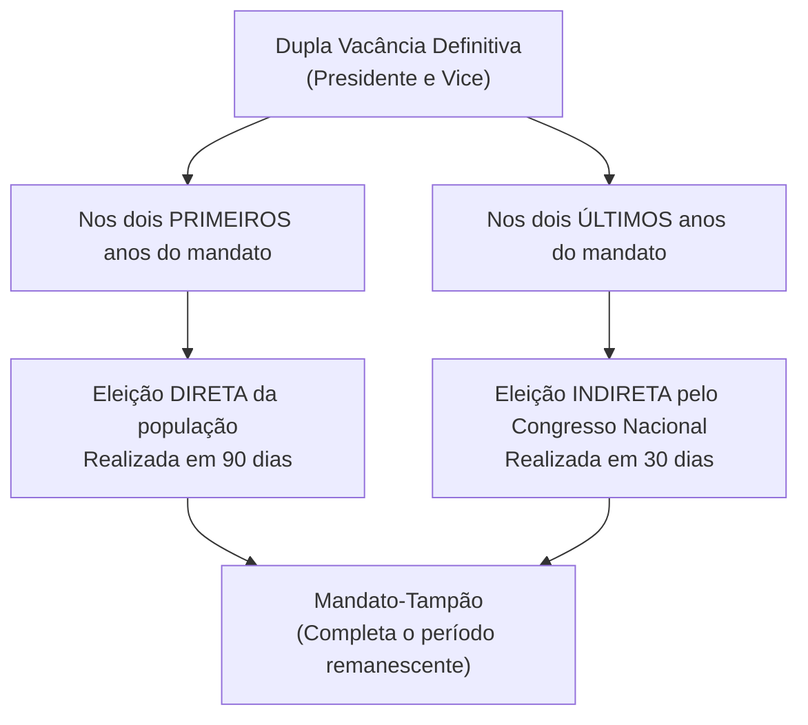
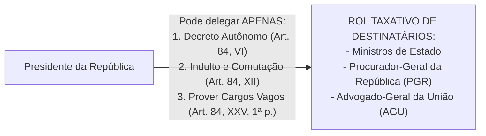

# 05 - Poder Executivo, Poder Judiciário e Funções Essenciais à Justiça

> **Matéria:** Noções de Direito Constitucional  
> **Cargo:** A01 – Técnico de Controle Externo – Especialidade: Técnico Administrativo  
> **Arquivo:** `05_poder_executivo_poder_judiciario_e_funcoes_essenciais.md`  
> **Status:** 🟢 Teoria Aprofundada + 5 Questões FCC Comentadas (A a E)

---

## 📌 Ementa / Itens do Edital

- Do Poder Executivo: eleição, posse, impedimento, vacância e sucessão presidencial;
- Atribuições e prerrogativas do Presidente da República (Artigo 84 da CF/88): competências indelegáveis e competências privativas delegáveis (decretos autônomos, indulto e provimento de cargos vagos);
- Responsabilidade do Presidente da República (Artigos 85 e 86 da CF/88):
    - Crimes comuns vs. crimes de responsabilidade (*impeachment*);
    - Juízo prévio de admissibilidade pela Câmara dos Deputados (quórum qualificado de 2/3);
    - Competência de julgamento pelo STF e pelo Senado Federal (presidido pelo Presidente do STF);
    - Imunidades presidenciais: imunidade prisional temporária e cláusula de irresponsabilidade relativa por atos estranhos ao mandato;
- Do Poder Judiciário: disposições gerais, estatuto e garantias da magistratura (vitaliciedade, inamovibilidade e irredutibilidade) e vedações expressas (quarentena de saída);
- Do Supremo Tribunal Federal (STF - Artigos 101 a 103-A da CF/88): composição (11 Ministros), nomeação, sabatina pelo Senado Federal, competências originárias e recursais, e o regime das Súmulas Vinculantes (Art. 103-A);
- Do Conselho Nacional de Justiça (CNJ - Artigo 103-B da CF/88): organização, composição (15 membros) e limites de atuação (natureza estritamente administrativa, orçamentária e correcional, sem competência jurisdicional);
- Do Superior Tribunal de Justiça (STJ - Artigos 104 e 105 da CF/88): composição (no mínimo 33 Ministros), uniformização da lei federal infraconstitucional e o filtro da relevância no Recurso Especial (EC nº 125/2022);
- Das Funções Essenciais à Justiça:
    - Ministério Público (Artigos 127 a 130-A da CF/88): princípios institucionais, autonomia, garantias, vedações e o Conselho Nacional do Ministério Público (CNMP);
    - Advocacia Pública (Artigos 131 e 132 da CF/88): AGU e Procuradorias Estaduais (PGE-GO);
    - Advocacia Privada (Artigo 133 da CF/88): indispensabilidade e inviolabilidade profissional;
    - Defensoria Pública (Artigos 134 e 135 da CF/88): assistência jurídica aos hipossuficientes e autonomia institucional expressa.

---

## 🧭 Sumário

1. [Poder Executivo: Estrutura, Atribuições e Responsabilidade](#1-poder-executivo-estrutura-atribuicoes-e-responsabilidade)
    1. [Dupla Vacância dos Cargos Presidenciais (Art. 81 da CF/88)](#11-dupla-vacancia-dos-cargos-presidenciais-art-81-da-cf88)
    2. [Atribuições Delegáveis do Presidente da República (Art. 84, Parágrafo Único)](#12-atribuicoes-delegaveis-do-presidente-da-republica-art-84-paragrafo-unico)
    3. [Responsabilidade do Presidente da República e Imunidades (Arts. 85 e 86)](#13-responsabilidade-do-presidente-da-republica-e-imunidades-arts-85-e-86)
    4. [Teste 154](#Teste-154)
    5. [Teste 155](#Teste-155)
    6. [Teste 156](#Teste-156)
    7. [Teste 157](#Teste-157)
2. [Poder Judiciário: Estrutura Orgânica, CNJ e Súmula Vinculante](#2-poder-judiciario-estrutura-organica-cnj-e-sumula-vinculante)
    1. [Garantias e Vedações dos Magistrados (Art. 95 da CF/88)](#21-garantias-e-vedacoes-dos-magistrados-art-95-da-cf88)
    2. [Conselho Nacional de Justiça (CNJ - Art. 103-B)](#22-conselho-nacional-de-justica-cnj-art-103-b)
    3. [Supremo Tribunal Federal e o Regime da Súmula Vinculante (Art. 103-A)](#23-supremo-tribunal-federal-e-o-regime-da-sumula-vinculante-art-103-a)
    4. [Superior Tribunal de Justiça e o Filtro de Relevância (Arts. 104 e 105)](#24-superior-tribunal-de-justica-e-o-filtro-de-relevancia-arts-104-e-105)
    5. [Teste 158](#Teste-158)
    6. [Teste 159](#Teste-159)
    7. [Teste 160](#Teste-160)
    8. [Teste 161](#Teste-161)
3. [Funções Essenciais à Justiça](#3-funcoes-essenciais-a-justica)
    1. [Ministério Público e o CNMP (Arts. 127 a 130-A)](#31-ministerio-publico-e-o-cnmp-arts-127-a-130-a)
    2. [Advocacia Pública (Arts. 131 e 132)](#32-advocacia-publica-arts-131-e-132)
    3. [Defensoria Pública (Arts. 134 e 135)](#33-defensoria-publica-arts-134-e-135)
    4. [Advocacia Privada (Art. 133)](#34-advocacia-privada-art-133)
    5. [Teste 162](#Teste-162)
    6. [Teste 163](#Teste-163)
    7. [Teste 164](#Teste-164)
4. [🌐 Fontes Oficiais & Jurisprudenciais Recomendadas](#fontes-oficiais-jurisprudenciais-recomendadas)

---

## 1. Poder Executivo: Estrutura, Atribuições e Responsabilidade

### 1.1 Dupla Vacância dos Cargos Presidenciais (Art. 81 da CF/88)
Ocorrendo a vacância definitiva tanto do cargo de Presidente quanto de Vice-Presidente da República, aplicam-se regras distintas a depender do momento do mandato:

- **Primeiros 2 anos do mandato:** Ocorrendo a vacância definitiva de ambos os cargos na primeira metade da legislatura, far-se-á eleição **direta** noventa dias depois de aberta a última vaga.
- **Últimos 2 anos do mandato:** Se a dupla vacância definitiva ocorrer na segunda metade da legislatura (3º ou 4º ano do mandato), a eleição para ambos os cargos será feita **indireta**, trinta dias depois da última vaga, pelo **Congresso Nacional**, na forma da lei.
- Em qualquer das hipóteses de eleição extraordinária, os eleitos deverão completar o período remanescente de seus antecessores (*mandato-tampão* - art. 81, § 2º).

### 1.2 Atribuições Delegáveis do Presidente da República (Art. 84, Parágrafo Único)
O art. 84 fixa as competências privativas do Presidente da República. Em regra, são privativas e indelegáveis. Todavia, a Constituição autoriza a **delegação de apenas TRÊS matérias específicas**:

1. **Art. 84, VI:** Dispor, mediante **decreto autônomo**, sobre:
    - *a)* Organização e funcionamento da administração federal, quando não implicar aumento de despesa nem criação ou extinção de órgãos públicos;
    - *b)* Extinção de funções ou cargos públicos, quando vagos;

2. **Art. 84, XII:** Conceder **indulto e comutar penas**, com audiência, se necessário, dos órgãos instituídos em lei;
3. **Art. 84, XXV, primeira parte:** **Prover** cargos públicos federais, na forma da lei.

> 🚨 **ALERTA DE PROVA / PEGADINHA FCC:**  
>
> - **Extinção de Órgãos Públicos:** O Presidente NÃO pode criar nem extinguir Ministérios ou órgãos públicos por decreto! A criação e extinção de órgãos públicos exige expressamente **lei formal ordinária** (art. 88 da CF/88). O decreto autônomo serve exclusivamente para organizar órgãos existentes sem gerar custos ou extinguir cargos vagos.  
> - **Extinção de Cargos Públicos Ocupados:** Depende obrigatoriamente de lei formal. Por decreto autônomo, o Chefe do Executivo só pode extinguir cargos e funções quando estiverem **vagos**!

### 1.3 Responsabilidade do Presidente da República e Imunidades (Arts. 85 e 86)
O Presidente da República responde perante o STF por crimes comuns e perante o Senado Federal por crimes de responsabilidade (*impeachment*).

| Aspecto Procedimental | Crime Comum (Penal) | Crime de Responsabilidade (*Impeachment*) |
| :--- | :--- | :--- |
| **Juízo de Admissibilidade** | **Câmara dos Deputados** (quórum de 2/3 dos membros) | **Câmara dos Deputados** (quórum de 2/3 dos membros) |
| **Órgão Julgador Competente** | **Supremo Tribunal Federal (STF)** | **Senado Federal** (sob presidência do Presidente do STF) |
| **Instauração do Processo** | Recebimento da denúncia ou queixa pelo STF | Deliberação do Plenário do Senado Federal por maioria simples |
| **Afastamento Preventivo** | Fica suspenso de suas funções por até 180 dias | Fica suspenso de suas funções por até 180 dias |
| **Sanção Constitucional** | Penas privativas de liberdade / multas criminais | **Perda do cargo** + **inabilitação por 8 anos** para qualquer função pública (quórum de 2/3 do Senado) |
| **Imunidade Prisional (Art. 86, § 3º)** | **Não pode ser preso**, na vigência do mandato, senão após sentença penal condenatória transitada em julgado | Inaplicável medida penal coercitiva |
| **Irresponsabilidade Relativa (Art. 86, § 4º)** | **Não pode ser responsabilizado por atos estranhos ao exercício de suas funções** na vigência do mandato | Aplicável a atos conexos ao exercício funcional |

---

