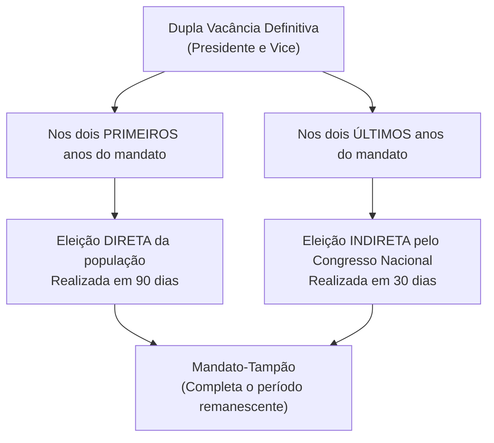
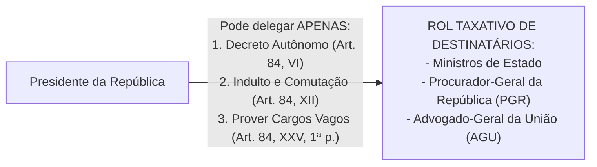

# 05 - Poder Executivo, Poder Judiciário e Funções Essenciais à Justiça

> **Matéria:** Noções de Direito Constitucional  
> **Cargo:** A01 – Técnico de Controle Externo – Especialidade: Técnico Administrativo  
> **Arquivo:** `05_poder_executivo_poder_judiciario_e_funcoes_essenciais.md`  
> **Status:** 🟢 Teoria Aprofundada + 5 Questões FCC Comentadas (A a E)

---

## 📌 Ementa / Itens do Edital

- Do Poder Executivo: eleição, posse, impedimento, vacância e sucessão presidencial;
- Atribuições e prerrogativas do Presidente da República (Artigo 84 da CF/88): competências indelegáveis e competências privativas delegáveis (decretos autônomos, indulto e provimento de cargos vagos);
- Responsabilidade do Presidente da República (Artigos 85 e 86 da CF/88):
    - Crimes comuns vs. crimes de responsabilidade (*impeachment*);
    - Juízo prévio de admissibilidade pela Câmara dos Deputados (quórum qualificado de 2/3);
    - Competência de julgamento pelo STF e pelo Senado Federal (presidido pelo Presidente do STF);
    - Imunidades presidenciais: imunidade prisional temporária e cláusula de irresponsabilidade relativa por atos estranhos ao mandato;
- Do Poder Judiciário: disposições gerais, estatuto e garantias da magistratura (vitaliciedade, inamovibilidade e irredutibilidade) e vedações expressas (quarentena de saída);
- Do Supremo Tribunal Federal (STF - Artigos 101 a 103-A da CF/88): composição (11 Ministros), nomeação, sabatina pelo Senado Federal, competências originárias e recursais, e o regime das Súmulas Vinculantes (Art. 103-A);
- Do Conselho Nacional de Justiça (CNJ - Artigo 103-B da CF/88): organização, composição (15 membros) e limites de atuação (natureza estritamente administrativa, orçamentária e correcional, sem competência jurisdicional);
- Do Superior Tribunal de Justiça (STJ - Artigos 104 e 105 da CF/88): composição (no mínimo 33 Ministros), uniformização da lei federal infraconstitucional e o filtro da relevância no Recurso Especial (EC nº 125/2022);
- Das Funções Essenciais à Justiça:
    - Ministério Público (Artigos 127 a 130-A da CF/88): princípios institucionais, autonomia, garantias, vedações e o Conselho Nacional do Ministério Público (CNMP);
    - Advocacia Pública (Artigos 131 e 132 da CF/88): AGU e Procuradorias Estaduais (PGE-GO);
    - Advocacia Privada (Artigo 133 da CF/88): indispensabilidade e inviolabilidade profissional;
    - Defensoria Pública (Artigos 134 e 135 da CF/88): assistência jurídica aos hipossuficientes e autonomia institucional expressa.

---

## 🧭 Sumário

1. [Poder Executivo: Estrutura, Atribuições e Responsabilidade](#1-poder-executivo-estrutura-atribuicoes-e-responsabilidade)
    1. [Dupla Vacância dos Cargos Presidenciais (Art. 81 da CF/88)](#11-dupla-vacancia-dos-cargos-presidenciais-art-81-da-cf88)
    2. [Atribuições Delegáveis do Presidente da República (Art. 84, Parágrafo Único)](#12-atribuicoes-delegaveis-do-presidente-da-republica-art-84-paragrafo-unico)
    3. [Responsabilidade do Presidente da República e Imunidades (Arts. 85 e 86)](#13-responsabilidade-do-presidente-da-republica-e-imunidades-arts-85-e-86)
    4. [Teste 154](#Teste-154)
    5. [Teste 155](#Teste-155)
    6. [Teste 156](#Teste-156)
    7. [Teste 157](#Teste-157)
2. [Poder Judiciário: Estrutura Orgânica, CNJ e Súmula Vinculante](#2-poder-judiciario-estrutura-organica-cnj-e-sumula-vinculante)
    1. [Garantias e Vedações dos Magistrados (Art. 95 da CF/88)](#21-garantias-e-vedacoes-dos-magistrados-art-95-da-cf88)
    2. [Conselho Nacional de Justiça (CNJ - Art. 103-B)](#22-conselho-nacional-de-justica-cnj-art-103-b)
    3. [Supremo Tribunal Federal e o Regime da Súmula Vinculante (Art. 103-A)](#23-supremo-tribunal-federal-e-o-regime-da-sumula-vinculante-art-103-a)
    4. [Superior Tribunal de Justiça e o Filtro de Relevância (Arts. 104 e 105)](#24-superior-tribunal-de-justica-e-o-filtro-de-relevancia-arts-104-e-105)
    5. [Teste 158](#Teste-158)
    6. [Teste 159](#Teste-159)
    7. [Teste 160](#Teste-160)
    8. [Teste 161](#Teste-161)
3. [Funções Essenciais à Justiça](#3-funcoes-essenciais-a-justica)
    1. [Ministério Público e o CNMP (Arts. 127 a 130-A)](#31-ministerio-publico-e-o-cnmp-arts-127-a-130-a)
    2. [Advocacia Pública (Arts. 131 e 132)](#32-advocacia-publica-arts-131-e-132)
    3. [Defensoria Pública (Arts. 134 e 135)](#33-defensoria-publica-arts-134-e-135)
    4. [Advocacia Privada (Art. 133)](#34-advocacia-privada-art-133)
    5. [Teste 162](#Teste-162)
    6. [Teste 163](#Teste-163)
    7. [Teste 164](#Teste-164)
4. [🌐 Fontes Oficiais & Jurisprudenciais Recomendadas](#fontes-oficiais-jurisprudenciais-recomendadas)

---

## 1. Poder Executivo: Estrutura, Atribuições e Responsabilidade

### 1.1 Dupla Vacância dos Cargos Presidenciais (Art. 81 da CF/88)
Ocorrendo a vacância definitiva tanto do cargo de Presidente quanto de Vice-Presidente da República, aplicam-se regras distintas a depender do momento do mandato:

- **Primeiros 2 anos do mandato:** Ocorrendo a vacância definitiva de ambos os cargos na primeira metade da legislatura, far-se-á eleição **direta** noventa dias depois de aberta a última vaga.
- **Últimos 2 anos do mandato:** Se a dupla vacância definitiva ocorrer na segunda metade da legislatura (3º ou 4º ano do mandato), a eleição para ambos os cargos será feita **indireta**, trinta dias depois da última vaga, pelo **Congresso Nacional**, na forma da lei.
- Em qualquer das hipóteses de eleição extraordinária, os eleitos deverão completar o período remanescente de seus antecessores (*mandato-tampão* - art. 81, § 2º).

### 1.2 Atribuições Delegáveis do Presidente da República (Art. 84, Parágrafo Único)
O art. 84 fixa as competências privativas do Presidente da República. Em regra, são privativas e indelegáveis. Todavia, a Constituição autoriza a **delegação de apenas TRÊS matérias específicas**:

1. **Art. 84, VI:** Dispor, mediante **decreto autônomo**, sobre:
    - *a)* Organização e funcionamento da administração federal, quando não implicar aumento de despesa nem criação ou extinção de órgãos públicos;
    - *b)* Extinção de funções ou cargos públicos, quando vagos;

2. **Art. 84, XII:** Conceder **indulto e comutar penas**, com audiência, se necessário, dos órgãos instituídos em lei;
3. **Art. 84, XXV, primeira parte:** **Prover** cargos públicos federais, na forma da lei.

> 🚨 **ALERTA DE PROVA / PEGADINHA FCC:**  
>
> - **Extinção de Órgãos Públicos:** O Presidente NÃO pode criar nem extinguir Ministérios ou órgãos públicos por decreto! A criação e extinção de órgãos públicos exige expressamente **lei formal ordinária** (art. 88 da CF/88). O decreto autônomo serve exclusivamente para organizar órgãos existentes sem gerar custos ou extinguir cargos vagos.  
> - **Extinção de Cargos Públicos Ocupados:** Depende obrigatoriamente de lei formal. Por decreto autônomo, o Chefe do Executivo só pode extinguir cargos e funções quando estiverem **vagos**!

### 1.3 Responsabilidade do Presidente da República e Imunidades (Arts. 85 e 86)
O Presidente da República responde perante o STF por crimes comuns e perante o Senado Federal por crimes de responsabilidade (*impeachment*).

| Aspecto Procedimental | Crime Comum (Penal) | Crime de Responsabilidade (*Impeachment*) |
| :--- | :--- | :--- |
| **Juízo de Admissibilidade** | **Câmara dos Deputados** (quórum de 2/3 dos membros) | **Câmara dos Deputados** (quórum de 2/3 dos membros) |
| **Órgão Julgador Competente** | **Supremo Tribunal Federal (STF)** | **Senado Federal** (sob presidência do Presidente do STF) |
| **Instauração do Processo** | Recebimento da denúncia ou queixa pelo STF | Deliberação do Plenário do Senado Federal por maioria simples |
| **Afastamento Preventivo** | Fica suspenso de suas funções por até 180 dias | Fica suspenso de suas funções por até 180 dias |
| **Sanção Constitucional** | Penas privativas de liberdade / multas criminais | **Perda do cargo** + **inabilitação por 8 anos** para qualquer função pública (quórum de 2/3 do Senado) |
| **Imunidade Prisional (Art. 86, § 3º)** | **Não pode ser preso**, na vigência do mandato, senão após sentença penal condenatória transitada em julgado | Inaplicável medida penal coercitiva |
| **Irresponsabilidade Relativa (Art. 86, § 4º)** | **Não pode ser responsabilizado por atos estranhos ao exercício de suas funções** na vigência do mandato | Aplicável a atos conexos ao exercício funcional |

---

### Teste 154
**(FGV – TCE-GO – Analista de Controle Externo Juridica – 2024)**
O Presidente da República editou o Decreto nº X, o qual dispôs sobre o seguinte: I. extinção dos órgãos públicos Alfa e Beta, com realocação dos respectivos ocupantes, o que decorria da exponencial diminuição de suas atividades, fruto de alterações no ambiente social; II. extinção dos cargos em comissão de simbologia W, na medida em que vagassem; III. disciplina da organização da Administração Pública federal. Por discordar das medidas adotadas, o Partido Político Alfa, com representação no Congresso Nacional, consultou sua assessoria jurídica em relação à conformidade constitucional das medidas adotadas. A assessoria informou que é constitucional o que consta em

* **A)** I, II e III.
* **B)** I, apenas.
* **C)** III, apenas.
* **D)** I e II, apenas.
* **E)** II e III, apenas.

---

> **Comentário Detalhado:**
>
> - **A)** **Incorreta.** A opção apresenta proposição em desacordo com os fundamentos teóricos e técnicos do tópico ao afirmar que "I, II e III". De acordo com a teoria estudada em *1.2 Atribuições Delegáveis do Presidente da República (Art. 84, Parágrafo Único)*, extinção de Órgãos Públicos: O Presidente NÃO pode criar nem extinguir Ministérios ou órgãos públicos por decreto! A criação e extinção de órgãos públicos exige expressamente lei formal ordinária (art. 88 da CF/88).
> - **B)** **Incorreta.** A opção incorre em restrição indevida ao limitar o escopo conceitual ao afirmar que "I, apenas". De acordo com a teoria estudada em *1.1 Dupla Vacância dos Cargos Presidenciais (Art. 81 da CF/88)*, últimos 2 anos do mandato: Se a dupla vacância definitiva ocorrer na segunda metade da legislatura (3º ou 4º ano do mandato), a eleição para ambos os cargos será feita indireta, trinta dias depois da última vaga, pelo Congresso Nacional, na forma da lei.
> - **C)** **Correta.** Conforme fundamentado na seção *1.2 Atribuições Delegáveis do Presidente da República (Art. 84, Parágrafo Único)* deste guia, *a)* Organização e funcionamento da administração federal, quando não implicar aumento de despesa nem criação ou extinção de órgãos públicos. Dessa forma, está plenamente correta a assertiva da banca (FGV – TCE-GO/2024) ao estabelecer que "III, apenas".
> - **D)** **Incorreta.** A opção incorre em restrição indevida ao limitar o escopo conceitual ao afirmar que "I e II, apenas". De acordo com a teoria estudada em *1.2 Atribuições Delegáveis do Presidente da República (Art. 84, Parágrafo Único)*, extinção de Cargos Públicos Ocupados: Depende obrigatoriamente de lei formal. Por decreto autônomo, o Chefe do Executivo só pode extinguir cargos e funções quando estiverem vagos!.
> - **E)** **Incorreta.** A opção incorre em restrição indevida ao limitar o escopo conceitual ao afirmar que "II e III, apenas". De acordo com a teoria estudada em *1.2 Atribuições Delegáveis do Presidente da República (Art. 84, Parágrafo Único)*, o decreto autônomo serve exclusivamente para organizar órgãos existentes sem gerar custos ou extinguir cargos vagos.
>
> **Gabarito: C**

---

### Teste 155
**(CEBRASPE – TRT-8 – Analista Judiciario Apoio Especializado Tecnologia da Informacao – 2016)**
Com base no que dispõe a CF sobre o presidente da República, assinale a opção correta. A

* **A)** renúncia ao mandado pelo presidente da República prejudica, por perda de objeto, o processo de impeachment eventualmente em curso, acarretando a sua extinção automática.
* **B)** Por força do princípio da inafastabilidade jurisdicional, eventual decisão condenatória proferida pelo Senado Federal em julgamento por crime de responsabilidade estará sujeita a controle judicial posterior.
* **C)** Por ser norma punitiva, o rol de crimes de responsabilidade previsto na CF é taxativo, nele não podendo ser inseridos novos tipos.
* **D)** A CF admite excepcionalmente a edição, pelo presidente da República, de decreto como fonte normativa primária, o chamado decreto autônomo.
* **E)** Em processo de impeachment por crime de responsabilidade, o contraditório e a ampla defesa somente são exercidos pelo presidente da República perante o Senado Federal, na fase de processo e julgamento.

---

> **Comentário Detalhado:**
>
> - **A)** **Incorreta.** A opção apresenta proposição em desacordo com os fundamentos teóricos e técnicos do tópico ao afirmar que "renúncia ao mandado pelo presidente da República prejudica, por perda de objeto, o processo de impeachment...". De acordo com a teoria estudada em *1.2 Atribuições Delegáveis do Presidente da República (Art. 84, Parágrafo Único)*, extinção de Cargos Públicos Ocupados: Depende obrigatoriamente de lei formal. Por decreto autônomo, o Chefe do Executivo só pode extinguir cargos e funções quando estiverem vagos!.
> - **B)** **Incorreta.** A opção apresenta proposição em desacordo com os fundamentos teóricos e técnicos do tópico ao afirmar que "Por força do princípio da inafastabilidade jurisdicional, eventual decisão condenatória proferida pelo Senado...". De acordo com a teoria estudada em *1.3 Responsabilidade do Presidente da República e Imunidades (Arts. 85 e 86)*, imunidade Prisional (Art. 86, § 3º): Não pode ser preso, na vigência do mandato, senão após sentença penal condenatória transitada em julgado — Inaplicável medida penal coercitiva.
> - **C)** **Incorreta.** A opção apresenta proposição em desacordo com os fundamentos teóricos e técnicos do tópico ao afirmar que "Por ser norma punitiva, o rol de crimes de responsabilidade previsto na CF é taxativo, nele não podendo ser...". De acordo com a teoria estudada em *1.3 Responsabilidade do Presidente da República e Imunidades (Arts. 85 e 86)*, o Presidente da República responde perante o STF por crimes comuns e perante o Senado Federal por crimes de responsabilidade (*impeachment*).
> - **D)** **Correta.** Conforme fundamentado na seção *1.2 Atribuições Delegáveis do Presidente da República (Art. 84, Parágrafo Único)* deste guia, art. 84, VI: Dispor, mediante decreto autônomo, sobre. Dessa forma, está plenamente correta a assertiva da banca (CEBRASPE – TRT-8/2016) ao estabelecer que "A CF admite excepcionalmente a edição, pelo presidente da República, de decreto como fonte normativa primária, o...".
> - **E)** **Incorreta.** A opção incorre em restrição indevida ao limitar o escopo conceitual ao afirmar que "Em processo de impeachment por crime de responsabilidade, o contraditório e a ampla defesa somente são exercidos...". De acordo com a teoria estudada em *1.3 Responsabilidade do Presidente da República e Imunidades (Arts. 85 e 86)*, instauração do Processo: Recebimento da denúncia ou queixa pelo STF — Deliberação do Plenário do Senado Federal por maioria simples.
>
> **Gabarito: D**

---

### Teste 156
**(FCC – TRT-2 – Analista Judiciário - Tecnologia da Informação – 2014)**  
Entre as atribuições conferidas pelo texto constitucional ao Presidente da República está o poder de "conceder indulto e comutar penas" (art. 84, XII). O exercício dessa atribuição presidencial não é cabível, nos termos da Constituição Federal, para beneficiar os condenados pela prática das infrações criminais de:

* **A)** terrorismo, racismo, crimes hediondos e ação de grupos armados contra a ordem constitucional.
* **B)** tortura, racismo, crimes hediondos e tráfico ilícito de entorpecentes e drogas afins.
* **C)** terrorismo, tortura, crimes hediondos e tráfico ilícito de entorpecentes e drogas afins.
* **D)** terrorismo, tortura, ação de grupos armados contra a ordem constitucional e tráfico ilícito de drogas.
* **E)** terrorismo, tortura, racismo, estelionato previdenciário e crimes contra a administração pública.

---

> **Comentário Detalhado:**
>
> - **A)** **Incorreto**. O racismo e a ação de grupos armados são crimes inafiançáveis e imprescritíveis (art. 5º, XLII e XLIV), mas a vedação de graça/indulto não incide expressamente sobre eles.
> - **B)** **Incorreto**. O racismo não consta da vedação de graça ou anistia do inciso XLIII.
> - **C)** **Correto**. Nos termos do art. 5º, XLIII, da Constituição Federal: "a lei considerará crimes inafiançáveis e insuscetíveis de graça ou anistia a prática da tortura, o tráfico ilícito de entorpecentes e drogas afins, o terrorismo e os definidos como crimes hediondos, por eles respondendo os mandantes, os executores e os que, podendo evitá-los, se omitirem". Conforme pacífica jurisprudência do STF, a vedação da graça alcança também o indulto coletivo (que é espécie do gênero graça em sentido amplo).
> - **D)** **Incorreto**. Ação de grupos armados é imprescritível e inafiançável, mas a vedação de indulto refere-se a tortura, tráfico, terrorismo e hediondos (o grupo 3T + H).
> - **E)** **Incorreto**. O racismo não integra a cláusula de vedação de graça/anistia do art. 5º, XLIII.
>
> **Gabarito: C**

### Teste 157
**(FCC – TCE-GO – Analista de Controle Externo Gestao de Conhecimento – 2009)**
Vagando os cargos de Presidente e Vice-Presidente da República,

* **A)** será chamado ao exercício da Presidência o Presidente da Câmara dos Deputados, que deverá completar o período de mandato de seus antecessores.
* **B)** será realizada eleição pelo Congresso Nacional, trinta dias depois da última vaga, caso a vacância ocorra nos últimos dois anos do período presidencial.
* **C)** deverá ser convocado plebiscito para decidir quanto à necessidade de realização de nova eleição.
* **D)** caberá ao Tribunal Superior Eleitoral dar posse aos candidatos segundos colocados no pleito em que eleitos os antecessores.
* **E)** não há solução prevista expressamente na Constituição da República para a sucessão, cabendo ao Congresso Nacional dispor sobre a matéria.

---

> **Comentário Detalhado:**
>
> - **A)** **Incorreta.** A opção apresenta proposição em desacordo com os fundamentos teóricos e técnicos do tópico ao afirmar que "será chamado ao exercício da Presidência o Presidente da Câmara dos Deputados, que deverá completar o período de...". De acordo com a teoria estudada em *1.1 Dupla Vacância dos Cargos Presidenciais (Art. 81 da CF/88)*, em qualquer das hipóteses de eleição extraordinária, os eleitos deverão completar o período remanescente de seus antecessores (*mandato-tampão* - art. 81, § 2º).
> - **B)** **Correta.** Conforme fundamentado na seção *1.1 Dupla Vacância dos Cargos Presidenciais (Art. 81 da CF/88)* deste guia, últimos 2 anos do mandato: Se a dupla vacância definitiva ocorrer na segunda metade da legislatura (3º ou 4º ano do mandato), a eleição para ambos os cargos será feita indireta, trinta dias depois da última vaga, pelo Congresso Nacional, na forma da lei. Dessa forma, está plenamente correta a assertiva da banca (FCC – TCE-GO/2009) ao estabelecer que "será realizada eleição pelo Congresso Nacional, trinta dias depois da última vaga, caso a vacância ocorra nos...".
> - **C)** **Incorreta.** A opção apresenta proposição em desacordo com os fundamentos teóricos e técnicos do tópico ao afirmar que "deverá ser convocado plebiscito para decidir quanto à necessidade de realização de nova eleição". De acordo com a teoria estudada em *1.1 Dupla Vacância dos Cargos Presidenciais (Art. 81 da CF/88)*, primeiros 2 anos do mandato: Ocorrendo a vacância definitiva de ambos os cargos na primeira metade da legislatura, far-se-á eleição direta noventa dias depois de aberta a última vaga.
> - **D)** **Incorreta.** A opção apresenta proposição em desacordo com os fundamentos teóricos e técnicos do tópico ao afirmar que "caberá ao Tribunal Superior Eleitoral dar posse aos candidatos segundos colocados no pleito em que eleitos os...". De acordo com a teoria estudada em *1.1 Dupla Vacância dos Cargos Presidenciais (Art. 81 da CF/88)*, ocorrendo a vacância definitiva tanto do cargo de Presidente quanto de Vice-Presidente da República, aplicam-se regras distintas a depender do momento do mandato.
> - **E)** **Incorreta.** A opção apresenta proposição em desacordo com os fundamentos teóricos e técnicos do tópico ao afirmar que "não há solução prevista expressamente na Constituição da República para a sucessão, cabendo ao Congresso Nacional...". De acordo com a teoria estudada em *1.2 Atribuições Delegáveis do Presidente da República (Art. 84, Parágrafo Único)*, o art. 84 fixa as competências privativas do Presidente da República. Em regra, são privativas e indelegáveis. Todavia, a Constituição autoriza a delegação de apenas TRÊS matérias específicas.
>
> **Gabarito: B**

---

### Teste 158
**(FCC – TRT-24 – Analista Judiciario Tecnologia da Informacao – 2017)**
Em razão do recente falecimento de Ministro do Supremo Tribunal Federal, o Presidente da República indicou determinado jurista para ocupar o referido cargo. Neste caso, a nomeação de novo Ministro pelo Presidente da República depende da aprovação da referida escolha

* **A)** pela maioria absoluta do Congresso Nacional.
* **B)** pela maioria relativa do Congresso Nacional.
* **C)** pela maioria relativa do Senado Federal.
* **D)** pela maioria absoluta do Senado Federal.
* **E)** por 1/3 do Senado Federal.

---

> **Comentário Detalhado:**
>
> - **A)** **Incorreta.** A opção apresenta proposição em desacordo com os fundamentos teóricos e técnicos do tópico ao afirmar que "pela maioria absoluta do Congresso Nacional". De acordo com a teoria estudada em *1.1 Dupla Vacância dos Cargos Presidenciais (Art. 81 da CF/88)*, últimos 2 anos do mandato: Se a dupla vacância definitiva ocorrer na segunda metade da legislatura (3º ou 4º ano do mandato), a eleição para ambos os cargos será feita indireta, trinta dias depois da última vaga, pelo Congresso Nacional, na forma da lei.
> - **B)** **Incorreta.** A opção apresenta proposição em desacordo com os fundamentos teóricos e técnicos do tópico ao afirmar que "pela maioria relativa do Congresso Nacional". De acordo com a teoria estudada em *1.3 Responsabilidade do Presidente da República e Imunidades (Arts. 85 e 86)*, instauração do Processo: Recebimento da denúncia ou queixa pelo STF — Deliberação do Plenário do Senado Federal por maioria simples.
> - **C)** **Incorreta.** A opção apresenta proposição em desacordo com os fundamentos teóricos e técnicos do tópico ao afirmar que "pela maioria relativa do Senado Federal". De acordo com a teoria estudada em *1.3 Responsabilidade do Presidente da República e Imunidades (Arts. 85 e 86)*, irresponsabilidade Relativa (Art. 86, § 4º): Não pode ser responsabilizado por atos estranhos ao exercício de suas funções na vigência do mandato — Aplicável a atos conexos ao exercício funcional.
> - **D)** **Incorreta.** A opção apresenta proposição em desacordo com os fundamentos teóricos e técnicos do tópico ao afirmar que "pela maioria absoluta do Senado Federal". De acordo com a teoria estudada em *1.3 Responsabilidade do Presidente da República e Imunidades (Arts. 85 e 86)*, o Presidente da República responde perante o STF por crimes comuns e perante o Senado Federal por crimes de responsabilidade (*impeachment*).
> - **E)** **Correta.** Conforme fundamentado na seção *1.3 Responsabilidade do Presidente da República e Imunidades (Arts. 85 e 86)* deste guia, órgão Julgador Competente: Supremo Tribunal Federal (STF) — Senado Federal (sob presidência do Presidente do STF). Dessa forma, está plenamente correta a assertiva da banca (FCC – TRT-24/2017) ao estabelecer que "por 1/3 do Senado Federal".
>
> **Gabarito: E**

---

### Teste 159
**(FGV – TJ-MT – Analista Judiciário - Tecnologia da Informação – 2024)**  
Determinado órgão, em âmbito nacional, tem a competência de controlar a atuação administrativa e financeira do Poder Judiciário e o cumprimento dos deveres funcionais dos juízes, além de outras atribuições que lhe forem conferidas pelo Estatuto da Magistratura.  
Nesse cenário, considerando as disposições da Constituição Federal de 1988, está-se diante de uma competência do:

* **A)** Tribunal Superior do Trabalho.
* **B)** Conselho Nacional de Justiça.
* **C)** Superior Tribunal de Justiça.
* **D)** Tribunal Superior Eleitoral.
* **E)** Supremo Tribunal Federal.

---

> **Comentário Detalhado:**
>
> - **A)** **Incorreto**. O TST é órgão de cúpula da Justiça do Trabalho, com atribuições essencialmente jurisdicionais.
> - **B)** **Correto**. Conforme o art. 103-B, § 4º, da Constituição Federal: "Compete ao Conselho o controle da atuação administrativa e financeira do Poder Judiciário e do cumprimento dos deveres funcionais dos juízes, cabendo-lhe, além de outras atribuições que lhe forem conferidas pelo Estatuto da Magistratura...". O CNJ não possui competência jurisdicional, atuando exclusivamente como órgão de controle administrativo e correcional.
> - **C)** **Incorreto**. O STJ é tribunal jurisdicional responsável pela uniformização da legislação infraconstitucional federal.
> - **D)** **Incorreto**. O TSE coordena a jurisdição eleitoral em nível nacional.
> - **E)** **Incorreto**. O STF é o guardião da Constituição e cúpula jurisdicional máxima do Estado brasileiro.
>
> **Gabarito: B**

### Teste 160
**(FGV – TJ-RR – Analista Judiciário - Suporte e Infraestrutura de TI – 2024)**  
O Conselho Nacional de Justiça compõe-se de 15 (quinze) membros com mandato de 2 (dois) anos, admitida 1 (uma) recondução. As opções a seguir apresentam membros que participam da composição constitucional desse Conselho, à exceção de uma. Assinale-a:

* **A)** Um juiz de Tribunal Regional Federal, indicado pelo Superior Tribunal de Justiça.
* **B)** Um juiz de Tribunal Regional do Trabalho, indicado pelo Tribunal Superior do Trabalho.
* **C)** Dois cidadãos de notável saber jurídico e reputação ilibada, indicados pela Câmara e pelo Senado.
* **D)** Um juiz de Tribunal Regional Eleitoral, indicado privativamente pelo Supremo Tribunal Federal.
* **E)** Um membro do Ministério Público estadual, escolhido pelo Procurador-Geral da República.

---

> **Comentário Detalhado:**
>
> - **A)** **Incorreto**. É membro integrante expressamente previsto no art. 103-B, V, da CF/88.
> - **B)** **Incorreto**. É membro integrante expressamente previsto no art. 103-B, VIII, da CF/88.
> - **C)** **Incorreto**. Membros previstos no art. 103-B, XIII, da CF/88 (um indicado pela Câmara dos Deputados e um pelo Senado Federal).
> - **D)** **Correto**. O art. 103-B da Constituição Federal NÃO contempla na composição do CNJ a figura de juiz de Tribunal Regional Eleitoral (TRE). A composição conta com: o Presidente do STF, 1 Ministro do STJ, 1 Ministro do TST, 1 Desembargador de TJ, 1 Juiz de Direito estadual, 1 Juiz de TRF, 1 Juiz federal, 1 Juiz de TRT, 1 Juiz do trabalho, 1 membro do MPU, 1 membro do MPE, 2 advogados indicados pelo CFOAB e 2 cidadãos indicados pelo Congresso Nacional. Logo, esta é a única opção que traz membro inexistente no colegiado.
> - **E)** **Incorreto**. É membro integrante expressamente previsto no art. 103-B, XI, da CF/88.
>
> **Gabarito: D**

### Teste 161
**(FGV – TRF-1 – Analista Judiciario Area Apoio Especializado Especialidade Suporte Em Tecnologia da Informacao – 2024)**
Em determinada relação processual, o Tribunal Regional Federal X dispensou à lei federal interpretação diametralmente oposta àquela realizada pelo Tribunal Regional Federal Y. Ao tomar conhecimento desse fato, a parte, que não teve seus interesses atendidos pela interpretação realizada pelo Tribunal Regional Federal X, decidiu interpor o recurso cabível após o exaurimento da atividade jurisdicional por este último órgão. A narrativa indica que a referida parte almeja que o seu recurso seja julgado pelo:

* **A)** Supremo Tribunal Federal;
* **B)** Conselho da Justiça Federal;
* **C)** Superior Tribunal de Justiça;
* **D)** Conselho Nacional de Justiça;
* **E)** Turma de Uniformização de Jurisprudência.

---

> **Comentário Detalhado:**
>
> - **A)** **Incorreta.** A opção apresenta proposição em desacordo com os fundamentos teóricos e técnicos do tópico ao afirmar que "Supremo Tribunal Federal". De acordo com a teoria estudada em *1.3 Responsabilidade do Presidente da República e Imunidades (Arts. 85 e 86)*, órgão Julgador Competente: Supremo Tribunal Federal (STF) — Senado Federal (sob presidência do Presidente do STF).
> - **B)** **Incorreta.** A opção apresenta proposição em desacordo com os fundamentos teóricos e técnicos do tópico ao afirmar que "Conselho da Justiça Federal". De acordo com a teoria estudada em *1.2 Atribuições Delegáveis do Presidente da República (Art. 84, Parágrafo Único)*, art. 84, XXV, primeira parte: Prover cargos públicos federais, na forma da lei.
> - **C)** **Correta.** Conforme fundamentado na seção *1.3 Responsabilidade do Presidente da República e Imunidades (Arts. 85 e 86)* deste guia, imunidade Prisional (Art. 86, § 3º): Não pode ser preso, na vigência do mandato, senão após sentença penal condenatória transitada em julgado — Inaplicável medida penal coercitiva. Dessa forma, está plenamente correta a assertiva da banca (FGV – TRF-1/2024) ao estabelecer que "Superior Tribunal de Justiça".
> - **D)** **Incorreta.** A opção apresenta proposição em desacordo com os fundamentos teóricos e técnicos do tópico ao afirmar que "Conselho Nacional de Justiça". De acordo com a teoria estudada em *1.1 Dupla Vacância dos Cargos Presidenciais (Art. 81 da CF/88)*, últimos 2 anos do mandato: Se a dupla vacância definitiva ocorrer na segunda metade da legislatura (3º ou 4º ano do mandato), a eleição para ambos os cargos será feita indireta, trinta dias depois da última vaga, pelo Congresso Nacional, na forma da lei.
> - **E)** **Incorreta.** A opção apresenta proposição em desacordo com os fundamentos teóricos e técnicos do tópico ao afirmar que "Turma de Uniformização de Jurisprudência". De acordo com a teoria estudada em *1.2 Atribuições Delegáveis do Presidente da República (Art. 84, Parágrafo Único)*, art. 84, XII: Conceder indulto e comutar penas, com audiência, se necessário, dos órgãos instituídos em lei.
>
> **Gabarito: C**

---

### Teste 162
**(FGV – TRT-1 – Analista Judiciario Area Administrativa – 2024)**
O Tribunal Regional Federal da 1ª Região, ao apreciar mandado de segurança impetrado contra ato de juiz federal, denegou a ordem por não identificar a violação de direito líquido e certo. Esse acórdão, ao ver do impetrante, era manifestamente contrário à ordem constitucional. Nesse caso, é correto afirmar que, contra o referido acórdão:

* **A)** não é cabível a interposição de recurso;
* **B)** é cabível o ajuizamento de reclamação perante o Conselho Nacional de Justiça;
* **C)** é cabível a interposição de recurso a ser julgado pelo Superior Tribunal de Justiça;
* **D)** é cabível a interposição de recurso a ser julgado pelo Supremo Tribunal Federal;
* **E)** somente é cabível pedido de reconsideração endereçado ao próprio Tribunal Regional Federal da 1ª Região.

---

> **Comentário Detalhado:**
>
> - **A)** **Incorreta.** A opção apresenta proposição em desacordo com os fundamentos teóricos e técnicos do tópico ao afirmar que "não é cabível a interposição de recurso". De acordo com a teoria estudada em *1.3 Responsabilidade do Presidente da República e Imunidades (Arts. 85 e 86)*, o Presidente da República responde perante o STF por crimes comuns e perante o Senado Federal por crimes de responsabilidade (*impeachment*).
> - **B)** **Correta.** Conforme fundamentado na seção *1.1 Dupla Vacância dos Cargos Presidenciais (Art. 81 da CF/88)* deste guia, últimos 2 anos do mandato: Se a dupla vacância definitiva ocorrer na segunda metade da legislatura (3º ou 4º ano do mandato), a eleição para ambos os cargos será feita indireta, trinta dias depois da última vaga, pelo Congresso Nacional, na forma da lei. Dessa forma, está plenamente correta a assertiva da banca (FGV – TRT-1/2024) ao estabelecer que "é cabível o ajuizamento de reclamação perante o Conselho Nacional de Justiça".
> - **C)** **Incorreta.** A opção apresenta proposição em desacordo com os fundamentos teóricos e técnicos do tópico ao afirmar que "é cabível a interposição de recurso a ser julgado pelo Superior Tribunal de Justiça". De acordo com a teoria estudada em *1.3 Responsabilidade do Presidente da República e Imunidades (Arts. 85 e 86)*, imunidade Prisional (Art. 86, § 3º): Não pode ser preso, na vigência do mandato, senão após sentença penal condenatória transitada em julgado — Inaplicável medida penal coercitiva.
> - **D)** **Incorreta.** A opção apresenta proposição em desacordo com os fundamentos teóricos e técnicos do tópico ao afirmar que "é cabível a interposição de recurso a ser julgado pelo Supremo Tribunal Federal". De acordo com a teoria estudada em *1.3 Responsabilidade do Presidente da República e Imunidades (Arts. 85 e 86)*, órgão Julgador Competente: Supremo Tribunal Federal (STF) — Senado Federal (sob presidência do Presidente do STF).
> - **E)** **Incorreta.** A opção incorre em restrição indevida ao limitar o escopo conceitual ao afirmar que "somente é cabível pedido de reconsideração endereçado ao próprio Tribunal Regional Federal da 1ª Região". De acordo com a teoria estudada em *1.3 Responsabilidade do Presidente da República e Imunidades (Arts. 85 e 86)*, sanção Constitucional: Penas privativas de liberdade / multas criminais — Perda do cargo + inabilitação por 8 anos para qualquer função pública (quórum de 2/3 do Senado).
>
> **Gabarito: B**

---

### Teste 163
**(FGV – TCE-PA – Auditor de Controle Externo Administrativa Direito – 2024)**
João, após regular processo judicial, foi condenado pela prática de crime político pelo órgão constitucional que tem competência originária para conhecer da ação. Irresignado com a sua condenação, decidiu interpor recurso de fundamentação livre a ser julgado pelo tribunal competente. À luz da sistemática constitucional, é correto afirmar que a condenação de João resultou de decisão proferida

* **A)** por Juiz Federal, sendo que o recurso será julgado por Tribunal Regional Federal.
* **B)** por Juiz Federal, sendo que o recurso será julgado pelo Supremo Tribunal Federal.
* **C)** por Juiz Federal, sendo que o recurso será julgado pelo Superior Tribunal de Justiça.
* **D)** pelo Supremo Tribunal Federal, sendo que o recurso será julgado pelo próprio Tribunal.
* **E)** pelo Superior Tribunal de Justiça, sendo que o recurso será julgado pelo Supremo Tribunal Federal.

---

> **Comentário Detalhado:**
>
> - **A)** **Correta.** Conforme fundamentado na seção *1.3 Responsabilidade do Presidente da República e Imunidades (Arts. 85 e 86)* deste guia, imunidade Prisional (Art. 86, § 3º): Não pode ser preso, na vigência do mandato, senão após sentença penal condenatória transitada em julgado — Inaplicável medida penal coercitiva. Dessa forma, está plenamente correta a assertiva da banca (FGV – TCE-PA/2024) ao estabelecer que "por Juiz Federal, sendo que o recurso será julgado por Tribunal Regional Federal".
> - **B)** **Incorreta.** A opção apresenta proposição em desacordo com os fundamentos teóricos e técnicos do tópico ao afirmar que "por Juiz Federal, sendo que o recurso será julgado pelo Supremo Tribunal Federal". De acordo com a teoria estudada em *1.3 Responsabilidade do Presidente da República e Imunidades (Arts. 85 e 86)*, órgão Julgador Competente: Supremo Tribunal Federal (STF) — Senado Federal (sob presidência do Presidente do STF).
> - **C)** **Incorreta.** A opção apresenta proposição em desacordo com os fundamentos teóricos e técnicos do tópico ao afirmar que "por Juiz Federal, sendo que o recurso será julgado pelo Superior Tribunal de Justiça". De acordo com a teoria estudada em *1.3 Responsabilidade do Presidente da República e Imunidades (Arts. 85 e 86)*, instauração do Processo: Recebimento da denúncia ou queixa pelo STF — Deliberação do Plenário do Senado Federal por maioria simples.
> - **D)** **Incorreta.** A opção apresenta proposição em desacordo com os fundamentos teóricos e técnicos do tópico ao afirmar que "pelo Supremo Tribunal Federal, sendo que o recurso será julgado pelo próprio Tribunal". De acordo com a teoria estudada em *1.3 Responsabilidade do Presidente da República e Imunidades (Arts. 85 e 86)*, sanção Constitucional: Penas privativas de liberdade / multas criminais — Perda do cargo + inabilitação por 8 anos para qualquer função pública (quórum de 2/3 do Senado).
> - **E)** **Incorreta.** A opção apresenta proposição em desacordo com os fundamentos teóricos e técnicos do tópico ao afirmar que "pelo Superior Tribunal de Justiça, sendo que o recurso será julgado pelo Supremo Tribunal Federal". De acordo com a teoria estudada em *1.3 Responsabilidade do Presidente da República e Imunidades (Arts. 85 e 86)*, irresponsabilidade Relativa (Art. 86, § 4º): Não pode ser responsabilizado por atos estranhos ao exercício de suas funções na vigência do mandato — Aplicável a atos conexos ao exercício funcional.
>
> **Gabarito: A**

---

### Teste 164
**(FCC – TRT-9 – Analista Judiciario Apoio Especializado Tecnologia da Informacao – 2015)**
Julgar os juízes estaduais, bem como os membros do Ministério Público, nos crimes comuns e de responsabilidade, ressalvada a competência da Justiça Eleitoral, compete

* **A)** ao Supremo Tribunal Federal, privativamente.
* **B)** ao Supremo Tribunal Federal e ao Superior Tribunal de Justiça, concorrentemente.
* **C)** ao Superior Tribunal de Justiça, privativamente.
* **D)** ao Superior Tribunal de Justiça e aos Tribunais de Justiça, concorrentemente.
* **E)** aos Tribunais de Justiça, privativamente.

---

> **Comentário Detalhado:**
>
> - **A)** **Incorreta.** A opção apresenta proposição em desacordo com os fundamentos teóricos e técnicos do tópico ao afirmar que "ao Supremo Tribunal Federal, privativamente". De acordo com a teoria estudada em *1.3 Responsabilidade do Presidente da República e Imunidades (Arts. 85 e 86)*, órgão Julgador Competente: Supremo Tribunal Federal (STF) — Senado Federal (sob presidência do Presidente do STF).
> - **B)** **Incorreta.** A opção apresenta proposição em desacordo com os fundamentos teóricos e técnicos do tópico ao afirmar que "ao Supremo Tribunal Federal e ao Superior Tribunal de Justiça, concorrentemente". De acordo com a teoria estudada em *1.3 Responsabilidade do Presidente da República e Imunidades (Arts. 85 e 86)*, juízo de Admissibilidade: Câmara dos Deputados (quórum de 2/3 dos membros) — Câmara dos Deputados (quórum de 2/3 dos membros).
> - **C)** **Incorreta.** A opção apresenta proposição em desacordo com os fundamentos teóricos e técnicos do tópico ao afirmar que "ao Superior Tribunal de Justiça, privativamente". De acordo com a teoria estudada em *1.3 Responsabilidade do Presidente da República e Imunidades (Arts. 85 e 86)*, instauração do Processo: Recebimento da denúncia ou queixa pelo STF — Deliberação do Plenário do Senado Federal por maioria simples.
> - **D)** **Incorreta.** A opção apresenta proposição em desacordo com os fundamentos teóricos e técnicos do tópico ao afirmar que "ao Superior Tribunal de Justiça e aos Tribunais de Justiça, concorrentemente". De acordo com a teoria estudada em *1.3 Responsabilidade do Presidente da República e Imunidades (Arts. 85 e 86)*, afastamento Preventivo: Fica suspenso de suas funções por até 180 dias — Fica suspenso de suas funções por até 180 dias.
> - **E)** **Correta.** Conforme fundamentado na seção *1.3 Responsabilidade do Presidente da República e Imunidades (Arts. 85 e 86)* deste guia, o Presidente da República responde perante o STF por crimes comuns e perante o Senado Federal por crimes de responsabilidade (*impeachment*). Dessa forma, está plenamente correta a assertiva da banca (FCC – TRT-9/2015) ao estabelecer que "aos Tribunais de Justiça, privativamente".
>
> **Gabarito: E**

---

