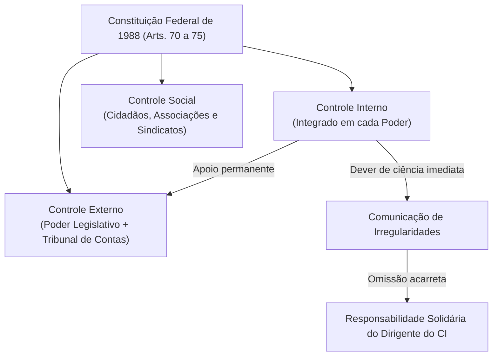
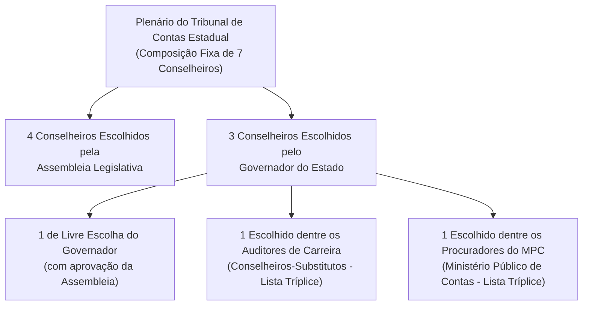

# 01 - Sistema Constitucional de Controle e Jurisdição dos Tribunais de Contas

> **Matéria:** Noções de Controle Externo  
> **Cargo:** A01 – Técnico de Controle Externo – Especialidade: Técnico Administrativo  
> **Arquivo:** `01_sistema_constitucional_e_jurisdicao_dos_tcs.md`  
> **Status:** 🟢 Teoria Aprofundada + 5 Questões FCC Comentadas (A a E)

---

## 📌 Ementa / Itens do Edital

- Sistema constitucional de controle da Administração Pública: controle interno e controle externo;
- Relação e integração harmônica entre os sistemas de controle interno e externo;
- Dever de comunicação imediata sob pena de responsabilidade solidária (Artigo 74, § 1º, da CF/88);
- Tribunais de Contas: natureza jurídica, autonomia institucional, funcional, administrativa e orçamentária;
- O modelo federal e o princípio da simetria constitucional (Artigo 75 da CF/88);
- Composição e nomeação de membros dos Tribunais de Contas Estaduais (Artigos 73 e 75 da CF/88);
- Jurisdição dos Tribunais de Contas: abrangência subjetiva e objetiva; gestores públicos e particulares que guardem, arrecadem, gerenciem ou administrem verbas públicas;
- Competências constitucionais dos Tribunais de Contas:
    - Apreciação de contas do Chefe do Poder Executivo (parecer prévio opinativo e político-constitucional);
    - Julgamento técnico das contas dos administradores e demais responsáveis por recursos públicos (contas de gestão);
    - Fiscalização de atos de admissão de pessoal e concessão de benefícios previdenciários (atos complexos, Súmula Vinculante nº 3 e Tema 445 do STF);
    - Fixação de prazo para adoção de providências saneadoras e sustação direta de atos administrativos ilegais;
    - Sustação de contratos administrativos (competência privativa do Poder Legislativo com atuação subsidiária do TC);
- Eficácia das decisões dos Tribunais de Contas: imputação de débito e multa com força de título executivo extrajudicial (Artigo 71, § 3º, da CF/88);
- Limites da jurisdição de contas, prescrição da pretensão punitiva/ressarcitória (Tema 899 do STF) e independência das instâncias civil, penal e administrativa.

---

## 🧭 Sumário

1. [O Modelo Constitucional de Controle e a Responsabilidade Solidária](#1-o-modelo-constitucional-de-controle-e-a-responsabilidade-solidaria)
    1. [Sistemas de Controle Externo, Interno e Social](#11-sistemas-de-controle-externo-interno-e-social)
    2. [O Dever de Comunicação do Controle Interno e Sanção de Solidariedade (Art. 74, § 1º)](#12-o-dever-de-comunicacao-do-controle-interno-e-sancao-de-solidariedade-art-74-1o)
2. [Natureza Jurídica, Autonomia e Princípio da Simetria (Art. 75)](#2-natureza-juridica-autonomia-e-principio-da-simetria-art-75)
    1. [Natureza Jurídica e Autonomias dos Tribunais de Contas](#21-natureza-juridica-e-autonomias-dos-tribunais-de-contas)
    2. [O Princípio da Simetria Constitucional Federativa e a Composição dos TCEs](#22-o-principio-da-simetria-constitucional-federativa-e-a-composicao-dos-tces)
    3. [Teste 165](#Teste-165)
    4. [Teste 166](#Teste-166)
3. [Competências Constitucionais: Julgamento Técnico versus Parecer Prévio](#3-competencias-constitucionais-julgamento-tecnico-versus-parecer-previo)
    1. [Contas de Governo versus Contas de Gestão](#31-contas-de-governo-versus-contas-de-gestao)
    2. [O Julgamento das Contas de Prefeito Municipal (Tema 835 do STF)](#32-o-julgamento-das-contas-de-prefeito-municipal-tema-835-do-stf)
    3. [Teste 167](#Teste-167)
4. [Registro de Atos de Admissão e Benefícios Previdenciários (Art. 71, III)](#4-registro-de-atos-de-admissao-e-beneficios-previdenciarios-art-71-iii)
    1. [Teste 168](#Teste-168)
    2. [Teste 169](#Teste-169)
5. [Sustação de Atos Ilegais versus Sustação de Contratos Administrativos](#5-sustacao-de-atos-ilegais-versus-sustacao-de-contratos-administrativos)
    1. [Teste 170](#Teste-170)
    2. [Teste 171](#Teste-171)
6. [Eficácia Executiva e Prescritibilidade (Art. 71, § 3º e Tema 899 do STF)](#6-eficacia-executiva-e-prescritibilidade-art-71-3o-e-tema-899-do-stf)
    1. [Teste 172](#Teste-172)
    2. [Teste 173](#Teste-173)
7. [Jurisdição Ampla e Independência das Instâncias](#7-jurisdicao-ampla-e-independencia-das-instancias)
    1. [Teste 174](#Teste-174)
    2. [Teste 175](#Teste-175)
8. [🌐 Fontes Oficiais & Jurisprudenciais Recomendadas](#fontes-oficiais-jurisprudenciais-recomendadas)

---

## 1. O Modelo Constitucional de Controle e a Responsabilidade Solidária

O controle dos recursos públicos no Brasil é tripartite e integrado:

1. **Controle Externo:** Exercido pelo **Poder Legislativo** com o **auxílio técnico-constitucional do Tribunal de Contas** competente (TCU na União, TCE nos Estados e DF, TCMs onde existentes).
2. **Controle Interno:** Mantido de forma **integrada** por cada um dos Poderes (Executivo, Legislativo e Judiciário) e pelo Ministério Público.
3. **Controle Social:** Exercido diretamente pela sociedade civil mediante instrumentos de transparência e cidadania (art. 74, § 2º).

### 1.1 Sistemas de Controle Externo, Interno e Social
- O **Controle Externo** possui titularidade política no Poder Legislativo, sendo operacionalizado na plenitude técnica pelo Tribunal de Contas, órgão constitucional independente de controle da legitimidade, legalidade, economicidade, aplicação de subvenções e renúncia de receitas públicas.
- O **Controle Interno** atua no seio de cada estrutura orgânica para avaliar o cumprimento das metas do PPA, comprovar a legalidade da gestão orçamentária e apoiar o controle externo no exercício de sua missão institucional (art. 74, I a IV).
- O **Controle Social** assegura a qualquer cidadão, partido político, associação ou sindicato legitimidade para denunciar irregularidades perante o Tribunal de Contas (art. 74, § 2º).

### 1.2 O Dever de Comunicação do Controle Interno e Sanção de Solidariedade (Art. 74, § 1º)
- Os responsáveis pelo controle interno, ao tomarem conhecimento de qualquer irregularidade ou ilegalidade no órgão, **devem dar ciência imediata ao Tribunal de Contas competente**.
- **Sanção por Omissão:** Se o titular do controle interno silenciar dolosa ou culposamente, responderá **pessoal e solidariamente** com o gestor ímprobo pelo dano apurado e pelas sanções cominadas pelo Tribunal de Contas.

---

## 2. Natureza Jurídica, Autonomia e Princípio da Simetria (Art. 75)

### 2.1 Natureza Jurídica e Autonomias dos Tribunais de Contas
- Os Tribunais de Contas são **órgãos estatais independentes**, de extração estritamente constitucional.
- **Não integram a estrutura hierárquica do Poder Legislativo**, tampouco do Poder Executivo ou do Judiciário. Exercem magistratura técnica de contas especializada dotada de autogoverno.
- Possuem **autonomia administrativa, funcional, orçamentária e financeira**, além de quadro próprio de servidores públicos efetivos e poder de iniciativa reservada para suas leis orgânicas.

### 2.2 O Princípio da Simetria Constitucional Federativa e a Composição dos TCEs
O art. 75 da Carta Magna estabelece que as normas constitucionais federais sobre fiscalização financeira e organização do Tribunal de Contas da União aplicam-se compulsoriamente aos Tribunais de Contas dos Estados, do Distrito Federal e dos Municípios:

- **Composição dos Tribunais de Contas Estaduais (TCE-GO):**
    - O plenário é composto por **7 Conselheiros** (ao contrário do TCU, que possui 9 Ministros).
    - Regra constitucional de escolha e indicação (Art. 73, § 2º c/c Art. 75):
    - **4 Conselheiros** indicados e eleitos pela **Assembleia Legislativa**;
    - **3 Conselheiros** indicados pelo **Governador do Estado**, com prévia aprovação da Assembleia Legislativa, sendo:
        - 1 de livre escolha do Governador;
        - 1 obrigatoriamente escolhido dentre os **Auditores de Controle Externo (Conselheiros-Substitutos)**, a partir de lista tríplice de antiguidade e merecimento;
        - 1 obrigatoriamente escolhido dentre os **Procuradores do Ministério Público de Contas**, a partir de lista tríplice de antiguidade e merecimento.

---

### Teste 165
**(FGV – TCE/SC – 2026 – Auditor Fiscal de Controle Externo - Administração)**
O Tribunal de Contas do Estado de Santa Catarina ampliou nos últimos anos seus mecanismos de interação com a sociedade civil, disponibilizando portais de transparência com dados abertos sobre a aplicação de recursos públicos municipais e estaduais, instituindo canais eletrônicos para recebimento de denúncias de irregularidades por qualquer cidadão e desenvolvendo programas de educação para a cidadania voltados ao fomento do controle social. Um pesquisador avaliou essas iniciativas e concluiu que, embora representem avanço na transparência ativa do Tribunal, ainda existem limites estruturais que restringem a efetividade do controle social exercido pela população sobre a Administração Pública. Considerando os conceitos de controle interno, externo e social, o papel constitucional do Tribunal de Contas e os instrumentos de transparência e controle social, assinale a afirmativa correta.

* **A)** A disponibilização de portais de dados abertos pelo TCE-SC caracteriza transparência passiva, pois a publicação proativa de informações depende de solicitação prévia do cidadão, ao contrário da transparência ativa, que se realiza por meio de respostas a pedidos formalizados pelo interessado junto ao órgão.
* **B)** A transparência ativa praticada pelo TCE e os canais de denúncia abertos à sociedade civil são instrumentos complementares ao controle externo institucional, pois ampliam a capacidade da população de identificar irregularidades e acionar o Tribunal, fortalecendo a accountability democrática sem substituir a atuação técnica do órgão de controle.
* **C)** O controle social exercido pelos cidadãos sobre a Administração Pública substitui o controle externo exercido pelo Tribunal de Contas nos municípios em que os portais de transparência estiverem plenamente implementados, tornando dispensável a atuação técnica do TCE-SC nesses casos.
* **D)** Os canais eletrônicos de denúncia instituídos pelo TCE-SC são incompatíveis com a Constituição Federal, que restringe a legitimidade para denunciar irregularidades perante o Tribunal de Contas a partidos políticos, associações e sindicatos, excluindo os cidadãos individualmente considerados dessa prerrogativa.
* **E)** O controle social e o controle externo são modalidades excludentes de fiscalização da Administração Pública: enquanto o controle externo é exercido pelo Tribunal de Contas com base em critérios técnicos e jurídicos, o controle social exercido pelos cidadãos não produz efeitos jurídicos e não subsidia processos de fiscalização institucional. Realização

---

> **Comentário Detalhado:**
>
> - **A)** **Incorreta.** A opção apresenta proposição em desacordo com os fundamentos teóricos e técnicos do tópico ao afirmar que "A disponibilização de portais de dados abertos pelo TCE-SC caracteriza transparência passiva, pois a publicação...". De acordo com a teoria estudada em *1.1 Sistemas de Controle Externo, Interno e Social*, o Controle Social assegura a qualquer cidadão, partido político, associação ou sindicato legitimidade para denunciar irregularidades perante o Tribunal de Contas (art. 74, § 2º).
> - **B)** **Correta.** Conforme fundamentado na seção *1. O Modelo Constitucional de Controle e a Responsabilidade Solidária* deste guia, controle Social: Exercido diretamente pela sociedade civil mediante instrumentos de transparência e cidadania (art. 74, § 2º). Dessa forma, está plenamente correta a assertiva da banca (FGV – TCE/SC/2026) ao estabelecer que "A transparência ativa praticada pelo TCE e os canais de denúncia abertos à sociedade civil são instrumentos...".
> - **C)** **Incorreta.** A opção apresenta proposição em desacordo com os fundamentos teóricos e técnicos do tópico ao afirmar que "O controle social exercido pelos cidadãos sobre a Administração Pública substitui o controle externo exercido pelo...". De acordo com a teoria estudada em *1.1 Sistemas de Controle Externo, Interno e Social*, o Controle Externo possui titularidade política no Poder Legislativo, sendo operacionalizado na plenitude técnica pelo Tribunal de Contas, órgão constitucional independente de controle da legitimidade, legalidade, economicidade, aplicação de subvenções e renúncia de receitas públicas.
> - **D)** **Incorreta.** A opção apresenta proposição em desacordo com os fundamentos teóricos e técnicos do tópico ao afirmar que "Os canais eletrônicos de denúncia instituídos pelo TCE-SC são incompatíveis com a Constituição Federal, que...". De acordo com a teoria estudada em *2.2 O Princípio da Simetria Constitucional Federativa e a Composição dos TCEs*, composição dos Tribunais de Contas Estaduais (TCE-GO).
> - **E)** **Incorreta.** A opção apresenta proposição em desacordo com os fundamentos teóricos e técnicos do tópico ao afirmar que "O controle social e o controle externo são modalidades excludentes de fiscalização da Administração Pública...". De acordo com a teoria estudada em *1. O Modelo Constitucional de Controle e a Responsabilidade Solidária*, controle Externo: Exercido pelo Poder Legislativo com o auxílio técnico-constitucional do Tribunal de Contas competente (TCU na União, TCE nos Estados e DF, TCMs onde existentes).
>
> **Gabarito: B**

---

### Teste 166
**(FGV – TRT da 24º Região – 2025 – Analista Judiciário - Área Administrativa - Contabilidade)**
Maria, servidora pública federal, recebia auxílio-moradia em razão da inexistência de imóvel funcional disponível na localidade em que estava lotada, além de preencher os demais requisitos exigidos na sistemática vigente. Sobre a hipótese, considerando os balizamentos estabelecidos pela Lei nº 8.112/1990, assinale a afirmativa correta.

* **A)** O auxílio tem a natureza jurídica de adicional.
* **B)** O auxílio tem a natureza jurídica de gratificação.
* **C)** O valor do auxílio é estabelecido apenas em regulamento.
* **D)** O auxílio se incorpora ao vencimento de Maria, nas situações indicadas em lei.
* **E)** No caso de falecimento de Maria, o auxílio continuará sendo pago por um mês.

---

> **Comentário Detalhado:**
>
> - **A)** **Incorreta.** A opção apresenta proposição em desacordo com os fundamentos teóricos e técnicos do tópico ao afirmar que "O auxílio tem a natureza jurídica de adicional". De acordo com a teoria estudada em *2.1 Natureza Jurídica e Autonomias dos Tribunais de Contas*, possuem autonomia administrativa, funcional, orçamentária e financeira, além de quadro próprio de servidores públicos efetivos e poder de iniciativa reservada para suas leis orgânicas.
> - **B)** **Incorreta.** A opção apresenta proposição em desacordo com os fundamentos teóricos e técnicos do tópico ao afirmar que "O auxílio tem a natureza jurídica de gratificação". De acordo com a teoria estudada em *2.1 Natureza Jurídica e Autonomias dos Tribunais de Contas*, os Tribunais de Contas são órgãos estatais independentes, de extração estritamente constitucional.
> - **C)** **Incorreta.** A opção incorre em restrição indevida ao limitar o escopo conceitual ao afirmar que "O valor do auxílio é estabelecido apenas em regulamento". De acordo com a teoria estudada em *2.2 O Princípio da Simetria Constitucional Federativa e a Composição dos TCEs*, 3 Conselheiros indicados pelo Governador do Estado, com prévia aprovação da Assembleia Legislativa, sendo.
> - **D)** **Incorreta.** A opção apresenta proposição em desacordo com os fundamentos teóricos e técnicos do tópico ao afirmar que "O auxílio se incorpora ao vencimento de Maria, nas situações indicadas em lei". De acordo com a teoria estudada em *1.1 Sistemas de Controle Externo, Interno e Social*, o Controle Externo possui titularidade política no Poder Legislativo, sendo operacionalizado na plenitude técnica pelo Tribunal de Contas, órgão constitucional independente de controle da legitimidade, legalidade, economicidade, aplicação de subvenções e renúncia de receitas públicas.
> - **E)** **Correta.** Conforme fundamentado na seção *1. O Modelo Constitucional de Controle e a Responsabilidade Solidária* deste guia, controle Externo: Exercido pelo Poder Legislativo com o auxílio técnico-constitucional do Tribunal de Contas competente (TCU na União, TCE nos Estados e DF, TCMs onde existentes). Dessa forma, está plenamente correta a assertiva da banca (FGV – TRT da 24º Região/2025) ao estabelecer que "No caso de falecimento de Maria, o auxílio continuará sendo pago por um mês".
>
> **Gabarito: E**

---

### Teste 167
**(FGV – TJ/RR – 2024 – Analista Judiciario Gestao E Governanca De Tecnologia Da Informacao)**
A maioria dos projetos de computadores modernos baseia-se em conceitos desenvolvidos por John Von Neumann. Para a execução de uma instrução, diversos componentes do sistema computacional são envolvidos, tais como processadores, barramentos, operadores lógicos e memórias. O ciclo de execução de uma instrução pode abranger várias operações, dependendo da natureza da instrução. A seguir, são apresentadas quatro etapas do ciclo de execução de uma instrução: I. A busca do código de operação na memória principal, localizado no endereço indicado pelo Ciclo de Instrução, e seu armazenamento no Registrador de Instrução. II. A Unidade de Controle comanda a execução da instrução e, se necessário, processa os dados disponíveis nos registradores. III. Caso a instrução exija, a Unidade de Controle busca o(s) dado(s) na memória e os armazena nos registradores. Esta fase se repete até que todos os dados necessários à execução sejam transferidos. IV. O Decodificador de Instrução decodifica o código de operação contido no Registrador de Instrução. A sequência correta dessas etapas, desde o início até a execução da instrução, é

* **A)** III – I – IV – II.
* **B)** I – III – IV – II.
* **C)** I – IV – III – II.
* **D)** III – I – II – IV.
* **E)** III – IV – I – II.

---

> **Comentário Detalhado:**
>
> - **A)** **Incorreta.** A opção apresenta proposição em desacordo com os fundamentos teóricos e técnicos do tópico ao afirmar que "III – I – IV – II". De acordo com a teoria estudada em *2.1 Natureza Jurídica e Autonomias dos Tribunais de Contas*, não integram a estrutura hierárquica do Poder Legislativo, tampouco do Poder Executivo ou do Judiciário. Exercem magistratura técnica de contas especializada dotada de autogoverno.
> - **B)** **Incorreta.** A opção apresenta proposição em desacordo com os fundamentos teóricos e técnicos do tópico ao afirmar que "I – III – IV – II". De acordo com a teoria estudada em *2.1 Natureza Jurídica e Autonomias dos Tribunais de Contas*, possuem autonomia administrativa, funcional, orçamentária e financeira, além de quadro próprio de servidores públicos efetivos e poder de iniciativa reservada para suas leis orgânicas.
> - **C)** **Correta.** Conforme fundamentado na seção *2.1 Natureza Jurídica e Autonomias dos Tribunais de Contas* deste guia, os Tribunais de Contas são órgãos estatais independentes, de extração estritamente constitucional. Dessa forma, está plenamente correta a assertiva da banca (FGV – TJ/RR/2024) ao estabelecer que "I – IV – III – II".
> - **D)** **Incorreta.** A opção apresenta proposição em desacordo com os fundamentos teóricos e técnicos do tópico ao afirmar que "III – I – II – IV". De acordo com a teoria estudada em *2.2 O Princípio da Simetria Constitucional Federativa e a Composição dos TCEs*, o art. 75 da Carta Magna estabelece que as normas constitucionais federais sobre fiscalização financeira e organização do Tribunal de Contas da União aplicam-se compulsoriamente aos Tribunais de Contas dos Estados, do Distrito Federal e dos Municípios.
> - **E)** **Incorreta.** A opção apresenta proposição em desacordo com os fundamentos teóricos e técnicos do tópico ao afirmar que "III – IV – I – II". De acordo com a teoria estudada em *2.2 O Princípio da Simetria Constitucional Federativa e a Composição dos TCEs*, composição dos Tribunais de Contas Estaduais (TCE-GO).
>
> **Gabarito: C**

---

### Teste 168
**(FGV – TCE/SC – 2026 – Auditor Fiscal de Controle Externo - Administração)**
Em uma inspeção, o controle externo do Tribunal de Contas do Estado Alfa constatou que o Município Beta direcionou recursos públicos a uma escola confessional sem fins lucrativos, prosélita da religião X, o que desagradou fiéis vinculados a outras religiões. Na situação descrita, é correto afirmar que o referido direcionamento de recursos é

* **A)** ilícito, considerando o caráter laico do Estado.
* **B)** lícito, considerando o dever de o Estado subvencionar atividades religiosas, enquanto manifestação cultural popular.
* **C)** lícito, caso a escola preencha os requisitos exigidos pela ordem constitucional, ainda que os recursos não sejam destinados a bolsas de estudo.
* **D)** lícito, desde que os recursos sejam integralmente direcionados a bolsas de estudos e a escola aplique eventuais excedentes financeiros em educação.
* **E)** ilícito, pois, embora seja possível a celebração de ajustes com as escolas confessionais, recursos públicos devem ser direcionados apenas a escolas públicas.

---

> **Comentário Detalhado:**
>
> - **A)** **Incorreta.** A opção apresenta proposição em desacordo com os fundamentos teóricos e técnicos do tópico ao afirmar que "ilícito, considerando o caráter laico do Estado". De acordo com a teoria estudada em *2.1 Natureza Jurídica e Autonomias dos Tribunais de Contas*, possuem autonomia administrativa, funcional, orçamentária e financeira, além de quadro próprio de servidores públicos efetivos e poder de iniciativa reservada para suas leis orgânicas.
> - **B)** **Incorreta.** A opção apresenta proposição em desacordo com os fundamentos teóricos e técnicos do tópico ao afirmar que "lícito, considerando o dever de o Estado subvencionar atividades religiosas, enquanto manifestação cultural popular". De acordo com a teoria estudada em *1.2 O Dever de Comunicação do Controle Interno e Sanção de Solidariedade (Art. 74, § 1º)*, os responsáveis pelo controle interno, ao tomarem conhecimento de qualquer irregularidade ou ilegalidade no órgão, devem dar ciência imediata ao Tribunal de Contas competente.
> - **C)** **Correta.** Conforme fundamentado na seção *1. O Modelo Constitucional de Controle e a Responsabilidade Solidária* deste guia, o controle dos recursos públicos no Brasil é tripartite e integrado. Dessa forma, está plenamente correta a assertiva da banca (FGV – TCE/SC/2026) ao estabelecer que "lícito, caso a escola preencha os requisitos exigidos pela ordem constitucional, ainda que os recursos não sejam...".
> - **D)** **Incorreta.** A opção apresenta proposição em desacordo com os fundamentos teóricos e técnicos do tópico ao afirmar que "lícito, desde que os recursos sejam integralmente direcionados a bolsas de estudos e a escola aplique eventuais...". De acordo com a teoria estudada em *2.1 Natureza Jurídica e Autonomias dos Tribunais de Contas*, os Tribunais de Contas são órgãos estatais independentes, de extração estritamente constitucional.
> - **E)** **Incorreta.** A opção incorre em restrição indevida ao limitar o escopo conceitual ao afirmar que "ilícito, pois, embora seja possível a celebração de ajustes com as escolas confessionais, recursos públicos devem...". De acordo com a teoria estudada em *1.1 Sistemas de Controle Externo, Interno e Social*, o Controle Externo possui titularidade política no Poder Legislativo, sendo operacionalizado na plenitude técnica pelo Tribunal de Contas, órgão constitucional independente de controle da legitimidade, legalidade, economicidade, aplicação de subvenções e renúncia de receitas públicas.
>
> **Gabarito: C**

---

### Teste 169
**(FGV – TCE/GO – 2024 – Analista de Controle Externo - Ciências Contábeis)**
A Lei nº 13.303/2016 estabelece que os órgãos de controle externo e interno das três esferas de governo fiscalizarão as empresas públicas e as sociedades de economia mista a eles relacionados, inclusive aquelas domiciliadas no exterior, quanto à legitimidade, à economicidade e à eficácia da aplicação de seus recursos, sob o ponto de vista contábil, financeiro, operacional e patrimonial. Acerca do mencionado tema, à luz da referida norma, é correto afirmar que

* **A)** as ações e deliberações do órgão ou ente de controle não podem implicar interferência na gestão das empresas públicas e das sociedades de economia mista a eles submetidas nem ingerência no exercício de suas competências ou na definição de políticas públicas.
* **B)** é vedado que os Tribunais de Contas realizem o controle externo em relação às licitações e contratos formalizados pelas empresas públicas e sociedades de economia mista, considerando a natureza jurídica de tais entidades administrativas.
* **C)** as gravações e filmagens existentes de reuniões, ordinárias ou extraordinárias, dos conselhos de administração ou fiscal das empresas públicas e das sociedades de economia mista, não poderão ser disponibilizados para os órgãos de controle, no âmbito dos trabalhos de auditoria.
* **D)** o exercício da supervisão por vinculação da empresa pública ou da sociedade de economia mista, pelo órgão a que se vincula, enseja necessariamente a redução da autonomia conferida pela lei específica que autorizou a criação da entidade supervisionada ou inerente a sua natureza, autorizando, assim, a ingerência do supervisor em sua administração e funcionamento.
* **E)** para a realização da aludida atividade fiscalizatória, os órgãos de controle deverão ter acesso às informações e aos documentos necessários à realização dos trabalhos, ressalvados aqueles classificados como sigilosos pela empresa pública ou pela sociedade de economia mista, nos termos da legislação de regência.

---

> **Comentário Detalhado:**
>
> - **A)** **Correta.** Conforme fundamentado na seção *1.1 Sistemas de Controle Externo, Interno e Social* deste guia, o Controle Externo possui titularidade política no Poder Legislativo, sendo operacionalizado na plenitude técnica pelo Tribunal de Contas, órgão constitucional independente de controle da legitimidade, legalidade, economicidade, aplicação de subvenções e renúncia de receitas públicas. Dessa forma, está plenamente correta a assertiva da banca (FGV – TCE/GO/2024) ao estabelecer que "as ações e deliberações do órgão ou ente de controle não podem implicar interferência na gestão das empresas...".
> - **B)** **Incorreta.** A opção apresenta proposição em desacordo com os fundamentos teóricos e técnicos do tópico ao afirmar que "é vedado que os Tribunais de Contas realizem o controle externo em relação às licitações e contratos formalizados...". De acordo com a teoria estudada em *2.1 Natureza Jurídica e Autonomias dos Tribunais de Contas*, os Tribunais de Contas são órgãos estatais independentes, de extração estritamente constitucional.
> - **C)** **Incorreta.** A opção apresenta proposição em desacordo com os fundamentos teóricos e técnicos do tópico ao afirmar que "as gravações e filmagens existentes de reuniões, ordinárias ou extraordinárias, dos conselhos de administração ou...". De acordo com a teoria estudada em *1.1 Sistemas de Controle Externo, Interno e Social*, o Controle Interno atua no seio de cada estrutura orgânica para avaliar o cumprimento das metas do PPA, comprovar a legalidade da gestão orçamentária e apoiar o controle externo no exercício de sua missão institucional (art. 74, I a IV).
> - **D)** **Incorreta.** A opção apresenta proposição em desacordo com os fundamentos teóricos e técnicos do tópico ao afirmar que "o exercício da supervisão por vinculação da empresa pública ou da sociedade de economia mista, pelo órgão a que se...". De acordo com a teoria estudada em *2.1 Natureza Jurídica e Autonomias dos Tribunais de Contas*, possuem autonomia administrativa, funcional, orçamentária e financeira, além de quadro próprio de servidores públicos efetivos e poder de iniciativa reservada para suas leis orgânicas.
> - **E)** **Incorreta.** A opção apresenta proposição em desacordo com os fundamentos teóricos e técnicos do tópico ao afirmar que "para a realização da aludida atividade fiscalizatória, os órgãos de controle deverão ter acesso às informações e...". De acordo com a teoria estudada em *1. O Modelo Constitucional de Controle e a Responsabilidade Solidária*, controle Social: Exercido diretamente pela sociedade civil mediante instrumentos de transparência e cidadania (art. 74, § 2º).
>
> **Gabarito: A**

---

### Teste 170
**(FGV – TCE/PA – 2024 – Auditor de Controle Externo - Administrativa - Gestão Governamental)**
O recente fenômeno relacionado aos órgãos constitucionais autônomos faz com que, embora inseridos na organização dos poderes, esses órgãos não se enfeixem nos três blocos orgânicos clássicos, e, sim, ao lado deles. O Tribunal de Contas é definido como “órgão especial” de destaque constitucional, possuindo caráter “sui generis”. (GUERRA, Evandro Martins. Controle Externo da Administração Pública. Ed. Forum, 2019, p. 168) O autor discorre sobre a natureza jurídica dos Tribunais de Contas e destaca que, dessa natureza, decorrem algumas características peculiares. Avalie se essas características dos Tribunais de Contas incluem: I. são órgãos híbridos, com função de controle externo formada por distintas competências de caráter técnico. II. possuem hierarquia própria e independente, apartada dos poderes. III. seus membros são equiparados aos do Poder Judiciário, possuindo as mesmas garantias, prerrogativas e impedimentos. IV. possuem iniciativa legislativa própria e competência normativa reguladora específica. Estão corretas:

* **A)** II, III e IV, somente.
* **B)** II e IV, somente.
* **C)** I, II e IV, somente.
* **D)** I, II, III e IV.
* **E)** I, II e III, somente.

---

> **Comentário Detalhado:**
>
> - **A)** **Incorreta.** A opção incorre em restrição indevida ao limitar o escopo conceitual ao afirmar que "II, III e IV, somente". De acordo com a teoria estudada em *2.1 Natureza Jurídica e Autonomias dos Tribunais de Contas*, os Tribunais de Contas são órgãos estatais independentes, de extração estritamente constitucional.
> - **B)** **Incorreta.** A opção incorre em restrição indevida ao limitar o escopo conceitual ao afirmar que "II e IV, somente". De acordo com a teoria estudada em *2.2 O Princípio da Simetria Constitucional Federativa e a Composição dos TCEs*, o art. 75 da Carta Magna estabelece que as normas constitucionais federais sobre fiscalização financeira e organização do Tribunal de Contas da União aplicam-se compulsoriamente aos Tribunais de Contas dos Estados, do Distrito Federal e dos Municípios.
> - **C)** **Incorreta.** A opção incorre em restrição indevida ao limitar o escopo conceitual ao afirmar que "I, II e IV, somente". De acordo com a teoria estudada em *2.1 Natureza Jurídica e Autonomias dos Tribunais de Contas*, não integram a estrutura hierárquica do Poder Legislativo, tampouco do Poder Executivo ou do Judiciário. Exercem magistratura técnica de contas especializada dotada de autogoverno.
> - **D)** **Correta.** Conforme fundamentado na seção *2.1 Natureza Jurídica e Autonomias dos Tribunais de Contas* deste guia, possuem autonomia administrativa, funcional, orçamentária e financeira, além de quadro próprio de servidores públicos efetivos e poder de iniciativa reservada para suas leis orgânicas. Dessa forma, está plenamente correta a assertiva da banca (FGV – TCE/PA/2024) ao estabelecer que "I, II, III e IV".
> - **E)** **Incorreta.** A opção incorre em restrição indevida ao limitar o escopo conceitual ao afirmar que "I, II e III, somente". De acordo com a teoria estudada em *1.1 Sistemas de Controle Externo, Interno e Social*, o Controle Externo possui titularidade política no Poder Legislativo, sendo operacionalizado na plenitude técnica pelo Tribunal de Contas, órgão constitucional independente de controle da legitimidade, legalidade, economicidade, aplicação de subvenções e renúncia de receitas públicas.
>
> **Gabarito: D**

---

### Teste 171
**(FGV – TCE/PI – 2025 – Auditor de Controle Externo - Controle Externo - Específica de Área Comum)**
Em razão da prática de ato danoso ao erário, o TCE-PI aplicou multa e imputou débito a João, gestor de uma autarquia de município jurisdicionado àquela Corte de Contas. A decisão do TCE-PI que resultou na imputação de débito a João tem natureza de

* **A)** dívida ativa.
* **B)** dívida tributária.
* **C)** decisão jurisdicional.
* **D)** título de crédito judicial.
* **E)** título executivo extrajudicial.

---

> **Comentário Detalhado:**
>
> - **A)** **Incorreta.** A opção apresenta proposição em desacordo com os fundamentos teóricos e técnicos do tópico ao afirmar que "dívida ativa". De acordo com a teoria estudada em *1. O Modelo Constitucional de Controle e a Responsabilidade Solidária*, controle Interno: Mantido de forma integrada por cada um dos Poderes (Executivo, Legislativo e Judiciário) e pelo Ministério Público.
> - **B)** **Incorreta.** A opção apresenta proposição em desacordo com os fundamentos teóricos e técnicos do tópico ao afirmar que "dívida tributária". De acordo com a teoria estudada em *2.2 O Princípio da Simetria Constitucional Federativa e a Composição dos TCEs*, composição dos Tribunais de Contas Estaduais (TCE-GO).
> - **C)** **Incorreta.** A opção apresenta proposição em desacordo com os fundamentos teóricos e técnicos do tópico ao afirmar que "decisão jurisdicional". De acordo com a teoria estudada em *2.1 Natureza Jurídica e Autonomias dos Tribunais de Contas*, os Tribunais de Contas são órgãos estatais independentes, de extração estritamente constitucional.
> - **D)** **Incorreta.** A opção apresenta proposição em desacordo com os fundamentos teóricos e técnicos do tópico ao afirmar que "título de crédito judicial". De acordo com a teoria estudada em *2.1 Natureza Jurídica e Autonomias dos Tribunais de Contas*, possuem autonomia administrativa, funcional, orçamentária e financeira, além de quadro próprio de servidores públicos efetivos e poder de iniciativa reservada para suas leis orgânicas.
> - **E)** **Correta.** Conforme fundamentado na seção *2.1 Natureza Jurídica e Autonomias dos Tribunais de Contas* deste guia, não integram a estrutura hierárquica do Poder Legislativo, tampouco do Poder Executivo ou do Judiciário. Exercem magistratura técnica de contas especializada dotada de autogoverno. Dessa forma, está plenamente correta a assertiva da banca (FGV – TCE/PI/2025) ao estabelecer que "título executivo extrajudicial".
>
> **Gabarito: E**

---

### Teste 172
**(FGV – TCE/GO – 2024 – Analista de Controle Externo - Ciências Contábeis)**
No exercício da atribuição de avaliar as prestações de contas realizadas no âmbito das parcerias formalizadas com fulcro na Lei nº 13.019/2014, a autoridade competente deparou-se com as seguintes situações: I. Omissão no dever de prestar contas; II. Descumprimento injustificado dos objetivos e metas estabelecidos no plano de trabalho; III. Danos ao erário decorrente de ato de gestão ilegítimo ou antieconômico. Diante dessa situação hipotética, considerando que foram comprovadas as aludidas circunstâncias, é correto afirmar que deve ser avaliado regular, com ressalvas, o cenário descrito

* **A)** no item I, apenas.
* **B)** no item II, apenas.
* **C)** nos itens I e III, apenas.
* **D)** em todos os itens.
* **E)** em nenhum dos itens.

---

> **Comentário Detalhado:**
>
> - **A)** **Incorreta.** A opção incorre em restrição indevida ao limitar o escopo conceitual ao afirmar que "no item I, apenas". De acordo com a teoria estudada em *1.2 O Dever de Comunicação do Controle Interno e Sanção de Solidariedade (Art. 74, § 1º)*, sanção por Omissão: Se o titular do controle interno silenciar dolosa ou culposamente, responderá pessoal e solidariamente com o gestor ímprobo pelo dano apurado e pelas sanções cominadas pelo Tribunal de Contas.
> - **B)** **Incorreta.** A opção incorre em restrição indevida ao limitar o escopo conceitual ao afirmar que "no item II, apenas". De acordo com a teoria estudada em *1.2 O Dever de Comunicação do Controle Interno e Sanção de Solidariedade (Art. 74, § 1º)*, os responsáveis pelo controle interno, ao tomarem conhecimento de qualquer irregularidade ou ilegalidade no órgão, devem dar ciência imediata ao Tribunal de Contas competente.
> - **C)** **Incorreta.** A opção incorre em restrição indevida ao limitar o escopo conceitual ao afirmar que "nos itens I e III, apenas". De acordo com a teoria estudada em *1. O Modelo Constitucional de Controle e a Responsabilidade Solidária*, controle Externo: Exercido pelo Poder Legislativo com o auxílio técnico-constitucional do Tribunal de Contas competente (TCU na União, TCE nos Estados e DF, TCMs onde existentes).
> - **D)** **Incorreta.** A opção apresenta proposição em desacordo com os fundamentos teóricos e técnicos do tópico ao afirmar que "em todos os itens". De acordo com a teoria estudada em *2.1 Natureza Jurídica e Autonomias dos Tribunais de Contas*, os Tribunais de Contas são órgãos estatais independentes, de extração estritamente constitucional.
> - **E)** **Correta.** Conforme fundamentado na seção *1.1 Sistemas de Controle Externo, Interno e Social* deste guia, o Controle Interno atua no seio de cada estrutura orgânica para avaliar o cumprimento das metas do PPA, comprovar a legalidade da gestão orçamentária e apoiar o controle externo no exercício de sua missão institucional (art. 74, I a IV). Dessa forma, está plenamente correta a assertiva da banca (FGV – TCE/GO/2024) ao estabelecer que "em nenhum dos itens".
>
> **Gabarito: E**

---

### Teste 173
**(FGV – TCE/SC – 2026 – Auditor Fiscal de Controle Externo - Direito)**
Em decorrência de ampla mobilização popular, foi aprovada no último ano, a partir de iniciativa da maioria absoluta dos Deputados Estaduais, a Emenda Constitucional nº X (ECX) à Constituição do Estado Alfa, que vinculou 18% (dezoito por cento) dos recursos orçamentários anuais ao sistema estadual de saúde. Apesar do acolhimento popular, um legitimado submeteu a ECX ao controle concentrado de constitucionalidade. O órgão jurisdicional competente decidiu corretamente que a ECX é

* **A)** constitucional, pois mantém uma relação de simetria com previsão expressa da Constituição da República.
* **B)** inconstitucional, tendo incursionado em temática própria da lei e caminhado em norte contrário à necessidade de reavaliação dos índices a cada quinquênio.
* **C)** constitucional, considerando que a vedação de vinculação da receita pública a fundo não é aplicável, em se tratando de recursos destinados a ações e serviços públicos de saúde.
* **D)** constitucional, pois a sistemática estabelecida na Constituição da República assegura o nível mínimo de proteção do direito à saúde, que pode ser ampliado a nível estadual.
* **E)** inconstitucional, considerando que os percentuais mínimos de vinculação de receitas orçamentárias, a ações e serviços de saúde, estão definidos na Constituição da República em patamares distintos dos estabelecidos em ECX.

---

> **Comentário Detalhado:**
>
> - **A)** **Incorreta.** A opção apresenta proposição em desacordo com os fundamentos teóricos e técnicos do tópico ao afirmar que "constitucional, pois mantém uma relação de simetria com previsão expressa da Constituição da República". De acordo com a teoria estudada em *2.2 O Princípio da Simetria Constitucional Federativa e a Composição dos TCEs*, composição dos Tribunais de Contas Estaduais (TCE-GO).
> - **B)** **Correta.** Conforme fundamentado na seção *2.2 O Princípio da Simetria Constitucional Federativa e a Composição dos TCEs* deste guia, o plenário é composto por 7 Conselheiros (ao contrário do TCU, que possui 9 Ministros). Dessa forma, está plenamente correta a assertiva da banca (FGV – TCE/SC/2026) ao estabelecer que "inconstitucional, tendo incursionado em temática própria da lei e caminhado em norte contrário à necessidade de...".
> - **C)** **Incorreta.** A opção apresenta proposição em desacordo com os fundamentos teóricos e técnicos do tópico ao afirmar que "constitucional, considerando que a vedação de vinculação da receita pública a fundo não é aplicável, em se...". De acordo com a teoria estudada em *1. O Modelo Constitucional de Controle e a Responsabilidade Solidária*, o controle dos recursos públicos no Brasil é tripartite e integrado.
> - **D)** **Incorreta.** A opção apresenta proposição em desacordo com os fundamentos teóricos e técnicos do tópico ao afirmar que "constitucional, pois a sistemática estabelecida na Constituição da República assegura o nível mínimo de proteção...". De acordo com a teoria estudada em *1.1 Sistemas de Controle Externo, Interno e Social*, o Controle Social assegura a qualquer cidadão, partido político, associação ou sindicato legitimidade para denunciar irregularidades perante o Tribunal de Contas (art. 74, § 2º).
> - **E)** **Incorreta.** A opção apresenta proposição em desacordo com os fundamentos teóricos e técnicos do tópico ao afirmar que "inconstitucional, considerando que os percentuais mínimos de vinculação de receitas orçamentárias, a ações e...". De acordo com a teoria estudada em *1.1 Sistemas de Controle Externo, Interno e Social*, o Controle Externo possui titularidade política no Poder Legislativo, sendo operacionalizado na plenitude técnica pelo Tribunal de Contas, órgão constitucional independente de controle da legitimidade, legalidade, economicidade, aplicação de subvenções e renúncia de receitas públicas.
>
> **Gabarito: B**

---

### Teste 174
**(FGV – TCE/SC – 2026 – Auditor Fiscal de Controle Externo - Direito)**
Determinada lei estadual amplia as possibilidades de aposentadoria voluntária dos servidores locais, com a opção de retiro precoce aos 55 anos de idade, sem qualquer previsão adicional de reajuste no plano de custeio do sistema previdenciário local. Diante do cenário hipotético, pode-se afirmar que a medida legislativa é:

* **A)** constitucional, desde que extensível a todos os servidores estaduais.
* **B)** inconstitucional, pois somente a União Federal pode legislar sobre previdência social de servidores.
* **C)** constitucional, desde que a lei local tenha sido aprovada no rito estabelecido pela Assembleia Legislativa.
* **D)** inconstitucional, por ampliar benefício previdenciário sem fonte de custeio.
* **E)** constitucional, desde que permita o retiro precoce de mulheres em idade mínima inferior.

---

> **Comentário Detalhado:**
>
> - **A)** **Incorreta.** A opção apresenta proposição em desacordo com os fundamentos teóricos e técnicos do tópico ao afirmar que "constitucional, desde que extensível a todos os servidores estaduais". De acordo com a teoria estudada em *2.2 O Princípio da Simetria Constitucional Federativa e a Composição dos TCEs*, composição dos Tribunais de Contas Estaduais (TCE-GO).
> - **B)** **Incorreta.** A opção incorre em restrição indevida ao limitar o escopo conceitual ao afirmar que "inconstitucional, pois somente a União Federal pode legislar sobre previdência social de servidores". De acordo com a teoria estudada em *2.2 O Princípio da Simetria Constitucional Federativa e a Composição dos TCEs*, o art. 75 da Carta Magna estabelece que as normas constitucionais federais sobre fiscalização financeira e organização do Tribunal de Contas da União aplicam-se compulsoriamente aos Tribunais de Contas dos Estados, do Distrito Federal e dos Municípios.
> - **C)** **Incorreta.** A opção apresenta proposição em desacordo com os fundamentos teóricos e técnicos do tópico ao afirmar que "constitucional, desde que a lei local tenha sido aprovada no rito estabelecido pela Assembleia Legislativa". De acordo com a teoria estudada em *2.2 O Princípio da Simetria Constitucional Federativa e a Composição dos TCEs*, 4 Conselheiros indicados e eleitos pela Assembleia Legislativa.
> - **D)** **Correta.** Conforme fundamentado na seção *2.1 Natureza Jurídica e Autonomias dos Tribunais de Contas* deste guia, possuem autonomia administrativa, funcional, orçamentária e financeira, além de quadro próprio de servidores públicos efetivos e poder de iniciativa reservada para suas leis orgânicas. Dessa forma, está plenamente correta a assertiva da banca (FGV – TCE/SC/2026) ao estabelecer que "inconstitucional, por ampliar benefício previdenciário sem fonte de custeio".
> - **E)** **Incorreta.** A opção apresenta proposição em desacordo com os fundamentos teóricos e técnicos do tópico ao afirmar que "constitucional, desde que permita o retiro precoce de mulheres em idade mínima inferior". De acordo com a teoria estudada em *2.2 O Princípio da Simetria Constitucional Federativa e a Composição dos TCEs*, 3 Conselheiros indicados pelo Governador do Estado, com prévia aprovação da Assembleia Legislativa, sendo.
>
> **Gabarito: D**

---

### Teste 175
**(FGV – TCE/GO – 2024 – Analista de Controle Externo - Jurídica)**
Em decorrência da verificação em processo de tomada especial de contas de fraude à lei e confusão patrimonial entre sociedade e sócios da sociedade Ômega, certo Tribunal de Contas determinou, após o devido processo administrativo, a desconsideração da personalidade jurídica da mencionada sociedade, viabilizando que a imposição de ressarcimento ao erário alcançasse o patrimônio de seus sócios, para fins de resguardar o resultado útil do processo, mediante a garantia do contraditório e da ampla defesa. Diante dessa situação hipotética, à luz da orientação do Supremo Tribunal Federal, é correto afirmar que a medida determinada no âmbito do controle realizado pela Corte de Contas é

* **A)** inconstitucional, na medida em que viola a propriedade privada e a livre iniciativa.
* **B)** constitucional, por se lhe reconhecer todos os poderes inerentes à atividade jurisdicional.
* **C)** inconstitucional, considerando que não está especificada dentre as suas atribuições na forma em que delimitada na Constituição.
* **D)** inconstitucional, pois tal desconsideração da personalidade jurídica apenas poderia ser determinada pelo Poder Judiciário.
* **E)** constitucional, porque abarcada pelo poder geral de cautela que lhe é reconhecido com base na teoria dos poderes implícitos. Direito Civil

---

> **Comentário Detalhado:**
>
> - **A)** **Incorreta.** A opção apresenta proposição em desacordo com os fundamentos teóricos e técnicos do tópico ao afirmar que "inconstitucional, na medida em que viola a propriedade privada e a livre iniciativa". De acordo com a teoria estudada em *2.1 Natureza Jurídica e Autonomias dos Tribunais de Contas*, possuem autonomia administrativa, funcional, orçamentária e financeira, além de quadro próprio de servidores públicos efetivos e poder de iniciativa reservada para suas leis orgânicas.
> - **B)** **Incorreta.** A opção apresenta proposição em desacordo com os fundamentos teóricos e técnicos do tópico ao afirmar que "constitucional, por se lhe reconhecer todos os poderes inerentes à atividade jurisdicional". De acordo com a teoria estudada em *1. O Modelo Constitucional de Controle e a Responsabilidade Solidária*, controle Interno: Mantido de forma integrada por cada um dos Poderes (Executivo, Legislativo e Judiciário) e pelo Ministério Público.
> - **C)** **Incorreta.** A opção apresenta proposição em desacordo com os fundamentos teóricos e técnicos do tópico ao afirmar que "inconstitucional, considerando que não está especificada dentre as suas atribuições na forma em que delimitada na...". De acordo com a teoria estudada em *2.2 O Princípio da Simetria Constitucional Federativa e a Composição dos TCEs*, 1 obrigatoriamente escolhido dentre os Procuradores do Ministério Público de Contas, a partir de lista tríplice de antiguidade e merecimento.
> - **D)** **Incorreta.** A opção incorre em restrição indevida ao limitar o escopo conceitual ao afirmar que "inconstitucional, pois tal desconsideração da personalidade jurídica apenas poderia ser determinada pelo Poder...". De acordo com a teoria estudada em *2.1 Natureza Jurídica e Autonomias dos Tribunais de Contas*, não integram a estrutura hierárquica do Poder Legislativo, tampouco do Poder Executivo ou do Judiciário. Exercem magistratura técnica de contas especializada dotada de autogoverno.
> - **E)** **Correta.** Conforme fundamentado na seção *1. O Modelo Constitucional de Controle e a Responsabilidade Solidária* deste guia, controle Social: Exercido diretamente pela sociedade civil mediante instrumentos de transparência e cidadania (art. 74, § 2º). Dessa forma, está plenamente correta a assertiva da banca (FGV – TCE/GO/2024) ao estabelecer que "constitucional, porque abarcada pelo poder geral de cautela que lhe é reconhecido com base na teoria dos poderes...".
>
> **Gabarito: E**

---

