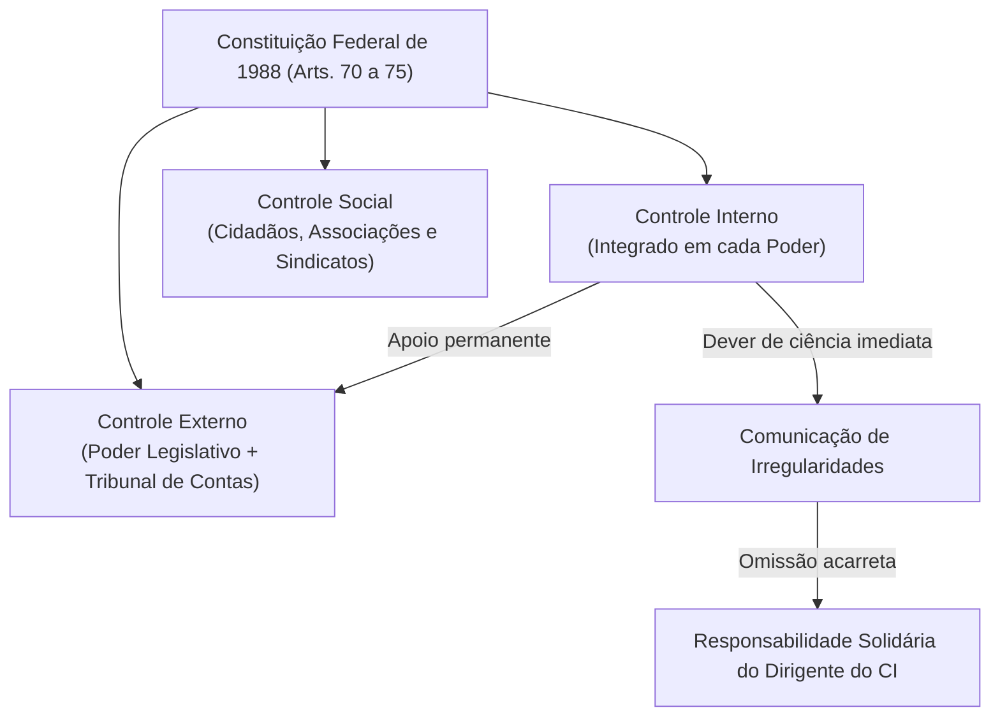
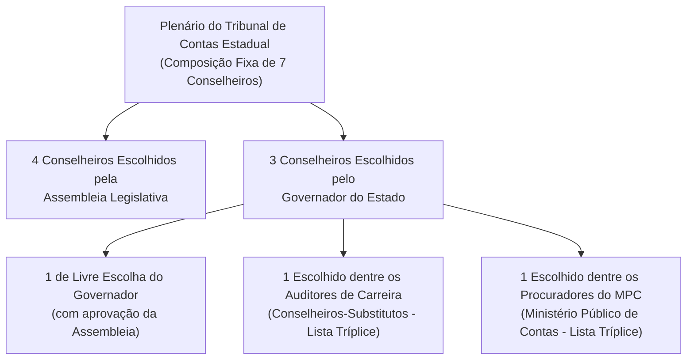

# 01 - Sistema Constitucional de Controle e Jurisdição dos Tribunais de Contas

> **Matéria:** Noções de Controle Externo  
> **Cargo:** A01 – Técnico de Controle Externo – Especialidade: Técnico Administrativo  
> **Arquivo:** `01_sistema_constitucional_e_jurisdicao_dos_tcs.md`  
> **Status:** 🟢 Teoria Aprofundada + 5 Questões FCC Comentadas (A a E)

---

## 📌 Ementa / Itens do Edital

- Sistema constitucional de controle da Administração Pública: controle interno e controle externo;
- Relação e integração harmônica entre os sistemas de controle interno e externo;
- Dever de comunicação imediata sob pena de responsabilidade solidária (Artigo 74, § 1º, da CF/88);
- Tribunais de Contas: natureza jurídica, autonomia institucional, funcional, administrativa e orçamentária;
- O modelo federal e o princípio da simetria constitucional (Artigo 75 da CF/88);
- Composição e nomeação de membros dos Tribunais de Contas Estaduais (Artigos 73 e 75 da CF/88);
- Jurisdição dos Tribunais de Contas: abrangência subjetiva e objetiva; gestores públicos e particulares que guardem, arrecadem, gerenciem ou administrem verbas públicas;
- Competências constitucionais dos Tribunais de Contas:
    - Apreciação de contas do Chefe do Poder Executivo (parecer prévio opinativo e político-constitucional);
    - Julgamento técnico das contas dos administradores e demais responsáveis por recursos públicos (contas de gestão);
    - Fiscalização de atos de admissão de pessoal e concessão de benefícios previdenciários (atos complexos, Súmula Vinculante nº 3 e Tema 445 do STF);
    - Fixação de prazo para adoção de providências saneadoras e sustação direta de atos administrativos ilegais;
    - Sustação de contratos administrativos (competência privativa do Poder Legislativo com atuação subsidiária do TC);
- Eficácia das decisões dos Tribunais de Contas: imputação de débito e multa com força de título executivo extrajudicial (Artigo 71, § 3º, da CF/88);
- Limites da jurisdição de contas, prescrição da pretensão punitiva/ressarcitória (Tema 899 do STF) e independência das instâncias civil, penal e administrativa.

---

## 🧭 Sumário

1. [O Modelo Constitucional de Controle e a Responsabilidade Solidária](#1-o-modelo-constitucional-de-controle-e-a-responsabilidade-solidaria)
    1. [Sistemas de Controle Externo, Interno e Social](#11-sistemas-de-controle-externo-interno-e-social)
    2. [O Dever de Comunicação do Controle Interno e Sanção de Solidariedade (Art. 74, § 1º)](#12-o-dever-de-comunicacao-do-controle-interno-e-sancao-de-solidariedade-art-74-1o)
2. [Natureza Jurídica, Autonomia e Princípio da Simetria (Art. 75)](#2-natureza-juridica-autonomia-e-principio-da-simetria-art-75)
    1. [Natureza Jurídica e Autonomias dos Tribunais de Contas](#21-natureza-juridica-e-autonomias-dos-tribunais-de-contas)
    2. [O Princípio da Simetria Constitucional Federativa e a Composição dos TCEs](#22-o-principio-da-simetria-constitucional-federativa-e-a-composicao-dos-tces)
    3. [Teste 165](#Teste-165)
    4. [Teste 166](#Teste-166)
3. [Competências Constitucionais: Julgamento Técnico versus Parecer Prévio](#3-competencias-constitucionais-julgamento-tecnico-versus-parecer-previo)
    1. [Contas de Governo versus Contas de Gestão](#31-contas-de-governo-versus-contas-de-gestao)
    2. [O Julgamento das Contas de Prefeito Municipal (Tema 835 do STF)](#32-o-julgamento-das-contas-de-prefeito-municipal-tema-835-do-stf)
    3. [Teste 167](#Teste-167)
4. [Registro de Atos de Admissão e Benefícios Previdenciários (Art. 71, III)](#4-registro-de-atos-de-admissao-e-beneficios-previdenciarios-art-71-iii)
    1. [Teste 168](#Teste-168)
    2. [Teste 169](#Teste-169)
5. [Sustação de Atos Ilegais versus Sustação de Contratos Administrativos](#5-sustacao-de-atos-ilegais-versus-sustacao-de-contratos-administrativos)
    1. [Teste 170](#Teste-170)
    2. [Teste 171](#Teste-171)
6. [Eficácia Executiva e Prescritibilidade (Art. 71, § 3º e Tema 899 do STF)](#6-eficacia-executiva-e-prescritibilidade-art-71-3o-e-tema-899-do-stf)
    1. [Teste 172](#Teste-172)
    2. [Teste 173](#Teste-173)
7. [Jurisdição Ampla e Independência das Instâncias](#7-jurisdicao-ampla-e-independencia-das-instancias)
    1. [Teste 174](#Teste-174)
    2. [Teste 175](#Teste-175)
8. [🌐 Fontes Oficiais & Jurisprudenciais Recomendadas](#fontes-oficiais-jurisprudenciais-recomendadas)

---

## 1. O Modelo Constitucional de Controle e a Responsabilidade Solidária

O controle dos recursos públicos no Brasil é tripartite e integrado:

1. **Controle Externo:** Exercido pelo **Poder Legislativo** com o **auxílio técnico-constitucional do Tribunal de Contas** competente (TCU na União, TCE nos Estados e DF, TCMs onde existentes).
2. **Controle Interno:** Mantido de forma **integrada** por cada um dos Poderes (Executivo, Legislativo e Judiciário) e pelo Ministério Público.
3. **Controle Social:** Exercido diretamente pela sociedade civil mediante instrumentos de transparência e cidadania (art. 74, § 2º).

### 1.1 Sistemas de Controle Externo, Interno e Social
- O **Controle Externo** possui titularidade política no Poder Legislativo, sendo operacionalizado na plenitude técnica pelo Tribunal de Contas, órgão constitucional independente de controle da legitimidade, legalidade, economicidade, aplicação de subvenções e renúncia de receitas públicas.
- O **Controle Interno** atua no seio de cada estrutura orgânica para avaliar o cumprimento das metas do PPA, comprovar a legalidade da gestão orçamentária e apoiar o controle externo no exercício de sua missão institucional (art. 74, I a IV).
- O **Controle Social** assegura a qualquer cidadão, partido político, associação ou sindicato legitimidade para denunciar irregularidades perante o Tribunal de Contas (art. 74, § 2º).

### 1.2 O Dever de Comunicação do Controle Interno e Sanção de Solidariedade (Art. 74, § 1º)
- Os responsáveis pelo controle interno, ao tomarem conhecimento de qualquer irregularidade ou ilegalidade no órgão, **devem dar ciência imediata ao Tribunal de Contas competente**.
- **Sanção por Omissão:** Se o titular do controle interno silenciar dolosa ou culposamente, responderá **pessoal e solidariamente** com o gestor ímprobo pelo dano apurado e pelas sanções cominadas pelo Tribunal de Contas.

---

## 2. Natureza Jurídica, Autonomia e Princípio da Simetria (Art. 75)

### 2.1 Natureza Jurídica e Autonomias dos Tribunais de Contas
- Os Tribunais de Contas são **órgãos estatais independentes**, de extração estritamente constitucional.
- **Não integram a estrutura hierárquica do Poder Legislativo**, tampouco do Poder Executivo ou do Judiciário. Exercem magistratura técnica de contas especializada dotada de autogoverno.
- Possuem **autonomia administrativa, funcional, orçamentária e financeira**, além de quadro próprio de servidores públicos efetivos e poder de iniciativa reservada para suas leis orgânicas.

### 2.2 O Princípio da Simetria Constitucional Federativa e a Composição dos TCEs
O art. 75 da Carta Magna estabelece que as normas constitucionais federais sobre fiscalização financeira e organização do Tribunal de Contas da União aplicam-se compulsoriamente aos Tribunais de Contas dos Estados, do Distrito Federal e dos Municípios:

- **Composição dos Tribunais de Contas Estaduais (TCE-GO):**
    - O plenário é composto por **7 Conselheiros** (ao contrário do TCU, que possui 9 Ministros).
    - Regra constitucional de escolha e indicação (Art. 73, § 2º c/c Art. 75):
    - **4 Conselheiros** indicados e eleitos pela **Assembleia Legislativa**;
    - **3 Conselheiros** indicados pelo **Governador do Estado**, com prévia aprovação da Assembleia Legislativa, sendo:
        - 1 de livre escolha do Governador;
        - 1 obrigatoriamente escolhido dentre os **Auditores de Controle Externo (Conselheiros-Substitutos)**, a partir de lista tríplice de antiguidade e merecimento;
        - 1 obrigatoriamente escolhido dentre os **Procuradores do Ministério Público de Contas**, a partir de lista tríplice de antiguidade e merecimento.

---

### Teste 165
**(FGV – TRT – Analista Judiciário - Tecnologia da Informação – 2024)**  
Em um Tribunal de Contas Estadual havia sete conselheiros, sendo quatro nomeados pela Assembleia Legislativa e três nomeados pelo Governador do Estado com aprovação do parlamento estadual. Surgida vaga de conselheiro reservada ao Poder Executivo estadual, o Governador pretende nomear membro do Ministério Público de Contas para ocupar a respectiva vaga.  
À luz do modelo constitucional de composição dos Tribunais de Contas dos Estados (art. 73, § 2º c/c art. 75 da CF/88), a pretensão governamental:

* **A)** mostra-se plenamente viável desde que haja aprovação prévia por maioria simples da Assembleia Legislativa.
* **B)** não se mostra juridicamente possível por ser a vaga privativa de auditores concursados do próprio Tribunal.
* **C)** é admitida de imediato, assegurando-se a alternância com a vaga destinada aos auditores de carreira.
* **D)** depende de emenda constitucional prévia para criar o cargo no âmbito do respectivo Tribunal de Contas.
* **E)** é legítima desde que a vaga corresponda à cota destinada a membros do Ministério Público junto ao Tribunal.

---

> **Comentário Detalhado:**
>
> - **A)** **Incorreto**. A aprovação da escolha pelo Poder Legislativo exige quórum de maioria absoluta dos parlamentares (art. 73, § 2º c/c art. 75, CF/88).
> - **B)** **Incorreto**. Dentre as três vagas de livre e técnica indicação do Governador, uma é privativa de auditores (conselheiros-substitutos) e uma é privativa de membros do Ministério Público junto ao Tribunal de Contas.
> - **C)** **Incorreto**. A vaga técnica do MPC é titularizada especificamente pela respectiva carreira, em lista tríplice de antiguidade e merecimento, não havendo confusão aleatória com a vaga dos auditores.
> - **D)** **Incorreto**. A regra decorre diretamente do modelo federal de reprodução obrigatória pelo constituinte estadual (art. 75 da CF/88 e Súmula Vinculante correspondente).
> - **E)** **Correto**. Conforme o art. 75, parágrafo único, c/c art. 73, § 2º, I, da Constituição Federal, os Tribunais de Contas dos Estados são compostos por 7 conselheiros: 4 escolhidos pela Assembleia Legislativa e 3 pelo Governador do Estado (com aprovação da Assembleia), sendo estes 3 necessariamente: 1 de livre escolha e 2 escolhidos alternadamente entre auditores e membros do Ministério Público junto ao Tribunal, indicados em lista tríplice segundo critérios de antiguidade e merecimento. Logo, a nomeação governamental é válida se referida à vaga constitucional do MPC.
>
> **Gabarito: E**

### Teste 166
**(FGV – TRT – Analista Judiciário - Tecnologia da Informação – 2024)**  
A NBASP 50 - Princípios de Atividades Jurisdicionais dos Tribunais de Contas desenvolve princípios fundamentais aplicáveis às Cortes que exercem função judicante sobre a responsabilidade de gestores. Considere as seguintes afirmativas:

I. O Tribunal de Contas deve ser dotado de garantias legais e institucionais que assegurem independência e autonomia a seus membros.  
II. O exercício da competência sancionatória dos Tribunais de Contas deve respeitar o contraditório, a ampla defesa e o devido processo legal.  
III. As decisões definitivas dos Tribunais de Contas que imputem débito ou multa possuem eficácia de título executivo judicial.  

Está correto o que se afirma em:

* **A)** I, apenas.
* **B)** I e II, apenas.
* **C)** I e III, apenas.
* **D)** II e III, apenas.
* **E)** I, II e III.

---

> **Comentário Detalhado:**
>
> - **A)** **Incorreto**. O item II também está inteiramente correto nos termos da NBASP 50 e da CF/88.
> - **B)** **Correto**. O item I expressa princípio basilar da Declaração de Lima, do art. 73 da CF/88 e da NBASP 50 (autonomia orgânica, funcional e independência dos membros com garantias de magistratura). O item II reproduz garantia elementar da processualística do controle externo e princípio jurisdicional da NBASP 50 (devido processo legal sancionatório com contraditório e ampla defesa). Já o item III está incorreto porque o art. 71, § 3º, da CF/88 confere às decisões condenatórias do Tribunal de Contas eficácia de "título executivo extrajudicial", e não título judicial.
> - **C)** **Incorreto**. O item III padece de erro técnico grave (título extrajudicial).
> - **D)** **Incorreto**. O item I é verdadeiro e o item III é falso.
> - **E)** **Incorreto**. O item III inviabiliza a afirmativa global.
>
> **Gabarito: B**

### Teste 167
**(FGV – TCE-PI – Auditor de Controle Externo Controle Externo Especifica de Area Comum – 2025)**
Os Tribunais de Contas dos Estados são compostos por sete Conselheiros, dentre os quais, três são escolhidos pelo Poder Executivo (Governador do Estado) e os demais pelo Poder Legislativo (Assembleia Legislativa). Sobre as regras constitucionais de escolha de Conselheiro do TCE pelo Governador do Estado Alfa, avalie as afirmativas a seguir. I. Os critérios de antiguidade e merecimento não se aplicam na escolha do Conselheiro-Substituto para a vaga de Conselheiro Titular. II. A escolha de Procurador do Ministério Público de Contas para a vaga de Conselheiro do TCE prescinde de aprovação da Assembleia Legislativa do Estado Alfa. III. O Membro do Ministério Público de Contas deve contar com idade máxima de setenta anos para ocupar a vaga de Conselheiro do TCE. Está correto o que se afirma em

* **A)** I, apenas.
* **B)** II apenas.
* **C)** III, apenas.
* **D)** I e III, apenas.
* **E)** II e III, apenas.

---

> **Comentário Detalhado:**
>
> - **A)** **Incorreta.** A opção incorre em restrição indevida ao limitar o escopo conceitual ao afirmar que "I, apenas". De acordo com a teoria estudada em *2.2 O Princípio da Simetria Constitucional Federativa e a Composição dos TCEs*, o art. 75 da Carta Magna estabelece que as normas constitucionais federais sobre fiscalização financeira e organização do Tribunal de Contas da União aplicam-se compulsoriamente aos Tribunais de Contas dos Estados, do Distrito Federal e dos Municípios.
> - **B)** **Incorreta.** A opção incorre em restrição indevida ao limitar o escopo conceitual ao afirmar que "II apenas". De acordo com a teoria estudada em *2.2 O Princípio da Simetria Constitucional Federativa e a Composição dos TCEs*, 1 obrigatoriamente escolhido dentre os Procuradores do Ministério Público de Contas, a partir de lista tríplice de antiguidade e merecimento.
> - **C)** **Incorreta.** A opção incorre em restrição indevida ao limitar o escopo conceitual ao afirmar que "III, apenas". De acordo com a teoria estudada em *2.2 O Princípio da Simetria Constitucional Federativa e a Composição dos TCEs*, 1 obrigatoriamente escolhido dentre os Auditores de Controle Externo (Conselheiros-Substitutos), a partir de lista tríplice de antiguidade e merecimento.
> - **D)** **Correta.** Conforme fundamentado na seção *2.2 O Princípio da Simetria Constitucional Federativa e a Composição dos TCEs* deste guia, 3 Conselheiros indicados pelo Governador do Estado, com prévia aprovação da Assembleia Legislativa, sendo. Dessa forma, está plenamente correta a assertiva da banca (FGV – TCE-PI/2025) ao estabelecer que "I e III, apenas".
> - **E)** **Incorreta.** A opção incorre em restrição indevida ao limitar o escopo conceitual ao afirmar que "II e III, apenas". De acordo com a teoria estudada em *2.1 Natureza Jurídica e Autonomias dos Tribunais de Contas*, não integram a estrutura hierárquica do Poder Legislativo, tampouco do Poder Executivo ou do Judiciário. Exercem magistratura técnica de contas especializada dotada de autogoverno.
>
> **Gabarito: D**

---

### Teste 168
**(FCC – TRT – Analista Judiciário - Tecnologia da Informação – 2009)**  
Sobre as disposições constitucionais referentes ao controle externo das entidades públicas (art. 71 da CF/88), é correto afirmar:

* **A)** O Tribunal de Contas tem competência para apreciar a legalidade de atos de admissão de pessoal a qualquer título.
* **B)** O parecer prévio emitido sobre as contas do Governador deixará de prevalecer por decisão de dois terços da Assembleia.
* **C)** As decisões dos Tribunais de Contas que resultem em imputação de débito ou multa têm eficácia de título executivo judicial.
* **D)** A sustação de contratos administrativos irregulares é competência originária e direta do próprio Tribunal de Contas.
* **E)** O controle externo exercido pelo Tribunal de Contas restringe-se exclusivamente aos aspectos contábil e de legalidade.

---

> **Comentário Detalhado:**
>
> - **A)** **Incorreto**. O art. 71, III, da CF/88 excepciona expressamente da apreciação do Tribunal de Contas as nomeações para cargo de provimento em comissão.
> - **B)** **Correto**. Conforme o modelo federal reproduzido no âmbito estadual (art. 71, I c/c art. 31, § 2º e art. 75 da CF/88), o parecer prévio emitido pelo Tribunal de Contas sobre as contas gerais prestadas anualmente pelo Chefe do Poder Executivo somente deixará de prevalecer por deliberação de dois terços dos membros do Poder Legislativo.
> - **C)** **Incorreto**. As decisões condenatórias têm eficácia de título executivo extrajudicial (art. 71, § 3º, CF/88).
> - **D)** **Incorreto**. No caso de contrato, o ato de sustação é adotado diretamente pelo Congresso Nacional / Assembleia Legislativa; somente se o Legislativo não efetivar a medida em 90 dias é que o Tribunal de Contas decidirá a respeito (art. 71, §§ 1º e 2º, CF/88).
> - **E)** **Incorreto**. O controle externo abrange a fiscalização contábil, financeira, orçamentária, operacional e patrimonial, sob os aspectos da legalidade, legitimidade e economicidade (art. 70, caput, CF/88).
>
> **Gabarito: B**

### Teste 169
**(FGV – TCE-GO – Analista de Controle Externo Ciencias Contabeis – 2024)**
A Constituição do Estado de Goiás dispõe sobre o Sistema de controle externo. Analise os itens a seguir: I. O controle externo a cargo da Câmara Municipal será exercido com o auxílio do TCE-GO, que emitirá parecer prévio, no prazo de sessenta dias de sua apresentação, sobre as contas mensais e anuais do Município; II. Somente por decisão de dois terços dos membros da Câmara Municipal deixará de prevalecer o parecer prévio emitido pelo TCE-GO, sobre as contas do Prefeito; III. A Câmara Municipal não julgará as contas, antes do parecer do TCE-GO, nem antes de escoado o prazo para exame dos contribuintes. Está correto o que se afirma em

* **A)** I, apenas.
* **B)** I e II, apenas.
* **C)** I e III, apenas.
* **D)** II e III, apenas.
* **E)** I, II e III.

---

> **Comentário Detalhado:**
>
> - **A)** **Correta.** Conforme fundamentado na seção *1. O Modelo Constitucional de Controle e a Responsabilidade Solidária* deste guia, controle Externo: Exercido pelo Poder Legislativo com o auxílio técnico-constitucional do Tribunal de Contas competente (TCU na União, TCE nos Estados e DF, TCMs onde existentes). Dessa forma, está plenamente correta a assertiva da banca (FGV – TCE-GO/2024) ao estabelecer que "I, apenas".
> - **B)** **Incorreta.** A opção incorre em restrição indevida ao limitar o escopo conceitual ao afirmar que "I e II, apenas". De acordo com a teoria estudada em *2.2 O Princípio da Simetria Constitucional Federativa e a Composição dos TCEs*, composição dos Tribunais de Contas Estaduais (TCE-GO).
> - **C)** **Incorreta.** A opção incorre em restrição indevida ao limitar o escopo conceitual ao afirmar que "I e III, apenas". De acordo com a teoria estudada em *2.1 Natureza Jurídica e Autonomias dos Tribunais de Contas*, os Tribunais de Contas são órgãos estatais independentes, de extração estritamente constitucional.
> - **D)** **Incorreta.** A opção incorre em restrição indevida ao limitar o escopo conceitual ao afirmar que "II e III, apenas". De acordo com a teoria estudada em *2.1 Natureza Jurídica e Autonomias dos Tribunais de Contas*, não integram a estrutura hierárquica do Poder Legislativo, tampouco do Poder Executivo ou do Judiciário. Exercem magistratura técnica de contas especializada dotada de autogoverno.
> - **E)** **Incorreta.** A opção apresenta proposição em desacordo com os fundamentos teóricos e técnicos do tópico ao afirmar que "I, II e III". De acordo com a teoria estudada em *2.1 Natureza Jurídica e Autonomias dos Tribunais de Contas*, possuem autonomia administrativa, funcional, orçamentária e financeira, além de quadro próprio de servidores públicos efetivos e poder de iniciativa reservada para suas leis orgânicas.
>
> **Gabarito: A**

---

### Teste 170
**(FGV – TCE-PA – Auditor de Controle Externo Administrativa Gestao Governamental – 2024)**
O recente fenômeno relacionado aos órgãos constitucionais autônomos faz com que, embora inseridos na organização dos poderes, esses órgãos não se enfeixem nos três blocos orgânicos clássicos, e, sim, ao lado deles. O Tribunal de Contas é definido como “órgão especial” de destaque constitucional, possuindo caráter “sui generis”. (GUERRA, Evandro Martins. Controle Externo da Administração Pública. Ed. Forum, 2019, p. 168) O autor discorre sobre a natureza jurídica dos Tribunais de Contas e destaca que, dessa natureza, decorrem algumas características peculiares. Avalie se essas características dos Tribunais de Contas incluem: I. são órgãos híbridos, com função de controle externo formada por distintas competências de caráter técnico. II. possuem hierarquia própria e independente, apartada dos poderes. III. seus membros são equiparados aos do Poder Judiciário, possuindo as mesmas garantias, prerrogativas e impedimentos. IV. possuem iniciativa legislativa própria e competência normativa reguladora específica. Estão corretas:

* **A)** II, III e IV, somente.
* **B)** II e IV, somente.
* **C)** I, II e IV, somente.
* **D)** I, II, III e IV.
* **E)** I, II e III, somente.

---

> **Comentário Detalhado:**
>
> - **A)** **Incorreta.** A opção incorre em restrição indevida ao limitar o escopo conceitual ao afirmar que "II, III e IV, somente". De acordo com a teoria estudada em *2.1 Natureza Jurídica e Autonomias dos Tribunais de Contas*, os Tribunais de Contas são órgãos estatais independentes, de extração estritamente constitucional.
> - **B)** **Incorreta.** A opção incorre em restrição indevida ao limitar o escopo conceitual ao afirmar que "II e IV, somente". De acordo com a teoria estudada em *2.2 O Princípio da Simetria Constitucional Federativa e a Composição dos TCEs*, o art. 75 da Carta Magna estabelece que as normas constitucionais federais sobre fiscalização financeira e organização do Tribunal de Contas da União aplicam-se compulsoriamente aos Tribunais de Contas dos Estados, do Distrito Federal e dos Municípios.
> - **C)** **Incorreta.** A opção incorre em restrição indevida ao limitar o escopo conceitual ao afirmar que "I, II e IV, somente". De acordo com a teoria estudada em *2.1 Natureza Jurídica e Autonomias dos Tribunais de Contas*, não integram a estrutura hierárquica do Poder Legislativo, tampouco do Poder Executivo ou do Judiciário. Exercem magistratura técnica de contas especializada dotada de autogoverno.
> - **D)** **Correta.** Conforme fundamentado na seção *2.1 Natureza Jurídica e Autonomias dos Tribunais de Contas* deste guia, possuem autonomia administrativa, funcional, orçamentária e financeira, além de quadro próprio de servidores públicos efetivos e poder de iniciativa reservada para suas leis orgânicas. Dessa forma, está plenamente correta a assertiva da banca (FGV – TCE-PA/2024) ao estabelecer que "I, II, III e IV".
> - **E)** **Incorreta.** A opção incorre em restrição indevida ao limitar o escopo conceitual ao afirmar que "I, II e III, somente". De acordo com a teoria estudada em *1.1 Sistemas de Controle Externo, Interno e Social*, o Controle Externo possui titularidade política no Poder Legislativo, sendo operacionalizado na plenitude técnica pelo Tribunal de Contas, órgão constitucional independente de controle da legitimidade, legalidade, economicidade, aplicação de subvenções e renúncia de receitas públicas.
>
> **Gabarito: D**

---

### Teste 171
**(FGV – TCE-GO – Analista de Controle Externo Ciencias Contabeis – 2024)**
Certo Tribunal de Contas, no âmbito de sua competência, realizou uma tomada de contas especial, para fins de verificar a regularidade no cumprimento de determinado convênio interfederativo de repasse de verbas e promover a responsabilização pessoal dos envolvidos, dentre os quais o prefeito do Município Alfa. Considerando as disposições constitucionais acerca do controle exercido pelas Cortes de Contas e a orientação do Supremo Tribunal Federal acerca do tema, é correto afirmar que, em relação à mencionada tomada de contas especial

* **A)** não é possível que o Tribunal de Contas aprecie condutas e gastos realizados pelo prefeito, considerando que a Constituição determina que o julgamento das contas do Chefe do Poder Executivo deve ser realizado pela respectiva Casa Legislativa.
* **B)** cabe ao Tribunal de Contas apenas apreciar a regularidade dos gastos realizados pelo prefeito, mediante a elaboração de parecer, cuja conclusão apenas deixa de prevalecer pela votação de 2/3 (dois terços) da Câmara de Vereadores.
* **C)** deve aplicar as sanções pertinentes ao prefeito, em decorrência da apuração de irregularidades no convênio em questão, considerando ser o órgão responsável pelo julgamento anual das contas do Chefe do Poder Executivo.
* **D)** não pode ser compreendida como atribuição autônoma do Tribunal de Contas, de modo que eventual aplicação de penalidade ao Chefe do Poder Executivo, em decorrência de irregularidades no convênio em questão, deve ser submetida à apreciação da Casa Legislativa.
* **E)** pode promover a condenação administrativa do Chefe do Poder Executivo, quando identificada a responsabilidade pessoal em face de irregularidades no cumprimento do convênio em questão, sem necessidade de posterior julgamento ou aprovação do ato pelo respectivo Poder Legislativo.

---

> **Comentário Detalhado:**
>
> - **A)** **Correta.** Conforme fundamentado na seção *2.1 Natureza Jurídica e Autonomias dos Tribunais de Contas* deste guia, não integram a estrutura hierárquica do Poder Legislativo, tampouco do Poder Executivo ou do Judiciário. Exercem magistratura técnica de contas especializada dotada de autogoverno. Dessa forma, está plenamente correta a assertiva da banca (FGV – TCE-GO/2024) ao estabelecer que "não é possível que o Tribunal de Contas aprecie condutas e gastos realizados pelo prefeito, considerando que a...".
> - **B)** **Incorreta.** A opção incorre em restrição indevida ao limitar o escopo conceitual ao afirmar que "cabe ao Tribunal de Contas apenas apreciar a regularidade dos gastos realizados pelo prefeito, mediante a...". De acordo com a teoria estudada em *1. O Modelo Constitucional de Controle e a Responsabilidade Solidária*, controle Social: Exercido diretamente pela sociedade civil mediante instrumentos de transparência e cidadania (art. 74, § 2º).
> - **C)** **Incorreta.** A opção apresenta proposição em desacordo com os fundamentos teóricos e técnicos do tópico ao afirmar que "deve aplicar as sanções pertinentes ao prefeito, em decorrência da apuração de irregularidades no convênio em...". De acordo com a teoria estudada em *1.1 Sistemas de Controle Externo, Interno e Social*, o Controle Externo possui titularidade política no Poder Legislativo, sendo operacionalizado na plenitude técnica pelo Tribunal de Contas, órgão constitucional independente de controle da legitimidade, legalidade, economicidade, aplicação de subvenções e renúncia de receitas públicas.
> - **D)** **Incorreta.** A opção apresenta proposição em desacordo com os fundamentos teóricos e técnicos do tópico ao afirmar que "não pode ser compreendida como atribuição autônoma do Tribunal de Contas, de modo que eventual aplicação de...". De acordo com a teoria estudada em *1.1 Sistemas de Controle Externo, Interno e Social*, o Controle Social assegura a qualquer cidadão, partido político, associação ou sindicato legitimidade para denunciar irregularidades perante o Tribunal de Contas (art. 74, § 2º).
> - **E)** **Incorreta.** A opção apresenta proposição em desacordo com os fundamentos teóricos e técnicos do tópico ao afirmar que "pode promover a condenação administrativa do Chefe do Poder Executivo, quando identificada a responsabilidade...". De acordo com a teoria estudada em *1. O Modelo Constitucional de Controle e a Responsabilidade Solidária*, controle Externo: Exercido pelo Poder Legislativo com o auxílio técnico-constitucional do Tribunal de Contas competente (TCU na União, TCE nos Estados e DF, TCMs onde existentes).
>
> **Gabarito: A**

---

### Teste 172
**(FGV – TCE-GO – Analista de Controle Externo Juridica – 2024)**
Em relação ao controle orçamentário, assinale V para a afirmativa verdadeira e F para a falsa. ( ) A fiscalização orçamentária, quanto à legalidade, legitimidade, economicidade, aplicação das subvenções e renúncia de receitas, será exercida pelo Congresso Nacional, com o auxílio do Tribunal de Contas, mediante controle externo, e pelo sistema de controle interno de cada Poder. ( ) A Constituição da República contempla comando expresso de espelhamento obrigatório, nos Estados, no Distrito Federal e nos Municípios, do modelo nela estabelecido de controle externo da higidez orçamentária dos atos administrativos, sendo materialmente inconstitucional a norma de regência da organização ou funcionamento de Tribunal de Contas estadual divorciada do modelo federal de controle externo das contas públicas. ( ) É vedado ao Tribunal de Contas realizar, por iniciativa própria, inspeções e auditorias de natureza orçamentária, nas unidades administrativas dos Poderes Legislativo, Executivo e Judiciário. As afirmativas são, respectivamente,

* **A)** F – V – F.
* **B)** F – V – V.
* **C)** V – F – F.
* **D)** V – V – F.
* **E)** F – F – V.

---

> **Comentário Detalhado:**
>
> - **A)** **Incorreta.** A opção apresenta proposição em desacordo com os fundamentos teóricos e técnicos do tópico ao afirmar que "F – V – F". De acordo com a teoria estudada em *2.2 O Princípio da Simetria Constitucional Federativa e a Composição dos TCEs*, o art. 75 da Carta Magna estabelece que as normas constitucionais federais sobre fiscalização financeira e organização do Tribunal de Contas da União aplicam-se compulsoriamente aos Tribunais de Contas dos Estados, do Distrito Federal e dos Municípios.
> - **B)** **Incorreta.** A opção apresenta proposição em desacordo com os fundamentos teóricos e técnicos do tópico ao afirmar que "F – V – V". De acordo com a teoria estudada em *2.1 Natureza Jurídica e Autonomias dos Tribunais de Contas*, possuem autonomia administrativa, funcional, orçamentária e financeira, além de quadro próprio de servidores públicos efetivos e poder de iniciativa reservada para suas leis orgânicas.
> - **C)** **Incorreta.** A opção apresenta proposição em desacordo com os fundamentos teóricos e técnicos do tópico ao afirmar que "V – F – F". De acordo com a teoria estudada em *1. O Modelo Constitucional de Controle e a Responsabilidade Solidária*, controle Externo: Exercido pelo Poder Legislativo com o auxílio técnico-constitucional do Tribunal de Contas competente (TCU na União, TCE nos Estados e DF, TCMs onde existentes).
> - **D)** **Incorreta.** A opção apresenta proposição em desacordo com os fundamentos teóricos e técnicos do tópico ao afirmar que "V – V – F". De acordo com a teoria estudada em *2.1 Natureza Jurídica e Autonomias dos Tribunais de Contas*, não integram a estrutura hierárquica do Poder Legislativo, tampouco do Poder Executivo ou do Judiciário. Exercem magistratura técnica de contas especializada dotada de autogoverno.
> - **E)** **Correta.** Conforme fundamentado na seção *1.1 Sistemas de Controle Externo, Interno e Social* deste guia, o Controle Externo possui titularidade política no Poder Legislativo, sendo operacionalizado na plenitude técnica pelo Tribunal de Contas, órgão constitucional independente de controle da legitimidade, legalidade, economicidade, aplicação de subvenções e renúncia de receitas públicas. Dessa forma, está plenamente correta a assertiva da banca (FGV – TCE-GO/2024) ao estabelecer que "F – F – V".
>
> **Gabarito: E**

---

### Teste 173
**(FGV – TCE-PI – Auditor de Controle Externo Controle Externo Especifica de Area Comum – 2025)**
Sobre a organização, os papéis e as funções constitucionais e jurisprudenciais atribuídas aos Tribunais de Contas, avalie as afirmativas a seguir. I. Na ausência do Ministério Público Especial, de atuação específica no Tribunal de Contas Estadual, é constitucional o dispositivo da Lei Orgânica dessa Corte que possibilita a atuação de promotores de justiça para suprirem a inexistência de procuradores de contas. II. Tendo em vista o princípio da simetria, que orienta a organização e a estruturação dos Tribunais de Contas, é constitucional a atribuição às Cortes de Contas estaduais de competência para homologação dos cálculos das cotas do ICMS devidas aos Municípios. III. É possível a aprovação de Emenda à Constituição estadual, de iniciativa parlamentar, que tenha por finalidade a extinção de Tribunal de Contas responsável pela fiscalização dos Municípios. Está correto o que se afirma em

* **A)** I, apenas.
* **B)** II, apenas.
* **C)** III, apenas.
* **D)** I e II, apenas.
* **E)** I e III, apenas.

---

> **Comentário Detalhado:**
>
> - **A)** **Incorreta.** A opção incorre em restrição indevida ao limitar o escopo conceitual ao afirmar que "I, apenas". De acordo com a teoria estudada em *2.2 O Princípio da Simetria Constitucional Federativa e a Composição dos TCEs*, 1 obrigatoriamente escolhido dentre os Procuradores do Ministério Público de Contas, a partir de lista tríplice de antiguidade e merecimento.
> - **B)** **Incorreta.** A opção incorre em restrição indevida ao limitar o escopo conceitual ao afirmar que "II, apenas". De acordo com a teoria estudada em *2.2 O Princípio da Simetria Constitucional Federativa e a Composição dos TCEs*, composição dos Tribunais de Contas Estaduais (TCE-GO).
> - **C)** **Incorreta.** A opção incorre em restrição indevida ao limitar o escopo conceitual ao afirmar que "III, apenas". De acordo com a teoria estudada em *2.2 O Princípio da Simetria Constitucional Federativa e a Composição dos TCEs*, 3 Conselheiros indicados pelo Governador do Estado, com prévia aprovação da Assembleia Legislativa, sendo.
> - **D)** **Correta.** Conforme fundamentado na seção *2.2 O Princípio da Simetria Constitucional Federativa e a Composição dos TCEs* deste guia, o art. 75 da Carta Magna estabelece que as normas constitucionais federais sobre fiscalização financeira e organização do Tribunal de Contas da União aplicam-se compulsoriamente aos Tribunais de Contas dos Estados, do Distrito Federal e dos Municípios. Dessa forma, está plenamente correta a assertiva da banca (FGV – TCE-PI/2025) ao estabelecer que "I e II, apenas".
> - **E)** **Incorreta.** A opção incorre em restrição indevida ao limitar o escopo conceitual ao afirmar que "I e III, apenas". De acordo com a teoria estudada em *2.1 Natureza Jurídica e Autonomias dos Tribunais de Contas*, possuem autonomia administrativa, funcional, orçamentária e financeira, além de quadro próprio de servidores públicos efetivos e poder de iniciativa reservada para suas leis orgânicas.
>
> **Gabarito: D**

---

### Teste 174
**(FGV – TRT – Analista Judiciário - Tecnologia da Informação – 2024)**  
A Lei nº 16.168, de 11 de dezembro de 2007, estabelece a Lei Orgânica do Tribunal de Contas do Estado de Goiás (LOTCE-GO), disciplinando sua jurisdição, competência e processo. À luz da LOTCE-GO, é correto afirmar que:

* **A)** os responsáveis por contas de gestão que causarem prejuízo ao erário respondem solidariamente com seus subordinados.
* **B)** a decisão do Tribunal de Contas que julgar regulares com ressalva as contas confere quitação irrestrita ao responsável.
* **C)** o Tribunal de Contas é órgão subordinado administrativamente à Mesa Diretora da Assembleia Legislativa goiana.
* **D)** as certidões emitidas pelo TCE-GO sobre imputação de débito dependem de cobrança privativa pelo próprio Tribunal.
* **E)** a fiscalização contábil exercida pelo TCE-GO alcança apenas os recursos oriundos do Tesouro do Estado de Goiás.

---

> **Comentário Detalhado:**
>
> - **A)** **Correto**. Nos termos da LOTCE-GO (Lei Estadual nº 16.168/2007) e do art. 71, II, da CF/88, aqueles que derem causa a perda, extravio ou outra irregularidade de que resulte dano ao erário público estadual respondem civilmente pelo dever de ressarcimento, caracterizando-se a responsabilidade solidária de todos os agentes públicos que concorreram para a consumação do ato lesivo.
> - **B)** **Incorreto**. As contas julgadas regulares com ressalva conferem quitação com determinação de providências (quitação condicionada/parcial, e não plena).
> - **C)** **Incorreto**. O TCE-GO possui autonomia funcional e orçamentária constitucional.
> - **D)** **Incorreto**. A execução do título cabe à Fazenda Pública / Procuradoria-Geral do Estado.
> - **E)** **Incorreto**. Alcança recursos estaduais, fundos, convênios e quaisquer valores geridos por entidades sujeitas à sua jurisdição.
>
> **Gabarito: A**

### Teste 175
**(FGV – TCE-GO – Analista de Controle Externo Ciencias Contabeis – 2024)**
A NBASP 10 tem como objetivo definir, no nível institucional, os princípios relacionados ao pré-requisito da independência e as diretrizes que devem reger a atuação independente dos Tribunais de Contas. Sobre a NBASP 10 - Independência dos Tribunais de Contas, analise os itens a seguir: I. O auxílio prestado pelos Tribunais de Contas ao Poder Legislativo, conforme art. 71 da Constituição Federal, representa subordinação hierárquica. II. Os Tribunais de Contas somente podem exercer suas funções com objetividade quando são independentes das entidades fiscalizadas e estão protegidos contra influências externas. III. Embora se reconheça que as instituições do Estado não podem ser totalmente independentes, os Tribunais de Contas devem exercer sua independência funcional e organizacional no cumprimento de suas competências constitucionais. Está correto o que se afirma em

* **A)** I, apenas.
* **B)** I e II, apenas.
* **C)** I e III, apenas.
* **D)** II e III, apenas.
* **E)** I, II e III.

---

> **Comentário Detalhado:**
>
> - **A)** **Incorreta.** A opção incorre em restrição indevida ao limitar o escopo conceitual ao afirmar que "I, apenas". De acordo com a teoria estudada em *2.1 Natureza Jurídica e Autonomias dos Tribunais de Contas*, possuem autonomia administrativa, funcional, orçamentária e financeira, além de quadro próprio de servidores públicos efetivos e poder de iniciativa reservada para suas leis orgânicas.
> - **B)** **Correta.** Conforme fundamentado na seção *2.1 Natureza Jurídica e Autonomias dos Tribunais de Contas* deste guia, não integram a estrutura hierárquica do Poder Legislativo, tampouco do Poder Executivo ou do Judiciário. Exercem magistratura técnica de contas especializada dotada de autogoverno. Dessa forma, está plenamente correta a assertiva da banca (FGV – TCE-GO/2024) ao estabelecer que "I e II, apenas".
> - **C)** **Incorreta.** A opção incorre em restrição indevida ao limitar o escopo conceitual ao afirmar que "I e III, apenas". De acordo com a teoria estudada em *2.2 O Princípio da Simetria Constitucional Federativa e a Composição dos TCEs*, o art. 75 da Carta Magna estabelece que as normas constitucionais federais sobre fiscalização financeira e organização do Tribunal de Contas da União aplicam-se compulsoriamente aos Tribunais de Contas dos Estados, do Distrito Federal e dos Municípios.
> - **D)** **Incorreta.** A opção incorre em restrição indevida ao limitar o escopo conceitual ao afirmar que "II e III, apenas". De acordo com a teoria estudada em *1. O Modelo Constitucional de Controle e a Responsabilidade Solidária*, controle Externo: Exercido pelo Poder Legislativo com o auxílio técnico-constitucional do Tribunal de Contas competente (TCU na União, TCE nos Estados e DF, TCMs onde existentes).
> - **E)** **Incorreta.** A opção apresenta proposição em desacordo com os fundamentos teóricos e técnicos do tópico ao afirmar que "I, II e III". De acordo com a teoria estudada em *1.1 Sistemas de Controle Externo, Interno e Social*, o Controle Externo possui titularidade política no Poder Legislativo, sendo operacionalizado na plenitude técnica pelo Tribunal de Contas, órgão constitucional independente de controle da legitimidade, legalidade, economicidade, aplicação de subvenções e renúncia de receitas públicas.
>
> **Gabarito: B**

---

