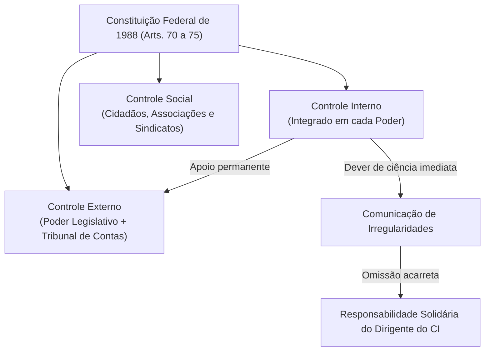
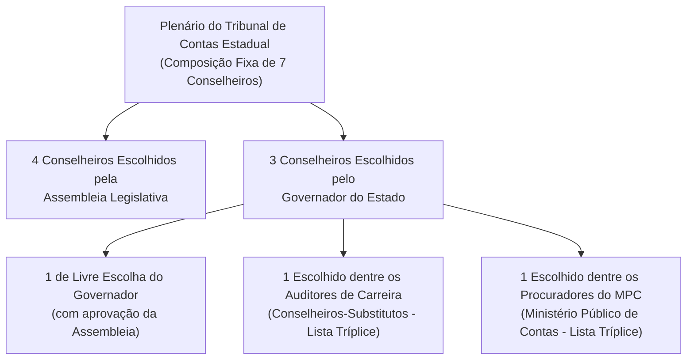

# 01 - Sistema Constitucional de Controle e Jurisdição dos Tribunais de Contas

> **Matéria:** Noções de Controle Externo  
> **Cargo:** A01 – Técnico de Controle Externo – Especialidade: Técnico Administrativo  
> **Arquivo:** `01_sistema_constitucional_e_jurisdicao_dos_tcs.md`  
> **Status:** 🟢 Teoria Aprofundada + 5 Questões FCC Comentadas (A a E)

---

## 📌 Ementa / Itens do Edital

- Sistema constitucional de controle da Administração Pública: controle interno e controle externo;
- Relação e integração harmônica entre os sistemas de controle interno e externo;
- Dever de comunicação imediata sob pena de responsabilidade solidária (Artigo 74, § 1º, da CF/88);
- Tribunais de Contas: natureza jurídica, autonomia institucional, funcional, administrativa e orçamentária;
- O modelo federal e o princípio da simetria constitucional (Artigo 75 da CF/88);
- Composição e nomeação de membros dos Tribunais de Contas Estaduais (Artigos 73 e 75 da CF/88);
- Jurisdição dos Tribunais de Contas: abrangência subjetiva e objetiva; gestores públicos e particulares que guardem, arrecadem, gerenciem ou administrem verbas públicas;
- Competências constitucionais dos Tribunais de Contas:
    - Apreciação de contas do Chefe do Poder Executivo (parecer prévio opinativo e político-constitucional);
    - Julgamento técnico das contas dos administradores e demais responsáveis por recursos públicos (contas de gestão);
    - Fiscalização de atos de admissão de pessoal e concessão de benefícios previdenciários (atos complexos, Súmula Vinculante nº 3 e Tema 445 do STF);
    - Fixação de prazo para adoção de providências saneadoras e sustação direta de atos administrativos ilegais;
    - Sustação de contratos administrativos (competência privativa do Poder Legislativo com atuação subsidiária do TC);
- Eficácia das decisões dos Tribunais de Contas: imputação de débito e multa com força de título executivo extrajudicial (Artigo 71, § 3º, da CF/88);
- Limites da jurisdição de contas, prescrição da pretensão punitiva/ressarcitória (Tema 899 do STF) e independência das instâncias civil, penal e administrativa.

---

## 🧭 Sumário

1. [O Modelo Constitucional de Controle e a Responsabilidade Solidária](#1-o-modelo-constitucional-de-controle-e-a-responsabilidade-solidaria)
    1. [Sistemas de Controle Externo, Interno e Social](#11-sistemas-de-controle-externo-interno-e-social)
    2. [O Dever de Comunicação do Controle Interno e Sanção de Solidariedade (Art. 74, § 1º)](#12-o-dever-de-comunicacao-do-controle-interno-e-sancao-de-solidariedade-art-74-1o)
2. [Natureza Jurídica, Autonomia e Princípio da Simetria (Art. 75)](#2-natureza-juridica-autonomia-e-principio-da-simetria-art-75)
    1. [Natureza Jurídica e Autonomias dos Tribunais de Contas](#21-natureza-juridica-e-autonomias-dos-tribunais-de-contas)
    2. [O Princípio da Simetria Constitucional Federativa e a Composição dos TCEs](#22-o-principio-da-simetria-constitucional-federativa-e-a-composicao-dos-tces)
    3. [Teste 165](#Teste-165)
    4. [Teste 166](#Teste-166)
3. [Competências Constitucionais: Julgamento Técnico versus Parecer Prévio](#3-competencias-constitucionais-julgamento-tecnico-versus-parecer-previo)
    1. [Contas de Governo versus Contas de Gestão](#31-contas-de-governo-versus-contas-de-gestao)
    2. [O Julgamento das Contas de Prefeito Municipal (Tema 835 do STF)](#32-o-julgamento-das-contas-de-prefeito-municipal-tema-835-do-stf)
    3. [Teste 167](#Teste-167)
4. [Registro de Atos de Admissão e Benefícios Previdenciários (Art. 71, III)](#4-registro-de-atos-de-admissao-e-beneficios-previdenciarios-art-71-iii)
    1. [Teste 168](#Teste-168)
    2. [Teste 169](#Teste-169)
5. [Sustação de Atos Ilegais versus Sustação de Contratos Administrativos](#5-sustacao-de-atos-ilegais-versus-sustacao-de-contratos-administrativos)
    1. [Teste 170](#Teste-170)
    2. [Teste 171](#Teste-171)
6. [Eficácia Executiva e Prescritibilidade (Art. 71, § 3º e Tema 899 do STF)](#6-eficacia-executiva-e-prescritibilidade-art-71-3o-e-tema-899-do-stf)
    1. [Teste 172](#Teste-172)
    2. [Teste 173](#Teste-173)
7. [Jurisdição Ampla e Independência das Instâncias](#7-jurisdicao-ampla-e-independencia-das-instancias)
    1. [Teste 174](#Teste-174)
    2. [Teste 175](#Teste-175)
8. [🌐 Fontes Oficiais & Jurisprudenciais Recomendadas](#fontes-oficiais-jurisprudenciais-recomendadas)

---

## 1. O Modelo Constitucional de Controle e a Responsabilidade Solidária

O controle dos recursos públicos no Brasil é tripartite e integrado:

1. **Controle Externo:** Exercido pelo **Poder Legislativo** com o **auxílio técnico-constitucional do Tribunal de Contas** competente (TCU na União, TCE nos Estados e DF, TCMs onde existentes).
2. **Controle Interno:** Mantido de forma **integrada** por cada um dos Poderes (Executivo, Legislativo e Judiciário) e pelo Ministério Público.
3. **Controle Social:** Exercido diretamente pela sociedade civil mediante instrumentos de transparência e cidadania (art. 74, § 2º).

### 1.1 Sistemas de Controle Externo, Interno e Social
- O **Controle Externo** possui titularidade política no Poder Legislativo, sendo operacionalizado na plenitude técnica pelo Tribunal de Contas, órgão constitucional independente de controle da legitimidade, legalidade, economicidade, aplicação de subvenções e renúncia de receitas públicas.
- O **Controle Interno** atua no seio de cada estrutura orgânica para avaliar o cumprimento das metas do PPA, comprovar a legalidade da gestão orçamentária e apoiar o controle externo no exercício de sua missão institucional (art. 74, I a IV).
- O **Controle Social** assegura a qualquer cidadão, partido político, associação ou sindicato legitimidade para denunciar irregularidades perante o Tribunal de Contas (art. 74, § 2º).

### 1.2 O Dever de Comunicação do Controle Interno e Sanção de Solidariedade (Art. 74, § 1º)
- Os responsáveis pelo controle interno, ao tomarem conhecimento de qualquer irregularidade ou ilegalidade no órgão, **devem dar ciência imediata ao Tribunal de Contas competente**.
- **Sanção por Omissão:** Se o titular do controle interno silenciar dolosa ou culposamente, responderá **pessoal e solidariamente** com o gestor ímprobo pelo dano apurado e pelas sanções cominadas pelo Tribunal de Contas.

---

### Teste 001
**(FGV – TCE/GO – 2024 – Analista de Controle Externo - Ciências Contábeis)**
Ana, servidora pública no âmbito do estado de Goiás, em conluio com João, requereu o pagamento de determinado benefício estatutário ao qual sabidamente não tinha direito. Apesar da injuridicidade, João o deferiu poucos dias depois, tendo se iniciado, incontinente, o recebimento mensal do benefício por Ana. Seis anos depois, os mecanismos de controle interno detectaram o ilícito praticado. À luz dessa narrativa, é correto afirmar que, nos termos da Lei Estadual nº 13.800/2001,

* **A)** apesar do tempo decorrido, a decisão pode ser anulada.
* **B)** deve ser revogada a decisão que concedeu o benefício a Ana.
* **C)** a decisão não pode ser modificada, pois a Administração Pública decaiu da possibilidade de modificá-la.
* **D)** como Ana recebe o benefício mensalmente, a cada mês se reinicia o prazo prescricional de cinco anos para a anulação da decisão.
* **E)** como o benefício foi integrado à esfera jurídica de Ana, operou-se o direito adquirido, logo, a decisão não pode ser modificada.

---

> **Comentário Detalhado:**
>
> - **A)** **Correta.** Conforme fundamentado na seção *2.2 O Princípio da Simetria Constitucional Federativa e a Composição dos TCEs* deste guia, tCE["Plenário do Tribunal de Contas Estadual<br/ (Composição Fixa de 7 Conselheiros)"]. Dessa forma, está plenamente correta a assertiva da banca (FGV – TCE/GO/2024) ao estabelecer que "apesar do tempo decorrido, a decisão pode ser anulada".
> - **B)** **Incorreta.** A opção apresenta proposição em desacordo com os fundamentos teóricos e técnicos do tópico ao afirmar que "deve ser revogada a decisão que concedeu o benefício a Ana". De acordo com a teoria estudada em *1. O Modelo Constitucional de Controle e a Responsabilidade Solidária*, controle Interno: Mantido de forma integrada por cada um dos Poderes (Executivo, Legislativo e Judiciário) e pelo Ministério Público.
> - **C)** **Incorreta.** A opção apresenta proposição em desacordo com os fundamentos teóricos e técnicos do tópico ao afirmar que "a decisão não pode ser modificada, pois a Administração Pública decaiu da possibilidade de modificá la". De acordo com a teoria estudada em *1. O Modelo Constitucional de Controle e a Responsabilidade Solidária*, cF CInt["Controle Interno<br/ (Integrado em cada Poder)"].
> - **D)** **Incorreta.** A opção apresenta proposição em desacordo com os fundamentos teóricos e técnicos do tópico ao afirmar que "como Ana recebe o benefício mensalmente, a cada mês se reinicia o prazo prescricional de cinco anos para a...". De acordo com a teoria estudada em *1.1 Sistemas de Controle Externo, Interno e Social*, o Controle Externo possui titularidade política no Poder Legislativo, sendo operacionalizado na plenitude técnica pelo Tribunal de Contas, órgão constitucional independente de controle da legitimidade, legalidade, economicidade, aplicação de subvenções e renúncia de receitas públicas.
> - **E)** **Incorreta.** A opção apresenta proposição em desacordo com os fundamentos teóricos e técnicos do tópico ao afirmar que "como o benefício foi integrado à esfera jurídica de Ana, operou se o direito adquirido, logo, a decisão não pode...". De acordo com a teoria estudada em *1. O Modelo Constitucional de Controle e a Responsabilidade Solidária*, o controle dos recursos públicos no Brasil é tripartite e integrado.
>
> **Gabarito: A**

---

### Teste 002
**(FGV – TCE/GO – 2024 – Analista de Controle Externo - Ciências Contábeis)**
O artigo 25 da Constituição do Estado de Goiás estabelece que a fiscalização contábil, financeira, orçamentária, operacional e patrimonial do Estado e das entidades da administração direta e indireta, no que se refere à legalidade, legitimidade, economicidade, aplicação das subvenções e renúncia de receitas, será́ exercida pela Assembleia Legislativa mediante controle externo e pelo sistema de controle interno de cada Poder. Assinale a opção que indica uma competência do TCE.

* **A)** apreciar as contas prestadas anualmente pelo Presidente.
* **B)** legislar sobre assuntos de seu interesse.
* **C)** prestar contas da aplicação dos auxílios federais ou estaduais entregues ao Município.
* **D)** julgar as contas dos responsáveis por bens, excluídas as fundações mantidas pelo Estado.
* **E)** aplicar aos responsáveis, em caso de ilegalidade de despesa, multa proporcional ao dano causado ao erário.

---

> **Comentário Detalhado:**
>
> - **A)** **Incorreta.** A opção apresenta proposição em desacordo com os fundamentos teóricos e técnicos do tópico ao afirmar que "apreciar as contas prestadas anualmente pelo Presidente". De acordo com a teoria estudada em *1.2 O Dever de Comunicação do Controle Interno e Sanção de Solidariedade (Art. 74, § 1º)*, os responsáveis pelo controle interno, ao tomarem conhecimento de qualquer irregularidade ou ilegalidade no órgão, devem dar ciência imediata ao Tribunal de Contas competente.
> - **B)** **Incorreta.** A opção apresenta proposição em desacordo com os fundamentos teóricos e técnicos do tópico ao afirmar que "legislar sobre assuntos de seu interesse". De acordo com a teoria estudada em *1.2 O Dever de Comunicação do Controle Interno e Sanção de Solidariedade (Art. 74, § 1º)*, sanção por Omissão: Se o titular do controle interno silenciar dolosa ou culposamente, responderá pessoal e solidariamente com o gestor ímprobo pelo dano apurado e pelas sanções cominadas pelo Tribunal de Contas.
> - **C)** **Incorreta.** A opção apresenta proposição em desacordo com os fundamentos teóricos e técnicos do tópico ao afirmar que "prestar contas da aplicação dos auxílios federais ou estaduais entregues ao Município". De acordo com a teoria estudada em *2.2 O Princípio da Simetria Constitucional Federativa e a Composição dos TCEs*, o art. 75 da Carta Magna estabelece que as normas constitucionais federais sobre fiscalização financeira e organização do Tribunal de Contas da União aplicam se compulsoriamente aos Tribunais de Contas dos Estados, do Distrito Federal e dos Municípios.
> - **D)** **Incorreta.** A opção apresenta proposição em desacordo com os fundamentos teóricos e técnicos do tópico ao afirmar que "julgar as contas dos responsáveis por bens, excluídas as fundações mantidas pelo Estado". De acordo com a teoria estudada em *2.1 Natureza Jurídica e Autonomias dos Tribunais de Contas*, possuem autonomia administrativa, funcional, orçamentária e financeira, além de quadro próprio de servidores públicos efetivos e poder de iniciativa reservada para suas leis orgânicas.
> - **E)** **Correta.** Conforme fundamentado na seção *1.1 Sistemas de Controle Externo, Interno e Social* deste guia, o Controle Externo possui titularidade política no Poder Legislativo, sendo operacionalizado na plenitude técnica pelo Tribunal de Contas, órgão constitucional independente de controle da legitimidade, legalidade, economicidade, aplicação de subvenções e renúncia de receitas públicas. Dessa forma, está plenamente correta a assertiva da banca (FGV – TCE/GO/2024) ao estabelecer que "aplicar aos responsáveis, em caso de ilegalidade de despesa, multa proporcional ao dano causado ao erário".
>
> **Gabarito: E**

---

### Teste 003
**(FGV – TCE/GO – 2024 – Analista de Controle Externo - Ciências Contábeis)**
A Lei nº 9.504/1997 atribui funções específicas aos Tribunais de Contas no contexto das eleições e da fiscalização dos gastos públicos relacionados a campanhas políticas. Assinale a opção que indica uma função dos Tribunais de Contas constante na Lei nº 9.504/1997.

* **A)** promover eventos de capacitação para os servidores efetivos e empregados públicos designados para o desempenho das funções essenciais à execução desta Lei por meio de suas escolas de contas.
* **B)** fiscalizar a execução do orçamento, inclusive a aplicação de recursos específicos, bem como sua compatibilização com o plano plurianual e com as diretrizes orçamentárias.
* **C)** fornecer à Justiça Eleitoral relação dos que tiveram suas contas relativas ao exercício de cargos ou funções públicas rejeitadas por irregularidade insanável e por decisão irrecorrível, exceto em situações sob análise judicial ou com decisão favorável.
* **D)** prestar as informações solicitadas pela Assembleia ou por qualquer de suas comissões, sobre a fiscalização contábil, financeira, orçamentária, operacional e patrimonial, e sobre resultados de auditorias e inspeções realizadas.
* **E)** representar ao Poder competente sobre irregularidades ou abusos apurados, indicando o ato inquinado e definindo responsabilidades.

---

> **Comentário Detalhado:**
>
> - **A)** **Incorreta.** A opção apresenta proposição em desacordo com os fundamentos teóricos e técnicos do tópico ao afirmar que "promover eventos de capacitação para os servidores efetivos e empregados públicos designados para o desempenho das...". De acordo com a teoria estudada em *2.1 Natureza Jurídica e Autonomias dos Tribunais de Contas*, possuem autonomia administrativa, funcional, orçamentária e financeira, além de quadro próprio de servidores públicos efetivos e poder de iniciativa reservada para suas leis orgânicas.
> - **B)** **Incorreta.** A opção apresenta proposição em desacordo com os fundamentos teóricos e técnicos do tópico ao afirmar que "fiscalizar a execução do orçamento, inclusive a aplicação de recursos específicos, bem como sua compatibilização...". De acordo com a teoria estudada em *1.2 O Dever de Comunicação do Controle Interno e Sanção de Solidariedade (Art. 74, § 1º)*, os responsáveis pelo controle interno, ao tomarem conhecimento de qualquer irregularidade ou ilegalidade no órgão, devem dar ciência imediata ao Tribunal de Contas competente.
> - **C)** **Correta.** Conforme fundamentado na seção *1.1 Sistemas de Controle Externo, Interno e Social* deste guia, o Controle Externo possui titularidade política no Poder Legislativo, sendo operacionalizado na plenitude técnica pelo Tribunal de Contas, órgão constitucional independente de controle da legitimidade, legalidade, economicidade, aplicação de subvenções e renúncia de receitas públicas. Dessa forma, está plenamente correta a assertiva da banca (FGV – TCE/GO/2024) ao estabelecer que "fornecer à Justiça Eleitoral relação dos que tiveram suas contas relativas ao exercício de cargos ou funções...".
> - **D)** **Incorreta.** A opção promove generalização excessiva que desconsidera as condições técnicas e normativas ao afirmar que "prestar as informações solicitadas pela Assembleia ou por qualquer de suas comissões, sobre a fiscalização...". De acordo com a teoria estudada em *2.2 O Princípio da Simetria Constitucional Federativa e a Composição dos TCEs*, o art. 75 da Carta Magna estabelece que as normas constitucionais federais sobre fiscalização financeira e organização do Tribunal de Contas da União aplicam se compulsoriamente aos Tribunais de Contas dos Estados, do Distrito Federal e dos Municípios.
> - **E)** **Incorreta.** A opção apresenta proposição em desacordo com os fundamentos teóricos e técnicos do tópico ao afirmar que "representar ao Poder competente sobre irregularidades ou abusos apurados, indicando o ato inquinado e definindo...". De acordo com a teoria estudada em *1. O Modelo Constitucional de Controle e a Responsabilidade Solidária*, controle Externo: Exercido pelo Poder Legislativo com o auxílio técnico constitucional do Tribunal de Contas competente (TCU na União, TCE nos Estados e DF, TCMs onde existentes).
>
> **Gabarito: C**

---

### Teste 004
**(FGV – TCE/GO – 2024 – Analista de Controle Externo - Ciências Contábeis)**
A Lei nº 9.717/1998 atribui funções específicas aos Tribunais de Contas no contexto da fiscalização e controle dos regimes próprios de previdência social dos servidores públicos. Assinale a opção que indica uma função dos Tribunais de Contas constante na Lei nº 9.717/1998.

* **A)** Representar ao Poder competente sobre irregularidades ou abusos apurados, indicando o ato inquinado e definindo responsabilidades.
* **B)** Realizar inspeções e auditorias de natureza atuarial, contábil, financeira, orçamentária e patrimonial.
* **C)** Elaborar relatórios de transparência e informação social acerca das atividades da Corregedoria-Geral, contendo informações sobre os processos relativos à sua competência.
* **D)** Verificar o cumprimento dos prazos legais, regimentais e regulamentares e, no caso de não observância, propor abertura de sindicância ou de processo administrativo disciplinar.
* **E)** Manter cadastro de servidores submetidos a processo criminal ou administrativo ou punidos por infração de conduta funcional nos últimos cinco anos.

---

> **Comentário Detalhado:**
>
> - **A)** **Incorreta.** A opção apresenta proposição em desacordo com os fundamentos teóricos e técnicos do tópico ao afirmar que "Representar ao Poder competente sobre irregularidades ou abusos apurados, indicando o ato inquinado e definindo...". De acordo com a teoria estudada em *2.1 Natureza Jurídica e Autonomias dos Tribunais de Contas*, não integram a estrutura hierárquica do Poder Legislativo, tampouco do Poder Executivo ou do Judiciário. Exercem magistratura técnica de contas especializada dotada de autogoverno.
> - **B)** **Correta.** Conforme fundamentado na seção *2.1 Natureza Jurídica e Autonomias dos Tribunais de Contas* deste guia, possuem autonomia administrativa, funcional, orçamentária e financeira, além de quadro próprio de servidores públicos efetivos e poder de iniciativa reservada para suas leis orgânicas. Dessa forma, está plenamente correta a assertiva da banca (FGV – TCE/GO/2024) ao estabelecer que "Realizar inspeções e auditorias de natureza atuarial, contábil, financeira, orçamentária e patrimonial".
> - **C)** **Incorreta.** A opção apresenta proposição em desacordo com os fundamentos teóricos e técnicos do tópico ao afirmar que "Elaborar relatórios de transparência e informação social acerca das atividades da Corregedoria Geral, contendo...". De acordo com a teoria estudada em *1. O Modelo Constitucional de Controle e a Responsabilidade Solidária*, controle Social: Exercido diretamente pela sociedade civil mediante instrumentos de transparência e cidadania (art. 74, § 2º).
> - **D)** **Incorreta.** A opção apresenta proposição em desacordo com os fundamentos teóricos e técnicos do tópico ao afirmar que "Verificar o cumprimento dos prazos legais, regimentais e regulamentares e, no caso de não observância, propor...". De acordo com a teoria estudada em *1.1 Sistemas de Controle Externo, Interno e Social*, o Controle Interno atua no seio de cada estrutura orgânica para avaliar o cumprimento das metas do PPA, comprovar a legalidade da gestão orçamentária e apoiar o controle externo no exercício de sua missão institucional (art. 74, I a IV).
> - **E)** **Incorreta.** A opção apresenta proposição em desacordo com os fundamentos teóricos e técnicos do tópico ao afirmar que "Manter cadastro de servidores submetidos a processo criminal ou administrativo ou punidos por infração de conduta...". De acordo com a teoria estudada em *2.2 O Princípio da Simetria Constitucional Federativa e a Composição dos TCEs*, o art. 75 da Carta Magna estabelece que as normas constitucionais federais sobre fiscalização financeira e organização do Tribunal de Contas da União aplicam se compulsoriamente aos Tribunais de Contas dos Estados, do Distrito Federal e dos Municípios.
>
> **Gabarito: B**

---

### Teste 005
**(FGV – TCE/GO – 2024 – Analista de Controle Externo - Ciências Contábeis)**
Jucundido Francisco, servidor de um município brasileiro fictício, alcançou enfim o tempo de sua aposentadoria após décadas de labor. O processo de aposentadoria somente foi encaminhado para registro junto ao Tribunal de Contas Local após dois anos da concessão da aposentadoria à Jucundido Francisco. Passados três anos e meio de tramitação do processo na Corte de Contas o tribunal decidiu anular o ato de concessão de aposentadoria por verificação de algumas inconsistências. Tendo por orientação o tema 445 de repercussão geral do Supremo Tribunal Federal, assinale a alternativa que melhor resolve a situação-problema apresentada.

* **A)** O tribunal não poderia anular o ato de concessão de aposentadoria haja vista o prazo decadencial de 5 anos da publicação do ato no diário oficial.
* **B)** O tribunal pode anular o ato de concessão de aposentadoria na situação em tela.
* **C)** O tribunal não poderia anular o ato de concessão de aposentadoria haja vista o prazo decadencial de 3 anos a contar da chegada do processo à respectiva Corte de Contas.
* **D)** O tribunal não poderia anular o ato de concessão de aposentadoria haja vista o prazo decadencial de 2 anos a contar da chegada do processo à respectiva Corte de Contas.
* **E)** O tribunal não poderia anular o ato de concessão de aposentadoria haja vista o prazo decadencial de 3 anos da publicação do ato no diário oficial, cabendo responsabilizar o agente a que deu causa o atraso no envio. Auditoria Governamental

---

> **Comentário Detalhado:**
>
> - **A)** **Incorreta.** A opção apresenta proposição em desacordo com os fundamentos teóricos e técnicos do tópico ao afirmar que "O tribunal não poderia anular o ato de concessão de aposentadoria haja vista o prazo decadencial de 5 anos da...". De acordo com a teoria estudada em *1. O Modelo Constitucional de Controle e a Responsabilidade Solidária*, cF CExt["Controle Externo<br/ (Poder Legislativo + Tribunal de Contas)"].
> - **B)** **Correta.** Conforme fundamentado na seção *1. O Modelo Constitucional de Controle e a Responsabilidade Solidária* deste guia, controle Externo: Exercido pelo Poder Legislativo com o auxílio técnico constitucional do Tribunal de Contas competente (TCU na União, TCE nos Estados e DF, TCMs onde existentes). Dessa forma, está plenamente correta a assertiva da banca (FGV – TCE/GO/2024) ao estabelecer que "O tribunal pode anular o ato de concessão de aposentadoria na situação em tela".
> - **C)** **Incorreta.** A opção apresenta proposição em desacordo com os fundamentos teóricos e técnicos do tópico ao afirmar que "O tribunal não poderia anular o ato de concessão de aposentadoria haja vista o prazo decadencial de 3 anos a...". De acordo com a teoria estudada em *1.1 Sistemas de Controle Externo, Interno e Social*, o Controle Externo possui titularidade política no Poder Legislativo, sendo operacionalizado na plenitude técnica pelo Tribunal de Contas, órgão constitucional independente de controle da legitimidade, legalidade, economicidade, aplicação de subvenções e renúncia de receitas públicas.
> - **D)** **Incorreta.** A opção apresenta proposição em desacordo com os fundamentos teóricos e técnicos do tópico ao afirmar que "O tribunal não poderia anular o ato de concessão de aposentadoria haja vista o prazo decadencial de 2 anos a...". De acordo com a teoria estudada em *1.1 Sistemas de Controle Externo, Interno e Social*, o Controle Social assegura a qualquer cidadão, partido político, associação ou sindicato legitimidade para denunciar irregularidades perante o Tribunal de Contas (art. 74, § 2º).
> - **E)** **Incorreta.** A opção apresenta proposição em desacordo com os fundamentos teóricos e técnicos do tópico ao afirmar que "O tribunal não poderia anular o ato de concessão de aposentadoria haja vista o prazo decadencial de 3 anos da...". De acordo com a teoria estudada em *1.2 O Dever de Comunicação do Controle Interno e Sanção de Solidariedade (Art. 74, § 1º)*, os responsáveis pelo controle interno, ao tomarem conhecimento de qualquer irregularidade ou ilegalidade no órgão, devem dar ciência imediata ao Tribunal de Contas competente.
>
> **Gabarito: B**

---

### Teste 006
**(FGV – TCE/GO – 2024 – Analista de Controle Externo - Controle Externo)**
Em relação à Análise da Variância (ANOVA), as afirmativas a seguir estão corretas, à exceção de uma. Assinale-a.

* **A)** É um método para testar a igualdade de três ou mais médias populacionais, baseado na análise das variâncias amostrais.
* **B)** Os dados amostrais são separados em grupos segundo uma característica denominada fator. Fator (ou tratamento) é uma característica que permite distinguir diferentes populações umas das outras.
* **C)** Cada fator contém dois ou mais grupos (classificações).
* **D)** Amostras são aleatórias e mutuamente dependentes.
* **E)** Suposições incluem: populações normalmente distribuídas e de mesma variância. Realização T C E RIBUNAL DE ONTAS DO STADO G DE OIÁS CONCURSO PÚBLICO – EDITAL 01/2024 TARDE ANALISTA DE CONTROLE EXTERNO CONTROLE EXTERNO NÍVEL SUPERIOR TIPO 1 – BRANCA SUA PROVA INFORMAÇÕES GERAIS • Além deste caderno contendo 2 (duas) • Verifique se seu caderno de questões está completo, discursivas você receberá do fiscal de sala a folha sem repetição de questões ou falhas. Caso contrário, de texto definitivo; notifique imediatamente o fiscal da sala, para que • As questões discursivas deverão ser redigidas em sejam tomadas as devidas providências; até 20 (vinte) linhas. • Confira seus dados pessoais, especialmente nome, número de inscrição e documento de identidade e leia atentamente as instruções para preencher a folha de • texto definitivo; TEMPO • Para o preenchimento das folhas de textos definitivos, use somente caneta esferográfica, fabricada em • Você dispõe de 2 (duas) horas para a realização material transparente, com tinta preta ou azul; da prova, já incluído o tempo para o preenchimento • Assine seu nome apenas nos espaços reservados nas das folhas de textos definitivos; folhas de textos definitivos; • 1 (uma) hora após o início da prova, é possível retirar-se da sala, sem levar o caderno de questões; • Confira seu cargo, cor e tipo do caderno de questões. Caso tenha recebido caderno de cargo ou cor ou tipo • A partir dos 30 (trinta) minutos anteriores ao diferente do impresso em suas folhas de textos término da prova é possível retirar-se da sala definitivos, o fiscal de sala deve ser obrigatoriamente levando o caderno de questões. informado para o devido registro na ata da sala; • Reserve tempo suficiente para o preenchimento das suas folhas de textos definitivos. O preenchimento é de sua responsabilidade e não será permitida a troca das folhas de textos definitivos em caso de erro NÃO SERÁ PERMITIDO cometido pelo candidato; • Para fins de avaliação, serão levadas em consideração • Qualquer tipo de comunicação entre os candidatos apenas as marcações realizadas nas folhas de textos durante a aplicação da prova; definitivos; • Anotar informações relativas às respostas em • A FGV coletará as impressões digitais dos candidatos qualquer outro meio que não seja o caderno de na lista de presença; questões; • Levantar da cadeira sem autorização do fiscal de • Os candidatos serão submetidos ao sistema de sala; detecção de metais quando do ingresso e da saída de sanitários durante a realização das provas. • Usar o sanitário ao término da prova, após deixar a sala. • Boa prova! Controle Externo - Discursiva

---

> **Comentário Detalhado:**
>
> - **A)** **Incorreta.** A opção apresenta proposição em desacordo com os fundamentos teóricos e técnicos do tópico ao afirmar que "É um método para testar a igualdade de três ou mais médias populacionais, baseado na análise das variâncias...". De acordo com a teoria estudada em *1. O Modelo Constitucional de Controle e a Responsabilidade Solidária*, o controle dos recursos públicos no Brasil é tripartite e integrado.
> - **B)** **Incorreta.** A opção apresenta proposição em desacordo com os fundamentos teóricos e técnicos do tópico ao afirmar que "Os dados amostrais são separados em grupos segundo uma característica denominada fator. Fator (ou tratamento) é...". De acordo com a teoria estudada em *1. O Modelo Constitucional de Controle e a Responsabilidade Solidária*, controle Externo: Exercido pelo Poder Legislativo com o auxílio técnico constitucional do Tribunal de Contas competente (TCU na União, TCE nos Estados e DF, TCMs onde existentes).
> - **C)** **Correta.** Conforme fundamentado na seção *Fundamentos Teóricos* deste guia, status: 🟢 Teoria Aprofundada + 5 Questões FCC Comentadas (A a E). Dessa forma, está plenamente correta a assertiva da banca (FGV – TCE/GO/2024) ao estabelecer que "Cada fator contém dois ou mais grupos (classificações)".
> - **D)** **Incorreta.** A opção apresenta proposição em desacordo com os fundamentos teóricos e técnicos do tópico ao afirmar que "Amostras são aleatórias e mutuamente dependentes". De acordo com a teoria estudada em *1. O Modelo Constitucional de Controle e a Responsabilidade Solidária*, controle Interno: Mantido de forma integrada por cada um dos Poderes (Executivo, Legislativo e Judiciário) e pelo Ministério Público.
> - **E)** **Incorreta.** A opção incorre em restrição indevida ao limitar o escopo conceitual ao afirmar que "Suposições incluem: populações normalmente distribuídas e de mesma variância. Realização T C E RIBUNAL DE ONTAS DO...". De acordo com a teoria estudada em *2.2 O Princípio da Simetria Constitucional Federativa e a Composição dos TCEs*, 1 obrigatoriamente escolhido dentre os Auditores de Controle Externo (Conselheiros Substitutos), a partir de lista tríplice de antiguidade e merecimento.
>
> **Gabarito: C**

---

### Teste 007
**(FGV – TCE/GO – 2024 – Analista de Controle Externo - Engenharia)**
Relacione os tipos de precipitação a seguir com as respectivas definições. 1 Orográfica. 2 Convectiva. 3 Frontal. ( ) Ocorre ao longo da linha de descontinuidade, separando duas massas de ar de características diferentes. ( ) Provocadas pela ascensão de ar devido às diferenças de temperatura na camada vizinha da atmosfera. ( ) Ocorrem quando o ar é forçado a transpor barreiras de montanhas. Assinale a opção que indica a relação correta na ordem apresentada.

* **A)** 1 – 2 – 3
* **B)** 2 – 1 – 3
* **C)** 2 – 3 – 1
* **D)** 3 – 1 – 2
* **E)** 3 – 2 – 1 Realização T RIBUNAL ANALISTA SUA PROVA • Além deste caderno contendo 2 (duas) discursivas você receberá do fiscal de sala a folha de texto definitivo; • As questões discursivas deverão ser redigidas em até 20 (vinte) linhas. • TEMPO • Você dispõe de 2 (duas) horas para a realização da prova, já incluído o tempo para o preenchimento das folhas de textos definitivos; • 1 (uma) hora após o início da prova, é possível retirar-se da sala, sem levar o caderno de questões; • A partir dos 30 (trinta) minutos anteriores ao término da prova é possível retirar-se da sala levando o caderno de questões. NÃO SERÁ PERMITIDO • Qualquer tipo de comunicação entre os candidatos durante a aplicação da prova; • Anotar informações relativas às respostas em qualquer outro meio que não seja o caderno de questões; • Levantar da cadeira sem autorização do fiscal de sala; • Usar o sanitário ao término da prova, após deixar a sala. C E DE ONTAS DO STADO G DE OIÁS CONCURSO PÚBLICO – EDITAL 01/2024 TARDE DE CONTROLE EXTERNO ENGENHARIA NÍVEL SUPERIOR TIPO 1 – BRANCA INFORMAÇÕES GERAIS • Verifique se seu caderno de questões está completo, sem repetição de questões ou falhas. Caso contrário, notifique imediatamente o fiscal da sala, para que sejam tomadas as devidas providências; • Confira seus dados pessoais, especialmente nome, número de inscrição e documento de identidade e leia atentamente as instruções para preencher a folha de texto definitivo; • Para o preenchimento das folhas de textos definitivos, use somente caneta esferográfica, fabricada em material transparente, com tinta preta ou azul; • Assine seu nome apenas nos espaços reservados nas folhas de textos definitivos; • Confira seu cargo, cor e tipo do caderno de questões. Caso tenha recebido caderno de cargo ou cor ou tipo diferente do impresso em suas folhas de textos definitivos, o fiscal de sala deve ser obrigatoriamente informado para o devido registro na ata da sala; • Reserve tempo suficiente para o preenchimento das suas folhas de textos definitivos. O preenchimento é de sua responsabilidade e não será permitida a troca das folhas de textos definitivos em caso de erro cometido pelo candidato; • Para fins de avaliação, serão levadas em consideração apenas as marcações realizadas nas folhas de textos definitivos; • A FGV coletará as impressões digitais dos candidatos na lista de presença; • Os candidatos serão submetidos ao sistema de detecção de metais quando do ingresso e da saída de sanitários durante a realização das provas. • Boa prova! Engenharia - Discursiva

---

> **Comentário Detalhado:**
>
> - **A)** **Incorreta.** A opção apresenta proposição em desacordo com os fundamentos teóricos e técnicos do tópico ao afirmar que "1 – 2 – 3". De acordo com a teoria estudada em *2.2 O Princípio da Simetria Constitucional Federativa e a Composição dos TCEs*, 1 obrigatoriamente escolhido dentre os Procuradores do Ministério Público de Contas, a partir de lista tríplice de antiguidade e merecimento.
> - **B)** **Incorreta.** A opção apresenta proposição em desacordo com os fundamentos teóricos e técnicos do tópico ao afirmar que "2 – 1 – 3". De acordo com a teoria estudada em *1.2 O Dever de Comunicação do Controle Interno e Sanção de Solidariedade (Art. 74, § 1º)*, os responsáveis pelo controle interno, ao tomarem conhecimento de qualquer irregularidade ou ilegalidade no órgão, devem dar ciência imediata ao Tribunal de Contas competente.
> - **C)** **Incorreta.** A opção apresenta proposição em desacordo com os fundamentos teóricos e técnicos do tópico ao afirmar que "2 – 3 – 1". De acordo com a teoria estudada em *1. O Modelo Constitucional de Controle e a Responsabilidade Solidária*, cInt |"Dever de ciência imediata"| Alerta["Comunicação de Irregularidades"].
> - **D)** **Incorreta.** A opção apresenta proposição em desacordo com os fundamentos teóricos e técnicos do tópico ao afirmar que "3 – 1 – 2". De acordo com a teoria estudada em *Fundamentos Teóricos*, status: 🟢 Teoria Aprofundada + 5 Questões FCC Comentadas (A a E).
> - **E)** **Correta.** Conforme fundamentado na seção *2.2 O Princípio da Simetria Constitucional Federativa e a Composição dos TCEs* deste guia, 1 obrigatoriamente escolhido dentre os Auditores de Controle Externo (Conselheiros Substitutos), a partir de lista tríplice de antiguidade e merecimento. Dessa forma, está plenamente correta a assertiva da banca (FGV – TCE/GO/2024) ao estabelecer que "3 – 2 – 1 Realização T RIBUNAL ANALISTA SUA PROVA • Além deste caderno contendo 2 (duas) discursivas você receberá...".
>
> **Gabarito: E**

---

### Teste 008
**(FCC – TCE/GO – 2009 – Analista de Controle Externo - Gestão de Conhecimento)**
Observe o esquema a seguir. Base de Dados A Base de Dados B “Orçamento público − Fis- “Orçamento público” calização financeira − Con- “Fiscalização financeira” trole externo” “Controle externo” Um usuário interessado no assunto “Controle externo e Fiscalização financeira do Orçamento público” faz uma busca usando termos autorizados, conforme indicado no esquema, em duas bases de dados que utilizam diferentes sistemas de indexação. O resultado da busca na base A foi mais consistente e relevante, enquanto o resultado da base B trouxe um número maior de documentos, porque a base

* **A)** cada informação só pode representar um único dado
* **B)** as informações devem ser verdadeiras.
* **C)** o código usado deve ser compreensível para o
* **D)** o Sistema de Informações do Congresso Nacional.
* **E)** a Biblioteca Jurídica Virtual. _________________________________________________________

---

> **Comentário Detalhado:**
>
> - **A)** **Incorreta.** A opção apresenta proposição em desacordo com os fundamentos teóricos e técnicos do tópico ao afirmar que "cada informação só pode representar um único dado". De acordo com a teoria estudada em *2.1 Natureza Jurídica e Autonomias dos Tribunais de Contas*, possuem autonomia administrativa, funcional, orçamentária e financeira, além de quadro próprio de servidores públicos efetivos e poder de iniciativa reservada para suas leis orgânicas.
> - **B)** **Incorreta.** A opção apresenta proposição em desacordo com os fundamentos teóricos e técnicos do tópico ao afirmar que "as informações devem ser verdadeiras". De acordo com a teoria estudada em *1.2 O Dever de Comunicação do Controle Interno e Sanção de Solidariedade (Art. 74, § 1º)*, os responsáveis pelo controle interno, ao tomarem conhecimento de qualquer irregularidade ou ilegalidade no órgão, devem dar ciência imediata ao Tribunal de Contas competente.
> - **C)** **Incorreta.** A opção apresenta proposição em desacordo com os fundamentos teóricos e técnicos do tópico ao afirmar que "o código usado deve ser compreensível para o". De acordo com a teoria estudada em *1.1 Sistemas de Controle Externo, Interno e Social*, o Controle Externo possui titularidade política no Poder Legislativo, sendo operacionalizado na plenitude técnica pelo Tribunal de Contas, órgão constitucional independente de controle da legitimidade, legalidade, economicidade, aplicação de subvenções e renúncia de receitas públicas.
> - **D)** **Correta.** Conforme fundamentado na seção *2.2 O Princípio da Simetria Constitucional Federativa e a Composição dos TCEs* deste guia, o art. 75 da Carta Magna estabelece que as normas constitucionais federais sobre fiscalização financeira e organização do Tribunal de Contas da União aplicam se compulsoriamente aos Tribunais de Contas dos Estados, do Distrito Federal e dos Municípios. Dessa forma, está plenamente correta a assertiva da banca (FCC – TCE/GO/2009) ao estabelecer que "o Sistema de Informações do Congresso Nacional".
> - **E)** **Incorreta.** A opção apresenta proposição em desacordo com os fundamentos teóricos e técnicos do tópico ao afirmar que "a Biblioteca Jurídica Virtual". De acordo com a teoria estudada em *2.1 Natureza Jurídica e Autonomias dos Tribunais de Contas*, os Tribunais de Contas são órgãos estatais independentes, de extração estritamente constitucional.
>
> **Gabarito: D**

---

### Teste 009
**(FCC – TCE/GO – 2009 – Analista de Controle Externo - Gestão de Conhecimento)**
Sobre as disposições constitucionais referentes ao contro- le externo das entidade governamentais, considere: I. A abrangência dos controles se restringe à lega- lidade e à legitimidade dos atos praticados pelos gestores. II. Qualquer cidadão é parte legítima para, na forma da lei, denunciar irregularidades ou ilegalidades pe- _________________________________________________________ rante o Tribunal de Contas da União. III. Compete ao Tribunal de Contas da União apreciar as contas prestadas anualmente pelo Presidente da República, mediante parecer prévio que deverá ser elaborado em noventa dias a contar de seu rece- bimento. IV. Os responsáveis pelo controle interno, ao tomarem conhecimento de qualquer irregularidade ou ilegali- dade, dela darão ciência ao Tribunal de Contas da União, sob pena de responsabilidade solidária. Está correto o que se afirma APENAS em

* **A)** I e II.
* **B)** II e III.
* **C)** II e IV.
* **D)** III. _________________________________________________________
* **E)** III e IV. _________________________________________________________

---

> **Comentário Detalhado:**
>
> - **A)** **Incorreta.** A opção apresenta proposição em desacordo com os fundamentos teóricos e técnicos do tópico ao afirmar que "I e II". De acordo com a teoria estudada em *1.1 Sistemas de Controle Externo, Interno e Social*, o Controle Social assegura a qualquer cidadão, partido político, associação ou sindicato legitimidade para denunciar irregularidades perante o Tribunal de Contas (art. 74, § 2º).
> - **B)** **Incorreta.** A opção apresenta proposição em desacordo com os fundamentos teóricos e técnicos do tópico ao afirmar que "II e III". De acordo com a teoria estudada em *1. O Modelo Constitucional de Controle e a Responsabilidade Solidária*, cInt |"Dever de ciência imediata"| Alerta["Comunicação de Irregularidades"].
> - **C)** **Correta.** Conforme fundamentado na seção *1.2 O Dever de Comunicação do Controle Interno e Sanção de Solidariedade (Art. 74, § 1º)* deste guia, os responsáveis pelo controle interno, ao tomarem conhecimento de qualquer irregularidade ou ilegalidade no órgão, devem dar ciência imediata ao Tribunal de Contas competente. Dessa forma, está plenamente correta a assertiva da banca (FCC – TCE/GO/2009) ao estabelecer que "II e IV".
> - **D)** **Incorreta.** A opção apresenta proposição em desacordo com os fundamentos teóricos e técnicos do tópico ao afirmar que "III". De acordo com a teoria estudada em *1. O Modelo Constitucional de Controle e a Responsabilidade Solidária*, controle Interno: Mantido de forma integrada por cada um dos Poderes (Executivo, Legislativo e Judiciário) e pelo Ministério Público.
> - **E)** **Incorreta.** A opção apresenta proposição em desacordo com os fundamentos teóricos e técnicos do tópico ao afirmar que "III e IV". De acordo com a teoria estudada em *2.2 O Princípio da Simetria Constitucional Federativa e a Composição dos TCEs*, o art. 75 da Carta Magna estabelece que as normas constitucionais federais sobre fiscalização financeira e organização do Tribunal de Contas da União aplicam se compulsoriamente aos Tribunais de Contas dos Estados, do Distrito Federal e dos Municípios.
>
> **Gabarito: C**

---

### Teste 010
**(FGV – TCE/GO – 2024 – Analista de Controle Externo - Jurídica)**
O Tribunal de Contas do Estado Alfa, ao apreciar as contas de Maria, ordenadora de despesas em determinado ente da Administração Pública indireta sujeito à sua fiscalização, constatou o desvio de recursos públicos. Por tal razão, as contas foram rejeitadas, foi aplicada a sanção de multa a Maria e imputado o débito correspondente. Considerando os balizamentos constitucionais afetos a essa temática, e os efeitos da decisão do Tribunal de Contas, é correto afirmar que.

* **A)** em razão da natureza do ilícito praticado, é imprescritível a pretensão de ressarcimento ao erário fundada nessa decisão.
* **B)** a decisão do Tribunal de Contas, no exercício de sua competência constitucional, forma um título executivo judicial.
* **C)** como a decisão analisou as contas, não julgando Maria pelo ilícito praticado, é prescritível a pretensão de ressarcimento ao erário.
* **D)** a imputação de débito é incompatível com a decisão de rejeição das contas, devendo ser objeto de processo autônomo, o que retira a eficácia do título.
* **E)** caso não haja o adimplemento voluntário do dever de ressarcir o erário, a decisão deve ser inscrita em dívida ativa, não havendo prazo limite para a sua cobrança.

---

> **Comentário Detalhado:**
>
> - **A)** **Incorreta.** A opção apresenta proposição em desacordo com os fundamentos teóricos e técnicos do tópico ao afirmar que "em razão da natureza do ilícito praticado, é imprescritível a pretensão de ressarcimento ao erário fundada nessa...". De acordo com a teoria estudada em *2.1 Natureza Jurídica e Autonomias dos Tribunais de Contas*, possuem autonomia administrativa, funcional, orçamentária e financeira, além de quadro próprio de servidores públicos efetivos e poder de iniciativa reservada para suas leis orgânicas.
> - **B)** **Incorreta.** A opção apresenta proposição em desacordo com os fundamentos teóricos e técnicos do tópico ao afirmar que "a decisão do Tribunal de Contas, no exercício de sua competência constitucional, forma um título executivo judicial". De acordo com a teoria estudada em *1. O Modelo Constitucional de Controle e a Responsabilidade Solidária*, controle Interno: Mantido de forma integrada por cada um dos Poderes (Executivo, Legislativo e Judiciário) e pelo Ministério Público.
> - **C)** **Correta.** Conforme fundamentado na seção *2.2 O Princípio da Simetria Constitucional Federativa e a Composição dos TCEs* deste guia, o art. 75 da Carta Magna estabelece que as normas constitucionais federais sobre fiscalização financeira e organização do Tribunal de Contas da União aplicam se compulsoriamente aos Tribunais de Contas dos Estados, do Distrito Federal e dos Municípios. Dessa forma, está plenamente correta a assertiva da banca (FGV – TCE/GO/2024) ao estabelecer que "como a decisão analisou as contas, não julgando Maria pelo ilícito praticado, é prescritível a pretensão de...".
> - **D)** **Incorreta.** A opção apresenta proposição em desacordo com os fundamentos teóricos e técnicos do tópico ao afirmar que "a imputação de débito é incompatível com a decisão de rejeição das contas, devendo ser objeto de processo...". De acordo com a teoria estudada em *1.2 O Dever de Comunicação do Controle Interno e Sanção de Solidariedade (Art. 74, § 1º)*, os responsáveis pelo controle interno, ao tomarem conhecimento de qualquer irregularidade ou ilegalidade no órgão, devem dar ciência imediata ao Tribunal de Contas competente.
> - **E)** **Incorreta.** A opção apresenta proposição em desacordo com os fundamentos teóricos e técnicos do tópico ao afirmar que "caso não haja o adimplemento voluntário do dever de ressarcir o erário, a decisão deve ser inscrita em dívida...". De acordo com a teoria estudada em *1.2 O Dever de Comunicação do Controle Interno e Sanção de Solidariedade (Art. 74, § 1º)*, sanção por Omissão: Se o titular do controle interno silenciar dolosa ou culposamente, responderá pessoal e solidariamente com o gestor ímprobo pelo dano apurado e pelas sanções cominadas pelo Tribunal de Contas.
>
> **Gabarito: C**

---

### Teste 011
**(FGV – TCE/GO – 2024 – Analista de Controle Externo - Jurídica)**
Bárbara, servidora pública estável, após o preenchimento dos respectivos requisitos, pleiteou a sua aposentadoria junto ao órgão de origem, obtendo o deferimento do benefício, que começou então a ser pago, sendo certo que a concessão de tal aposentadoria foi submetida à apreciação para fins de registro perante o respectivo Tribunal de Contas, no exercício da atribuição prevista no Art. 71, III, da CRFB/88. Diante da aludida situação hipotética, considerando que não há vícios no deferimento do pedido realizado por Bárbara e que o aludido registro ainda está pendente de apreciação pela Corte de Contas, à luz dos requisitos de formalização dos atos administrativos, notadamente os planos da perfeição, validade e eficácia, diante da orientação do Supremo Tribunal Federal, é correto afirmar que a aludida aposentadoria está

* **A)** perfeita, válida e eficaz.
* **B)** imperfeita, válida e ineficaz.
* **C)** perfeita, inválida e ineficaz.
* **D)** imperfeita, válida e eficaz.
* **E)** perfeita, válida e ineficaz.

---

> **Comentário Detalhado:**
>
> - **A)** **Incorreta.** A opção apresenta proposição em desacordo com os fundamentos teóricos e técnicos do tópico ao afirmar que "perfeita, válida e eficaz". De acordo com a teoria estudada em *1.1 Sistemas de Controle Externo, Interno e Social*, o Controle Social assegura a qualquer cidadão, partido político, associação ou sindicato legitimidade para denunciar irregularidades perante o Tribunal de Contas (art. 74, § 2º).
> - **B)** **Incorreta.** A opção apresenta proposição em desacordo com os fundamentos teóricos e técnicos do tópico ao afirmar que "imperfeita, válida e ineficaz". De acordo com a teoria estudada em *1.2 O Dever de Comunicação do Controle Interno e Sanção de Solidariedade (Art. 74, § 1º)*, os responsáveis pelo controle interno, ao tomarem conhecimento de qualquer irregularidade ou ilegalidade no órgão, devem dar ciência imediata ao Tribunal de Contas competente.
> - **C)** **Incorreta.** A opção apresenta proposição em desacordo com os fundamentos teóricos e técnicos do tópico ao afirmar que "perfeita, inválida e ineficaz". De acordo com a teoria estudada em *1.1 Sistemas de Controle Externo, Interno e Social*, o Controle Interno atua no seio de cada estrutura orgânica para avaliar o cumprimento das metas do PPA, comprovar a legalidade da gestão orçamentária e apoiar o controle externo no exercício de sua missão institucional (art. 74, I a IV).
> - **D)** **Correta.** Conforme fundamentado na seção *1.1 Sistemas de Controle Externo, Interno e Social* deste guia, o Controle Externo possui titularidade política no Poder Legislativo, sendo operacionalizado na plenitude técnica pelo Tribunal de Contas, órgão constitucional independente de controle da legitimidade, legalidade, economicidade, aplicação de subvenções e renúncia de receitas públicas. Dessa forma, está plenamente correta a assertiva da banca (FGV – TCE/GO/2024) ao estabelecer que "imperfeita, válida e eficaz".
> - **E)** **Incorreta.** A opção apresenta proposição em desacordo com os fundamentos teóricos e técnicos do tópico ao afirmar que "perfeita, válida e ineficaz". De acordo com a teoria estudada em *2.2 O Princípio da Simetria Constitucional Federativa e a Composição dos TCEs*, 3 Conselheiros indicados pelo Governador do Estado, com prévia aprovação da Assembleia Legislativa, sendo.
>
> **Gabarito: D**

---

### Teste 012
**(FGV – TCE/GO – 2024 – Analista de Controle Externo - Jurídica)**
Em relação ao controle orçamentário, assinale V para a afirmativa verdadeira e F para a falsa. ( ) A fiscalização orçamentária, quanto à legalidade, legitimidade, economicidade, aplicação das subvenções e renúncia de receitas, será exercida pelo Congresso Nacional, com o auxílio do Tribunal de Contas, mediante controle externo, e pelo sistema de controle interno de cada Poder. ( ) A Constituição da República contempla comando expresso de espelhamento obrigatório, nos Estados, no Distrito Federal e nos Municípios, do modelo nela estabelecido de controle externo da higidez orçamentária dos atos administrativos, sendo materialmente inconstitucional a norma de regência da organização ou funcionamento de Tribunal de Contas estadual divorciada do modelo federal de controle externo das contas públicas. ( ) É vedado ao Tribunal de Contas realizar, por iniciativa própria, inspeções e auditorias de natureza orçamentária, nas unidades administrativas dos Poderes Legislativo, Executivo e Judiciário. As afirmativas são, respectivamente,

* **A)** F – V – F.
* **B)** F – V – V.
* **C)** V – F – F.
* **D)** V – V – F.
* **E)** F – F – V.

---

> **Comentário Detalhado:**
>
> - **A)** **Incorreta.** A opção apresenta proposição em desacordo com os fundamentos teóricos e técnicos do tópico ao afirmar que "F – V – F". De acordo com a teoria estudada em *2.2 O Princípio da Simetria Constitucional Federativa e a Composição dos TCEs*, o art. 75 da Carta Magna estabelece que as normas constitucionais federais sobre fiscalização financeira e organização do Tribunal de Contas da União aplicam se compulsoriamente aos Tribunais de Contas dos Estados, do Distrito Federal e dos Municípios.
> - **B)** **Incorreta.** A opção apresenta proposição em desacordo com os fundamentos teóricos e técnicos do tópico ao afirmar que "F – V – V". De acordo com a teoria estudada em *1. O Modelo Constitucional de Controle e a Responsabilidade Solidária*, controle Externo: Exercido pelo Poder Legislativo com o auxílio técnico constitucional do Tribunal de Contas competente (TCU na União, TCE nos Estados e DF, TCMs onde existentes).
> - **C)** **Incorreta.** A opção apresenta proposição em desacordo com os fundamentos teóricos e técnicos do tópico ao afirmar que "V – F – F". De acordo com a teoria estudada em *2.1 Natureza Jurídica e Autonomias dos Tribunais de Contas*, possuem autonomia administrativa, funcional, orçamentária e financeira, além de quadro próprio de servidores públicos efetivos e poder de iniciativa reservada para suas leis orgânicas.
> - **D)** **Correta.** Conforme fundamentado na seção *1.1 Sistemas de Controle Externo, Interno e Social* deste guia, o Controle Externo possui titularidade política no Poder Legislativo, sendo operacionalizado na plenitude técnica pelo Tribunal de Contas, órgão constitucional independente de controle da legitimidade, legalidade, economicidade, aplicação de subvenções e renúncia de receitas públicas. Dessa forma, está plenamente correta a assertiva da banca (FGV – TCE/GO/2024) ao estabelecer que "V – V – F".
> - **E)** **Incorreta.** A opção apresenta proposição em desacordo com os fundamentos teóricos e técnicos do tópico ao afirmar que "F – F – V". De acordo com a teoria estudada em *1. O Modelo Constitucional de Controle e a Responsabilidade Solidária*, controle Interno: Mantido de forma integrada por cada um dos Poderes (Executivo, Legislativo e Judiciário) e pelo Ministério Público.
>
> **Gabarito: D**

---

### Teste 013
**(FGV – TCE/GO – 2024 – Analista de Controle Externo - Tecnologia da Informação)**
Um certo fiscal de contratos da administração pública exerce vários papéis e funções. Considerando o tema, é correto que se deve

* **A)** representar a contratada nas negociações com a administração pública, garantindo a adequação dos termos contratuais às necessidades da contratante.
* **B)** aplicar diretamente penalidades e sanções administrativas à contratada em caso de execução inadequada do contrato.
* **C)** receber e aceite dos bens e serviços, não participando das etapas anteriores de acompanhamento da execução contratual.
* **D)** acompanhar a execução contratual, registrando e notificando irregularidades à autoridade competente, para as devidas providências.
* **E)** elaborar sanções a ser aplicadas nas irregularidades encontradas durante a execução contratual. Realização T C E RIBUNAL DE ONTAS DO STADO G DE OIÁS CONCURSO PÚBLICO – EDITAL 01/2024 TARDE ANALISTA DE CONTROLE EXTERNO TECNOLOGIA DA INFORMACAO NÍVEL SUPERIOR TIPO 1 – BRANCA SUA PROVA INFORMAÇÕES GERAIS • Além deste caderno contendo 2 (duas) • Verifique se seu caderno de questões está completo, discursivas você receberá do fiscal de sala a folha sem repetição de questões ou falhas. Caso contrário, de texto definitivo; notifique imediatamente o fiscal da sala, para que • As questões discursivas deverão ser redigidas em sejam tomadas as devidas providências; até 20 (vinte) linhas. • Confira seus dados pessoais, especialmente nome, número de inscrição e documento de identidade e leia atentamente as instruções para preencher a folha de • texto definitivo; TEMPO • Para o preenchimento das folhas de textos definitivos, use somente caneta esferográfica, fabricada em • Você dispõe de 2 (duas) horas para a realização material transparente, com tinta preta ou azul; da prova, já incluído o tempo para o preenchimento • Assine seu nome apenas nos espaços reservados nas das folhas de textos definitivos; folhas de textos definitivos; • 1 (uma) hora após o início da prova, é possível retirar-se da sala, sem levar o caderno de questões; • Confira seu cargo, cor e tipo do caderno de questões. Caso tenha recebido caderno de cargo ou cor ou tipo • A partir dos 30 (trinta) minutos anteriores ao diferente do impresso em suas folhas de textos término da prova é possível retirar-se da sala definitivos, o fiscal de sala deve ser obrigatoriamente levando o caderno de questões. informado para o devido registro na ata da sala; • Reserve tempo suficiente para o preenchimento das suas folhas de textos definitivos. O preenchimento é de sua responsabilidade e não será permitida a troca das folhas de textos definitivos em caso de erro NÃO SERÁ PERMITIDO cometido pelo candidato; • Para fins de avaliação, serão levadas em consideração • Qualquer tipo de comunicação entre os candidatos apenas as marcações realizadas nas folhas de textos durante a aplicação da prova; definitivos; • Anotar informações relativas às respostas em • A FGV coletará as impressões digitais dos candidatos qualquer outro meio que não seja o caderno de na lista de presença; questões; • Levantar da cadeira sem autorização do fiscal de • Os candidatos serão submetidos ao sistema de sala; detecção de metais quando do ingresso e da saída de sanitários durante a realização das provas. • Usar o sanitário ao término da prova, após deixar a sala. • Boa prova! Tecnologia da Informação - Discursiva

---

> **Comentário Detalhado:**
>
> - **A)** **Incorreta.** A opção apresenta proposição em desacordo com os fundamentos teóricos e técnicos do tópico ao afirmar que "representar a contratada nas negociações com a administração pública, garantindo a adequação dos termos...". De acordo com a teoria estudada em *1. O Modelo Constitucional de Controle e a Responsabilidade Solidária*, cInt |"Dever de ciência imediata"| Alerta["Comunicação de Irregularidades"].
> - **B)** **Incorreta.** A opção apresenta proposição em desacordo com os fundamentos teóricos e técnicos do tópico ao afirmar que "aplicar diretamente penalidades e sanções administrativas à contratada em caso de execução inadequada do contrato". De acordo com a teoria estudada em *1. O Modelo Constitucional de Controle e a Responsabilidade Solidária*, controle Social: Exercido diretamente pela sociedade civil mediante instrumentos de transparência e cidadania (art. 74, § 2º).
> - **C)** **Incorreta.** A opção apresenta proposição em desacordo com os fundamentos teóricos e técnicos do tópico ao afirmar que "receber e aceite dos bens e serviços, não participando das etapas anteriores de acompanhamento da execução...". De acordo com a teoria estudada em *1.1 Sistemas de Controle Externo, Interno e Social*, o Controle Social assegura a qualquer cidadão, partido político, associação ou sindicato legitimidade para denunciar irregularidades perante o Tribunal de Contas (art. 74, § 2º).
> - **D)** **Correta.** Conforme fundamentado na seção *1. O Modelo Constitucional de Controle e a Responsabilidade Solidária* deste guia, controle Externo: Exercido pelo Poder Legislativo com o auxílio técnico constitucional do Tribunal de Contas competente (TCU na União, TCE nos Estados e DF, TCMs onde existentes). Dessa forma, está plenamente correta a assertiva da banca (FGV – TCE/GO/2024) ao estabelecer que "acompanhar a execução contratual, registrando e notificando irregularidades à autoridade competente, para as...".
> - **E)** **Incorreta.** A opção incorre em restrição indevida ao limitar o escopo conceitual ao afirmar que "elaborar sanções a ser aplicadas nas irregularidades encontradas durante a execução contratual. Realização T C E...". De acordo com a teoria estudada em *1.2 O Dever de Comunicação do Controle Interno e Sanção de Solidariedade (Art. 74, § 1º)*, os responsáveis pelo controle interno, ao tomarem conhecimento de qualquer irregularidade ou ilegalidade no órgão, devem dar ciência imediata ao Tribunal de Contas competente.
>
> **Gabarito: D**

---

### Teste 014
**(FGV – TJ/AP – 2023 – Analista Judiciario Apoio Especializado Tecnologia Da Informacao Banco De Dados)**
Ao estudar ponto específico de edital para concurso público atinente à organização administrativa, notadamente com relação à descentralização, Ofélia observou que, dentre as entidades dotadas de personalidade jurídica de direito privado que integram a Administração Pública indireta, é correto apontar:

* **A)** as autarquias;
* **B)** as prefeituras;
* **C)** as associações públicas;
* **D)** os tribunais de contas;
* **E)** as sociedades de economia mista.

---

> **Comentário Detalhado:**
>
> - **A)** **Incorreta.** A opção apresenta proposição em desacordo com os fundamentos teóricos e técnicos do tópico ao afirmar que "as autarquias". De acordo com a teoria estudada em *2.1 Natureza Jurídica e Autonomias dos Tribunais de Contas*, possuem autonomia administrativa, funcional, orçamentária e financeira, além de quadro próprio de servidores públicos efetivos e poder de iniciativa reservada para suas leis orgânicas.
> - **B)** **Incorreta.** A opção apresenta proposição em desacordo com os fundamentos teóricos e técnicos do tópico ao afirmar que "as prefeituras". De acordo com a teoria estudada em *2.2 O Princípio da Simetria Constitucional Federativa e a Composição dos TCEs*, o art. 75 da Carta Magna estabelece que as normas constitucionais federais sobre fiscalização financeira e organização do Tribunal de Contas da União aplicam se compulsoriamente aos Tribunais de Contas dos Estados, do Distrito Federal e dos Municípios.
> - **C)** **Incorreta.** A opção apresenta proposição em desacordo com os fundamentos teóricos e técnicos do tópico ao afirmar que "as associações públicas". De acordo com a teoria estudada em *1. O Modelo Constitucional de Controle e a Responsabilidade Solidária*, cF CSoc["Controle Social<br/ (Cidadãos, Associações e Sindicatos)"].
> - **D)** **Incorreta.** A opção apresenta proposição em desacordo com os fundamentos teóricos e técnicos do tópico ao afirmar que "os tribunais de contas". De acordo com a teoria estudada em *2.1 Natureza Jurídica e Autonomias dos Tribunais de Contas*, os Tribunais de Contas são órgãos estatais independentes, de extração estritamente constitucional.
> - **E)** **Correta.** Conforme fundamentado na seção *2.1 Natureza Jurídica e Autonomias dos Tribunais de Contas* deste guia, não integram a estrutura hierárquica do Poder Legislativo, tampouco do Poder Executivo ou do Judiciário. Exercem magistratura técnica de contas especializada dotada de autogoverno. Dessa forma, está plenamente correta a assertiva da banca (FGV – TJ/AP/2023) ao estabelecer que "as sociedades de economia mista".
>
> **Gabarito: E**

---

### Teste 015
**(FGV – TRT 1ª – 2024 – Analista Judiciário - Área Administrativa)**
A Lei nº 13.655/2018 introduziu, no Decreto-Lei nº 4.657/1942, disposições acerca da segurança jurídica e eficiência na criação e na aplicação do direito público, contendo previsões relevantes quanto ao controle da Administração Pública, dentre as quais a norma que dispõe que a invalidação de ato, contrato ou ajuste deverá indicar, de modo expresso, suas consequências jurídicas e administrativas. Nesse contexto, é correto afirmar que tal determinação:

* **A)** não pode ser imposta ao controle judicial da Administração Pública;
* **B)** apenas é aplicável no âmbito do controle externo;
* **C)** não precisa ser observada no exercício da autotutela;
* **D)** há de ser atendida nas esferas administrativa, controladora ou judicial;
* **E)** restringe-se às hipóteses de controle interno da Administração Pública.

---

> **Comentário Detalhado:**
>
> - **A)** **Incorreta.** A opção apresenta proposição em desacordo com os fundamentos teóricos e técnicos do tópico ao afirmar que "não pode ser imposta ao controle judicial da Administração Pública". De acordo com a teoria estudada em *1.1 Sistemas de Controle Externo, Interno e Social*, o Controle Externo possui titularidade política no Poder Legislativo, sendo operacionalizado na plenitude técnica pelo Tribunal de Contas, órgão constitucional independente de controle da legitimidade, legalidade, economicidade, aplicação de subvenções e renúncia de receitas públicas.
> - **B)** **Incorreta.** A opção incorre em restrição indevida ao limitar o escopo conceitual ao afirmar que "apenas é aplicável no âmbito do controle externo". De acordo com a teoria estudada em *2.1 Natureza Jurídica e Autonomias dos Tribunais de Contas*, os Tribunais de Contas são órgãos estatais independentes, de extração estritamente constitucional.
> - **C)** **Incorreta.** A opção apresenta proposição em desacordo com os fundamentos teóricos e técnicos do tópico ao afirmar que "não precisa ser observada no exercício da autotutela". De acordo com a teoria estudada em *1.1 Sistemas de Controle Externo, Interno e Social*, o Controle Interno atua no seio de cada estrutura orgânica para avaliar o cumprimento das metas do PPA, comprovar a legalidade da gestão orçamentária e apoiar o controle externo no exercício de sua missão institucional (art. 74, I a IV).
> - **D)** **Correta.** Conforme fundamentado na seção *2.1 Natureza Jurídica e Autonomias dos Tribunais de Contas* deste guia, possuem autonomia administrativa, funcional, orçamentária e financeira, além de quadro próprio de servidores públicos efetivos e poder de iniciativa reservada para suas leis orgânicas. Dessa forma, está plenamente correta a assertiva da banca (FGV – TRT 1ª/2024) ao estabelecer que "há de ser atendida nas esferas administrativa, controladora ou judicial".
> - **E)** **Incorreta.** A opção apresenta proposição em desacordo com os fundamentos teóricos e técnicos do tópico ao afirmar que "restringe se às hipóteses de controle interno da Administração Pública". De acordo com a teoria estudada em *1. O Modelo Constitucional de Controle e a Responsabilidade Solidária*, controle Interno: Mantido de forma integrada por cada um dos Poderes (Executivo, Legislativo e Judiciário) e pelo Ministério Público.
>
> **Gabarito: D**

---

### Teste 016
**(FGV – TCE/PA – 2024 – Auditor de Controle Externo - Administrativa - Administração)**
No exercício de suas atribuições como auditor de controle externo do Tribunal de Contas do Estado do Pará, regularmente investido no cargo, Rozendo entendeu ser necessário averiguar as normas aplicáveis aos servidores no tocante às relações com o fiscalizado, à luz da Resolução nº 18.523/2013 (Código de Ética), vindo a concluir corretamente que, durante os trabalhos de fiscalização a cargo do Tribunal, o servidor deverá:

* **A)** conferir prioridade ao caráter inquisitorial às indagações formuladas ao fiscalizado.
* **B)** evitar que interesses pessoais e interpretações tendenciosas interfiram na apresentação e nos tratamentos dos fatos levantados.
* **C)** dar preferência para realização de sugestões sobre assunto administrativo interno do órgão, entidade ou programa fiscalizado durante os trabalhos de campo.
* **D)** manter atitude de independência em relação ao fiscalizado, deixando clara a sua posição de superioridade.
* **E)** manter sigilo quanto às sanções aplicáveis em virtude da sonegação de informação e obstrução ao livre exercício das atividades de controle externo, para não prejudicar ulterior procedimento sancionatório.

---

> **Comentário Detalhado:**
>
> - **A)** **Incorreta.** A opção apresenta proposição em desacordo com os fundamentos teóricos e técnicos do tópico ao afirmar que "conferir prioridade ao caráter inquisitorial às indagações formuladas ao fiscalizado". De acordo com a teoria estudada em *2.1 Natureza Jurídica e Autonomias dos Tribunais de Contas*, possuem autonomia administrativa, funcional, orçamentária e financeira, além de quadro próprio de servidores públicos efetivos e poder de iniciativa reservada para suas leis orgânicas.
> - **B)** **Correta.** Conforme fundamentado na seção *2.2 O Princípio da Simetria Constitucional Federativa e a Composição dos TCEs* deste guia, o art. 75 da Carta Magna estabelece que as normas constitucionais federais sobre fiscalização financeira e organização do Tribunal de Contas da União aplicam se compulsoriamente aos Tribunais de Contas dos Estados, do Distrito Federal e dos Municípios. Dessa forma, está plenamente correta a assertiva da banca (FGV – TCE/PA/2024) ao estabelecer que "evitar que interesses pessoais e interpretações tendenciosas interfiram na apresentação e nos tratamentos dos...".
> - **C)** **Incorreta.** A opção apresenta proposição em desacordo com os fundamentos teóricos e técnicos do tópico ao afirmar que "dar preferência para realização de sugestões sobre assunto administrativo interno do órgão, entidade ou programa...". De acordo com a teoria estudada em *1.2 O Dever de Comunicação do Controle Interno e Sanção de Solidariedade (Art. 74, § 1º)*, os responsáveis pelo controle interno, ao tomarem conhecimento de qualquer irregularidade ou ilegalidade no órgão, devem dar ciência imediata ao Tribunal de Contas competente.
> - **D)** **Incorreta.** A opção apresenta proposição em desacordo com os fundamentos teóricos e técnicos do tópico ao afirmar que "manter atitude de independência em relação ao fiscalizado, deixando clara a sua posição de superioridade". De acordo com a teoria estudada em *1.1 Sistemas de Controle Externo, Interno e Social*, o Controle Interno atua no seio de cada estrutura orgânica para avaliar o cumprimento das metas do PPA, comprovar a legalidade da gestão orçamentária e apoiar o controle externo no exercício de sua missão institucional (art. 74, I a IV).
> - **E)** **Incorreta.** A opção apresenta proposição em desacordo com os fundamentos teóricos e técnicos do tópico ao afirmar que "manter sigilo quanto às sanções aplicáveis em virtude da sonegação de informação e obstrução ao livre exercício...". De acordo com a teoria estudada em *1.2 O Dever de Comunicação do Controle Interno e Sanção de Solidariedade (Art. 74, § 1º)*, sanção por Omissão: Se o titular do controle interno silenciar dolosa ou culposamente, responderá pessoal e solidariamente com o gestor ímprobo pelo dano apurado e pelas sanções cominadas pelo Tribunal de Contas.
>
> **Gabarito: B**

---

### Teste 017
**(FGV – TCE/PA – 2024 – Auditor de Controle Externo - Administrativa - Administração)**
Em junho de 2023, a Comissão Arns entregou ao ministro da Justiça e Segurança Pública o relatório “Pará: sem justiça não há paz”, fruto de uma expedição no Sul e Sudeste do Pará, território marcado por uma criminalidade crônica. Os principais tipos de conflitos territoriais registrados foram: a ação ilegal e predatória de grileiros, garimpeiros e madeireiros; a atuação de milícias rurais organizadas para a prática de crimes violentos na região; o excesso de uso da força policial em ações de desapropriação; e a invasão de terras públicas não destinadas, entre outros. A respeito do enfrentamento do quadro de insegurança e violência, assinale a opção que descreve de modo pertinente uma possível ação para reafirmar o poder público e fortalecer a sociedade civil na região.

* **A)** O estabelecimento de protocolos públicos para o uso da força policial nos casos de desocupação forçada, pelos governos federal e estadual.
* **B)** O levantamento e a sistematização de um banco de dados dos casos de conflito fundiário judicializados, pela assembleia legislativa estadual.
* **C)** A criação e supervisão de comissões de mediação e apoio para resolução negociada de conflitos relativos à posse fundiária, pelo tribunal de contas estadual.
* **D)** O confisco de armamentos ilegais presentes em assentamentos e entre milícias rurais, pelo Instituto Nacional de Colonização e Reforma Agrária (INCRA).
* **E)** A repressão às invasões em Unidades de Conservação e Terras Indígenas, por parte do Greenpeace Brasil e outras organizações não governamentais.

---

> **Comentário Detalhado:**
>
> - **A)** **Correta.** Conforme fundamentado na seção *2.1 Natureza Jurídica e Autonomias dos Tribunais de Contas* deste guia, possuem autonomia administrativa, funcional, orçamentária e financeira, além de quadro próprio de servidores públicos efetivos e poder de iniciativa reservada para suas leis orgânicas. Dessa forma, está plenamente correta a assertiva da banca (FGV – TCE/PA/2024) ao estabelecer que "O estabelecimento de protocolos públicos para o uso da força policial nos casos de desocupação forçada, pelos...".
> - **B)** **Incorreta.** A opção apresenta proposição em desacordo com os fundamentos teóricos e técnicos do tópico ao afirmar que "O levantamento e a sistematização de um banco de dados dos casos de conflito fundiário judicializados, pela...". De acordo com a teoria estudada em *2.2 O Princípio da Simetria Constitucional Federativa e a Composição dos TCEs*, 4 Conselheiros indicados e eleitos pela Assembleia Legislativa.
> - **C)** **Incorreta.** A opção apresenta proposição em desacordo com os fundamentos teóricos e técnicos do tópico ao afirmar que "A criação e supervisão de comissões de mediação e apoio para resolução negociada de conflitos relativos à posse...". De acordo com a teoria estudada em *2.2 O Princípio da Simetria Constitucional Federativa e a Composição dos TCEs*, tCE["Plenário do Tribunal de Contas Estadual<br/ (Composição Fixa de 7 Conselheiros)"].
> - **D)** **Incorreta.** A opção apresenta proposição em desacordo com os fundamentos teóricos e técnicos do tópico ao afirmar que "O confisco de armamentos ilegais presentes em assentamentos e entre milícias rurais, pelo Instituto Nacional de...". De acordo com a teoria estudada em *1. O Modelo Constitucional de Controle e a Responsabilidade Solidária*, o controle dos recursos públicos no Brasil é tripartite e integrado.
> - **E)** **Incorreta.** A opção apresenta proposição em desacordo com os fundamentos teóricos e técnicos do tópico ao afirmar que "A repressão às invasões em Unidades de Conservação e Terras Indígenas, por parte do Greenpeace Brasil e outras...". De acordo com a teoria estudada em *1. O Modelo Constitucional de Controle e a Responsabilidade Solidária*, controle Social: Exercido diretamente pela sociedade civil mediante instrumentos de transparência e cidadania (art. 74, § 2º).
>
> **Gabarito: A**

---

### Teste 018
**(FGV – TCE/PA – 2024 – Auditor de Controle Externo - Administrativa - Administração)**
Ao estudar a classificação dos atos administrativos, à luz da orientação do Supremo Tribunal Federal, Josiane verificou que é correto indicar como um ato administrativo complexo

* **A)** a decisão plenária de certo Tribunal de Contas.
* **B)** a determinação de ressarcimento ao erário pelo Tribunal de Contas, após o devido processo administrativo.
* **C)** o registro de aposentadoria de servidores públicos ocupantes de cargo efetivo junto ao respectivo Tribunal de Conta.
* **D)** a desconsideração da personalidade jurídica em sede administrativa, realizada pelo Tribunal de Contas em determinado processo administrativo.
* **E)** o reconhecimento de ilegalidade de determinada verba remuneratória paga a servidor público, por decisão do Tribunal de Contas.

---

> **Comentário Detalhado:**
>
> - **A)** **Incorreta.** A opção apresenta proposição em desacordo com os fundamentos teóricos e técnicos do tópico ao afirmar que "a decisão plenária de certo Tribunal de Contas". De acordo com a teoria estudada em *1. O Modelo Constitucional de Controle e a Responsabilidade Solidária*, o controle dos recursos públicos no Brasil é tripartite e integrado.
> - **B)** **Incorreta.** A opção apresenta proposição em desacordo com os fundamentos teóricos e técnicos do tópico ao afirmar que "a determinação de ressarcimento ao erário pelo Tribunal de Contas, após o devido processo administrativo". De acordo com a teoria estudada em *1. O Modelo Constitucional de Controle e a Responsabilidade Solidária*, controle Externo: Exercido pelo Poder Legislativo com o auxílio técnico constitucional do Tribunal de Contas competente (TCU na União, TCE nos Estados e DF, TCMs onde existentes).
> - **C)** **Correta.** Conforme fundamentado na seção *2.1 Natureza Jurídica e Autonomias dos Tribunais de Contas* deste guia, possuem autonomia administrativa, funcional, orçamentária e financeira, além de quadro próprio de servidores públicos efetivos e poder de iniciativa reservada para suas leis orgânicas. Dessa forma, está plenamente correta a assertiva da banca (FGV – TCE/PA/2024) ao estabelecer que "o registro de aposentadoria de servidores públicos ocupantes de cargo efetivo junto ao respectivo Tribunal de Conta".
> - **D)** **Incorreta.** A opção apresenta proposição em desacordo com os fundamentos teóricos e técnicos do tópico ao afirmar que "a desconsideração da personalidade jurídica em sede administrativa, realizada pelo Tribunal de Contas em...". De acordo com a teoria estudada em *2.1 Natureza Jurídica e Autonomias dos Tribunais de Contas*, os Tribunais de Contas são órgãos estatais independentes, de extração estritamente constitucional.
> - **E)** **Incorreta.** A opção apresenta proposição em desacordo com os fundamentos teóricos e técnicos do tópico ao afirmar que "o reconhecimento de ilegalidade de determinada verba remuneratória paga a servidor público, por decisão do...". De acordo com a teoria estudada em *1.2 O Dever de Comunicação do Controle Interno e Sanção de Solidariedade (Art. 74, § 1º)*, os responsáveis pelo controle interno, ao tomarem conhecimento de qualquer irregularidade ou ilegalidade no órgão, devem dar ciência imediata ao Tribunal de Contas competente.
>
> **Gabarito: C**

---

### Teste 019
**(FGV – TCE/PA – 2024 – Auditor de Controle Externo - Administrativa - Administração)**
A Constituição da República de 1988 estabelece que a fiscalização contábil, financeira, orçamentária, operacional e patrimonial da União e das entidades da administração direta e indireta, quanto a aspectos expressamente mencionados no texto do Art. 70, no que concerne à aplicação das subvenções e renúncia de receitas, será exercida pelo Congresso Nacional, mediante controle externo, e pelo sistema de controle interno de cada Poder. Entre os aludidos aspectos textualmente indicados no mencionado dispositivo, é correto apontar

* **A)** a transparência.
* **B)** a efetividade.
* **C)** a legitimidade.
* **D)** a eficiência.
* **E)** a juridicidade.

---

> **Comentário Detalhado:**
>
> - **A)** **Incorreta.** A opção apresenta proposição em desacordo com os fundamentos teóricos e técnicos do tópico ao afirmar que "a transparência". De acordo com a teoria estudada em *1. O Modelo Constitucional de Controle e a Responsabilidade Solidária*, controle Social: Exercido diretamente pela sociedade civil mediante instrumentos de transparência e cidadania (art. 74, § 2º).
> - **B)** **Incorreta.** A opção apresenta proposição em desacordo com os fundamentos teóricos e técnicos do tópico ao afirmar que "a efetividade". De acordo com a teoria estudada em *2.2 O Princípio da Simetria Constitucional Federativa e a Composição dos TCEs*, o art. 75 da Carta Magna estabelece que as normas constitucionais federais sobre fiscalização financeira e organização do Tribunal de Contas da União aplicam se compulsoriamente aos Tribunais de Contas dos Estados, do Distrito Federal e dos Municípios.
> - **C)** **Correta.** Conforme fundamentado na seção *1.1 Sistemas de Controle Externo, Interno e Social* deste guia, o Controle Externo possui titularidade política no Poder Legislativo, sendo operacionalizado na plenitude técnica pelo Tribunal de Contas, órgão constitucional independente de controle da legitimidade, legalidade, economicidade, aplicação de subvenções e renúncia de receitas públicas. Dessa forma, está plenamente correta a assertiva da banca (FGV – TCE/PA/2024) ao estabelecer que "a legitimidade".
> - **D)** **Incorreta.** A opção apresenta proposição em desacordo com os fundamentos teóricos e técnicos do tópico ao afirmar que "a eficiência". De acordo com a teoria estudada em *1.1 Sistemas de Controle Externo, Interno e Social*, o Controle Social assegura a qualquer cidadão, partido político, associação ou sindicato legitimidade para denunciar irregularidades perante o Tribunal de Contas (art. 74, § 2º).
> - **E)** **Incorreta.** A opção apresenta proposição em desacordo com os fundamentos teóricos e técnicos do tópico ao afirmar que "a juridicidade". De acordo com a teoria estudada em *2.1 Natureza Jurídica e Autonomias dos Tribunais de Contas*, possuem autonomia administrativa, funcional, orçamentária e financeira, além de quadro próprio de servidores públicos efetivos e poder de iniciativa reservada para suas leis orgânicas.
>
> **Gabarito: C**

---

### Teste 020
**(FGV – TCE/PA – 2024 – Auditor de Controle Externo - Administrativa - Administração)**
Avalie se as seguintes afirmativas a seguir, contidas no Planejamento Estratégico do TCE-PA, correspondem a um valor institucional, à missão da organização ou à visão da organização. I. Ser instituição de referência no controle externo e contribuir para o aperfeiçoamento da administração pública. II. Primar pela divulgação clara e acessível dos seus atos e dos decorrentes de sua missão. III. Exercer o controle externo da gestão de recursos públicos estaduais em benefício da sociedade. IV. Atuar com liberdade, imparcialidade e autonomia. As afirmativas referem-se, respectivamente, a

* **A)** valor, visão, missão e valor.
* **B)** visão, missão, valor e valor.
* **C)** visão, visão, missão e missão.
* **D)** missão, visão, valor e visão.
* **E)** visão, valor, missão e valor.

---

> **Comentário Detalhado:**
>
> - **A)** **Incorreta.** A opção apresenta proposição em desacordo com os fundamentos teóricos e técnicos do tópico ao afirmar que "valor, visão, missão e valor". De acordo com a teoria estudada em *1. O Modelo Constitucional de Controle e a Responsabilidade Solidária*, o controle dos recursos públicos no Brasil é tripartite e integrado.
> - **B)** **Incorreta.** A opção apresenta proposição em desacordo com os fundamentos teóricos e técnicos do tópico ao afirmar que "visão, missão, valor e valor". De acordo com a teoria estudada em *2.1 Natureza Jurídica e Autonomias dos Tribunais de Contas*, possuem autonomia administrativa, funcional, orçamentária e financeira, além de quadro próprio de servidores públicos efetivos e poder de iniciativa reservada para suas leis orgânicas.
> - **C)** **Incorreta.** A opção apresenta proposição em desacordo com os fundamentos teóricos e técnicos do tópico ao afirmar que "visão, visão, missão e missão". De acordo com a teoria estudada em *2.2 O Princípio da Simetria Constitucional Federativa e a Composição dos TCEs*, composição dos Tribunais de Contas Estaduais (TCE GO).
> - **D)** **Incorreta.** A opção apresenta proposição em desacordo com os fundamentos teóricos e técnicos do tópico ao afirmar que "missão, visão, valor e visão". De acordo com a teoria estudada em *1. O Modelo Constitucional de Controle e a Responsabilidade Solidária*, controle Social: Exercido diretamente pela sociedade civil mediante instrumentos de transparência e cidadania (art. 74, § 2º).
> - **E)** **Correta.** Conforme fundamentado na seção *1.1 Sistemas de Controle Externo, Interno e Social* deste guia, o Controle Interno atua no seio de cada estrutura orgânica para avaliar o cumprimento das metas do PPA, comprovar a legalidade da gestão orçamentária e apoiar o controle externo no exercício de sua missão institucional (art. 74, I a IV). Dessa forma, está plenamente correta a assertiva da banca (FGV – TCE/PA/2024) ao estabelecer que "visão, valor, missão e valor".
>
> **Gabarito: E**

---

### Teste 021
**(FGV – TCE/PA – 2024 – Auditor de Controle Externo - Administrativa - Administração)**
João, José e Maria são Conselheiros do Tribunal de Contas do Pará. João, graduado em matemática e direito, é professor da rede de ensino fundamental de um município paraense. José é formado em medicina e atua como profissional liberal no exercício dessa profissão, mantendo um consultório no centro da capital paraense. Maria mantém-se operante e dedicada à atividade político- partidária, apesar de ter se desfiliado do partido que integrava ao ser escolhida pelo parlamento estadual para o cargo de Conselheira do TCE. Considerando os fatos narrados na situação hipotética e tendo em vista as vedações previstas no RITCE-PA, é correto afirmar que

* **A)** as condutas de João e Maria são vedadas; a de José é permitida, tendo em vista que não há vedação ao exercício de atividade privada.
* **B)** as condutas de João, José e Maria são vedadas; João pode acumular seu cargo de conselheiro somente com o de professor universitário.
* **C)** as condutas de João, José e Maria são permitidas pelo RITCE- PA.
* **D)** a conduta de João é permitida, vez que é possível acumular o cargo de Conselheiro com outro cargo de professor; já as de José e Maria são vedadas pelo RITCE-PA.
* **E)** a conduta de José é permitida, pois os dois cargos, de Conselheiro e de médico, são considerados de natureza técnica; as de João e Maria são vedadas pelo RITCE-PA.

---

> **Comentário Detalhado:**
>
> - **A)** **Incorreta.** A opção apresenta proposição em desacordo com os fundamentos teóricos e técnicos do tópico ao afirmar que "as condutas de João e Maria são vedadas; a de José é permitida, tendo em vista que não há vedação ao exercício de...". De acordo com a teoria estudada em *1.1 Sistemas de Controle Externo, Interno e Social*, o Controle Interno atua no seio de cada estrutura orgânica para avaliar o cumprimento das metas do PPA, comprovar a legalidade da gestão orçamentária e apoiar o controle externo no exercício de sua missão institucional (art. 74, I a IV).
> - **B)** **Incorreta.** A opção incorre em restrição indevida ao limitar o escopo conceitual ao afirmar que "as condutas de João, José e Maria são vedadas; João pode acumular seu cargo de conselheiro somente com o de...". De acordo com a teoria estudada em *1.1 Sistemas de Controle Externo, Interno e Social*, o Controle Social assegura a qualquer cidadão, partido político, associação ou sindicato legitimidade para denunciar irregularidades perante o Tribunal de Contas (art. 74, § 2º).
> - **C)** **Incorreta.** A opção apresenta proposição em desacordo com os fundamentos teóricos e técnicos do tópico ao afirmar que "as condutas de João, José e Maria são permitidas pelo RITCE PA". De acordo com a teoria estudada em *2.2 O Princípio da Simetria Constitucional Federativa e a Composição dos TCEs*, tCE AL["4 Conselheiros Escolhidos pela<br/ Assembleia Legislativa"].
> - **D)** **Correta.** Conforme fundamentado na seção *2.2 O Princípio da Simetria Constitucional Federativa e a Composição dos TCEs* deste guia, tCE["Plenário do Tribunal de Contas Estadual<br/ (Composição Fixa de 7 Conselheiros)"]. Dessa forma, está plenamente correta a assertiva da banca (FGV – TCE/PA/2024) ao estabelecer que "a conduta de João é permitida, vez que é possível acumular o cargo de Conselheiro com outro cargo de professor; já...".
> - **E)** **Incorreta.** A opção apresenta proposição em desacordo com os fundamentos teóricos e técnicos do tópico ao afirmar que "a conduta de José é permitida, pois os dois cargos, de Conselheiro e de médico, são considerados de natureza...". De acordo com a teoria estudada em *2.1 Natureza Jurídica e Autonomias dos Tribunais de Contas*, não integram a estrutura hierárquica do Poder Legislativo, tampouco do Poder Executivo ou do Judiciário. Exercem magistratura técnica de contas especializada dotada de autogoverno.
>
> **Gabarito: D**

---

### Teste 022
**(FGV – TCE/PA – 2024 – Auditor de Controle Externo - Administrativa - Administração)**
Os mecanismos de controle interno e externo são fundamentais para garantir a integridade, eficiência e conformidade das operações de uma organização. Assinale a opção que apresenta um mecanismo de controle estratégico.

* **A)** Controle orçamentário.
* **B)** Balanço.
* **C)** Contabilidade de custos.
* **D)** Just-in-time.
* **E)** Controle de estoques.

---

> **Comentário Detalhado:**
>
> - **A)** **Incorreta.** A opção apresenta proposição em desacordo com os fundamentos teóricos e técnicos do tópico ao afirmar que "Controle orçamentário". De acordo com a teoria estudada em *1. O Modelo Constitucional de Controle e a Responsabilidade Solidária*, controle Interno: Mantido de forma integrada por cada um dos Poderes (Executivo, Legislativo e Judiciário) e pelo Ministério Público.
> - **B)** **Correta.** Conforme fundamentado na seção *2.2 O Princípio da Simetria Constitucional Federativa e a Composição dos TCEs* deste guia, o art. 75 da Carta Magna estabelece que as normas constitucionais federais sobre fiscalização financeira e organização do Tribunal de Contas da União aplicam se compulsoriamente aos Tribunais de Contas dos Estados, do Distrito Federal e dos Municípios. Dessa forma, está plenamente correta a assertiva da banca (FGV – TCE/PA/2024) ao estabelecer que "Balanço".
> - **C)** **Incorreta.** A opção apresenta proposição em desacordo com os fundamentos teóricos e técnicos do tópico ao afirmar que "Contabilidade de custos". De acordo com a teoria estudada em *1. O Modelo Constitucional de Controle e a Responsabilidade Solidária*, cF CInt["Controle Interno<br/ (Integrado em cada Poder)"].
> - **D)** **Incorreta.** A opção apresenta proposição em desacordo com os fundamentos teóricos e técnicos do tópico ao afirmar que "Just in time". De acordo com a teoria estudada em *1.1 Sistemas de Controle Externo, Interno e Social*, o Controle Externo possui titularidade política no Poder Legislativo, sendo operacionalizado na plenitude técnica pelo Tribunal de Contas, órgão constitucional independente de controle da legitimidade, legalidade, economicidade, aplicação de subvenções e renúncia de receitas públicas.
> - **E)** **Incorreta.** A opção apresenta proposição em desacordo com os fundamentos teóricos e técnicos do tópico ao afirmar que "Controle de estoques". De acordo com a teoria estudada em *1.1 Sistemas de Controle Externo, Interno e Social*, o Controle Interno atua no seio de cada estrutura orgânica para avaliar o cumprimento das metas do PPA, comprovar a legalidade da gestão orçamentária e apoiar o controle externo no exercício de sua missão institucional (art. 74, I a IV).
>
> **Gabarito: B**

---

### Teste 023
**(FGV – TCE/PA – 2024 – Auditor de Controle Externo - Administrativa - Direito)**
Após perquirir a distinção entre Administração Direta e Indireta e os respectivos órgãos e entidades administrativas, além das questões atinentes à personalidade jurídica em cada caso, Felisbela concluiu corretamente que

* **A)** os Tribunais de Contas são órgãos integrantes da Administração Direta, que não são dotados de personalidade jurídica.
* **B)** as autarquias são órgãos integrantes da Administração Direta, que tem personalidade jurídica de direito público.
* **C)** as empresas públicas são entidades integrantes da Administração Indireta dotadas de personalidade jurídica de direito públicos.
* **D)** os Tribunais de Justiça são entidades integrantes da Administração Indireta dotadas de personalidade jurídica de direito público.
* **E)** as fundações públicas são órgãos integrantes da Administração Indireta, que não são dotados de personalidade jurídica.

---

> **Comentário Detalhado:**
>
> - **A)** **Correta.** Conforme fundamentado na seção *2.1 Natureza Jurídica e Autonomias dos Tribunais de Contas* deste guia, os Tribunais de Contas são órgãos estatais independentes, de extração estritamente constitucional. Dessa forma, está plenamente correta a assertiva da banca (FGV – TCE/PA/2024) ao estabelecer que "os Tribunais de Contas são órgãos integrantes da Administração Direta, que não são dotados de personalidade...".
> - **B)** **Incorreta.** A opção apresenta proposição em desacordo com os fundamentos teóricos e técnicos do tópico ao afirmar que "as autarquias são órgãos integrantes da Administração Direta, que tem personalidade jurídica de direito público". De acordo com a teoria estudada em *2.1 Natureza Jurídica e Autonomias dos Tribunais de Contas*, possuem autonomia administrativa, funcional, orçamentária e financeira, além de quadro próprio de servidores públicos efetivos e poder de iniciativa reservada para suas leis orgânicas.
> - **C)** **Incorreta.** A opção apresenta proposição em desacordo com os fundamentos teóricos e técnicos do tópico ao afirmar que "as empresas públicas são entidades integrantes da Administração Indireta dotadas de personalidade jurídica de...". De acordo com a teoria estudada em *2.1 Natureza Jurídica e Autonomias dos Tribunais de Contas*, não integram a estrutura hierárquica do Poder Legislativo, tampouco do Poder Executivo ou do Judiciário. Exercem magistratura técnica de contas especializada dotada de autogoverno.
> - **D)** **Incorreta.** A opção apresenta proposição em desacordo com os fundamentos teóricos e técnicos do tópico ao afirmar que "os Tribunais de Justiça são entidades integrantes da Administração Indireta dotadas de personalidade jurídica de...". De acordo com a teoria estudada em *2.2 O Princípio da Simetria Constitucional Federativa e a Composição dos TCEs*, o art. 75 da Carta Magna estabelece que as normas constitucionais federais sobre fiscalização financeira e organização do Tribunal de Contas da União aplicam se compulsoriamente aos Tribunais de Contas dos Estados, do Distrito Federal e dos Municípios.
> - **E)** **Incorreta.** A opção apresenta proposição em desacordo com os fundamentos teóricos e técnicos do tópico ao afirmar que "as fundações públicas são órgãos integrantes da Administração Indireta, que não são dotados de personalidade...". De acordo com a teoria estudada em *1.1 Sistemas de Controle Externo, Interno e Social*, o Controle Externo possui titularidade política no Poder Legislativo, sendo operacionalizado na plenitude técnica pelo Tribunal de Contas, órgão constitucional independente de controle da legitimidade, legalidade, economicidade, aplicação de subvenções e renúncia de receitas públicas.
>
> **Gabarito: A**

---

### Teste 024
**(FGV – TCE/PA – 2024 – Auditor de Controle Externo - Administrativa - Gestão Governamental)**
Um objetivo consagrado no Código de Ética e Disciplina dos Servidores do Tribunal de Contas do Estado do Pará (Resolução nº 18.523/2013), é o de

* **A)** fomentar a utilização de informação privilegiada após o exercício do cargo, para que o respectivo servidor possa obter dela vantagem.
* **B)** impor o sigilo de todas as informações que tramitam perante o Tribunal de Contas, diante da relevância das situações analisadas pelo órgão de controle, no exercício de suas atribuições constitucionais.
* **C)** propiciar, no campo ético, regras específicas sobre o conflito de interesses públicos e privados, de modo fazer prevalecer esses últimos sobre aqueles anteriormente mencionados.
* **D)** assegurar aos servidores do Tribunal de Contas a preservação de sua imagem, ainda que seu comportamento seja contrário as normas éticas estabelecidas pela aludida norma.
* **E)** tornar transparentes as regras éticas de conduta dos servidores do Tribunal de Contas, para que a sociedade possa aferir sua integridade e a lisura do processo de apreciação das contas públicas.

---

> **Comentário Detalhado:**
>
> - **A)** **Incorreta.** A opção apresenta proposição em desacordo com os fundamentos teóricos e técnicos do tópico ao afirmar que "fomentar a utilização de informação privilegiada após o exercício do cargo, para que o respectivo servidor possa...". De acordo com a teoria estudada em *1.1 Sistemas de Controle Externo, Interno e Social*, o Controle Externo possui titularidade política no Poder Legislativo, sendo operacionalizado na plenitude técnica pelo Tribunal de Contas, órgão constitucional independente de controle da legitimidade, legalidade, economicidade, aplicação de subvenções e renúncia de receitas públicas.
> - **B)** **Incorreta.** A opção apresenta proposição em desacordo com os fundamentos teóricos e técnicos do tópico ao afirmar que "impor o sigilo de todas as informações que tramitam perante o Tribunal de Contas, diante da relevância das...". De acordo com a teoria estudada em *1.1 Sistemas de Controle Externo, Interno e Social*, o Controle Social assegura a qualquer cidadão, partido político, associação ou sindicato legitimidade para denunciar irregularidades perante o Tribunal de Contas (art. 74, § 2º).
> - **C)** **Incorreta.** A opção apresenta proposição em desacordo com os fundamentos teóricos e técnicos do tópico ao afirmar que "propiciar, no campo ético, regras específicas sobre o conflito de interesses públicos e privados, de modo fazer...". De acordo com a teoria estudada em *1. O Modelo Constitucional de Controle e a Responsabilidade Solidária*, controle Social: Exercido diretamente pela sociedade civil mediante instrumentos de transparência e cidadania (art. 74, § 2º).
> - **D)** **Incorreta.** A opção apresenta proposição em desacordo com os fundamentos teóricos e técnicos do tópico ao afirmar que "assegurar aos servidores do Tribunal de Contas a preservação de sua imagem, ainda que seu comportamento seja...". De acordo com a teoria estudada em *2.2 O Princípio da Simetria Constitucional Federativa e a Composição dos TCEs*, o art. 75 da Carta Magna estabelece que as normas constitucionais federais sobre fiscalização financeira e organização do Tribunal de Contas da União aplicam se compulsoriamente aos Tribunais de Contas dos Estados, do Distrito Federal e dos Municípios.
> - **E)** **Correta.** Conforme fundamentado na seção *2.1 Natureza Jurídica e Autonomias dos Tribunais de Contas* deste guia, possuem autonomia administrativa, funcional, orçamentária e financeira, além de quadro próprio de servidores públicos efetivos e poder de iniciativa reservada para suas leis orgânicas. Dessa forma, está plenamente correta a assertiva da banca (FGV – TCE/PA/2024) ao estabelecer que "tornar transparentes as regras éticas de conduta dos servidores do Tribunal de Contas, para que a sociedade possa...".
>
> **Gabarito: E**

---

### Teste 025
**(FGV – TCE/PA – 2024 – Auditor de Controle Externo - Administrativa - Gestão Governamental)**
Joana, ex-Secretária de Estado de Educação do Estado Beta, foi citada em processo de execução fundado em título extrajudicial, consistente em acórdão condenatório do Tribunal de Contas do Estado Beta, que não fora inscrito em dívida ativa pela Procuradoria-Geral do Estado. O mandado de citação foi juntado aos autos em 06/05/2024, uma segunda-feira. Vinte e dois dias depois, Joana apresentou embargos à execução, nos quais sustentou a nulidade do título executivo, ante a ausência de prévia inscrição em dívida ativa, bem como a inexistência de qualquer irregularidade em sua atuação enquanto agente política. Tomando o caso acima como premissa, assinale a afirmativa correta.

* **A)** Os embargos à execução são tempestivos, pois a execução de acórdão condenatório de Tribunal de Contas segue o rito da Lei de Execução Fiscal, independentemente de sua inscrição em dívida ativa.
* **B)** A alegação de inexistência de irregularidade em sua atuação não poderá ser examinada pelo juízo em sede de embargos à execução, pois o executado somente poderá alegar as matérias taxativamente previstas em lei.
* **C)** Conforme dispõe o Código de Processo Civil, eventual efeito suspensivo aos embargos à execução prescindirá de garantia do juízo, bastando o preenchimento dos requisitos para a concessão da tutela provisória.
* **D)** Os embargos deverão ser liminarmente rejeitados pelo juízo, com a majoração dos honorários advocatícios já fixados quando do despacho da petição inicial.
* **E)** A oposição de embargos à execução não impede que Joana, reconhecendo o crédito do Estado do Pará, comprove o depósito de trinta por cento do valor da execução e requeira o pagamento do restante em seis parcelas mensais.

---

> **Comentário Detalhado:**
>
> - **A)** **Incorreta.** A opção apresenta proposição em desacordo com os fundamentos teóricos e técnicos do tópico ao afirmar que "Os embargos à execução são tempestivos, pois a execução de acórdão condenatório de Tribunal de Contas segue o rito...". De acordo com a teoria estudada em *1.1 Sistemas de Controle Externo, Interno e Social*, o Controle Externo possui titularidade política no Poder Legislativo, sendo operacionalizado na plenitude técnica pelo Tribunal de Contas, órgão constitucional independente de controle da legitimidade, legalidade, economicidade, aplicação de subvenções e renúncia de receitas públicas.
> - **B)** **Incorreta.** A opção incorre em restrição indevida ao limitar o escopo conceitual ao afirmar que "A alegação de inexistência de irregularidade em sua atuação não poderá ser examinada pelo juízo em sede de...". De acordo com a teoria estudada em *1.1 Sistemas de Controle Externo, Interno e Social*, o Controle Social assegura a qualquer cidadão, partido político, associação ou sindicato legitimidade para denunciar irregularidades perante o Tribunal de Contas (art. 74, § 2º).
> - **C)** **Incorreta.** A opção apresenta proposição em desacordo com os fundamentos teóricos e técnicos do tópico ao afirmar que "Conforme dispõe o Código de Processo Civil, eventual efeito suspensivo aos embargos à execução prescindirá de...". De acordo com a teoria estudada em *1. O Modelo Constitucional de Controle e a Responsabilidade Solidária*, controle Social: Exercido diretamente pela sociedade civil mediante instrumentos de transparência e cidadania (art. 74, § 2º).
> - **D)** **Correta.** Conforme fundamentado na seção *1.2 O Dever de Comunicação do Controle Interno e Sanção de Solidariedade (Art. 74, § 1º)* deste guia, os responsáveis pelo controle interno, ao tomarem conhecimento de qualquer irregularidade ou ilegalidade no órgão, devem dar ciência imediata ao Tribunal de Contas competente. Dessa forma, está plenamente correta a assertiva da banca (FGV – TCE/PA/2024) ao estabelecer que "Os embargos deverão ser liminarmente rejeitados pelo juízo, com a majoração dos honorários advocatícios já fixados...".
> - **E)** **Incorreta.** A opção apresenta proposição em desacordo com os fundamentos teóricos e técnicos do tópico ao afirmar que "A oposição de embargos à execução não impede que Joana, reconhecendo o crédito do Estado do Pará, comprove o...". De acordo com a teoria estudada em *2.1 Natureza Jurídica e Autonomias dos Tribunais de Contas*, não integram a estrutura hierárquica do Poder Legislativo, tampouco do Poder Executivo ou do Judiciário. Exercem magistratura técnica de contas especializada dotada de autogoverno.
>
> **Gabarito: D**

---

### Teste 026
**(FGV – TCE/PA – 2024 – Auditor de Controle Externo - Administrativa - Gestão Governamental)**
A Lei nº 14.133/2021 estabelece que as contratações públicas deverão submeter-se a práticas contínuas e permanentes de gestão de riscos e de controle preventivo, inclusive mediante adoção de recursos de tecnologia da informação, e, além de estar subordinadas ao controle social, sujeitar-se-ão às linhas de defesa nela delimitadas. Acerca do aludido tema, à luz do mencionado Diploma Legal, é correto afirmar que os Tribunal de Contas

* **A)** integram todas as linhas de defesa, em razão da relevância do controle por eles exercido.
* **B)** integram a primeira linha de defesa, juntamente com as autoridades que atuam na estrutura de governança do órgão ou entidade.
* **C)** integram a segunda linha de defesa, juntamente com as unidades de assessoramento jurídico.
* **D)** integram a terceira linha de defesa, juntamente o órgão central de controle interno da Administração.
* **E)** não integram tais linhas de defesa, que são compostas apenas pelos órgãos de controle interno.

---

> **Comentário Detalhado:**
>
> - **A)** **Incorreta.** A opção apresenta proposição em desacordo com os fundamentos teóricos e técnicos do tópico ao afirmar que "integram todas as linhas de defesa, em razão da relevância do controle por eles exercido". De acordo com a teoria estudada em *1.2 O Dever de Comunicação do Controle Interno e Sanção de Solidariedade (Art. 74, § 1º)*, os responsáveis pelo controle interno, ao tomarem conhecimento de qualquer irregularidade ou ilegalidade no órgão, devem dar ciência imediata ao Tribunal de Contas competente.
> - **B)** **Incorreta.** A opção apresenta proposição em desacordo com os fundamentos teóricos e técnicos do tópico ao afirmar que "integram a primeira linha de defesa, juntamente com as autoridades que atuam na estrutura de governança do órgão...". De acordo com a teoria estudada em *2.1 Natureza Jurídica e Autonomias dos Tribunais de Contas*, não integram a estrutura hierárquica do Poder Legislativo, tampouco do Poder Executivo ou do Judiciário. Exercem magistratura técnica de contas especializada dotada de autogoverno.
> - **C)** **Incorreta.** A opção apresenta proposição em desacordo com os fundamentos teóricos e técnicos do tópico ao afirmar que "integram a segunda linha de defesa, juntamente com as unidades de assessoramento jurídico". De acordo com a teoria estudada em *1.1 Sistemas de Controle Externo, Interno e Social*, o Controle Interno atua no seio de cada estrutura orgânica para avaliar o cumprimento das metas do PPA, comprovar a legalidade da gestão orçamentária e apoiar o controle externo no exercício de sua missão institucional (art. 74, I a IV).
> - **D)** **Correta.** Conforme fundamentado na seção *1.1 Sistemas de Controle Externo, Interno e Social* deste guia, o Controle Externo possui titularidade política no Poder Legislativo, sendo operacionalizado na plenitude técnica pelo Tribunal de Contas, órgão constitucional independente de controle da legitimidade, legalidade, economicidade, aplicação de subvenções e renúncia de receitas públicas. Dessa forma, está plenamente correta a assertiva da banca (FGV – TCE/PA/2024) ao estabelecer que "integram a terceira linha de defesa, juntamente o órgão central de controle interno da Administração".
> - **E)** **Incorreta.** A opção incorre em restrição indevida ao limitar o escopo conceitual ao afirmar que "não integram tais linhas de defesa, que são compostas apenas pelos órgãos de controle interno". De acordo com a teoria estudada em *2.1 Natureza Jurídica e Autonomias dos Tribunais de Contas*, os Tribunais de Contas são órgãos estatais independentes, de extração estritamente constitucional.
>
> **Gabarito: D**

---

### Teste 027
**(FGV – TCE/PA – 2024 – Auditor de Controle Externo - Administrativa - Gestão Governamental)**
No exercício de suas atribuições como auditor de controle externo do Tribunal de Contas do Estado do Pará, para fins de elaboração de certos contratos administrativos, Ednardo foi instado a se manifestar acerca da existência de discricionariedade quanto à previsão de matriz de alocação de riscos entre contratante e contratado nos respectivos editais. Nesse contexto, diante do disposto na Lei nº 14.133/2021, Ednardo respondeu corretamente que

* **A)** a previsão de matriz de risco submete-se à discricionariedade da Administração em qualquer contrato, independente do objeto ou do regime de execução.
* **B)** há discricionariedade quanto à previsão de matriz de risco nos contratos de fornecimento, nas locações e nos contratos de obra, ainda que sejam realizados pelo regime da contratação semi-integrada.
* **C)** nos contratos de grande vulto, além de outras hipóteses especificadas na lei de regência, notadamente quanto ao regime de execução, não há discricionariedade com relação à previsão de matriz de risco.
* **D)** nas hipóteses de contratação pelos regimes de empreitada integral e empreitada por preço global não há discricionariedade da Administração acerca da previsão de matriz de risco.
* **E)** dentre os regimes de execução indireta previstos na norma de regência, não há discricionariedade da Administração quanto à previsão de matriz de risco apenas em relação ao da contratação integrada. Controle Externo

---

> **Comentário Detalhado:**
>
> - **A)** **Incorreta.** A opção promove generalização excessiva que desconsidera as condições técnicas e normativas ao afirmar que "a previsão de matriz de risco submete se à discricionariedade da Administração em qualquer contrato, independente...". De acordo com a teoria estudada em *1.1 Sistemas de Controle Externo, Interno e Social*, o Controle Externo possui titularidade política no Poder Legislativo, sendo operacionalizado na plenitude técnica pelo Tribunal de Contas, órgão constitucional independente de controle da legitimidade, legalidade, economicidade, aplicação de subvenções e renúncia de receitas públicas.
> - **B)** **Incorreta.** A opção apresenta proposição em desacordo com os fundamentos teóricos e técnicos do tópico ao afirmar que "há discricionariedade quanto à previsão de matriz de risco nos contratos de fornecimento, nas locações e nos...". De acordo com a teoria estudada em *1. O Modelo Constitucional de Controle e a Responsabilidade Solidária*, controle Interno: Mantido de forma integrada por cada um dos Poderes (Executivo, Legislativo e Judiciário) e pelo Ministério Público.
> - **C)** **Correta.** Conforme fundamentado na seção *2.1 Natureza Jurídica e Autonomias dos Tribunais de Contas* deste guia, possuem autonomia administrativa, funcional, orçamentária e financeira, além de quadro próprio de servidores públicos efetivos e poder de iniciativa reservada para suas leis orgânicas. Dessa forma, está plenamente correta a assertiva da banca (FGV – TCE/PA/2024) ao estabelecer que "nos contratos de grande vulto, além de outras hipóteses especificadas na lei de regência, notadamente quanto ao...".
> - **D)** **Incorreta.** A opção apresenta proposição em desacordo com os fundamentos teóricos e técnicos do tópico ao afirmar que "nas hipóteses de contratação pelos regimes de empreitada integral e empreitada por preço global não há...". De acordo com a teoria estudada em *1.1 Sistemas de Controle Externo, Interno e Social*, o Controle Interno atua no seio de cada estrutura orgânica para avaliar o cumprimento das metas do PPA, comprovar a legalidade da gestão orçamentária e apoiar o controle externo no exercício de sua missão institucional (art. 74, I a IV).
> - **E)** **Incorreta.** A opção incorre em restrição indevida ao limitar o escopo conceitual ao afirmar que "dentre os regimes de execução indireta previstos na norma de regência, não há discricionariedade da Administração...". De acordo com a teoria estudada em *2.2 O Princípio da Simetria Constitucional Federativa e a Composição dos TCEs*, 1 obrigatoriamente escolhido dentre os Procuradores do Ministério Público de Contas, a partir de lista tríplice de antiguidade e merecimento.
>
> **Gabarito: C**

---

### Teste 028
**(FGV – TCE/PA – 2024 – Auditor de Controle Externo - Administrativa - Gestão Governamental)**
João, ordenador de despesas, ao apresentar suas considerações em processo de tomada de conta especial instaurado pelo Tribunal de Contas do Estado Alfa, sustentou que a interpretação de determinado dispositivo constitucional era distinta daquela que estava sendo adotada nos autos. De acordo com João, o significado a ser atribuído pelo intérprete ao dispositivo interpretado é influenciado pelas vicissitudes da realidade. Os argumentos de João

* **A)** não se ajustam ao realismo jurídico.
* **B)** são compatíveis com o originalismo constitucional.
* **C)** são compatíveis com a declaração de inconstitucionalidade sem redução de texto.
* **D)** indicam a existência de uma relação de sobreposição entre texto e norma constitucional.
* **E)** embora se ajustem à mutação constitucional, não se compatibilizam com a interpretação conforme a constituição.

---

> **Comentário Detalhado:**
>
> - **A)** **Incorreta.** A opção apresenta proposição em desacordo com os fundamentos teóricos e técnicos do tópico ao afirmar que "não se ajustam ao realismo jurídico". De acordo com a teoria estudada em *2.2 O Princípio da Simetria Constitucional Federativa e a Composição dos TCEs*, 3 Conselheiros indicados pelo Governador do Estado, com prévia aprovação da Assembleia Legislativa, sendo.
> - **B)** **Incorreta.** A opção apresenta proposição em desacordo com os fundamentos teóricos e técnicos do tópico ao afirmar que "são compatíveis com o originalismo constitucional". De acordo com a teoria estudada em *1. O Modelo Constitucional de Controle e a Responsabilidade Solidária*, controle Externo: Exercido pelo Poder Legislativo com o auxílio técnico constitucional do Tribunal de Contas competente (TCU na União, TCE nos Estados e DF, TCMs onde existentes).
> - **C)** **Correta.** Conforme fundamentado na seção *1.1 Sistemas de Controle Externo, Interno e Social* deste guia, o Controle Externo possui titularidade política no Poder Legislativo, sendo operacionalizado na plenitude técnica pelo Tribunal de Contas, órgão constitucional independente de controle da legitimidade, legalidade, economicidade, aplicação de subvenções e renúncia de receitas públicas. Dessa forma, está plenamente correta a assertiva da banca (FGV – TCE/PA/2024) ao estabelecer que "são compatíveis com a declaração de inconstitucionalidade sem redução de texto".
> - **D)** **Incorreta.** A opção apresenta proposição em desacordo com os fundamentos teóricos e técnicos do tópico ao afirmar que "indicam a existência de uma relação de sobreposição entre texto e norma constitucional". De acordo com a teoria estudada em *1. O Modelo Constitucional de Controle e a Responsabilidade Solidária*, cF CExt["Controle Externo<br/ (Poder Legislativo + Tribunal de Contas)"].
> - **E)** **Incorreta.** A opção apresenta proposição em desacordo com os fundamentos teóricos e técnicos do tópico ao afirmar que "embora se ajustem à mutação constitucional, não se compatibilizam com a interpretação conforme a constituição". De acordo com a teoria estudada em *1. O Modelo Constitucional de Controle e a Responsabilidade Solidária*, cF["Constituição Federal de 1988 (Arts. 70 a 75)"].
>
> **Gabarito: C**

---

### Teste 029
**(FGV – TCE/PA – 2024 – Auditor de Controle Externo - Administrativa - Gestão Governamental)**
Gisele é formada em Economia e vem estudando há alguns anos para concurso público, com vistas a concretizar seus planos de ser aprovada para cargo efetivo, que lhe assegure a garantia da estabilidade após o preenchimento dos respectivos requisitos. Diante dessa situação hipotética, é correto afirmar que Gisele colocará em prática o seu projeto pessoal caso venha a concorrer para

* **A)** a seleção para certo emprego público em empresa pública estadual.
* **B)** o procedimento seletivo conduzido por entidade integrante do serviço social autônomo.
* **C)** o certame realizado para integrar o quadro de servidores de carreira de certa autarquia estadual.
* **D)** o preenchimento de determinado cargo exclusivamente em comissão junto a determinado Tribunal de Contas.
* **E)** a contratação temporária, para atender situação emergencial de relevante interesse público, por determinado Estado.

---

> **Comentário Detalhado:**
>
> - **A)** **Incorreta.** A opção apresenta proposição em desacordo com os fundamentos teóricos e técnicos do tópico ao afirmar que "a seleção para certo emprego público em empresa pública estadual". De acordo com a teoria estudada em *2.2 O Princípio da Simetria Constitucional Federativa e a Composição dos TCEs*, tCE["Plenário do Tribunal de Contas Estadual<br/ (Composição Fixa de 7 Conselheiros)"].
> - **B)** **Incorreta.** A opção apresenta proposição em desacordo com os fundamentos teóricos e técnicos do tópico ao afirmar que "o procedimento seletivo conduzido por entidade integrante do serviço social autônomo". De acordo com a teoria estudada em *2.2 O Princípio da Simetria Constitucional Federativa e a Composição dos TCEs*, gOV G2["1 Escolhido dentre os Auditores de Carreira<br/ (Conselheiros Substitutos Lista Tríplice)"].
> - **C)** **Correta.** Conforme fundamentado na seção *2.1 Natureza Jurídica e Autonomias dos Tribunais de Contas* deste guia, possuem autonomia administrativa, funcional, orçamentária e financeira, além de quadro próprio de servidores públicos efetivos e poder de iniciativa reservada para suas leis orgânicas. Dessa forma, está plenamente correta a assertiva da banca (FGV – TCE/PA/2024) ao estabelecer que "o certame realizado para integrar o quadro de servidores de carreira de certa autarquia estadual".
> - **D)** **Incorreta.** A opção incorre em restrição indevida ao limitar o escopo conceitual ao afirmar que "o preenchimento de determinado cargo exclusivamente em comissão junto a determinado Tribunal de Contas". De acordo com a teoria estudada em *1.2 O Dever de Comunicação do Controle Interno e Sanção de Solidariedade (Art. 74, § 1º)*, sanção por Omissão: Se o titular do controle interno silenciar dolosa ou culposamente, responderá pessoal e solidariamente com o gestor ímprobo pelo dano apurado e pelas sanções cominadas pelo Tribunal de Contas.
> - **E)** **Incorreta.** A opção apresenta proposição em desacordo com os fundamentos teóricos e técnicos do tópico ao afirmar que "a contratação temporária, para atender situação emergencial de relevante interesse público, por determinado Estado". De acordo com a teoria estudada em *Fundamentos Teóricos*, status: 🟢 Teoria Aprofundada + 5 Questões FCC Comentadas (A a E).
>
> **Gabarito: C**

---

### Teste 030
**(FGV – TCE/PA – 2024 – Auditor de Controle Externo - Administrativa - Gestão Governamental)**
Em momentos de queda da atividade econômica, como o verificado após o choque da COVID-19, é comum o setor público utilizar medidas contracíclicas para estimular a economia. A concessão de incentivos fiscais é um exemplo. Sobre esse tema e sua relação com a Lei de Responsabilidade Fiscal (LRF), é correto afirmar que

* **A)** a avaliação do chamado “gasto tributário” do setor público é objeto de trabalho dos Tribunais de Contas, que encontram amparo legal em normas específicas, haja vista este tema ser uma lacuna na LRF.
* **B)** a fim de evitar afronta ao previsto na LRF, resta ao setor público a concessão de incentivos fiscais através da redução da base de cálculo dos tributos, sem alterações de alíquotas.
* **C)** a LRF disciplina tanto a concessão quanto a ampliação de incentivo ou benefício de natureza tributária da qual decorra renúncia de receita considerando o impacto orçamentário no exercício atual e em exercícios futuros.
* **D)** a demonstração pelo proponente de que a eventual renúncia fiscal foi considerada na estimativa de receita da lei orçamentária não compreende condição que pode justificar a concessão de incentivos.
* **E)** a compensação do impacto orçamentário-financeiro no exercício em que deva iniciar a vigência do incentivo fiscal é condição suficiente para adequação da renúncia fiscal à LRF.

---

> **Comentário Detalhado:**
>
> - **A)** **Incorreta.** A opção apresenta proposição em desacordo com os fundamentos teóricos e técnicos do tópico ao afirmar que "a avaliação do chamado “gasto tributário” do setor público é objeto de trabalho dos Tribunais de Contas, que...". De acordo com a teoria estudada em *2.2 O Princípio da Simetria Constitucional Federativa e a Composição dos TCEs*, o art. 75 da Carta Magna estabelece que as normas constitucionais federais sobre fiscalização financeira e organização do Tribunal de Contas da União aplicam se compulsoriamente aos Tribunais de Contas dos Estados, do Distrito Federal e dos Municípios.
> - **B)** **Incorreta.** A opção apresenta proposição em desacordo com os fundamentos teóricos e técnicos do tópico ao afirmar que "a fim de evitar afronta ao previsto na LRF, resta ao setor público a concessão de incentivos fiscais através da...". De acordo com a teoria estudada em *1.1 Sistemas de Controle Externo, Interno e Social*, o Controle Interno atua no seio de cada estrutura orgânica para avaliar o cumprimento das metas do PPA, comprovar a legalidade da gestão orçamentária e apoiar o controle externo no exercício de sua missão institucional (art. 74, I a IV).
> - **C)** **Correta.** Conforme fundamentado na seção *1.1 Sistemas de Controle Externo, Interno e Social* deste guia, o Controle Externo possui titularidade política no Poder Legislativo, sendo operacionalizado na plenitude técnica pelo Tribunal de Contas, órgão constitucional independente de controle da legitimidade, legalidade, economicidade, aplicação de subvenções e renúncia de receitas públicas. Dessa forma, está plenamente correta a assertiva da banca (FGV – TCE/PA/2024) ao estabelecer que "a LRF disciplina tanto a concessão quanto a ampliação de incentivo ou benefício de natureza tributária da qual...".
> - **D)** **Incorreta.** A opção apresenta proposição em desacordo com os fundamentos teóricos e técnicos do tópico ao afirmar que "a demonstração pelo proponente de que a eventual renúncia fiscal foi considerada na estimativa de receita da lei...". De acordo com a teoria estudada em *2.1 Natureza Jurídica e Autonomias dos Tribunais de Contas*, possuem autonomia administrativa, funcional, orçamentária e financeira, além de quadro próprio de servidores públicos efetivos e poder de iniciativa reservada para suas leis orgânicas.
> - **E)** **Incorreta.** A opção apresenta proposição em desacordo com os fundamentos teóricos e técnicos do tópico ao afirmar que "a compensação do impacto orçamentário financeiro no exercício em que deva iniciar a vigência do incentivo fiscal é...". De acordo com a teoria estudada em *2.1 Natureza Jurídica e Autonomias dos Tribunais de Contas*, os Tribunais de Contas são órgãos estatais independentes, de extração estritamente constitucional.
>
> **Gabarito: C**

---

### Teste 031
**(FGV – TCE/PA – 2024 – Auditor de Controle Externo - Administrativa - Gestão Governamental)**
Na atualidade, há modalidades de auditoria inerentes ao controle do primeiro setor (...) capazes de ensejar melhores resultados, tanto para o órgão fiscalizador, como para o fiscalizado, em face da avaliação do grau de eficiência, eficácia e economicidade de determinado programa de governo. (GUERRA, Evandro Martins. Controle Externo da Administração Pública. Ed, Forum, 2019, p. 303) A modalidade de auditoria a que se refere o texto é

* **A)** o levantamento.
* **B)** o operacional.
* **C)** a regularidade.
* **D)** a financeira.
* **E)** a contábil.

---

> **Comentário Detalhado:**
>
> - **A)** **Incorreta.** A opção apresenta proposição em desacordo com os fundamentos teóricos e técnicos do tópico ao afirmar que "o levantamento". De acordo com a teoria estudada em *1.2 O Dever de Comunicação do Controle Interno e Sanção de Solidariedade (Art. 74, § 1º)*, os responsáveis pelo controle interno, ao tomarem conhecimento de qualquer irregularidade ou ilegalidade no órgão, devem dar ciência imediata ao Tribunal de Contas competente.
> - **B)** **Correta.** Conforme fundamentado na seção *1.1 Sistemas de Controle Externo, Interno e Social* deste guia, o Controle Externo possui titularidade política no Poder Legislativo, sendo operacionalizado na plenitude técnica pelo Tribunal de Contas, órgão constitucional independente de controle da legitimidade, legalidade, economicidade, aplicação de subvenções e renúncia de receitas públicas. Dessa forma, está plenamente correta a assertiva da banca (FGV – TCE/PA/2024) ao estabelecer que "o operacional".
> - **C)** **Incorreta.** A opção apresenta proposição em desacordo com os fundamentos teóricos e técnicos do tópico ao afirmar que "a regularidade". De acordo com a teoria estudada em *Fundamentos Teóricos*, status: 🟢 Teoria Aprofundada + 5 Questões FCC Comentadas (A a E).
> - **D)** **Incorreta.** A opção apresenta proposição em desacordo com os fundamentos teóricos e técnicos do tópico ao afirmar que "a financeira". De acordo com a teoria estudada em *2.1 Natureza Jurídica e Autonomias dos Tribunais de Contas*, possuem autonomia administrativa, funcional, orçamentária e financeira, além de quadro próprio de servidores públicos efetivos e poder de iniciativa reservada para suas leis orgânicas.
> - **E)** **Incorreta.** A opção apresenta proposição em desacordo com os fundamentos teóricos e técnicos do tópico ao afirmar que "a contábil". De acordo com a teoria estudada em *1. O Modelo Constitucional de Controle e a Responsabilidade Solidária*, o controle dos recursos públicos no Brasil é tripartite e integrado.
>
> **Gabarito: B**

---

### Teste 032
**(FGV – TCE/PI – 2025 – Auditor de Controle Externo - Controle Externo - Específica de Área Comum)**
Nos últimos anos, a administração pública brasileira tem dado cada vez mais atenção à gestão da integridade. Programas de integridade, que abrangem ações preventivas e corretivas contra fraudes e corrupção, são fundamentais para promover a confiança pública e criar um ambiente favorável ao desenvolvimento econômico. Assinale a opção que descreve a função suporte da alta administração nos programas de integridade.

* **A)** Desenvolver mecanismos de controle para gerenciar os riscos internos e externos da organização.
* **B)** Promover a adesão dos colaboradores a um código de conduta específico para prevenir fraudes e corrupção.
* **C)** Realizar auditorias independentes para detectar violações e garantir a conformidade com as políticas da organização.
* **D)** Dar aval explícito e apoio incondicional como exemplo a ser seguido, reforçando o compromisso de transformar a cultura da organização.
* **E)** Monitorar continuamente as operações da organização, garantindo a adaptação dos instrumentos e estruturas às novas demandas. Legislação Aplicável ao Tribunal de Contas do Estado do Piauí

---

> **Comentário Detalhado:**
>
> - **A)** **Incorreta.** A opção apresenta proposição em desacordo com os fundamentos teóricos e técnicos do tópico ao afirmar que "Desenvolver mecanismos de controle para gerenciar os riscos internos e externos da organização". De acordo com a teoria estudada em *1.2 O Dever de Comunicação do Controle Interno e Sanção de Solidariedade (Art. 74, § 1º)*, os responsáveis pelo controle interno, ao tomarem conhecimento de qualquer irregularidade ou ilegalidade no órgão, devem dar ciência imediata ao Tribunal de Contas competente.
> - **B)** **Incorreta.** A opção apresenta proposição em desacordo com os fundamentos teóricos e técnicos do tópico ao afirmar que "Promover a adesão dos colaboradores a um código de conduta específico para prevenir fraudes e corrupção". De acordo com a teoria estudada em *2.2 O Princípio da Simetria Constitucional Federativa e a Composição dos TCEs*, o art. 75 da Carta Magna estabelece que as normas constitucionais federais sobre fiscalização financeira e organização do Tribunal de Contas da União aplicam se compulsoriamente aos Tribunais de Contas dos Estados, do Distrito Federal e dos Municípios.
> - **C)** **Incorreta.** A opção apresenta proposição em desacordo com os fundamentos teóricos e técnicos do tópico ao afirmar que "Realizar auditorias independentes para detectar violações e garantir a conformidade com as políticas da organização". De acordo com a teoria estudada em *2.1 Natureza Jurídica e Autonomias dos Tribunais de Contas*, os Tribunais de Contas são órgãos estatais independentes, de extração estritamente constitucional.
> - **D)** **Correta.** Conforme fundamentado na seção *1. O Modelo Constitucional de Controle e a Responsabilidade Solidária* deste guia, cInt |"Apoio permanente"| CExt. Dessa forma, está plenamente correta a assertiva da banca (FGV – TCE/PI/2025) ao estabelecer que "Dar aval explícito e apoio incondicional como exemplo a ser seguido, reforçando o compromisso de transformar a...".
> - **E)** **Incorreta.** A opção apresenta proposição em desacordo com os fundamentos teóricos e técnicos do tópico ao afirmar que "Monitorar continuamente as operações da organização, garantindo a adaptação dos instrumentos e estruturas às novas...". De acordo com a teoria estudada em *1. O Modelo Constitucional de Controle e a Responsabilidade Solidária*, controle Social: Exercido diretamente pela sociedade civil mediante instrumentos de transparência e cidadania (art. 74, § 2º).
>
> **Gabarito: D**

---

### Teste 033
**(FGV – TCE/PI – 2025 – Auditor de Controle Externo - Controle Externo - Específica de Área Comum)**
No curso de auditoria governamental para fiscalização da regularidade dos contratos de fornecimento de merendas escolares para a Escola Municipal Alfa, os auditores de controle externo do TCE-PI verificaram fortes indícios de superfaturamento dos contratos, oriundos de conduta dolosa de agentes públicos, sob a chefia do Secretário Municipal de Educação. Percebendo que o avanço das investigações levaria inexoravelmente à descoberta de seu envolvimento nos danos causados ao erário, o secretário tomou providências para impedir a atuação da equipe de auditores, se negando a permitir sua entrada nas dependências da Secretaria, bem como negando o acesso às informações e aos documentos requisitados por ela. Ante a frustração da execução da auditoria, a equipe de auditores reportou o fato ao corpo deliberativo da Corte de Contas, sugerindo a aplicação de medidas que garantam a continuidade dos trabalhos. Ciente da situação, a Corte de Contas determinará,

* **A)** cautelarmente, o julgamento das contas de Bruno irregulares, por deliberação do Conselheiro relator.
* **B)** cautelarmente, o afastamento temporário de Bruno, por deliberação da maioria absoluta do colegiado competente.
* **C)** definitivamente, o afastamento de Bruno, por deliberação da maioria relativa do colegiado competente, em voto secreto.
* **D)** cautelarmente, o ressarcimento ao erário pelos danos decorrentes do superfaturamento dos contratos, ainda que não liquidados.
* **E)** cautelarmente, a realização de monitoramento, com escolta da equipe de auditores pela polícia militar, visando garantir a continuidade da auditoria.

---

> **Comentário Detalhado:**
>
> - **A)** **Incorreta.** A opção apresenta proposição em desacordo com os fundamentos teóricos e técnicos do tópico ao afirmar que "cautelarmente, o julgamento das contas de Bruno irregulares, por deliberação do Conselheiro relator". De acordo com a teoria estudada em *1.2 O Dever de Comunicação do Controle Interno e Sanção de Solidariedade (Art. 74, § 1º)*, os responsáveis pelo controle interno, ao tomarem conhecimento de qualquer irregularidade ou ilegalidade no órgão, devem dar ciência imediata ao Tribunal de Contas competente.
> - **B)** **Correta.** Conforme fundamentado na seção *1. O Modelo Constitucional de Controle e a Responsabilidade Solidária* deste guia, controle Externo: Exercido pelo Poder Legislativo com o auxílio técnico constitucional do Tribunal de Contas competente (TCU na União, TCE nos Estados e DF, TCMs onde existentes). Dessa forma, está plenamente correta a assertiva da banca (FGV – TCE/PI/2025) ao estabelecer que "cautelarmente, o afastamento temporário de Bruno, por deliberação da maioria absoluta do colegiado competente".
> - **C)** **Incorreta.** A opção apresenta proposição em desacordo com os fundamentos teóricos e técnicos do tópico ao afirmar que "definitivamente, o afastamento de Bruno, por deliberação da maioria relativa do colegiado competente, em voto...". De acordo com a teoria estudada em *1.1 Sistemas de Controle Externo, Interno e Social*, o Controle Externo possui titularidade política no Poder Legislativo, sendo operacionalizado na plenitude técnica pelo Tribunal de Contas, órgão constitucional independente de controle da legitimidade, legalidade, economicidade, aplicação de subvenções e renúncia de receitas públicas.
> - **D)** **Incorreta.** A opção apresenta proposição em desacordo com os fundamentos teóricos e técnicos do tópico ao afirmar que "cautelarmente, o ressarcimento ao erário pelos danos decorrentes do superfaturamento dos contratos, ainda que não...". De acordo com a teoria estudada em *1.2 O Dever de Comunicação do Controle Interno e Sanção de Solidariedade (Art. 74, § 1º)*, sanção por Omissão: Se o titular do controle interno silenciar dolosa ou culposamente, responderá pessoal e solidariamente com o gestor ímprobo pelo dano apurado e pelas sanções cominadas pelo Tribunal de Contas.
> - **E)** **Incorreta.** A opção apresenta proposição em desacordo com os fundamentos teóricos e técnicos do tópico ao afirmar que "cautelarmente, a realização de monitoramento, com escolta da equipe de auditores pela polícia militar, visando...". De acordo com a teoria estudada em *2.2 O Princípio da Simetria Constitucional Federativa e a Composição dos TCEs*, 1 obrigatoriamente escolhido dentre os Auditores de Controle Externo (Conselheiros Substitutos), a partir de lista tríplice de antiguidade e merecimento.
>
> **Gabarito: B**

---

### Teste 034
**(FGV – TCE/PI – 2025 – Auditor de Controle Externo - Controle Externo - Específica de Área Comum)**
Laura, auditora do TCE-PI, foi escalada para compor a equipe que executará auditoria governamental no âmbito das políticas de combate à violência doméstica e familiar contra a mulher, tendo como órgãos auditados as delegacias especializadas no atendimento à mulher do Estado. Considerando que Laura foi vítima de violência doméstica por parte de seu ex-marido, com medida protetiva em vigor, e que a execução da auditoria lhe daria poder de fiscalizar e de influenciar a atividade administrativa dos agentes policiais que investigam seu caso, deverá a auditora, nos termos do Código de Ética dos Servidores do TCE-PI, declarar-se

* **A)** suspeita, abstendo-se de atuar de qualquer forma no processo administrativo.
* **B)** impedida, abstendo-se de atuar de qualquer forma no processo administrativo.
* **C)** impedida, podendo atuar no processo administrativo, desde que supervisionada por seus pares.
* **D)** suspeita, podendo atuar no processo administrativo, desde que supervisionada por seus pares.
* **E)** suspeita, podendo atuar no processo administrativo, desde que não tenha contato direto com o jurisdicionado. CONHECIMENTOS ESPECÍFICOS Administração Financeira e Orçamentária

---

> **Comentário Detalhado:**
>
> - **A)** **Incorreta.** A opção promove generalização excessiva que desconsidera as condições técnicas e normativas ao afirmar que "suspeita, abstendo se de atuar de qualquer forma no processo administrativo". De acordo com a teoria estudada em *2.1 Natureza Jurídica e Autonomias dos Tribunais de Contas*, possuem autonomia administrativa, funcional, orçamentária e financeira, além de quadro próprio de servidores públicos efetivos e poder de iniciativa reservada para suas leis orgânicas.
> - **B)** **Correta.** Conforme fundamentado na seção *1. O Modelo Constitucional de Controle e a Responsabilidade Solidária* deste guia, controle Interno: Mantido de forma integrada por cada um dos Poderes (Executivo, Legislativo e Judiciário) e pelo Ministério Público. Dessa forma, está plenamente correta a assertiva da banca (FGV – TCE/PI/2025) ao estabelecer que "impedida, abstendo se de atuar de qualquer forma no processo administrativo".
> - **C)** **Incorreta.** A opção apresenta proposição em desacordo com os fundamentos teóricos e técnicos do tópico ao afirmar que "impedida, podendo atuar no processo administrativo, desde que supervisionada por seus pares". De acordo com a teoria estudada em *1.1 Sistemas de Controle Externo, Interno e Social*, o Controle Social assegura a qualquer cidadão, partido político, associação ou sindicato legitimidade para denunciar irregularidades perante o Tribunal de Contas (art. 74, § 2º).
> - **D)** **Incorreta.** A opção apresenta proposição em desacordo com os fundamentos teóricos e técnicos do tópico ao afirmar que "suspeita, podendo atuar no processo administrativo, desde que supervisionada por seus pares". De acordo com a teoria estudada em *1.2 O Dever de Comunicação do Controle Interno e Sanção de Solidariedade (Art. 74, § 1º)*, os responsáveis pelo controle interno, ao tomarem conhecimento de qualquer irregularidade ou ilegalidade no órgão, devem dar ciência imediata ao Tribunal de Contas competente.
> - **E)** **Incorreta.** A opção apresenta proposição em desacordo com os fundamentos teóricos e técnicos do tópico ao afirmar que "suspeita, podendo atuar no processo administrativo, desde que não tenha contato direto com o jurisdicionado...". De acordo com a teoria estudada em *1.1 Sistemas de Controle Externo, Interno e Social*, o Controle Interno atua no seio de cada estrutura orgânica para avaliar o cumprimento das metas do PPA, comprovar a legalidade da gestão orçamentária e apoiar o controle externo no exercício de sua missão institucional (art. 74, I a IV).
>
> **Gabarito: B**

---

### Teste 035
**(FGV – TCE/PI – 2025 – Auditor de Controle Externo - Controle Externo - Específica de Área Comum)**
José, servidor efetivo de município jurisdicionado ao TCE-PI, praticou atos que violavam as normas financeiras, contábeis e orçamentárias aplicáveis, razão pela qual foi multado pela Corte de Contas Estadual, no valor de R$ 100.000,00 (cem mil reais). Os atos praticados por José não resultaram em prejuízo ao erário, pelo que a penalidade aplicada pode ser considerada uma multa simples. Sobre a hipótese, a execução do crédito decorrente da multa aplicada compete

* **A)** ao Estado do Piauí.
* **B)** ao Tribunal de Contas.
* **C)** ao Tribunal Regional Eleitoral do Piauí.
* **D)** à Câmara de Vereadores do respectivo Município.
* **E)** ao Município a que José está vinculado funcionalmente.

---

> **Comentário Detalhado:**
>
> - **A)** **Correta.** Conforme fundamentado na seção *2.2 O Princípio da Simetria Constitucional Federativa e a Composição dos TCEs* deste guia, tCE["Plenário do Tribunal de Contas Estadual<br/ (Composição Fixa de 7 Conselheiros)"]. Dessa forma, está plenamente correta a assertiva da banca (FGV – TCE/PI/2025) ao estabelecer que "ao Estado do Piauí".
> - **B)** **Incorreta.** A opção apresenta proposição em desacordo com os fundamentos teóricos e técnicos do tópico ao afirmar que "ao Tribunal de Contas". De acordo com a teoria estudada em *2.2 O Princípio da Simetria Constitucional Federativa e a Composição dos TCEs*, o art. 75 da Carta Magna estabelece que as normas constitucionais federais sobre fiscalização financeira e organização do Tribunal de Contas da União aplicam se compulsoriamente aos Tribunais de Contas dos Estados, do Distrito Federal e dos Municípios.
> - **C)** **Incorreta.** A opção apresenta proposição em desacordo com os fundamentos teóricos e técnicos do tópico ao afirmar que "ao Tribunal Regional Eleitoral do Piauí". De acordo com a teoria estudada em *1. O Modelo Constitucional de Controle e a Responsabilidade Solidária*, controle Externo: Exercido pelo Poder Legislativo com o auxílio técnico constitucional do Tribunal de Contas competente (TCU na União, TCE nos Estados e DF, TCMs onde existentes).
> - **D)** **Incorreta.** A opção apresenta proposição em desacordo com os fundamentos teóricos e técnicos do tópico ao afirmar que "à Câmara de Vereadores do respectivo Município". De acordo com a teoria estudada em *2.2 O Princípio da Simetria Constitucional Federativa e a Composição dos TCEs*, composição dos Tribunais de Contas Estaduais (TCE GO).
> - **E)** **Incorreta.** A opção apresenta proposição em desacordo com os fundamentos teóricos e técnicos do tópico ao afirmar que "ao Município a que José está vinculado funcionalmente". De acordo com a teoria estudada em *2.2 O Princípio da Simetria Constitucional Federativa e a Composição dos TCEs*, tCE AL["4 Conselheiros Escolhidos pela<br/ Assembleia Legislativa"].
>
> **Gabarito: A**

---

### Teste 036
**(FGV – TCE/PI – 2025 – Auditor de Controle Externo - Controle Externo - Específica de Área Comum)**
João, auditor de controle externo do Tribunal de Contas do Estado Alfa, no exercício de suas funções, analisou de forma errônea o pedido de concessão de aposentadoria formulado por Ana, servidora pública de órgão jurisdicionado. Esse fato resultou no indeferimento do pedido de aposentadoria por parte do corpo deliberativo da Corte de Contas, com consequente retorno da servidora ao exercício das funções, mesmo já tendo cumprido integralmente o período aquisitivo. Sentindo-se prejudicada pelo indeferimento do pleito, Ana ajuizou demanda judicial diretamente contra João, pleiteando reparação pelos danos morais e materiais sofridos, em razão da análise errônea realizada pelo auditor. Nesse contexto, em sede de responsabilidade civil do Estado, assinale a afirmativa correta.

* **A)** João poderá ser demandado diretamente, sendo sua responsabilidade de natureza objetiva.
* **B)** João poderá ser demandado diretamente, sendo sua responsabilidade de natureza subjetiva.
* **C)** João não poderá ser demandado diretamente, mas apenas em regresso, sendo sua responsabilidade de natureza objetiva.
* **D)** João não poderá ser demandado diretamente, mas apenas em regresso, sendo sua responsabilidade de natureza subjetiva.
* **E)** João poderá ser demandado concomitantemente com o órgão público ao qual pertence, sendo sua responsabilidade de natureza objetiva.

---

> **Comentário Detalhado:**
>
> - **A)** **Incorreta.** A opção apresenta proposição em desacordo com os fundamentos teóricos e técnicos do tópico ao afirmar que "João poderá ser demandado diretamente, sendo sua responsabilidade de natureza objetiva". De acordo com a teoria estudada em *1.1 Sistemas de Controle Externo, Interno e Social*, o Controle Externo possui titularidade política no Poder Legislativo, sendo operacionalizado na plenitude técnica pelo Tribunal de Contas, órgão constitucional independente de controle da legitimidade, legalidade, economicidade, aplicação de subvenções e renúncia de receitas públicas.
> - **B)** **Incorreta.** A opção apresenta proposição em desacordo com os fundamentos teóricos e técnicos do tópico ao afirmar que "João poderá ser demandado diretamente, sendo sua responsabilidade de natureza subjetiva". De acordo com a teoria estudada em *2.2 O Princípio da Simetria Constitucional Federativa e a Composição dos TCEs*, 3 Conselheiros indicados pelo Governador do Estado, com prévia aprovação da Assembleia Legislativa, sendo.
> - **C)** **Incorreta.** A opção incorre em restrição indevida ao limitar o escopo conceitual ao afirmar que "João não poderá ser demandado diretamente, mas apenas em regresso, sendo sua responsabilidade de natureza objetiva". De acordo com a teoria estudada em *2.1 Natureza Jurídica e Autonomias dos Tribunais de Contas*, os Tribunais de Contas são órgãos estatais independentes, de extração estritamente constitucional.
> - **D)** **Correta.** Conforme fundamentado na seção *1. O Modelo Constitucional de Controle e a Responsabilidade Solidária* deste guia, controle Social: Exercido diretamente pela sociedade civil mediante instrumentos de transparência e cidadania (art. 74, § 2º). Dessa forma, está plenamente correta a assertiva da banca (FGV – TCE/PI/2025) ao estabelecer que "João não poderá ser demandado diretamente, mas apenas em regresso, sendo sua responsabilidade de natureza subjetiva".
> - **E)** **Incorreta.** A opção apresenta proposição em desacordo com os fundamentos teóricos e técnicos do tópico ao afirmar que "João poderá ser demandado concomitantemente com o órgão público ao qual pertence, sendo sua responsabilidade de...". De acordo com a teoria estudada em *1.2 O Dever de Comunicação do Controle Interno e Sanção de Solidariedade (Art. 74, § 1º)*, os responsáveis pelo controle interno, ao tomarem conhecimento de qualquer irregularidade ou ilegalidade no órgão, devem dar ciência imediata ao Tribunal de Contas competente.
>
> **Gabarito: D**

---

### Teste 037
**(FGV – TCE/PI – 2025 – Auditor de Controle Externo - Controle Externo - Específica de Área Comum)**
Godofredo está radiante porque foi aprovado no concurso público para o Tribunal de Contas do Estado do Piauí, em 2024. Agora Godofredo prepara-se para tomar posse e cumprir escorreitamente as suas atividades no serviço público. De acordo com a Lei de Regência, assinale a opção que indica a contribuição mensal de Godofredo para o plano de custeio do regime próprio de previdência social dos servidores públicos do Estado do Piauí.

* **A)** 10%.
* **B)** 12%.
* **C)** 11%.
* **D)** 14%.
* **E)** 13%.

---

> **Comentário Detalhado:**
>
> - **A)** **Incorreta.** A opção apresenta proposição em desacordo com os fundamentos teóricos e técnicos do tópico ao afirmar que "10%". De acordo com a teoria estudada em *1.1 Sistemas de Controle Externo, Interno e Social*, o Controle Externo possui titularidade política no Poder Legislativo, sendo operacionalizado na plenitude técnica pelo Tribunal de Contas, órgão constitucional independente de controle da legitimidade, legalidade, economicidade, aplicação de subvenções e renúncia de receitas públicas.
> - **B)** **Incorreta.** A opção apresenta proposição em desacordo com os fundamentos teóricos e técnicos do tópico ao afirmar que "12%". De acordo com a teoria estudada em *1.1 Sistemas de Controle Externo, Interno e Social*, o Controle Social assegura a qualquer cidadão, partido político, associação ou sindicato legitimidade para denunciar irregularidades perante o Tribunal de Contas (art. 74, § 2º).
> - **C)** **Incorreta.** A opção apresenta proposição em desacordo com os fundamentos teóricos e técnicos do tópico ao afirmar que "11%". De acordo com a teoria estudada em *1. O Modelo Constitucional de Controle e a Responsabilidade Solidária*, o controle dos recursos públicos no Brasil é tripartite e integrado.
> - **D)** **Correta.** Conforme fundamentado na seção *2.1 Natureza Jurídica e Autonomias dos Tribunais de Contas* deste guia, possuem autonomia administrativa, funcional, orçamentária e financeira, além de quadro próprio de servidores públicos efetivos e poder de iniciativa reservada para suas leis orgânicas. Dessa forma, está plenamente correta a assertiva da banca (FGV – TCE/PI/2025) ao estabelecer que "14%".
> - **E)** **Incorreta.** A opção apresenta proposição em desacordo com os fundamentos teóricos e técnicos do tópico ao afirmar que "13%". De acordo com a teoria estudada em *1. O Modelo Constitucional de Controle e a Responsabilidade Solidária*, controle Social: Exercido diretamente pela sociedade civil mediante instrumentos de transparência e cidadania (art. 74, § 2º).
>
> **Gabarito: D**

---

### Teste 038
**(FGV – TCE/PA – 2024 – Auditor de Controle Externo - Fiscalização - Contabilidade)**
“O conceito e estabelecimento da auditoria são inerentes à administração financeira pública, já que a gestão de recursos públicos envolve um voto de confiança. A auditoria não é um fim em si, e sim um elemento indispensável de um sistema regulatório cujo objetivo é revelar desvios das normas e violações dos princípios da legalidade, eficiência, efetividade e economicidade na gestão financeira com a tempestividade necessária para que medidas corretivas possam ter tomadas em casos individuais, para fazer com que os responsáveis por esses desvios assumam essa responsabilidade, para obter o devido ressarcimento ou para tomar medidas para prevenir- ou pelo menos dificultar—a ocorrência dessas violações”. INTOSAI, Declaração de Lima (INTOSAI-P 1) A Organização Internacional das Entidades Fiscalizadoras Superiores (INTOSAI) foi fundada em 1953, durante o primeiro Congresso Internacional de Entidades Fiscalizadoras Superiores, realizado em Cuba, como organização independente para, entre outros objetivos, estabelecer normas e orientações para a realização de auditorias governamentais eficazes e eficientes. O Brasil encontra-se entre seus membros, por meio do Tribunal de Contas da União. Em consonância com as normas emanadas pela INTOSAI assinale a afirmativa correta.

* **A)** Os princípios fundamentais estabelecidos pela INTOSAI, dado o seu caráter amplo, e pela adesão dos países membros, se sobrepõem às leis e regulamentos nacionais.
* **B)** Auditoria financeira foca em determinar se um particular objeto está em conformidade com normas identificadas como critérios.
* **C)** Auditoria de conformidade foca em determinar se intervenções, programas e instituições estão operando em conformidade com os princípios de economicidade, eficiência e efetividade, bem como se há espaço para aperfeiçoamento.
* **D)** As Instituições Superiores de Controle podem realizar auditorias ou outros trabalhos sobre qualquer tema de relevância que diga respeito às responsabilidades da administração e dos responsáveis pela governança e ao uso apropriado de recursos e bens públicos.
* **E)** A asseguração em auditoria pode ser razoável ou limitada, nesta última a conclusão da auditoria é expressa de forma positiva, transmitindo que, na opinião do auditor, o objeto está ou não em conformidade em todos os aspectos relevantes.

---

> **Comentário Detalhado:**
>
> - **A)** **Incorreta.** A opção apresenta proposição em desacordo com os fundamentos teóricos e técnicos do tópico ao afirmar que "Os princípios fundamentais estabelecidos pela INTOSAI, dado o seu caráter amplo, e pela adesão dos países membros...". De acordo com a teoria estudada em *2.1 Natureza Jurídica e Autonomias dos Tribunais de Contas*, possuem autonomia administrativa, funcional, orçamentária e financeira, além de quadro próprio de servidores públicos efetivos e poder de iniciativa reservada para suas leis orgânicas.
> - **B)** **Incorreta.** A opção apresenta proposição em desacordo com os fundamentos teóricos e técnicos do tópico ao afirmar que "Auditoria financeira foca em determinar se um particular objeto está em conformidade com normas identificadas como...". De acordo com a teoria estudada em *2.2 O Princípio da Simetria Constitucional Federativa e a Composição dos TCEs*, o art. 75 da Carta Magna estabelece que as normas constitucionais federais sobre fiscalização financeira e organização do Tribunal de Contas da União aplicam se compulsoriamente aos Tribunais de Contas dos Estados, do Distrito Federal e dos Municípios.
> - **C)** **Incorreta.** A opção apresenta proposição em desacordo com os fundamentos teóricos e técnicos do tópico ao afirmar que "Auditoria de conformidade foca em determinar se intervenções, programas e instituições estão operando em...". De acordo com a teoria estudada em *1.2 O Dever de Comunicação do Controle Interno e Sanção de Solidariedade (Art. 74, § 1º)*, os responsáveis pelo controle interno, ao tomarem conhecimento de qualquer irregularidade ou ilegalidade no órgão, devem dar ciência imediata ao Tribunal de Contas competente.
> - **D)** **Correta.** Conforme fundamentado na seção *1. O Modelo Constitucional de Controle e a Responsabilidade Solidária* deste guia, o controle dos recursos públicos no Brasil é tripartite e integrado. Dessa forma, está plenamente correta a assertiva da banca (FGV – TCE/PA/2024) ao estabelecer que "As Instituições Superiores de Controle podem realizar auditorias ou outros trabalhos sobre qualquer tema de...".
> - **E)** **Incorreta.** A opção apresenta proposição em desacordo com os fundamentos teóricos e técnicos do tópico ao afirmar que "A asseguração em auditoria pode ser razoável ou limitada, nesta última a conclusão da auditoria é expressa de...". De acordo com a teoria estudada em *1. O Modelo Constitucional de Controle e a Responsabilidade Solidária*, controle Interno: Mantido de forma integrada por cada um dos Poderes (Executivo, Legislativo e Judiciário) e pelo Ministério Público.
>
> **Gabarito: D**

---

### Teste 039
**(FGV – TCE/SC – 2026 – Auditor Fiscal de Controle Externo - Administração)**
O P I T AUDITOR SUA PROVA Além deste caderno de questões contendo 100 (cem) questões objetivas, você receberá do fiscal de sala o cartão de respostas. As questões objetivas têm 5 (cinco) opções de resposta (A, B, C, D e E) e somente uma delas está correta. TEMPO • 5 (cinco) horas é o período disponível para a realização da prova, já incluído o tempo para a marcação do cartão de respostas. • 3 (três) horas após o início da prova, é possível retirar-se da sala, sem levar o caderno de questões nem qualquer tipo de anotação de suas respostas. • 30 (trinta) minutos antes do término do período de prova, é possível retirar-se da sala, levando o caderno de questões. NÃO SERÁ PERMITIDO • Qualquer tipo de comunicação entre os candidatos durante a aplicação da prova. • Levantar da cadeira sem autorização e usar o sanitário ao término da prova, após deixar a sala. • Anotar informações relativas às respostas em qualquer outro meio que não seja este caderno de questões. TRIBUNAL DE CONTAS DO ESTADO DE SANTA CATARINA (TCE-SC) EDITAL Nº 01/2026 FISCAL DE CONTROLE EXTERNO A DMINISTRAÇÃO T 1 IPO INFORMAÇÕES GERAIS • Verifique se este caderno de questões está completo e sem falhas de impressão. Caso contrário, notifique imediatamente o fiscal da sala, para que sejam tomadas as devidas providências. • No cartão de respostas, confira seus dados pessoais, especialmente nome, número de inscrição e documento de identidade, e leia atentamente as instruções para preenchê-las. • Use somente caneta esferográfica, fabricada em material transparente, com tinta preta ou azul. • Assine seu nome apenas no espaço reservado no cartão de respostas. • Confira o tipo do seu caderno de questões. Caso tenha recebido caderno de questões com tipo diferente do impresso em seu cartão de respostas, o fiscal deve ser obrigatoriamente informado para o devido registro na ata da sala. • O preenchimento do cartão de respostas é de sua responsabilidade e não será permitida a substituição em caso de erro cometido por você. • Para fins de avaliação, serão levadas em consideração apenas as marcações realizadas no cartão de respostas. • Os candidatos serão submetidos ao sistema de detecção de metais quando do ingresso e da saída de sanitários durante a realização das provas. Boa prova! CONHECIMENTOS GERAIS Língua Portuguesa ATENÇÃO: sobre as funções de Tribunais de Contas, responda às duas próximas questões. 1 Uma página da Internet informa que uma das funções do Tribunal de Contas é a Função Fiscalizadora, aquela que compreende a realização das auditorias e inspeções, que podem ser por iniciativa própria, por requerimento do Congresso Nacional, para apuração de denúncias em órgãos e entidades federais ou em programas do governo, para apreciação da legalidade de atos de concessão de aposentadorias, reformas, pensões, admissão de pessoal no serviço público federal, fiscalização de renúncia de receitas, além de atos e contratos administrativos gerais. Sobre esse texto, assinale a informação correta.

* **A)** O verbo “compreender” é aplicado no sentido de abarcar e não no sentido de entender.
* **B)** Ao usar a expressão “uma das funções”, o texto informa que essa é a principal de uma série de outras funções.
* **C)** Nos segmentos “realização das auditorias” e “programas do governo”, os termos preposicionados têm o mesmo valor sintático, indicando agentes da ação.
* **D)** Nos termos “que compreende a realização das auditorias” e “que podem ser por iniciativa própria”, os pronomes relativos “que” possuem o mesmo antecedente, ou seja, referem-se ao mesmo termo anterior.
* **E)** O termo “além de”, no final do texto, introduz elementos da maior importância informativa no texto.

---

> **Comentário Detalhado:**
>
> - **A)** **Correta.** Conforme fundamentado na seção *1.1 Sistemas de Controle Externo, Interno e Social* deste guia, o Controle Externo possui titularidade política no Poder Legislativo, sendo operacionalizado na plenitude técnica pelo Tribunal de Contas, órgão constitucional independente de controle da legitimidade, legalidade, economicidade, aplicação de subvenções e renúncia de receitas públicas. Dessa forma, está plenamente correta a assertiva da banca (FGV – TCE/SC/2026) ao estabelecer que "O verbo “compreender” é aplicado no sentido de abarcar e não no sentido de entender".
> - **B)** **Incorreta.** A opção apresenta proposição em desacordo com os fundamentos teóricos e técnicos do tópico ao afirmar que "Ao usar a expressão “uma das funções”, o texto informa que essa é a principal de uma série de outras funções". De acordo com a teoria estudada em *2.1 Natureza Jurídica e Autonomias dos Tribunais de Contas*, possuem autonomia administrativa, funcional, orçamentária e financeira, além de quadro próprio de servidores públicos efetivos e poder de iniciativa reservada para suas leis orgânicas.
> - **C)** **Incorreta.** A opção apresenta proposição em desacordo com os fundamentos teóricos e técnicos do tópico ao afirmar que "Nos segmentos “realização das auditorias” e “programas do governo”, os termos preposicionados têm o mesmo valor...". De acordo com a teoria estudada em *2.2 O Princípio da Simetria Constitucional Federativa e a Composição dos TCEs*, o art. 75 da Carta Magna estabelece que as normas constitucionais federais sobre fiscalização financeira e organização do Tribunal de Contas da União aplicam se compulsoriamente aos Tribunais de Contas dos Estados, do Distrito Federal e dos Municípios.
> - **D)** **Incorreta.** A opção apresenta proposição em desacordo com os fundamentos teóricos e técnicos do tópico ao afirmar que "Nos termos “que compreende a realização das auditorias” e “que podem ser por iniciativa própria”, os pronomes...". De acordo com a teoria estudada em *1.2 O Dever de Comunicação do Controle Interno e Sanção de Solidariedade (Art. 74, § 1º)*, sanção por Omissão: Se o titular do controle interno silenciar dolosa ou culposamente, responderá pessoal e solidariamente com o gestor ímprobo pelo dano apurado e pelas sanções cominadas pelo Tribunal de Contas.
> - **E)** **Incorreta.** A opção apresenta proposição em desacordo com os fundamentos teóricos e técnicos do tópico ao afirmar que "O termo “além de”, no final do texto, introduz elementos da maior importância informativa no texto". De acordo com a teoria estudada em *2.1 Natureza Jurídica e Autonomias dos Tribunais de Contas*, os Tribunais de Contas são órgãos estatais independentes, de extração estritamente constitucional.
>
> **Gabarito: A**

---

### Teste 040
**(FGV – TCE/SC – 2026 – Auditor Fiscal de Controle Externo - Administração)**
A sigla TCU (Tribunal de Contas da União) mostra a mesma estruturação que a seguinte forma abreviada:

* **A)** PETROBRAS (Petróleo Brasileiro)
* **B)** STF (Supremo Tribunal Federal)
* **C)** UNICAMP (Universidade de Campinas)
* **D)** SUSEPE (Superintendência dos Serviços Penitenciários)
* **E)** BRADESCO (Banco Brasileiro de Descontos)

---

> **Comentário Detalhado:**
>
> - **A)** **Incorreta.** A opção apresenta proposição em desacordo com os fundamentos teóricos e técnicos do tópico ao afirmar que "PETROBRAS (Petróleo Brasileiro)". De acordo com a teoria estudada em *2.2 O Princípio da Simetria Constitucional Federativa e a Composição dos TCEs*, o art. 75 da Carta Magna estabelece que as normas constitucionais federais sobre fiscalização financeira e organização do Tribunal de Contas da União aplicam se compulsoriamente aos Tribunais de Contas dos Estados, do Distrito Federal e dos Municípios.
> - **B)** **Correta.** Conforme fundamentado na seção *1. O Modelo Constitucional de Controle e a Responsabilidade Solidária* deste guia, controle Externo: Exercido pelo Poder Legislativo com o auxílio técnico constitucional do Tribunal de Contas competente (TCU na União, TCE nos Estados e DF, TCMs onde existentes). Dessa forma, está plenamente correta a assertiva da banca (FGV – TCE/SC/2026) ao estabelecer que "STF (Supremo Tribunal Federal)".
> - **C)** **Incorreta.** A opção apresenta proposição em desacordo com os fundamentos teóricos e técnicos do tópico ao afirmar que "UNICAMP (Universidade de Campinas)". De acordo com a teoria estudada em *1. O Modelo Constitucional de Controle e a Responsabilidade Solidária*, controle Interno: Mantido de forma integrada por cada um dos Poderes (Executivo, Legislativo e Judiciário) e pelo Ministério Público.
> - **D)** **Incorreta.** A opção apresenta proposição em desacordo com os fundamentos teóricos e técnicos do tópico ao afirmar que "SUSEPE (Superintendência dos Serviços Penitenciários)". De acordo com a teoria estudada em *2.2 O Princípio da Simetria Constitucional Federativa e a Composição dos TCEs*, o plenário é composto por 7 Conselheiros (ao contrário do TCU, que possui 9 Ministros).
> - **E)** **Incorreta.** A opção apresenta proposição em desacordo com os fundamentos teóricos e técnicos do tópico ao afirmar que "BRADESCO (Banco Brasileiro de Descontos)". De acordo com a teoria estudada em *1. O Modelo Constitucional de Controle e a Responsabilidade Solidária*, cF CExt["Controle Externo<br/ (Poder Legislativo + Tribunal de Contas)"].
>
> **Gabarito: B**

---

### Teste 041
**(FGV – TCE/SC – 2026 – Auditor Fiscal de Controle Externo - Administração)**
Caso ocorra ilegalidade ou irregularidade nos atos de gestão de quaisquer órgãos ou entidade pública, caberá ao Tribunal de Contas fixar o prazo para cumprimento da lei. Quando não atendido o ato administrativo, o Tribunal deverá determinar a sustação do ato impugnado. Essa função autoriza aos Tribunais de Contas a aplicarem sanções por ilegalidade de contas e despesas apresentadas pelos órgãos governamentais. Tais decisões sancionatórias dos Tribunais de Contas têm eficácia de título executivo, embora os Tribunais não tenham competência para executá-las, pois, caberá a execução às entidades públicas beneficiárias. A função do Tribunal, no caso desse texto, pode ser adequadamente chamada de função

* **A)** normativa.
* **B)** corretiva.
* **C)** de Ouvidoria.
* **D)** informativa.
* **E)** consultiva.

---

> **Comentário Detalhado:**
>
> - **A)** **Incorreta.** A opção apresenta proposição em desacordo com os fundamentos teóricos e técnicos do tópico ao afirmar que "normativa". De acordo com a teoria estudada em *1.1 Sistemas de Controle Externo, Interno e Social*, o Controle Interno atua no seio de cada estrutura orgânica para avaliar o cumprimento das metas do PPA, comprovar a legalidade da gestão orçamentária e apoiar o controle externo no exercício de sua missão institucional (art. 74, I a IV).
> - **B)** **Correta.** Conforme fundamentado na seção *1.2 O Dever de Comunicação do Controle Interno e Sanção de Solidariedade (Art. 74, § 1º)* deste guia, os responsáveis pelo controle interno, ao tomarem conhecimento de qualquer irregularidade ou ilegalidade no órgão, devem dar ciência imediata ao Tribunal de Contas competente. Dessa forma, está plenamente correta a assertiva da banca (FGV – TCE/SC/2026) ao estabelecer que "corretiva".
> - **C)** **Incorreta.** A opção apresenta proposição em desacordo com os fundamentos teóricos e técnicos do tópico ao afirmar que "de Ouvidoria". De acordo com a teoria estudada em *2.1 Natureza Jurídica e Autonomias dos Tribunais de Contas*, os Tribunais de Contas são órgãos estatais independentes, de extração estritamente constitucional.
> - **D)** **Incorreta.** A opção apresenta proposição em desacordo com os fundamentos teóricos e técnicos do tópico ao afirmar que "informativa". De acordo com a teoria estudada em *2.1 Natureza Jurídica e Autonomias dos Tribunais de Contas*, não integram a estrutura hierárquica do Poder Legislativo, tampouco do Poder Executivo ou do Judiciário. Exercem magistratura técnica de contas especializada dotada de autogoverno.
> - **E)** **Incorreta.** A opção apresenta proposição em desacordo com os fundamentos teóricos e técnicos do tópico ao afirmar que "consultiva". De acordo com a teoria estudada em *1.1 Sistemas de Controle Externo, Interno e Social*, o Controle Externo possui titularidade política no Poder Legislativo, sendo operacionalizado na plenitude técnica pelo Tribunal de Contas, órgão constitucional independente de controle da legitimidade, legalidade, economicidade, aplicação de subvenções e renúncia de receitas públicas.
>
> **Gabarito: B**

---

### Teste 042
**(FGV – TCE/SC – 2026 – Auditor Fiscal de Controle Externo - Administração)**
A convocação ocorre nos termos do Estatuto da entidade e tem como pauta o exame de situação institucional envolvendo procedimento disciplinar contra Auditor de Controle Externo, bem como a definição de estratégias políticas e jurídicas voltadas à preservação da independência funcional e das garantias inerentes à função de auditoria. Entre os termos abaixo, aquele que se refere a um termo citado no texto da questão anterior, é:

* **A)** convocação.
* **B)** situação institucional.
* **C)** procedimento disciplinar.
* **D)** estratégias políticas.
* **E)** independência.

---

> **Comentário Detalhado:**
>
> - **A)** **Correta.** Conforme fundamentado na seção *1.1 Sistemas de Controle Externo, Interno e Social* deste guia, o Controle Interno atua no seio de cada estrutura orgânica para avaliar o cumprimento das metas do PPA, comprovar a legalidade da gestão orçamentária e apoiar o controle externo no exercício de sua missão institucional (art. 74, I a IV). Dessa forma, está plenamente correta a assertiva da banca (FGV – TCE/SC/2026) ao estabelecer que "convocação".
> - **B)** **Incorreta.** A opção apresenta proposição em desacordo com os fundamentos teóricos e técnicos do tópico ao afirmar que "situação institucional". De acordo com a teoria estudada em *2.1 Natureza Jurídica e Autonomias dos Tribunais de Contas*, possuem autonomia administrativa, funcional, orçamentária e financeira, além de quadro próprio de servidores públicos efetivos e poder de iniciativa reservada para suas leis orgânicas.
> - **C)** **Incorreta.** A opção apresenta proposição em desacordo com os fundamentos teóricos e técnicos do tópico ao afirmar que "procedimento disciplinar". De acordo com a teoria estudada em *Fundamentos Teóricos*, status: 🟢 Teoria Aprofundada + 5 Questões FCC Comentadas (A a E).
> - **D)** **Incorreta.** A opção apresenta proposição em desacordo com os fundamentos teóricos e técnicos do tópico ao afirmar que "estratégias políticas". De acordo com a teoria estudada em *1. O Modelo Constitucional de Controle e a Responsabilidade Solidária*, o controle dos recursos públicos no Brasil é tripartite e integrado.
> - **E)** **Incorreta.** A opção apresenta proposição em desacordo com os fundamentos teóricos e técnicos do tópico ao afirmar que "independência". De acordo com a teoria estudada em *1. O Modelo Constitucional de Controle e a Responsabilidade Solidária*, controle Externo: Exercido pelo Poder Legislativo com o auxílio técnico constitucional do Tribunal de Contas competente (TCU na União, TCE nos Estados e DF, TCMs onde existentes).
>
> **Gabarito: A**

---

### Teste 043
**(FGV – TCE/SC – 2026 – Auditor Fiscal de Controle Externo - Administração)**
Leia o texto a seguir. Funções de confiança, cargos comissionados e vínculos temporários – A ANTC propõe que cargos e funções de chefia, direção e assessoramento em atividades exclusivas de Estado – como a Auditoria de Controle Externo – sejam exercidos exclusivamente por servidores concursados da respectiva carreira. Essa medida reforça a imparcialidade, a continuidade institucional e a proteção da função pública contra interferências indevidas. A entidade também defende que, no mínimo, 50% dos cargos em comissão de qualquer órgão sejam ocupados por servidores efetivos. Um texto pode expressar-se por distintas estruturas; entre as opções a seguir, assinale aquela que mostra uma substituição adequada da forma original por outra equivalente.

* **A)** “Funções de confiança” = funções confiantes.
* **B)** “vínculos temporários” = vínculos de longo tempo.
* **C)** “sejam exercidos” = se exerçam.
* **D)** “exclusivamente” = sem exclusividade.
* **E)** “de qualquer órgão” = de um órgão qualquer.

---

> **Comentário Detalhado:**
>
> - **A)** **Incorreta.** A opção apresenta proposição em desacordo com os fundamentos teóricos e técnicos do tópico ao afirmar que "“Funções de confiança” = funções confiantes". De acordo com a teoria estudada em *1.2 O Dever de Comunicação do Controle Interno e Sanção de Solidariedade (Art. 74, § 1º)*, os responsáveis pelo controle interno, ao tomarem conhecimento de qualquer irregularidade ou ilegalidade no órgão, devem dar ciência imediata ao Tribunal de Contas competente.
> - **B)** **Incorreta.** A opção apresenta proposição em desacordo com os fundamentos teóricos e técnicos do tópico ao afirmar que "“vínculos temporários” = vínculos de longo tempo". De acordo com a teoria estudada em *1. O Modelo Constitucional de Controle e a Responsabilidade Solidária*, controle Interno: Mantido de forma integrada por cada um dos Poderes (Executivo, Legislativo e Judiciário) e pelo Ministério Público.
> - **C)** **Correta.** Conforme fundamentado na seção *2.1 Natureza Jurídica e Autonomias dos Tribunais de Contas* deste guia, possuem autonomia administrativa, funcional, orçamentária e financeira, além de quadro próprio de servidores públicos efetivos e poder de iniciativa reservada para suas leis orgânicas. Dessa forma, está plenamente correta a assertiva da banca (FGV – TCE/SC/2026) ao estabelecer que "“sejam exercidos” = se exerçam".
> - **D)** **Incorreta.** A opção incorre em restrição indevida ao limitar o escopo conceitual ao afirmar que "“exclusivamente” = sem exclusividade". De acordo com a teoria estudada em *1.1 Sistemas de Controle Externo, Interno e Social*, o Controle Interno atua no seio de cada estrutura orgânica para avaliar o cumprimento das metas do PPA, comprovar a legalidade da gestão orçamentária e apoiar o controle externo no exercício de sua missão institucional (art. 74, I a IV).
> - **E)** **Incorreta.** A opção promove generalização excessiva que desconsidera as condições técnicas e normativas ao afirmar que "“de qualquer órgão” = de um órgão qualquer". De acordo com a teoria estudada em *1.1 Sistemas de Controle Externo, Interno e Social*, o Controle Externo possui titularidade política no Poder Legislativo, sendo operacionalizado na plenitude técnica pelo Tribunal de Contas, órgão constitucional independente de controle da legitimidade, legalidade, economicidade, aplicação de subvenções e renúncia de receitas públicas.
>
> **Gabarito: C**

---

### Teste 044
**(FGV – TCE/SC – 2026 – Auditor Fiscal de Controle Externo - Administração)**
João, auditor fiscal de controle externo do Tribunal de Contas do Estado de Santa Catarina (TCE/SC), tomou conhecimento de que Maria, sua colega de trabalho, negou publicidade a atos oficiais, em situação não enquadrada como imprescindível para a segurança da sociedade e do Estado ou de outra hipótese instituída em lei que autorizasse o sigilo, conduta tipificada no Art. 11, IV, da Lei nº 8.429/92, com a redação conferida pela Lei nº 14.230/2021, como ato de improbidade que atenta contra os princípios da Administração Pública. Em razão disso, João passou a analisar as peculiaridades da situação em que Maria está envolvida, conforme disposto na aludida norma. Assinale a opção que indica a correta conclusão alcançada por João.

* **A)** O próprio Tribunal e Contas, após processo administrativo, poderá aplicar à Maria as penalidades previstas na lei de improbidade administrativa, dentre as quais a sanção de multa civil de até 30 (trinta) vezes o valor da remuneração percebida pelo agente.
* **B)** A responsabilização na esfera em análise é objetiva, de modo que a caracterização do ato de improbidade de Maria independe do reconhecimento da produção de danos ao erário e de enriquecimento ilícito dos agentes públicos.
* **C)** A penalidade de perda da função pública não está elencada dentre aquelas que podem ser aplicadas à Maria, caso configurada a sua responsabilidade na respectiva esfera, mediante o ajuizamento da demanda pertinente.
* **D)** A conduta praticada por Maria, ainda que não estivesse elencada no aludido inciso, poderia ser penalizada mediante o enquadramento no caput do dispositivo que versa sobre o ato de improbidade em questão, pois o respectivo rol é exemplificativo.
* **E)** O enquadramento da conduta funcional de Maria na categoria dos atos de improbidade em comento independe da demonstração objetiva da prática de ilegalidade no exercício da função pública, de modo que desnecessária a indicação das normas violadas.

---

> **Comentário Detalhado:**
>
> - **A)** **Incorreta.** A opção apresenta proposição em desacordo com os fundamentos teóricos e técnicos do tópico ao afirmar que "O próprio Tribunal e Contas, após processo administrativo, poderá aplicar à Maria as penalidades previstas na lei...". De acordo com a teoria estudada em *2.1 Natureza Jurídica e Autonomias dos Tribunais de Contas*, possuem autonomia administrativa, funcional, orçamentária e financeira, além de quadro próprio de servidores públicos efetivos e poder de iniciativa reservada para suas leis orgânicas.
> - **B)** **Incorreta.** A opção afasta requisito ou relação estrutural exigida pela matéria ao afirmar que "A responsabilização na esfera em análise é objetiva, de modo que a caracterização do ato de improbidade de Maria...". De acordo com a teoria estudada em *1. O Modelo Constitucional de Controle e a Responsabilidade Solidária*, o controle dos recursos públicos no Brasil é tripartite e integrado.
> - **C)** **Correta.** Conforme fundamentado na seção *1. O Modelo Constitucional de Controle e a Responsabilidade Solidária* deste guia, controle Social: Exercido diretamente pela sociedade civil mediante instrumentos de transparência e cidadania (art. 74, § 2º). Dessa forma, está plenamente correta a assertiva da banca (FGV – TCE/SC/2026) ao estabelecer que "A penalidade de perda da função pública não está elencada dentre aquelas que podem ser aplicadas à Maria, caso...".
> - **D)** **Incorreta.** A opção apresenta proposição em desacordo com os fundamentos teóricos e técnicos do tópico ao afirmar que "A conduta praticada por Maria, ainda que não estivesse elencada no aludido inciso, poderia ser penalizada mediante...". De acordo com a teoria estudada em *2.2 O Princípio da Simetria Constitucional Federativa e a Composição dos TCEs*, 1 obrigatoriamente escolhido dentre os Procuradores do Ministério Público de Contas, a partir de lista tríplice de antiguidade e merecimento.
> - **E)** **Incorreta.** A opção afasta requisito ou relação estrutural exigida pela matéria ao afirmar que "O enquadramento da conduta funcional de Maria na categoria dos atos de improbidade em comento independe da...". De acordo com a teoria estudada em *1.2 O Dever de Comunicação do Controle Interno e Sanção de Solidariedade (Art. 74, § 1º)*, os responsáveis pelo controle interno, ao tomarem conhecimento de qualquer irregularidade ou ilegalidade no órgão, devem dar ciência imediata ao Tribunal de Contas competente.
>
> **Gabarito: C**

---

### Teste 045
**(FGV – TCE/SC – 2026 – Auditor Fiscal de Controle Externo - Administração)**
Após ser aprovado no concurso de auditor fiscal de controle externo do Tribunal de Contas do Estado de Santa Catarina (TCE/SC), Carlos decidiu rememorar as normas atinentes ao uso responsável das redes sociais e mídias digitais previstas na Resolução nº 252/2024 do TCE-SC, que institui o Código de Conduta Ética dos servidores da aludida Corte de Contas, vindo a concluir corretamente que

* **A)** a ausência de identificação expressa da qualidade de servidor do Tribunal de Contas em seu perfil pessoal, torna prescindível considerar que suas interações podem ser vinculadas à Instituição em razão da função pública.
* **B)** o uso de mídias sociais durante o horário de expediente deverá ser priorizado para, dentre outras atividades, identificar demandas da sociedade e da mídia que possam ser atendidas pela Instituição.
* **C)** o descumprimento das normas relativas ao uso responsável de redes sociais e de comunicação digital pelo servidor não poderá ensejar a instauração de processo disciplinar e/ou ético, considerando serem meras recomendações.
* **D)** o servidor deve utilizar o e-mail institucional para administrar conta de perfil em qualquer rede social, para fins de facilitar a fiscalização quanto ao cumprimento dos deveres éticos impostos no âmbito da comunicação digital por parte do Tribunal de Contas.
* **E)** o servidor deve evitar compartilhamento de pronunciamentos oficiais sobre casos decorrentes de sua atuação funcional, incluindo publicações veiculadas nos perfis institucionais ou de notícias já publicadas oficialmente na página eletrônica do Tribunal de Contas.

---

> **Comentário Detalhado:**
>
> - **A)** **Incorreta.** A opção apresenta proposição em desacordo com os fundamentos teóricos e técnicos do tópico ao afirmar que "a ausência de identificação expressa da qualidade de servidor do Tribunal de Contas em seu perfil pessoal, torna...". De acordo com a teoria estudada em *1.2 O Dever de Comunicação do Controle Interno e Sanção de Solidariedade (Art. 74, § 1º)*, sanção por Omissão: Se o titular do controle interno silenciar dolosa ou culposamente, responderá pessoal e solidariamente com o gestor ímprobo pelo dano apurado e pelas sanções cominadas pelo Tribunal de Contas.
> - **B)** **Correta.** Conforme fundamentado na seção *1. O Modelo Constitucional de Controle e a Responsabilidade Solidária* deste guia, controle Social: Exercido diretamente pela sociedade civil mediante instrumentos de transparência e cidadania (art. 74, § 2º). Dessa forma, está plenamente correta a assertiva da banca (FGV – TCE/SC/2026) ao estabelecer que "o uso de mídias sociais durante o horário de expediente deverá ser priorizado para, dentre outras atividades...".
> - **C)** **Incorreta.** A opção apresenta proposição em desacordo com os fundamentos teóricos e técnicos do tópico ao afirmar que "o descumprimento das normas relativas ao uso responsável de redes sociais e de comunicação digital pelo servidor...". De acordo com a teoria estudada em *2.2 O Princípio da Simetria Constitucional Federativa e a Composição dos TCEs*, o art. 75 da Carta Magna estabelece que as normas constitucionais federais sobre fiscalização financeira e organização do Tribunal de Contas da União aplicam se compulsoriamente aos Tribunais de Contas dos Estados, do Distrito Federal e dos Municípios.
> - **D)** **Incorreta.** A opção promove generalização excessiva que desconsidera as condições técnicas e normativas ao afirmar que "o servidor deve utilizar o e mail institucional para administrar conta de perfil em qualquer rede social, para...". De acordo com a teoria estudada em *1.1 Sistemas de Controle Externo, Interno e Social*, o Controle Interno atua no seio de cada estrutura orgânica para avaliar o cumprimento das metas do PPA, comprovar a legalidade da gestão orçamentária e apoiar o controle externo no exercício de sua missão institucional (art. 74, I a IV).
> - **E)** **Incorreta.** A opção apresenta proposição em desacordo com os fundamentos teóricos e técnicos do tópico ao afirmar que "o servidor deve evitar compartilhamento de pronunciamentos oficiais sobre casos decorrentes de sua atuação...". De acordo com a teoria estudada em *2.1 Natureza Jurídica e Autonomias dos Tribunais de Contas*, possuem autonomia administrativa, funcional, orçamentária e financeira, além de quadro próprio de servidores públicos efetivos e poder de iniciativa reservada para suas leis orgânicas.
>
> **Gabarito: B**

---

### Teste 046
**(FGV – TCE/SC – 2026 – Auditor Fiscal de Controle Externo - Administração)**
Em uma inspeção, o controle externo do Tribunal de Contas do Estado Alfa constatou que o Município Beta direcionou recursos públicos a uma escola confessional sem fins lucrativos, prosélita da religião X, o que desagradou fiéis vinculados a outras religiões. Na situação descrita, é correto afirmar que o referido direcionamento de recursos é

* **A)** ilícito, considerando o caráter laico do Estado.
* **B)** lícito, considerando o dever de o Estado subvencionar atividades religiosas, enquanto manifestação cultural popular.
* **C)** lícito, caso a escola preencha os requisitos exigidos pela ordem constitucional, ainda que os recursos não sejam destinados a bolsas de estudo.
* **D)** lícito, desde que os recursos sejam integralmente direcionados a bolsas de estudos e a escola aplique eventuais excedentes financeiros em educação.
* **E)** ilícito, pois, embora seja possível a celebração de ajustes com as escolas confessionais, recursos públicos devem ser direcionados apenas a escolas públicas.

---

> **Comentário Detalhado:**
>
> - **A)** **Incorreta.** A opção apresenta proposição em desacordo com os fundamentos teóricos e técnicos do tópico ao afirmar que "ilícito, considerando o caráter laico do Estado". De acordo com a teoria estudada em *2.1 Natureza Jurídica e Autonomias dos Tribunais de Contas*, possuem autonomia administrativa, funcional, orçamentária e financeira, além de quadro próprio de servidores públicos efetivos e poder de iniciativa reservada para suas leis orgânicas.
> - **B)** **Incorreta.** A opção apresenta proposição em desacordo com os fundamentos teóricos e técnicos do tópico ao afirmar que "lícito, considerando o dever de o Estado subvencionar atividades religiosas, enquanto manifestação cultural popular". De acordo com a teoria estudada em *1.2 O Dever de Comunicação do Controle Interno e Sanção de Solidariedade (Art. 74, § 1º)*, os responsáveis pelo controle interno, ao tomarem conhecimento de qualquer irregularidade ou ilegalidade no órgão, devem dar ciência imediata ao Tribunal de Contas competente.
> - **C)** **Correta.** Conforme fundamentado na seção *1. O Modelo Constitucional de Controle e a Responsabilidade Solidária* deste guia, o controle dos recursos públicos no Brasil é tripartite e integrado. Dessa forma, está plenamente correta a assertiva da banca (FGV – TCE/SC/2026) ao estabelecer que "lícito, caso a escola preencha os requisitos exigidos pela ordem constitucional, ainda que os recursos não sejam...".
> - **D)** **Incorreta.** A opção apresenta proposição em desacordo com os fundamentos teóricos e técnicos do tópico ao afirmar que "lícito, desde que os recursos sejam integralmente direcionados a bolsas de estudos e a escola aplique eventuais...". De acordo com a teoria estudada em *1. O Modelo Constitucional de Controle e a Responsabilidade Solidária*, controle Externo: Exercido pelo Poder Legislativo com o auxílio técnico constitucional do Tribunal de Contas competente (TCU na União, TCE nos Estados e DF, TCMs onde existentes).
> - **E)** **Incorreta.** A opção incorre em restrição indevida ao limitar o escopo conceitual ao afirmar que "ilícito, pois, embora seja possível a celebração de ajustes com as escolas confessionais, recursos públicos devem...". De acordo com a teoria estudada em *1.1 Sistemas de Controle Externo, Interno e Social*, o Controle Externo possui titularidade política no Poder Legislativo, sendo operacionalizado na plenitude técnica pelo Tribunal de Contas, órgão constitucional independente de controle da legitimidade, legalidade, economicidade, aplicação de subvenções e renúncia de receitas públicas.
>
> **Gabarito: C**

---

### Teste 047
**(FGV – TCE/SC – 2026 – Auditor Fiscal de Controle Externo - Administração)**
O TCE-SC recebeu denúncias de uma entidade da sociedade civil e representações de autoridades administrativas que apontavam eventuais irregularidades na execução de um contrato firmado entre a empresa FazTudo Ltda. e um Município catarinense. Para apurar o objeto da denúncia e das representações e, ainda, para suprir omissões e lacunas nelas identificadas, a Diretoria Geral de Controle Externo do TCE-SC instaurou um instrumento de fiscalização e designou uma equipe para sua realização. Assinale a opção que identifica o instrumento de fiscalização instaurado pelo órgão de auditoria externa do TCE-SC.

* **A)** Levantamento.
* **B)** Auditoria governamental.
* **C)** Inspeção.
* **D)** Auditoria de Conformidade.
* **E)** Apuração.

---

> **Comentário Detalhado:**
>
> - **A)** **Incorreta.** A opção apresenta proposição em desacordo com os fundamentos teóricos e técnicos do tópico ao afirmar que "Levantamento". De acordo com a teoria estudada em *2.2 O Princípio da Simetria Constitucional Federativa e a Composição dos TCEs*, o art. 75 da Carta Magna estabelece que as normas constitucionais federais sobre fiscalização financeira e organização do Tribunal de Contas da União aplicam se compulsoriamente aos Tribunais de Contas dos Estados, do Distrito Federal e dos Municípios.
> - **B)** **Incorreta.** A opção apresenta proposição em desacordo com os fundamentos teóricos e técnicos do tópico ao afirmar que "Auditoria governamental". De acordo com a teoria estudada em *1. O Modelo Constitucional de Controle e a Responsabilidade Solidária*, cInt |"Dever de ciência imediata"| Alerta["Comunicação de Irregularidades"].
> - **C)** **Correta.** Conforme fundamentado na seção *1. O Modelo Constitucional de Controle e a Responsabilidade Solidária* deste guia, controle Social: Exercido diretamente pela sociedade civil mediante instrumentos de transparência e cidadania (art. 74, § 2º). Dessa forma, está plenamente correta a assertiva da banca (FGV – TCE/SC/2026) ao estabelecer que "Inspeção".
> - **D)** **Incorreta.** A opção apresenta proposição em desacordo com os fundamentos teóricos e técnicos do tópico ao afirmar que "Auditoria de Conformidade". De acordo com a teoria estudada em *1.1 Sistemas de Controle Externo, Interno e Social*, o Controle Externo possui titularidade política no Poder Legislativo, sendo operacionalizado na plenitude técnica pelo Tribunal de Contas, órgão constitucional independente de controle da legitimidade, legalidade, economicidade, aplicação de subvenções e renúncia de receitas públicas.
> - **E)** **Incorreta.** A opção apresenta proposição em desacordo com os fundamentos teóricos e técnicos do tópico ao afirmar que "Apuração". De acordo com a teoria estudada em *1.1 Sistemas de Controle Externo, Interno e Social*, o Controle Social assegura a qualquer cidadão, partido político, associação ou sindicato legitimidade para denunciar irregularidades perante o Tribunal de Contas (art. 74, § 2º).
>
> **Gabarito: C**

---

### Teste 048
**(FGV – TCE/SC – 2026 – Auditor Fiscal de Controle Externo - Administração)**
Ao executar uma auditoria governamental, uma equipe de auditores do TCE-SC evidenciou graves irregularidades na execução orçamentária de um órgão público jurisdicionado à referida Corte de Contas. Ao verificarem a conduta do agente público responsável, observaram que ele foi informado pela assessoria jurídica da unidade auditada acerca da irregularidade apontada e que tinha plena consciência da ilegalidade apurada, tendo-lhe sido oportunizada a possibilidade de adotar comportamento diverso, fatos esses devidamente apurados e registrados no campo da matriz de responsabilização, que é denominado

* **A)** nexo de causalidade.
* **B)** antijuridicidade.
* **C)** conduta.
* **D)** culpabilidade.
* **E)** agravantes/atenuantes.

---

> **Comentário Detalhado:**
>
> - **A)** **Incorreta.** A opção apresenta proposição em desacordo com os fundamentos teóricos e técnicos do tópico ao afirmar que "nexo de causalidade". De acordo com a teoria estudada em *2.1 Natureza Jurídica e Autonomias dos Tribunais de Contas*, possuem autonomia administrativa, funcional, orçamentária e financeira, além de quadro próprio de servidores públicos efetivos e poder de iniciativa reservada para suas leis orgânicas.
> - **B)** **Incorreta.** A opção apresenta proposição em desacordo com os fundamentos teóricos e técnicos do tópico ao afirmar que "antijuridicidade". De acordo com a teoria estudada em *1.1 Sistemas de Controle Externo, Interno e Social*, o Controle Externo possui titularidade política no Poder Legislativo, sendo operacionalizado na plenitude técnica pelo Tribunal de Contas, órgão constitucional independente de controle da legitimidade, legalidade, economicidade, aplicação de subvenções e renúncia de receitas públicas.
> - **C)** **Incorreta.** A opção apresenta proposição em desacordo com os fundamentos teóricos e técnicos do tópico ao afirmar que "conduta". De acordo com a teoria estudada em *1.1 Sistemas de Controle Externo, Interno e Social*, o Controle Social assegura a qualquer cidadão, partido político, associação ou sindicato legitimidade para denunciar irregularidades perante o Tribunal de Contas (art. 74, § 2º).
> - **D)** **Correta.** Conforme fundamentado na seção *1.2 O Dever de Comunicação do Controle Interno e Sanção de Solidariedade (Art. 74, § 1º)* deste guia, os responsáveis pelo controle interno, ao tomarem conhecimento de qualquer irregularidade ou ilegalidade no órgão, devem dar ciência imediata ao Tribunal de Contas competente. Dessa forma, está plenamente correta a assertiva da banca (FGV – TCE/SC/2026) ao estabelecer que "culpabilidade".
> - **E)** **Incorreta.** A opção apresenta proposição em desacordo com os fundamentos teóricos e técnicos do tópico ao afirmar que "agravantes/atenuantes". De acordo com a teoria estudada em *2.1 Natureza Jurídica e Autonomias dos Tribunais de Contas*, os Tribunais de Contas são órgãos estatais independentes, de extração estritamente constitucional.
>
> **Gabarito: D**

---

### Teste 049
**(FGV – TCE/SC – 2026 – Auditor Fiscal de Controle Externo - Administração)**
O Estado Alfa apresentou um quadro de grave desequilíbrio financeiro, fato que o impulsionou a aderir ao plano de recuperação fiscal firmado junto ao Governo Federal, e com base nos parâmetros previstos na legislação vigente. O plano previa uma série de medidas administrativas, orçamentárias e financeiras a serem desenvolvidas pelo Estado Alfa, a fim de reestabelecer seu equilíbrio financeiro. O Tribunal de Contas do Estado Alfa instaurou um instrumento de fiscalização com a finalidade de examinar, no período de execução do plano, a legalidade, a legitimidade e a tempestividade dos atos de gestão dos responsáveis pela execução daquele plano. Nesse sentido, o instrumento de fiscalização mais adequado à finalidade da atividade de controle externo é denominado

* **A)** monitoramento.
* **B)** levantamento.
* **C)** auditoria operacional.
* **D)** auditoria de regularidade.
* **E)** acompanhamento. Controle Externo da Administração Pública

---

> **Comentário Detalhado:**
>
> - **A)** **Incorreta.** A opção apresenta proposição em desacordo com os fundamentos teóricos e técnicos do tópico ao afirmar que "monitoramento". De acordo com a teoria estudada em *1.1 Sistemas de Controle Externo, Interno e Social*, o Controle Interno atua no seio de cada estrutura orgânica para avaliar o cumprimento das metas do PPA, comprovar a legalidade da gestão orçamentária e apoiar o controle externo no exercício de sua missão institucional (art. 74, I a IV).
> - **B)** **Incorreta.** A opção apresenta proposição em desacordo com os fundamentos teóricos e técnicos do tópico ao afirmar que "levantamento". De acordo com a teoria estudada em *1.2 O Dever de Comunicação do Controle Interno e Sanção de Solidariedade (Art. 74, § 1º)*, os responsáveis pelo controle interno, ao tomarem conhecimento de qualquer irregularidade ou ilegalidade no órgão, devem dar ciência imediata ao Tribunal de Contas competente.
> - **C)** **Incorreta.** A opção apresenta proposição em desacordo com os fundamentos teóricos e técnicos do tópico ao afirmar que "auditoria operacional". De acordo com a teoria estudada em *2.1 Natureza Jurídica e Autonomias dos Tribunais de Contas*, possuem autonomia administrativa, funcional, orçamentária e financeira, além de quadro próprio de servidores públicos efetivos e poder de iniciativa reservada para suas leis orgânicas.
> - **D)** **Incorreta.** A opção apresenta proposição em desacordo com os fundamentos teóricos e técnicos do tópico ao afirmar que "auditoria de regularidade". De acordo com a teoria estudada em *2.2 O Princípio da Simetria Constitucional Federativa e a Composição dos TCEs*, o art. 75 da Carta Magna estabelece que as normas constitucionais federais sobre fiscalização financeira e organização do Tribunal de Contas da União aplicam se compulsoriamente aos Tribunais de Contas dos Estados, do Distrito Federal e dos Municípios.
> - **E)** **Correta.** Conforme fundamentado na seção *1.1 Sistemas de Controle Externo, Interno e Social* deste guia, o Controle Externo possui titularidade política no Poder Legislativo, sendo operacionalizado na plenitude técnica pelo Tribunal de Contas, órgão constitucional independente de controle da legitimidade, legalidade, economicidade, aplicação de subvenções e renúncia de receitas públicas. Dessa forma, está plenamente correta a assertiva da banca (FGV – TCE/SC/2026) ao estabelecer que "acompanhamento. Controle Externo da Administração Pública".
>
> **Gabarito: E**

---

### Teste 050
**(FGV – TCE/SC – 2026 – Auditor Fiscal de Controle Externo - Administração)**
No que tange à composição do Tribunal de Contas do Estado de Santa Catarina, nos termos da Constituição Estadual, é correto afirmar que os Conselheiros serão nomeados entre brasileiros que satisfaçam os seguintes requisitos, entre outros:

* **A)** mais de trinta e menos de setenta anos de idade, idoneidade moral e reputação ilibada.
* **B)** mais de trinta e cinco e menos de sessenta e cinco anos de idade, idoneidade moral e reputação ilibada.
* **C)** notórios conhecimentos, exclusivamente, em Direito, Ciências Contábeis e Administração Pública.
* **D)** mais de quinze anos de exercício de função ou de efetiva atividade profissional em matéria de Gestão Pública.
* **E)** mais de cinco anos de exercício de função ou de efetiva atividade profissional em Direito, Administração, Ciências Contábeis e Ciências Econômicas.

---

> **Comentário Detalhado:**
>
> - **A)** **Incorreta.** A opção apresenta proposição em desacordo com os fundamentos teóricos e técnicos do tópico ao afirmar que "mais de trinta e menos de setenta anos de idade, idoneidade moral e reputação ilibada". De acordo com a teoria estudada em *1. O Modelo Constitucional de Controle e a Responsabilidade Solidária*, cF["Constituição Federal de 1988 (Arts. 70 a 75)"].
> - **B)** **Correta.** Conforme fundamentado na seção *2.2 O Princípio da Simetria Constitucional Federativa e a Composição dos TCEs* deste guia, tCE["Plenário do Tribunal de Contas Estadual<br/ (Composição Fixa de 7 Conselheiros)"]. Dessa forma, está plenamente correta a assertiva da banca (FGV – TCE/SC/2026) ao estabelecer que "mais de trinta e cinco e menos de sessenta e cinco anos de idade, idoneidade moral e reputação ilibada".
> - **C)** **Incorreta.** A opção incorre em restrição indevida ao limitar o escopo conceitual ao afirmar que "notórios conhecimentos, exclusivamente, em Direito, Ciências Contábeis e Administração Pública". De acordo com a teoria estudada em *2.2 O Princípio da Simetria Constitucional Federativa e a Composição dos TCEs*, o plenário é composto por 7 Conselheiros (ao contrário do TCU, que possui 9 Ministros).
> - **D)** **Incorreta.** A opção apresenta proposição em desacordo com os fundamentos teóricos e técnicos do tópico ao afirmar que "mais de quinze anos de exercício de função ou de efetiva atividade profissional em matéria de Gestão Pública". De acordo com a teoria estudada em *1.1 Sistemas de Controle Externo, Interno e Social*, o Controle Interno atua no seio de cada estrutura orgânica para avaliar o cumprimento das metas do PPA, comprovar a legalidade da gestão orçamentária e apoiar o controle externo no exercício de sua missão institucional (art. 74, I a IV).
> - **E)** **Incorreta.** A opção apresenta proposição em desacordo com os fundamentos teóricos e técnicos do tópico ao afirmar que "mais de cinco anos de exercício de função ou de efetiva atividade profissional em Direito, Administração, Ciências...". De acordo com a teoria estudada em *2.2 O Princípio da Simetria Constitucional Federativa e a Composição dos TCEs*, 4 Conselheiros indicados e eleitos pela Assembleia Legislativa.
>
> **Gabarito: B**

---

### Teste 051
**(FGV – TCE/SC – 2026 – Auditor Fiscal de Controle Externo - Administração)**
A conduta ética dos servidores públicos é fundamental para promover integridade, transparência, responsabilidade, imparcialidade, legalidade e efetividade na prestação dos serviços públicos. Durante os trabalhos de fiscalização a cargo do Tribunal, além de observar as normas de auditoria adotadas pelo TCE-SC, o Auditor Fiscal de Controle Externo, nos termos do Código de Ética e Conduta dos Servidores (Resolução nº TC-0252/2024), deverá

* **A)** se utilizar de opiniões preconcebidas, convicções político- partidárias, religiosas ou ideológicas para garantir uma maior receptividade do jurisdicionado, favorecendo o desenvolvimento dos trabalhos e a obtenção de dados.
* **B)** desde o início, se manter firme com relação às afirmações feitas pelos fiscalizados, no decorrer dos trabalhos de fiscalização, informando ponto a ponto as irregularidades tão logo sejam observadas, sobretudo no curso de fiscalizações in loco.
* **C)** evitar que interesses pessoais e interpretações tendenciosas interfiram na apresentação e no tratamento dos fatos levantados, bem como abster-se de emitir opinião preconcebida ou induzida por convicções político-partidárias, religiosas ou ideológicas.
* **D)** evitar denunciar quaisquer ações que venha a sofrer, bem como atos ou fatos que tenha conhecimento, se protelarem a decisão dos feitos, ainda que limitem sua independência ou que criem restrições à sua atuação, desde que não afetem o resultado final da fiscalização.
* **E)** evitar empreender caráter agressivo às indagações formuladas aos fiscalizados, exceto quando o jurisdicionado se mostrar reativo à fiscalização, ocasião em que deverão ser tomadas medidas mais enérgicas, exclusivamente no limite suficiente para garantir a não frustração da diligência.

---

> **Comentário Detalhado:**
>
> - **A)** **Incorreta.** A opção apresenta proposição em desacordo com os fundamentos teóricos e técnicos do tópico ao afirmar que "se utilizar de opiniões preconcebidas, convicções político partidárias, religiosas ou ideológicas para garantir...". De acordo com a teoria estudada em *2.1 Natureza Jurídica e Autonomias dos Tribunais de Contas*, possuem autonomia administrativa, funcional, orçamentária e financeira, além de quadro próprio de servidores públicos efetivos e poder de iniciativa reservada para suas leis orgânicas.
> - **B)** **Incorreta.** A opção apresenta proposição em desacordo com os fundamentos teóricos e técnicos do tópico ao afirmar que "desde o início, se manter firme com relação às afirmações feitas pelos fiscalizados, no decorrer dos trabalhos de...". De acordo com a teoria estudada em *2.2 O Princípio da Simetria Constitucional Federativa e a Composição dos TCEs*, o art. 75 da Carta Magna estabelece que as normas constitucionais federais sobre fiscalização financeira e organização do Tribunal de Contas da União aplicam se compulsoriamente aos Tribunais de Contas dos Estados, do Distrito Federal e dos Municípios.
> - **C)** **Correta.** Conforme fundamentado na seção *1.1 Sistemas de Controle Externo, Interno e Social* deste guia, o Controle Social assegura a qualquer cidadão, partido político, associação ou sindicato legitimidade para denunciar irregularidades perante o Tribunal de Contas (art. 74, § 2º). Dessa forma, está plenamente correta a assertiva da banca (FGV – TCE/SC/2026) ao estabelecer que "evitar que interesses pessoais e interpretações tendenciosas interfiram na apresentação e no tratamento dos fatos...".
> - **D)** **Incorreta.** A opção apresenta proposição em desacordo com os fundamentos teóricos e técnicos do tópico ao afirmar que "evitar denunciar quaisquer ações que venha a sofrer, bem como atos ou fatos que tenha conhecimento, se protelarem...". De acordo com a teoria estudada em *1.2 O Dever de Comunicação do Controle Interno e Sanção de Solidariedade (Art. 74, § 1º)*, os responsáveis pelo controle interno, ao tomarem conhecimento de qualquer irregularidade ou ilegalidade no órgão, devem dar ciência imediata ao Tribunal de Contas competente.
> - **E)** **Incorreta.** A opção incorre em restrição indevida ao limitar o escopo conceitual ao afirmar que "evitar empreender caráter agressivo às indagações formuladas aos fiscalizados, exceto quando o jurisdicionado se...". De acordo com a teoria estudada em *1. O Modelo Constitucional de Controle e a Responsabilidade Solidária*, controle Social: Exercido diretamente pela sociedade civil mediante instrumentos de transparência e cidadania (art. 74, § 2º).
>
> **Gabarito: C**

---

### Teste 052
**(FGV – TCE/SC – 2026 – Auditor Fiscal de Controle Externo - Administração)**
Na era da informação, o uso responsável de redes sociais e de comunicação digital pelos servidores públicos é mandatório. Considerando as previsões expressas sobre a temática no Código de Conduta Ética dos Servidores do Tribunal de Contas do Estado de Santa Catarina (Resolução N. TC-252/2024) é correto afirmar que, ao utilizar as suas redes sociais e mídias digitais, o Auditor Fiscal de Controle Externo deve

* **A)** se abster de se identificar expressamente como servidor do Tribunal de Contas em seu perfil pessoal, o que afasta a possibilidade de penalização por eventuais manifestações fora do ambiente de trabalho.
* **B)** se abster de possuir perfis abertos ao público nas redes sociais, cautela que por si só já demonstra reserva e discrição suficientes para afastar eventuais violações de deveres funcionais.
* **C)** evitar, no seu perfil das redes sociais, pronunciamentos oficiais sobre casos decorrentes de sua atuação funcional, exceto o compartilhamento de publicações veiculadas nos perfis institucionais ou de notícias já publicadas oficialmente na página eletrônica do Tribunal de Contas.
* **D)** se abster de antecipar resultados de estudos, de projetos, de trabalhos ou de informações de caráter estratégico e funcional, antes de divulgação oficial, inclusive nos casos em que a divulgação esteja acordada com a Administração Superior, por imperativo de ética.
* **E)** evitar publicações em redes sociais que possam ser percebidas como discriminatórias em relação à raça, ao gênero, à orientação sexual, à religião e a outros valores ou direitos protegidos, e que possam comprometer os ideais defendidos pela instituição, salvo se publicadas em perfil fechado ao público e sem identificação da qualidade de servidor do TCE-SC.

---

> **Comentário Detalhado:**
>
> - **A)** **Incorreta.** A opção apresenta proposição em desacordo com os fundamentos teóricos e técnicos do tópico ao afirmar que "se abster de se identificar expressamente como servidor do Tribunal de Contas em seu perfil pessoal, o que afasta...". De acordo com a teoria estudada em *1.2 O Dever de Comunicação do Controle Interno e Sanção de Solidariedade (Art. 74, § 1º)*, sanção por Omissão: Se o titular do controle interno silenciar dolosa ou culposamente, responderá pessoal e solidariamente com o gestor ímprobo pelo dano apurado e pelas sanções cominadas pelo Tribunal de Contas.
> - **B)** **Incorreta.** A opção apresenta proposição em desacordo com os fundamentos teóricos e técnicos do tópico ao afirmar que "se abster de possuir perfis abertos ao público nas redes sociais, cautela que por si só já demonstra reserva e...". De acordo com a teoria estudada em *1.2 O Dever de Comunicação do Controle Interno e Sanção de Solidariedade (Art. 74, § 1º)*, os responsáveis pelo controle interno, ao tomarem conhecimento de qualquer irregularidade ou ilegalidade no órgão, devem dar ciência imediata ao Tribunal de Contas competente.
> - **C)** **Correta.** Conforme fundamentado na seção *2.1 Natureza Jurídica e Autonomias dos Tribunais de Contas* deste guia, possuem autonomia administrativa, funcional, orçamentária e financeira, além de quadro próprio de servidores públicos efetivos e poder de iniciativa reservada para suas leis orgânicas. Dessa forma, está plenamente correta a assertiva da banca (FGV – TCE/SC/2026) ao estabelecer que "evitar, no seu perfil das redes sociais, pronunciamentos oficiais sobre casos decorrentes de sua atuação...".
> - **D)** **Incorreta.** A opção apresenta proposição em desacordo com os fundamentos teóricos e técnicos do tópico ao afirmar que "se abster de antecipar resultados de estudos, de projetos, de trabalhos ou de informações de caráter estratégico e...". De acordo com a teoria estudada em *1. O Modelo Constitucional de Controle e a Responsabilidade Solidária*, controle Externo: Exercido pelo Poder Legislativo com o auxílio técnico constitucional do Tribunal de Contas competente (TCU na União, TCE nos Estados e DF, TCMs onde existentes).
> - **E)** **Incorreta.** A opção apresenta proposição em desacordo com os fundamentos teóricos e técnicos do tópico ao afirmar que "evitar publicações em redes sociais que possam ser percebidas como discriminatórias em relação à raça, ao gênero...". De acordo com a teoria estudada em *2.2 O Princípio da Simetria Constitucional Federativa e a Composição dos TCEs*, composição dos Tribunais de Contas Estaduais (TCE GO).
>
> **Gabarito: C**

---

### Teste 053
**(FGV – TCE/SC – 2026 – Auditor Fiscal de Controle Externo - Administração)**
Caio, contador, logra êxito em ser aprovado no concurso de Auditor Fiscal de Controle Externo do TCE-SC, passando a titularizar o concorrido e renomado cargo para o qual estudou por tantos anos. Após o curso de formação e o início efetivo das atividades, o titular da unidade técnica lhe distribuiu dois processos para fins de instrução. Em um deles, processo X, havia como documento anexo à defesa do jurisdicionado uma perícia realizada pelo próprio Caio, quando ainda trabalhava como contador em escritório renomado do Estado, do qual foi desligado antes mesmo da sua nomeação e posse no cargo público em questão. No outro, processo Y, figurava como jurisdicionado seu tio distante, com quem nunca teve laço de afetividade, de amizade ou de inimizade. Considerando as disposições do Código de Conduta Ética dos Servidores do Tribunal de Contas do Estado de Santa Catarina, é correto afirmar, com relação aos processos X e Y, que

* **A)** não está configurado conflito de interesse no exercício do cargo.
* **B)** está configurado conflito de interesse no exercício do cargo, ainda que Caio não tenha obtido qualquer vantagem ou retribuição.
* **C)** está configurado conflito de interesse no exercício do cargo com relação ao processo X, mas não em relação ao processo Y.
* **D)** está configurado conflito de interesse no exercício do cargo com relação ao processo Y, mas não em relação ao processo X.
* **E)** está configurado conflito de interesse no exercício do cargo, apenas se Caio tiver obtido vantagem ou retribuição mensuráveis.

---

> **Comentário Detalhado:**
>
> - **A)** **Incorreta.** A opção apresenta proposição em desacordo com os fundamentos teóricos e técnicos do tópico ao afirmar que "não está configurado conflito de interesse no exercício do cargo". De acordo com a teoria estudada em *1.1 Sistemas de Controle Externo, Interno e Social*, o Controle Social assegura a qualquer cidadão, partido político, associação ou sindicato legitimidade para denunciar irregularidades perante o Tribunal de Contas (art. 74, § 2º).
> - **B)** **Correta.** Conforme fundamentado na seção *1.1 Sistemas de Controle Externo, Interno e Social* deste guia, o Controle Interno atua no seio de cada estrutura orgânica para avaliar o cumprimento das metas do PPA, comprovar a legalidade da gestão orçamentária e apoiar o controle externo no exercício de sua missão institucional (art. 74, I a IV). Dessa forma, está plenamente correta a assertiva da banca (FGV – TCE/SC/2026) ao estabelecer que "está configurado conflito de interesse no exercício do cargo, ainda que Caio não tenha obtido qualquer vantagem ou...".
> - **C)** **Incorreta.** A opção apresenta proposição em desacordo com os fundamentos teóricos e técnicos do tópico ao afirmar que "está configurado conflito de interesse no exercício do cargo com relação ao processo X, mas não em relação ao...". De acordo com a teoria estudada em *1.2 O Dever de Comunicação do Controle Interno e Sanção de Solidariedade (Art. 74, § 1º)*, os responsáveis pelo controle interno, ao tomarem conhecimento de qualquer irregularidade ou ilegalidade no órgão, devem dar ciência imediata ao Tribunal de Contas competente.
> - **D)** **Incorreta.** A opção apresenta proposição em desacordo com os fundamentos teóricos e técnicos do tópico ao afirmar que "está configurado conflito de interesse no exercício do cargo com relação ao processo Y, mas não em relação ao...". De acordo com a teoria estudada em *2.1 Natureza Jurídica e Autonomias dos Tribunais de Contas*, possuem autonomia administrativa, funcional, orçamentária e financeira, além de quadro próprio de servidores públicos efetivos e poder de iniciativa reservada para suas leis orgânicas.
> - **E)** **Incorreta.** A opção incorre em restrição indevida ao limitar o escopo conceitual ao afirmar que "está configurado conflito de interesse no exercício do cargo, apenas se Caio tiver obtido vantagem ou retribuição...". De acordo com a teoria estudada em *1.2 O Dever de Comunicação do Controle Interno e Sanção de Solidariedade (Art. 74, § 1º)*, sanção por Omissão: Se o titular do controle interno silenciar dolosa ou culposamente, responderá pessoal e solidariamente com o gestor ímprobo pelo dano apurado e pelas sanções cominadas pelo Tribunal de Contas.
>
> **Gabarito: B**

---

### Teste 054
**(FGV – TCE/SC – 2026 – Auditor Fiscal de Controle Externo - Administração)**
O Tribunal de Contas da União (TCU), por meio do Referencial Básico de Governança Aplicável a Organizações Públicas (2020), consolidou um conjunto de conceitos e diretrizes sobre governança pública que orienta a atuação dos órgãos e entidades da Administração Pública brasileira. Com base no referencial do TCU sobre governança pública, assinale a afirmativa correta.

* **A)** Segundo o TCU, governança pública e gestão pública são conceitos equivalentes, pois ambos dizem respeito à execução das atividades finalísticas das organizações públicas com vistas ao atingimento de resultados.
* **B)** O referencial do TCU define governança pública como o conjunto de mecanismos de liderança, estratégia e controle postos em prática para avaliar, direcionar e monitorar a atuação da gestão, com vistas à condução de políticas públicas e à prestação de serviços de interesse da sociedade.
* **C)** Para o TCU, a governança pública tem como objetivo principal garantir a eficiência operacional dos processos internos das organizações, sendo sua aplicação restrita aos órgãos da Administração direta federal.
* **D)** O referencial do TCU estabelece que os mecanismos de governança compreendem exclusivamente as estruturas de controle interno, não abrangendo aspectos de liderança e definição estratégica das organizações públicas.
* **E)** Conforme o TCU, a boa governança pública dispensa a participação de partes interessadas externas à organização, pois a legitimidade das decisões decorre exclusivamente da competência técnica dos gestores públicos responsáveis pela condução institucional.

---

> **Comentário Detalhado:**
>
> - **A)** **Incorreta.** A opção apresenta proposição em desacordo com os fundamentos teóricos e técnicos do tópico ao afirmar que "Segundo o TCU, governança pública e gestão pública são conceitos equivalentes, pois ambos dizem respeito à...". De acordo com a teoria estudada em *1. O Modelo Constitucional de Controle e a Responsabilidade Solidária*, controle Externo: Exercido pelo Poder Legislativo com o auxílio técnico constitucional do Tribunal de Contas competente (TCU na União, TCE nos Estados e DF, TCMs onde existentes).
> - **B)** **Correta.** Conforme fundamentado na seção *1.1 Sistemas de Controle Externo, Interno e Social* deste guia, o Controle Interno atua no seio de cada estrutura orgânica para avaliar o cumprimento das metas do PPA, comprovar a legalidade da gestão orçamentária e apoiar o controle externo no exercício de sua missão institucional (art. 74, I a IV). Dessa forma, está plenamente correta a assertiva da banca (FGV – TCE/SC/2026) ao estabelecer que "O referencial do TCU define governança pública como o conjunto de mecanismos de liderança, estratégia e controle...".
> - **C)** **Incorreta.** A opção apresenta proposição em desacordo com os fundamentos teóricos e técnicos do tópico ao afirmar que "Para o TCU, a governança pública tem como objetivo principal garantir a eficiência operacional dos processos...". De acordo com a teoria estudada em *1.1 Sistemas de Controle Externo, Interno e Social*, o Controle Externo possui titularidade política no Poder Legislativo, sendo operacionalizado na plenitude técnica pelo Tribunal de Contas, órgão constitucional independente de controle da legitimidade, legalidade, economicidade, aplicação de subvenções e renúncia de receitas públicas.
> - **D)** **Incorreta.** A opção incorre em restrição indevida ao limitar o escopo conceitual ao afirmar que "O referencial do TCU estabelece que os mecanismos de governança compreendem exclusivamente as estruturas de...". De acordo com a teoria estudada em *2.2 O Princípio da Simetria Constitucional Federativa e a Composição dos TCEs*, o art. 75 da Carta Magna estabelece que as normas constitucionais federais sobre fiscalização financeira e organização do Tribunal de Contas da União aplicam se compulsoriamente aos Tribunais de Contas dos Estados, do Distrito Federal e dos Municípios.
> - **E)** **Incorreta.** A opção incorre em restrição indevida ao limitar o escopo conceitual ao afirmar que "Conforme o TCU, a boa governança pública dispensa a participação de partes interessadas externas à organização...". De acordo com a teoria estudada em *2.2 O Princípio da Simetria Constitucional Federativa e a Composição dos TCEs*, o plenário é composto por 7 Conselheiros (ao contrário do TCU, que possui 9 Ministros).
>
> **Gabarito: B**

---

### Teste 055
**(FGV – TCE/SC – 2026 – Auditor Fiscal de Controle Externo - Administração)**
Um Tribunal de Contas estadual enfrenta conflitos recorrentes entre a Diretoria de Fiscalização e Controle (DFC) e a Diretoria de Relações Institucionais (DRI), motivados por disputas por recursos humanos compartilhados, divergências sobre prazos e percepções assimétricas de relevância institucional. A Presidência decidiu adotar uma estratégia de negociação ganha-ganha estruturada no modelo PRAM para mediar o conflito, construir acordos viáveis e preservar o relacionamento institucional no longo prazo. Assinale a opção que descreve corretamente a aplicação das quatro etapas do modelo PRAM ao referido conflito.

* **A)** Na etapa de planejamento, mapeia-se apenas os conflitos já ocorridos; no relacionamento, a confiança é construída durante a negociação substantiva; no acordo, as soluções são propostas pelo mediador; e na manutenção, o acompanhamento é dispensável quando o acordo é formalizado por escrito.
* **B)** Na etapa de planejamento, impõe-se um acordo preliminar antes do diálogo; no relacionamento, substituem-se os líderes das diretorias para eliminar assimetrias; no acordo, adotam-se critérios exclusivamente técnicos; e na manutenção, monitora-se apenas o cumprimento de prazos.
* **C)** Na etapa de planejamento, antecipam-se cenários apenas para a DFC, por ter maior volume de entregas; no relacionamento, prioriza-se a formalização do acordo antes da construção da confiança; no acordo, adota-se lógica distributiva para garantir equilíbrio de concessões; e na manutenção, realizam-se reuniões apenas quando surgirem novos conflitos.
* **D)** Na etapa de planejamento, identificam-se os interesses de cada diretoria sem buscar convergências; no relacionamento, impõem-se regras de interação via ato normativo; no acordo, a alocação de recursos é definida unilateralmente pela Presidência; e na manutenção, encerra-se o acompanhamento após a assinatura do acordo.
* **E)** Na etapa de planejamento, mapeiam-se objetivos, interesses e pontos de divergência de ambas as diretorias, antecipando cenários de negociação; no relacionamento, criam-se espaços formais de diálogo para construir confiança mútua e reduzir assimetrias de poder antes da negociação substantiva; no acordo, facilitam-se soluções conjuntas que compatibilizem prazos, recursos e prioridades; e na manutenção, instituem- se mecanismos de acompanhamento, feedback periódico e canais permanentes de comunicação para preservar o relacionamento institucional no longo prazo.

---

> **Comentário Detalhado:**
>
> - **A)** **Incorreta.** A opção incorre em restrição indevida ao limitar o escopo conceitual ao afirmar que "Na etapa de planejamento, mapeia se apenas os conflitos já ocorridos; no relacionamento, a confiança é construída...". De acordo com a teoria estudada em *1.1 Sistemas de Controle Externo, Interno e Social*, o Controle Interno atua no seio de cada estrutura orgânica para avaliar o cumprimento das metas do PPA, comprovar a legalidade da gestão orçamentária e apoiar o controle externo no exercício de sua missão institucional (art. 74, I a IV).
> - **B)** **Incorreta.** A opção incorre em restrição indevida ao limitar o escopo conceitual ao afirmar que "Na etapa de planejamento, impõe se um acordo preliminar antes do diálogo; no relacionamento, substituem se os...". De acordo com a teoria estudada em *1.1 Sistemas de Controle Externo, Interno e Social*, o Controle Externo possui titularidade política no Poder Legislativo, sendo operacionalizado na plenitude técnica pelo Tribunal de Contas, órgão constitucional independente de controle da legitimidade, legalidade, economicidade, aplicação de subvenções e renúncia de receitas públicas.
> - **C)** **Incorreta.** A opção incorre em restrição indevida ao limitar o escopo conceitual ao afirmar que "Na etapa de planejamento, antecipam se cenários apenas para a DFC, por ter maior volume de entregas; no...". De acordo com a teoria estudada em *1. O Modelo Constitucional de Controle e a Responsabilidade Solidária*, cInt |"Dever de ciência imediata"| Alerta["Comunicação de Irregularidades"].
> - **D)** **Incorreta.** A opção apresenta proposição em desacordo com os fundamentos teóricos e técnicos do tópico ao afirmar que "Na etapa de planejamento, identificam se os interesses de cada diretoria sem buscar convergências; no...". De acordo com a teoria estudada em *1.2 O Dever de Comunicação do Controle Interno e Sanção de Solidariedade (Art. 74, § 1º)*, os responsáveis pelo controle interno, ao tomarem conhecimento de qualquer irregularidade ou ilegalidade no órgão, devem dar ciência imediata ao Tribunal de Contas competente.
> - **E)** **Correta.** Conforme fundamentado na seção *1. O Modelo Constitucional de Controle e a Responsabilidade Solidária* deste guia, o controle dos recursos públicos no Brasil é tripartite e integrado. Dessa forma, está plenamente correta a assertiva da banca (FGV – TCE/SC/2026) ao estabelecer que "Na etapa de planejamento, mapeiam se objetivos, interesses e pontos de divergência de ambas as diretorias...".
>
> **Gabarito: E**

---

### Teste 056
**(FGV – TCE/SC – 2026 – Auditor Fiscal de Controle Externo - Ciências Atuariais)**
O P I T AUDITOR C IÊNCIAS SUA PROVA Além deste caderno de questões contendo 100 (cem) questões objetivas, você receberá do fiscal de sala o cartão de respostas. As questões objetivas têm 5 (cinco) opções de resposta (A, B, C, D e E) e somente uma delas está correta. TEMPO • 5 (cinco) horas é o período disponível para a realização da prova, já incluído o tempo para a marcação do cartão de respostas. • 3 (três) horas após o início da prova, é possível retirar-se da sala, sem levar o caderno de questões nem qualquer tipo de anotação de suas respostas. • 30 (trinta) minutos antes do término do período de prova, é possível retirar-se da sala, levando o caderno de questões. NÃO SERÁ PERMITIDO • Qualquer tipo de comunicação entre os candidatos durante a aplicação da prova. • Levantar da cadeira sem autorização e usar o sanitário ao término da prova, após deixar a sala. • Anotar informações relativas às respostas em qualquer outro meio que não seja este caderno de questões. TRIBUNAL DE CONTAS DO ESTADO DE SANTA CATARINA (TCE-SC) EDITAL Nº 01/2026 FISCAL DE CONTROLE EXTERNO A TUARIAIS T 1 IPO INFORMAÇÕES GERAIS • Verifique se este caderno de questões está completo e sem falhas de impressão. Caso contrário, notifique imediatamente o fiscal da sala, para que sejam tomadas as devidas providências. • No cartão de respostas, confira seus dados pessoais, especialmente nome, número de inscrição e documento de identidade, e leia atentamente as instruções para preenchê-las. • Use somente caneta esferográfica, fabricada em material transparente, com tinta preta ou azul. • Assine seu nome apenas no espaço reservado no cartão de respostas. • Confira o tipo do seu caderno de questões. Caso tenha recebido caderno de questões com tipo diferente do impresso em seu cartão de respostas, o fiscal deve ser obrigatoriamente informado para o devido registro na ata da sala. • O preenchimento do cartão de respostas é de sua responsabilidade e não será permitida a substituição em caso de erro cometido por você. • Para fins de avaliação, serão levadas em consideração apenas as marcações realizadas no cartão de respostas. • Os candidatos serão submetidos ao sistema de detecção de metais quando do ingresso e da saída de sanitários durante a realização das provas. Boa prova! CONHECIMENTOS GERAIS Língua Portuguesa ATENÇÃO: sobre as funções de Tribunais de Contas, responda às duas próximas questões. 1 Uma página da Internet informa que uma das funções do Tribunal de Contas é a Função Fiscalizadora, aquela que compreende a realização das auditorias e inspeções, que podem ser por iniciativa própria, por requerimento do Congresso Nacional, para apuração de denúncias em órgãos e entidades federais ou em programas do governo, para apreciação da legalidade de atos de concessão de aposentadorias, reformas, pensões, admissão de pessoal no serviço público federal, fiscalização de renúncia de receitas, além de atos e contratos administrativos gerais. Sobre esse texto, assinale a informação correta.

* **A)** O verbo “compreender” é aplicado no sentido de abarcar e não no sentido de entender.
* **B)** Ao usar a expressão “uma das funções”, o texto informa que essa é a principal de uma série de outras funções.
* **C)** Nos segmentos “realização das auditorias” e “programas do governo”, os termos preposicionados têm o mesmo valor sintático, indicando agentes da ação.
* **D)** Nos termos “que compreende a realização das auditorias” e “que podem ser por iniciativa própria”, os pronomes relativos “que” possuem o mesmo antecedente, ou seja, referem-se ao mesmo termo anterior.
* **E)** O termo “além de”, no final do texto, introduz elementos da maior importância informativa no texto.

---

> **Comentário Detalhado:**
>
> - **A)** **Correta.** Conforme fundamentado na seção *1.1 Sistemas de Controle Externo, Interno e Social* deste guia, o Controle Externo possui titularidade política no Poder Legislativo, sendo operacionalizado na plenitude técnica pelo Tribunal de Contas, órgão constitucional independente de controle da legitimidade, legalidade, economicidade, aplicação de subvenções e renúncia de receitas públicas. Dessa forma, está plenamente correta a assertiva da banca (FGV – TCE/SC/2026) ao estabelecer que "O verbo “compreender” é aplicado no sentido de abarcar e não no sentido de entender".
> - **B)** **Incorreta.** A opção apresenta proposição em desacordo com os fundamentos teóricos e técnicos do tópico ao afirmar que "Ao usar a expressão “uma das funções”, o texto informa que essa é a principal de uma série de outras funções". De acordo com a teoria estudada em *2.1 Natureza Jurídica e Autonomias dos Tribunais de Contas*, possuem autonomia administrativa, funcional, orçamentária e financeira, além de quadro próprio de servidores públicos efetivos e poder de iniciativa reservada para suas leis orgânicas.
> - **C)** **Incorreta.** A opção apresenta proposição em desacordo com os fundamentos teóricos e técnicos do tópico ao afirmar que "Nos segmentos “realização das auditorias” e “programas do governo”, os termos preposicionados têm o mesmo valor...". De acordo com a teoria estudada em *2.2 O Princípio da Simetria Constitucional Federativa e a Composição dos TCEs*, o art. 75 da Carta Magna estabelece que as normas constitucionais federais sobre fiscalização financeira e organização do Tribunal de Contas da União aplicam se compulsoriamente aos Tribunais de Contas dos Estados, do Distrito Federal e dos Municípios.
> - **D)** **Incorreta.** A opção apresenta proposição em desacordo com os fundamentos teóricos e técnicos do tópico ao afirmar que "Nos termos “que compreende a realização das auditorias” e “que podem ser por iniciativa própria”, os pronomes...". De acordo com a teoria estudada em *1.2 O Dever de Comunicação do Controle Interno e Sanção de Solidariedade (Art. 74, § 1º)*, sanção por Omissão: Se o titular do controle interno silenciar dolosa ou culposamente, responderá pessoal e solidariamente com o gestor ímprobo pelo dano apurado e pelas sanções cominadas pelo Tribunal de Contas.
> - **E)** **Incorreta.** A opção apresenta proposição em desacordo com os fundamentos teóricos e técnicos do tópico ao afirmar que "O termo “além de”, no final do texto, introduz elementos da maior importância informativa no texto". De acordo com a teoria estudada em *2.1 Natureza Jurídica e Autonomias dos Tribunais de Contas*, os Tribunais de Contas são órgãos estatais independentes, de extração estritamente constitucional.
>
> **Gabarito: A**

---

### Teste 057
**(FGV – TCE/SC – 2026 – Auditor Fiscal de Controle Externo - Ciências Contábeis)**
Na era da informação, o uso responsável de redes sociais e de comunicação digital pelos servidores públicos é mandatória. Considerando as previsões expressas sobre a temática no Código de Conduta Ética dos Servidores do Tribunal de Contas do Estado de Santa Catarina (Resolução N. TC-252/2024) é correto afirmar que, ao utilizar as suas redes sociais e mídias digitais, o Auditor Fiscal de Controle Externo deve

* **A)** se abster de se identificar expressamente como servidor do Tribunal de Contas em seu perfil pessoal, o que afasta a possibilidade de penalização por eventuais manifestações fora do ambiente de trabalho.
* **B)** se abster de possuir perfis abertos ao público nas redes sociais, cautela que por si só já demonstra reserva e discrição suficientes para afastar eventuais violações de deveres funcionais.
* **C)** evitar, no seu perfil das redes sociais, pronunciamentos oficiais sobre casos decorrentes de sua atuação funcional, exceto o compartilhamento de publicações veiculadas nos perfis institucionais ou de notícias já publicadas oficialmente na página eletrônica do Tribunal de Contas.
* **D)** se abster de antecipar resultados de estudos, de projetos, de trabalhos ou de informações de caráter estratégico e funcional, antes de divulgação oficial, inclusive nos casos em que a divulgação esteja acordada com a Administração Superior, por imperativo de ética.
* **E)** evitar publicações em redes sociais que possam ser percebidas como discriminatórias em relação à raça, ao gênero, à orientação sexual, à religião e a outros valores ou direitos protegidos, e que possam comprometer os ideais defendidos pela instituição, salvo se publicadas em perfil fechado ao público e sem identificação da qualidade de servidor do TCE-SC.

---

> **Comentário Detalhado:**
>
> - **A)** **Incorreta.** A opção apresenta proposição em desacordo com os fundamentos teóricos e técnicos do tópico ao afirmar que "se abster de se identificar expressamente como servidor do Tribunal de Contas em seu perfil pessoal, o que afasta...". De acordo com a teoria estudada em *1.2 O Dever de Comunicação do Controle Interno e Sanção de Solidariedade (Art. 74, § 1º)*, sanção por Omissão: Se o titular do controle interno silenciar dolosa ou culposamente, responderá pessoal e solidariamente com o gestor ímprobo pelo dano apurado e pelas sanções cominadas pelo Tribunal de Contas.
> - **B)** **Incorreta.** A opção apresenta proposição em desacordo com os fundamentos teóricos e técnicos do tópico ao afirmar que "se abster de possuir perfis abertos ao público nas redes sociais, cautela que por si só já demonstra reserva e...". De acordo com a teoria estudada em *1.2 O Dever de Comunicação do Controle Interno e Sanção de Solidariedade (Art. 74, § 1º)*, os responsáveis pelo controle interno, ao tomarem conhecimento de qualquer irregularidade ou ilegalidade no órgão, devem dar ciência imediata ao Tribunal de Contas competente.
> - **C)** **Correta.** Conforme fundamentado na seção *2.1 Natureza Jurídica e Autonomias dos Tribunais de Contas* deste guia, possuem autonomia administrativa, funcional, orçamentária e financeira, além de quadro próprio de servidores públicos efetivos e poder de iniciativa reservada para suas leis orgânicas. Dessa forma, está plenamente correta a assertiva da banca (FGV – TCE/SC/2026) ao estabelecer que "evitar, no seu perfil das redes sociais, pronunciamentos oficiais sobre casos decorrentes de sua atuação...".
> - **D)** **Incorreta.** A opção apresenta proposição em desacordo com os fundamentos teóricos e técnicos do tópico ao afirmar que "se abster de antecipar resultados de estudos, de projetos, de trabalhos ou de informações de caráter estratégico e...". De acordo com a teoria estudada em *1. O Modelo Constitucional de Controle e a Responsabilidade Solidária*, controle Externo: Exercido pelo Poder Legislativo com o auxílio técnico constitucional do Tribunal de Contas competente (TCU na União, TCE nos Estados e DF, TCMs onde existentes).
> - **E)** **Incorreta.** A opção apresenta proposição em desacordo com os fundamentos teóricos e técnicos do tópico ao afirmar que "evitar publicações em redes sociais que possam ser percebidas como discriminatórias em relação à raça, ao gênero...". De acordo com a teoria estudada em *2.2 O Princípio da Simetria Constitucional Federativa e a Composição dos TCEs*, composição dos Tribunais de Contas Estaduais (TCE GO).
>
> **Gabarito: C**

---

### Teste 058
**(FGV – TCE/SC – 2026 – Auditor Fiscal de Controle Externo - Ciências da Computação, Sistemas de Informação...)**
O TRIBUNAL DE CONTAS DO ESTADO P DE SANTA CATARINA (TCE-SC) I EDITAL 01/2026 T Nº AUDITOR FISCAL DE CONTROLE EXTERNO C C - S IÊNCIAS DA OMPUTAÇÃO ISTEMAS DE I - E NFORMAÇÃO NGENHARIA DE C E S OMPUTAÇÃO E NGENHARIA DE OFTWARE T 1 IPO SUA PROVA INFORMAÇÕES GERAIS Além deste caderno de questões contendo • Verifique se este caderno de questões está completo e 100 (cem) questões objetivas, você receberá do sem falhas de impressão. Caso contrário, notifique fiscal de sala o cartão de respostas. imediatamente o fiscal da sala, para que sejam tomadas as devidas providências. As questões objetivas têm 5 (cinco) opções de resposta (A, B, C, D e E) e somente uma delas está • No cartão de respostas, confira seus dados pessoais, correta. especialmente nome, número de inscrição e documento de identidade, e leia atentamente as instruções para preenchê-las. TEMPO • Use somente caneta esferográfica, fabricada em material transparente, com tinta preta ou azul. • 5 (cinco) horas é o período disponível para a • Assine seu nome apenas no espaço reservado no realização da prova, já incluído o tempo para a cartão de respostas. marcação do cartão de respostas. • Confira o tipo do seu caderno de questões. Caso • 3 (três) horas após o início da prova, é possível tenha recebido caderno de questões com tipo retirar-se da sala, sem levar o caderno de diferente do impresso em seu cartão de respostas, o questões nem qualquer tipo de anotação de suas fiscal deve ser obrigatoriamente informado para o respostas. devido registro na ata da sala. • 30 (trinta) minutos antes do término do • O preenchimento do cartão de respostas é de sua período de prova, é possível retirar-se da sala, responsabilidade e não será permitida a substituição levando o caderno de questões. em caso de erro cometido por você. • Para fins de avaliação, serão levadas em consideração apenas as marcações realizadas no cartão de respostas. NÃO SERÁ PERMITIDO • Os candidatos serão submetidos ao sistema de • Qualquer tipo de comunicação entre os detecção de metais quando do ingresso e da saída de candidatos durante a aplicação da prova. sanitários durante a realização das provas. • Levantar da cadeira sem autorização e usar o sanitário ao término da prova, após deixar a sala. • Anotar informações relativas às respostas em Boa prova! qualquer outro meio que não seja este caderno de questões. CONHECIMENTOS GERAIS Língua Portuguesa ATENÇÃO: sobre as funções de Tribunais de Contas, responda às duas próximas questões. 1 Uma página da Internet informa que uma das funções do Tribunal de Contas é a Função Fiscalizadora, aquela que compreende a realização das auditorias e inspeções, que podem ser por iniciativa própria, por requerimento do Congresso Nacional, para apuração de denúncias em órgãos e entidades federais ou em programas do governo, para apreciação da legalidade de atos de concessão de aposentadorias, reformas, pensões, admissão de pessoal no serviço público federal, fiscalização de renúncia de receitas, além de atos e contratos administrativos gerais. Sobre esse texto, assinale a informação correta.

* **A)** O verbo “compreender” é aplicado no sentido de abarcar e não no sentido de entender.
* **B)** Ao usar a expressão “uma das funções”, o texto informa que essa é a principal de uma série de outras funções.
* **C)** Nos segmentos “realização das auditorias” e “programas do governo”, os termos preposicionados têm o mesmo valor sintático, indicando agentes da ação.
* **D)** Nos termos “que compreende a realização das auditorias” e “que podem ser por iniciativa própria”, os pronomes relativos “que” possuem o mesmo antecedente, ou seja, referem-se ao mesmo termo anterior.
* **E)** O termo “além de”, no final do texto, introduz elementos da maior importância informativa no texto.

---

> **Comentário Detalhado:**
>
> - **A)** **Correta.** Conforme fundamentado na seção *1.1 Sistemas de Controle Externo, Interno e Social* deste guia, o Controle Externo possui titularidade política no Poder Legislativo, sendo operacionalizado na plenitude técnica pelo Tribunal de Contas, órgão constitucional independente de controle da legitimidade, legalidade, economicidade, aplicação de subvenções e renúncia de receitas públicas. Dessa forma, está plenamente correta a assertiva da banca (FGV – TCE/SC/2026) ao estabelecer que "O verbo “compreender” é aplicado no sentido de abarcar e não no sentido de entender".
> - **B)** **Incorreta.** A opção apresenta proposição em desacordo com os fundamentos teóricos e técnicos do tópico ao afirmar que "Ao usar a expressão “uma das funções”, o texto informa que essa é a principal de uma série de outras funções". De acordo com a teoria estudada em *2.1 Natureza Jurídica e Autonomias dos Tribunais de Contas*, possuem autonomia administrativa, funcional, orçamentária e financeira, além de quadro próprio de servidores públicos efetivos e poder de iniciativa reservada para suas leis orgânicas.
> - **C)** **Incorreta.** A opção apresenta proposição em desacordo com os fundamentos teóricos e técnicos do tópico ao afirmar que "Nos segmentos “realização das auditorias” e “programas do governo”, os termos preposicionados têm o mesmo valor...". De acordo com a teoria estudada em *2.2 O Princípio da Simetria Constitucional Federativa e a Composição dos TCEs*, o art. 75 da Carta Magna estabelece que as normas constitucionais federais sobre fiscalização financeira e organização do Tribunal de Contas da União aplicam se compulsoriamente aos Tribunais de Contas dos Estados, do Distrito Federal e dos Municípios.
> - **D)** **Incorreta.** A opção apresenta proposição em desacordo com os fundamentos teóricos e técnicos do tópico ao afirmar que "Nos termos “que compreende a realização das auditorias” e “que podem ser por iniciativa própria”, os pronomes...". De acordo com a teoria estudada em *1.2 O Dever de Comunicação do Controle Interno e Sanção de Solidariedade (Art. 74, § 1º)*, sanção por Omissão: Se o titular do controle interno silenciar dolosa ou culposamente, responderá pessoal e solidariamente com o gestor ímprobo pelo dano apurado e pelas sanções cominadas pelo Tribunal de Contas.
> - **E)** **Incorreta.** A opção apresenta proposição em desacordo com os fundamentos teóricos e técnicos do tópico ao afirmar que "O termo “além de”, no final do texto, introduz elementos da maior importância informativa no texto". De acordo com a teoria estudada em *2.1 Natureza Jurídica e Autonomias dos Tribunais de Contas*, os Tribunais de Contas são órgãos estatais independentes, de extração estritamente constitucional.
>
> **Gabarito: A**

---

### Teste 059
**(FGV – TCE/SC – 2026 – Auditor Fiscal de Controle Externo - Ciências da Computação, Sistemas de Informação...)**
Walter, auditor fiscal de controle externo do Tribunal de Contas do Estado de Santa Catarina (TCE/SC), recentemente, praticou conduta que caracteriza infração disciplinar de menor potencial ofensivo, em decorrência de problemas de ordem pessoal devidamente justificados, que comprometeram a sua rotina funcional, sendo certo que, na última sexta-feira, tomou conhecimento da instauração do respectivo processo administrativo disciplinar Ocorre que, anteriormente, diante de outra infração disciplinar de menor potencial ofensivo, em razão da falta de treinamento na área técnica relacionada, Walter já havia formalizado o aludido instrumento consensual com a Administração Pública, o qual foi devidamente cumprido. Diante dessa situação hipotética, assinale a afirmativa correta à luz do disposto na Resolução nº 302/2026, que institui a Política de Gestão e Controle da Disciplina no âmbito do Tribunal de Contas do Estado de Santa Catarina (TCE/SC).

* **A)** As comissões sindicantes e processantes poderão propor o termo de ajustamento de conduta em procedimentos disciplinares em curso até a elaboração do relatório conclusivo.
* **B)** A celebração de termo de ajustamento de conduta, preenchidos os requisitos estabelecidos na norma em questão, é direito subjetivo do servidor, inexistindo discricionariedade para a Administração.
* **C)** O servidor não poderá formalizar novo termo de ajustamento de conduta, na medida em que tal instrumento consensual somente pode ser aplicado uma vez para cada servidor, sendo vedado nas hipóteses de novas infrações.
* **D)** Os problemas de ordem pessoal devidamente justificados e que possam comprometer a rotina profissional do servidor não caracterizam circunstância que justifica a celebração de termo de ajustamento de conduta.
* **E)** O servidor não poderá propor a celebração do termo de ajustamento de conduta após tomar conhecimento do processo disciplinar, considerando que tal instrumento consensual somente pode ser celebrado antes de sua instauração.

---

> **Comentário Detalhado:**
>
> - **A)** **Correta.** Conforme fundamentado na seção *1.1 Sistemas de Controle Externo, Interno e Social* deste guia, o Controle Externo possui titularidade política no Poder Legislativo, sendo operacionalizado na plenitude técnica pelo Tribunal de Contas, órgão constitucional independente de controle da legitimidade, legalidade, economicidade, aplicação de subvenções e renúncia de receitas públicas. Dessa forma, está plenamente correta a assertiva da banca (FGV – TCE/SC/2026) ao estabelecer que "As comissões sindicantes e processantes poderão propor o termo de ajustamento de conduta em procedimentos...".
> - **B)** **Incorreta.** A opção apresenta proposição em desacordo com os fundamentos teóricos e técnicos do tópico ao afirmar que "A celebração de termo de ajustamento de conduta, preenchidos os requisitos estabelecidos na norma em questão, é...". De acordo com a teoria estudada em *1.2 O Dever de Comunicação do Controle Interno e Sanção de Solidariedade (Art. 74, § 1º)*, os responsáveis pelo controle interno, ao tomarem conhecimento de qualquer irregularidade ou ilegalidade no órgão, devem dar ciência imediata ao Tribunal de Contas competente.
> - **C)** **Incorreta.** A opção incorre em restrição indevida ao limitar o escopo conceitual ao afirmar que "O servidor não poderá formalizar novo termo de ajustamento de conduta, na medida em que tal instrumento consensual...". De acordo com a teoria estudada em *2.2 O Princípio da Simetria Constitucional Federativa e a Composição dos TCEs*, 3 Conselheiros indicados pelo Governador do Estado, com prévia aprovação da Assembleia Legislativa, sendo.
> - **D)** **Incorreta.** A opção apresenta proposição em desacordo com os fundamentos teóricos e técnicos do tópico ao afirmar que "Os problemas de ordem pessoal devidamente justificados e que possam comprometer a rotina profissional do servidor...". De acordo com a teoria estudada em *1.2 O Dever de Comunicação do Controle Interno e Sanção de Solidariedade (Art. 74, § 1º)*, sanção por Omissão: Se o titular do controle interno silenciar dolosa ou culposamente, responderá pessoal e solidariamente com o gestor ímprobo pelo dano apurado e pelas sanções cominadas pelo Tribunal de Contas.
> - **E)** **Incorreta.** A opção incorre em restrição indevida ao limitar o escopo conceitual ao afirmar que "O servidor não poderá propor a celebração do termo de ajustamento de conduta após tomar conhecimento do processo...". De acordo com a teoria estudada em *2.1 Natureza Jurídica e Autonomias dos Tribunais de Contas*, possuem autonomia administrativa, funcional, orçamentária e financeira, além de quadro próprio de servidores públicos efetivos e poder de iniciativa reservada para suas leis orgânicas.
>
> **Gabarito: A**

---

### Teste 060
**(FGV – TCE/SC – 2026 – Auditor Fiscal de Controle Externo - Ciências da Computação, Sistemas de Informação...)**
Uma vedação constante do Código de Conduta Ética dos servidores do Tribunal de Contas do Estado de Santa Catarina (Resolução nº 252/2024 do TCE-SC) é

* **A)** cooperar com qualquer organização que atente contra a dignidade da pessoa humana.
* **B)** utilizar os materiais fornecidos para a execução do trabalho com economia e consciência, evitando o desperdício e contribuindo para a sustentabilidade.
* **C)** resistir e denunciar pressões de superiores hierárquicos, de contratantes, de interessados e de outros que visem a obter quaisquer favores, benesses ou vantagens indevidas em decorrência de ações ou de omissões imorais, ilegais ou antiéticas.
* **D)** representar imediatamente à chefia ou à unidade técnica competente todo e qualquer ato ou fato que seja contrário ao interesse público, prejudicial ao Tribunal ou à sua missão institucional, de que tenha tomado conhecimento em razão do cargo ou da função.
* **E)** manter neutralidade no exercício profissional – tanto a real como a percebida –, conservando sua independência em relação às influências político-partidárias ou religiosas, de modo a evitar que essas venham a afetar – ou parecer afetar – a sua capacidade de desempenhar com imparcialidade suas responsabilidades profissionais.

---

> **Comentário Detalhado:**
>
> - **A)** **Correta.** Conforme fundamentado na seção *2.2 O Princípio da Simetria Constitucional Federativa e a Composição dos TCEs* deste guia, o art. 75 da Carta Magna estabelece que as normas constitucionais federais sobre fiscalização financeira e organização do Tribunal de Contas da União aplicam se compulsoriamente aos Tribunais de Contas dos Estados, do Distrito Federal e dos Municípios. Dessa forma, está plenamente correta a assertiva da banca (FGV – TCE/SC/2026) ao estabelecer que "cooperar com qualquer organização que atente contra a dignidade da pessoa humana".
> - **B)** **Incorreta.** A opção apresenta proposição em desacordo com os fundamentos teóricos e técnicos do tópico ao afirmar que "utilizar os materiais fornecidos para a execução do trabalho com economia e consciência, evitando o desperdício e...". De acordo com a teoria estudada em *1.1 Sistemas de Controle Externo, Interno e Social*, o Controle Social assegura a qualquer cidadão, partido político, associação ou sindicato legitimidade para denunciar irregularidades perante o Tribunal de Contas (art. 74, § 2º).
> - **C)** **Incorreta.** A opção apresenta proposição em desacordo com os fundamentos teóricos e técnicos do tópico ao afirmar que "resistir e denunciar pressões de superiores hierárquicos, de contratantes, de interessados e de outros que visem a...". De acordo com a teoria estudada em *1.2 O Dever de Comunicação do Controle Interno e Sanção de Solidariedade (Art. 74, § 1º)*, os responsáveis pelo controle interno, ao tomarem conhecimento de qualquer irregularidade ou ilegalidade no órgão, devem dar ciência imediata ao Tribunal de Contas competente.
> - **D)** **Incorreta.** A opção promove generalização excessiva que desconsidera as condições técnicas e normativas ao afirmar que "representar imediatamente à chefia ou à unidade técnica competente todo e qualquer ato ou fato que seja contrário...". De acordo com a teoria estudada em *1.1 Sistemas de Controle Externo, Interno e Social*, o Controle Interno atua no seio de cada estrutura orgânica para avaliar o cumprimento das metas do PPA, comprovar a legalidade da gestão orçamentária e apoiar o controle externo no exercício de sua missão institucional (art. 74, I a IV).
> - **E)** **Incorreta.** A opção apresenta proposição em desacordo com os fundamentos teóricos e técnicos do tópico ao afirmar que "manter neutralidade no exercício profissional – tanto a real como a percebida –, conservando sua independência em...". De acordo com a teoria estudada em *2.1 Natureza Jurídica e Autonomias dos Tribunais de Contas*, possuem autonomia administrativa, funcional, orçamentária e financeira, além de quadro próprio de servidores públicos efetivos e poder de iniciativa reservada para suas leis orgânicas.
>
> **Gabarito: A**

---

### Teste 061
**(FGV – TCE/SC – 2026 – Auditor Fiscal de Controle Externo - Ciências da Computação, Sistemas de Informação...)**
Um Auditor de Controle Externo precisa processar grandes volumes de dados de georreferenciação de obras públicas em Santa Catarina. Para otimizar o tempo, ele utiliza o paradigma MapReduce. Na fase de MAP desse paradigma, a ação principal executada nos blocos de dados distribuídos é

* **A)** consolidar todos os resultados parciais num único servidor central.
* **B)** filtrar e ordenar os dados por meio de funções de agregação final.
* **C)** transformar os dados de entrada em pares de chave-valor.
* **D)** eliminar permanentemente os dados duplicados na base de origem.
* **E)** realizar o backup dos dados em nós de redundância.

---

> **Comentário Detalhado:**
>
> - **A)** **Incorreta.** A opção apresenta proposição em desacordo com os fundamentos teóricos e técnicos do tópico ao afirmar que "consolidar todos os resultados parciais num único servidor central". De acordo com a teoria estudada em *Fundamentos Teóricos*, status: 🟢 Teoria Aprofundada + 5 Questões FCC Comentadas (A a E).
> - **B)** **Incorreta.** A opção apresenta proposição em desacordo com os fundamentos teóricos e técnicos do tópico ao afirmar que "filtrar e ordenar os dados por meio de funções de agregação final". De acordo com a teoria estudada em *1. O Modelo Constitucional de Controle e a Responsabilidade Solidária*, o controle dos recursos públicos no Brasil é tripartite e integrado.
> - **C)** **Correta.** Conforme fundamentado na seção *1.1 Sistemas de Controle Externo, Interno e Social* deste guia, o Controle Externo possui titularidade política no Poder Legislativo, sendo operacionalizado na plenitude técnica pelo Tribunal de Contas, órgão constitucional independente de controle da legitimidade, legalidade, economicidade, aplicação de subvenções e renúncia de receitas públicas. Dessa forma, está plenamente correta a assertiva da banca (FGV – TCE/SC/2026) ao estabelecer que "transformar os dados de entrada em pares de chave valor".
> - **D)** **Incorreta.** A opção apresenta proposição em desacordo com os fundamentos teóricos e técnicos do tópico ao afirmar que "eliminar permanentemente os dados duplicados na base de origem". De acordo com a teoria estudada em *1. O Modelo Constitucional de Controle e a Responsabilidade Solidária*, controle Externo: Exercido pelo Poder Legislativo com o auxílio técnico constitucional do Tribunal de Contas competente (TCU na União, TCE nos Estados e DF, TCMs onde existentes).
> - **E)** **Incorreta.** A opção apresenta proposição em desacordo com os fundamentos teóricos e técnicos do tópico ao afirmar que "realizar o backup dos dados em nós de redundância". De acordo com a teoria estudada em *1. O Modelo Constitucional de Controle e a Responsabilidade Solidária*, controle Interno: Mantido de forma integrada por cada um dos Poderes (Executivo, Legislativo e Judiciário) e pelo Ministério Público.
>
> **Gabarito: C**

---

### Teste 062
**(FGV – TCE/SC – 2026 – Auditor Fiscal de Controle Externo - Direito)**
Analise as condutas a seguir elencadas, praticadas por servidores do Tribunal de Contas do Estado de Santa Catarina (TCE/SC): I. Lucia participou de trabalho de fiscalização em situação envolvendo Inalda, pessoa com quem possui profundo laço afetivo de amizade. II. Milton fez uso de informação privilegiada em benefício de seu irmão Marcos. III. Norma exerceu atividade que prejudicou a realização de tarefas atinentes ao seu cargo junto à Corte de Contas. Considerando o disposto na Resolução nº 252/2024 do TCE-SC, que institui o Código de Conduta Ética dos servidores do Tribunal de Contas do Estado de Santa Catarina (TCE/SC), é correto afirmar que configura(m) conflito(s) de interesses a(s) conduta(s) praticadas por:

* **A)** Lucia, apenas.
* **B)** Milton, apenas.
* **C)** Milton e Noma, apenas.
* **D)** Lucia e Norma, apenas.
* **E)** Lucia, Milton e Norma

---

> **Comentário Detalhado:**
>
> - **A)** **Incorreta.** A opção incorre em restrição indevida ao limitar o escopo conceitual ao afirmar que "Lucia, apenas". De acordo com a teoria estudada em *2.2 O Princípio da Simetria Constitucional Federativa e a Composição dos TCEs*, o art. 75 da Carta Magna estabelece que as normas constitucionais federais sobre fiscalização financeira e organização do Tribunal de Contas da União aplicam se compulsoriamente aos Tribunais de Contas dos Estados, do Distrito Federal e dos Municípios.
> - **B)** **Correta.** Conforme fundamentado na seção *2.1 Natureza Jurídica e Autonomias dos Tribunais de Contas* deste guia, possuem autonomia administrativa, funcional, orçamentária e financeira, além de quadro próprio de servidores públicos efetivos e poder de iniciativa reservada para suas leis orgânicas. Dessa forma, está plenamente correta a assertiva da banca (FGV – TCE/SC/2026) ao estabelecer que "Milton, apenas".
> - **C)** **Incorreta.** A opção incorre em restrição indevida ao limitar o escopo conceitual ao afirmar que "Milton e Noma, apenas". De acordo com a teoria estudada em *1.1 Sistemas de Controle Externo, Interno e Social*, o Controle Externo possui titularidade política no Poder Legislativo, sendo operacionalizado na plenitude técnica pelo Tribunal de Contas, órgão constitucional independente de controle da legitimidade, legalidade, economicidade, aplicação de subvenções e renúncia de receitas públicas.
> - **D)** **Incorreta.** A opção incorre em restrição indevida ao limitar o escopo conceitual ao afirmar que "Lucia e Norma, apenas". De acordo com a teoria estudada em *1. O Modelo Constitucional de Controle e a Responsabilidade Solidária*, controle Externo: Exercido pelo Poder Legislativo com o auxílio técnico constitucional do Tribunal de Contas competente (TCU na União, TCE nos Estados e DF, TCMs onde existentes).
> - **E)** **Incorreta.** A opção apresenta proposição em desacordo com os fundamentos teóricos e técnicos do tópico ao afirmar que "Lucia, Milton e Norma". De acordo com a teoria estudada em *2.2 O Princípio da Simetria Constitucional Federativa e a Composição dos TCEs*, composição dos Tribunais de Contas Estaduais (TCE GO).
>
> **Gabarito: B**

---

### Teste 063
**(FGV – TCE/SC – 2026 – Auditor Fiscal de Controle Externo - Direito)**
Com relação às denúncias anônimas, à luz do disposto na Resolução nº 302/2026, do TCE-SC, que institui a Política de Gestão e Controle da Disciplina no âmbito do Tribunal de Contas do Estado de Santa Catarina (TCE/SC), assinale a afirmativa correta.

* **A)** A averiguação ou investigação preliminar sumária decorrente de denúncia anônima destina-se à verificação dos dados do denunciante.
* **B)** As denúncias anônimas que versem sobre fatos notoriamente inverídicos devem necessariamente ensejar a averiguação ou investigação preliminar sumária.
* **C)** A denúncia anônima é expressamente vedada, de modo que, em nenhuma hipótese, poderá fundamentar averiguação ou investigação preliminar sumária.
* **D)** A sindicância acusatória, o procedimento sumário ou o processo administrativo disciplinar podem ser instaurados com base exclusivamente em denúncia anônima.
* **E)** As denúncias anônimas que forem manifestamente genéricas, vagas ou incoerentes serão arquivadas, de plano, mediante decisão fundamentada do Corregedor Geral. Informática e Análise de Dados

---

> **Comentário Detalhado:**
>
> - **A)** **Incorreta.** A opção apresenta proposição em desacordo com os fundamentos teóricos e técnicos do tópico ao afirmar que "A averiguação ou investigação preliminar sumária decorrente de denúncia anônima destina se à verificação dos dados...". De acordo com a teoria estudada em *1.1 Sistemas de Controle Externo, Interno e Social*, o Controle Interno atua no seio de cada estrutura orgânica para avaliar o cumprimento das metas do PPA, comprovar a legalidade da gestão orçamentária e apoiar o controle externo no exercício de sua missão institucional (art. 74, I a IV).
> - **B)** **Incorreta.** A opção apresenta proposição em desacordo com os fundamentos teóricos e técnicos do tópico ao afirmar que "As denúncias anônimas que versem sobre fatos notoriamente inverídicos devem necessariamente ensejar a averiguação...". De acordo com a teoria estudada em *1.2 O Dever de Comunicação do Controle Interno e Sanção de Solidariedade (Art. 74, § 1º)*, os responsáveis pelo controle interno, ao tomarem conhecimento de qualquer irregularidade ou ilegalidade no órgão, devem dar ciência imediata ao Tribunal de Contas competente.
> - **C)** **Correta.** Conforme fundamentado na seção *1.1 Sistemas de Controle Externo, Interno e Social* deste guia, o Controle Externo possui titularidade política no Poder Legislativo, sendo operacionalizado na plenitude técnica pelo Tribunal de Contas, órgão constitucional independente de controle da legitimidade, legalidade, economicidade, aplicação de subvenções e renúncia de receitas públicas. Dessa forma, está plenamente correta a assertiva da banca (FGV – TCE/SC/2026) ao estabelecer que "A denúncia anônima é expressamente vedada, de modo que, em nenhuma hipótese, poderá fundamentar averiguação ou...".
> - **D)** **Incorreta.** A opção incorre em restrição indevida ao limitar o escopo conceitual ao afirmar que "A sindicância acusatória, o procedimento sumário ou o processo administrativo disciplinar podem ser instaurados...". De acordo com a teoria estudada em *1. O Modelo Constitucional de Controle e a Responsabilidade Solidária*, controle Externo: Exercido pelo Poder Legislativo com o auxílio técnico constitucional do Tribunal de Contas competente (TCU na União, TCE nos Estados e DF, TCMs onde existentes).
> - **E)** **Incorreta.** A opção apresenta proposição em desacordo com os fundamentos teóricos e técnicos do tópico ao afirmar que "As denúncias anônimas que forem manifestamente genéricas, vagas ou incoerentes serão arquivadas, de plano...". De acordo com a teoria estudada em *1. O Modelo Constitucional de Controle e a Responsabilidade Solidária*, controle Social: Exercido diretamente pela sociedade civil mediante instrumentos de transparência e cidadania (art. 74, § 2º).
>
> **Gabarito: C**

---

### Teste 064
**(FGV – TCE/SC – 2026 – Auditor Fiscal de Controle Externo - Economia)**
Durante auditoria em um município catarinense, um Auditor Fiscal de Controle Externo do TCE-SC identificou as seguintes situações: I. Em dezembro de 2025, o município empenhou despesa relativa à aquisição de equipamentos de informática. Os bens foram entregues e atestados ainda em 2025, mas o pagamento somente ocorreu em janeiro de 2026. II. Em dezembro de 2024, o município celebrou contratação de serviço especializado, com dotação própria e saldo suficiente no respectivo orçamento. O serviço foi prestado no prazo, mas o empenho foi cancelado no encerramento do exercício. Em 2026, após requerimento do credor e reconhecimento administrativo da obrigação, a administração pretende efetuar o pagamento. Com base na legislação de finanças públicas, assinale a afirmativa correta a respeito do caso relatado.

* **A)** A situação I configura despesa de exercício anterior, e a situação II configura resto a pagar processado.
* **B)** A situação I configura resto a pagar não processado, e a situação II não pode mais ser paga por ausência de empenho vigente.
* **C)** A situação I configura resto a pagar processado, e a situação II pode ser paga à conta de dotação específica para despesas de exercícios anteriores.
* **D)** Ambas as situações configuram restos a pagar processados, pois em ambas o fato gerador ocorreu em exercício anterior ao pagamento.
* **E)** Ambas as situações devem ser pagas como despesas de exercícios anteriores, pois o pagamento ocorreu em exercício diverso daquele do fato gerador.

---

> **Comentário Detalhado:**
>
> - **A)** **Correta.** Conforme fundamentado na seção *1.1 Sistemas de Controle Externo, Interno e Social* deste guia, o Controle Interno atua no seio de cada estrutura orgânica para avaliar o cumprimento das metas do PPA, comprovar a legalidade da gestão orçamentária e apoiar o controle externo no exercício de sua missão institucional (art. 74, I a IV). Dessa forma, está plenamente correta a assertiva da banca (FGV – TCE/SC/2026) ao estabelecer que "A situação I configura despesa de exercício anterior, e a situação II configura resto a pagar processado".
> - **B)** **Incorreta.** A opção apresenta proposição em desacordo com os fundamentos teóricos e técnicos do tópico ao afirmar que "A situação I configura resto a pagar não processado, e a situação II não pode mais ser paga por ausência de...". De acordo com a teoria estudada em *1.1 Sistemas de Controle Externo, Interno e Social*, o Controle Externo possui titularidade política no Poder Legislativo, sendo operacionalizado na plenitude técnica pelo Tribunal de Contas, órgão constitucional independente de controle da legitimidade, legalidade, economicidade, aplicação de subvenções e renúncia de receitas públicas.
> - **C)** **Incorreta.** A opção apresenta proposição em desacordo com os fundamentos teóricos e técnicos do tópico ao afirmar que "A situação I configura resto a pagar processado, e a situação II pode ser paga à conta de dotação específica para...". De acordo com a teoria estudada em *1. O Modelo Constitucional de Controle e a Responsabilidade Solidária*, controle Externo: Exercido pelo Poder Legislativo com o auxílio técnico constitucional do Tribunal de Contas competente (TCU na União, TCE nos Estados e DF, TCMs onde existentes).
> - **D)** **Incorreta.** A opção apresenta proposição em desacordo com os fundamentos teóricos e técnicos do tópico ao afirmar que "Ambas as situações configuram restos a pagar processados, pois em ambas o fato gerador ocorreu em exercício...". De acordo com a teoria estudada em *2.2 O Princípio da Simetria Constitucional Federativa e a Composição dos TCEs*, composição dos Tribunais de Contas Estaduais (TCE GO).
> - **E)** **Incorreta.** A opção apresenta proposição em desacordo com os fundamentos teóricos e técnicos do tópico ao afirmar que "Ambas as situações devem ser pagas como despesas de exercícios anteriores, pois o pagamento ocorreu em exercício...". De acordo com a teoria estudada em *1.2 O Dever de Comunicação do Controle Interno e Sanção de Solidariedade (Art. 74, § 1º)*, os responsáveis pelo controle interno, ao tomarem conhecimento de qualquer irregularidade ou ilegalidade no órgão, devem dar ciência imediata ao Tribunal de Contas competente.
>
> **Gabarito: A**

---

### Teste 065
**(FGV – TCE/SC – 2026 – Auditor Fiscal de Controle Externo - Engenharia Civil)**
O P I T AUDITOR E NGENHARIA SUA PROVA Além deste caderno de questões contendo 100 (cem) questões objetivas, você receberá do fiscal de sala o cartão de respostas. As questões objetivas têm 5 (cinco) opções de resposta (A, B, C, D e E) e somente uma delas está correta. TEMPO • 5 (cinco) horas é o período disponível para a realização da prova, já incluído o tempo para a marcação do cartão de respostas. • 3 (três) horas após o início da prova, é possível retirar-se da sala, sem levar o caderno de questões nem qualquer tipo de anotação de suas respostas. • 30 (trinta) minutos antes do término do período de prova, é possível retirar-se da sala, levando o caderno de questões. NÃO SERÁ PERMITIDO • Qualquer tipo de comunicação entre os candidatos durante a aplicação da prova. • Levantar da cadeira sem autorização e usar o sanitário ao término da prova, após deixar a sala. • Anotar informações relativas às respostas em qualquer outro meio que não seja este caderno de questões. TRIBUNAL DE CONTAS DO ESTADO DE SANTA CATARINA (TCE-SC) EDITAL Nº 01/2026 FISCAL DE CONTROLE EXTERNO C IVIL T 1 IPO INFORMAÇÕES GERAIS • Verifique se este caderno de questões está completo e sem falhas de impressão. Caso contrário, notifique imediatamente o fiscal da sala, para que sejam tomadas as devidas providências. • No cartão de respostas, confira seus dados pessoais, especialmente nome, número de inscrição e documento de identidade, e leia atentamente as instruções para preenchê-las. • Use somente caneta esferográfica, fabricada em material transparente, com tinta preta ou azul. • Assine seu nome apenas no espaço reservado no cartão de respostas. • Confira o tipo do seu caderno de questões. Caso tenha recebido caderno de questões com tipo diferente do impresso em seu cartão de respostas, o fiscal deve ser obrigatoriamente informado para o devido registro na ata da sala. • O preenchimento do cartão de respostas é de sua responsabilidade e não será permitida a substituição em caso de erro cometido por você. • Para fins de avaliação, serão levadas em consideração apenas as marcações realizadas no cartão de respostas. • Os candidatos serão submetidos ao sistema de detecção de metais quando do ingresso e da saída de sanitários durante a realização das provas. Boa prova! CONHECIMENTOS GERAIS Língua Portuguesa ATENÇÃO: sobre as funções de Tribunais de Contas, responda às duas próximas questões. 1 Uma página da Internet informa que uma das funções do Tribunal de Contas é a Função Fiscalizadora, aquela que compreende a realização das auditorias e inspeções, que podem ser por iniciativa própria, por requerimento do Congresso Nacional, para apuração de denúncias em órgãos e entidades federais ou em programas do governo, para apreciação da legalidade de atos de concessão de aposentadorias, reformas, pensões, admissão de pessoal no serviço público federal, fiscalização de renúncia de receitas, além de atos e contratos administrativos gerais. Sobre esse texto, assinale a informação correta.

* **A)** O verbo “compreender” é aplicado no sentido de abarcar e não no sentido de entender.
* **B)** Ao usar a expressão “uma das funções”, o texto informa que essa é a principal de uma série de outras funções.
* **C)** Nos segmentos “realização das auditorias” e “programas do governo”, os termos preposicionados têm o mesmo valor sintático, indicando agentes da ação.
* **D)** Nos termos “que compreende a realização das auditorias” e “que podem ser por iniciativa própria”, os pronomes relativos “que” possuem o mesmo antecedente, ou seja, referem-se ao mesmo termo anterior.
* **E)** O termo “além de”, no final do texto, introduz elementos da maior importância informativa no texto.

---

> **Comentário Detalhado:**
>
> - **A)** **Correta.** Conforme fundamentado na seção *1.1 Sistemas de Controle Externo, Interno e Social* deste guia, o Controle Externo possui titularidade política no Poder Legislativo, sendo operacionalizado na plenitude técnica pelo Tribunal de Contas, órgão constitucional independente de controle da legitimidade, legalidade, economicidade, aplicação de subvenções e renúncia de receitas públicas. Dessa forma, está plenamente correta a assertiva da banca (FGV – TCE/SC/2026) ao estabelecer que "O verbo “compreender” é aplicado no sentido de abarcar e não no sentido de entender".
> - **B)** **Incorreta.** A opção apresenta proposição em desacordo com os fundamentos teóricos e técnicos do tópico ao afirmar que "Ao usar a expressão “uma das funções”, o texto informa que essa é a principal de uma série de outras funções". De acordo com a teoria estudada em *2.1 Natureza Jurídica e Autonomias dos Tribunais de Contas*, possuem autonomia administrativa, funcional, orçamentária e financeira, além de quadro próprio de servidores públicos efetivos e poder de iniciativa reservada para suas leis orgânicas.
> - **C)** **Incorreta.** A opção apresenta proposição em desacordo com os fundamentos teóricos e técnicos do tópico ao afirmar que "Nos segmentos “realização das auditorias” e “programas do governo”, os termos preposicionados têm o mesmo valor...". De acordo com a teoria estudada em *2.2 O Princípio da Simetria Constitucional Federativa e a Composição dos TCEs*, o art. 75 da Carta Magna estabelece que as normas constitucionais federais sobre fiscalização financeira e organização do Tribunal de Contas da União aplicam se compulsoriamente aos Tribunais de Contas dos Estados, do Distrito Federal e dos Municípios.
> - **D)** **Incorreta.** A opção apresenta proposição em desacordo com os fundamentos teóricos e técnicos do tópico ao afirmar que "Nos termos “que compreende a realização das auditorias” e “que podem ser por iniciativa própria”, os pronomes...". De acordo com a teoria estudada em *1.2 O Dever de Comunicação do Controle Interno e Sanção de Solidariedade (Art. 74, § 1º)*, sanção por Omissão: Se o titular do controle interno silenciar dolosa ou culposamente, responderá pessoal e solidariamente com o gestor ímprobo pelo dano apurado e pelas sanções cominadas pelo Tribunal de Contas.
> - **E)** **Incorreta.** A opção apresenta proposição em desacordo com os fundamentos teóricos e técnicos do tópico ao afirmar que "O termo “além de”, no final do texto, introduz elementos da maior importância informativa no texto". De acordo com a teoria estudada em *2.1 Natureza Jurídica e Autonomias dos Tribunais de Contas*, os Tribunais de Contas são órgãos estatais independentes, de extração estritamente constitucional.
>
> **Gabarito: A**

---

### Teste 066
**(FGV – TRT/DA – 2025 – Tecnico Judiciario Area Administrativa Agente Da Policia Judicial)**
Pedro, servidor federal ocupante de cargo em comissão, lotado no órgão de controle interno de determinada estrutura de poder da União, recebeu expediente que tem por objeto a realização de uma análise relativa à execução orçamentária, considerando as metas previstas no plano plurianual. Ao consultar os balizamentos constitucionais da esfera de desenvolvimento do controle interno, Pedro concluiu corretamente que

* **A)** deve realizar apenas a análise alvitrada, caso haja delegação expressa do Tribunal de Contas da União.
* **B)** é da alçada privativa do Tribunal de Contas da União a análise a ser realizada, não do controle interno.
* **C)** deve, caso constate alguma irregularidade, dar ciência ao Tribunal de Contas da União, sob pena de ser solidariamente responsável.
* **D)** deve chancelar os distintos aspectos da execução orçamentária, principiando pela juridicidade e avançando até a conveniência e oportunidade dos atos praticados.
* **E)** somente deve verificar se há irregularidades nos atos praticados no âmbito interno, não avançar no plano da eficiência, delineada justamente pelas metas orçamentárias.

---

> **Comentário Detalhado:**
>
> - **A)** **Incorreta.** A opção incorre em restrição indevida ao limitar o escopo conceitual ao afirmar que "deve realizar apenas a análise alvitrada, caso haja delegação expressa do Tribunal de Contas da União". De acordo com a teoria estudada em *2.2 O Princípio da Simetria Constitucional Federativa e a Composição dos TCEs*, o art. 75 da Carta Magna estabelece que as normas constitucionais federais sobre fiscalização financeira e organização do Tribunal de Contas da União aplicam se compulsoriamente aos Tribunais de Contas dos Estados, do Distrito Federal e dos Municípios.
> - **B)** **Incorreta.** A opção apresenta proposição em desacordo com os fundamentos teóricos e técnicos do tópico ao afirmar que "é da alçada privativa do Tribunal de Contas da União a análise a ser realizada, não do controle interno". De acordo com a teoria estudada em *1.2 O Dever de Comunicação do Controle Interno e Sanção de Solidariedade (Art. 74, § 1º)*, sanção por Omissão: Se o titular do controle interno silenciar dolosa ou culposamente, responderá pessoal e solidariamente com o gestor ímprobo pelo dano apurado e pelas sanções cominadas pelo Tribunal de Contas.
> - **C)** **Correta.** Conforme fundamentado na seção *1.2 O Dever de Comunicação do Controle Interno e Sanção de Solidariedade (Art. 74, § 1º)* deste guia, os responsáveis pelo controle interno, ao tomarem conhecimento de qualquer irregularidade ou ilegalidade no órgão, devem dar ciência imediata ao Tribunal de Contas competente. Dessa forma, está plenamente correta a assertiva da banca (FGV – TRT/DA/2025) ao estabelecer que "deve, caso constate alguma irregularidade, dar ciência ao Tribunal de Contas da União, sob pena de ser...".
> - **D)** **Incorreta.** A opção apresenta proposição em desacordo com os fundamentos teóricos e técnicos do tópico ao afirmar que "deve chancelar os distintos aspectos da execução orçamentária, principiando pela juridicidade e avançando até a...". De acordo com a teoria estudada em *1.1 Sistemas de Controle Externo, Interno e Social*, o Controle Interno atua no seio de cada estrutura orgânica para avaliar o cumprimento das metas do PPA, comprovar a legalidade da gestão orçamentária e apoiar o controle externo no exercício de sua missão institucional (art. 74, I a IV).
> - **E)** **Incorreta.** A opção incorre em restrição indevida ao limitar o escopo conceitual ao afirmar que "somente deve verificar se há irregularidades nos atos praticados no âmbito interno, não avançar no plano da...". De acordo com a teoria estudada em *1.1 Sistemas de Controle Externo, Interno e Social*, o Controle Social assegura a qualquer cidadão, partido político, associação ou sindicato legitimidade para denunciar irregularidades perante o Tribunal de Contas (art. 74, § 2º).
>
> **Gabarito: C**

---

### Teste 067
**(FGV – TRT/DA – 2025 – Tecnico Judiciario Area Administrativa Sem Especialidade)**
O Tribunal de Contas de um determinado Estado resolveu implementar uma nova metodologia de gestão para melhoria contínua de seus processos. Assim, como responsáveis por área estratégica, nomeou  João para a área de identificação de problemas, definição de metas, elaboração e implementação de planos de ação;  Lúcia para a área onde serão aplicadas as “correções de rumo” e a padronização das melhorias;  Jorge para a área de análise dos resultados obtidos, comparação com os objetivos iniciais e identificação de desvios. Considerando o Ciclo PDCA (P = planejar, D = fazer, C = verificar, A = agir), assinale a opção que mostra, corretamente, as etapas de cada responsável.

* **A)** P = João; D = João; C = Jorge e A = Lúcia.
* **B)** P = João; D = Jorge; C = Lúcia e A = Lúcia.
* **C)** P = Lúcia; D = João; C = Lúcia e A = Jorge.
* **D)** P = Jorge; D = João; C = Lúcia e A = Jorge.
* **E)** P = Jorge; D = Jorge; C = João e A = Lúcia.

---

> **Comentário Detalhado:**
>
> - **A)** **Correta.** Conforme fundamentado na seção *1.1 Sistemas de Controle Externo, Interno e Social* deste guia, o Controle Interno atua no seio de cada estrutura orgânica para avaliar o cumprimento das metas do PPA, comprovar a legalidade da gestão orçamentária e apoiar o controle externo no exercício de sua missão institucional (art. 74, I a IV). Dessa forma, está plenamente correta a assertiva da banca (FGV – TRT/DA/2025) ao estabelecer que "P = João; D = João; C = Jorge e A = Lúcia".
> - **B)** **Incorreta.** A opção apresenta proposição em desacordo com os fundamentos teóricos e técnicos do tópico ao afirmar que "P = João; D = Jorge; C = Lúcia e A = Lúcia". De acordo com a teoria estudada em *1. O Modelo Constitucional de Controle e a Responsabilidade Solidária*, controle Externo: Exercido pelo Poder Legislativo com o auxílio técnico constitucional do Tribunal de Contas competente (TCU na União, TCE nos Estados e DF, TCMs onde existentes).
> - **C)** **Incorreta.** A opção apresenta proposição em desacordo com os fundamentos teóricos e técnicos do tópico ao afirmar que "P = Lúcia; D = João; C = Lúcia e A = Jorge". De acordo com a teoria estudada em *1.2 O Dever de Comunicação do Controle Interno e Sanção de Solidariedade (Art. 74, § 1º)*, os responsáveis pelo controle interno, ao tomarem conhecimento de qualquer irregularidade ou ilegalidade no órgão, devem dar ciência imediata ao Tribunal de Contas competente.
> - **D)** **Incorreta.** A opção apresenta proposição em desacordo com os fundamentos teóricos e técnicos do tópico ao afirmar que "P = Jorge; D = João; C = Lúcia e A = Jorge". De acordo com a teoria estudada em *1. O Modelo Constitucional de Controle e a Responsabilidade Solidária*, cF CExt["Controle Externo<br/ (Poder Legislativo + Tribunal de Contas)"].
> - **E)** **Incorreta.** A opção apresenta proposição em desacordo com os fundamentos teóricos e técnicos do tópico ao afirmar que "P = Jorge; D = Jorge; C = João e A = Lúcia". De acordo com a teoria estudada em *1.1 Sistemas de Controle Externo, Interno e Social*, o Controle Externo possui titularidade política no Poder Legislativo, sendo operacionalizado na plenitude técnica pelo Tribunal de Contas, órgão constitucional independente de controle da legitimidade, legalidade, economicidade, aplicação de subvenções e renúncia de receitas públicas.
>
> **Gabarito: A**

---

## 2. Natureza Jurídica, Autonomia e Princípio da Simetria (Art. 75)

### 2.1 Natureza Jurídica e Autonomias dos Tribunais de Contas
- Os Tribunais de Contas são **órgãos estatais independentes**, de extração estritamente constitucional.
- **Não integram a estrutura hierárquica do Poder Legislativo**, tampouco do Poder Executivo ou do Judiciário. Exercem magistratura técnica de contas especializada dotada de autogoverno.
- Possuem **autonomia administrativa, funcional, orçamentária e financeira**, além de quadro próprio de servidores públicos efetivos e poder de iniciativa reservada para suas leis orgânicas.

### 2.2 O Princípio da Simetria Constitucional Federativa e a Composição dos TCEs
O art. 75 da Carta Magna estabelece que as normas constitucionais federais sobre fiscalização financeira e organização do Tribunal de Contas da União aplicam-se compulsoriamente aos Tribunais de Contas dos Estados, do Distrito Federal e dos Municípios:

- **Composição dos Tribunais de Contas Estaduais (TCE-GO):**
    - O plenário é composto por **7 Conselheiros** (ao contrário do TCU, que possui 9 Ministros).
    - Regra constitucional de escolha e indicação (Art. 73, § 2º c/c Art. 75):
    - **4 Conselheiros** indicados e eleitos pela **Assembleia Legislativa**;
    - **3 Conselheiros** indicados pelo **Governador do Estado**, com prévia aprovação da Assembleia Legislativa, sendo:
        - 1 de livre escolha do Governador;
        - 1 obrigatoriamente escolhido dentre os **Auditores de Controle Externo (Conselheiros-Substitutos)**, a partir de lista tríplice de antiguidade e merecimento;
        - 1 obrigatoriamente escolhido dentre os **Procuradores do Ministério Público de Contas**, a partir de lista tríplice de antiguidade e merecimento.

---

### Teste 068
**(FGV – TJ/SC – 2026 – Analista Administrativo)**
Em audiência pública promovida por determinada Secretaria Estadual, o Secretário afirmou aos presentes que a divulgação ampla de dados sobre execução orçamentária, contratos e despesas correntes não constitui mera formalidade administrativa, mas pressuposto para que a comunidade exerça efetivo acompanhamento sobre os gastos públicos. Acrescentou que o desenvolvimento de condições e arranjos institucionais voltados a aproximar a Administração Pública do cidadão é expediente necessário ao combate à corrupção. A manifestação do Secretário guarda correspondência com a noção de transparência pública, na medida em que se assenta, fundamentalmente, na

* **A)** exigência de participação da comunidade no controle dos gastos públicos, mediante o desenvolvimento de condições institucionais que permitam o acompanhamento da atuação administrativa pela sociedade.
* **B)** atribuição da fiscalização dos atos do administrador público à estrutura interna de controle do próprio ente federativo, no exercício de suas competências institucionais ordinárias.
* **C)** consolidação de sigilo amplo sobre informações financeiras e orçamentárias, de modo a preservar a estabilidade institucional da Administração Pública.
* **D)** restrição do acesso a informações administrativas aos cidadãos previamente cadastrados em sistemas de identificação biométrica.
* **E)** atuação técnico-fiscalizatória dos Tribunais de Contas, cujo aparato especializado supre, em sede de controle externo, as exigências do princípio republicano, cabendo à divulgação à sociedade função meramente subsidiária.

---

> **Comentário Detalhado:**
>
> - **A)** **Correta.** Conforme fundamentado na seção *2.1 Natureza Jurídica e Autonomias dos Tribunais de Contas* deste guia, possuem autonomia administrativa, funcional, orçamentária e financeira, além de quadro próprio de servidores públicos efetivos e poder de iniciativa reservada para suas leis orgânicas. Dessa forma, está plenamente correta a assertiva da banca (FGV – TJ/SC/2026) ao estabelecer que "exigência de participação da comunidade no controle dos gastos públicos, mediante o desenvolvimento de condições...".
> - **B)** **Incorreta.** A opção apresenta proposição em desacordo com os fundamentos teóricos e técnicos do tópico ao afirmar que "atribuição da fiscalização dos atos do administrador público à estrutura interna de controle do próprio ente...". De acordo com a teoria estudada em *1. O Modelo Constitucional de Controle e a Responsabilidade Solidária*, controle Social: Exercido diretamente pela sociedade civil mediante instrumentos de transparência e cidadania (art. 74, § 2º).
> - **C)** **Incorreta.** A opção apresenta proposição em desacordo com os fundamentos teóricos e técnicos do tópico ao afirmar que "consolidação de sigilo amplo sobre informações financeiras e orçamentárias, de modo a preservar a estabilidade...". De acordo com a teoria estudada em *1.1 Sistemas de Controle Externo, Interno e Social*, o Controle Interno atua no seio de cada estrutura orgânica para avaliar o cumprimento das metas do PPA, comprovar a legalidade da gestão orçamentária e apoiar o controle externo no exercício de sua missão institucional (art. 74, I a IV).
> - **D)** **Incorreta.** A opção apresenta proposição em desacordo com os fundamentos teóricos e técnicos do tópico ao afirmar que "restrição do acesso a informações administrativas aos cidadãos previamente cadastrados em sistemas de...". De acordo com a teoria estudada em *1. O Modelo Constitucional de Controle e a Responsabilidade Solidária*, o controle dos recursos públicos no Brasil é tripartite e integrado.
> - **E)** **Incorreta.** A opção apresenta proposição em desacordo com os fundamentos teóricos e técnicos do tópico ao afirmar que "atuação técnico fiscalizatória dos Tribunais de Contas, cujo aparato especializado supre, em sede de controle...". De acordo com a teoria estudada em *2.2 O Princípio da Simetria Constitucional Federativa e a Composição dos TCEs*, o art. 75 da Carta Magna estabelece que as normas constitucionais federais sobre fiscalização financeira e organização do Tribunal de Contas da União aplicam se compulsoriamente aos Tribunais de Contas dos Estados, do Distrito Federal e dos Municípios.
>
> **Gabarito: A**

---

### Teste 069
**(FGV – TJ/SC – 2026 – Analista Administrativo)**
O Portal da Transparência do governo federal brasileiro, criado em 2004, constitui hoje a mais popular e premiada solução de transparência do governo brasileiro, cuja finalidade é franquear informações on-line sobre a máquina estatal no país. Sua trajetória se insere no ciclo de reformas para a transparência na América Latina, impulsionado pelo discurso da boa governança e pela associação entre opacidade estatal e práticas corruptas. Sobre o Portal da Transparência como instrumento de controle social, é correto afirmar que

* **A)** constitui instrumento de transparência passiva, pois condiciona o acesso às informações sobre a máquina estatal à apresentação de requerimento prévio pelo cidadão interessado.
* **B)** foi desenvolvido pelo Tribunal de Contas da União, no exercício de suas competências constitucionais de fiscalização contábil, financeira e orçamentária da Administração Pública Federal.
* **C)** representa instrumento de transparência ativa que franqueia, em formato on-line, informações sobre receitas, despesas, salários e contratos, fortalecendo simultaneamente o controle social e o controle governamental.
* **D)** corresponde ao canal eletrônico de divulgação periódica do Relatório Resumido de Execução Orçamentária e do Relatório de Gestão Fiscal, em ciclos quadrimestrais de prestação de contas dirigidos primariamente aos órgãos de controle externo.
* **E)** opera como sistema eletrônico destinado ao recebimento e ao processamento de pedidos individuais de acesso à informação dirigidos aos órgãos e entidades da Administração Pública federal, com posterior encaminhamento das respostas aos requerentes.

---

> **Comentário Detalhado:**
>
> - **A)** **Incorreta.** A opção apresenta proposição em desacordo com os fundamentos teóricos e técnicos do tópico ao afirmar que "constitui instrumento de transparência passiva, pois condiciona o acesso às informações sobre a máquina estatal à...". De acordo com a teoria estudada em *1.1 Sistemas de Controle Externo, Interno e Social*, o Controle Social assegura a qualquer cidadão, partido político, associação ou sindicato legitimidade para denunciar irregularidades perante o Tribunal de Contas (art. 74, § 2º).
> - **B)** **Incorreta.** A opção apresenta proposição em desacordo com os fundamentos teóricos e técnicos do tópico ao afirmar que "foi desenvolvido pelo Tribunal de Contas da União, no exercício de suas competências constitucionais de...". De acordo com a teoria estudada em *2.2 O Princípio da Simetria Constitucional Federativa e a Composição dos TCEs*, o art. 75 da Carta Magna estabelece que as normas constitucionais federais sobre fiscalização financeira e organização do Tribunal de Contas da União aplicam se compulsoriamente aos Tribunais de Contas dos Estados, do Distrito Federal e dos Municípios.
> - **C)** **Correta.** Conforme fundamentado na seção *1. O Modelo Constitucional de Controle e a Responsabilidade Solidária* deste guia, controle Social: Exercido diretamente pela sociedade civil mediante instrumentos de transparência e cidadania (art. 74, § 2º). Dessa forma, está plenamente correta a assertiva da banca (FGV – TJ/SC/2026) ao estabelecer que "representa instrumento de transparência ativa que franqueia, em formato on line, informações sobre receitas...".
> - **D)** **Incorreta.** A opção apresenta proposição em desacordo com os fundamentos teóricos e técnicos do tópico ao afirmar que "corresponde ao canal eletrônico de divulgação periódica do Relatório Resumido de Execução Orçamentária e do...". De acordo com a teoria estudada em *1.1 Sistemas de Controle Externo, Interno e Social*, o Controle Interno atua no seio de cada estrutura orgânica para avaliar o cumprimento das metas do PPA, comprovar a legalidade da gestão orçamentária e apoiar o controle externo no exercício de sua missão institucional (art. 74, I a IV).
> - **E)** **Incorreta.** A opção apresenta proposição em desacordo com os fundamentos teóricos e técnicos do tópico ao afirmar que "opera como sistema eletrônico destinado ao recebimento e ao processamento de pedidos individuais de acesso à...". De acordo com a teoria estudada em *1.1 Sistemas de Controle Externo, Interno e Social*, o Controle Externo possui titularidade política no Poder Legislativo, sendo operacionalizado na plenitude técnica pelo Tribunal de Contas, órgão constitucional independente de controle da legitimidade, legalidade, economicidade, aplicação de subvenções e renúncia de receitas públicas.
>
> **Gabarito: C**

---

### Teste 070
**(FGV – TCE/GO – 2024 – Analista de Controle Externo - Ciências Contábeis)**
A Lei nº 14.133/2021 define as funções dos Tribunais de Contas no contexto das normas que regem as licitações e contratos administrativos no Brasil. Assinale a opção que indica uma função dos Tribunais de Contas constante na Lei nº 14.133/2021.

* **A)** Julgar documentos relativos às licitações.
* **B)** Promover gestão por competências.
* **C)** Frustrar a competitividade em licitações com a participação de cooperativas.
* **D)** Estabelecer tratamento igualitário entre empresas brasileiras e estrangeiras.
* **E)** Promover congressos sobre contratações públicas.

---

> **Comentário Detalhado:**
>
> - **A)** **Incorreta.** A opção apresenta proposição em desacordo com os fundamentos teóricos e técnicos do tópico ao afirmar que "Julgar documentos relativos às licitações". De acordo com a teoria estudada em *2.2 O Princípio da Simetria Constitucional Federativa e a Composição dos TCEs*, o art. 75 da Carta Magna estabelece que as normas constitucionais federais sobre fiscalização financeira e organização do Tribunal de Contas da União aplicam se compulsoriamente aos Tribunais de Contas dos Estados, do Distrito Federal e dos Municípios.
> - **B)** **Incorreta.** A opção apresenta proposição em desacordo com os fundamentos teóricos e técnicos do tópico ao afirmar que "Promover gestão por competências". De acordo com a teoria estudada em *1.1 Sistemas de Controle Externo, Interno e Social*, o Controle Interno atua no seio de cada estrutura orgânica para avaliar o cumprimento das metas do PPA, comprovar a legalidade da gestão orçamentária e apoiar o controle externo no exercício de sua missão institucional (art. 74, I a IV).
> - **C)** **Incorreta.** A opção apresenta proposição em desacordo com os fundamentos teóricos e técnicos do tópico ao afirmar que "Frustrar a competitividade em licitações com a participação de cooperativas". De acordo com a teoria estudada em *1. O Modelo Constitucional de Controle e a Responsabilidade Solidária*, o controle dos recursos públicos no Brasil é tripartite e integrado.
> - **D)** **Incorreta.** A opção apresenta proposição em desacordo com os fundamentos teóricos e técnicos do tópico ao afirmar que "Estabelecer tratamento igualitário entre empresas brasileiras e estrangeiras". De acordo com a teoria estudada em *2.1 Natureza Jurídica e Autonomias dos Tribunais de Contas*, os Tribunais de Contas são órgãos estatais independentes, de extração estritamente constitucional.
> - **E)** **Correta.** Conforme fundamentado na seção *1.1 Sistemas de Controle Externo, Interno e Social* deste guia, o Controle Externo possui titularidade política no Poder Legislativo, sendo operacionalizado na plenitude técnica pelo Tribunal de Contas, órgão constitucional independente de controle da legitimidade, legalidade, economicidade, aplicação de subvenções e renúncia de receitas públicas. Dessa forma, está plenamente correta a assertiva da banca (FGV – TCE/GO/2024) ao estabelecer que "Promover congressos sobre contratações públicas".
>
> **Gabarito: E**

---

### Teste 071
**(FGV – TCE/GO – 2024 – Analista de Controle Externo - Ciências Contábeis)**
A Lei nº 13.303/2016 estabelece que os órgãos de controle externo e interno das três esferas de governo fiscalizarão as empresas públicas e as sociedades de economia mista a eles relacionados, inclusive aquelas domiciliadas no exterior, quanto à legitimidade, à economicidade e à eficácia da aplicação de seus recursos, sob o ponto de vista contábil, financeiro, operacional e patrimonial. Acerca do mencionado tema, à luz da referida norma, é correto afirmar que

* **A)** as ações e deliberações do órgão ou ente de controle não podem implicar interferência na gestão das empresas públicas e das sociedades de economia mista a eles submetidas nem ingerência no exercício de suas competências ou na definição de políticas públicas.
* **B)** é vedado que os Tribunais de Contas realizem o controle externo em relação às licitações e contratos formalizados pelas empresas públicas e sociedades de economia mista, considerando a natureza jurídica de tais entidades administrativas.
* **C)** as gravações e filmagens existentes de reuniões, ordinárias ou extraordinárias, dos conselhos de administração ou fiscal das empresas públicas e das sociedades de economia mista, não poderão ser disponibilizados para os órgãos de controle, no âmbito dos trabalhos de auditoria.
* **D)** o exercício da supervisão por vinculação da empresa pública ou da sociedade de economia mista, pelo órgão a que se vincula, enseja necessariamente a redução da autonomia conferida pela lei específica que autorizou a criação da entidade supervisionada ou inerente a sua natureza, autorizando, assim, a ingerência do supervisor em sua administração e funcionamento.
* **E)** para a realização da aludida atividade fiscalizatória, os órgãos de controle deverão ter acesso às informações e aos documentos necessários à realização dos trabalhos, ressalvados aqueles classificados como sigilosos pela empresa pública ou pela sociedade de economia mista, nos termos da legislação de regência.

---

> **Comentário Detalhado:**
>
> - **A)** **Correta.** Conforme fundamentado na seção *1.1 Sistemas de Controle Externo, Interno e Social* deste guia, o Controle Externo possui titularidade política no Poder Legislativo, sendo operacionalizado na plenitude técnica pelo Tribunal de Contas, órgão constitucional independente de controle da legitimidade, legalidade, economicidade, aplicação de subvenções e renúncia de receitas públicas. Dessa forma, está plenamente correta a assertiva da banca (FGV – TCE/GO/2024) ao estabelecer que "as ações e deliberações do órgão ou ente de controle não podem implicar interferência na gestão das empresas...".
> - **B)** **Incorreta.** A opção apresenta proposição em desacordo com os fundamentos teóricos e técnicos do tópico ao afirmar que "é vedado que os Tribunais de Contas realizem o controle externo em relação às licitações e contratos formalizados...". De acordo com a teoria estudada em *2.1 Natureza Jurídica e Autonomias dos Tribunais de Contas*, os Tribunais de Contas são órgãos estatais independentes, de extração estritamente constitucional.
> - **C)** **Incorreta.** A opção apresenta proposição em desacordo com os fundamentos teóricos e técnicos do tópico ao afirmar que "as gravações e filmagens existentes de reuniões, ordinárias ou extraordinárias, dos conselhos de administração ou...". De acordo com a teoria estudada em *1.1 Sistemas de Controle Externo, Interno e Social*, o Controle Interno atua no seio de cada estrutura orgânica para avaliar o cumprimento das metas do PPA, comprovar a legalidade da gestão orçamentária e apoiar o controle externo no exercício de sua missão institucional (art. 74, I a IV).
> - **D)** **Incorreta.** A opção apresenta proposição em desacordo com os fundamentos teóricos e técnicos do tópico ao afirmar que "o exercício da supervisão por vinculação da empresa pública ou da sociedade de economia mista, pelo órgão a que se...". De acordo com a teoria estudada em *2.1 Natureza Jurídica e Autonomias dos Tribunais de Contas*, possuem autonomia administrativa, funcional, orçamentária e financeira, além de quadro próprio de servidores públicos efetivos e poder de iniciativa reservada para suas leis orgânicas.
> - **E)** **Incorreta.** A opção apresenta proposição em desacordo com os fundamentos teóricos e técnicos do tópico ao afirmar que "para a realização da aludida atividade fiscalizatória, os órgãos de controle deverão ter acesso às informações e...". De acordo com a teoria estudada em *1.2 O Dever de Comunicação do Controle Interno e Sanção de Solidariedade (Art. 74, § 1º)*, os responsáveis pelo controle interno, ao tomarem conhecimento de qualquer irregularidade ou ilegalidade no órgão, devem dar ciência imediata ao Tribunal de Contas competente.
>
> **Gabarito: A**

---

### Teste 072
**(FGV – TCE/GO – 2024 – Analista de Controle Externo - Ciências Contábeis)**
De acordo com a norma NBC TSP 34 – Custos no Setor Público, Obrigatoriedade do Sistema de Custos, as informações de custo devem ser confiáveis e úteis para os processos de planejamento, tomada de decisão, monitoramento, avaliação de desempenho, transparência, prestação de contas e responsabilização. Ao mesmo tempo, devem ser evitados

* **A)** exatidão e refinamentos desnecessários dos dados.
* **B)** detalhamentos e divulgação externa.
* **C)** rastreamento da informação que não é essencial.
* **D)** uso de diferentes métodos de custeio e bases de mensuração.
* **E)** mapeamento e documentação da forma como foram obtidos os resultados. Análise das Demonstrações Contábeis

---

> **Comentário Detalhado:**
>
> - **A)** **Correta.** Conforme fundamentado na seção *1.2 O Dever de Comunicação do Controle Interno e Sanção de Solidariedade (Art. 74, § 1º)* deste guia, os responsáveis pelo controle interno, ao tomarem conhecimento de qualquer irregularidade ou ilegalidade no órgão, devem dar ciência imediata ao Tribunal de Contas competente. Dessa forma, está plenamente correta a assertiva da banca (FGV – TCE/GO/2024) ao estabelecer que "exatidão e refinamentos desnecessários dos dados".
> - **B)** **Incorreta.** A opção apresenta proposição em desacordo com os fundamentos teóricos e técnicos do tópico ao afirmar que "detalhamentos e divulgação externa". De acordo com a teoria estudada em *1. O Modelo Constitucional de Controle e a Responsabilidade Solidária*, controle Social: Exercido diretamente pela sociedade civil mediante instrumentos de transparência e cidadania (art. 74, § 2º).
> - **C)** **Incorreta.** A opção apresenta proposição em desacordo com os fundamentos teóricos e técnicos do tópico ao afirmar que "rastreamento da informação que não é essencial". De acordo com a teoria estudada em *1. O Modelo Constitucional de Controle e a Responsabilidade Solidária*, controle Externo: Exercido pelo Poder Legislativo com o auxílio técnico constitucional do Tribunal de Contas competente (TCU na União, TCE nos Estados e DF, TCMs onde existentes).
> - **D)** **Incorreta.** A opção apresenta proposição em desacordo com os fundamentos teóricos e técnicos do tópico ao afirmar que "uso de diferentes métodos de custeio e bases de mensuração". De acordo com a teoria estudada em *1. O Modelo Constitucional de Controle e a Responsabilidade Solidária*, cF CExt["Controle Externo<br/ (Poder Legislativo + Tribunal de Contas)"].
> - **E)** **Incorreta.** A opção apresenta proposição em desacordo com os fundamentos teóricos e técnicos do tópico ao afirmar que "mapeamento e documentação da forma como foram obtidos os resultados. Análise das Demonstrações Contábeis". De acordo com a teoria estudada em *1. O Modelo Constitucional de Controle e a Responsabilidade Solidária*, controle Interno: Mantido de forma integrada por cada um dos Poderes (Executivo, Legislativo e Judiciário) e pelo Ministério Público.
>
> **Gabarito: A**

---

### Teste 073
**(FCC – TCE/GO – 2009 – Analista de Controle Externo - Gestão de Conhecimento)**
A verificação da legalidade dos atos de execução orça- mentária será prévia, concomitante ou subsequente. Uma das formas de se exercer o controle prévio é por meio

* **A)** do Balanço Patrimonial.
* **B)** do Relatório Resumido da Execução Orçamentária.
* **C)** do Relatório de Gestão Fiscal.
* **D)** do Empenho da Despesa.
* **E)** da Tomada de contas.

---

> **Comentário Detalhado:**
>
> - **A)** **Incorreta.** A opção apresenta proposição em desacordo com os fundamentos teóricos e técnicos do tópico ao afirmar que "do Balanço Patrimonial". De acordo com a teoria estudada em *1.1 Sistemas de Controle Externo, Interno e Social*, o Controle Externo possui titularidade política no Poder Legislativo, sendo operacionalizado na plenitude técnica pelo Tribunal de Contas, órgão constitucional independente de controle da legitimidade, legalidade, economicidade, aplicação de subvenções e renúncia de receitas públicas.
> - **B)** **Incorreta.** A opção apresenta proposição em desacordo com os fundamentos teóricos e técnicos do tópico ao afirmar que "do Relatório Resumido da Execução Orçamentária". De acordo com a teoria estudada em *1.1 Sistemas de Controle Externo, Interno e Social*, o Controle Interno atua no seio de cada estrutura orgânica para avaliar o cumprimento das metas do PPA, comprovar a legalidade da gestão orçamentária e apoiar o controle externo no exercício de sua missão institucional (art. 74, I a IV).
> - **C)** **Incorreta.** A opção apresenta proposição em desacordo com os fundamentos teóricos e técnicos do tópico ao afirmar que "do Relatório de Gestão Fiscal". De acordo com a teoria estudada em *Fundamentos Teóricos*, status: 🟢 Teoria Aprofundada + 5 Questões FCC Comentadas (A a E).
> - **D)** **Correta.** Conforme fundamentado na seção *2.2 O Princípio da Simetria Constitucional Federativa e a Composição dos TCEs* deste guia, 3 Conselheiros indicados pelo Governador do Estado, com prévia aprovação da Assembleia Legislativa, sendo. Dessa forma, está plenamente correta a assertiva da banca (FCC – TCE/GO/2009) ao estabelecer que "do Empenho da Despesa".
> - **E)** **Incorreta.** A opção apresenta proposição em desacordo com os fundamentos teóricos e técnicos do tópico ao afirmar que "da Tomada de contas". De acordo com a teoria estudada em *1. O Modelo Constitucional de Controle e a Responsabilidade Solidária*, controle Externo: Exercido pelo Poder Legislativo com o auxílio técnico constitucional do Tribunal de Contas competente (TCU na União, TCE nos Estados e DF, TCMs onde existentes).
>
> **Gabarito: D**

---

### Teste 074
**(FGV – TJ/AP – 2023 – Analista Judiciario Apoio Especializado Tecnologia Da Informacao Seguranca Da Informacao)**
A Governança de Tecnologia da Informação (TI) deverá ser implantada com base no(a):

* **A)** área focal tecnológica;
* **B)** gestão por projetos;
* **C)** ativo operacional;
* **D)** colaboração da sociedade;
* **E)** transparência e prestação de contas.

---

> **Comentário Detalhado:**
>
> - **A)** **Incorreta.** A opção apresenta proposição em desacordo com os fundamentos teóricos e técnicos do tópico ao afirmar que "área focal tecnológica". De acordo com a teoria estudada em *1. O Modelo Constitucional de Controle e a Responsabilidade Solidária*, controle Externo: Exercido pelo Poder Legislativo com o auxílio técnico constitucional do Tribunal de Contas competente (TCU na União, TCE nos Estados e DF, TCMs onde existentes).
> - **B)** **Incorreta.** A opção apresenta proposição em desacordo com os fundamentos teóricos e técnicos do tópico ao afirmar que "gestão por projetos". De acordo com a teoria estudada em *1.1 Sistemas de Controle Externo, Interno e Social*, o Controle Interno atua no seio de cada estrutura orgânica para avaliar o cumprimento das metas do PPA, comprovar a legalidade da gestão orçamentária e apoiar o controle externo no exercício de sua missão institucional (art. 74, I a IV).
> - **C)** **Incorreta.** A opção apresenta proposição em desacordo com os fundamentos teóricos e técnicos do tópico ao afirmar que "ativo operacional". De acordo com a teoria estudada em *1. O Modelo Constitucional de Controle e a Responsabilidade Solidária*, cF CExt["Controle Externo<br/ (Poder Legislativo + Tribunal de Contas)"].
> - **D)** **Incorreta.** A opção apresenta proposição em desacordo com os fundamentos teóricos e técnicos do tópico ao afirmar que "colaboração da sociedade". De acordo com a teoria estudada em *1.1 Sistemas de Controle Externo, Interno e Social*, o Controle Externo possui titularidade política no Poder Legislativo, sendo operacionalizado na plenitude técnica pelo Tribunal de Contas, órgão constitucional independente de controle da legitimidade, legalidade, economicidade, aplicação de subvenções e renúncia de receitas públicas.
> - **E)** **Correta.** Conforme fundamentado na seção *1. O Modelo Constitucional de Controle e a Responsabilidade Solidária* deste guia, controle Social: Exercido diretamente pela sociedade civil mediante instrumentos de transparência e cidadania (art. 74, § 2º). Dessa forma, está plenamente correta a assertiva da banca (FGV – TJ/AP/2023) ao estabelecer que "transparência e prestação de contas".
>
> **Gabarito: E**

---

### Teste 075
**(FGV – TRT da 24º Região – 2025 – Analista Judiciário - Área Administrativa - Contabilidade)**
A gestão de resultados nos serviços públicos busca eficiência, transparência e atendimento às demandas sociais por meio de monitoramento e avaliação contínuos. Assinale a opção que apresenta, corretamente, itens da agenda para a estruturação da gestão de resultados na produção de serviços públicos.

* **A)** Foco nos resultados e políticas públicas formuladas a partir de processo de organização governamental.
* **B)** Caráter centralizado da tomada de decisão e flexibilização de recursos com cobrança de responsabilidade de gestores.
* **C)** Utilização de planejamento estratégico nas organizações públicas e otimização dos processos administrativos.
* **D)** Mudanças metodológicas no processo de formulação do orçamento privado e sistemas de monitoramento da gestão, prestação de contas e avaliação.
* **E)** Desenvolvimento de indicadores que permitam medir o insumo da ação governamental e indicar os desvios para introdução de medidas preventivas.

---

> **Comentário Detalhado:**
>
> - **A)** **Incorreta.** A opção apresenta proposição em desacordo com os fundamentos teóricos e técnicos do tópico ao afirmar que "Foco nos resultados e políticas públicas formuladas a partir de processo de organização governamental". De acordo com a teoria estudada em *2.2 O Princípio da Simetria Constitucional Federativa e a Composição dos TCEs*, o art. 75 da Carta Magna estabelece que as normas constitucionais federais sobre fiscalização financeira e organização do Tribunal de Contas da União aplicam se compulsoriamente aos Tribunais de Contas dos Estados, do Distrito Federal e dos Municípios.
> - **B)** **Incorreta.** A opção apresenta proposição em desacordo com os fundamentos teóricos e técnicos do tópico ao afirmar que "Caráter centralizado da tomada de decisão e flexibilização de recursos com cobrança de responsabilidade de gestores". De acordo com a teoria estudada em *1. O Modelo Constitucional de Controle e a Responsabilidade Solidária*, o controle dos recursos públicos no Brasil é tripartite e integrado.
> - **C)** **Correta.** Conforme fundamentado na seção *1.1 Sistemas de Controle Externo, Interno e Social* deste guia, o Controle Externo possui titularidade política no Poder Legislativo, sendo operacionalizado na plenitude técnica pelo Tribunal de Contas, órgão constitucional independente de controle da legitimidade, legalidade, economicidade, aplicação de subvenções e renúncia de receitas públicas. Dessa forma, está plenamente correta a assertiva da banca (FGV – TRT da 24º Região/2025) ao estabelecer que "Utilização de planejamento estratégico nas organizações públicas e otimização dos processos administrativos".
> - **D)** **Incorreta.** A opção apresenta proposição em desacordo com os fundamentos teóricos e técnicos do tópico ao afirmar que "Mudanças metodológicas no processo de formulação do orçamento privado e sistemas de monitoramento da gestão...". De acordo com a teoria estudada em *1.1 Sistemas de Controle Externo, Interno e Social*, o Controle Interno atua no seio de cada estrutura orgânica para avaliar o cumprimento das metas do PPA, comprovar a legalidade da gestão orçamentária e apoiar o controle externo no exercício de sua missão institucional (art. 74, I a IV).
> - **E)** **Incorreta.** A opção apresenta proposição em desacordo com os fundamentos teóricos e técnicos do tópico ao afirmar que "Desenvolvimento de indicadores que permitam medir o insumo da ação governamental e indicar os desvios para...". De acordo com a teoria estudada em *1. O Modelo Constitucional de Controle e a Responsabilidade Solidária*, controle Social: Exercido diretamente pela sociedade civil mediante instrumentos de transparência e cidadania (art. 74, § 2º).
>
> **Gabarito: C**

---

### Teste 076
**(FGV – TRT da 24º Região – 2025 – Analista Judiciário - Área Administrativa - Sem Especialidade)**
A elaboração e a execução do Plano Plurianual (PPA) é um instrumento essencial do ciclo orçamentário, pois orienta o planejamento, a alocação de recursos e a prestação de contas das políticas públicas. Assinale a opção que apresenta corretamente as características do PPA.

* **A)** O PPA permite que cada novo governo defina metas e programas independentes, não exigindo continuidade dos planos e projetos iniciados no mandato anterior.
* **B)** O PPA é uma lei exclusivamente de planejamento operacional, que influencia apenas a elaboração da Lei Orçamentária Anual, sem relação com a Lei de Diretrizes Orçamentárias.
* **C)** O PPA tem duração de três anos, iniciando sua vigência imediatamente no início do mandato presidencial, sem a necessidade de continuidade administrativa das metas e programas.
* **D)** O PPA é uma lei de natureza formal e conteúdo material, com duração de quatro anos e seu projeto deve ser encaminhado pelo Executivo ao Legislativo até 31 de agosto do primeiro ano do governo, iniciando sua vigência no segundo ano do mandato presidencial.
* **E)** O PPA é uma lei de planejamento estratégico de quatro anos, que deve ser encaminhada pelo Executivo ao Legislativo até o final do primeiro ano do governo, iniciando sua vigência imediatamente no início do mandato, o que não garante a continuidade administrativa das metas e programas.

---

> **Comentário Detalhado:**
>
> - **A)** **Incorreta.** A opção apresenta proposição em desacordo com os fundamentos teóricos e técnicos do tópico ao afirmar que "O PPA permite que cada novo governo defina metas e programas independentes, não exigindo continuidade dos planos e...". De acordo com a teoria estudada em *1.1 Sistemas de Controle Externo, Interno e Social*, o Controle Interno atua no seio de cada estrutura orgânica para avaliar o cumprimento das metas do PPA, comprovar a legalidade da gestão orçamentária e apoiar o controle externo no exercício de sua missão institucional (art. 74, I a IV).
> - **B)** **Incorreta.** A opção incorre em restrição indevida ao limitar o escopo conceitual ao afirmar que "O PPA é uma lei exclusivamente de planejamento operacional, que influencia apenas a elaboração da Lei Orçamentária...". De acordo com a teoria estudada em *2.1 Natureza Jurídica e Autonomias dos Tribunais de Contas*, possuem autonomia administrativa, funcional, orçamentária e financeira, além de quadro próprio de servidores públicos efetivos e poder de iniciativa reservada para suas leis orgânicas.
> - **C)** **Incorreta.** A opção apresenta proposição em desacordo com os fundamentos teóricos e técnicos do tópico ao afirmar que "O PPA tem duração de três anos, iniciando sua vigência imediatamente no início do mandato presidencial, sem a...". De acordo com a teoria estudada em *1. O Modelo Constitucional de Controle e a Responsabilidade Solidária*, controle Interno: Mantido de forma integrada por cada um dos Poderes (Executivo, Legislativo e Judiciário) e pelo Ministério Público.
> - **D)** **Correta.** Conforme fundamentado na seção *2.1 Natureza Jurídica e Autonomias dos Tribunais de Contas* deste guia, não integram a estrutura hierárquica do Poder Legislativo, tampouco do Poder Executivo ou do Judiciário. Exercem magistratura técnica de contas especializada dotada de autogoverno. Dessa forma, está plenamente correta a assertiva da banca (FGV – TRT da 24º Região/2025) ao estabelecer que "O PPA é uma lei de natureza formal e conteúdo material, com duração de quatro anos e seu projeto deve ser...".
> - **E)** **Incorreta.** A opção apresenta proposição em desacordo com os fundamentos teóricos e técnicos do tópico ao afirmar que "O PPA é uma lei de planejamento estratégico de quatro anos, que deve ser encaminhada pelo Executivo ao Legislativo...". De acordo com a teoria estudada em *1.1 Sistemas de Controle Externo, Interno e Social*, o Controle Externo possui titularidade política no Poder Legislativo, sendo operacionalizado na plenitude técnica pelo Tribunal de Contas, órgão constitucional independente de controle da legitimidade, legalidade, economicidade, aplicação de subvenções e renúncia de receitas públicas.
>
> **Gabarito: D**

---

### Teste 077
**(FGV – TRT da 24º Região – 2025 – Analista Judiciário - Área Administrativa - Sem Especialidade)**
De acordo com a NBC TSP Estrutura Conceitual - Estrutura Conceitual para Elaboração e Divulgação de Informação Contábil de Propósito Geral pelas Entidades do Setor Público, o desempenho da maioria das entidades do setor público pode ser apenas parcialmente avaliado por meio da análise da situação patrimonial, do desempenho e dos fluxos de caixa. Isso é consequência do seguinte fato:

* **A)** a prestação de contas (accountability) não é necessária para ela.
* **B)** os seus usuários têm restrições em relação à interpretação de análises econômicos financeiras.
* **C)** o objetivo principal delas é prestar serviços à sociedade, em vez de obter lucros e gerar retorno financeiro aos investidores.
* **D)** essas entidades seguem regras contábeis que não são, ainda, aderentes às normas internacionais.
* **E)** essas entidades devem concentrar os seus esforços, principalmente, na obtenção de superávit econômico para a população.

---

> **Comentário Detalhado:**
>
> - **A)** **Incorreta.** A opção apresenta proposição em desacordo com os fundamentos teóricos e técnicos do tópico ao afirmar que "a prestação de contas (accountability) não é necessária para ela". De acordo com a teoria estudada em *2.1 Natureza Jurídica e Autonomias dos Tribunais de Contas*, não integram a estrutura hierárquica do Poder Legislativo, tampouco do Poder Executivo ou do Judiciário. Exercem magistratura técnica de contas especializada dotada de autogoverno.
> - **B)** **Incorreta.** A opção apresenta proposição em desacordo com os fundamentos teóricos e técnicos do tópico ao afirmar que "os seus usuários têm restrições em relação à interpretação de análises econômicos financeiras". De acordo com a teoria estudada em *1.1 Sistemas de Controle Externo, Interno e Social*, o Controle Interno atua no seio de cada estrutura orgânica para avaliar o cumprimento das metas do PPA, comprovar a legalidade da gestão orçamentária e apoiar o controle externo no exercício de sua missão institucional (art. 74, I a IV).
> - **C)** **Correta.** Conforme fundamentado na seção *1. O Modelo Constitucional de Controle e a Responsabilidade Solidária* deste guia, controle Social: Exercido diretamente pela sociedade civil mediante instrumentos de transparência e cidadania (art. 74, § 2º). Dessa forma, está plenamente correta a assertiva da banca (FGV – TRT da 24º Região/2025) ao estabelecer que "o objetivo principal delas é prestar serviços à sociedade, em vez de obter lucros e gerar retorno financeiro aos...".
> - **D)** **Incorreta.** A opção apresenta proposição em desacordo com os fundamentos teóricos e técnicos do tópico ao afirmar que "essas entidades seguem regras contábeis que não são, ainda, aderentes às normas internacionais". De acordo com a teoria estudada em *2.2 O Princípio da Simetria Constitucional Federativa e a Composição dos TCEs*, o art. 75 da Carta Magna estabelece que as normas constitucionais federais sobre fiscalização financeira e organização do Tribunal de Contas da União aplicam se compulsoriamente aos Tribunais de Contas dos Estados, do Distrito Federal e dos Municípios.
> - **E)** **Incorreta.** A opção apresenta proposição em desacordo com os fundamentos teóricos e técnicos do tópico ao afirmar que "essas entidades devem concentrar os seus esforços, principalmente, na obtenção de superávit econômico para a...". De acordo com a teoria estudada em *1.2 O Dever de Comunicação do Controle Interno e Sanção de Solidariedade (Art. 74, § 1º)*, os responsáveis pelo controle interno, ao tomarem conhecimento de qualquer irregularidade ou ilegalidade no órgão, devem dar ciência imediata ao Tribunal de Contas competente.
>
> **Gabarito: C**

---

### Teste 078
**(FGV – TCE/PA – 2024 – Auditor de Controle Externo - Administrativa - Administração)**
Um dos grandes debates doutrinários se relaciona às objeções dirigidas contra a ideia de jurisdição de contas: A oposição que se faz à jurisdição de contas, ou seja, aquela realizada no âmbito da atividade processual do Tribunal de Contas, diz respeito à jurisdição uma. Outros elementos compõem o espectro de oposições, porém, encontram-se conectados a esta principal objeção. (HOEMKE, Hamilton Hobus. Tribunal de Contas-Direito Processual de Contas: jurisdição, provas e partes. Conceito Editorial, 2015, p. 56) Os argumentos a favor do reconhecimento da função jurisdicional na atividade processual dos Tribunais de Contas se fundam em sua função constitucional de

* **A)** exercer o controle das operações de crédito, avais e garantias, bem como dos direitos e haveres da União.
* **B)** comprovar a legalidade e avaliar os resultados, quanto à eficácia e eficiência, da gestão orçamentária, financeira e patrimonial nos órgãos e entidades da administração federal, bem como da aplicação de recursos públicos por entidades de direito privado.
* **C)** avaliar o cumprimento das metas previstas no plano plurianual, a execução dos programas de governo e dos orçamentos da União.
* **D)** julgar as contas dos administradores e demais responsáveis por dinheiros, bens e valores públicos da administração direta e indireta, incluídas as fundações e sociedades instituídas e mantidas pelo Poder Público federal, e as contas daqueles que derem causa a perda, extravio ou outra irregularidade de que resulte prejuízo ao erário público.
* **E)** executar, diretamente, as multas e débitos imputados pela Corte de Contas.

---

> **Comentário Detalhado:**
>
> - **A)** **Incorreta.** A opção apresenta proposição em desacordo com os fundamentos teóricos e técnicos do tópico ao afirmar que "exercer o controle das operações de crédito, avais e garantias, bem como dos direitos e haveres da União". De acordo com a teoria estudada em *2.1 Natureza Jurídica e Autonomias dos Tribunais de Contas*, possuem autonomia administrativa, funcional, orçamentária e financeira, além de quadro próprio de servidores públicos efetivos e poder de iniciativa reservada para suas leis orgânicas.
> - **B)** **Incorreta.** A opção apresenta proposição em desacordo com os fundamentos teóricos e técnicos do tópico ao afirmar que "comprovar a legalidade e avaliar os resultados, quanto à eficácia e eficiência, da gestão orçamentária, financeira...". De acordo com a teoria estudada em *1.1 Sistemas de Controle Externo, Interno e Social*, o Controle Interno atua no seio de cada estrutura orgânica para avaliar o cumprimento das metas do PPA, comprovar a legalidade da gestão orçamentária e apoiar o controle externo no exercício de sua missão institucional (art. 74, I a IV).
> - **C)** **Incorreta.** A opção apresenta proposição em desacordo com os fundamentos teóricos e técnicos do tópico ao afirmar que "avaliar o cumprimento das metas previstas no plano plurianual, a execução dos programas de governo e dos...". De acordo com a teoria estudada em *1. O Modelo Constitucional de Controle e a Responsabilidade Solidária*, controle Externo: Exercido pelo Poder Legislativo com o auxílio técnico constitucional do Tribunal de Contas competente (TCU na União, TCE nos Estados e DF, TCMs onde existentes).
> - **D)** **Correta.** Conforme fundamentado na seção *1.2 O Dever de Comunicação do Controle Interno e Sanção de Solidariedade (Art. 74, § 1º)* deste guia, os responsáveis pelo controle interno, ao tomarem conhecimento de qualquer irregularidade ou ilegalidade no órgão, devem dar ciência imediata ao Tribunal de Contas competente. Dessa forma, está plenamente correta a assertiva da banca (FGV – TCE/PA/2024) ao estabelecer que "julgar as contas dos administradores e demais responsáveis por dinheiros, bens e valores públicos da administração...".
> - **E)** **Incorreta.** A opção apresenta proposição em desacordo com os fundamentos teóricos e técnicos do tópico ao afirmar que "executar, diretamente, as multas e débitos imputados pela Corte de Contas". De acordo com a teoria estudada em *2.1 Natureza Jurídica e Autonomias dos Tribunais de Contas*, não integram a estrutura hierárquica do Poder Legislativo, tampouco do Poder Executivo ou do Judiciário. Exercem magistratura técnica de contas especializada dotada de autogoverno.
>
> **Gabarito: D**

---

### Teste 079
**(FGV – TCE/PA – 2024 – Auditor de Controle Externo - Administrativa - Contabilidade)**
Mensuração é o processo que consiste em determinar os valores pelos quais os elementos das demonstrações contábeis devem ser reconhecidos e apresentados nas demonstrações contábeis. A seleção da base de mensuração para ativos e passivos contribui para satisfazer aos objetivos da elaboração e divulgação da informação contábil pelas entidades do setor público ao fornecer informação que possibilita os usuários avaliarem, entre outros pontos, a capacidade financeira, que representa a capacidade da entidade

* **A)** financiar as suas próprias atividades.
* **B)** otimizar a prestação de contas aos usuários externos.
* **C)** dar suporte à prestação de serviços no futuro por meio de recursos físicos.
* **D)** determinar o custo dos serviços prestados no período, em termos históricos ou atuais.
* **E)** maximizar a disponibilidade dos serviços prestados frente aos recursos disponíveis.

---

> **Comentário Detalhado:**
>
> - **A)** **Correta.** Conforme fundamentado na seção *1.2 O Dever de Comunicação do Controle Interno e Sanção de Solidariedade (Art. 74, § 1º)* deste guia, os responsáveis pelo controle interno, ao tomarem conhecimento de qualquer irregularidade ou ilegalidade no órgão, devem dar ciência imediata ao Tribunal de Contas competente. Dessa forma, está plenamente correta a assertiva da banca (FGV – TCE/PA/2024) ao estabelecer que "financiar as suas próprias atividades".
> - **B)** **Incorreta.** A opção apresenta proposição em desacordo com os fundamentos teóricos e técnicos do tópico ao afirmar que "otimizar a prestação de contas aos usuários externos". De acordo com a teoria estudada em *2.1 Natureza Jurídica e Autonomias dos Tribunais de Contas*, possuem autonomia administrativa, funcional, orçamentária e financeira, além de quadro próprio de servidores públicos efetivos e poder de iniciativa reservada para suas leis orgânicas.
> - **C)** **Incorreta.** A opção apresenta proposição em desacordo com os fundamentos teóricos e técnicos do tópico ao afirmar que "dar suporte à prestação de serviços no futuro por meio de recursos físicos". De acordo com a teoria estudada em *1. O Modelo Constitucional de Controle e a Responsabilidade Solidária*, o controle dos recursos públicos no Brasil é tripartite e integrado.
> - **D)** **Incorreta.** A opção apresenta proposição em desacordo com os fundamentos teóricos e técnicos do tópico ao afirmar que "determinar o custo dos serviços prestados no período, em termos históricos ou atuais". De acordo com a teoria estudada em *2.2 O Princípio da Simetria Constitucional Federativa e a Composição dos TCEs*, o art. 75 da Carta Magna estabelece que as normas constitucionais federais sobre fiscalização financeira e organização do Tribunal de Contas da União aplicam se compulsoriamente aos Tribunais de Contas dos Estados, do Distrito Federal e dos Municípios.
> - **E)** **Incorreta.** A opção apresenta proposição em desacordo com os fundamentos teóricos e técnicos do tópico ao afirmar que "maximizar a disponibilidade dos serviços prestados frente aos recursos disponíveis". De acordo com a teoria estudada em *Fundamentos Teóricos*, status: 🟢 Teoria Aprofundada + 5 Questões FCC Comentadas (A a E).
>
> **Gabarito: A**

---

### Teste 080
**(FGV – TCE/PA – 2024 – Auditor de Controle Externo - Administrativa - Direito)**
Avalie se as características-chave de entidade do setor público que reporta a informação contábil incluem: I. ser uma entidade que capta recursos da sociedade ou em nome desta e/ou utiliza recursos para realizar atividades em benefício dela; II. existirem usuários de serviços ou provedores de recursos dependentes de informações contidas nos relatórios contábeis de propósito geral das entidades do setor público para fins de prestação de contas e responsabilização e tomada de decisão; III. apresentar resultado superavitário em pelo menos dois exercícios sociais, mesmo não sendo essa a sua finalidade. De acordo com a NBC TSP Estrutura Conceitual – Estrutura Conceitual para Elaboração e Divulgação de Informação Contábil de Propósito Geral pelas Entidades do Setor Público, a entidade do setor público que reporta a informação contábil deve apresentar as seguintes características-chave:

* **A)** I, apenas.
* **B)** I e II, apenas.
* **C)** I e III, apenas.
* **D)** II e III, apenas.
* **E)** I, II e III.

---

> **Comentário Detalhado:**
>
> - **A)** **Incorreta.** A opção incorre em restrição indevida ao limitar o escopo conceitual ao afirmar que "I, apenas". De acordo com a teoria estudada em *2.1 Natureza Jurídica e Autonomias dos Tribunais de Contas*, não integram a estrutura hierárquica do Poder Legislativo, tampouco do Poder Executivo ou do Judiciário. Exercem magistratura técnica de contas especializada dotada de autogoverno.
> - **B)** **Correta.** Conforme fundamentado na seção *1.1 Sistemas de Controle Externo, Interno e Social* deste guia, o Controle Externo possui titularidade política no Poder Legislativo, sendo operacionalizado na plenitude técnica pelo Tribunal de Contas, órgão constitucional independente de controle da legitimidade, legalidade, economicidade, aplicação de subvenções e renúncia de receitas públicas. Dessa forma, está plenamente correta a assertiva da banca (FGV – TCE/PA/2024) ao estabelecer que "I e II, apenas".
> - **C)** **Incorreta.** A opção incorre em restrição indevida ao limitar o escopo conceitual ao afirmar que "I e III, apenas". De acordo com a teoria estudada em *1. O Modelo Constitucional de Controle e a Responsabilidade Solidária*, o controle dos recursos públicos no Brasil é tripartite e integrado.
> - **D)** **Incorreta.** A opção incorre em restrição indevida ao limitar o escopo conceitual ao afirmar que "II e III, apenas". De acordo com a teoria estudada em *1. O Modelo Constitucional de Controle e a Responsabilidade Solidária*, controle Social: Exercido diretamente pela sociedade civil mediante instrumentos de transparência e cidadania (art. 74, § 2º).
> - **E)** **Incorreta.** A opção apresenta proposição em desacordo com os fundamentos teóricos e técnicos do tópico ao afirmar que "I, II e III". De acordo com a teoria estudada em *1.1 Sistemas de Controle Externo, Interno e Social*, o Controle Interno atua no seio de cada estrutura orgânica para avaliar o cumprimento das metas do PPA, comprovar a legalidade da gestão orçamentária e apoiar o controle externo no exercício de sua missão institucional (art. 74, I a IV).
>
> **Gabarito: B**

---

### Teste 081
**(FGV – TCE/PI – 2025 – Auditor de Controle Externo - Controle Externo - Específica de Área Comum)**
Os Tribunais de Contas são órgãos independentes, de envergadura constitucional, responsáveis pelo controle externo da Administração Pública, ostentando competências próprias e privativas. As decisões proferidas pelas Cortes de Contas têm capacidade de impactar diretamente a esfera jurídica dos órgãos jurisdicionados, definindo deveres e responsabilidades. Nesse contexto, considerando as disposições da Lei de Introdução às Normas do Direito Brasileiro - LINDB, no âmbito de sua atuação, o Tribunal de Contas do Estado do Piauí

* **A)** ao decidir, poderá se basear em valores jurídicos abstratos, mesmo sem considerar as consequências práticas da decisão, desde que o faça de forma motivada.
* **B)** ao motivar seus atos, demonstrará a necessidade e a adequação da medida imposta ou da invalidação de ato, contrato, ajuste, processo ou norma administrativa, inclusive em face das possíveis alternativas.
* **C)** ao interpretar normas sobre gestão pública, deverá considerar os obstáculos, as dificuldades reais do gestor e as exigências das políticas públicas a seu cargo, mesmo que com eventual prejuízo dos direitos dos administrados.
* **D)** ao decretar a invalidação de ato, contrato, ajuste, processo ou norma administrativa, deverá indicar de modo expresso suas consequências administrativas, mas não as jurídicas, em razão do princípio da inafastabilidade do controle jurisdicional.
* **E)** ao estabelecer interpretação ou orientação nova sobre norma de conteúdo indeterminado, impondo novo dever ou novo condicionamento de direito, dará a ela aplicabilidade imediata, se abstendo, em qualquer caso, de estabelecer regime de transição, aplicável apenas à esfera judicial. Noções de Direito Constitucional

---

> **Comentário Detalhado:**
>
> - **A)** **Incorreta.** A opção apresenta proposição em desacordo com os fundamentos teóricos e técnicos do tópico ao afirmar que "ao decidir, poderá se basear em valores jurídicos abstratos, mesmo sem considerar as consequências práticas da...". De acordo com a teoria estudada em *2.1 Natureza Jurídica e Autonomias dos Tribunais de Contas*, os Tribunais de Contas são órgãos estatais independentes, de extração estritamente constitucional.
> - **B)** **Correta.** Conforme fundamentado na seção *2.1 Natureza Jurídica e Autonomias dos Tribunais de Contas* deste guia, possuem autonomia administrativa, funcional, orçamentária e financeira, além de quadro próprio de servidores públicos efetivos e poder de iniciativa reservada para suas leis orgânicas. Dessa forma, está plenamente correta a assertiva da banca (FGV – TCE/PI/2025) ao estabelecer que "ao motivar seus atos, demonstrará a necessidade e a adequação da medida imposta ou da invalidação de ato...".
> - **C)** **Incorreta.** A opção apresenta proposição em desacordo com os fundamentos teóricos e técnicos do tópico ao afirmar que "ao interpretar normas sobre gestão pública, deverá considerar os obstáculos, as dificuldades reais do gestor e as...". De acordo com a teoria estudada em *2.2 O Princípio da Simetria Constitucional Federativa e a Composição dos TCEs*, o art. 75 da Carta Magna estabelece que as normas constitucionais federais sobre fiscalização financeira e organização do Tribunal de Contas da União aplicam se compulsoriamente aos Tribunais de Contas dos Estados, do Distrito Federal e dos Municípios.
> - **D)** **Incorreta.** A opção apresenta proposição em desacordo com os fundamentos teóricos e técnicos do tópico ao afirmar que "ao decretar a invalidação de ato, contrato, ajuste, processo ou norma administrativa, deverá indicar de modo...". De acordo com a teoria estudada em *2.2 O Princípio da Simetria Constitucional Federativa e a Composição dos TCEs*, composição dos Tribunais de Contas Estaduais (TCE GO).
> - **E)** **Incorreta.** A opção incorre em restrição indevida ao limitar o escopo conceitual ao afirmar que "ao estabelecer interpretação ou orientação nova sobre norma de conteúdo indeterminado, impondo novo dever ou novo...". De acordo com a teoria estudada em *1.2 O Dever de Comunicação do Controle Interno e Sanção de Solidariedade (Art. 74, § 1º)*, os responsáveis pelo controle interno, ao tomarem conhecimento de qualquer irregularidade ou ilegalidade no órgão, devem dar ciência imediata ao Tribunal de Contas competente.
>
> **Gabarito: B**

---

### Teste 082
**(FGV – TCE/PI – 2025 – Auditor de Controle Externo - Controle Externo - Específica de Área Comum)**
Ana, servidora pública estadual ocupante de cargo de provimento efetivo, preencheu os requisitos para a aposentadoria compulsória, o que redundou na expedição do ato de aposentadoria, com a correlata fixação dos seus proventos pela autoridade máxima da estrutura de poder a que estava vinculada. Esse ato foi expedido no dia 10 de setembro de 2018, mas até a presente data ainda não foi analisado pelo Tribunal de Contas. Sobre a hipótese apresentada, à luz da sistemática vigente, assinale a afirmativa correta.

* **A)** Pela natureza do ato de aposentação, não é necessário o seu registro no Tribunal de Contas.
* **B)** Em razão do tempo decorrido desde a expedição do ato, a aposentadoria de Maria tornou-se irreversível.
* **C)** O Tribunal de Contas pode analisar a qualquer tempo a legalidade do ato inicial de aposentadoria, não se exigindo a observância do contraditório e da ampla defesa.
* **D)** Em razão do tempo decorrido, eventual negativa de registro, pelo Tribunal de Contas, deve ser antecedida da observância das garantias do contraditório e da ampla defesa.
* **E)** É possível que o ato seja considerado registrado em razão do decurso do tempo, mas o termo inicial da contagem é o ingresso do processo administrativo no Tribunal de Contas.

---

> **Comentário Detalhado:**
>
> - **A)** **Incorreta.** A opção apresenta proposição em desacordo com os fundamentos teóricos e técnicos do tópico ao afirmar que "Pela natureza do ato de aposentação, não é necessário o seu registro no Tribunal de Contas". De acordo com a teoria estudada em *2.1 Natureza Jurídica e Autonomias dos Tribunais de Contas*, possuem autonomia administrativa, funcional, orçamentária e financeira, além de quadro próprio de servidores públicos efetivos e poder de iniciativa reservada para suas leis orgânicas.
> - **B)** **Incorreta.** A opção apresenta proposição em desacordo com os fundamentos teóricos e técnicos do tópico ao afirmar que "Em razão do tempo decorrido desde a expedição do ato, a aposentadoria de Maria tornou se irreversível". De acordo com a teoria estudada em *2.2 O Princípio da Simetria Constitucional Federativa e a Composição dos TCEs*, tCE["Plenário do Tribunal de Contas Estadual<br/ (Composição Fixa de 7 Conselheiros)"].
> - **C)** **Incorreta.** A opção promove generalização excessiva que desconsidera as condições técnicas e normativas ao afirmar que "O Tribunal de Contas pode analisar a qualquer tempo a legalidade do ato inicial de aposentadoria, não se exigindo...". De acordo com a teoria estudada em *1.1 Sistemas de Controle Externo, Interno e Social*, o Controle Externo possui titularidade política no Poder Legislativo, sendo operacionalizado na plenitude técnica pelo Tribunal de Contas, órgão constitucional independente de controle da legitimidade, legalidade, economicidade, aplicação de subvenções e renúncia de receitas públicas.
> - **D)** **Incorreta.** A opção apresenta proposição em desacordo com os fundamentos teóricos e técnicos do tópico ao afirmar que "Em razão do tempo decorrido, eventual negativa de registro, pelo Tribunal de Contas, deve ser antecedida da...". De acordo com a teoria estudada em *1. O Modelo Constitucional de Controle e a Responsabilidade Solidária*, controle Externo: Exercido pelo Poder Legislativo com o auxílio técnico constitucional do Tribunal de Contas competente (TCU na União, TCE nos Estados e DF, TCMs onde existentes).
> - **E)** **Correta.** Conforme fundamentado na seção *2.1 Natureza Jurídica e Autonomias dos Tribunais de Contas* deste guia, não integram a estrutura hierárquica do Poder Legislativo, tampouco do Poder Executivo ou do Judiciário. Exercem magistratura técnica de contas especializada dotada de autogoverno. Dessa forma, está plenamente correta a assertiva da banca (FGV – TCE/PI/2025) ao estabelecer que "É possível que o ato seja considerado registrado em razão do decurso do tempo, mas o termo inicial da contagem é o...".
>
> **Gabarito: E**

---

### Teste 083
**(FGV – TCE/SC – 2026 – Auditor Fiscal de Controle Externo - Administração)**
Assinale a frase abaixo que mostra uma interferência da língua falada na língua escrita.

* **A)** Os Tribunais de Contas (TCs) exercem funções de fiscalização, consultoria, julgamento, sanção, correção, normatização, informação e ouvidoria, garantindo a legalidade e eficiência na gestão dos recursos públicos.
* **B)** Tomando-se por parâmetro o Tribunal de Contas da União (TCU) pode-se dizer que são funções/competências das Cortes de Contas: Função Fiscalizadora, Consultiva, Informativa, Judicante, Sancionadora, Corretiva, Normativa e de Ouvidoria, e em alguns casos assumem o caráter Educativo ou Orientador.
* **C)** A função de inspeção se refere à obtenção de informações que não têm no Tribunal, quanto para esclarecer dúvidas acerca dos procedimentos, apura fatos trazidos ao Tribunal por meio de representações ou denúncias.
* **D)** Monitoramento: é o instrumento utilizado para aferir o cumprimento das deliberações proferidas pelo Tribunal e seus resultados.
* **E)** Os TCs respondem às consultas, na forma de parecer, que tem valor normativo e forma prejulgamento de tese, não de fato ou de caso concreto, mas a direção dada aproveitará quando do exame do caso concreto correspondente.

---

> **Comentário Detalhado:**
>
> - **A)** **Incorreta.** A opção apresenta proposição em desacordo com os fundamentos teóricos e técnicos do tópico ao afirmar que "Os Tribunais de Contas (TCs) exercem funções de fiscalização, consultoria, julgamento, sanção, correção...". De acordo com a teoria estudada em *2.1 Natureza Jurídica e Autonomias dos Tribunais de Contas*, não integram a estrutura hierárquica do Poder Legislativo, tampouco do Poder Executivo ou do Judiciário. Exercem magistratura técnica de contas especializada dotada de autogoverno.
> - **B)** **Incorreta.** A opção apresenta proposição em desacordo com os fundamentos teóricos e técnicos do tópico ao afirmar que "Tomando se por parâmetro o Tribunal de Contas da União (TCU) pode se dizer que são funções/competências das Cortes...". De acordo com a teoria estudada em *1. O Modelo Constitucional de Controle e a Responsabilidade Solidária*, controle Externo: Exercido pelo Poder Legislativo com o auxílio técnico constitucional do Tribunal de Contas competente (TCU na União, TCE nos Estados e DF, TCMs onde existentes).
> - **C)** **Correta.** Conforme fundamentado na seção *Fundamentos Teóricos* deste guia, status: 🟢 Teoria Aprofundada + 5 Questões FCC Comentadas (A a E). Dessa forma, está plenamente correta a assertiva da banca (FGV – TCE/SC/2026) ao estabelecer que "A função de inspeção se refere à obtenção de informações que não têm no Tribunal, quanto para esclarecer dúvidas...".
> - **D)** **Incorreta.** A opção apresenta proposição em desacordo com os fundamentos teóricos e técnicos do tópico ao afirmar que "Monitoramento: é o instrumento utilizado para aferir o cumprimento das deliberações proferidas pelo Tribunal e...". De acordo com a teoria estudada em *1.1 Sistemas de Controle Externo, Interno e Social*, o Controle Interno atua no seio de cada estrutura orgânica para avaliar o cumprimento das metas do PPA, comprovar a legalidade da gestão orçamentária e apoiar o controle externo no exercício de sua missão institucional (art. 74, I a IV).
> - **E)** **Incorreta.** A opção apresenta proposição em desacordo com os fundamentos teóricos e técnicos do tópico ao afirmar que "Os TCs respondem às consultas, na forma de parecer, que tem valor normativo e forma prejulgamento de tese, não de...". De acordo com a teoria estudada em *1. O Modelo Constitucional de Controle e a Responsabilidade Solidária*, controle Interno: Mantido de forma integrada por cada um dos Poderes (Executivo, Legislativo e Judiciário) e pelo Ministério Público.
>
> **Gabarito: C**

---

### Teste 084
**(FGV – TCE/SC – 2026 – Auditor Fiscal de Controle Externo - Administração)**
Os atos de improbidade administrativa são ações ou omissões dolosas que violam os deveres de honestidade, probidade e boa- fé. Considerando as disposições da Lei nº 8.429/1992, com a redação dada pela Lei nº 14.230/2021, a respeito dos referidos atos, é correto afirmar que

* **A)** constitui ato de improbidade administrativa que causa prejuízo ao erário deixar a Assembleia Legislativa de apreciar o parecer prévio de Contas do Governador emitido pelo Tribunal de Contas Estadual, no prazo de 60 dias a contar do seu recebimento.
* **B)** constitui ato de improbidade administrativa que causa prejuízo ao erário deixar a Câmara Municipal de apreciar o parecer prévio de Contas do Prefeito Municipal emitido pelo Tribunal de Contas do Município, no prazo de 30 dias a contar do seu recebimento.
* **C)** constitui ato de improbidade administrativa que atenta contra os princípios da administração pública deixar de prestar contas quando esteja obrigado a fazê-lo, desde que disponha das condições para isso, com vistas a ocultar irregularidades
* **D)** constitui ato de improbidade administrativa que importa enriquecimento ilícito deixar o Tribunal de Contas de proferir provimento final em tomada de contas especial no prazo de 5 anos a contar do fato gerador, desde que o valor não supere o limite de alçada.
* **E)** constitui ato de improbidade administrativa que causa prejuízo ao erário deixar de prestar contas quando esteja obrigado a fazê-lo, desde que disponha das condições para isso, com vistas a ocultar irregularidades ou permitir a mudança em situação de fato ou de direito.

---

> **Comentário Detalhado:**
>
> - **A)** **Incorreta.** A opção apresenta proposição em desacordo com os fundamentos teóricos e técnicos do tópico ao afirmar que "constitui ato de improbidade administrativa que causa prejuízo ao erário deixar a Assembleia Legislativa de...". De acordo com a teoria estudada em *2.2 O Princípio da Simetria Constitucional Federativa e a Composição dos TCEs*, 3 Conselheiros indicados pelo Governador do Estado, com prévia aprovação da Assembleia Legislativa, sendo.
> - **B)** **Incorreta.** A opção apresenta proposição em desacordo com os fundamentos teóricos e técnicos do tópico ao afirmar que "constitui ato de improbidade administrativa que causa prejuízo ao erário deixar a Câmara Municipal de apreciar o...". De acordo com a teoria estudada em *1.1 Sistemas de Controle Externo, Interno e Social*, o Controle Social assegura a qualquer cidadão, partido político, associação ou sindicato legitimidade para denunciar irregularidades perante o Tribunal de Contas (art. 74, § 2º).
> - **C)** **Correta.** Conforme fundamentado na seção *2.1 Natureza Jurídica e Autonomias dos Tribunais de Contas* deste guia, possuem autonomia administrativa, funcional, orçamentária e financeira, além de quadro próprio de servidores públicos efetivos e poder de iniciativa reservada para suas leis orgânicas. Dessa forma, está plenamente correta a assertiva da banca (FGV – TCE/SC/2026) ao estabelecer que "constitui ato de improbidade administrativa que atenta contra os princípios da administração pública deixar de...".
> - **D)** **Incorreta.** A opção apresenta proposição em desacordo com os fundamentos teóricos e técnicos do tópico ao afirmar que "constitui ato de improbidade administrativa que importa enriquecimento ilícito deixar o Tribunal de Contas de...". De acordo com a teoria estudada em *1. O Modelo Constitucional de Controle e a Responsabilidade Solidária*, cInt |"Dever de ciência imediata"| Alerta["Comunicação de Irregularidades"].
> - **E)** **Incorreta.** A opção apresenta proposição em desacordo com os fundamentos teóricos e técnicos do tópico ao afirmar que "constitui ato de improbidade administrativa que causa prejuízo ao erário deixar de prestar contas quando esteja...". De acordo com a teoria estudada em *1. O Modelo Constitucional de Controle e a Responsabilidade Solidária*, controle Externo: Exercido pelo Poder Legislativo com o auxílio técnico constitucional do Tribunal de Contas competente (TCU na União, TCE nos Estados e DF, TCMs onde existentes).
>
> **Gabarito: C**

---

### Teste 085
**(FGV – TCE/SC – 2026 – Auditor Fiscal de Controle Externo - Administração)**
O Secretário de Estado, Sérgio, deixou de prestar contas a respeito da aquisição de materiais de escritório para as 10 unidades administrativas das quais é gestor, o que acarretou a instauração de tomada de contas por parte do Tribunal de Contas de Santa Catarina. Considerando as espécies de decisão que podem ser proferidas em respectivo processo, assinale a afirmativa correta.

* **A)** Definitiva é a decisão pela qual o Tribunal julga regulares, regulares com ressalva ou irregulares as contas.
* **B)** Definitiva é a decisão pela qual o Tribunal julga parcialmente regulares, regulares com observações ou irregulares as contas.
* **C)** Terminativa é a decisão pela qual o Tribunal ordena o trancamento das contas que forem consideradas irregulares ou parcialmente irregulares.
* **D)** Preliminar é a decisão pela qual o Tribunal, após se pronunciar quanto ao mérito das contas, resolve sobrestar o julgamento, ordenar a citação dos responsáveis ou, ainda, determinar as diligências necessárias ao saneamento do processo.
* **E)** Preliminar é a decisão pela qual o Tribunal, após se pronunciar quanto ao mérito das contas, resolve arquivar, suspender o julgamento, ou, ainda, determinar o trancamento das contas consideradas iliquidáveis. Legislação Aplicável ao TCE-SC

---

> **Comentário Detalhado:**
>
> - **A)** **Correta.** Conforme fundamentado na seção *1.2 O Dever de Comunicação do Controle Interno e Sanção de Solidariedade (Art. 74, § 1º)* deste guia, sanção por Omissão: Se o titular do controle interno silenciar dolosa ou culposamente, responderá pessoal e solidariamente com o gestor ímprobo pelo dano apurado e pelas sanções cominadas pelo Tribunal de Contas. Dessa forma, está plenamente correta a assertiva da banca (FGV – TCE/SC/2026) ao estabelecer que "Definitiva é a decisão pela qual o Tribunal julga regulares, regulares com ressalva ou irregulares as contas".
> - **B)** **Incorreta.** A opção apresenta proposição em desacordo com os fundamentos teóricos e técnicos do tópico ao afirmar que "Definitiva é a decisão pela qual o Tribunal julga parcialmente regulares, regulares com observações ou irregulares...". De acordo com a teoria estudada em *1. O Modelo Constitucional de Controle e a Responsabilidade Solidária*, controle Externo: Exercido pelo Poder Legislativo com o auxílio técnico constitucional do Tribunal de Contas competente (TCU na União, TCE nos Estados e DF, TCMs onde existentes).
> - **C)** **Incorreta.** A opção apresenta proposição em desacordo com os fundamentos teóricos e técnicos do tópico ao afirmar que "Terminativa é a decisão pela qual o Tribunal ordena o trancamento das contas que forem consideradas irregulares ou...". De acordo com a teoria estudada em *1. O Modelo Constitucional de Controle e a Responsabilidade Solidária*, cF CExt["Controle Externo<br/ (Poder Legislativo + Tribunal de Contas)"].
> - **D)** **Incorreta.** A opção apresenta proposição em desacordo com os fundamentos teóricos e técnicos do tópico ao afirmar que "Preliminar é a decisão pela qual o Tribunal, após se pronunciar quanto ao mérito das contas, resolve sobrestar o...". De acordo com a teoria estudada em *1.2 O Dever de Comunicação do Controle Interno e Sanção de Solidariedade (Art. 74, § 1º)*, os responsáveis pelo controle interno, ao tomarem conhecimento de qualquer irregularidade ou ilegalidade no órgão, devem dar ciência imediata ao Tribunal de Contas competente.
> - **E)** **Incorreta.** A opção apresenta proposição em desacordo com os fundamentos teóricos e técnicos do tópico ao afirmar que "Preliminar é a decisão pela qual o Tribunal, após se pronunciar quanto ao mérito das contas, resolve arquivar...". De acordo com a teoria estudada em *2.2 O Princípio da Simetria Constitucional Federativa e a Composição dos TCEs*, composição dos Tribunais de Contas Estaduais (TCE GO).
>
> **Gabarito: A**

---

### Teste 086
**(FGV – TCE/SC – 2026 – Auditor Fiscal de Controle Externo - Administração)**
No TCE-SC, a Diretoria-Geral de Controle Externo (DGCE) é o órgão competente para realização de atividades fiscalizatórias, sendo composto, dentre outros, por Auditores Fiscais de Controle Externo, carreira essencial e exclusiva de Estado, competindo-lhe privativamente as atribuições relacionadas ao exercício das competências constitucionais e legais do Tribunal de Contas. Nesse contexto, é correto afirmar que, nos termos da Resolução TC-149-2019, uma competência da DGCE é

* **A)** promover pesquisas, seminários, debates, palestras e similares e concursos, com intuito de criar, incentivar e disseminar novas técnicas de gestão e controle da coisa pública.
* **B)** propor e estimular a realização de pesquisas, seminários e outros eventos sobre assuntos relativos ao exercício da cidadania e sua importância em participar da fiscalização e avaliação das ações da Administração Pública.
* **C)** propor a elaboração do Plano de Ação do Controle Externo, considerando os objetivos estratégicos do Tribunal de Contas e fatores como risco, relevância e oportunidade, bem como supervisionar a sua execução.
* **D)** propor e definir critérios junto às unidades do Tribunal de Contas no encaminhamento, exame da demanda e comunicação do resultado da averiguação e das providências requeridas, para garantir ao cidadão o retorno de orientação, informação ou resposta.
* **E)** receber e registrar comunicações contendo informações relevantes sobre atos administrativos e de gestão praticados por órgãos e entidades da Administração Pública, aptos a subsidiar os procedimentos de controle externo, sem prejuízo da autuação, quando for o caso, de processo de denúncia ou representação junto ao Tribunal de Contas.

---

> **Comentário Detalhado:**
>
> - **A)** **Incorreta.** A opção apresenta proposição em desacordo com os fundamentos teóricos e técnicos do tópico ao afirmar que "promover pesquisas, seminários, debates, palestras e similares e concursos, com intuito de criar, incentivar e...". De acordo com a teoria estudada em *1.1 Sistemas de Controle Externo, Interno e Social*, o Controle Interno atua no seio de cada estrutura orgânica para avaliar o cumprimento das metas do PPA, comprovar a legalidade da gestão orçamentária e apoiar o controle externo no exercício de sua missão institucional (art. 74, I a IV).
> - **B)** **Incorreta.** A opção apresenta proposição em desacordo com os fundamentos teóricos e técnicos do tópico ao afirmar que "propor e estimular a realização de pesquisas, seminários e outros eventos sobre assuntos relativos ao exercício da...". De acordo com a teoria estudada em *2.2 O Princípio da Simetria Constitucional Federativa e a Composição dos TCEs*, o art. 75 da Carta Magna estabelece que as normas constitucionais federais sobre fiscalização financeira e organização do Tribunal de Contas da União aplicam se compulsoriamente aos Tribunais de Contas dos Estados, do Distrito Federal e dos Municípios.
> - **C)** **Correta.** Conforme fundamentado na seção *1.1 Sistemas de Controle Externo, Interno e Social* deste guia, o Controle Externo possui titularidade política no Poder Legislativo, sendo operacionalizado na plenitude técnica pelo Tribunal de Contas, órgão constitucional independente de controle da legitimidade, legalidade, economicidade, aplicação de subvenções e renúncia de receitas públicas. Dessa forma, está plenamente correta a assertiva da banca (FGV – TCE/SC/2026) ao estabelecer que "propor a elaboração do Plano de Ação do Controle Externo, considerando os objetivos estratégicos do Tribunal de...".
> - **D)** **Incorreta.** A opção apresenta proposição em desacordo com os fundamentos teóricos e técnicos do tópico ao afirmar que "propor e definir critérios junto às unidades do Tribunal de Contas no encaminhamento, exame da demanda e...". De acordo com a teoria estudada em *1.2 O Dever de Comunicação do Controle Interno e Sanção de Solidariedade (Art. 74, § 1º)*, os responsáveis pelo controle interno, ao tomarem conhecimento de qualquer irregularidade ou ilegalidade no órgão, devem dar ciência imediata ao Tribunal de Contas competente.
> - **E)** **Incorreta.** A opção apresenta proposição em desacordo com os fundamentos teóricos e técnicos do tópico ao afirmar que "receber e registrar comunicações contendo informações relevantes sobre atos administrativos e de gestão praticados...". De acordo com a teoria estudada em *2.1 Natureza Jurídica e Autonomias dos Tribunais de Contas*, os Tribunais de Contas são órgãos estatais independentes, de extração estritamente constitucional.
>
> **Gabarito: C**

---

### Teste 087
**(FGV – TCE/SC – 2026 – Auditor Fiscal de Controle Externo - Ciências Contábeis)**
A administração pública e uma organização da sociedade civil realizaram uma parceria em regime de mútua cooperação para a consecução de finalidades de interesse público e recíproco, mediante a execução de atividades ou de projetos previamente estabelecidos em planos de trabalho inseridos em termos de colaboração, conforme a Lei nº 13.019/2014. A organização da sociedade civil apresentou a sua prestação de contas com elementos que permitiram ao gestor da parceria avaliar o seu andamento. Os dados financeiros foram analisados com o intuito principal de

* **A)** verificar o grau de produtividade.
* **B)** detectar possíveis casos de fraudes ou erros.
* **C)** avaliar a variação dos elementos patrimoniais.
* **D)** estabelecer o nexo de causalidade entre a receita e a despesa realizada.
* **E)** comparar as remunerações oferecidas com aquelas praticadas pelo mercado.

---

> **Comentário Detalhado:**
>
> - **A)** **Incorreta.** A opção apresenta proposição em desacordo com os fundamentos teóricos e técnicos do tópico ao afirmar que "verificar o grau de produtividade". De acordo com a teoria estudada em *1.2 O Dever de Comunicação do Controle Interno e Sanção de Solidariedade (Art. 74, § 1º)*, sanção por Omissão: Se o titular do controle interno silenciar dolosa ou culposamente, responderá pessoal e solidariamente com o gestor ímprobo pelo dano apurado e pelas sanções cominadas pelo Tribunal de Contas.
> - **B)** **Incorreta.** A opção apresenta proposição em desacordo com os fundamentos teóricos e técnicos do tópico ao afirmar que "detectar possíveis casos de fraudes ou erros". De acordo com a teoria estudada em *2.2 O Princípio da Simetria Constitucional Federativa e a Composição dos TCEs*, o art. 75 da Carta Magna estabelece que as normas constitucionais federais sobre fiscalização financeira e organização do Tribunal de Contas da União aplicam se compulsoriamente aos Tribunais de Contas dos Estados, do Distrito Federal e dos Municípios.
> - **C)** **Incorreta.** A opção apresenta proposição em desacordo com os fundamentos teóricos e técnicos do tópico ao afirmar que "avaliar a variação dos elementos patrimoniais". De acordo com a teoria estudada em *1.1 Sistemas de Controle Externo, Interno e Social*, o Controle Interno atua no seio de cada estrutura orgânica para avaliar o cumprimento das metas do PPA, comprovar a legalidade da gestão orçamentária e apoiar o controle externo no exercício de sua missão institucional (art. 74, I a IV).
> - **D)** **Correta.** Conforme fundamentado na seção *1. O Modelo Constitucional de Controle e a Responsabilidade Solidária* deste guia, controle Social: Exercido diretamente pela sociedade civil mediante instrumentos de transparência e cidadania (art. 74, § 2º). Dessa forma, está plenamente correta a assertiva da banca (FGV – TCE/SC/2026) ao estabelecer que "estabelecer o nexo de causalidade entre a receita e a despesa realizada".
> - **E)** **Incorreta.** A opção apresenta proposição em desacordo com os fundamentos teóricos e técnicos do tópico ao afirmar que "comparar as remunerações oferecidas com aquelas praticadas pelo mercado". De acordo com a teoria estudada em *1. O Modelo Constitucional de Controle e a Responsabilidade Solidária*, controle Externo: Exercido pelo Poder Legislativo com o auxílio técnico constitucional do Tribunal de Contas competente (TCU na União, TCE nos Estados e DF, TCMs onde existentes).
>
> **Gabarito: D**

---

