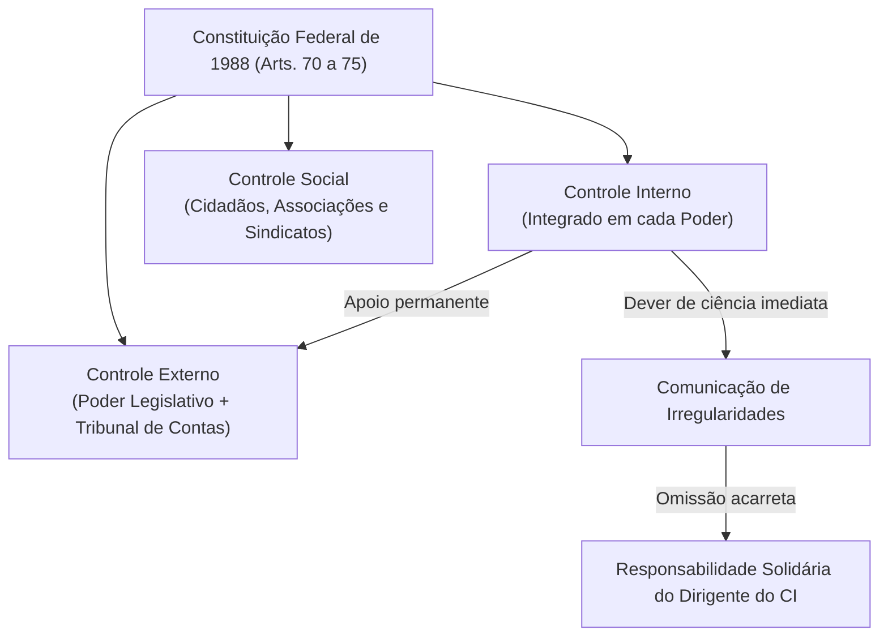
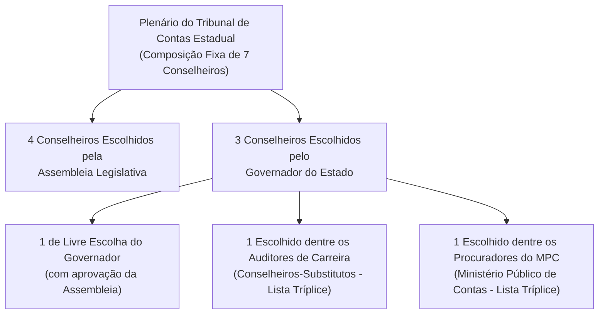

# 01 - Sistema Constitucional de Controle e Jurisdição dos Tribunais de Contas

> **Matéria:** Noções de Controle Externo  
> **Cargo:** A01 – Técnico de Controle Externo – Especialidade: Técnico Administrativo  
> **Arquivo:** `01_sistema_constitucional_e_jurisdicao_dos_tcs.md`  
> **Status:** 🟢 Teoria Aprofundada + 5 Questões FCC Comentadas (A a E)

---

## 📌 Ementa / Itens do Edital

- Sistema constitucional de controle da Administração Pública: controle interno e controle externo;
- Relação e integração harmônica entre os sistemas de controle interno e externo;
- Dever de comunicação imediata sob pena de responsabilidade solidária (Artigo 74, § 1º, da CF/88);
- Tribunais de Contas: natureza jurídica, autonomia institucional, funcional, administrativa e orçamentária;
- O modelo federal e o princípio da simetria constitucional (Artigo 75 da CF/88);
- Composição e nomeação de membros dos Tribunais de Contas Estaduais (Artigos 73 e 75 da CF/88);
- Jurisdição dos Tribunais de Contas: abrangência subjetiva e objetiva; gestores públicos e particulares que guardem, arrecadem, gerenciem ou administrem verbas públicas;
- Competências constitucionais dos Tribunais de Contas:
    - Apreciação de contas do Chefe do Poder Executivo (parecer prévio opinativo e político-constitucional);
    - Julgamento técnico das contas dos administradores e demais responsáveis por recursos públicos (contas de gestão);
    - Fiscalização de atos de admissão de pessoal e concessão de benefícios previdenciários (atos complexos, Súmula Vinculante nº 3 e Tema 445 do STF);
    - Fixação de prazo para adoção de providências saneadoras e sustação direta de atos administrativos ilegais;
    - Sustação de contratos administrativos (competência privativa do Poder Legislativo com atuação subsidiária do TC);
- Eficácia das decisões dos Tribunais de Contas: imputação de débito e multa com força de título executivo extrajudicial (Artigo 71, § 3º, da CF/88);
- Limites da jurisdição de contas, prescrição da pretensão punitiva/ressarcitória (Tema 899 do STF) e independência das instâncias civil, penal e administrativa.

---

## 🧭 Sumário

1. [O Modelo Constitucional de Controle e a Responsabilidade Solidária](#1-o-modelo-constitucional-de-controle-e-a-responsabilidade-solidaria)
    1. [Sistemas de Controle Externo, Interno e Social](#11-sistemas-de-controle-externo-interno-e-social)
    2. [O Dever de Comunicação do Controle Interno e Sanção de Solidariedade (Art. 74, § 1º)](#12-o-dever-de-comunicacao-do-controle-interno-e-sancao-de-solidariedade-art-74-1o)
2. [Natureza Jurídica, Autonomia e Princípio da Simetria (Art. 75)](#2-natureza-juridica-autonomia-e-principio-da-simetria-art-75)
    1. [Natureza Jurídica e Autonomias dos Tribunais de Contas](#21-natureza-juridica-e-autonomias-dos-tribunais-de-contas)
    2. [O Princípio da Simetria Constitucional Federativa e a Composição dos TCEs](#22-o-principio-da-simetria-constitucional-federativa-e-a-composicao-dos-tces)
    3. [Teste 165](#Teste-165)
    4. [Teste 166](#Teste-166)
3. [Competências Constitucionais: Julgamento Técnico versus Parecer Prévio](#3-competencias-constitucionais-julgamento-tecnico-versus-parecer-previo)
    1. [Contas de Governo versus Contas de Gestão](#31-contas-de-governo-versus-contas-de-gestao)
    2. [O Julgamento das Contas de Prefeito Municipal (Tema 835 do STF)](#32-o-julgamento-das-contas-de-prefeito-municipal-tema-835-do-stf)
    3. [Teste 167](#Teste-167)
4. [Registro de Atos de Admissão e Benefícios Previdenciários (Art. 71, III)](#4-registro-de-atos-de-admissao-e-beneficios-previdenciarios-art-71-iii)
    1. [Teste 168](#Teste-168)
    2. [Teste 169](#Teste-169)
5. [Sustação de Atos Ilegais versus Sustação de Contratos Administrativos](#5-sustacao-de-atos-ilegais-versus-sustacao-de-contratos-administrativos)
    1. [Teste 170](#Teste-170)
    2. [Teste 171](#Teste-171)
6. [Eficácia Executiva e Prescritibilidade (Art. 71, § 3º e Tema 899 do STF)](#6-eficacia-executiva-e-prescritibilidade-art-71-3o-e-tema-899-do-stf)
    1. [Teste 172](#Teste-172)
    2. [Teste 173](#Teste-173)
7. [Jurisdição Ampla e Independência das Instâncias](#7-jurisdicao-ampla-e-independencia-das-instancias)
    1. [Teste 174](#Teste-174)
    2. [Teste 175](#Teste-175)
8. [🌐 Fontes Oficiais & Jurisprudenciais Recomendadas](#fontes-oficiais-jurisprudenciais-recomendadas)

---

## 1. O Modelo Constitucional de Controle e a Responsabilidade Solidária

O controle dos recursos públicos no Brasil é tripartite e integrado:

1. **Controle Externo:** Exercido pelo **Poder Legislativo** com o **auxílio técnico-constitucional do Tribunal de Contas** competente (TCU na União, TCE nos Estados e DF, TCMs onde existentes).
2. **Controle Interno:** Mantido de forma **integrada** por cada um dos Poderes (Executivo, Legislativo e Judiciário) e pelo Ministério Público.
3. **Controle Social:** Exercido diretamente pela sociedade civil mediante instrumentos de transparência e cidadania (art. 74, § 2º).

### 1.1 Sistemas de Controle Externo, Interno e Social
- O **Controle Externo** possui titularidade política no Poder Legislativo, sendo operacionalizado na plenitude técnica pelo Tribunal de Contas, órgão constitucional independente de controle da legitimidade, legalidade, economicidade, aplicação de subvenções e renúncia de receitas públicas.
- O **Controle Interno** atua no seio de cada estrutura orgânica para avaliar o cumprimento das metas do PPA, comprovar a legalidade da gestão orçamentária e apoiar o controle externo no exercício de sua missão institucional (art. 74, I a IV).
- O **Controle Social** assegura a qualquer cidadão, partido político, associação ou sindicato legitimidade para denunciar irregularidades perante o Tribunal de Contas (art. 74, § 2º).

### 1.2 O Dever de Comunicação do Controle Interno e Sanção de Solidariedade (Art. 74, § 1º)
- Os responsáveis pelo controle interno, ao tomarem conhecimento de qualquer irregularidade ou ilegalidade no órgão, **devem dar ciência imediata ao Tribunal de Contas competente**.
- **Sanção por Omissão:** Se o titular do controle interno silenciar dolosa ou culposamente, responderá **pessoal e solidariamente** com o gestor ímprobo pelo dano apurado e pelas sanções cominadas pelo Tribunal de Contas.

---

## 2. Natureza Jurídica, Autonomia e Princípio da Simetria (Art. 75)

### 2.1 Natureza Jurídica e Autonomias dos Tribunais de Contas
- Os Tribunais de Contas são **órgãos estatais independentes**, de extração estritamente constitucional.
- **Não integram a estrutura hierárquica do Poder Legislativo**, tampouco do Poder Executivo ou do Judiciário. Exercem magistratura técnica de contas especializada dotada de autogoverno.
- Possuem **autonomia administrativa, funcional, orçamentária e financeira**, além de quadro próprio de servidores públicos efetivos e poder de iniciativa reservada para suas leis orgânicas.

### 2.2 O Princípio da Simetria Constitucional Federativa e a Composição dos TCEs
O art. 75 da Carta Magna estabelece que as normas constitucionais federais sobre fiscalização financeira e organização do Tribunal de Contas da União aplicam-se compulsoriamente aos Tribunais de Contas dos Estados, do Distrito Federal e dos Municípios:

- **Composição dos Tribunais de Contas Estaduais (TCE-GO):**
    - O plenário é composto por **7 Conselheiros** (ao contrário do TCU, que possui 9 Ministros).
    - Regra constitucional de escolha e indicação (Art. 73, § 2º c/c Art. 75):
    - **4 Conselheiros** indicados e eleitos pela **Assembleia Legislativa**;
    - **3 Conselheiros** indicados pelo **Governador do Estado**, com prévia aprovação da Assembleia Legislativa, sendo:
        - 1 de livre escolha do Governador;
        - 1 obrigatoriamente escolhido dentre os **Auditores de Controle Externo (Conselheiros-Substitutos)**, a partir de lista tríplice de antiguidade e merecimento;
        - 1 obrigatoriamente escolhido dentre os **Procuradores do Ministério Público de Contas**, a partir de lista tríplice de antiguidade e merecimento.

---

### Teste 001
**(FGV – TCE/GO – 2024 – Analista de Controle Externo - Ciências Contábeis)**
A Lei nº 14.133/2021 define as funções dos Tribunais de Contas no contexto das normas que regem as licitações e contratos administrativos no Brasil. Assinale a opção que indica uma função dos Tribunais de Contas constante na Lei nº 14.133/2021.

* **A)** Julgar documentos relativos às licitações.
* **B)** Promover gestão por competências.
* **C)** Frustrar a competitividade em licitações com a participação de cooperativas.
* **D)** Estabelecer tratamento igualitário entre empresas brasileiras e estrangeiras.
* **E)** Promover congressos sobre contratações públicas.

---

> **Comentário Detalhado:**
>
> - **A)** **Incorreta.** A opção apresenta proposição em desacordo com os fundamentos teóricos e técnicos do tópico ao afirmar que "Julgar documentos relativos às licitações". De acordo com a teoria estudada em *2.2 O Princípio da Simetria Constitucional Federativa e a Composição dos TCEs*, o art. 75 da Carta Magna estabelece que as normas constitucionais federais sobre fiscalização financeira e organização do Tribunal de Contas da União aplicam se compulsoriamente aos Tribunais de Contas dos Estados, do Distrito Federal e dos Municípios.
> - **B)** **Incorreta.** A opção apresenta proposição em desacordo com os fundamentos teóricos e técnicos do tópico ao afirmar que "Promover gestão por competências". De acordo com a teoria estudada em *1.1 Sistemas de Controle Externo, Interno e Social*, o Controle Interno atua no seio de cada estrutura orgânica para avaliar o cumprimento das metas do PPA, comprovar a legalidade da gestão orçamentária e apoiar o controle externo no exercício de sua missão institucional (art. 74, I a IV).
> - **C)** **Incorreta.** A opção apresenta proposição em desacordo com os fundamentos teóricos e técnicos do tópico ao afirmar que "Frustrar a competitividade em licitações com a participação de cooperativas". De acordo com a teoria estudada em *2.1 Natureza Jurídica e Autonomias dos Tribunais de Contas*, os Tribunais de Contas são órgãos estatais independentes, de extração estritamente constitucional.
> - **D)** **Incorreta.** A opção apresenta proposição em desacordo com os fundamentos teóricos e técnicos do tópico ao afirmar que "Estabelecer tratamento igualitário entre empresas brasileiras e estrangeiras". De acordo com a teoria estudada em *2.1 Natureza Jurídica e Autonomias dos Tribunais de Contas*, não integram a estrutura hierárquica do Poder Legislativo, tampouco do Poder Executivo ou do Judiciário. Exercem magistratura técnica de contas especializada dotada de autogoverno.
> - **E)** **Correta.** Conforme fundamentado na seção *1.1 Sistemas de Controle Externo, Interno e Social* deste guia, o Controle Externo possui titularidade política no Poder Legislativo, sendo operacionalizado na plenitude técnica pelo Tribunal de Contas, órgão constitucional independente de controle da legitimidade, legalidade, economicidade, aplicação de subvenções e renúncia de receitas públicas. Dessa forma, está plenamente correta a assertiva da banca (FGV – TCE/GO/2024) ao estabelecer que "Promover congressos sobre contratações públicas".
>
> **Gabarito: E**

---

