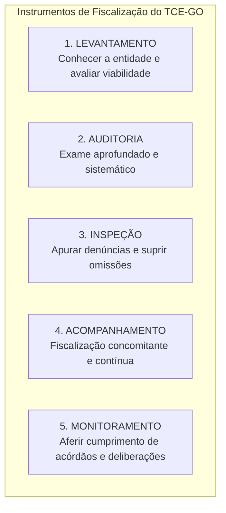

# 02 - Instrumentos de Fiscalização, Tipos de Auditoria e Normas NBASP / INTOSAI

> **Matéria:** Noções de Controle Externo  
> **Cargo:** A01 – Técnico de Controle Externo – Especialidade: Técnico Administrativo  
> **Arquivo:** `02_instrumentos_e_tipos_de_auditoria_governamental_nbasp.md`  
> **Status:** 🟢 Teoria Aprofundada + 5 Questões FCC Comentadas (A a E)

---

## 📌 Ementa / Itens do Edital

- Instrumentos de fiscalização do controle externo: levantamento, auditoria, inspeção, acompanhamento e monitoramento (conceitos, distinções operacionais e hipóteses de cabimento);
- Tipologia da auditoria governamental segundo as normas técnicas:
    - Auditoria de Conformidade (legalidade, legitimidade, regularidade formal e cumprimento normativo);
    - Auditoria Operacional / de Desempenho (avaliação dos 4 Es: economicidade, eficiência, eficácia e efetividade);
    - Auditoria Financeira (exame das demonstrações contábeis e tipos de opinião do auditor);
- Estrutura das Normas Internacionais das Entidades Fiscalizadoras Superiores (INTOSAI) e Declaração de Lima;
- Normas Brasileiras de Auditoria do Setor Público (NBASP) emitidas pelo Instituto Rui Barbosa (IRB):
    - **NBASP 100:** Princípios Fundamentais de Auditoria do Setor Público (as três partes da auditoria, objeto e critérios);
    - **NBASP 200:** Princípios de Auditoria Financeira;
    - **NBASP 300:** Princípios de Auditoria Operacional;
    - **NBASP 400:** Princípios de Auditoria de Conformidade;
- Postura profissional e conduta ética do auditor de controle externo: independência, integridade, ceticismo profissional, julgamento profissional, devido zelo e sigilo funcional;
- Matrizes metodológicas: Matriz de Planejamento e Matriz de Achados de Auditoria.

---

## 🧭 Sumário

1. [Os Cinco Instrumentos de Fiscalização do Controle Externo](#1-os-cinco-instrumentos-de-fiscalizacao-do-controle-externo)
    1. [Conceito e Finalidade Prática de Cada Instrumento](#11-conceito-e-finalidade-pratica-de-cada-instrumento)
    2. [Diferença Prática entre Inspeção e Monitoramento](#12-diferenca-pratica-entre-inspecao-e-monitoramento)
    3. [Teste 176](#Teste-176)
    4. [Teste 177](#Teste-177)
2. [Tipologia das Auditorias Governamentais (Normas NBASP / INTOSAI)](#2-tipologia-das-auditorias-governamentais-normas-nbasp-intosai)
    1. [Auditoria de Conformidade (NBASP 400)](#21-auditoria-de-conformidade-nbasp-400)
    2. [Auditoria Operacional ou de Desempenho e os 4 Es (NBASP 300)](#22-auditoria-operacional-ou-de-desempenho-e-os-4-es-nbasp-300)
    3. [Auditoria Financeira e os Tipos de Opinião do Auditor (NBASP 200)](#23-auditoria-financeira-e-os-tipos-de-opiniao-do-auditor-nbasp-200)
    4. [Teste 178](#Teste-178)
    5. [Teste 179](#Teste-179)
    6. [Teste 180](#Teste-180)
    7. [Teste 181](#Teste-181)
3. [Estrutura Normativa NBASP / INTOSAI e as Três Partes da Auditoria](#3-estrutura-normativa-nbasp-intosai-e-as-tres-partes-da-auditoria)
    1. [Teste 182](#Teste-182)
4. [Postura e Conduta Profissional do Auditor (NBASP 100)](#4-postura-e-conduta-profissional-do-auditor-nbasp-100)
    1. [Teste 183](#Teste-183)
    2. [Teste 184](#Teste-184)
5. [Matrizes Metodológicas de Trabalho: Planejamento e Achados](#5-matrizes-metodologicas-de-trabalho-planejamento-e-achados)
    1. [Teste 185](#Teste-185)
    2. [Teste 186](#Teste-186)
6. [🌐 Fontes Oficiais & Normativas Recomendadas](#fontes-oficiais-normativas-recomendadas)

---

## 1. Os Cinco Instrumentos de Fiscalização do Controle Externo

A Lei Orgânica do Tribunal de Contas do Estado de Goiás (Lei Estadual nº 16.168/2007) e o seu Regimento Interno estruturam a atuação fiscalizatória externa em **cinco instrumentos operacionais fundamentais**:

### 1.1 Conceito e Finalidade Prática de Cada Instrumento

| Instrumento | Conceito & Finalidade | Quando é Utilizado na Prática? |
| :--- | :--- | :--- |
| **Levantamento** | Utilizado para conhecer a organização, o funcionamento dos órgãos públicos, mapear sistemas de informação e **avaliar a viabilidade da realização de futuras fiscalizações**. | Fase exploratória prévia; elaboração do Plano Anual de Fiscalização do Tribunal. |
| **Auditoria** | Instrumento formal e abrangente destinado a examinar a legalidade, legitimidade e economicidade de atos, contratos, demonstrações contábeis e programas de governo. | Fiscalização planejada de grande porte (conformidade, operacional ou financeira). |
| **Inspeção** | Destinada a suprir omissões ou lacunas de informações, esclarecer dúvidas pontuais em processos em andamento ou **apurar denúncias e representações de caráter urgente**. | Atuação pontual, corretiva e de resposta a denúncias de irregularidades. |
| **Acompanhamento** | Utilizado para fiscalizar tempestivamente a gestão, de forma **concomitante e periódica**, ao longo de um determinado período. | Grandes obras públicas em execução, repasses contínuos e editais de licitação em andamento. |
| **Monitoramento** | Destinado especificamente a verificar o **cumprimento das deliberações** (determinações e recomendações) expedidas pelo Tribunal e os resultados gerados. | Etapa pós-auditoria; fiscaliza se o órgão cumpriu os prazos e providências do acórdão. |

### 1.2 Diferença Prática entre Inspeção e Monitoramento
> 🚨 **ALERTA DE PROVA / PEGADINHA FCC:**  
> A banca FCC frequentemente permuta as finalidades da **Inspeção** e do **Monitoramento**:  
>
> - Se o enunciado mencionar *"apurar fatos noticiados em representação de vereador ou denúncia popular urgente"*, o instrumento próprio e adequado é a **INSPEÇÃO**!  
> - Se o enunciado descrever *"verificar se a Secretaria de Educação adotou as providências e determinações exaradas em acórdão anterior do Tribunal"*, o instrumento correto é o **MONITORAMENTO**!

---

### Teste 001
**(FGV – TCE/GO – 2024 – Analista de Controle Externo - Ciências Contábeis)**
As Normas Internacionais das Entidades Fiscalizadoras Superiores (ISSAI), desenvolvidas pela Organização Internacional das Entidades Fiscalizadoras Superiores (INTOSAI), visam promover a realização de auditorias independentes e eficazes pelas Entidades Fiscalizadoras Superiores (EFS). Sobre auditoria governamental segundo a INTOSAI, analise os itens a seguir: I. As EFS podem optar por compilar um único documento normativo, uma série de tais documentos ou uma combinação de documentos normativos e outros documentos oficiais; II. As EFS devem declarar quais normas elas aplicam na execução de suas auditorias, e essa declaração deve ser acessível para os usuários dos seus relatórios; III. As EFS podem decidir adotar as Diretrizes Gerais de Auditoria como suas normas oficiais. Está correto o que se afirma em

* **A)** I, apenas.
* **B)** I e II, apenas.
* **C)** I e III, apenas.
* **D)** II e III, apenas.
* **E)** I, II e III.

---

> **Comentário Detalhado:**
>
> - **A)** **Incorreta.** A opção incorre em restrição indevida ao limitar o escopo conceitual ao afirmar que "I, apenas". De acordo com a teoria estudada em *1.1 Conceito e Finalidade Prática de Cada Instrumento*, acompanhamento: Utilizado para fiscalizar tempestivamente a gestão, de forma concomitante e periódica, ao longo de um determinado período. — Grandes obras públicas em execução, repasses contínuos e editais de licitação em andamento.
> - **B)** **Incorreta.** A opção incorre em restrição indevida ao limitar o escopo conceitual ao afirmar que "I e II, apenas". De acordo com a teoria estudada em *1.2 Diferença Prática entre Inspeção e Monitoramento*, se o enunciado descrever "verificar se a Secretaria de Educação adotou as providências e determinações exaradas em acórdão anterior do Tribunal" , o instrumento correto é o MONITORAMENTO!.
> - **C)** **Incorreta.** A opção incorre em restrição indevida ao limitar o escopo conceitual ao afirmar que "I e III, apenas". De acordo com a teoria estudada em *1. Os Cinco Instrumentos de Fiscalização do Controle Externo*, aUD["2. AUDITORIA<br/ Exame aprofundado e sistemático"].
> - **D)** **Incorreta.** A opção incorre em restrição indevida ao limitar o escopo conceitual ao afirmar que "II e III, apenas". De acordo com a teoria estudada em *1.1 Conceito e Finalidade Prática de Cada Instrumento*, auditoria: Instrumento formal e abrangente destinado a examinar a legalidade, legitimidade e economicidade de atos, contratos, demonstrações contábeis e programas de governo. — Fiscalização planejada de grande porte (conformidade, operacional ou financeira).
> - **E)** **Correta.** Conforme fundamentado na seção *1.1 Conceito e Finalidade Prática de Cada Instrumento* deste guia, levantamento: Utilizado para conhecer a organização, o funcionamento dos órgãos públicos, mapear sistemas de informação e avaliar a viabilidade da realização de futuras fiscalizações. — Fase exploratória prévia; elaboração do Plano Anual de Fiscalização do Tribunal. Dessa forma, está plenamente correta a assertiva da banca (FGV – TCE/GO/2024) ao estabelecer que "I, II e III".
>
> **Gabarito: E**

---

### Teste 002
**(FGV – TCE/GO – 2024 – Analista de Controle Externo - Ciências Contábeis)**
Os princípios de auditoria constantes nas Normas Internacionais das Entidades Fiscalizadoras Superiores (ISSAI) são fundamentais para a condução de uma auditoria. Assinale a opção que indica o princípio que enfatiza a necessidade de comunicação eficaz por parte dos auditores ao longo de todo o processo de auditoria.

* **A)** Ética e independência.
* **B)** Controle de qualidade.
* **C)** Comunicação.
* **D)** Gestão de equipes de auditoria e habilidades.
* **E)** Julgamento, devido zelo e ceticismo profissionais.

---

> **Comentário Detalhado:**
>
> - **A)** **Incorreta.** A opção apresenta proposição em desacordo com os fundamentos teóricos e técnicos do tópico ao afirmar que "Ética e independência". De acordo com a teoria estudada em *1.1 Conceito e Finalidade Prática de Cada Instrumento*, acompanhamento: Utilizado para fiscalizar tempestivamente a gestão, de forma concomitante e periódica, ao longo de um determinado período. — Grandes obras públicas em execução, repasses contínuos e editais de licitação em andamento.
> - **B)** **Incorreta.** A opção apresenta proposição em desacordo com os fundamentos teóricos e técnicos do tópico ao afirmar que "Controle de qualidade". De acordo com a teoria estudada em *1. Os Cinco Instrumentos de Fiscalização do Controle Externo*, aUD["2. AUDITORIA<br/ Exame aprofundado e sistemático"].
> - **C)** **Correta.** Conforme fundamentado na seção *1. Os Cinco Instrumentos de Fiscalização do Controle Externo* deste guia, a Lei Orgânica do Tribunal de Contas do Estado de Goiás (Lei Estadual nº 16.168/2007) e o seu Regimento Interno estruturam a atuação fiscalizatória externa em cinco instrumentos operacionais fundamentais. Dessa forma, está plenamente correta a assertiva da banca (FGV – TCE/GO/2024) ao estabelecer que "Comunicação".
> - **D)** **Incorreta.** A opção apresenta proposição em desacordo com os fundamentos teóricos e técnicos do tópico ao afirmar que "Gestão de equipes de auditoria e habilidades". De acordo com a teoria estudada em *1.1 Conceito e Finalidade Prática de Cada Instrumento*, auditoria: Instrumento formal e abrangente destinado a examinar a legalidade, legitimidade e economicidade de atos, contratos, demonstrações contábeis e programas de governo. — Fiscalização planejada de grande porte (conformidade, operacional ou financeira).
> - **E)** **Incorreta.** A opção apresenta proposição em desacordo com os fundamentos teóricos e técnicos do tópico ao afirmar que "Julgamento, devido zelo e ceticismo profissionais". De acordo com a teoria estudada em *1.1 Conceito e Finalidade Prática de Cada Instrumento*, monitoramento: Destinado especificamente a verificar o cumprimento das deliberações (determinações e recomendações) expedidas pelo Tribunal e os resultados gerados. — Etapa pós auditoria; fiscaliza se o órgão cumpriu os prazos e providências do acórdão.
>
> **Gabarito: C**

---

### Teste 003
**(FGV – TCE/GO – 2024 – Analista de Controle Externo - Ciências Contábeis)**
A Declaração de Lima é considerada a Carta Magna da auditoria governamental, uma vez que lançou as bases do controle público. Sobre a Declaração de Lima, analise os itens a seguir: I. O principal objetivo da Declaração de Lima é defender a necessidade de uma fiscalização independente do setor público. II. Dada a importância histórica e institucional global deste documento, a Declaração de Lima foi oficialmente integrada à estrutura da NBASP. III. A Declaração de Lima se fundamenta no Estado de Direito e na Democracia, premissas para uma fiscalização do setor público dependente. Está correto o que se afirma em

* **A)** I, apenas.
* **B)** I e II, apenas.
* **C)** I e III, apenas.
* **D)** II e III, apenas.
* **E)** I, II e III.

---

> **Comentário Detalhado:**
>
> - **A)** **Incorreta.** A opção incorre em restrição indevida ao limitar o escopo conceitual ao afirmar que "I, apenas". De acordo com a teoria estudada em *1. Os Cinco Instrumentos de Fiscalização do Controle Externo*, aUD["2. AUDITORIA<br/ Exame aprofundado e sistemático"].
> - **B)** **Correta.** Conforme fundamentado na seção *1.2 Diferença Prática entre Inspeção e Monitoramento* deste guia, se o enunciado descrever "verificar se a Secretaria de Educação adotou as providências e determinações exaradas em acórdão anterior do Tribunal" , o instrumento correto é o MONITORAMENTO!. Dessa forma, está plenamente correta a assertiva da banca (FGV – TCE/GO/2024) ao estabelecer que "I e II, apenas".
> - **C)** **Incorreta.** A opção incorre em restrição indevida ao limitar o escopo conceitual ao afirmar que "I e III, apenas". De acordo com a teoria estudada em *1.1 Conceito e Finalidade Prática de Cada Instrumento*, auditoria: Instrumento formal e abrangente destinado a examinar a legalidade, legitimidade e economicidade de atos, contratos, demonstrações contábeis e programas de governo. — Fiscalização planejada de grande porte (conformidade, operacional ou financeira).
> - **D)** **Incorreta.** A opção incorre em restrição indevida ao limitar o escopo conceitual ao afirmar que "II e III, apenas". De acordo com a teoria estudada em *1.1 Conceito e Finalidade Prática de Cada Instrumento*, monitoramento: Destinado especificamente a verificar o cumprimento das deliberações (determinações e recomendações) expedidas pelo Tribunal e os resultados gerados. — Etapa pós auditoria; fiscaliza se o órgão cumpriu os prazos e providências do acórdão.
> - **E)** **Incorreta.** A opção apresenta proposição em desacordo com os fundamentos teóricos e técnicos do tópico ao afirmar que "I, II e III". De acordo com a teoria estudada em *1. Os Cinco Instrumentos de Fiscalização do Controle Externo*, a Lei Orgânica do Tribunal de Contas do Estado de Goiás (Lei Estadual nº 16.168/2007) e o seu Regimento Interno estruturam a atuação fiscalizatória externa em cinco instrumentos operacionais fundamentais.
>
> **Gabarito: B**

---

### Teste 004
**(FGV – TCE/GO – 2024 – Analista de Controle Externo - Ciências Contábeis)**
A NBASP 10 traz os princípios que devem ser observados pelo Tribunal de Contas para preservar a sua independência institucional, o que tem impactos na imparcialidade e na credibilidade das conclusões de seus trabalhos e relatórios. Assinale a opção que indica o princípio que afirma que os Tribunais de Contas devem operar sem sofrer ingerência por parte da Administração Pública sobre o desempenho das suas funções.

* **A)** Independência dos Tribunais de Contas para o desempenho de suas competências.
* **B)** Acesso irrestrito a informações.
* **C)** Prevenção ao conflito de interesses.
* **D)** Previsão legal da independência dos Tribunais de Contas.
* **E)** Cooperação interinstitucional sem prejuízo da independência e da autonomia.

---

> **Comentário Detalhado:**
>
> - **A)** **Correta.** Conforme fundamentado na seção *1. Os Cinco Instrumentos de Fiscalização do Controle Externo* deste guia, a Lei Orgânica do Tribunal de Contas do Estado de Goiás (Lei Estadual nº 16.168/2007) e o seu Regimento Interno estruturam a atuação fiscalizatória externa em cinco instrumentos operacionais fundamentais. Dessa forma, está plenamente correta a assertiva da banca (FGV – TCE/GO/2024) ao estabelecer que "Independência dos Tribunais de Contas para o desempenho de suas competências".
> - **B)** **Incorreta.** A opção apresenta proposição em desacordo com os fundamentos teóricos e técnicos do tópico ao afirmar que "Acesso irrestrito a informações". De acordo com a teoria estudada em *1.1 Conceito e Finalidade Prática de Cada Instrumento*, inspeção: Destinada a suprir omissões ou lacunas de informações, esclarecer dúvidas pontuais em processos em andamento ou apurar denúncias e representações de caráter urgente. — Atuação pontual, corretiva e de resposta a denúncias de irregularidades.
> - **C)** **Incorreta.** A opção apresenta proposição em desacordo com os fundamentos teóricos e técnicos do tópico ao afirmar que "Prevenção ao conflito de interesses". De acordo com a teoria estudada em *Fundamentos Teóricos*, status: 🟢 Teoria Aprofundada + 5 Questões FCC Comentadas (A a E).
> - **D)** **Incorreta.** A opção apresenta proposição em desacordo com os fundamentos teóricos e técnicos do tópico ao afirmar que "Previsão legal da independência dos Tribunais de Contas". De acordo com a teoria estudada em *1. Os Cinco Instrumentos de Fiscalização do Controle Externo*, subgraph Instrumentos["Instrumentos de Fiscalização do TCE GO"].
> - **E)** **Incorreta.** A opção apresenta proposição em desacordo com os fundamentos teóricos e técnicos do tópico ao afirmar que "Cooperação interinstitucional sem prejuízo da independência e da autonomia". De acordo com a teoria estudada em *1. Os Cinco Instrumentos de Fiscalização do Controle Externo*, lEV["1. LEVANTAMENTO<br/ Conhecer a entidade e avaliar viabilidade"].
>
> **Gabarito: A**

---

### Teste 005
**(FGV – TCE/GO – 2024 – Analista de Controle Externo - Ciências Contábeis)**
A NBASP 20 objetiva promover os princípios de transparência e de accountability nos Tribunais de Contas, que devem atuar de forma exemplar, mediante a aplicação destes princípios em todos os seus atos. Sobre a NBASP 20 - Transparência e Accountability, analise os itens a seguir: I. Os Tribunais de Contas devem atuar sob normas a partir das quais seja possível responsabilizar seus membros e servidores. II. É recomendável que os Tribunais de Contas divulguem ao público as informações básicas sobre suas competências, suas responsabilidades, sua missão, sua estratégia e suas atividades em uma das línguas oficiais da Intosai, além da língua portuguesa. III. Os Tribunais de Contas devem ter regras ou códigos de ética, políticas e práticas que estejam alinhados com as Normas Brasileiras de Auditoria do Setor Público, especialmente a NBASP 130. Está correto o que se afirma em

* **A)** I, apenas.
* **B)** I e II, apenas.
* **C)** I e III, apenas.
* **D)** II e III, apenas.
* **E)** I, II e III.

---

> **Comentário Detalhado:**
>
> - **A)** **Incorreta.** A opção incorre em restrição indevida ao limitar o escopo conceitual ao afirmar que "I, apenas". De acordo com a teoria estudada em *1. Os Cinco Instrumentos de Fiscalização do Controle Externo*, a Lei Orgânica do Tribunal de Contas do Estado de Goiás (Lei Estadual nº 16.168/2007) e o seu Regimento Interno estruturam a atuação fiscalizatória externa em cinco instrumentos operacionais fundamentais.
> - **B)** **Incorreta.** A opção incorre em restrição indevida ao limitar o escopo conceitual ao afirmar que "I e II, apenas". De acordo com a teoria estudada em *1.1 Conceito e Finalidade Prática de Cada Instrumento*, inspeção: Destinada a suprir omissões ou lacunas de informações, esclarecer dúvidas pontuais em processos em andamento ou apurar denúncias e representações de caráter urgente. — Atuação pontual, corretiva e de resposta a denúncias de irregularidades.
> - **C)** **Incorreta.** A opção incorre em restrição indevida ao limitar o escopo conceitual ao afirmar que "I e III, apenas". De acordo com a teoria estudada em *1.1 Conceito e Finalidade Prática de Cada Instrumento*, acompanhamento: Utilizado para fiscalizar tempestivamente a gestão, de forma concomitante e periódica, ao longo de um determinado período. — Grandes obras públicas em execução, repasses contínuos e editais de licitação em andamento.
> - **D)** **Incorreta.** A opção incorre em restrição indevida ao limitar o escopo conceitual ao afirmar que "II e III, apenas". De acordo com a teoria estudada em *1.2 Diferença Prática entre Inspeção e Monitoramento*, se o enunciado descrever "verificar se a Secretaria de Educação adotou as providências e determinações exaradas em acórdão anterior do Tribunal" , o instrumento correto é o MONITORAMENTO!.
> - **E)** **Correta.** Conforme fundamentado na seção *1.1 Conceito e Finalidade Prática de Cada Instrumento* deste guia, auditoria: Instrumento formal e abrangente destinado a examinar a legalidade, legitimidade e economicidade de atos, contratos, demonstrações contábeis e programas de governo. — Fiscalização planejada de grande porte (conformidade, operacional ou financeira). Dessa forma, está plenamente correta a assertiva da banca (FGV – TCE/GO/2024) ao estabelecer que "I, II e III".
>
> **Gabarito: E**

---

### Teste 006
**(FGV – TCE/GO – 2024 – Analista de Controle Externo - Ciências Contábeis)**
A NBASP 50 - Princípios de Atividades Jurisdicionais dos Tribunais de Contas desenvolve doze princípios adequados ao contexto especifico das atividades jurisdicionais dos Tribunais de Contas. Nesse contexto, analise os itens a seguir: I. O Tribunal de Contas deve garantir que as pessoas responsáveis perante ele sejam submetidas a um julgamento justo, garantido por procedimentos legais. II. Qualquer julgamento do Tribunal de Contas deve ser aberto a objeções e reconsideração e estar sujeito a revisão ou anulação em conformidade com a legislação nacional. III. Uma pessoa pode ser condenada pela mesma irregularidade a várias sanções da mesma natureza impostas pelo Tribunal de Contas. Está correto o que se afirma em

* **A)** I, apenas.
* **B)** I e II, apenas.
* **C)** I e III, apenas.
* **D)** II e III, apenas.
* **E)** I, II e III.

---

> **Comentário Detalhado:**
>
> - **A)** **Incorreta.** A opção incorre em restrição indevida ao limitar o escopo conceitual ao afirmar que "I, apenas". De acordo com a teoria estudada em *1.1 Conceito e Finalidade Prática de Cada Instrumento*, auditoria: Instrumento formal e abrangente destinado a examinar a legalidade, legitimidade e economicidade de atos, contratos, demonstrações contábeis e programas de governo. — Fiscalização planejada de grande porte (conformidade, operacional ou financeira).
> - **B)** **Correta.** Conforme fundamentado na seção *1. Os Cinco Instrumentos de Fiscalização do Controle Externo* deste guia, a Lei Orgânica do Tribunal de Contas do Estado de Goiás (Lei Estadual nº 16.168/2007) e o seu Regimento Interno estruturam a atuação fiscalizatória externa em cinco instrumentos operacionais fundamentais. Dessa forma, está plenamente correta a assertiva da banca (FGV – TCE/GO/2024) ao estabelecer que "I e II, apenas".
> - **C)** **Incorreta.** A opção incorre em restrição indevida ao limitar o escopo conceitual ao afirmar que "I e III, apenas". De acordo com a teoria estudada em *1.2 Diferença Prática entre Inspeção e Monitoramento*, se o enunciado descrever "verificar se a Secretaria de Educação adotou as providências e determinações exaradas em acórdão anterior do Tribunal" , o instrumento correto é o MONITORAMENTO!.
> - **D)** **Incorreta.** A opção incorre em restrição indevida ao limitar o escopo conceitual ao afirmar que "II e III, apenas". De acordo com a teoria estudada em *Fundamentos Teóricos*, status: 🟢 Teoria Aprofundada + 5 Questões FCC Comentadas (A a E).
> - **E)** **Incorreta.** A opção apresenta proposição em desacordo com os fundamentos teóricos e técnicos do tópico ao afirmar que "I, II e III". De acordo com a teoria estudada em *1. Os Cinco Instrumentos de Fiscalização do Controle Externo*, subgraph Instrumentos["Instrumentos de Fiscalização do TCE GO"].
>
> **Gabarito: B**

---

### Teste 007
**(FGV – TCE/GO – 2024 – Analista de Controle Externo - Ciências Contábeis)**
A NBASP 400 - Princípios de Auditoria de Conformidade estabelece diretrizes fundamentais para a realização de auditorias destinadas a verificar se as operações estão em conformidade com leis, regulamentos e normas aplicáveis. Nesse contexto, analise os itens a seguir: I. A auditoria de conformidade é a avaliação independente para determinar se um dado objeto está em conformidade com normas aplicáveis identificadas como critérios. II. As auditorias de conformidade são realizadas para avaliar se atividades, transações orçamentárias e informações cumprem, em todos os aspectos relevantes, as normas que regem a entidade auditada. III. A auditoria de conformidade é frequentemente parte integrante do mandato de uma Entidade Fiscalizadora Superior para a auditoria de entidades do setor público. Está correto o que se afirma em

* **A)** I, apenas.
* **B)** I e II, apenas.
* **C)** I e III, apenas.
* **D)** II e III, apenas.
* **E)** I, II e III.

---

> **Comentário Detalhado:**
>
> - **A)** **Incorreta.** A opção incorre em restrição indevida ao limitar o escopo conceitual ao afirmar que "I, apenas". De acordo com a teoria estudada em *1.1 Conceito e Finalidade Prática de Cada Instrumento*, levantamento: Utilizado para conhecer a organização, o funcionamento dos órgãos públicos, mapear sistemas de informação e avaliar a viabilidade da realização de futuras fiscalizações. — Fase exploratória prévia; elaboração do Plano Anual de Fiscalização do Tribunal.
> - **B)** **Incorreta.** A opção incorre em restrição indevida ao limitar o escopo conceitual ao afirmar que "I e II, apenas". De acordo com a teoria estudada em *1.2 Diferença Prática entre Inspeção e Monitoramento*, se o enunciado descrever "verificar se a Secretaria de Educação adotou as providências e determinações exaradas em acórdão anterior do Tribunal" , o instrumento correto é o MONITORAMENTO!.
> - **C)** **Correta.** Conforme fundamentado na seção *1. Os Cinco Instrumentos de Fiscalização do Controle Externo* deste guia, lEV["1. LEVANTAMENTO<br/ Conhecer a entidade e avaliar viabilidade"]. Dessa forma, está plenamente correta a assertiva da banca (FGV – TCE/GO/2024) ao estabelecer que "I e III, apenas".
> - **D)** **Incorreta.** A opção incorre em restrição indevida ao limitar o escopo conceitual ao afirmar que "II e III, apenas". De acordo com a teoria estudada em *1.1 Conceito e Finalidade Prática de Cada Instrumento*, auditoria: Instrumento formal e abrangente destinado a examinar a legalidade, legitimidade e economicidade de atos, contratos, demonstrações contábeis e programas de governo. — Fiscalização planejada de grande porte (conformidade, operacional ou financeira).
> - **E)** **Incorreta.** A opção apresenta proposição em desacordo com os fundamentos teóricos e técnicos do tópico ao afirmar que "I, II e III". De acordo com a teoria estudada em *1.1 Conceito e Finalidade Prática de Cada Instrumento*, monitoramento: Destinado especificamente a verificar o cumprimento das deliberações (determinações e recomendações) expedidas pelo Tribunal e os resultados gerados. — Etapa pós auditoria; fiscaliza se o órgão cumpriu os prazos e providências do acórdão.
>
> **Gabarito: C**

---

### Teste 008
**(FGV – TCE/GO – 2024 – Analista de Controle Externo - Ciências Contábeis)**
A NBASP 9020 - Avaliação de políticas públicas oferece orientações detalhadas para a avaliação rigorosa e abrangente das políticas públicas, visando aprimorar sua eficácia e impacto na sociedade. Nesse contexto, analise os itens a seguir: I. As Entidades Fiscalizadoras Superiores (EFS) não são os únicos atores que podem realizar avaliações de políticas públicas. II. Organizações administrativas devem realizar avaliações de políticas públicas quando requisitadas por autoridades governamentais. III. Semelhantes as outras instituições públicas ou privadas, as EFS precisam demonstrar sua objetividade e comprovar sua independência do governo e de interesses privados. Está correto o que se afirma em

* **A)** I, apenas.
* **B)** I e II, apenas.
* **C)** I e III, apenas.
* **D)** II e III, apenas.
* **E)** I, II e III. Conhecimentos Específicos Noções de Direito Constitucional

---

> **Comentário Detalhado:**
>
> - **A)** **Correta.** Conforme fundamentado na seção *1.1 Conceito e Finalidade Prática de Cada Instrumento* deste guia, auditoria: Instrumento formal e abrangente destinado a examinar a legalidade, legitimidade e economicidade de atos, contratos, demonstrações contábeis e programas de governo. — Fiscalização planejada de grande porte (conformidade, operacional ou financeira). Dessa forma, está plenamente correta a assertiva da banca (FGV – TCE/GO/2024) ao estabelecer que "I, apenas".
> - **B)** **Incorreta.** A opção incorre em restrição indevida ao limitar o escopo conceitual ao afirmar que "I e II, apenas". De acordo com a teoria estudada em *1.1 Conceito e Finalidade Prática de Cada Instrumento*, acompanhamento: Utilizado para fiscalizar tempestivamente a gestão, de forma concomitante e periódica, ao longo de um determinado período. — Grandes obras públicas em execução, repasses contínuos e editais de licitação em andamento.
> - **C)** **Incorreta.** A opção incorre em restrição indevida ao limitar o escopo conceitual ao afirmar que "I e III, apenas". De acordo com a teoria estudada em *1.2 Diferença Prática entre Inspeção e Monitoramento*, se o enunciado descrever "verificar se a Secretaria de Educação adotou as providências e determinações exaradas em acórdão anterior do Tribunal" , o instrumento correto é o MONITORAMENTO!.
> - **D)** **Incorreta.** A opção incorre em restrição indevida ao limitar o escopo conceitual ao afirmar que "II e III, apenas". De acordo com a teoria estudada em *Fundamentos Teóricos*, status: 🟢 Teoria Aprofundada + 5 Questões FCC Comentadas (A a E).
> - **E)** **Incorreta.** A opção apresenta proposição em desacordo com os fundamentos teóricos e técnicos do tópico ao afirmar que "I, II e III. Conhecimentos Específicos Noções de Direito Constitucional". De acordo com a teoria estudada em *1. Os Cinco Instrumentos de Fiscalização do Controle Externo*, a Lei Orgânica do Tribunal de Contas do Estado de Goiás (Lei Estadual nº 16.168/2007) e o seu Regimento Interno estruturam a atuação fiscalizatória externa em cinco instrumentos operacionais fundamentais.
>
> **Gabarito: A**

---

### Teste 009
**(FGV – TCE/PA – 2024 – Auditor de Controle Externo - Administrativa - Administração)**
Na Declaração de Lima (ISSAI 1) são estabelecidos poderes de auditoria (EFS). Tendo por base essa norma, avalie se as seguintes afirmativas acerca de tais poderes estão corretas. I. Os poderes básicos de auditoria das Entidades Fiscalizadoras Superiores deverão estar previstos na Constituição, não se admitindo o seu detalhamento na legislação ordinária. II. Ao auditarem instituições públicas estabelecidas no exterior, restrições previstas no direito internacional serão consideradas; quando justificado, essas limitações deverão ser superadas por deliberação da EFS. III. Todas as operações financeiras públicas, a despeito de estarem ou não refletidas no orçamento nacional, ficarão sujeitas a auditoria por parte de Entidades Fiscalizadoras Superiores. A exclusão de partes da gestão financeira do orçamento público não isentará essas partes da auditoria da Entidade Fiscalizadora Superior. IV. As Entidades Fiscalizadoras Superiores terão poderes para auditar a cobrança de impostos da forma mais extensa possível e de examinar arquivos fiscais individuais. Estão corretas as afirmativas

* **A)** III e IV, somente.
* **B)** I, II e IV, somente.
* **C)** II e III, somente.
* **D)** I, II e III, somente.
* **E)** II, III e IV, somente.

---

> **Comentário Detalhado:**
>
> - **A)** **Correta.** Conforme fundamentado na seção *1.1 Conceito e Finalidade Prática de Cada Instrumento* deste guia, acompanhamento: Utilizado para fiscalizar tempestivamente a gestão, de forma concomitante e periódica, ao longo de um determinado período. — Grandes obras públicas em execução, repasses contínuos e editais de licitação em andamento. Dessa forma, está plenamente correta a assertiva da banca (FGV – TCE/PA/2024) ao estabelecer que "III e IV, somente".
> - **B)** **Incorreta.** A opção incorre em restrição indevida ao limitar o escopo conceitual ao afirmar que "I, II e IV, somente". De acordo com a teoria estudada em *1.1 Conceito e Finalidade Prática de Cada Instrumento*, auditoria: Instrumento formal e abrangente destinado a examinar a legalidade, legitimidade e economicidade de atos, contratos, demonstrações contábeis e programas de governo. — Fiscalização planejada de grande porte (conformidade, operacional ou financeira).
> - **C)** **Incorreta.** A opção incorre em restrição indevida ao limitar o escopo conceitual ao afirmar que "II e III, somente". De acordo com a teoria estudada em *1. Os Cinco Instrumentos de Fiscalização do Controle Externo*, lEV["1. LEVANTAMENTO<br/ Conhecer a entidade e avaliar viabilidade"].
> - **D)** **Incorreta.** A opção incorre em restrição indevida ao limitar o escopo conceitual ao afirmar que "I, II e III, somente". De acordo com a teoria estudada em *1. Os Cinco Instrumentos de Fiscalização do Controle Externo*, aUD["2. AUDITORIA<br/ Exame aprofundado e sistemático"].
> - **E)** **Incorreta.** A opção incorre em restrição indevida ao limitar o escopo conceitual ao afirmar que "II, III e IV, somente". De acordo com a teoria estudada em *1.1 Conceito e Finalidade Prática de Cada Instrumento*, monitoramento: Destinado especificamente a verificar o cumprimento das deliberações (determinações e recomendações) expedidas pelo Tribunal e os resultados gerados. — Etapa pós auditoria; fiscaliza se o órgão cumpriu os prazos e providências do acórdão.
>
> **Gabarito: A**

---

### Teste 010
**(FGV – TCE/PA – 2024 – Auditor de Controle Externo - Administrativa - Gestão Governamental)**
Nos termos da ISSAI 20, Accountability e transparência são dois elementos importantes de boa governança. A transparência é uma força poderosa que, quando aplicada de forma consistente, pode ajudar a combater a corrupção, melhorar a governança e promover a accountability. Considerando as disposições da referida norma, analise as afirmativas a seguir sobre os conceitos de accountability, transparência e sobre os princípios nela veiculados: I. É difícil separar accountability de transparência: ambas englobam muitas das mesmas ações, como por exemplo, a comunicação pública. II. A noção de transparência refere-se à informação pública tempestiva, confiável, clara e relevante da EFS sobre sua situação, seu mandato, sua estratégia, suas atividades, sua gestão financeira, suas operações e seus resultados. III. As EFS garantem que esses princípios de accountability e transparência não são comprometidos quando terceirizam suas atividades, inclusive as funções fiscalizadora e sancionadora. IV. O conceito de accountability refere-se à estrutura jurídica e de comunicação, à estrutura organizacional e estratégia, aos procedimentos e às ações para garantir que o dirigente da EFS, os membros (de instituições colegiais) e o servidores da EFS possam ser responsabilizados pelos seus atos, dentre outras iniciativas. Está correto o que se afirma em

* **A)** I, II e III, somente.
* **B)** I, II e IV, somente.
* **C)** I, II, III e IV.
* **D)** II e IV, somente.
* **E)** I e II, somente.

---

> **Comentário Detalhado:**
>
> - **A)** **Incorreta.** A opção incorre em restrição indevida ao limitar o escopo conceitual ao afirmar que "I, II e III, somente". De acordo com a teoria estudada em *1.1 Conceito e Finalidade Prática de Cada Instrumento*, acompanhamento: Utilizado para fiscalizar tempestivamente a gestão, de forma concomitante e periódica, ao longo de um determinado período. — Grandes obras públicas em execução, repasses contínuos e editais de licitação em andamento.
> - **B)** **Correta.** Conforme fundamentado na seção *1.1 Conceito e Finalidade Prática de Cada Instrumento* deste guia, auditoria: Instrumento formal e abrangente destinado a examinar a legalidade, legitimidade e economicidade de atos, contratos, demonstrações contábeis e programas de governo. — Fiscalização planejada de grande porte (conformidade, operacional ou financeira). Dessa forma, está plenamente correta a assertiva da banca (FGV – TCE/PA/2024) ao estabelecer que "I, II e IV, somente".
> - **C)** **Incorreta.** A opção apresenta proposição em desacordo com os fundamentos teóricos e técnicos do tópico ao afirmar que "I, II, III e IV". De acordo com a teoria estudada em *1.1 Conceito e Finalidade Prática de Cada Instrumento*, levantamento: Utilizado para conhecer a organização, o funcionamento dos órgãos públicos, mapear sistemas de informação e avaliar a viabilidade da realização de futuras fiscalizações. — Fase exploratória prévia; elaboração do Plano Anual de Fiscalização do Tribunal.
> - **D)** **Incorreta.** A opção incorre em restrição indevida ao limitar o escopo conceitual ao afirmar que "II e IV, somente". De acordo com a teoria estudada em *1.1 Conceito e Finalidade Prática de Cada Instrumento*, monitoramento: Destinado especificamente a verificar o cumprimento das deliberações (determinações e recomendações) expedidas pelo Tribunal e os resultados gerados. — Etapa pós auditoria; fiscaliza se o órgão cumpriu os prazos e providências do acórdão.
> - **E)** **Incorreta.** A opção incorre em restrição indevida ao limitar o escopo conceitual ao afirmar que "I e II, somente". De acordo com a teoria estudada em *1.2 Diferença Prática entre Inspeção e Monitoramento*, se o enunciado descrever "verificar se a Secretaria de Educação adotou as providências e determinações exaradas em acórdão anterior do Tribunal" , o instrumento correto é o MONITORAMENTO!.
>
> **Gabarito: B**

---

### Teste 011
**(FGV – TCE/PA – 2024 – Auditor de Controle Externo - Administrativa - Gestão Governamental)**
A NBASP 9020 fornece informações sobre as principais questões para a auditoria operacional e para a avaliação de políticas públicas, de modo a diferenciá-las. Sobre as semelhanças e diferenças entre os dois instrumentos, analise as afirmativas a seguir. I. A auditoria operacional avalia principalmente a economicidade, a eficiência e a efetividade até o nível do resultado imediato, enquanto a avaliação de política pública é definida como o exame desses mesmos aspectos e de resultados mais amplos e adicionalmente de impactos globais e socioeconômicos. II. A avaliação de políticas públicas se concentra na relevância da política, que é a adequação dos seus objetivos em relação às necessidades sociais, econômicas ou ambientais que a política pública quer atender. III. A avaliação de políticas públicas se concentra na utilidade da política, que lida com a questão de conhecer se a política foi vantajosa, levando em consideração, por um lado, todos os seus efeitos diretos (resultados) e indiretos (impactos), inclusive os não-intencionais ou não-esperados, e por outro, as necessidades que pretendia atender. IV. A avaliação de políticas públicas não deve se limitar a objetivos pré-estabelecidos, uma vez que pode questionar os objetivos estabelecidos na legislação. Estão corretas as afirmativas

* **A)** I, II e III, somente.
* **B)** II, III e IV, somente.
* **C)** I, II, III e IV.
* **D)** I, II e IV, somente.
* **E)** II e III, somente.

---

> **Comentário Detalhado:**
>
> - **A)** **Incorreta.** A opção incorre em restrição indevida ao limitar o escopo conceitual ao afirmar que "I, II e III, somente". De acordo com a teoria estudada em *1. Os Cinco Instrumentos de Fiscalização do Controle Externo*, aUD["2. AUDITORIA<br/ Exame aprofundado e sistemático"].
> - **B)** **Incorreta.** A opção incorre em restrição indevida ao limitar o escopo conceitual ao afirmar que "II, III e IV, somente". De acordo com a teoria estudada em *1.1 Conceito e Finalidade Prática de Cada Instrumento*, monitoramento: Destinado especificamente a verificar o cumprimento das deliberações (determinações e recomendações) expedidas pelo Tribunal e os resultados gerados. — Etapa pós auditoria; fiscaliza se o órgão cumpriu os prazos e providências do acórdão.
> - **C)** **Correta.** Conforme fundamentado na seção *1.1 Conceito e Finalidade Prática de Cada Instrumento* deste guia, auditoria: Instrumento formal e abrangente destinado a examinar a legalidade, legitimidade e economicidade de atos, contratos, demonstrações contábeis e programas de governo. — Fiscalização planejada de grande porte (conformidade, operacional ou financeira). Dessa forma, está plenamente correta a assertiva da banca (FGV – TCE/PA/2024) ao estabelecer que "I, II, III e IV".
> - **D)** **Incorreta.** A opção incorre em restrição indevida ao limitar o escopo conceitual ao afirmar que "I, II e IV, somente". De acordo com a teoria estudada em *1. Os Cinco Instrumentos de Fiscalização do Controle Externo*, lEV["1. LEVANTAMENTO<br/ Conhecer a entidade e avaliar viabilidade"].
> - **E)** **Incorreta.** A opção incorre em restrição indevida ao limitar o escopo conceitual ao afirmar que "II e III, somente". De acordo com a teoria estudada em *Fundamentos Teóricos*, status: 🟢 Teoria Aprofundada + 5 Questões FCC Comentadas (A a E).
>
> **Gabarito: C**

---

### Teste 012
**(FGV – TCE/PI – 2025 – Auditor de Controle Externo - Controle Externo - Específica de Área Comum)**
A NBASP 100 - Princípios Fundamentais de Auditoria no Setor Público estabelece as diretrizes essenciais que regem as auditorias governamentais, orientando a conduta e a prática dos auditores no setor público. Essa norma define os princípios básicos de independência, competência, ética e ceticismo profissional, além de enfatizar a necessidade de uma auditoria transparente, objetiva e eficiente, visando promover a responsabilidade, a boa governança e a prestação de contas no uso dos recursos públicos. Quanto à NBASP 100, avalie as afirmativas a seguir e assinale (V) para a verdadeira e (F) para a falsa. ( ) Em geral, a auditoria do setor público pode ser descrita como um processo sistemático de obter e avaliar objetivamente evidências para determinar se as informações ou as condições reais de um objeto estão de acordo com critérios aplicáveis. ( ) Todas as auditorias do setor público contam com os mesmos elementos básicos: o auditor, os demonstrativos contábeis e os usuários previstos (as três partes da auditoria). ( ) O objeto da auditoria refere-se à informação, condição ou atividade que é mensurada ou avaliada de acordo com certos critérios. Pode assumir várias formas e ter diferentes características, dependendo do objetivo da auditoria. As afirmativas são, respectivamente,

* **A)** V – V – V.
* **B)** V – F – V.
* **C)** F – F – F.
* **D)** V – V – F.
* **E)** F – V – V.

---

> **Comentário Detalhado:**
>
> - **A)** **Incorreta.** A opção apresenta proposição em desacordo com os fundamentos teóricos e técnicos do tópico ao afirmar que "V – V – V". De acordo com a teoria estudada em *1. Os Cinco Instrumentos de Fiscalização do Controle Externo*, a Lei Orgânica do Tribunal de Contas do Estado de Goiás (Lei Estadual nº 16.168/2007) e o seu Regimento Interno estruturam a atuação fiscalizatória externa em cinco instrumentos operacionais fundamentais.
> - **B)** **Correta.** Conforme fundamentado na seção *1.1 Conceito e Finalidade Prática de Cada Instrumento* deste guia, levantamento: Utilizado para conhecer a organização, o funcionamento dos órgãos públicos, mapear sistemas de informação e avaliar a viabilidade da realização de futuras fiscalizações. — Fase exploratória prévia; elaboração do Plano Anual de Fiscalização do Tribunal. Dessa forma, está plenamente correta a assertiva da banca (FGV – TCE/PI/2025) ao estabelecer que "V – F – V".
> - **C)** **Incorreta.** A opção apresenta proposição em desacordo com os fundamentos teóricos e técnicos do tópico ao afirmar que "F – F – F". De acordo com a teoria estudada em *1.1 Conceito e Finalidade Prática de Cada Instrumento*, auditoria: Instrumento formal e abrangente destinado a examinar a legalidade, legitimidade e economicidade de atos, contratos, demonstrações contábeis e programas de governo. — Fiscalização planejada de grande porte (conformidade, operacional ou financeira).
> - **D)** **Incorreta.** A opção apresenta proposição em desacordo com os fundamentos teóricos e técnicos do tópico ao afirmar que "V – V – F". De acordo com a teoria estudada em *1. Os Cinco Instrumentos de Fiscalização do Controle Externo*, aUD["2. AUDITORIA<br/ Exame aprofundado e sistemático"].
> - **E)** **Incorreta.** A opção apresenta proposição em desacordo com os fundamentos teóricos e técnicos do tópico ao afirmar que "F – V – V". De acordo com a teoria estudada em *1.1 Conceito e Finalidade Prática de Cada Instrumento*, inspeção: Destinada a suprir omissões ou lacunas de informações, esclarecer dúvidas pontuais em processos em andamento ou apurar denúncias e representações de caráter urgente. — Atuação pontual, corretiva e de resposta a denúncias de irregularidades.
>
> **Gabarito: B**

---

### Teste 013
**(FGV – TCE/PI – 2025 – Auditor de Controle Externo - Controle Externo - Específica de Área Comum)**
A auditoria no setor público é fundamental para assegurar a correta aplicação dos recursos públicos, promovendo transparência, responsabilidade e boa governança. As auditorias ajudam a prevenir fraudes e desperdícios, fortalecendo a confiança dos cidadãos nas instituições governamentais e garantindo que os recursos sejam utilizados de forma ética e eficaz para o bem coletivo. Relacione os tipos principais de auditoria do setor público estabelecidos na NBASP 100 - Princípios Fundamentais de Auditoria no Setor Público, às suas respectivas definições. I. Auditoria Financeira II. Auditoria Operacional III. Auditoria de Conformidade ( ) Foca em determinar se um particular objeto está de acordo com normas identificadas como critérios. É realizada para avaliar se atividades, transações financeiras e informações cumprem, em todos os aspectos relevantes, as normas que regem a entidade auditada. ( ) Foca em determinar se intervenções, programas e instituições estão atuando em conformidade com os princípios de economicidade, de eficiência e de efetividade, bem como se há espaço para aperfeiçoamento. O objetivo é responder a questões-chave de auditoria e apresentar recomendações para aperfeiçoamento. ( ) Foca em determinar se a informação contábil de uma entidade é apresentada em conformidade com a estrutura de relatório financeiro e o marco regulatório aplicável. Assinale a opção que indica a relação correta, segundo a ordem apresentada.

* **A)** I – II – III.
* **B)** III – II – I.
* **C)** III – I – II.
* **D)** I – III – II.
* **E)** II – III – I.

---

> **Comentário Detalhado:**
>
> - **A)** **Incorreta.** A opção apresenta proposição em desacordo com os fundamentos teóricos e técnicos do tópico ao afirmar que "I – II – III". De acordo com a teoria estudada em *1.1 Conceito e Finalidade Prática de Cada Instrumento*, levantamento: Utilizado para conhecer a organização, o funcionamento dos órgãos públicos, mapear sistemas de informação e avaliar a viabilidade da realização de futuras fiscalizações. — Fase exploratória prévia; elaboração do Plano Anual de Fiscalização do Tribunal.
> - **B)** **Correta.** Conforme fundamentado na seção *1.1 Conceito e Finalidade Prática de Cada Instrumento* deste guia, auditoria: Instrumento formal e abrangente destinado a examinar a legalidade, legitimidade e economicidade de atos, contratos, demonstrações contábeis e programas de governo. — Fiscalização planejada de grande porte (conformidade, operacional ou financeira). Dessa forma, está plenamente correta a assertiva da banca (FGV – TCE/PI/2025) ao estabelecer que "III – II – I".
> - **C)** **Incorreta.** A opção apresenta proposição em desacordo com os fundamentos teóricos e técnicos do tópico ao afirmar que "III – I – II". De acordo com a teoria estudada em *1. Os Cinco Instrumentos de Fiscalização do Controle Externo*, lEV["1. LEVANTAMENTO<br/ Conhecer a entidade e avaliar viabilidade"].
> - **D)** **Incorreta.** A opção apresenta proposição em desacordo com os fundamentos teóricos e técnicos do tópico ao afirmar que "I – III – II". De acordo com a teoria estudada em *1.1 Conceito e Finalidade Prática de Cada Instrumento*, monitoramento: Destinado especificamente a verificar o cumprimento das deliberações (determinações e recomendações) expedidas pelo Tribunal e os resultados gerados. — Etapa pós auditoria; fiscaliza se o órgão cumpriu os prazos e providências do acórdão.
> - **E)** **Incorreta.** A opção apresenta proposição em desacordo com os fundamentos teóricos e técnicos do tópico ao afirmar que "II – III – I". De acordo com a teoria estudada em *Fundamentos Teóricos*, status: 🟢 Teoria Aprofundada + 5 Questões FCC Comentadas (A a E).
>
> **Gabarito: B**

---

### Teste 014
**(FGV – TCE/PI – 2025 – Auditor de Controle Externo - Controle Externo - Específica de Área Comum)**
O Auditor Governamental, ao seguir os requisitos gerais da NBASP 3000, realiza auditorias operacionais com integridade, independência e competência, garantindo a credibilidade e a qualidade do trabalho. Esses requisitos asseguram que o auditor aplique ceticismo profissional, obtenha evidências apropriadas e suficientes, e adote uma abordagem baseada em risco. Quanto à NBASP 3000, avalie as afirmativas a seguir e assinale (V) para a verdadeira e (F) para a falsa. ( ) O auditor deve, como parte do planejamento e/ou da condução da auditoria, discutir os critérios de auditoria com a entidade auditada. ( ) O auditor deve gerenciar ativamente o risco de auditoria para evitar o desenvolvimento de achados, conclusões e recomendações incorretos ou incompletos, fornecendo informações inconsistentes ou que não agregam valor. ( ) O auditor deve planejar e manter uma comunicação eficaz e adequada dos aspectos-chave da auditoria com a entidade auditada e as partes interessadas durante todo o processo de auditoria. As afirmativas são, respectivamente,

* **A)** V – F – V.
* **B)** F – V – V.
* **C)** V – V – V.
* **D)** V – V – F.
* **E)** V – F – F.

---

> **Comentário Detalhado:**
>
> - **A)** **Incorreta.** A opção apresenta proposição em desacordo com os fundamentos teóricos e técnicos do tópico ao afirmar que "V – F – V". De acordo com a teoria estudada em *1. Os Cinco Instrumentos de Fiscalização do Controle Externo*, a Lei Orgânica do Tribunal de Contas do Estado de Goiás (Lei Estadual nº 16.168/2007) e o seu Regimento Interno estruturam a atuação fiscalizatória externa em cinco instrumentos operacionais fundamentais.
> - **B)** **Incorreta.** A opção apresenta proposição em desacordo com os fundamentos teóricos e técnicos do tópico ao afirmar que "F – V – V". De acordo com a teoria estudada em *1. Os Cinco Instrumentos de Fiscalização do Controle Externo*, lEV["1. LEVANTAMENTO<br/ Conhecer a entidade e avaliar viabilidade"].
> - **C)** **Correta.** Conforme fundamentado na seção *1.1 Conceito e Finalidade Prática de Cada Instrumento* deste guia, monitoramento: Destinado especificamente a verificar o cumprimento das deliberações (determinações e recomendações) expedidas pelo Tribunal e os resultados gerados. — Etapa pós auditoria; fiscaliza se o órgão cumpriu os prazos e providências do acórdão. Dessa forma, está plenamente correta a assertiva da banca (FGV – TCE/PI/2025) ao estabelecer que "V – V – V".
> - **D)** **Incorreta.** A opção apresenta proposição em desacordo com os fundamentos teóricos e técnicos do tópico ao afirmar que "V – V – F". De acordo com a teoria estudada em *1.1 Conceito e Finalidade Prática de Cada Instrumento*, inspeção: Destinada a suprir omissões ou lacunas de informações, esclarecer dúvidas pontuais em processos em andamento ou apurar denúncias e representações de caráter urgente. — Atuação pontual, corretiva e de resposta a denúncias de irregularidades.
> - **E)** **Incorreta.** A opção apresenta proposição em desacordo com os fundamentos teóricos e técnicos do tópico ao afirmar que "V – F – F". De acordo com a teoria estudada em *1. Os Cinco Instrumentos de Fiscalização do Controle Externo*, aUD["2. AUDITORIA<br/ Exame aprofundado e sistemático"].
>
> **Gabarito: C**

---

### Teste 015
**(FGV – TCE/PI – 2025 – Auditor de Controle Externo - Controle Externo - Específica de Área Comum)**
A NBASP 400 - Auditoria de Conformidade assegura que o auditor execute seu trabalho de maneira objetiva, garantindo a transparência e a integridade da gestão pública. Ao promover a conformidade, a NBASP 400 reforça a responsabilidade e a prestação de contas, fortalecendo a confiança da sociedade nas instituições governamentais. Assinale a opção que indica o elemento que um Relatório de Auditoria de Conformidade deve incluir.

* **A)** Local da auditoria.
* **B)** Entidade revisora.
* **C)** Programas avaliados.
* **D)** Achados de auditoria.
* **E)** Planejamento da auditoria.

---

> **Comentário Detalhado:**
>
> - **A)** **Incorreta.** A opção apresenta proposição em desacordo com os fundamentos teóricos e técnicos do tópico ao afirmar que "Local da auditoria". De acordo com a teoria estudada em *1. Os Cinco Instrumentos de Fiscalização do Controle Externo*, aUD["2. AUDITORIA<br/ Exame aprofundado e sistemático"].
> - **B)** **Incorreta.** A opção apresenta proposição em desacordo com os fundamentos teóricos e técnicos do tópico ao afirmar que "Entidade revisora". De acordo com a teoria estudada em *1. Os Cinco Instrumentos de Fiscalização do Controle Externo*, lEV["1. LEVANTAMENTO<br/ Conhecer a entidade e avaliar viabilidade"].
> - **C)** **Incorreta.** A opção apresenta proposição em desacordo com os fundamentos teóricos e técnicos do tópico ao afirmar que "Programas avaliados". De acordo com a teoria estudada em *1.1 Conceito e Finalidade Prática de Cada Instrumento*, monitoramento: Destinado especificamente a verificar o cumprimento das deliberações (determinações e recomendações) expedidas pelo Tribunal e os resultados gerados. — Etapa pós auditoria; fiscaliza se o órgão cumpriu os prazos e providências do acórdão.
> - **D)** **Correta.** Conforme fundamentado na seção *1.1 Conceito e Finalidade Prática de Cada Instrumento* deste guia, auditoria: Instrumento formal e abrangente destinado a examinar a legalidade, legitimidade e economicidade de atos, contratos, demonstrações contábeis e programas de governo. — Fiscalização planejada de grande porte (conformidade, operacional ou financeira). Dessa forma, está plenamente correta a assertiva da banca (FGV – TCE/PI/2025) ao estabelecer que "Achados de auditoria".
> - **E)** **Incorreta.** A opção apresenta proposição em desacordo com os fundamentos teóricos e técnicos do tópico ao afirmar que "Planejamento da auditoria". De acordo com a teoria estudada em *1. Os Cinco Instrumentos de Fiscalização do Controle Externo*, a Lei Orgânica do Tribunal de Contas do Estado de Goiás (Lei Estadual nº 16.168/2007) e o seu Regimento Interno estruturam a atuação fiscalizatória externa em cinco instrumentos operacionais fundamentais.
>
> **Gabarito: D**

---

### Teste 016
**(FGV – TCE/PI – 2025 – Auditor de Controle Externo - Controle Externo - Específica de Área Comum)**
A avaliação de política pública objetiva avaliar a utilidade dessa política. Ela analisa seus objetivos, sua implementação, seus produtos, resultados e impactos o mais sistematicamente possível, mede seu desempenho visando avaliar sua utilidade. Por isso, a avaliação está se tornando cada vez mais importante para o debate público, uma vez que líderes políticos precisam tomar decisões baseadas em evidências. De acordo com a NBASP 9020, uma avaliação de política pública pode ser realizada em três momentos diferentes a saber:

* **A)** antes, durante e depois.
* **B)** antes, no início e no final.
* **C)** no início, durante e depois.
* **D)** no início, no meio e no final.
* **E)** planejamento, execução e relatório.

---

> **Comentário Detalhado:**
>
> - **A)** **Correta.** Conforme fundamentado na seção *1.1 Conceito e Finalidade Prática de Cada Instrumento* deste guia, monitoramento: Destinado especificamente a verificar o cumprimento das deliberações (determinações e recomendações) expedidas pelo Tribunal e os resultados gerados. — Etapa pós auditoria; fiscaliza se o órgão cumpriu os prazos e providências do acórdão. Dessa forma, está plenamente correta a assertiva da banca (FGV – TCE/PI/2025) ao estabelecer que "antes, durante e depois".
> - **B)** **Incorreta.** A opção apresenta proposição em desacordo com os fundamentos teóricos e técnicos do tópico ao afirmar que "antes, no início e no final". De acordo com a teoria estudada em *1. Os Cinco Instrumentos de Fiscalização do Controle Externo*, lEV["1. LEVANTAMENTO<br/ Conhecer a entidade e avaliar viabilidade"].
> - **C)** **Incorreta.** A opção apresenta proposição em desacordo com os fundamentos teóricos e técnicos do tópico ao afirmar que "no início, durante e depois". De acordo com a teoria estudada em *1.1 Conceito e Finalidade Prática de Cada Instrumento*, levantamento: Utilizado para conhecer a organização, o funcionamento dos órgãos públicos, mapear sistemas de informação e avaliar a viabilidade da realização de futuras fiscalizações. — Fase exploratória prévia; elaboração do Plano Anual de Fiscalização do Tribunal.
> - **D)** **Incorreta.** A opção apresenta proposição em desacordo com os fundamentos teóricos e técnicos do tópico ao afirmar que "no início, no meio e no final". De acordo com a teoria estudada em *Fundamentos Teóricos*, status: 🟢 Teoria Aprofundada + 5 Questões FCC Comentadas (A a E).
> - **E)** **Incorreta.** A opção apresenta proposição em desacordo com os fundamentos teóricos e técnicos do tópico ao afirmar que "planejamento, execução e relatório". De acordo com a teoria estudada em *1.1 Conceito e Finalidade Prática de Cada Instrumento*, acompanhamento: Utilizado para fiscalizar tempestivamente a gestão, de forma concomitante e periódica, ao longo de um determinado período. — Grandes obras públicas em execução, repasses contínuos e editais de licitação em andamento.
>
> **Gabarito: A**

---

### Teste 017
**(FGV – TCE/PA – 2024 – Auditor de Controle Externo - Fiscalização - Ciências Atuariais)**
A NBASP 140 tem como objetivo ajudar os Tribunais de Contas (TCs) a instituir, estabelecer e manter um sistema de controle da qualidade de suas auditorias apropriado às suas competências, de forma a responder aos seus riscos de qualidade. O sistema de controle da qualidade inclui o controle e a asseguração da qualidade do processo de auditoria dos TCs, e é composto por seis elementos, orientados por princípios. O princípio que preceitua o estabelecimento de políticas e procedimentos destinados a fornecer segurança razoável de que têm pessoal suficiente, competente, capaz e comprometido com os princípios éticos para executar trabalhos de acordo com as normas profissionais, a legislação e as exigências regulamentares correspondentes, é integrante do seguinte elemento:

* **A)** Recursos Humanos.
* **B)** Governança.
* **C)** Tecnologia organizacional.
* **D)** Estrutura organizacional.
* **E)** Monitoramento.

---

> **Comentário Detalhado:**
>
> - **A)** **Correta.** Conforme fundamentado na seção *1. Os Cinco Instrumentos de Fiscalização do Controle Externo* deste guia, a Lei Orgânica do Tribunal de Contas do Estado de Goiás (Lei Estadual nº 16.168/2007) e o seu Regimento Interno estruturam a atuação fiscalizatória externa em cinco instrumentos operacionais fundamentais. Dessa forma, está plenamente correta a assertiva da banca (FGV – TCE/PA/2024) ao estabelecer que "Recursos Humanos".
> - **B)** **Incorreta.** A opção apresenta proposição em desacordo com os fundamentos teóricos e técnicos do tópico ao afirmar que "Governança". De acordo com a teoria estudada em *1.1 Conceito e Finalidade Prática de Cada Instrumento*, acompanhamento: Utilizado para fiscalizar tempestivamente a gestão, de forma concomitante e periódica, ao longo de um determinado período. — Grandes obras públicas em execução, repasses contínuos e editais de licitação em andamento.
> - **C)** **Incorreta.** A opção apresenta proposição em desacordo com os fundamentos teóricos e técnicos do tópico ao afirmar que "Tecnologia organizacional". De acordo com a teoria estudada em *1. Os Cinco Instrumentos de Fiscalização do Controle Externo*, aUD["2. AUDITORIA<br/ Exame aprofundado e sistemático"].
> - **D)** **Incorreta.** A opção apresenta proposição em desacordo com os fundamentos teóricos e técnicos do tópico ao afirmar que "Estrutura organizacional". De acordo com a teoria estudada em *1.1 Conceito e Finalidade Prática de Cada Instrumento*, auditoria: Instrumento formal e abrangente destinado a examinar a legalidade, legitimidade e economicidade de atos, contratos, demonstrações contábeis e programas de governo. — Fiscalização planejada de grande porte (conformidade, operacional ou financeira).
> - **E)** **Incorreta.** A opção apresenta proposição em desacordo com os fundamentos teóricos e técnicos do tópico ao afirmar que "Monitoramento". De acordo com a teoria estudada em *1.1 Conceito e Finalidade Prática de Cada Instrumento*, monitoramento: Destinado especificamente a verificar o cumprimento das deliberações (determinações e recomendações) expedidas pelo Tribunal e os resultados gerados. — Etapa pós auditoria; fiscaliza se o órgão cumpriu os prazos e providências do acórdão.
>
> **Gabarito: A**

---

### Teste 018
**(FGV – TCE/PA – 2024 – Auditor de Controle Externo - Fiscalização - Ciências Atuariais)**
José, Auditor de Controle Externo do TCE-PA, integrava a equipe de auditorias que realizava um trabalho de conformidade em um órgão da administração pública estadual paraense. Ao analisar a evidência de um achado de auditoria, José, por motivos ideológicos, não manteve o distanciamento profissional necessário e não demonstrou uma atitude questionadora ao avaliar se a evidência obtida era suficiente e apropriada. Considerando as disposições das NBASP-100, assinale o princípio fundamental de auditoria no setor público que não foi observado por José.

* **A)** Julgamento profissional.
* **B)** Ceticismo profissional.
* **C)** Qualidade do trabalho de auditoria.
* **D)** Devido zelo.
* **E)** Comunicação eficaz.

---

> **Comentário Detalhado:**
>
> - **A)** **Incorreta.** A opção apresenta proposição em desacordo com os fundamentos teóricos e técnicos do tópico ao afirmar que "Julgamento profissional". De acordo com a teoria estudada em *1.1 Conceito e Finalidade Prática de Cada Instrumento*, monitoramento: Destinado especificamente a verificar o cumprimento das deliberações (determinações e recomendações) expedidas pelo Tribunal e os resultados gerados. — Etapa pós auditoria; fiscaliza se o órgão cumpriu os prazos e providências do acórdão.
> - **B)** **Correta.** Conforme fundamentado na seção *1.1 Conceito e Finalidade Prática de Cada Instrumento* deste guia, auditoria: Instrumento formal e abrangente destinado a examinar a legalidade, legitimidade e economicidade de atos, contratos, demonstrações contábeis e programas de governo. — Fiscalização planejada de grande porte (conformidade, operacional ou financeira). Dessa forma, está plenamente correta a assertiva da banca (FGV – TCE/PA/2024) ao estabelecer que "Ceticismo profissional".
> - **C)** **Incorreta.** A opção apresenta proposição em desacordo com os fundamentos teóricos e técnicos do tópico ao afirmar que "Qualidade do trabalho de auditoria". De acordo com a teoria estudada em *1. Os Cinco Instrumentos de Fiscalização do Controle Externo*, aUD["2. AUDITORIA<br/ Exame aprofundado e sistemático"].
> - **D)** **Incorreta.** A opção apresenta proposição em desacordo com os fundamentos teóricos e técnicos do tópico ao afirmar que "Devido zelo". De acordo com a teoria estudada em *1. Os Cinco Instrumentos de Fiscalização do Controle Externo*, a Lei Orgânica do Tribunal de Contas do Estado de Goiás (Lei Estadual nº 16.168/2007) e o seu Regimento Interno estruturam a atuação fiscalizatória externa em cinco instrumentos operacionais fundamentais.
> - **E)** **Incorreta.** A opção apresenta proposição em desacordo com os fundamentos teóricos e técnicos do tópico ao afirmar que "Comunicação eficaz". De acordo com a teoria estudada em *1. Os Cinco Instrumentos de Fiscalização do Controle Externo*, subgraph Instrumentos["Instrumentos de Fiscalização do TCE GO"].
>
> **Gabarito: B**

---

### Teste 019
**(FGV – TCE/PA – 2024 – Auditor de Controle Externo - Fiscalização - Ciências Atuariais)**
Assinale a alternativa que apresenta uma orientação da NBASP 200 – Princípios de Auditoria Financeira, aplicável a um trabalho dessa natureza realizado pelo TCE-AP em um órgão da administração pública estadual.

* **A)** Terá por objeto os dados contábeis e financeiros relacionados a uma entidade, bem como os programas, sistemas e processos governamentais.
* **B)** O “usuário” das demonstrações contábeis no setor público é primariamente Tribunal de Contas e o Governador do Estado.
* **C)** A auditoria financeira será um trabalho de asseguração razoável, que é um alto nível de asseguração.
* **D)** Caso a equipe realize um trabalho de asseguração limitada, esse trabalho também será abrangido pelas NBASP atuais que tratam da auditoria financeira.
* **E)** O auditor é responsável pela elaboração da informação do objeto e pela implementação das transações contábeis subjacentes.

---

> **Comentário Detalhado:**
>
> - **A)** **Incorreta.** A opção apresenta proposição em desacordo com os fundamentos teóricos e técnicos do tópico ao afirmar que "Terá por objeto os dados contábeis e financeiros relacionados a uma entidade, bem como os programas, sistemas e...". De acordo com a teoria estudada em *1.1 Conceito e Finalidade Prática de Cada Instrumento*, monitoramento: Destinado especificamente a verificar o cumprimento das deliberações (determinações e recomendações) expedidas pelo Tribunal e os resultados gerados. — Etapa pós auditoria; fiscaliza se o órgão cumpriu os prazos e providências do acórdão.
> - **B)** **Incorreta.** A opção apresenta proposição em desacordo com os fundamentos teóricos e técnicos do tópico ao afirmar que "O “usuário” das demonstrações contábeis no setor público é primariamente Tribunal de Contas e o Governador do...". De acordo com a teoria estudada em *1. Os Cinco Instrumentos de Fiscalização do Controle Externo*, a Lei Orgânica do Tribunal de Contas do Estado de Goiás (Lei Estadual nº 16.168/2007) e o seu Regimento Interno estruturam a atuação fiscalizatória externa em cinco instrumentos operacionais fundamentais.
> - **C)** **Correta.** Conforme fundamentado na seção *1.1 Conceito e Finalidade Prática de Cada Instrumento* deste guia, auditoria: Instrumento formal e abrangente destinado a examinar a legalidade, legitimidade e economicidade de atos, contratos, demonstrações contábeis e programas de governo. — Fiscalização planejada de grande porte (conformidade, operacional ou financeira). Dessa forma, está plenamente correta a assertiva da banca (FGV – TCE/PA/2024) ao estabelecer que "A auditoria financeira será um trabalho de asseguração razoável, que é um alto nível de asseguração".
> - **D)** **Incorreta.** A opção apresenta proposição em desacordo com os fundamentos teóricos e técnicos do tópico ao afirmar que "Caso a equipe realize um trabalho de asseguração limitada, esse trabalho também será abrangido pelas NBASP atuais...". De acordo com a teoria estudada em *1. Os Cinco Instrumentos de Fiscalização do Controle Externo*, aUD["2. AUDITORIA<br/ Exame aprofundado e sistemático"].
> - **E)** **Incorreta.** A opção apresenta proposição em desacordo com os fundamentos teóricos e técnicos do tópico ao afirmar que "O auditor é responsável pela elaboração da informação do objeto e pela implementação das transações contábeis...". De acordo com a teoria estudada em *1.1 Conceito e Finalidade Prática de Cada Instrumento*, levantamento: Utilizado para conhecer a organização, o funcionamento dos órgãos públicos, mapear sistemas de informação e avaliar a viabilidade da realização de futuras fiscalizações. — Fase exploratória prévia; elaboração do Plano Anual de Fiscalização do Tribunal.
>
> **Gabarito: C**

---

