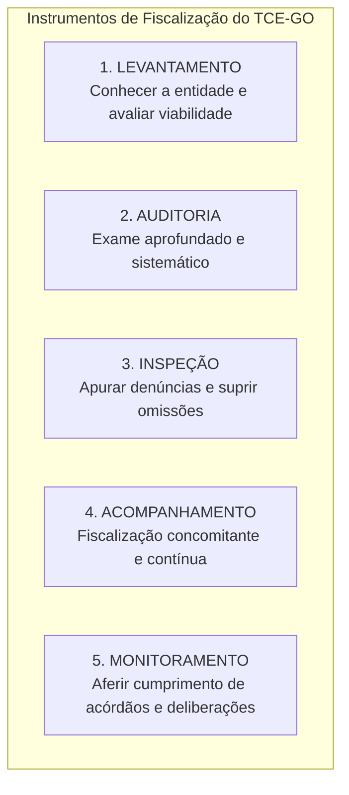

# 02 - Instrumentos de Fiscalização, Tipos de Auditoria e Normas NBASP / INTOSAI

> **Matéria:** Noções de Controle Externo  
> **Cargo:** A01 – Técnico de Controle Externo – Especialidade: Técnico Administrativo  
> **Arquivo:** `02_instrumentos_e_tipos_de_auditoria_governamental_nbasp.md`  
> **Status:** 🟢 Teoria Aprofundada + 5 Questões FCC Comentadas (A a E)

---

## 📌 Ementa / Itens do Edital

- Instrumentos de fiscalização do controle externo: levantamento, auditoria, inspeção, acompanhamento e monitoramento (conceitos, distinções operacionais e hipóteses de cabimento);
- Tipologia da auditoria governamental segundo as normas técnicas:
    - Auditoria de Conformidade (legalidade, legitimidade, regularidade formal e cumprimento normativo);
    - Auditoria Operacional / de Desempenho (avaliação dos 4 Es: economicidade, eficiência, eficácia e efetividade);
    - Auditoria Financeira (exame das demonstrações contábeis e tipos de opinião do auditor);
- Estrutura das Normas Internacionais das Entidades Fiscalizadoras Superiores (INTOSAI) e Declaração de Lima;
- Normas Brasileiras de Auditoria do Setor Público (NBASP) emitidas pelo Instituto Rui Barbosa (IRB):
    - **NBASP 100:** Princípios Fundamentais de Auditoria do Setor Público (as três partes da auditoria, objeto e critérios);
    - **NBASP 200:** Princípios de Auditoria Financeira;
    - **NBASP 300:** Princípios de Auditoria Operacional;
    - **NBASP 400:** Princípios de Auditoria de Conformidade;
- Postura profissional e conduta ética do auditor de controle externo: independência, integridade, ceticismo profissional, julgamento profissional, devido zelo e sigilo funcional;
- Matrizes metodológicas: Matriz de Planejamento e Matriz de Achados de Auditoria.

---

## 🧭 Sumário

1. [Os Cinco Instrumentos de Fiscalização do Controle Externo](#1-os-cinco-instrumentos-de-fiscalizacao-do-controle-externo)
    1. [Conceito e Finalidade Prática de Cada Instrumento](#11-conceito-e-finalidade-pratica-de-cada-instrumento)
    2. [Diferença Prática entre Inspeção e Monitoramento](#12-diferenca-pratica-entre-inspecao-e-monitoramento)
    3. [Teste 176](#Teste-176)
    4. [Teste 177](#Teste-177)
2. [Tipologia das Auditorias Governamentais (Normas NBASP / INTOSAI)](#2-tipologia-das-auditorias-governamentais-normas-nbasp-intosai)
    1. [Auditoria de Conformidade (NBASP 400)](#21-auditoria-de-conformidade-nbasp-400)
    2. [Auditoria Operacional ou de Desempenho e os 4 Es (NBASP 300)](#22-auditoria-operacional-ou-de-desempenho-e-os-4-es-nbasp-300)
    3. [Auditoria Financeira e os Tipos de Opinião do Auditor (NBASP 200)](#23-auditoria-financeira-e-os-tipos-de-opiniao-do-auditor-nbasp-200)
    4. [Teste 178](#Teste-178)
    5. [Teste 179](#Teste-179)
    6. [Teste 180](#Teste-180)
    7. [Teste 181](#Teste-181)
3. [Estrutura Normativa NBASP / INTOSAI e as Três Partes da Auditoria](#3-estrutura-normativa-nbasp-intosai-e-as-tres-partes-da-auditoria)
    1. [Teste 182](#Teste-182)
4. [Postura e Conduta Profissional do Auditor (NBASP 100)](#4-postura-e-conduta-profissional-do-auditor-nbasp-100)
    1. [Teste 183](#Teste-183)
    2. [Teste 184](#Teste-184)
5. [Matrizes Metodológicas de Trabalho: Planejamento e Achados](#5-matrizes-metodologicas-de-trabalho-planejamento-e-achados)
    1. [Teste 185](#Teste-185)
    2. [Teste 186](#Teste-186)
6. [🌐 Fontes Oficiais & Normativas Recomendadas](#fontes-oficiais-normativas-recomendadas)

---

## 1. Os Cinco Instrumentos de Fiscalização do Controle Externo

A Lei Orgânica do Tribunal de Contas do Estado de Goiás (Lei Estadual nº 16.168/2007) e o seu Regimento Interno estruturam a atuação fiscalizatória externa em **cinco instrumentos operacionais fundamentais**:

### 1.1 Conceito e Finalidade Prática de Cada Instrumento

| Instrumento | Conceito & Finalidade | Quando é Utilizado na Prática? |
| :--- | :--- | :--- |
| **Levantamento** | Utilizado para conhecer a organização, o funcionamento dos órgãos públicos, mapear sistemas de informação e **avaliar a viabilidade da realização de futuras fiscalizações**. | Fase exploratória prévia; elaboração do Plano Anual de Fiscalização do Tribunal. |
| **Auditoria** | Instrumento formal e abrangente destinado a examinar a legalidade, legitimidade e economicidade de atos, contratos, demonstrações contábeis e programas de governo. | Fiscalização planejada de grande porte (conformidade, operacional ou financeira). |
| **Inspeção** | Destinada a suprir omissões ou lacunas de informações, esclarecer dúvidas pontuais em processos em andamento ou **apurar denúncias e representações de caráter urgente**. | Atuação pontual, corretiva e de resposta a denúncias de irregularidades. |
| **Acompanhamento** | Utilizado para fiscalizar tempestivamente a gestão, de forma **concomitante e periódica**, ao longo de um determinado período. | Grandes obras públicas em execução, repasses contínuos e editais de licitação em andamento. |
| **Monitoramento** | Destinado especificamente a verificar o **cumprimento das deliberações** (determinações e recomendações) expedidas pelo Tribunal e os resultados gerados. | Etapa pós-auditoria; fiscaliza se o órgão cumpriu os prazos e providências do acórdão. |

### 1.2 Diferença Prática entre Inspeção e Monitoramento
> 🚨 **ALERTA DE PROVA / PEGADINHA FCC:**  
> A banca FCC frequentemente permuta as finalidades da **Inspeção** e do **Monitoramento**:  
>
> - Se o enunciado mencionar *"apurar fatos noticiados em representação de vereador ou denúncia popular urgente"*, o instrumento próprio e adequado é a **INSPEÇÃO**!  
> - Se o enunciado descrever *"verificar se a Secretaria de Educação adotou as providências e determinações exaradas em acórdão anterior do Tribunal"*, o instrumento correto é o **MONITORAMENTO**!

---

### Teste 176
**(FGV – TCE-PI – Auditor de Controle Externo Controle Externo Especifica de Area Comum – 2025)**
No plano anual de controle externo dos exercícios de 2024/2025 do TCE-PI, estão previstas as realizações de fiscalizações pelas unidades técnicas da Secretaria de Controle Externo nas áreas de educação, gestão ambiental e segurança pública, visando I. examinar a legalidade e a legitimidade dos atos de gestão dos responsáveis sujeitos à sua jurisdição, quanto aos aspectos contábil, financeiro, orçamentário, operacional e patrimonial. II. avaliar, ao longo de um período predeterminado, o desempenho dos órgãos e das entidades jurisdicionadas, assim como dos sistemas, dos programas e das ações governamentais, quanto aos aspectos da economicidade, da eficiência e da eficácia dos atos praticados. III. conhecer a organização e o funcionamento dos órgãos e das entidades da administração direta, indireta e fundacional do Estado e dos Municípios, incluindo fundos e demais instituições que lhe sejam jurisdicionadas, assim como dos sistemas, dos programas e das ações governamentais sob os aspectos contábil, financeiro, orçamentário, operacional e patrimonial. Considerando as disposições do Regimento Interno, os instrumentos de fiscalização adequados a serem utilizados pelas unidades técnicas na execução do plano proposto pela Secretaria de Controle Externo do TCE-PI são, respectivamente,

* **A)** inspeção, monitoramento e levantamento.
* **B)** levantamento, monitoramento e inspeção.
* **C)** auditoria, monitoramento e levantamento.
* **D)** monitoramento, auditoria e acompanhamento.
* **E)** auditoria, acompanhamento e levantamento.

---

> **Comentário Detalhado:**
>
> - **A)** **Incorreta.** A opção apresenta proposição em desacordo com os fundamentos teóricos e técnicos do tópico ao afirmar que "inspeção, monitoramento e levantamento". De acordo com a teoria estudada em *1.1 Conceito e Finalidade Prática de Cada Instrumento*, auditoria: Instrumento formal e abrangente destinado a examinar a legalidade, legitimidade e economicidade de atos, contratos, demonstrações contábeis e programas de governo. — Fiscalização planejada de grande porte (conformidade, operacional ou financeira).
> - **B)** **Correta.** Conforme fundamentado na seção *1.1 Conceito e Finalidade Prática de Cada Instrumento* deste guia, levantamento: Utilizado para conhecer a organização, o funcionamento dos órgãos públicos, mapear sistemas de informação e avaliar a viabilidade da realização de futuras fiscalizações. — Fase exploratória prévia; elaboração do Plano Anual de Fiscalização do Tribunal. Dessa forma, está plenamente correta a assertiva da banca (FGV – TCE-PI/2025) ao estabelecer que "levantamento, monitoramento e inspeção".
> - **C)** **Incorreta.** A opção apresenta proposição em desacordo com os fundamentos teóricos e técnicos do tópico ao afirmar que "auditoria, monitoramento e levantamento". De acordo com a teoria estudada em *1.2 Diferença Prática entre Inspeção e Monitoramento*, se o enunciado descrever *"verificar se a Secretaria de Educação adotou as providências e determinações exaradas em acórdão anterior do Tribunal"*, o instrumento correto é o MONITORAMENTO!.
> - **D)** **Incorreta.** A opção apresenta proposição em desacordo com os fundamentos teóricos e técnicos do tópico ao afirmar que "monitoramento, auditoria e acompanhamento". De acordo com a teoria estudada em *1.1 Conceito e Finalidade Prática de Cada Instrumento*, acompanhamento: Utilizado para fiscalizar tempestivamente a gestão, de forma concomitante e periódica, ao longo de um determinado período. — Grandes obras públicas em execução, repasses contínuos e editais de licitação em andamento.
> - **E)** **Incorreta.** A opção apresenta proposição em desacordo com os fundamentos teóricos e técnicos do tópico ao afirmar que "auditoria, acompanhamento e levantamento". De acordo com a teoria estudada em *1. Os Cinco Instrumentos de Fiscalização do Controle Externo*, a Lei Orgânica do Tribunal de Contas do Estado de Goiás (Lei Estadual nº 16.168/2007) e o seu Regimento Interno estruturam a atuação fiscalizatória externa em cinco instrumentos operacionais fundamentais.
>
> **Gabarito: B**

---

### Teste 177
**(FGV – TRT – Analista Judiciário - Tecnologia da Informação – 2024)**  
Os princípios de auditoria constantes nas Normas Internacionais das Entidades Fiscalizadoras Superiores (ISSAI / NBASP) são fundamentais para a condução de uma fiscalização técnica escorreita.  
Assinale a opção que indica o princípio de auditoria governamental que enfatiza a necessidade de comunicação eficaz e transparente por parte dos auditores ao longo de todo o processo fiscalizatório:

* **A)** Ética e independência profissional.
* **B)** Controle de qualidade do trabalho.
* **C)** Comunicação com a entidade auditada.
* **D)** Gestão de equipes e habilidades técnicas.
* **E)** Ceticismo e julgamento profissionais.

---

> **Comentário Detalhado:**
>
> - **A)** **Incorreto**. Refere-se à conduta moral, probidade, autonomia e neutralidade dos membros da equipe.
> - **B)** **Incorreto**. Abrange os procedimentos institucionais para assegurar que a auditoria atenda aos padrões técnicos de qualidade.
> - **C)** **Correto**. Conforme a NBASP 100 / ISSAI 100, o princípio da "Comunicação" estabelece que os auditores governamentais devem manter canais de comunicação claros e eficazes com a administração auditada e partes responsáveis ao longo de todas as etapas (planejamento, execução e relatório), promovendo a transparência e evitando surpresas nas conclusões.
> - **D)** **Incorreto**. Diz respeito à alocação de auditores com capacitação adequada ao objeto fiscalizado.
> - **E)** **Incorreto**. Refere-se à postura crítica e questionadora do auditor ao analisar as evidências colhidas.
>
> **Gabarito: C**

### Teste 178
**(FGV – TRT – Analista Judiciário - Tecnologia da Informação – 2024)**  
A Declaração de Lima é considerada a Carta Magna da auditoria governamental no plano internacional, uma vez que lançou as bases fundamentais do controle público moderno.  
Sobre a Declaração de Lima, analise os itens a seguir:

I. O principal objetivo da Declaração de Lima é defender a necessidade de uma fiscalização independente do setor público.  
II. Dada a importância histórica e institucional global deste documento, a Declaração de Lima foi oficialmente integrada à estrutura da NBASP.  
III. A Declaração de Lima se fundamenta no Estado de Direito e na Democracia, premissas para uma fiscalização do setor público dependente.  

Está correto o que se afirma em:

* **A)** I, apenas.
* **B)** I e II, apenas.
* **C)** I e III, apenas.
* **D)** II e III, apenas.
* **E)** I, II e III.

---

> **Comentário Detalhado:**
>
> - **A)** **Incorreto**. O item II também é verdadeiro no sistema NBASP/INTOSAI.
> - **B)** **Correto**. O item I é verdadeiro: o postulado central da Declaração de Lima (1977) é consagrar a independência funcional, institucional e financeira das Entidades Fiscalizadoras Superiores (EFS). O item II é verdadeiro: a Declaração de Lima constitui a norma NBASP 1 (ISSAI 1), alicerce máximo da auditoria no setor público brasileiro. O item III é falso porque a fiscalização defendida pela Declaração de Lima deve ser estritamente *independente* (e não "dependente").
> - **C)** **Incorreto**. O item III contém erro evidente ("fiscalização dependente").
> - **D)** **Incorreto**. O item I é plenamente verdadeiro.
> - **E)** **Incorreto**. O item III inviabiliza a opção.
>
> **Gabarito: B**

### Teste 179
**(FGV – TRT – Analista Judiciário - Tecnologia da Informação – 2024)**  
A NBASP 10 traz os princípios que devem ser observados pelo Tribunal de Contas para preservar a sua independência institucional, o que tem impactos diretos na imparcialidade e na credibilidade das conclusões de seus trabalhos e relatórios.  
Assinale a opção que indica o princípio da NBASP 10 que preconiza que os Tribunais de Contas devem operar sem sofrer qualquer ingerência por parte da Administração Pública sobre o desempenho de suas funções:

* **A)** Independência dos Tribunais de Contas para o desempenho de suas competências.
* **B)** Acesso irrestrito a todas as informações e bases de dados de órgãos públicos.
* **C)** Prevenção ao conflito de interesses na atuação dos auditores governamentais.
* **D)** Previsão legal da independência dos Tribunais de Contas na ordem jurídica nacional.
* **E)** Cooperação interinstitucional sem prejuízo da autonomia orgânica da Corte de Contas.

---

> **Comentário Detalhado:**
>
> - **A)** **Correto**. O Princípio 3 da Declaração do México / NBASP 10 estabelece expressamente a "Independência dos Tribunais de Contas para o desempenho de suas competências", vedando qualquer tipo de interferência, pressão ou ingerência política ou hierárquica por parte do Poder Executivo ou da Administração Pública na definição de suas pautas, cronogramas e metodologias de auditoria.
> - **B)** **Incorreto**. O Princípio 4 trata do "Acesso irrestrito a informações" para a obtenção tempestiva de evidências.
> - **C)** **Incorreto**. Refere-se à conduta ética individual de auditores e conselheiros.
> - **D)** **Incorreto**. O Princípio 1 exige a existência de um quadro constitucional/estatutário e a aplicação efetiva das disposições dessa estrutura.
> - **E)** **Incorreto**. A cooperação interinstitucional é princípio de articulação harmônica, mas não o princípio definidor da vedação à ingerência executiva.
>
> **Gabarito: A**

### Teste 180
**(FGV – TRT – Analista Judiciário - Tecnologia da Informação – 2024)**  
A NBASP 400 - Princípios de Auditoria de Conformidade estabelece diretrizes fundamentais para a realização de fiscalizações destinadas a verificar se atos, contratos e operações governamentais atendem às normas aplicáveis.  
Nesse contexto, analise as afirmativas a seguir:

I. A auditoria de conformidade é a avaliação independente para determinar se um dado objeto está em conformidade com normas aplicáveis identificadas como critérios.  
II. As auditorias de conformidade são realizadas para avaliar se atividades, transações orçamentárias e informações cumprem, em todos os aspectos relevantes, as normas que regem a entidade auditada.  
III. A auditoria de conformidade não integra o mandato de uma Entidade Fiscalizadora Superior, sendo restrita ao controle interno.  

Está correto o que se afirma em:

* **A)** I, apenas.
* **B)** I e II, apenas.
* **C)** I e III, apenas.
* **D)** II e III, apenas.
* **E)** I, II e III.

---

> **Comentário Detalhado:**
>
> - **A)** **Incorreto**. O item II também expressa com fidelidade a literalidade da norma NBASP 400.
> - **B)** **Correto**. O item I reproduz a definição do item 12 da NBASP 400 ("avaliação independente para determinar se um dado objeto está em conformidade com as normas aplicáveis identificadas como critérios"). O item II transcreve o objetivo central da conformidade (verificar cumprimento substancial das normas orçamentárias, financeiras e regulamentares). O item III é falso porque a auditoria de conformidade é atribuição nuclear e precípua do mandato dos Tribunais de Contas (EFS) em todo o mundo.
> - **C)** **Incorreto**. O item III é manifestamente falso.
> - **D)** **Incorreto**. O item I é verdadeiro e o item III é falso.
> - **E)** **Incorreto**. O item III impede a opção integral.
>
> **Gabarito: B**

### Teste 181
**(FGV – TCE-PI – Auditor de Controle Externo Controle Externo Especifica de Area Comum – 2025)**
A auditoria no setor público é fundamental para assegurar a correta aplicação dos recursos públicos, promovendo transparência, responsabilidade e boa governança. As auditorias ajudam a prevenir fraudes e desperdícios, fortalecendo a confiança dos cidadãos nas instituições governamentais e garantindo que os recursos sejam utilizados de forma ética e eficaz para o bem coletivo. Relacione os tipos principais de auditoria do setor público estabelecidos na NBASP 100 - Princípios Fundamentais de Auditoria no Setor Público, às suas respectivas definições. I. Auditoria Financeira II. Auditoria Operacional III. Auditoria de Conformidade ( ) Foca em determinar se um particular objeto está de acordo com normas identificadas como critérios. É realizada para avaliar se atividades, transações financeiras e informações cumprem, em todos os aspectos relevantes, as normas que regem a entidade auditada. ( ) Foca em determinar se intervenções, programas e instituições estão atuando em conformidade com os princípios de economicidade, de eficiência e de efetividade, bem como se há espaço para aperfeiçoamento. O objetivo é responder a questões-chave de auditoria e apresentar recomendações para aperfeiçoamento. ( ) Foca em determinar se a informação contábil de uma entidade é apresentada em conformidade com a estrutura de relatório financeiro e o marco regulatório aplicável. Assinale a opção que indica a relação correta, segundo a ordem apresentada.

* **A)** I – II – III.
* **B)** III – II – I.
* **C)** III – I – II.
* **D)** I – III – II.
* **E)** II – III – I.

---

> **Comentário Detalhado:**
>
> - **A)** **Incorreta.** A opção apresenta proposição em desacordo com os fundamentos teóricos e técnicos do tópico ao afirmar que "I – II – III". De acordo com a teoria estudada em *1.1 Conceito e Finalidade Prática de Cada Instrumento*, levantamento: Utilizado para conhecer a organização, o funcionamento dos órgãos públicos, mapear sistemas de informação e avaliar a viabilidade da realização de futuras fiscalizações. — Fase exploratória prévia; elaboração do Plano Anual de Fiscalização do Tribunal.
> - **B)** **Correta.** Conforme fundamentado na seção *1.1 Conceito e Finalidade Prática de Cada Instrumento* deste guia, auditoria: Instrumento formal e abrangente destinado a examinar a legalidade, legitimidade e economicidade de atos, contratos, demonstrações contábeis e programas de governo. — Fiscalização planejada de grande porte (conformidade, operacional ou financeira). Dessa forma, está plenamente correta a assertiva da banca (FGV – TCE-PI/2025) ao estabelecer que "III – II – I".
> - **C)** **Incorreta.** A opção apresenta proposição em desacordo com os fundamentos teóricos e técnicos do tópico ao afirmar que "III – I – II". De acordo com a teoria estudada em *1.1 Conceito e Finalidade Prática de Cada Instrumento*, monitoramento: Destinado especificamente a verificar o cumprimento das deliberações (determinações e recomendações) expedidas pelo Tribunal e os resultados gerados. — Etapa pós-auditoria; fiscaliza se o órgão cumpriu os prazos e providências do acórdão.
> - **D)** **Incorreta.** A opção apresenta proposição em desacordo com os fundamentos teóricos e técnicos do tópico ao afirmar que "I – III – II". De acordo com a teoria estudada em *1. Os Cinco Instrumentos de Fiscalização do Controle Externo*, a Lei Orgânica do Tribunal de Contas do Estado de Goiás (Lei Estadual nº 16.168/2007) e o seu Regimento Interno estruturam a atuação fiscalizatória externa em cinco instrumentos operacionais fundamentais.
> - **E)** **Incorreta.** A opção apresenta proposição em desacordo com os fundamentos teóricos e técnicos do tópico ao afirmar que "II – III – I". De acordo com a teoria estudada em *1.1 Conceito e Finalidade Prática de Cada Instrumento*, inspeção: Destinada a suprir omissões ou lacunas de informações, esclarecer dúvidas pontuais em processos em andamento ou apurar denúncias e representações de caráter urgente. — Atuação pontual, corretiva e de resposta a denúncias de irregularidades.
>
> **Gabarito: B**

---

### Teste 182
**(FGV – TRT-24 – Analista Judiciario Area Administrativa Sem Especialidade – 2025)**
Na fase de Planejamento de uma auditoria operacional, o auditor deve estabelecer critérios apropriados, que correspondam aos objetivos e questões de auditoria. Em relação a eles, analise o que se afirma a seguir. I. O critério representa a expectativa razoável e fundamentada do que “deveria ser”, as melhores práticas e benchmarks com os quais o desempenho pode ser comparado. II. Os critérios de auditoria precisam fornecer uma base apropriada e razoável para a avaliação dos objetivos da auditoria e devem ser relevantes, compreensíveis, completos, confiáveis e objetivos no contexto do objeto, dos objetivos e/ou das questões de auditoria. III. Os critérios de auditoria são estabelecidos pela equipe de auditoria e devem ser discutidos com a entidade auditada posteriormente, na fase de execução. Está correto o que se afirma em

* **A)** I, apenas.
* **B)** I e II, apenas.
* **C)** I e III, apenas.
* **D)** II e III, apenas.
* **E)** I, II e III.

---

> **Comentário Detalhado:**
>
> - **A)** **Incorreta.** A opção incorre em restrição indevida ao limitar o escopo conceitual ao afirmar que "I, apenas". De acordo com a teoria estudada em *1.1 Conceito e Finalidade Prática de Cada Instrumento*, levantamento: Utilizado para conhecer a organização, o funcionamento dos órgãos públicos, mapear sistemas de informação e avaliar a viabilidade da realização de futuras fiscalizações. — Fase exploratória prévia; elaboração do Plano Anual de Fiscalização do Tribunal.
> - **B)** **Incorreta.** A opção incorre em restrição indevida ao limitar o escopo conceitual ao afirmar que "I e II, apenas". De acordo com a teoria estudada em *1.1 Conceito e Finalidade Prática de Cada Instrumento*, acompanhamento: Utilizado para fiscalizar tempestivamente a gestão, de forma concomitante e periódica, ao longo de um determinado período. — Grandes obras públicas em execução, repasses contínuos e editais de licitação em andamento.
> - **C)** **Incorreta.** A opção incorre em restrição indevida ao limitar o escopo conceitual ao afirmar que "I e III, apenas". De acordo com a teoria estudada em *1.2 Diferença Prática entre Inspeção e Monitoramento*, se o enunciado descrever *"verificar se a Secretaria de Educação adotou as providências e determinações exaradas em acórdão anterior do Tribunal"*, o instrumento correto é o MONITORAMENTO!.
> - **D)** **Correta.** Conforme fundamentado na seção *1.1 Conceito e Finalidade Prática de Cada Instrumento* deste guia, auditoria: Instrumento formal e abrangente destinado a examinar a legalidade, legitimidade e economicidade de atos, contratos, demonstrações contábeis e programas de governo. — Fiscalização planejada de grande porte (conformidade, operacional ou financeira). Dessa forma, está plenamente correta a assertiva da banca (FGV – TRT-24/2025) ao estabelecer que "II e III, apenas".
> - **E)** **Incorreta.** A opção apresenta proposição em desacordo com os fundamentos teóricos e técnicos do tópico ao afirmar que "I, II e III". De acordo com a teoria estudada em *1.1 Conceito e Finalidade Prática de Cada Instrumento*, monitoramento: Destinado especificamente a verificar o cumprimento das deliberações (determinações e recomendações) expedidas pelo Tribunal e os resultados gerados. — Etapa pós-auditoria; fiscaliza se o órgão cumpriu os prazos e providências do acórdão.
>
> **Gabarito: D**

---

### Teste 183
**(FGV – TCE-PI – Auditor de Controle Externo Controle Externo Especifica de Area Comum – 2025)**
A NBASP 100 - Princípios Fundamentais de Auditoria no Setor Público estabelece as diretrizes essenciais que regem as auditorias governamentais, orientando a conduta e a prática dos auditores no setor público. Essa norma define os princípios básicos de independência, competência, ética e ceticismo profissional, além de enfatizar a necessidade de uma auditoria transparente, objetiva e eficiente, visando promover a responsabilidade, a boa governança e a prestação de contas no uso dos recursos públicos. Quanto à NBASP 100, avalie as afirmativas a seguir e assinale (V) para a verdadeira e (F) para a falsa. ( ) Em geral, a auditoria do setor público pode ser descrita como um processo sistemático de obter e avaliar objetivamente evidências para determinar se as informações ou as condições reais de um objeto estão de acordo com critérios aplicáveis. ( ) Todas as auditorias do setor público contam com os mesmos elementos básicos: o auditor, os demonstrativos contábeis e os usuários previstos (as três partes da auditoria). ( ) O objeto da auditoria refere-se à informação, condição ou atividade que é mensurada ou avaliada de acordo com certos critérios. Pode assumir várias formas e ter diferentes características, dependendo do objetivo da auditoria. As afirmativas são, respectivamente,

* **A)** V – V – V.
* **B)** V – F – V.
* **C)** F – F – F.
* **D)** V – V – F.
* **E)** F – V – V.

---

> **Comentário Detalhado:**
>
> - **A)** **Correta.** Conforme fundamentado na seção *1.1 Conceito e Finalidade Prática de Cada Instrumento* deste guia, levantamento: Utilizado para conhecer a organização, o funcionamento dos órgãos públicos, mapear sistemas de informação e avaliar a viabilidade da realização de futuras fiscalizações. — Fase exploratória prévia; elaboração do Plano Anual de Fiscalização do Tribunal. Dessa forma, está plenamente correta a assertiva da banca (FGV – TCE-PI/2025) ao estabelecer que "V – V – V".
> - **B)** **Incorreta.** A opção apresenta proposição em desacordo com os fundamentos teóricos e técnicos do tópico ao afirmar que "V – F – V". De acordo com a teoria estudada em *1. Os Cinco Instrumentos de Fiscalização do Controle Externo*, a Lei Orgânica do Tribunal de Contas do Estado de Goiás (Lei Estadual nº 16.168/2007) e o seu Regimento Interno estruturam a atuação fiscalizatória externa em cinco instrumentos operacionais fundamentais.
> - **C)** **Incorreta.** A opção apresenta proposição em desacordo com os fundamentos teóricos e técnicos do tópico ao afirmar que "F – F – F". De acordo com a teoria estudada em *1.1 Conceito e Finalidade Prática de Cada Instrumento*, auditoria: Instrumento formal e abrangente destinado a examinar a legalidade, legitimidade e economicidade de atos, contratos, demonstrações contábeis e programas de governo. — Fiscalização planejada de grande porte (conformidade, operacional ou financeira).
> - **D)** **Incorreta.** A opção apresenta proposição em desacordo com os fundamentos teóricos e técnicos do tópico ao afirmar que "V – V – F". De acordo com a teoria estudada em *1.1 Conceito e Finalidade Prática de Cada Instrumento*, inspeção: Destinada a suprir omissões ou lacunas de informações, esclarecer dúvidas pontuais em processos em andamento ou apurar denúncias e representações de caráter urgente. — Atuação pontual, corretiva e de resposta a denúncias de irregularidades.
> - **E)** **Incorreta.** A opção apresenta proposição em desacordo com os fundamentos teóricos e técnicos do tópico ao afirmar que "F – V – V". De acordo com a teoria estudada em *1.1 Conceito e Finalidade Prática de Cada Instrumento*, monitoramento: Destinado especificamente a verificar o cumprimento das deliberações (determinações e recomendações) expedidas pelo Tribunal e os resultados gerados. — Etapa pós-auditoria; fiscaliza se o órgão cumpriu os prazos e providências do acórdão.
>
> **Gabarito: A**

---

### Teste 184
**(FGV – TCE-PI – Auditor de Controle Externo Controle Externo Especifica de Area Comum – 2025)**
O Auditor Governamental, ao seguir os requisitos gerais da NBASP 3000, realiza auditorias operacionais com integridade, independência e competência, garantindo a credibilidade e a qualidade do trabalho. Esses requisitos asseguram que o auditor aplique ceticismo profissional, obtenha evidências apropriadas e suficientes, e adote uma abordagem baseada em risco. Quanto à NBASP 3000, avalie as afirmativas a seguir e assinale (V) para a verdadeira e (F) para a falsa. ( ) O auditor deve, como parte do planejamento e/ou da condução da auditoria, discutir os critérios de auditoria com a entidade auditada. ( ) O auditor deve gerenciar ativamente o risco de auditoria para evitar o desenvolvimento de achados, conclusões e recomendações incorretos ou incompletos, fornecendo informações inconsistentes ou que não agregam valor. ( ) O auditor deve planejar e manter uma comunicação eficaz e adequada dos aspectos-chave da auditoria com a entidade auditada e as partes interessadas durante todo o processo de auditoria. As afirmativas são, respectivamente,

* **A)** V – F – V.
* **B)** F – V – V.
* **C)** V – V – V.
* **D)** V – V – F.
* **E)** V – F – F.

---

> **Comentário Detalhado:**
>
> - **A)** **Correta.** Conforme fundamentado na seção *1.1 Conceito e Finalidade Prática de Cada Instrumento* deste guia, monitoramento: Destinado especificamente a verificar o cumprimento das deliberações (determinações e recomendações) expedidas pelo Tribunal e os resultados gerados. — Etapa pós-auditoria; fiscaliza se o órgão cumpriu os prazos e providências do acórdão. Dessa forma, está plenamente correta a assertiva da banca (FGV – TCE-PI/2025) ao estabelecer que "V – F – V".
> - **B)** **Incorreta.** A opção apresenta proposição em desacordo com os fundamentos teóricos e técnicos do tópico ao afirmar que "F – V – V". De acordo com a teoria estudada em *1. Os Cinco Instrumentos de Fiscalização do Controle Externo*, a Lei Orgânica do Tribunal de Contas do Estado de Goiás (Lei Estadual nº 16.168/2007) e o seu Regimento Interno estruturam a atuação fiscalizatória externa em cinco instrumentos operacionais fundamentais.
> - **C)** **Incorreta.** A opção apresenta proposição em desacordo com os fundamentos teóricos e técnicos do tópico ao afirmar que "V – V – V". De acordo com a teoria estudada em *1.1 Conceito e Finalidade Prática de Cada Instrumento*, inspeção: Destinada a suprir omissões ou lacunas de informações, esclarecer dúvidas pontuais em processos em andamento ou apurar denúncias e representações de caráter urgente. — Atuação pontual, corretiva e de resposta a denúncias de irregularidades.
> - **D)** **Incorreta.** A opção apresenta proposição em desacordo com os fundamentos teóricos e técnicos do tópico ao afirmar que "V – V – F". De acordo com a teoria estudada em *1.1 Conceito e Finalidade Prática de Cada Instrumento*, auditoria: Instrumento formal e abrangente destinado a examinar a legalidade, legitimidade e economicidade de atos, contratos, demonstrações contábeis e programas de governo. — Fiscalização planejada de grande porte (conformidade, operacional ou financeira).
> - **E)** **Incorreta.** A opção apresenta proposição em desacordo com os fundamentos teóricos e técnicos do tópico ao afirmar que "V – F – F". De acordo com a teoria estudada em *1.1 Conceito e Finalidade Prática de Cada Instrumento*, instrumento: Conceito & Finalidade — Quando é Utilizado na Prática?.
>
> **Gabarito: A**

---

### Teste 185
**(FGV – TCE-GO – Analista de Controle Externo Ciencias Contabeis – 2024)**
A NBASP 20 objetiva promover os princípios de transparência e de accountability nos Tribunais de Contas, que devem atuar de forma exemplar, mediante a aplicação destes princípios em todos os seus atos. Sobre a NBASP 20 - Transparência e Accountability, analise os itens a seguir: I. Os Tribunais de Contas devem atuar sob normas a partir das quais seja possível responsabilizar seus membros e servidores. II. É recomendável que os Tribunais de Contas divulguem ao público as informações básicas sobre suas competências, suas responsabilidades, sua missão, sua estratégia e suas atividades em uma das línguas oficiais da Intosai, além da língua portuguesa. III. Os Tribunais de Contas devem ter regras ou códigos de ética, políticas e práticas que estejam alinhados com as Normas Brasileiras de Auditoria do Setor Público, especialmente a NBASP 130. Está correto o que se afirma em

* **A)** I, apenas.
* **B)** I e II, apenas.
* **C)** I e III, apenas.
* **D)** II e III, apenas.
* **E)** I, II e III.

---

> **Comentário Detalhado:**
>
> - **A)** **Correta.** Conforme fundamentado na seção *1.1 Conceito e Finalidade Prática de Cada Instrumento* deste guia, auditoria: Instrumento formal e abrangente destinado a examinar a legalidade, legitimidade e economicidade de atos, contratos, demonstrações contábeis e programas de governo. — Fiscalização planejada de grande porte (conformidade, operacional ou financeira). Dessa forma, está plenamente correta a assertiva da banca (FGV – TCE-GO/2024) ao estabelecer que "I, apenas".
> - **B)** **Incorreta.** A opção incorre em restrição indevida ao limitar o escopo conceitual ao afirmar que "I e II, apenas". De acordo com a teoria estudada em *1. Os Cinco Instrumentos de Fiscalização do Controle Externo*, a Lei Orgânica do Tribunal de Contas do Estado de Goiás (Lei Estadual nº 16.168/2007) e o seu Regimento Interno estruturam a atuação fiscalizatória externa em cinco instrumentos operacionais fundamentais.
> - **C)** **Incorreta.** A opção incorre em restrição indevida ao limitar o escopo conceitual ao afirmar que "I e III, apenas". De acordo com a teoria estudada em *1.1 Conceito e Finalidade Prática de Cada Instrumento*, inspeção: Destinada a suprir omissões ou lacunas de informações, esclarecer dúvidas pontuais em processos em andamento ou apurar denúncias e representações de caráter urgente. — Atuação pontual, corretiva e de resposta a denúncias de irregularidades.
> - **D)** **Incorreta.** A opção incorre em restrição indevida ao limitar o escopo conceitual ao afirmar que "II e III, apenas". De acordo com a teoria estudada em *1.1 Conceito e Finalidade Prática de Cada Instrumento*, acompanhamento: Utilizado para fiscalizar tempestivamente a gestão, de forma concomitante e periódica, ao longo de um determinado período. — Grandes obras públicas em execução, repasses contínuos e editais de licitação em andamento.
> - **E)** **Incorreta.** A opção apresenta proposição em desacordo com os fundamentos teóricos e técnicos do tópico ao afirmar que "I, II e III". De acordo com a teoria estudada em *1.2 Diferença Prática entre Inspeção e Monitoramento*, se o enunciado descrever *"verificar se a Secretaria de Educação adotou as providências e determinações exaradas em acórdão anterior do Tribunal"*, o instrumento correto é o MONITORAMENTO!.
>
> **Gabarito: A**

---

### Teste 186
**(FGV – TRT-24 – Analista Judiciario Area Administrativa Contabilidade – 2025)**
Um auditor independente foi nomeado para auditar as demonstrações contábeis de uma entidade do setor público. No entanto, o auditor não conseguiu obter evidência de auditoria apropriada e suficiente. Além disso, ele concluiu que possíveis efeitos de distorções não detectadas sobre as demonstrações contábeis poderiam ser relevantes e generalizados, de modo que uma ressalva na opinião seria inadequada para comunicar a gravidade da situação. Não é possível ao auditor renunciar ao trabalho de auditoria antes da emissão do seu relatório. Nesse caso, ele deve

* **A)** emitir um relatório com opinião adversa.
* **B)** destacar o fato em um parágrafo de ênfase.
* **C)** destacar o fato em um parágrafo de Outros Assuntos.
* **D)** emitir o seu relatório com atraso, após o prazo acordado.
* **E)** abster-se de expressar uma opinião sobre as demonstrações contábeis.

---

> **Comentário Detalhado:**
>
> - **A)** **Incorreta.** A opção apresenta proposição em desacordo com os fundamentos teóricos e técnicos do tópico ao afirmar que "emitir um relatório com opinião adversa". De acordo com a teoria estudada em *1.1 Conceito e Finalidade Prática de Cada Instrumento*, monitoramento: Destinado especificamente a verificar o cumprimento das deliberações (determinações e recomendações) expedidas pelo Tribunal e os resultados gerados. — Etapa pós-auditoria; fiscaliza se o órgão cumpriu os prazos e providências do acórdão.
> - **B)** **Incorreta.** A opção apresenta proposição em desacordo com os fundamentos teóricos e técnicos do tópico ao afirmar que "destacar o fato em um parágrafo de ênfase". De acordo com a teoria estudada em *1. Os Cinco Instrumentos de Fiscalização do Controle Externo*, a Lei Orgânica do Tribunal de Contas do Estado de Goiás (Lei Estadual nº 16.168/2007) e o seu Regimento Interno estruturam a atuação fiscalizatória externa em cinco instrumentos operacionais fundamentais.
> - **C)** **Incorreta.** A opção apresenta proposição em desacordo com os fundamentos teóricos e técnicos do tópico ao afirmar que "destacar o fato em um parágrafo de Outros Assuntos". De acordo com a teoria estudada em *1.1 Conceito e Finalidade Prática de Cada Instrumento*, instrumento: Conceito & Finalidade — Quando é Utilizado na Prática?.
> - **D)** **Incorreta.** A opção apresenta proposição em desacordo com os fundamentos teóricos e técnicos do tópico ao afirmar que "emitir o seu relatório com atraso, após o prazo acordado". De acordo com a teoria estudada em *1.1 Conceito e Finalidade Prática de Cada Instrumento*, levantamento: Utilizado para conhecer a organização, o funcionamento dos órgãos públicos, mapear sistemas de informação e avaliar a viabilidade da realização de futuras fiscalizações. — Fase exploratória prévia; elaboração do Plano Anual de Fiscalização do Tribunal.
> - **E)** **Correta.** Conforme fundamentado na seção *1.1 Conceito e Finalidade Prática de Cada Instrumento* deste guia, auditoria: Instrumento formal e abrangente destinado a examinar a legalidade, legitimidade e economicidade de atos, contratos, demonstrações contábeis e programas de governo. — Fiscalização planejada de grande porte (conformidade, operacional ou financeira). Dessa forma, está plenamente correta a assertiva da banca (FGV – TRT-24/2025) ao estabelecer que "abster-se de expressar uma opinião sobre as demonstrações contábeis".
>
> **Gabarito: E**

---

